# 同类型数据的有效算法均值与中位数柱状图

生成时间：2026-10-23T14:32:22+08:00

类型按 dtype、保真条件、数据组织方式和 profile 划分；统计沿用汇总报告口径，仅包含 prepared 生命周期的完整有效案例。性质按任务保真要求标记：bitwise 为无损；bounded_abs 与 empirical_quality 为有损。每种类型分别显示压缩倍数、编码吞吐和解码吞吐；实心柱表示均值，斜线空心柱表示中位数。吞吐轴为对数刻度，压缩倍数图中的虚线为 1× 膨胀分界。

## <f4 · bitwise · values · cpu-single

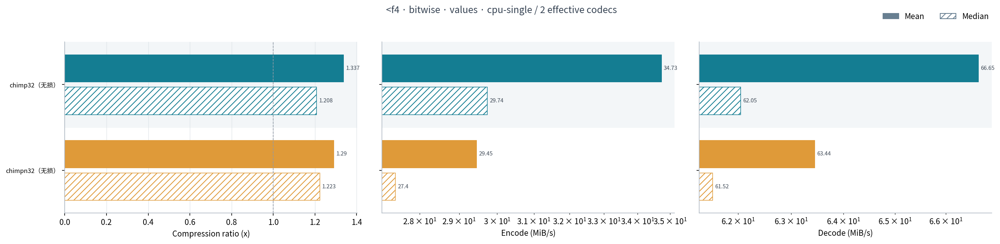

[SVG](figures/type-01.svg)

| 算法 | 性质 | 有效数据集数 | 压缩倍数均值 | 压缩倍数中位数 | 编码均值 MiB/s | 编码中位数 MiB/s | 解码均值 MiB/s | 解码中位数 MiB/s |
|---|---|---:|---:|---:|---:|---:|---:|---:|
| chimp32 | 无损 | 34 | 1.337 | 1.208 | 34.73 | 29.74 | 66.65 | 62.05 |
| chimpn32 | 无损 | 34 | 1.29 | 1.223 | 29.45 | 27.4 | 63.44 | 61.52 |

## <f4 · empirical_quality · values · cpu-single

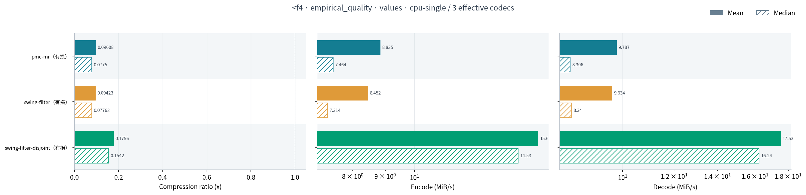

[SVG](figures/type-02.svg)

| 算法 | 性质 | 有效数据集数 | 压缩倍数均值 | 压缩倍数中位数 | 编码均值 MiB/s | 编码中位数 MiB/s | 解码均值 MiB/s | 解码中位数 MiB/s |
|---|---|---:|---:|---:|---:|---:|---:|---:|
| pmc-mr | 有损 | 21 | 0.09608 | 0.0775 | 8.835 | 7.464 | 9.787 | 8.306 |
| swing-filter | 有损 | 21 | 0.09423 | 0.07762 | 8.452 | 7.314 | 9.634 | 8.34 |
| swing-filter-disjoint | 有损 | 21 | 0.1756 | 0.1542 | 15.6 | 14.53 | 17.53 | 16.24 |

## <f8 · bitwise · records · cpu-single

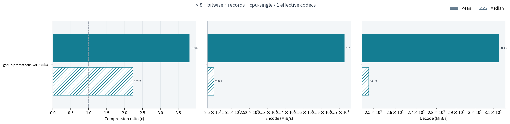

[SVG](figures/type-03.svg)

| 算法 | 性质 | 有效数据集数 | 压缩倍数均值 | 压缩倍数中位数 | 编码均值 MiB/s | 编码中位数 MiB/s | 解码均值 MiB/s | 解码中位数 MiB/s |
|---|---|---:|---:|---:|---:|---:|---:|---:|
| gorilla-prometheus-xor | 无损 | 21 | 3.806 | 2.232 | 257.3 | 250.1 | 313.2 | 247.9 |

## <f8 · bitwise · values · cpu-single

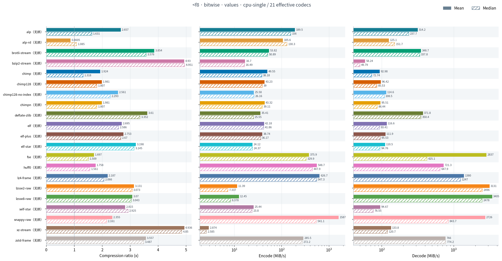

[SVG](figures/type-04.svg)

| 算法 | 性质 | 有效数据集数 | 压缩倍数均值 | 压缩倍数中位数 | 编码均值 MiB/s | 编码中位数 MiB/s | 解码均值 MiB/s | 解码中位数 MiB/s |
|---|---|---:|---:|---:|---:|---:|---:|---:|
| alp | 无损 | 45 | 2.657 | 1.631 | 189.5 | 156 | 314.2 | 237.7 |
| alp-rd | 无损 | 45 | 0.8605 | 1.085 | 105.6 | 130.3 | 125.1 | 151.7 |
| brotli-stream | 无损 | 46 | 3.854 | 3.576 | 53.82 | 50.89 | 348.7 | 337.8 |
| bzip2-stream | 无损 | 46 | 4.93 | 4.951 | 16.7 | 16.49 | 58.24 | 49.79 |
| chimp | 无损 | 34 | 1.924 | 1.318 | 49.55 | 38.18 | 92.98 | 72.74 |
| chimp128 | 无损 | 34 | 1.981 | 1.807 | 43.23 | 39 | 96.42 | 85.53 |
| chimp128-no-index | 无损 | 34 | 2.561 | 2.293 | 25.58 | 26.16 | 114.6 | 108.5 |
| chimpn | 无损 | 34 | 1.981 | 1.807 | 43.32 | 39.11 | 95.51 | 86.44 |
| deflate-zlib | 无损 | 46 | 3.61 | 3.352 | 35.41 | 25.55 | 371.8 | 350.4 |
| elf | 无损 | 43 | 2.695 | 2.586 | 42.18 | 41.86 | 116.6 | 93.41 |
| elf-plus | 无损 | 43 | 2.753 | 2.67 | 38.74 | 36.17 | 111.9 | 95.53 |
| elf-star | 无损 | 43 | 3.198 | 3.145 | 24.12 | 24.37 | 110.5 | 94.76 |
| fse | 无损 | 21 | 1.697 | 1.509 | 375.9 | 329.9 | 2837 | 425.1 |
| huff0 | 无损 | 21 | 1.758 | 1.561 | 548.7 | 447.9 | 721.3 | 647.9 |
| lz4-frame | 无损 | 46 | 2.187 | 2.066 | 626.7 | 547.3 | 1380 | 1247 |
| lzsse2-raw | 无损 | 46 | 3.131 | 3.073 | 11.39 | 7.337 | 3131 | 2496 |
| lzsse8-raw | 无损 | 46 | 3.07 | 3.043 | 12.45 | 8.378 | 3405 | 2478 |
| self-star | 无损 | 34 | 2.815 | 2.925 | 25.44 | 23.8 | 94.67 | 76.55 |
| snappy-raw | 无损 | 46 | 2.355 | 2.161 | 1587 | 541.1 | 2726 | 843.7 |
| xz-stream | 无损 | 46 | 4.936 | 4.85 | 2.874 | 2.585 | 133.8 | 120.7 |
| zstd-frame | 无损 | 46 | 3.557 | 3.487 | 285.5 | 272.2 | 766 | 774.2 |

## <f8 · bounded_abs · values · cpu-single

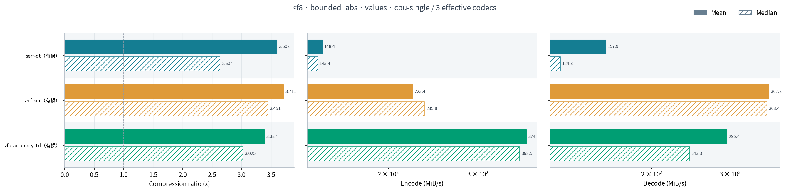

[SVG](figures/type-05.svg)

| 算法 | 性质 | 有效数据集数 | 压缩倍数均值 | 压缩倍数中位数 | 编码均值 MiB/s | 编码中位数 MiB/s | 解码均值 MiB/s | 解码中位数 MiB/s |
|---|---|---:|---:|---:|---:|---:|---:|---:|
| serf-qt | 有损 | 45 | 3.602 | 2.634 | 148.4 | 145.4 | 157.9 | 124.8 |
| serf-xor | 有损 | 45 | 3.711 | 3.451 | 223.4 | 235.8 | 367.2 | 363.4 |
| zfp-accuracy-1d | 有损 | 43 | 3.387 | 3.025 | 374 | 362.5 | 295.4 | 243.3 |

## <f8 · empirical_quality · values · cpu-single

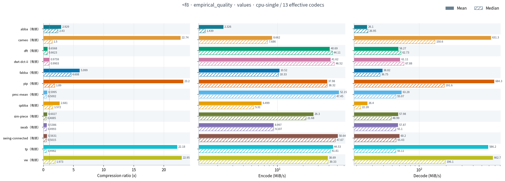

[SVG](figures/type-06.svg)

| 算法 | 性质 | 有效数据集数 | 压缩倍数均值 | 压缩倍数中位数 | 编码均值 MiB/s | 编码中位数 MiB/s | 解码均值 MiB/s | 解码中位数 MiB/s |
|---|---|---:|---:|---:|---:|---:|---:|---:|
| abba | 有损 | 21 | 2.929 | 2.43 | 2.326 | 1.439 | 26.1 | 26.95 |
| cameo | 有损 | 16 | 22.74 | 1.5 | 8.662 | 7.686 | 631.3 | 150.6 |
| dft | 有损 | 21 | 0.6568 | 0.6623 | 40.69 | 44.11 | 58.27 | 62.73 |
| dwt-dct-ii | 有损 | 21 | 0.9759 | 0.9903 | 41.62 | 46.52 | 61.11 | 67.88 |
| fabba | 有损 | 21 | 5.999 | 4.608 | 10.52 | 10.33 | 38.82 | 36.75 |
| pip | 有损 | 16 | 23.2 | 1.89 | 37.98 | 38.32 | 684.3 | 191.6 |
| pmc-mean | 有损 | 21 | 0.5995 | 0.5002 | 52.15 | 47.45 | 63.28 | 55.07 |
| qabba | 有损 | 7 | 2.681 | 1.572 | 6.499 | 5.31 | 26.4 | 22.28 |
| sim-piece | 有损 | 21 | 0.6027 | 0.4885 | 26.3 | 21.68 | 57.98 | 48.99 |
| swab | 有损 | 19 | 0.5386 | 0.4993 | 8.997 | 9.107 | 57.87 | 55.1 |
| swing-connected | 有损 | 21 | 0.5631 | 0.5015 | 50.64 | 47.67 | 60.2 | 55.43 |
| tp | 有损 | 16 | 22.18 | 0.4982 | 44.53 | 41.81 | 586.2 | 55.11 |
| vw | 有损 | 16 | 22.95 | 1.973 | 38.69 | 39.33 | 662.7 | 196.1 |

## <i2 · bitwise · values · cpu-single

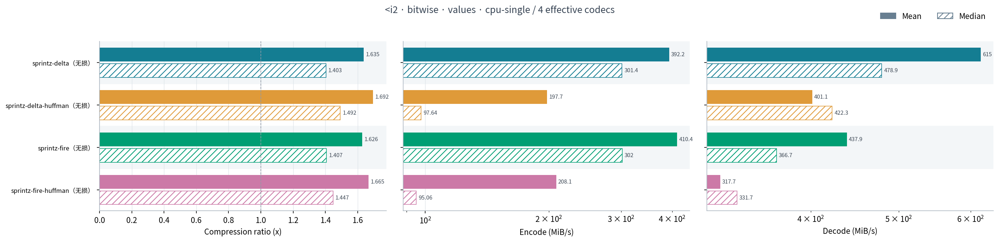

[SVG](figures/type-07.svg)

| 算法 | 性质 | 有效数据集数 | 压缩倍数均值 | 压缩倍数中位数 | 编码均值 MiB/s | 编码中位数 MiB/s | 解码均值 MiB/s | 解码中位数 MiB/s |
|---|---|---:|---:|---:|---:|---:|---:|---:|
| sprintz-delta | 无损 | 8 | 1.635 | 1.403 | 392.2 | 301.4 | 615 | 478.9 |
| sprintz-delta-huffman | 无损 | 8 | 1.692 | 1.492 | 197.7 | 97.64 | 401.1 | 422.3 |
| sprintz-fire | 无损 | 8 | 1.626 | 1.407 | 410.4 | 302 | 437.9 | 366.7 |
| sprintz-fire-huffman | 无损 | 8 | 1.665 | 1.447 | 208.1 | 95.06 | 317.7 | 331.7 |

## <i8 · bitwise · values · cpu-single

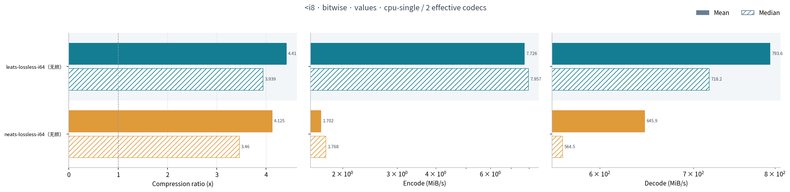

[SVG](figures/type-08.svg)

| 算法 | 性质 | 有效数据集数 | 压缩倍数均值 | 压缩倍数中位数 | 编码均值 MiB/s | 编码中位数 MiB/s | 解码均值 MiB/s | 解码中位数 MiB/s |
|---|---|---:|---:|---:|---:|---:|---:|---:|
| leats-lossless-i64 | 无损 | 9 | 4.41 | 3.939 | 7.726 | 7.957 | 793.6 | 718.2 |
| neats-lossless-i64 | 无损 | 9 | 4.125 | 3.46 | 1.702 | 1.768 | 645.9 | 564.5 |

## <u4 · bitwise · values · cpu-single

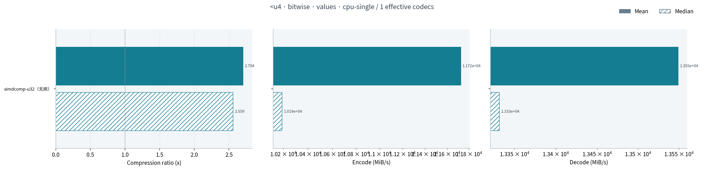

[SVG](figures/type-09.svg)

| 算法 | 性质 | 有效数据集数 | 压缩倍数均值 | 压缩倍数中位数 | 编码均值 MiB/s | 编码中位数 MiB/s | 解码均值 MiB/s | 解码中位数 MiB/s |
|---|---|---:|---:|---:|---:|---:|---:|---:|
| simdcomp-u32 | 无损 | 9 | 2.704 | 2.559 | 1.172e+04 | 1.019e+04 | 1.355e+04 | 1.333e+04 |
## 有效数据集支持矩阵

矩阵按无损浮点、无损整数和有损任务分组；每格数字为该类型下有完整有效结果的数据集数量。
空白（—）表示该算法在对应类型没有有效记录，不表示零压缩率或零吞吐。

### 无损浮点

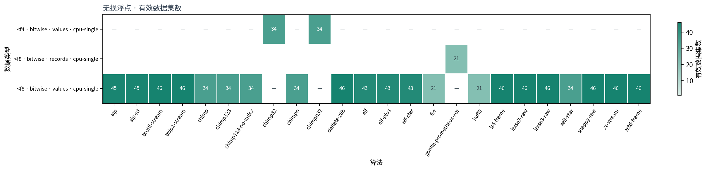

[SVG](figures/support-matrix-01.svg)

### 无损整数

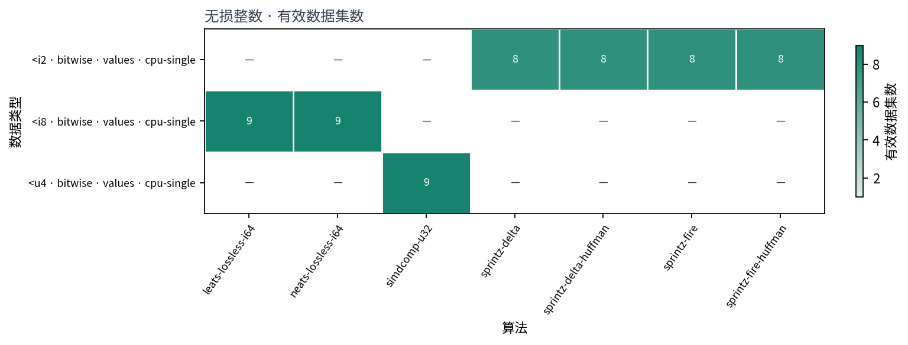

[SVG](figures/support-matrix-02.svg)

### 有损

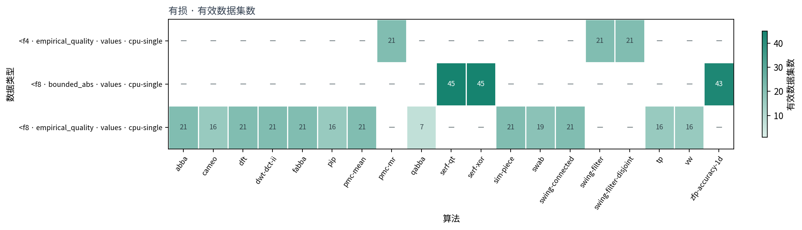

[SVG](figures/support-matrix-03.svg)

### 缩写与标注

- dtype：`<f4` = 32 位浮点，`<f8` = 64 位浮点，`<i2` = 16 位有符号整数，`<i8` = 64 位有符号整数，`<u4` = 32 位无符号整数。
- 保真：`bitwise` = 逐位无损；`bounded_abs` = 绝对误差有界的有损任务；`empirical_quality` = 按经验质量阈值验证的有损任务。
- `values` 表示仅压缩数值数组；`records` 表示带时间和值的记录；`cpu-single` 表示单线程 CPU profile。
- 数字统计 prepared 生命周期下完整有效的不同数据集数；颜色越深，覆盖的数据集越多。
