# forecasting_transpose 压缩算法可视化报告

生成时间：2026-10-23 11:59:49（Asia/Shanghai，UTC+08:00）。

选自 **4,126 个 CSV、46 个数据家族的 46 个代表文件**；每个代表文件使用全部行、全部数值列。完整 float64 主输入未截断、填补、归一化或额外量化；补充 dtype 任务单独声明。

当前 **51 个纳入请求的 CPU codec**（注册表排除项：`lzss-dipperstein-c`、`lzss-raw`；用户跳过项：`deepzip`、`dzip`；不含 raw-store 基线）；冻结 **5,448 个请求**，已审计 5,448 个，完整有效 2,850 个，正式批次 39,928/39,928 成功。

[平均结果](#averages) · [逐数据集结果](#datasets) · [算法覆盖](#coverage) · [GPU结果](#gpu) · [统计口径与复现](#methodology)

[逐案例 CSV](primary.csv) · [审计证据](audit.json) · [冻结选样和配置](../../benchmark/experiments/forecasting-20261022-1130/design.json)

以下CPU图的压缩倍数 = 有效原始 bytes / 完整 codec 输出 bytes；编码、解码按相同原始 bytes 归一化为 MiB/s。完整输出包含 codec 必要参数、模型和结束数据；实验管理 JSON、hash 不计入。实心为 prepared，斜线为空心 fresh_request；吞吐使用对数轴，误差线由批次时长的 Q3/Q1 反算。GPU采用独立对象边界和完整object wire，见GPU章节，不混合比较。1×虚线表示膨胀分界。N/A 表示拒绝、缺失或未完整完成，不能解释为零性能。

GPU 扩展 `cuSZp-fixed-1d`：当前不可用，原因见可用性检查，未使用历史GPU结果代替。

[GPU 可用性检查](../../benchmark/experiments/forecasting-20261022-1130/gpu_availability.json)

## 通用快速编码器概览

五个预先指定的完整代表文件，prepared、float64、无损；完整算法与 fresh_request 结果见后文。

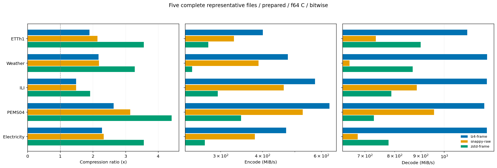

[SVG](figures/fast-codecs-overview.svg)

<a id="averages"></a>

## 平均结果

每个数据家族等权；先取每案例 14 个正式批次时长的中位数，再反算吞吐并对固定家族集合求算术平均。某 codec 缺少任一家族的完整有效结果，则其该组均值为 N/A。不同 dtype、质量任务及线程配置不合并。均值不使用成功子集替代固定集合，也不是合并所有文件后的总吞吐或总字节比。 本轮包含顺序和隔离核心并行两种调度条件；均值描述本次混合调度，不代表统一独占条件下的性能，详见调度记录。

### <f4 · 无损 · values · cpu-single

<details><summary>均值及覆盖分母</summary>

| codec | 有效／固定家族数 P / F | 平均压缩倍数 P / F | 平均编码 MiB/s P / F | 平均解码 MiB/s P / F |
|---|---:|---:|---:|---:|
| chimp32 | 34/46 / 34/46 | — / — | — / — | — / — |
| chimpn32 | 34/46 / 34/46 | — / — | — / — | — / — |

</details>

### <f4 · 经验质量（无最大误差保证） · values · cpu-single

<details><summary>均值及覆盖分母</summary>

| codec | 有效／固定家族数 P / F | 平均压缩倍数 P / F | 平均编码 MiB/s P / F | 平均解码 MiB/s P / F |
|---|---:|---:|---:|---:|
| pmc-mr | 21/46 / 20/46 | — / — | — / — | — / — |
| swing-filter | 21/46 / 21/46 | — / — | — / — | — / — |
| swing-filter-disjoint | 21/46 / 21/46 | — / — | — / — | — / — |
| swing-filter-disjoint-quantized / compatible | 0/46 / 0/46 | — / — | — / — | — / — |

</details>

### <f8 · 无损 · records · cpu-single

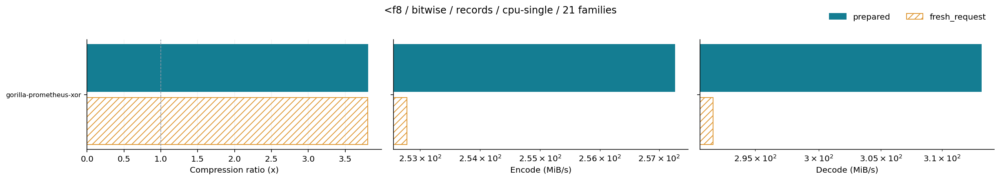

[SVG](figures/mean-02.svg)

<details><summary>均值及覆盖分母</summary>

| codec | 有效／固定家族数 P / F | 平均压缩倍数 P / F | 平均编码 MiB/s P / F | 平均解码 MiB/s P / F |
|---|---:|---:|---:|---:|
| gorilla-prometheus-xor | 21/21 / 21/21 | 3.81 / 3.81 | 257 / 253 | 313 / 292 |

</details>

### <f8 · 无损 · values · cpu-single

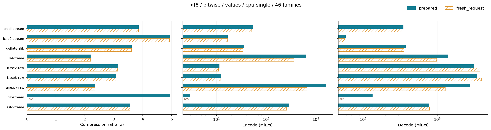

[SVG](figures/mean-03.svg)

<details><summary>均值及覆盖分母</summary>

| codec | 有效／固定家族数 P / F | 平均压缩倍数 P / F | 平均编码 MiB/s P / F | 平均解码 MiB/s P / F |
|---|---:|---:|---:|---:|
| alp | 45/46 / 45/46 | — / — | — / — | — / — |
| alp-rd | 45/46 / 45/46 | — / — | — / — | — / — |
| brotli-stream | 46/46 / 46/46 | 3.85 / 3.85 | 53.8 / 51.3 | 349 / 343 |
| bzip2-stream | 46/46 / 46/46 | 4.93 / 4.93 | 16.7 / 16.8 | 58.2 / 57.6 |
| chimp | 34/46 / 34/46 | — / — | — / — | — / — |
| chimp128 | 34/46 / 34/46 | — / — | — / — | — / — |
| chimp128-no-index | 34/46 / 34/46 | — / — | — / — | — / — |
| chimp32 | 0/46 / 0/46 | — / — | — / — | — / — |
| chimpn | 34/46 / 34/46 | — / — | — / — | — / — |
| chimpn32 | 0/46 / 0/46 | — / — | — / — | — / — |
| deflate-zlib | 46/46 / 46/46 | 3.61 / 3.61 | 35.4 / 34.2 | 372 / 355 |
| elf | 43/46 / 43/46 | — / — | — / — | — / — |
| elf-plus | 43/46 / 43/46 | — / — | — / — | — / — |
| elf-star | 43/46 / 43/46 | — / — | — / — | — / — |
| fse | 21/46 / 21/46 | — / — | — / — | — / — |
| gorilla-prometheus-xor | 0/46 / 0/46 | — / — | — / — | — / — |
| huff0 | 21/46 / 21/46 | — / — | — / — | — / — |
| leats-lossless-i64 | 0/46 / 0/46 | — / — | — / — | — / — |
| lz4-frame | 46/46 / 46/46 | 2.19 / 2.19 | 627 / 362 | 1.38e+03 / 983 |
| lzsse2-raw | 46/46 / 46/46 | 3.13 / 3.13 | 11.4 / 11 | 3.13e+03 / 3.75e+03 |
| lzsse8-raw | 46/46 / 46/46 | 3.07 / 3.07 | 12.4 / 12 | 3.4e+03 / 3.93e+03 |
| neats-lossless-i64 | 0/46 / 0/46 | — / — | — / — | — / — |
| self-star | 34/46 / 34/46 | — / — | — / — | — / — |
| simdcomp-u32 | 0/46 / 0/46 | — / — | — / — | — / — |
| snappy-raw | 46/46 / 46/46 | 2.35 / 2.35 | 1.59e+03 / 661 | 2.73e+03 / 1.29e+03 |
| sprintz-delta | 0/46 / 0/46 | — / — | — / — | — / — |
| sprintz-delta-huffman | 0/46 / 0/46 | — / — | — / — | — / — |
| sprintz-fire | 0/46 / 0/46 | — / — | — / — | — / — |
| sprintz-fire-huffman | 0/46 / 0/46 | — / — | — / — | — / — |
| xz-stream | 46/46 / 45/46 | 4.94 / — | 2.87 / — | 134 / — |
| zstd-frame | 46/46 / 46/46 | 3.56 / 3.56 | 285 / 256 | 766 / 784 |

</details>

### <f8 · ABS ≤ 0.01 · values · cpu-single

<details><summary>均值及覆盖分母</summary>

| codec | 有效／固定家族数 P / F | 平均压缩倍数 P / F | 平均编码 MiB/s P / F | 平均解码 MiB/s P / F |
|---|---:|---:|---:|---:|
| serf-qt | 45/46 / 45/46 | — / — | — / — | — / — |
| serf-xor | 45/46 / 45/46 | — / — | — / — | — / — |
| zfp-accuracy-1d | 43/46 / 43/46 | — / — | — / — | — / — |

</details>

### <f8 · 经验质量（无最大误差保证） · values · cpu-single

<details><summary>均值及覆盖分母</summary>

| codec | 有效／固定家族数 P / F | 平均压缩倍数 P / F | 平均编码 MiB/s P / F | 平均解码 MiB/s P / F |
|---|---:|---:|---:|---:|
| abba | 21/46 / 21/46 | — / — | — / — | — / — |
| cameo | 16/46 / 16/46 | — / — | — / — | — / — |
| dft | 21/46 / 21/46 | — / — | — / — | — / — |
| dwt-dct-ii | 21/46 / 21/46 | — / — | — / — | — / — |
| fabba | 21/46 / 21/46 | — / — | — / — | — / — |
| pip | 16/46 / 16/46 | — / — | — / — | — / — |
| pmc-mean | 21/46 / 21/46 | — / — | — / — | — / — |
| pmc-mr | 0/46 / 0/46 | — / — | — / — | — / — |
| qabba | 7/46 / 7/46 | — / — | — / — | — / — |
| sim-piece | 21/46 / 21/46 | — / — | — / — | — / — |
| swab | 19/46 / 19/46 | — / — | — / — | — / — |
| swing-connected | 21/46 / 21/46 | — / — | — / — | — / — |
| swing-filter | 0/46 / 0/46 | — / — | — / — | — / — |
| swing-filter-disjoint | 0/46 / 0/46 | — / — | — / — | — / — |
| swing-filter-disjoint-quantized / compatible | 0/46 / 0/46 | — / — | — / — | — / — |
| tp | 16/46 / 16/46 | — / — | — / — | — / — |
| vw | 16/46 / 16/46 | — / — | — / — | — / — |

</details>

### <i2 · 无损 · values · cpu-single

<details><summary>均值及覆盖分母</summary>

| codec | 有效／固定家族数 P / F | 平均压缩倍数 P / F | 平均编码 MiB/s P / F | 平均解码 MiB/s P / F |
|---|---:|---:|---:|---:|
| sprintz-delta | 8/10 / 8/10 | — / — | — / — | — / — |
| sprintz-delta-huffman | 8/10 / 8/10 | — / — | — / — | — / — |
| sprintz-fire | 8/10 / 8/10 | — / — | — / — | — / — |
| sprintz-fire-huffman | 8/10 / 8/10 | — / — | — / — | — / — |

</details>

### <i8 · 无损 · values · cpu-single

<details><summary>均值及覆盖分母</summary>

| codec | 有效／固定家族数 P / F | 平均压缩倍数 P / F | 平均编码 MiB/s P / F | 平均解码 MiB/s P / F |
|---|---:|---:|---:|---:|
| leats-lossless-i64 | 9/14 / 9/14 | — / — | — / — | — / — |
| neats-lossless-i64 | 9/14 / 9/14 | — / — | — / — | — / — |

</details>

### <u4 · 无损 · values · cpu-single

<details><summary>均值及覆盖分母</summary>

| codec | 有效／固定家族数 P / F | 平均压缩倍数 P / F | 平均编码 MiB/s P / F | 平均解码 MiB/s P / F |
|---|---:|---:|---:|---:|
| simdcomp-u32 | 9/13 / 9/13 | — / — | — / — | — / — |

</details>

<a id="datasets"></a>

## 逐数据集结果

选样规则：文件名在 `_dataset` 前的前缀作为家族；其余名称去掉末尾 `_数字`。每家族按（完整数值元素数量、文件名）排序后取下中位文件。大写 Weather 与小写 weather 分别保留为不同来源家族。所有选择在正式运行前冻结。

| 家族 | 家族文件数 | 代表文件 | 原始 f64 shape | 有效数值 bytes |
|---|---:|---|---|---:|
| AQShunyi | 1 | [AQShunyi](#dataset-AQShunyi) | [35064, 11] | 3,085,632 |
| AQWan | 1 | [AQWan](#dataset-AQWan) | [35064, 11] | 3,085,632 |
| Covid-19 | 1 | [Covid-19](#dataset-Covid-19) | [1392, 948] | 10,556,928 |
| CzeLan | 1 | [CzeLan](#dataset-CzeLan) | [19934, 11] | 1,754,192 |
| ETTh1 | 1 | [ETTh1](#dataset-ETTh1) | [17420, 7] | 975,520 |
| ETTh2 | 1 | [ETTh2](#dataset-ETTh2) | [17420, 7] | 975,520 |
| ETTm1 | 1 | [ETTm1](#dataset-ETTm1) | [69680, 7] | 3,902,080 |
| ETTm2 | 1 | [ETTm2](#dataset-ETTm2) | [69680, 7] | 3,902,080 |
| Electricity | 1 | [Electricity](#dataset-Electricity) | [26304, 321] | 67,548,672 |
| Exchange | 1 | [Exchange](#dataset-Exchange) | [7588, 8] | 485,632 |
| FRED-MD | 1 | [FRED-MD](#dataset-FRED-MD) | [728, 107] | 623,168 |
| ILI | 1 | [ILI](#dataset-ILI) | [966, 7] | 54,096 |
| METR-LA | 1 | [METR-LA](#dataset-METR-LA) | [34272, 207] | 56,754,432 |
| NASDAQ | 1 | [NASDAQ](#dataset-NASDAQ) | [1245, 5] | 49,800 |
| NN5 | 1 | [NN5](#dataset-NN5) | [791, 111] | 702,408 |
| NYSE | 1 | [NYSE](#dataset-NYSE) | [1244, 5] | 49,760 |
| PEMS-BAY | 1 | [PEMS-BAY](#dataset-PEMS-BAY) | [52116, 325] | 135,501,600 |
| PEMS04 | 1 | [PEMS04](#dataset-PEMS04) | [16992, 307] | 41,732,352 |
| PEMS08 | 1 | [PEMS08](#dataset-PEMS08) | [17856, 170] | 24,284,160 |
| Solar | 1 | [Solar](#dataset-Solar) | [52560, 137] | 57,605,760 |
| Traffic | 1 | [Traffic](#dataset-Traffic) | [17544, 862] | 120,983,424 |
| Weather | 1 | [Weather](#dataset-Weather) | [52696, 21] | 8,852,928 |
| Wike2000 | 1 | [Wike2000](#dataset-Wike2000) | [792, 2000] | 12,672,000 |
| Wind | 1 | [Wind](#dataset-Wind) | [48673, 7] | 2,725,688 |
| ZafNoo | 1 | [ZafNoo](#dataset-ZafNoo) | [19225, 11] | 1,691,800 |
| bitcoin | 18 | [bitcoin_dataset_without_missing_values_9](#dataset-bitcoin_dataset_without_missing_values_9) | [4021] | 32,168 |
| dominick | 201 | [dominick_dataset_12816](#dataset-dominick_dataset_12816) | [216] | 1,728 |
| economics | 69 | [economics_52](#dataset-economics_52) | [264] | 2,112 |
| finance | 73 | [finance_44](#dataset-finance_44) | [1657] | 13,256 |
| human | 97 | [human_26](#dataset-human_26) | [1464] | 11,712 |
| kdd_cup_2018 | 270 | [kdd_cup_2018_dataset_without_missing_values_3](#dataset-kdd_cup_2018_dataset_without_missing_values_3) | [10898] | 87,184 |
| m1_monthly | 7 | [m1_monthly_dataset_404](#dataset-m1_monthly_dataset_404) | [129] | 1,032 |
| m3_monthly | 3 | [m3_monthly_dataset_726](#dataset-m3_monthly_dataset_726) | [144] | 1,152 |
| m4_daily | 575 | [m4_daily_dataset_1507](#dataset-m4_daily_dataset_1507) | [2201] | 17,608 |
| m4_hourly | 414 | [m4_hourly_dataset_207](#dataset-m4_hourly_dataset_207) | [1008] | 8,064 |
| m4_monthly | 1029 | [m4_monthly_dataset_41446](#dataset-m4_monthly_dataset_41446) | [302] | 2,416 |
| m4_quarterly | 241 | [m4_quarterly_dataset_13508](#dataset-m4_quarterly_dataset_13508) | [145] | 1,160 |
| m4_weekly | 285 | [m4_weekly_dataset_275](#dataset-m4_weekly_dataset_275) | [1057] | 8,456 |
| m4_yearly | 3 | [m4_yearly_dataset_12343](#dataset-m4_yearly_dataset_12343) | [204] | 1,632 |
| nature | 87 | [nature_44](#dataset-nature_44) | [864] | 6,912 |
| pedestrian_counts | 22 | [pedestrian_counts_dataset_58](#dataset-pedestrian_counts_dataset_58) | [13872] | 110,976 |
| tourism_monthly | 69 | [tourism_monthly_dataset_189](#dataset-tourism_monthly_dataset_189) | [333] | 2,664 |
| tourism_quarterly | 2 | [tourism_quarterly_dataset_79](#dataset-tourism_quarterly_dataset_79) | [130] | 1,040 |
| us_births | 1 | [us_births_dataset_1](#dataset-us_births_dataset_1) | [7305] | 58,440 |
| vehicle_trips | 99 | [vehicle_trips_dataset_without_missing_values_9](#dataset-vehicle_trips_dataset_without_missing_values_9) | [180] | 1,440 |
| weather | 536 | [weather_dataset_39](#dataset-weather_dataset_39) | [9368] | 74,944 |

<a id="dataset-AQShunyi"></a>

### AQShunyi

**<f4 · [35064, 11] · 无损 · values · cpu-single**

运行进程 CPU 亲和性（P / F）：`[(0, 1, 2, 3, 4, 5, 6, 7, 8, 9, 10, 11, 12, 13, 14, 15)]` / `[(0, 1, 2, 3, 4, 5, 6, 7, 8, 9, 10, 11, 12, 13, 14, 15)]`；逐配置创建时间见 CSV，是否处于并行窗口见调度记录。

f64→f32 准备阶段转换的最大绝对差：**5.69661474e-05**；本组 codec 的恢复质量相对转换后的 f32 输入验证。

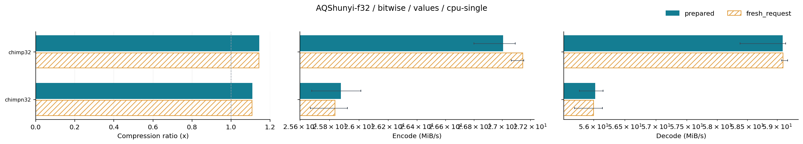

[SVG](figures/AQShunyi-f32--bitwise--cpu-single.svg)

<details><summary>完整数值、有效批次及拒绝原因</summary>

| codec | 完整输出 bytes P / F | 压缩倍数 P / F | 编码 MiB/s P / F | 解码 MiB/s P / F | 有效批次 P / F |
|---|---:|---:|---:|---:|---:|
| chimp32 | 1.35e+06 / 1.35e+06 | 1.14 / 1.14 | 27 / 27.1 | 59.1 / 59.1 | 14/14 / 14/14 |
| chimpn32 | 1.39e+06 / 1.39e+06 | 1.11 / 1.11 | 25.9 / 25.8 | 56 / 56 | 14/14 / 14/14 |

</details>

**<f4 · [35064, 11] · 经验质量（无最大误差保证） · values · cpu-single**

运行进程 CPU 亲和性（P / F）：`[(0, 1, 2, 3, 4, 5, 6, 7, 8, 9, 10, 11, 12, 13, 14, 15)]` / `[(0, 1, 2, 3, 4, 5, 6, 7, 8, 9, 10, 11, 12, 13, 14, 15)]`；逐配置创建时间见 CSV，是否处于并行窗口见调度记录。

f64→f32 准备阶段转换的最大绝对差：**5.69661474e-05**；本组 codec 的恢复质量相对转换后的 f32 输入验证。

<details><summary>完整数值、有效批次及拒绝原因</summary>

| codec | 完整输出 bytes P / F | 压缩倍数 P / F | 编码 MiB/s P / F | 解码 MiB/s P / F | 有效批次 P / F |
|---|---:|---:|---:|---:|---:|
| pmc-mr | — / — | — / — | — / — | — / — | 0/0 / 0/0 |
| swing-filter | — / — | — / — | — / — | — / — | 0/0 / 0/0 |
| swing-filter-disjoint | — / — | — / — | — / — | — / — | 0/0 / 0/0 |
| swing-filter-disjoint-quantized / compatible | — / — | — / — | — / — | — / — | 0/0 / 0/0 |

拒绝或未完整完成的请求：

- `pmc-mr` / fresh_request：unsupported，filter native_core requires one column; object/native_api preserve independent columns
- `pmc-mr` / prepared：unsupported，filter native_core requires one column; object/native_api preserve independent columns
- `swing-filter` / fresh_request：unsupported，filter native_core requires one column; object/native_api preserve independent columns
- `swing-filter` / prepared：unsupported，filter native_core requires one column; object/native_api preserve independent columns
- `swing-filter-disjoint` / fresh_request：unsupported，filter native_core requires one column; object/native_api preserve independent columns
- `swing-filter-disjoint` / prepared：unsupported，filter native_core requires one column; object/native_api preserve independent columns
- `swing-filter-disjoint-quantized / compatible` / fresh_request：unsupported，filter native_core requires one column; object/native_api preserve independent columns
- `swing-filter-disjoint-quantized / compatible` / prepared：unsupported，filter native_core requires one column; object/native_api preserve independent columns

</details>

**<f8 · [35064, 11] · 无损 · values · cpu-single**

运行进程 CPU 亲和性（P / F）：`[(0, 1, 2, 3, 4, 5, 6, 7, 8, 9, 10, 11, 12, 13, 14, 15)]` / `[(0, 1, 2, 3, 4, 5, 6, 7, 8, 9, 10, 11, 12, 13, 14, 15)]`；逐配置创建时间见 CSV，是否处于并行窗口见调度记录。

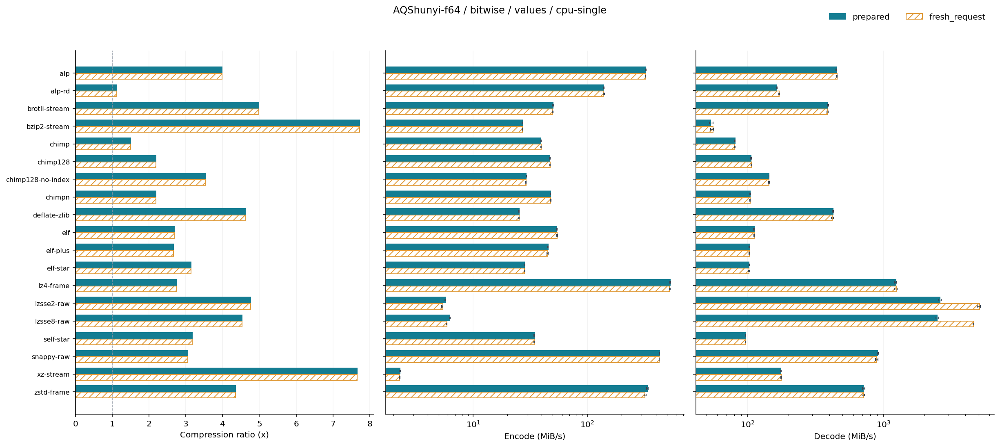

[SVG](figures/AQShunyi-f64--bitwise--cpu-single.svg)

<details><summary>完整数值、有效批次及拒绝原因</summary>

| codec | 完整输出 bytes P / F | 压缩倍数 P / F | 编码 MiB/s P / F | 解码 MiB/s P / F | 有效批次 P / F |
|---|---:|---:|---:|---:|---:|
| alp | 7.75e+05 / 7.75e+05 | 3.98 / 3.98 | 327 / 326 | 449 / 455 | 14/14 / 14/14 |
| alp-rd | 2.76e+06 / 2.76e+06 | 1.12 / 1.12 | 140 / 139 | 164 / 171 | 14/14 / 14/14 |
| brotli-stream | 6.19e+05 / 6.19e+05 | 4.99 / 4.99 | 50.1 / 49.9 | 387 / 386 | 14/14 / 14/14 |
| bzip2-stream | 3.99e+05 / 3.99e+05 | 7.73 / 7.73 | 27.1 / 27 | 53.7 / 55.6 | 14/14 / 14/14 |
| chimp | 2.06e+06 / 2.06e+06 | 1.5 / 1.5 | 39.3 / 39.4 | 80.8 / 80.6 | 14/14 / 14/14 |
| chimp128 | 1.41e+06 / 1.41e+06 | 2.19 / 2.19 | 47 / 47.3 | 106 / 107 | 14/14 / 14/14 |
| chimp128-no-index | 8.75e+05 / 8.75e+05 | 3.53 / 3.53 | 29.2 / 29.2 | 144 / 144 | 14/14 / 14/14 |
| chimp32 | — / — | — / — | — / — | — / — | 0/0 / 0/0 |
| chimpn | 1.41e+06 / 1.41e+06 | 2.19 / 2.19 | 47.9 / 47.7 | 104 / 104 | 14/14 / 14/14 |
| chimpn32 | — / — | — / — | — / — | — / — | 0/0 / 0/0 |
| deflate-zlib | 6.66e+05 / 6.66e+05 | 4.63 / 4.63 | 25.3 / 25.2 | 426 / 420 | 14/14 / 14/14 |
| elf | 1.15e+06 / 1.15e+06 | 2.69 / 2.69 | 54 / 54.6 | 112 / 112 | 14/14 / 14/14 |
| elf-plus | 1.16e+06 / 1.16e+06 | 2.67 / 2.67 | 45.3 / 45 | 104 / 103 | 14/14 / 14/14 |
| elf-star | 9.81e+05 / 9.81e+05 | 3.14 / 3.14 | 28.3 / 28.2 | 103 / 102 | 14/14 / 14/14 |
| fse | — / — | — / — | — / — | — / — | 0/0 / 0/0 |
| gorilla-prometheus-xor | — / — | — / — | — / — | — / — | 0/0 / 0/0 |
| huff0 | — / — | — / — | — / — | — / — | 0/0 / 0/0 |
| leats-lossless-i64 | — / — | — / — | — / — | — / — | 0/0 / 0/0 |
| lz4-frame | 1.13e+06 / 1.13e+06 | 2.74 / 2.74 | 536 / 528 | 1.23e+03 / 1.25e+03 | 14/14 / 14/14 |
| lzsse2-raw | 6.48e+05 / 6.48e+05 | 4.77 / 4.77 | 5.67 / 5.4 | 2.6e+03 / 5.1e+03 | 14/14 / 14/14 |
| lzsse8-raw | 6.81e+05 / 6.81e+05 | 4.53 / 4.53 | 6.23 / 5.86 | 2.49e+03 / 4.59e+03 | 14/14 / 14/14 |
| neats-lossless-i64 | — / — | — / — | — / — | — / — | 0/0 / 0/0 |
| self-star | 9.73e+05 / 9.73e+05 | 3.17 / 3.17 | 34.4 / 34.3 | 96.8 / 96.8 | 14/14 / 14/14 |
| simdcomp-u32 | — / — | — / — | — / — | — / — | 0/0 / 0/0 |
| snappy-raw | 1.01e+06 / 1.01e+06 | 3.05 / 3.05 | 431 / 429 | 905 / 894 | 14/14 / 14/14 |
| sprintz-delta | — / — | — / — | — / — | — / — | 0/0 / 0/0 |
| sprintz-delta-huffman | — / — | — / — | — / — | — / — | 0/0 / 0/0 |
| sprintz-fire | — / — | — / — | — / — | — / — | 0/0 / 0/0 |
| sprintz-fire-huffman | — / — | — / — | — / — | — / — | 0/0 / 0/0 |
| xz-stream | 4.03e+05 / 4.03e+05 | 7.66 / 7.66 | 2.29 / 2.26 | 176 / 176 | 14/14 / 14/14 |
| zstd-frame | 7.09e+05 / 7.09e+05 | 4.35 / 4.35 | 338 / 322 | 707 / 714 | 14/14 / 14/14 |

拒绝或未完整完成的请求：

- `chimp32` / fresh_request：unsupported，chimp32: dtype must be one of ('<f4',)
- `chimp32` / prepared：unsupported，chimp32: dtype must be one of ('<f4',)
- `chimpn32` / fresh_request：unsupported，chimpn32: dtype must be one of ('<f4',)
- `chimpn32` / prepared：unsupported，chimpn32: dtype must be one of ('<f4',)
- `fse` / fresh_request：unsupported，fse: n=35064 exceeds native limits
- `fse` / prepared：unsupported，fse: n=35064 exceeds native limits
- `gorilla-prometheus-xor` / fresh_request：unsupported，Gorilla requires actual paired T/V; values-only and timestamp-only are unsupported
- `gorilla-prometheus-xor` / prepared：unsupported，Gorilla requires actual paired T/V; values-only and timestamp-only are unsupported
- `huff0` / fresh_request：unsupported，huff0: n=35064 exceeds native limits
- `huff0` / prepared：unsupported，huff0: n=35064 exceeds native limits
- `leats-lossless-i64` / fresh_request：unsupported，leats-lossless-i64: dtype must be one of ('|i1', '<i2', '<i4', '<i8')
- `leats-lossless-i64` / prepared：unsupported，leats-lossless-i64: dtype must be one of ('|i1', '<i2', '<i4', '<i8')
- `neats-lossless-i64` / fresh_request：unsupported，neats-lossless-i64: dtype must be one of ('|i1', '<i2', '<i4', '<i8')
- `neats-lossless-i64` / prepared：unsupported，neats-lossless-i64: dtype must be one of ('|i1', '<i2', '<i4', '<i8')
- `simdcomp-u32` / fresh_request：unsupported，simdcomp-u32: dtype must be one of ('<u4',)
- `simdcomp-u32` / prepared：unsupported，simdcomp-u32: dtype must be one of ('<u4',)
- `sprintz-delta` / fresh_request：unsupported，sprintz-delta: dtype must be one of ('|u1', '|i1', '<u2', '<i2')
- `sprintz-delta` / prepared：unsupported，sprintz-delta: dtype must be one of ('|u1', '|i1', '<u2', '<i2')
- `sprintz-delta-huffman` / fresh_request：unsupported，sprintz-delta-huffman: dtype must be one of ('|u1', '|i1', '<u2', '<i2')
- `sprintz-delta-huffman` / prepared：unsupported，sprintz-delta-huffman: dtype must be one of ('|u1', '|i1', '<u2', '<i2')
- `sprintz-fire` / fresh_request：unsupported，sprintz-fire: dtype must be one of ('|u1', '|i1', '<u2', '<i2')
- `sprintz-fire` / prepared：unsupported，sprintz-fire: dtype must be one of ('|u1', '|i1', '<u2', '<i2')
- `sprintz-fire-huffman` / fresh_request：unsupported，sprintz-fire-huffman: dtype must be one of ('|u1', '|i1', '<u2', '<i2')
- `sprintz-fire-huffman` / prepared：unsupported，sprintz-fire-huffman: dtype must be one of ('|u1', '|i1', '<u2', '<i2')

</details>

**<f8 · [35064, 11] · ABS ≤ 0.01 · values · cpu-single**

运行进程 CPU 亲和性（P / F）：`[(0, 1, 2, 3, 4, 5, 6, 7, 8, 9, 10, 11, 12, 13, 14, 15)]` / `[(0, 1, 2, 3, 4, 5, 6, 7, 8, 9, 10, 11, 12, 13, 14, 15)]`；逐配置创建时间见 CSV，是否处于并行窗口见调度记录。

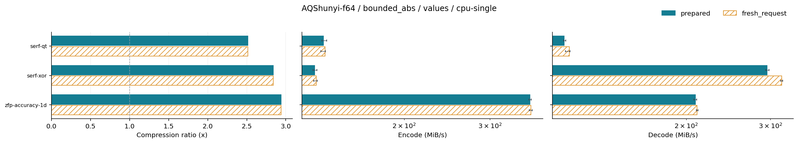

[SVG](figures/AQShunyi-f64--bounded_abs--cpu-single.svg)

<details><summary>完整数值、有效批次及拒绝原因</summary>

| codec | 完整输出 bytes P / F | 压缩倍数 P / F | 编码 MiB/s P / F | 解码 MiB/s P / F | 有效批次 P / F |
|---|---:|---:|---:|---:|---:|
| serf-qt | 1.23e+06 / 1.23e+06 | 2.52 / 2.52 | 137 / 138 | 111 / 114 | 14/14 / 14/14 |
| serf-xor | 1.09e+06 / 1.09e+06 | 2.84 / 2.84 | 131 / 132 | 296 / 317 | 14/14 / 14/14 |
| zfp-accuracy-1d | 1.05e+06 / 1.05e+06 | 2.94 / 2.94 | 362 / 364 | 209 / 211 | 14/14 / 14/14 |

</details>

**<f8 · [35064, 11] · 经验质量（无最大误差保证） · values · cpu-single**

运行进程 CPU 亲和性（P / F）：`[(0, 1, 2, 3, 4, 5, 6, 7, 8, 9, 10, 11, 12, 13, 14, 15)]` / `[(0, 1, 2, 3, 4, 5, 6, 7, 8, 9, 10, 11, 12, 13, 14, 15)]`；逐配置创建时间见 CSV，是否处于并行窗口见调度记录。

<details><summary>完整数值、有效批次及拒绝原因</summary>

| codec | 完整输出 bytes P / F | 压缩倍数 P / F | 编码 MiB/s P / F | 解码 MiB/s P / F | 有效批次 P / F |
|---|---:|---:|---:|---:|---:|
| abba | — / — | — / — | — / — | — / — | 0/0 / 0/0 |
| cameo | — / — | — / — | — / — | — / — | 0/0 / 0/0 |
| dft | — / — | — / — | — / — | — / — | 0/0 / 0/0 |
| dwt-dct-ii | — / — | — / — | — / — | — / — | 0/0 / 0/0 |
| fabba | — / — | — / — | — / — | — / — | 0/0 / 0/0 |
| pip | — / — | — / — | — / — | — / — | 0/0 / 0/0 |
| pmc-mean | — / — | — / — | — / — | — / — | 0/0 / 0/0 |
| pmc-mr | — / — | — / — | — / — | — / — | 0/0 / 0/0 |
| qabba | — / — | — / — | — / — | — / — | 0/0 / 0/0 |
| sim-piece | — / — | — / — | — / — | — / — | 0/0 / 0/0 |
| swab | — / — | — / — | — / — | — / — | 0/0 / 0/0 |
| swing-connected | — / — | — / — | — / — | — / — | 0/0 / 0/0 |
| swing-filter | — / — | — / — | — / — | — / — | 0/0 / 0/0 |
| swing-filter-disjoint | — / — | — / — | — / — | — / — | 0/0 / 0/0 |
| swing-filter-disjoint-quantized / compatible | — / — | — / — | — / — | — / — | 0/0 / 0/0 |
| tp | — / — | — / — | — / — | — / — | 0/0 / 0/0 |
| vw | — / — | — / — | — / — | — / — | 0/0 / 0/0 |

拒绝或未完整完成的请求：

- `abba` / fresh_request：unsupported，abba: native_core requires rank1; use object/native_api for independent columns
- `abba` / prepared：unsupported，abba: native_core requires rank1; use object/native_api for independent columns
- `cameo` / fresh_request：unsupported，cameo: element limit exceeded
- `cameo` / prepared：unsupported，cameo: element limit exceeded
- `dft` / fresh_request：unsupported，dft: element limit exceeded
- `dft` / prepared：unsupported，dft: element limit exceeded
- `dwt-dct-ii` / fresh_request：unsupported，dwt-dct-ii: element limit exceeded
- `dwt-dct-ii` / prepared：unsupported，dwt-dct-ii: element limit exceeded
- `fabba` / fresh_request：unsupported，fabba: native_core requires rank1; use object/native_api for independent columns
- `fabba` / prepared：unsupported，fabba: native_core requires rank1; use object/native_api for independent columns
- `pip` / fresh_request：unsupported，pip: element limit exceeded
- `pip` / prepared：unsupported，pip: element limit exceeded
- `pmc-mean` / fresh_request：unsupported，pmc-mean: element limit exceeded
- `pmc-mean` / prepared：unsupported，pmc-mean: element limit exceeded
- `pmc-mr` / fresh_request：unsupported，pmc-mr: dtype must be one of ('<f4',)
- `pmc-mr` / prepared：unsupported，pmc-mr: dtype must be one of ('<f4',)
- `qabba` / fresh_request：unsupported，qabba: native_core requires rank1; use object/native_api for independent columns
- `qabba` / prepared：unsupported，qabba: native_core requires rank1; use object/native_api for independent columns
- `sim-piece` / fresh_request：unsupported，sim-piece: element limit exceeded
- `sim-piece` / prepared：unsupported，sim-piece: element limit exceeded
- `swab` / fresh_request：unsupported，swab: element limit exceeded
- `swab` / prepared：unsupported，swab: element limit exceeded
- `swing-connected` / fresh_request：unsupported，swing-connected: element limit exceeded
- `swing-connected` / prepared：unsupported，swing-connected: element limit exceeded
- `swing-filter` / fresh_request：unsupported，swing-filter: dtype must be one of ('<f4',)
- `swing-filter` / prepared：unsupported，swing-filter: dtype must be one of ('<f4',)
- `swing-filter-disjoint` / fresh_request：unsupported，swing-filter-disjoint: dtype must be one of ('<f4',)
- `swing-filter-disjoint` / prepared：unsupported，swing-filter-disjoint: dtype must be one of ('<f4',)
- `swing-filter-disjoint-quantized / compatible` / fresh_request：unsupported，swing-filter-disjoint-quantized: dtype must be one of ('<f4',)
- `swing-filter-disjoint-quantized / compatible` / prepared：unsupported，swing-filter-disjoint-quantized: dtype must be one of ('<f4',)
- `tp` / fresh_request：unsupported，tp: element limit exceeded
- `tp` / prepared：unsupported，tp: element limit exceeded
- `vw` / fresh_request：unsupported，vw: element limit exceeded
- `vw` / prepared：unsupported，vw: element limit exceeded

</details>

<a id="dataset-AQWan"></a>

### AQWan

**<f4 · [35064, 11] · 无损 · values · cpu-single**

运行进程 CPU 亲和性（P / F）：`[(0, 1, 2, 3, 4, 5, 6, 7, 8, 9, 10, 11, 12, 13, 14, 15)]` / `[(0, 1, 2, 3, 4, 5, 6, 7, 8, 9, 10, 11, 12, 13, 14, 15)]`；逐配置创建时间见 CSV，是否处于并行窗口见调度记录。

f64→f32 准备阶段转换的最大绝对差：**4.8828125e-05**；本组 codec 的恢复质量相对转换后的 f32 输入验证。

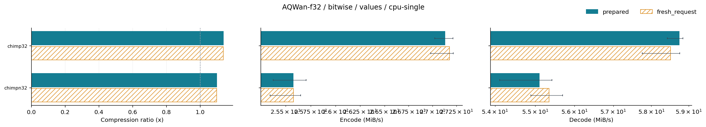

[SVG](figures/AQWan-f32--bitwise--cpu-single.svg)

<details><summary>完整数值、有效批次及拒绝原因</summary>

| codec | 完整输出 bytes P / F | 压缩倍数 P / F | 编码 MiB/s P / F | 解码 MiB/s P / F | 有效批次 P / F |
|---|---:|---:|---:|---:|---:|
| chimp32 | 1.36e+06 / 1.36e+06 | 1.14 / 1.14 | 27.1 / 27.2 | 58.7 / 58.5 | 14/14 / 14/14 |
| chimpn32 | 1.41e+06 / 1.41e+06 | 1.1 / 1.1 | 25.6 / 25.6 | 55.1 / 55.4 | 14/14 / 14/14 |

</details>

**<f4 · [35064, 11] · 经验质量（无最大误差保证） · values · cpu-single**

运行进程 CPU 亲和性（P / F）：`[(0, 1, 2, 3, 4, 5, 6, 7, 8, 9, 10, 11, 12, 13, 14, 15)]` / `[(0, 1, 2, 3, 4, 5, 6, 7, 8, 9, 10, 11, 12, 13, 14, 15)]`；逐配置创建时间见 CSV，是否处于并行窗口见调度记录。

f64→f32 准备阶段转换的最大绝对差：**4.8828125e-05**；本组 codec 的恢复质量相对转换后的 f32 输入验证。

<details><summary>完整数值、有效批次及拒绝原因</summary>

| codec | 完整输出 bytes P / F | 压缩倍数 P / F | 编码 MiB/s P / F | 解码 MiB/s P / F | 有效批次 P / F |
|---|---:|---:|---:|---:|---:|
| pmc-mr | — / — | — / — | — / — | — / — | 0/0 / 0/0 |
| swing-filter | — / — | — / — | — / — | — / — | 0/0 / 0/0 |
| swing-filter-disjoint | — / — | — / — | — / — | — / — | 0/0 / 0/0 |
| swing-filter-disjoint-quantized / compatible | — / — | — / — | — / — | — / — | 0/0 / 0/0 |

拒绝或未完整完成的请求：

- `pmc-mr` / fresh_request：unsupported，filter native_core requires one column; object/native_api preserve independent columns
- `pmc-mr` / prepared：unsupported，filter native_core requires one column; object/native_api preserve independent columns
- `swing-filter` / fresh_request：unsupported，filter native_core requires one column; object/native_api preserve independent columns
- `swing-filter` / prepared：unsupported，filter native_core requires one column; object/native_api preserve independent columns
- `swing-filter-disjoint` / fresh_request：unsupported，filter native_core requires one column; object/native_api preserve independent columns
- `swing-filter-disjoint` / prepared：unsupported，filter native_core requires one column; object/native_api preserve independent columns
- `swing-filter-disjoint-quantized / compatible` / fresh_request：unsupported，filter native_core requires one column; object/native_api preserve independent columns
- `swing-filter-disjoint-quantized / compatible` / prepared：unsupported，filter native_core requires one column; object/native_api preserve independent columns

</details>

**<f8 · [35064, 11] · 无损 · values · cpu-single**

运行进程 CPU 亲和性（P / F）：`[(0, 1, 2, 3, 4, 5, 6, 7, 8, 9, 10, 11, 12, 13, 14, 15)]` / `[(0, 1, 2, 3, 4, 5, 6, 7, 8, 9, 10, 11, 12, 13, 14, 15)]`；逐配置创建时间见 CSV，是否处于并行窗口见调度记录。

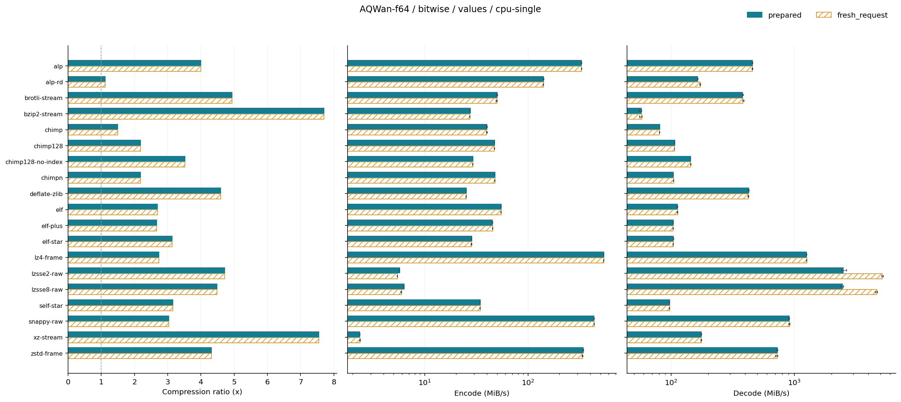

[SVG](figures/AQWan-f64--bitwise--cpu-single.svg)

<details><summary>完整数值、有效批次及拒绝原因</summary>

| codec | 完整输出 bytes P / F | 压缩倍数 P / F | 编码 MiB/s P / F | 解码 MiB/s P / F | 有效批次 P / F |
|---|---:|---:|---:|---:|---:|
| alp | 7.73e+05 / 7.73e+05 | 3.99 / 3.99 | 328 / 329 | 458 / 457 | 14/14 / 14/14 |
| alp-rd | 2.76e+06 / 2.76e+06 | 1.12 / 1.12 | 141 / 141 | 165 / 173 | 14/14 / 14/14 |
| brotli-stream | 6.26e+05 / 6.26e+05 | 4.93 / 4.93 | 50.2 / 50 | 381 / 383 | 14/14 / 14/14 |
| bzip2-stream | 4.01e+05 / 4.01e+05 | 7.7 / 7.7 | 27.5 / 27.3 | 57.4 / 57.6 | 14/14 / 14/14 |
| chimp | 2.06e+06 / 2.06e+06 | 1.5 / 1.5 | 39.9 / 39.6 | 81 / 80.6 | 14/14 / 14/14 |
| chimp128 | 1.42e+06 / 1.42e+06 | 2.18 / 2.18 | 47.2 / 47.1 | 107 / 107 | 14/14 / 14/14 |
| chimp128-no-index | 8.75e+05 / 8.75e+05 | 3.52 / 3.52 | 29.2 / 29.2 | 144 / 144 | 14/14 / 14/14 |
| chimp32 | — / — | — / — | — / — | — / — | 0/0 / 0/0 |
| chimpn | 1.42e+06 / 1.42e+06 | 2.18 / 2.18 | 47.8 / 47.7 | 105 / 105 | 14/14 / 14/14 |
| chimpn32 | — / — | — / — | — / — | — / — | 0/0 / 0/0 |
| deflate-zlib | 6.72e+05 / 6.72e+05 | 4.59 / 4.59 | 25.3 / 25.1 | 426 / 424 | 14/14 / 14/14 |
| elf | 1.15e+06 / 1.15e+06 | 2.69 / 2.69 | 54.9 / 55 | 113 / 113 | 14/14 / 14/14 |
| elf-plus | 1.16e+06 / 1.16e+06 | 2.67 / 2.67 | 45.2 / 45.4 | 104 / 104 | 14/14 / 14/14 |
| elf-star | 9.86e+05 / 9.86e+05 | 3.13 / 3.13 | 28.4 / 28.3 | 105 / 104 | 14/14 / 14/14 |
| fse | — / — | — / — | — / — | — / — | 0/0 / 0/0 |
| gorilla-prometheus-xor | — / — | — / — | — / — | — / — | 0/0 / 0/0 |
| huff0 | — / — | — / — | — / — | — / — | 0/0 / 0/0 |
| leats-lossless-i64 | — / — | — / — | — / — | — / — | 0/0 / 0/0 |
| lz4-frame | 1.13e+06 / 1.13e+06 | 2.74 / 2.74 | 539 / 542 | 1.26e+03 / 1.26e+03 | 14/14 / 14/14 |
| lzsse2-raw | 6.54e+05 / 6.54e+05 | 4.72 / 4.72 | 5.71 / 5.44 | 2.5e+03 / 5.17e+03 | 14/14 / 14/14 |
| lzsse8-raw | 6.88e+05 / 6.88e+05 | 4.49 / 4.49 | 6.3 / 5.94 | 2.47e+03 / 4.69e+03 | 14/14 / 14/14 |
| neats-lossless-i64 | — / — | — / — | — / — | — / — | 0/0 / 0/0 |
| self-star | 9.79e+05 / 9.79e+05 | 3.15 / 3.15 | 34.3 / 34.4 | 97.4 / 97.3 | 14/14 / 14/14 |
| simdcomp-u32 | — / — | — / — | — / — | — / — | 0/0 / 0/0 |
| snappy-raw | 1.02e+06 / 1.02e+06 | 3.03 / 3.03 | 434 / 437 | 912 / 916 | 14/14 / 14/14 |
| sprintz-delta | — / — | — / — | — / — | — / — | 0/0 / 0/0 |
| sprintz-delta-huffman | — / — | — / — | — / — | — / — | 0/0 / 0/0 |
| sprintz-fire | — / — | — / — | — / — | — / — | 0/0 / 0/0 |
| sprintz-fire-huffman | — / — | — / — | — / — | — / — | 0/0 / 0/0 |
| xz-stream | 4.09e+05 / 4.09e+05 | 7.55 / 7.55 | 2.35 / 2.37 | 176 / 176 | 14/14 / 14/14 |
| zstd-frame | 7.15e+05 / 7.15e+05 | 4.31 / 4.31 | 341 / 336 | 731 / 725 | 14/14 / 14/14 |

拒绝或未完整完成的请求：

- `chimp32` / fresh_request：unsupported，chimp32: dtype must be one of ('<f4',)
- `chimp32` / prepared：unsupported，chimp32: dtype must be one of ('<f4',)
- `chimpn32` / fresh_request：unsupported，chimpn32: dtype must be one of ('<f4',)
- `chimpn32` / prepared：unsupported，chimpn32: dtype must be one of ('<f4',)
- `fse` / fresh_request：unsupported，fse: n=35064 exceeds native limits
- `fse` / prepared：unsupported，fse: n=35064 exceeds native limits
- `gorilla-prometheus-xor` / fresh_request：unsupported，Gorilla requires actual paired T/V; values-only and timestamp-only are unsupported
- `gorilla-prometheus-xor` / prepared：unsupported，Gorilla requires actual paired T/V; values-only and timestamp-only are unsupported
- `huff0` / fresh_request：unsupported，huff0: n=35064 exceeds native limits
- `huff0` / prepared：unsupported，huff0: n=35064 exceeds native limits
- `leats-lossless-i64` / fresh_request：unsupported，leats-lossless-i64: dtype must be one of ('|i1', '<i2', '<i4', '<i8')
- `leats-lossless-i64` / prepared：unsupported，leats-lossless-i64: dtype must be one of ('|i1', '<i2', '<i4', '<i8')
- `neats-lossless-i64` / fresh_request：unsupported，neats-lossless-i64: dtype must be one of ('|i1', '<i2', '<i4', '<i8')
- `neats-lossless-i64` / prepared：unsupported，neats-lossless-i64: dtype must be one of ('|i1', '<i2', '<i4', '<i8')
- `simdcomp-u32` / fresh_request：unsupported，simdcomp-u32: dtype must be one of ('<u4',)
- `simdcomp-u32` / prepared：unsupported，simdcomp-u32: dtype must be one of ('<u4',)
- `sprintz-delta` / fresh_request：unsupported，sprintz-delta: dtype must be one of ('|u1', '|i1', '<u2', '<i2')
- `sprintz-delta` / prepared：unsupported，sprintz-delta: dtype must be one of ('|u1', '|i1', '<u2', '<i2')
- `sprintz-delta-huffman` / fresh_request：unsupported，sprintz-delta-huffman: dtype must be one of ('|u1', '|i1', '<u2', '<i2')
- `sprintz-delta-huffman` / prepared：unsupported，sprintz-delta-huffman: dtype must be one of ('|u1', '|i1', '<u2', '<i2')
- `sprintz-fire` / fresh_request：unsupported，sprintz-fire: dtype must be one of ('|u1', '|i1', '<u2', '<i2')
- `sprintz-fire` / prepared：unsupported，sprintz-fire: dtype must be one of ('|u1', '|i1', '<u2', '<i2')
- `sprintz-fire-huffman` / fresh_request：unsupported，sprintz-fire-huffman: dtype must be one of ('|u1', '|i1', '<u2', '<i2')
- `sprintz-fire-huffman` / prepared：unsupported，sprintz-fire-huffman: dtype must be one of ('|u1', '|i1', '<u2', '<i2')

</details>

**<f8 · [35064, 11] · ABS ≤ 0.01 · values · cpu-single**

运行进程 CPU 亲和性（P / F）：`[(0, 1, 2, 3, 4, 5, 6, 7, 8, 9, 10, 11, 12, 13, 14, 15)]` / `[(0, 1, 2, 3, 4, 5, 6, 7, 8, 9, 10, 11, 12, 13, 14, 15)]`；逐配置创建时间见 CSV，是否处于并行窗口见调度记录。


[SVG](figures/AQWan-f64--bounded_abs--cpu-single.svg)

<details><summary>完整数值、有效批次及拒绝原因</summary>

| codec | 完整输出 bytes P / F | 压缩倍数 P / F | 编码 MiB/s P / F | 解码 MiB/s P / F | 有效批次 P / F |
|---|---:|---:|---:|---:|---:|
| serf-qt | 1.25e+06 / 1.25e+06 | 2.47 / 2.47 | 138 / 138 | 110 / 112 | 14/14 / 14/14 |
| serf-xor | 1.09e+06 / 1.09e+06 | 2.83 / 2.83 | 136 / 135 | 298 / 316 | 14/14 / 14/14 |
| zfp-accuracy-1d | 1.06e+06 / 1.06e+06 | 2.92 / 2.92 | 364 / 359 | 210 / 208 | 14/14 / 14/14 |

</details>

**<f8 · [35064, 11] · 经验质量（无最大误差保证） · values · cpu-single**

运行进程 CPU 亲和性（P / F）：`[(0, 1, 2, 3, 4, 5, 6, 7, 8, 9, 10, 11, 12, 13, 14, 15)]` / `[(0, 1, 2, 3, 4, 5, 6, 7, 8, 9, 10, 11, 12, 13, 14, 15)]`；逐配置创建时间见 CSV，是否处于并行窗口见调度记录。

<details><summary>完整数值、有效批次及拒绝原因</summary>

| codec | 完整输出 bytes P / F | 压缩倍数 P / F | 编码 MiB/s P / F | 解码 MiB/s P / F | 有效批次 P / F |
|---|---:|---:|---:|---:|---:|
| abba | — / — | — / — | — / — | — / — | 0/0 / 0/0 |
| cameo | — / — | — / — | — / — | — / — | 0/0 / 0/0 |
| dft | — / — | — / — | — / — | — / — | 0/0 / 0/0 |
| dwt-dct-ii | — / — | — / — | — / — | — / — | 0/0 / 0/0 |
| fabba | — / — | — / — | — / — | — / — | 0/0 / 0/0 |
| pip | — / — | — / — | — / — | — / — | 0/0 / 0/0 |
| pmc-mean | — / — | — / — | — / — | — / — | 0/0 / 0/0 |
| pmc-mr | — / — | — / — | — / — | — / — | 0/0 / 0/0 |
| qabba | — / — | — / — | — / — | — / — | 0/0 / 0/0 |
| sim-piece | — / — | — / — | — / — | — / — | 0/0 / 0/0 |
| swab | — / — | — / — | — / — | — / — | 0/0 / 0/0 |
| swing-connected | — / — | — / — | — / — | — / — | 0/0 / 0/0 |
| swing-filter | — / — | — / — | — / — | — / — | 0/0 / 0/0 |
| swing-filter-disjoint | — / — | — / — | — / — | — / — | 0/0 / 0/0 |
| swing-filter-disjoint-quantized / compatible | — / — | — / — | — / — | — / — | 0/0 / 0/0 |
| tp | — / — | — / — | — / — | — / — | 0/0 / 0/0 |
| vw | — / — | — / — | — / — | — / — | 0/0 / 0/0 |

拒绝或未完整完成的请求：

- `abba` / fresh_request：unsupported，abba: native_core requires rank1; use object/native_api for independent columns
- `abba` / prepared：unsupported，abba: native_core requires rank1; use object/native_api for independent columns
- `cameo` / fresh_request：unsupported，cameo: element limit exceeded
- `cameo` / prepared：unsupported，cameo: element limit exceeded
- `dft` / fresh_request：unsupported，dft: element limit exceeded
- `dft` / prepared：unsupported，dft: element limit exceeded
- `dwt-dct-ii` / fresh_request：unsupported，dwt-dct-ii: element limit exceeded
- `dwt-dct-ii` / prepared：unsupported，dwt-dct-ii: element limit exceeded
- `fabba` / fresh_request：unsupported，fabba: native_core requires rank1; use object/native_api for independent columns
- `fabba` / prepared：unsupported，fabba: native_core requires rank1; use object/native_api for independent columns
- `pip` / fresh_request：unsupported，pip: element limit exceeded
- `pip` / prepared：unsupported，pip: element limit exceeded
- `pmc-mean` / fresh_request：unsupported，pmc-mean: element limit exceeded
- `pmc-mean` / prepared：unsupported，pmc-mean: element limit exceeded
- `pmc-mr` / fresh_request：unsupported，pmc-mr: dtype must be one of ('<f4',)
- `pmc-mr` / prepared：unsupported，pmc-mr: dtype must be one of ('<f4',)
- `qabba` / fresh_request：unsupported，qabba: native_core requires rank1; use object/native_api for independent columns
- `qabba` / prepared：unsupported，qabba: native_core requires rank1; use object/native_api for independent columns
- `sim-piece` / fresh_request：unsupported，sim-piece: element limit exceeded
- `sim-piece` / prepared：unsupported，sim-piece: element limit exceeded
- `swab` / fresh_request：unsupported，swab: element limit exceeded
- `swab` / prepared：unsupported，swab: element limit exceeded
- `swing-connected` / fresh_request：unsupported，swing-connected: element limit exceeded
- `swing-connected` / prepared：unsupported，swing-connected: element limit exceeded
- `swing-filter` / fresh_request：unsupported，swing-filter: dtype must be one of ('<f4',)
- `swing-filter` / prepared：unsupported，swing-filter: dtype must be one of ('<f4',)
- `swing-filter-disjoint` / fresh_request：unsupported，swing-filter-disjoint: dtype must be one of ('<f4',)
- `swing-filter-disjoint` / prepared：unsupported，swing-filter-disjoint: dtype must be one of ('<f4',)
- `swing-filter-disjoint-quantized / compatible` / fresh_request：unsupported，swing-filter-disjoint-quantized: dtype must be one of ('<f4',)
- `swing-filter-disjoint-quantized / compatible` / prepared：unsupported，swing-filter-disjoint-quantized: dtype must be one of ('<f4',)
- `tp` / fresh_request：unsupported，tp: element limit exceeded
- `tp` / prepared：unsupported，tp: element limit exceeded
- `vw` / fresh_request：unsupported，vw: element limit exceeded
- `vw` / prepared：unsupported，vw: element limit exceeded

</details>

<a id="dataset-Covid-19"></a>

### Covid-19

**<f4 · [1392, 948] · 无损 · values · cpu-single**

运行进程 CPU 亲和性（P / F）：`[(0, 1, 2, 3, 4, 5, 6, 7, 8, 9, 10, 11, 12, 13, 14, 15)]` / `[(0, 1, 2, 3, 4, 5, 6, 7, 8, 9, 10, 11, 12, 13, 14, 15)]`；逐配置创建时间见 CSV，是否处于并行窗口见调度记录。

f64→f32 准备阶段转换的最大绝对差：**4**；本组 codec 的恢复质量相对转换后的 f32 输入验证。

<details><summary>完整数值、有效批次及拒绝原因</summary>

| codec | 完整输出 bytes P / F | 压缩倍数 P / F | 编码 MiB/s P / F | 解码 MiB/s P / F | 有效批次 P / F |
|---|---:|---:|---:|---:|---:|
| chimp32 | — / — | — / — | — / — | — / — | 0/0 / 0/0 |
| chimpn32 | — / — | — / — | — / — | — / — | 0/0 / 0/0 |

拒绝或未完整完成的请求：

- `chimp32` / fresh_request：unsupported，chimp32: element limit exceeded
- `chimp32` / prepared：unsupported，chimp32: element limit exceeded
- `chimpn32` / fresh_request：unsupported，chimpn32: element limit exceeded
- `chimpn32` / prepared：unsupported，chimpn32: element limit exceeded

</details>

**<f4 · [1392, 948] · 经验质量（无最大误差保证） · values · cpu-single**

运行进程 CPU 亲和性（P / F）：`[(0, 1, 2, 3, 4, 5, 6, 7, 8, 9, 10, 11, 12, 13, 14, 15)]` / `[(0, 1, 2, 3, 4, 5, 6, 7, 8, 9, 10, 11, 12, 13, 14, 15)]`；逐配置创建时间见 CSV，是否处于并行窗口见调度记录。

f64→f32 准备阶段转换的最大绝对差：**4**；本组 codec 的恢复质量相对转换后的 f32 输入验证。

<details><summary>完整数值、有效批次及拒绝原因</summary>

| codec | 完整输出 bytes P / F | 压缩倍数 P / F | 编码 MiB/s P / F | 解码 MiB/s P / F | 有效批次 P / F |
|---|---:|---:|---:|---:|---:|
| pmc-mr | — / — | — / — | — / — | — / — | 0/0 / 0/0 |
| swing-filter | — / — | — / — | — / — | — / — | 0/0 / 0/0 |
| swing-filter-disjoint | — / — | — / — | — / — | — / — | 0/0 / 0/0 |
| swing-filter-disjoint-quantized / compatible | — / — | — / — | — / — | — / — | 0/0 / 0/0 |

拒绝或未完整完成的请求：

- `pmc-mr` / fresh_request：unsupported，pmc-mr: element limit exceeded
- `pmc-mr` / prepared：unsupported，pmc-mr: element limit exceeded
- `swing-filter` / fresh_request：unsupported，swing-filter: element limit exceeded
- `swing-filter` / prepared：unsupported，swing-filter: element limit exceeded
- `swing-filter-disjoint` / fresh_request：unsupported，swing-filter-disjoint: element limit exceeded
- `swing-filter-disjoint` / prepared：unsupported，swing-filter-disjoint: element limit exceeded
- `swing-filter-disjoint-quantized / compatible` / fresh_request：unsupported，swing-filter-disjoint-quantized: element limit exceeded
- `swing-filter-disjoint-quantized / compatible` / prepared：unsupported，swing-filter-disjoint-quantized: element limit exceeded

</details>

**<f8 · [1392, 948] · 无损 · values · cpu-single**

运行进程 CPU 亲和性（P / F）：`[(0, 1, 2, 3, 4, 5, 6, 7, 8, 9, 10, 11, 12, 13, 14, 15)]` / `[(0, 1, 2, 3, 4, 5, 6, 7, 8, 9, 10, 11, 12, 13, 14, 15)]`；逐配置创建时间见 CSV，是否处于并行窗口见调度记录。

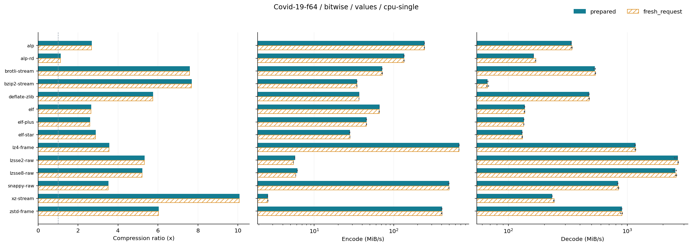

[SVG](figures/Covid-19-f64--bitwise--cpu-single.svg)

<details><summary>完整数值、有效批次及拒绝原因</summary>

| codec | 完整输出 bytes P / F | 压缩倍数 P / F | 编码 MiB/s P / F | 解码 MiB/s P / F | 有效批次 P / F |
|---|---:|---:|---:|---:|---:|
| alp | 3.95e+06 / 3.95e+06 | 2.67 / 2.67 | 243 / 245 | 338 / 343 | 14/14 / 14/14 |
| alp-rd | 9.5e+06 / 9.5e+06 | 1.11 / 1.11 | 135 / 135 | 163 / 170 | 14/14 / 14/14 |
| brotli-stream | 1.39e+06 / 1.39e+06 | 7.58 / 7.58 | 71 / 71.9 | 531 / 538 | 14/14 / 14/14 |
| bzip2-stream | 1.37e+06 / 1.37e+06 | 7.68 / 7.68 | 34.4 / 34.5 | 66.4 / 66.7 | 14/14 / 14/14 |
| chimp | — / — | — / — | — / — | — / — | 0/0 / 0/0 |
| chimp128 | — / — | — / — | — / — | — / — | 0/0 / 0/0 |
| chimp128-no-index | — / — | — / — | — / — | — / — | 0/0 / 0/0 |
| chimp32 | — / — | — / — | — / — | — / — | 0/0 / 0/0 |
| chimpn | — / — | — / — | — / — | — / — | 0/0 / 0/0 |
| chimpn32 | — / — | — / — | — / — | — / — | 0/0 / 0/0 |
| deflate-zlib | 1.84e+06 / 1.84e+06 | 5.74 / 5.74 | 36.6 / 36.7 | 475 / 478 | 14/14 / 14/14 |
| elf | 3.99e+06 / 3.99e+06 | 2.65 / 2.65 | 66 / 65.9 | 137 / 138 | 14/14 / 14/14 |
| elf-plus | 4.08e+06 / 4.08e+06 | 2.59 / 2.59 | 45.3 / 45.5 | 135 / 135 | 14/14 / 14/14 |
| elf-star | 3.67e+06 / 3.67e+06 | 2.87 / 2.87 | 28 / 28.2 | 130 / 131 | 14/14 / 14/14 |
| fse | — / — | — / — | — / — | — / — | 0/0 / 0/0 |
| gorilla-prometheus-xor | — / — | — / — | — / — | — / — | 0/0 / 0/0 |
| huff0 | — / — | — / — | — / — | — / — | 0/0 / 0/0 |
| leats-lossless-i64 | — / — | — / — | — / — | — / — | 0/0 / 0/0 |
| lz4-frame | 2.98e+06 / 2.98e+06 | 3.55 / 3.55 | 665 / 664 | 1.17e+03 / 1.17e+03 | 14/14 / 14/14 |
| lzsse2-raw | 1.99e+06 / 1.99e+06 | 5.32 / 5.32 | 5.69 / 5.48 | 2.65e+03 / 2.68e+03 | 14/14 / 14/14 |
| lzsse8-raw | 2.03e+06 / 2.03e+06 | 5.2 / 5.2 | 6.11 / 5.87 | 2.53e+03 / 2.58e+03 | 14/14 / 14/14 |
| neats-lossless-i64 | — / — | — / — | — / — | — / — | 0/0 / 0/0 |
| self-star | — / — | — / — | — / — | — / — | 0/0 / 0/0 |
| simdcomp-u32 | — / — | — / — | — / — | — / — | 0/0 / 0/0 |
| snappy-raw | 3.01e+06 / 3.01e+06 | 3.51 / 3.51 | 495 / 499 | 833 / 845 | 14/14 / 14/14 |
| sprintz-delta | — / — | — / — | — / — | — / — | 0/0 / 0/0 |
| sprintz-delta-huffman | — / — | — / — | — / — | — / — | 0/0 / 0/0 |
| sprintz-fire | — / — | — / — | — / — | — / — | 0/0 / 0/0 |
| sprintz-fire-huffman | — / — | — / — | — / — | — / — | 0/0 / 0/0 |
| xz-stream | 1.05e+06 / 1.05e+06 | 10.1 / 10.1 | 2.59 / 2.6 | 233 / 243 | 14/14 / 14/14 |
| zstd-frame | 1.75e+06 / 1.75e+06 | 6.02 / 6.02 | 404 / 405 | 896 / 903 | 14/14 / 14/14 |

拒绝或未完整完成的请求：

- `chimp` / fresh_request：unsupported，chimp: element limit exceeded
- `chimp` / prepared：unsupported，chimp: element limit exceeded
- `chimp128` / fresh_request：unsupported，chimp128: element limit exceeded
- `chimp128` / prepared：unsupported，chimp128: element limit exceeded
- `chimp128-no-index` / fresh_request：unsupported，chimp128-no-index: element limit exceeded
- `chimp128-no-index` / prepared：unsupported，chimp128-no-index: element limit exceeded
- `chimp32` / fresh_request：unsupported，chimp32: dtype must be one of ('<f4',)
- `chimp32` / prepared：unsupported，chimp32: dtype must be one of ('<f4',)
- `chimpn` / fresh_request：unsupported，chimpn: element limit exceeded
- `chimpn` / prepared：unsupported，chimpn: element limit exceeded
- `chimpn32` / fresh_request：unsupported，chimpn32: dtype must be one of ('<f4',)
- `chimpn32` / prepared：unsupported，chimpn32: dtype must be one of ('<f4',)
- `fse` / fresh_request：unsupported，fse: m=948 exceeds native limits
- `fse` / prepared：unsupported，fse: m=948 exceeds native limits
- `gorilla-prometheus-xor` / fresh_request：unsupported，Gorilla requires actual paired T/V; values-only and timestamp-only are unsupported
- `gorilla-prometheus-xor` / prepared：unsupported，Gorilla requires actual paired T/V; values-only and timestamp-only are unsupported
- `huff0` / fresh_request：unsupported，huff0: m=948 exceeds native limits
- `huff0` / prepared：unsupported，huff0: m=948 exceeds native limits
- `leats-lossless-i64` / fresh_request：unsupported，leats-lossless-i64: dtype must be one of ('|i1', '<i2', '<i4', '<i8')
- `leats-lossless-i64` / prepared：unsupported，leats-lossless-i64: dtype must be one of ('|i1', '<i2', '<i4', '<i8')
- `neats-lossless-i64` / fresh_request：unsupported，neats-lossless-i64: dtype must be one of ('|i1', '<i2', '<i4', '<i8')
- `neats-lossless-i64` / prepared：unsupported，neats-lossless-i64: dtype must be one of ('|i1', '<i2', '<i4', '<i8')
- `self-star` / fresh_request：unsupported，SElfStar intrinsic session limits exceeded 
- `self-star` / prepared：unsupported，SElfStar intrinsic session limits exceeded 
- `simdcomp-u32` / fresh_request：unsupported，simdcomp-u32: dtype must be one of ('<u4',)
- `simdcomp-u32` / prepared：unsupported，simdcomp-u32: dtype must be one of ('<u4',)
- `sprintz-delta` / fresh_request：unsupported，sprintz-delta: dtype must be one of ('|u1', '|i1', '<u2', '<i2')
- `sprintz-delta` / prepared：unsupported，sprintz-delta: dtype must be one of ('|u1', '|i1', '<u2', '<i2')
- `sprintz-delta-huffman` / fresh_request：unsupported，sprintz-delta-huffman: dtype must be one of ('|u1', '|i1', '<u2', '<i2')
- `sprintz-delta-huffman` / prepared：unsupported，sprintz-delta-huffman: dtype must be one of ('|u1', '|i1', '<u2', '<i2')
- `sprintz-fire` / fresh_request：unsupported，sprintz-fire: dtype must be one of ('|u1', '|i1', '<u2', '<i2')
- `sprintz-fire` / prepared：unsupported，sprintz-fire: dtype must be one of ('|u1', '|i1', '<u2', '<i2')
- `sprintz-fire-huffman` / fresh_request：unsupported，sprintz-fire-huffman: dtype must be one of ('|u1', '|i1', '<u2', '<i2')
- `sprintz-fire-huffman` / prepared：unsupported，sprintz-fire-huffman: dtype must be one of ('|u1', '|i1', '<u2', '<i2')

</details>

**<f8 · [1392, 948] · ABS ≤ 0.01 · values · cpu-single**

运行进程 CPU 亲和性（P / F）：`[(0, 1, 2, 3, 4, 5, 6, 7, 8, 9, 10, 11, 12, 13, 14, 15)]` / `[(0, 1, 2, 3, 4, 5, 6, 7, 8, 9, 10, 11, 12, 13, 14, 15)]`；逐配置创建时间见 CSV，是否处于并行窗口见调度记录。

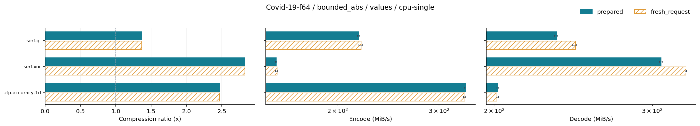

[SVG](figures/Covid-19-f64--bounded_abs--cpu-single.svg)

<details><summary>完整数值、有效批次及拒绝原因</summary>

| codec | 完整输出 bytes P / F | 压缩倍数 P / F | 编码 MiB/s P / F | 解码 MiB/s P / F | 有效批次 P / F |
|---|---:|---:|---:|---:|---:|
| serf-qt | 7.74e+06 / 7.74e+06 | 1.36 / 1.36 | 218 / 220 | 235 / 246 | 14/14 / 14/14 |
| serf-xor | 3.73e+06 / 3.73e+06 | 2.83 / 2.83 | 157 / 157 | 307 / 327 | 14/14 / 14/14 |
| zfp-accuracy-1d | 4.28e+06 / 4.28e+06 | 2.47 / 2.47 | 334 / 333 | 202 / 201 | 14/14 / 14/14 |

</details>

**<f8 · [1392, 948] · 经验质量（无最大误差保证） · values · cpu-single**

运行进程 CPU 亲和性（P / F）：`[(0, 1, 2, 3, 4, 5, 6, 7, 8, 9, 10, 11, 12, 13, 14, 15)]` / `[(0, 1, 2, 3, 4, 5, 6, 7, 8, 9, 10, 11, 12, 13, 14, 15)]`；逐配置创建时间见 CSV，是否处于并行窗口见调度记录。

<details><summary>完整数值、有效批次及拒绝原因</summary>

| codec | 完整输出 bytes P / F | 压缩倍数 P / F | 编码 MiB/s P / F | 解码 MiB/s P / F | 有效批次 P / F |
|---|---:|---:|---:|---:|---:|
| abba | — / — | — / — | — / — | — / — | 0/0 / 0/0 |
| cameo | — / — | — / — | — / — | — / — | 0/0 / 0/0 |
| dft | — / — | — / — | — / — | — / — | 0/0 / 0/0 |
| dwt-dct-ii | — / — | — / — | — / — | — / — | 0/0 / 0/0 |
| fabba | — / — | — / — | — / — | — / — | 0/0 / 0/0 |
| pip | — / — | — / — | — / — | — / — | 0/0 / 0/0 |
| pmc-mean | — / — | — / — | — / — | — / — | 0/0 / 0/0 |
| pmc-mr | — / — | — / — | — / — | — / — | 0/0 / 0/0 |
| qabba | — / — | — / — | — / — | — / — | 0/0 / 0/0 |
| sim-piece | — / — | — / — | — / — | — / — | 0/0 / 0/0 |
| swab | — / — | — / — | — / — | — / — | 0/0 / 0/0 |
| swing-connected | — / — | — / — | — / — | — / — | 0/0 / 0/0 |
| swing-filter | — / — | — / — | — / — | — / — | 0/0 / 0/0 |
| swing-filter-disjoint | — / — | — / — | — / — | — / — | 0/0 / 0/0 |
| swing-filter-disjoint-quantized / compatible | — / — | — / — | — / — | — / — | 0/0 / 0/0 |
| tp | — / — | — / — | — / — | — / — | 0/0 / 0/0 |
| vw | — / — | — / — | — / — | — / — | 0/0 / 0/0 |

拒绝或未完整完成的请求：

- `abba` / fresh_request：unsupported，abba: element limit exceeded
- `abba` / prepared：unsupported，abba: element limit exceeded
- `cameo` / fresh_request：unsupported，cameo: element limit exceeded
- `cameo` / prepared：unsupported，cameo: element limit exceeded
- `dft` / fresh_request：unsupported，dft: element limit exceeded
- `dft` / prepared：unsupported，dft: element limit exceeded
- `dwt-dct-ii` / fresh_request：unsupported，dwt-dct-ii: element limit exceeded
- `dwt-dct-ii` / prepared：unsupported，dwt-dct-ii: element limit exceeded
- `fabba` / fresh_request：unsupported，fabba: element limit exceeded
- `fabba` / prepared：unsupported，fabba: element limit exceeded
- `pip` / fresh_request：unsupported，pip: element limit exceeded
- `pip` / prepared：unsupported，pip: element limit exceeded
- `pmc-mean` / fresh_request：unsupported，pmc-mean: element limit exceeded
- `pmc-mean` / prepared：unsupported，pmc-mean: element limit exceeded
- `pmc-mr` / fresh_request：unsupported，pmc-mr: dtype must be one of ('<f4',)
- `pmc-mr` / prepared：unsupported，pmc-mr: dtype must be one of ('<f4',)
- `qabba` / fresh_request：unsupported，qabba: element limit exceeded
- `qabba` / prepared：unsupported，qabba: element limit exceeded
- `sim-piece` / fresh_request：unsupported，sim-piece: element limit exceeded
- `sim-piece` / prepared：unsupported，sim-piece: element limit exceeded
- `swab` / fresh_request：unsupported，swab: element limit exceeded
- `swab` / prepared：unsupported，swab: element limit exceeded
- `swing-connected` / fresh_request：unsupported，swing-connected: element limit exceeded
- `swing-connected` / prepared：unsupported，swing-connected: element limit exceeded
- `swing-filter` / fresh_request：unsupported，swing-filter: dtype must be one of ('<f4',)
- `swing-filter` / prepared：unsupported，swing-filter: dtype must be one of ('<f4',)
- `swing-filter-disjoint` / fresh_request：unsupported，swing-filter-disjoint: dtype must be one of ('<f4',)
- `swing-filter-disjoint` / prepared：unsupported，swing-filter-disjoint: dtype must be one of ('<f4',)
- `swing-filter-disjoint-quantized / compatible` / fresh_request：unsupported，swing-filter-disjoint-quantized: dtype must be one of ('<f4',)
- `swing-filter-disjoint-quantized / compatible` / prepared：unsupported，swing-filter-disjoint-quantized: dtype must be one of ('<f4',)
- `tp` / fresh_request：unsupported，tp: element limit exceeded
- `tp` / prepared：unsupported，tp: element limit exceeded
- `vw` / fresh_request：unsupported，vw: element limit exceeded
- `vw` / prepared：unsupported，vw: element limit exceeded

</details>

**<i8 · [1392, 948] · 无损 · values · cpu-single**

运行进程 CPU 亲和性（P / F）：`[(0, 1, 2, 3, 4, 5, 6, 7, 8, 9, 10, 11, 12, 13, 14, 15)]` / `[(0, 1, 2, 3, 4, 5, 6, 7, 8, 9, 10, 11, 12, 13, 14, 15)]`；逐配置创建时间见 CSV，是否处于并行窗口见调度记录。

<details><summary>完整数值、有效批次及拒绝原因</summary>

| codec | 完整输出 bytes P / F | 压缩倍数 P / F | 编码 MiB/s P / F | 解码 MiB/s P / F | 有效批次 P / F |
|---|---:|---:|---:|---:|---:|
| leats-lossless-i64 | — / — | — / — | — / — | — / — | 0/0 / 0/0 |
| neats-lossless-i64 | — / — | — / — | — / — | — / — | 0/0 / 0/0 |

拒绝或未完整完成的请求：

- `leats-lossless-i64` / fresh_request：unsupported，leats-lossless-i64: m=948 exceeds native limits
- `leats-lossless-i64` / prepared：unsupported，leats-lossless-i64: m=948 exceeds native limits
- `neats-lossless-i64` / fresh_request：unsupported，neats-lossless-i64: m=948 exceeds native limits
- `neats-lossless-i64` / prepared：unsupported，neats-lossless-i64: m=948 exceeds native limits

</details>

<a id="dataset-CzeLan"></a>

### CzeLan

**<f4 · [19934, 11] · 无损 · values · cpu-single**

运行进程 CPU 亲和性（P / F）：`[(0, 1, 2, 3, 4, 5, 6, 7, 8, 9, 10, 11, 12, 13, 14, 15)]` / `[(0, 1, 2, 3, 4, 5, 6, 7, 8, 9, 10, 11, 12, 13, 14, 15)]`；逐配置创建时间见 CSV，是否处于并行窗口见调度记录。

f64→f32 准备阶段转换的最大绝对差：**0.00048828125**；本组 codec 的恢复质量相对转换后的 f32 输入验证。

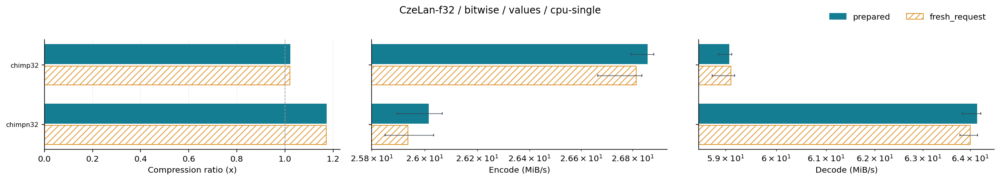

[SVG](figures/CzeLan-f32--bitwise--cpu-single.svg)

<details><summary>完整数值、有效批次及拒绝原因</summary>

| codec | 完整输出 bytes P / F | 压缩倍数 P / F | 编码 MiB/s P / F | 解码 MiB/s P / F | 有效批次 P / F |
|---|---:|---:|---:|---:|---:|
| chimp32 | 8.59e+05 / 8.59e+05 | 1.02 / 1.02 | 26.9 / 26.8 | 59.1 / 59.1 | 14/14 / 14/14 |
| chimpn32 | 7.49e+05 / 7.49e+05 | 1.17 / 1.17 | 26 / 25.9 | 64.1 / 64 | 14/14 / 14/14 |

</details>

**<f4 · [19934, 11] · 经验质量（无最大误差保证） · values · cpu-single**

运行进程 CPU 亲和性（P / F）：`[(0, 1, 2, 3, 4, 5, 6, 7, 8, 9, 10, 11, 12, 13, 14, 15)]` / `[(0, 1, 2, 3, 4, 5, 6, 7, 8, 9, 10, 11, 12, 13, 14, 15)]`；逐配置创建时间见 CSV，是否处于并行窗口见调度记录。

f64→f32 准备阶段转换的最大绝对差：**0.00048828125**；本组 codec 的恢复质量相对转换后的 f32 输入验证。

<details><summary>完整数值、有效批次及拒绝原因</summary>

| codec | 完整输出 bytes P / F | 压缩倍数 P / F | 编码 MiB/s P / F | 解码 MiB/s P / F | 有效批次 P / F |
|---|---:|---:|---:|---:|---:|
| pmc-mr | — / — | — / — | — / — | — / — | 0/0 / 0/0 |
| swing-filter | — / — | — / — | — / — | — / — | 0/0 / 0/0 |
| swing-filter-disjoint | — / — | — / — | — / — | — / — | 0/0 / 0/0 |
| swing-filter-disjoint-quantized / compatible | — / — | — / — | — / — | — / — | 0/0 / 0/0 |

拒绝或未完整完成的请求：

- `pmc-mr` / fresh_request：unsupported，filter native_core requires one column; object/native_api preserve independent columns
- `pmc-mr` / prepared：unsupported，filter native_core requires one column; object/native_api preserve independent columns
- `swing-filter` / fresh_request：unsupported，filter native_core requires one column; object/native_api preserve independent columns
- `swing-filter` / prepared：unsupported，filter native_core requires one column; object/native_api preserve independent columns
- `swing-filter-disjoint` / fresh_request：unsupported，filter native_core requires one column; object/native_api preserve independent columns
- `swing-filter-disjoint` / prepared：unsupported，filter native_core requires one column; object/native_api preserve independent columns
- `swing-filter-disjoint-quantized / compatible` / fresh_request：unsupported，filter native_core requires one column; object/native_api preserve independent columns
- `swing-filter-disjoint-quantized / compatible` / prepared：unsupported，filter native_core requires one column; object/native_api preserve independent columns

</details>

**<f8 · [19934, 11] · 无损 · values · cpu-single**

运行进程 CPU 亲和性（P / F）：`[(0, 1, 2, 3, 4, 5, 6, 7, 8, 9, 10, 11, 12, 13, 14, 15)]` / `[(0, 1, 2, 3, 4, 5, 6, 7, 8, 9, 10, 11, 12, 13, 14, 15)]`；逐配置创建时间见 CSV，是否处于并行窗口见调度记录。

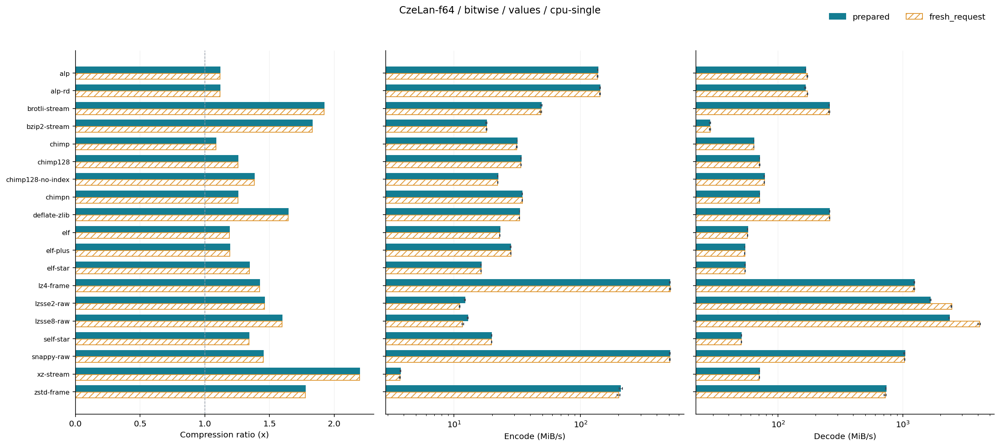

[SVG](figures/CzeLan-f64--bitwise--cpu-single.svg)

<details><summary>完整数值、有效批次及拒绝原因</summary>

| codec | 完整输出 bytes P / F | 压缩倍数 P / F | 编码 MiB/s P / F | 解码 MiB/s P / F | 有效批次 P / F |
|---|---:|---:|---:|---:|---:|
| alp | 1.57e+06 / 1.57e+06 | 1.12 / 1.12 | 137 / 136 | 166 / 172 | 14/14 / 14/14 |
| alp-rd | 1.57e+06 / 1.57e+06 | 1.12 / 1.12 | 142 / 142 | 165 / 172 | 14/14 / 14/14 |
| brotli-stream | 9.13e+05 / 9.13e+05 | 1.92 / 1.92 | 49 / 48.6 | 257 / 257 | 14/14 / 14/14 |
| bzip2-stream | 9.59e+05 / 9.59e+05 | 1.83 / 1.83 | 18.1 / 18 | 28.4 / 28.5 | 14/14 / 14/14 |
| chimp | 1.61e+06 / 1.61e+06 | 1.09 / 1.09 | 31.6 / 31.4 | 64 / 64 | 14/14 / 14/14 |
| chimp128 | 1.4e+06 / 1.4e+06 | 1.26 / 1.26 | 33.9 / 33.8 | 71.1 / 71 | 14/14 / 14/14 |
| chimp128-no-index | 1.27e+06 / 1.27e+06 | 1.38 / 1.38 | 22.2 / 22.2 | 77.5 / 77.5 | 14/14 / 14/14 |
| chimp32 | — / — | — / — | — / — | — / — | 0/0 / 0/0 |
| chimpn | 1.4e+06 / 1.4e+06 | 1.26 / 1.26 | 34.5 / 34.7 | 71 / 70.9 | 14/14 / 14/14 |
| chimpn32 | — / — | — / — | — / — | — / — | 0/0 / 0/0 |
| deflate-zlib | 1.07e+06 / 1.07e+06 | 1.65 / 1.65 | 33 / 32.9 | 258 / 260 | 14/14 / 14/14 |
| elf | 1.48e+06 / 1.48e+06 | 1.19 / 1.19 | 23.1 / 23 | 57 / 56.8 | 14/14 / 14/14 |
| elf-plus | 1.47e+06 / 1.47e+06 | 1.19 / 1.19 | 28.1 / 28.1 | 54.1 / 54 | 14/14 / 14/14 |
| elf-star | 1.31e+06 / 1.31e+06 | 1.34 / 1.34 | 16.4 / 16.4 | 54.5 / 54.3 | 14/14 / 14/14 |
| fse | — / — | — / — | — / — | — / — | 0/0 / 0/0 |
| gorilla-prometheus-xor | — / — | — / — | — / — | — / — | 0/0 / 0/0 |
| huff0 | — / — | — / — | — / — | — / — | 0/0 / 0/0 |
| leats-lossless-i64 | — / — | — / — | — / — | — / — | 0/0 / 0/0 |
| lz4-frame | 1.23e+06 / 1.23e+06 | 1.42 / 1.42 | 508 / 512 | 1.24e+03 / 1.23e+03 | 14/14 / 14/14 |
| lzsse2-raw | 1.2e+06 / 1.2e+06 | 1.46 / 1.46 | 12.2 / 11.1 | 1.66e+03 / 2.47e+03 | 14/14 / 14/14 |
| lzsse8-raw | 1.1e+06 / 1.1e+06 | 1.6 / 1.6 | 12.8 / 11.6 | 2.36e+03 / 4.12e+03 | 14/14 / 14/14 |
| neats-lossless-i64 | — / — | — / — | — / — | — / — | 0/0 / 0/0 |
| self-star | 1.31e+06 / 1.31e+06 | 1.34 / 1.34 | 19.8 / 19.8 | 50.7 / 50.6 | 14/14 / 14/14 |
| simdcomp-u32 | — / — | — / — | — / — | — / — | 0/0 / 0/0 |
| snappy-raw | 1.21e+06 / 1.21e+06 | 1.45 / 1.45 | 510 / 510 | 1.04e+03 / 1.04e+03 | 14/14 / 14/14 |
| sprintz-delta | — / — | — / — | — / — | — / — | 0/0 / 0/0 |
| sprintz-delta-huffman | — / — | — / — | — / — | — / — | 0/0 / 0/0 |
| sprintz-fire | — / — | — / — | — / — | — / — | 0/0 / 0/0 |
| sprintz-fire-huffman | — / — | — / — | — / — | — / — | 0/0 / 0/0 |
| xz-stream | 7.99e+05 / 7.99e+05 | 2.2 / 2.2 | 3.76 / 3.74 | 70.9 / 70.5 | 14/14 / 14/14 |
| zstd-frame | 9.87e+05 / 9.87e+05 | 1.78 / 1.78 | 207 / 201 | 734 / 724 | 14/14 / 14/14 |

拒绝或未完整完成的请求：

- `chimp32` / fresh_request：unsupported，chimp32: dtype must be one of ('<f4',)
- `chimp32` / prepared：unsupported，chimp32: dtype must be one of ('<f4',)
- `chimpn32` / fresh_request：unsupported，chimpn32: dtype must be one of ('<f4',)
- `chimpn32` / prepared：unsupported，chimpn32: dtype must be one of ('<f4',)
- `fse` / fresh_request：unsupported，fse: n=19934 exceeds native limits
- `fse` / prepared：unsupported，fse: n=19934 exceeds native limits
- `gorilla-prometheus-xor` / fresh_request：unsupported，Gorilla requires actual paired T/V; values-only and timestamp-only are unsupported
- `gorilla-prometheus-xor` / prepared：unsupported，Gorilla requires actual paired T/V; values-only and timestamp-only are unsupported
- `huff0` / fresh_request：unsupported，huff0: n=19934 exceeds native limits
- `huff0` / prepared：unsupported，huff0: n=19934 exceeds native limits
- `leats-lossless-i64` / fresh_request：unsupported，leats-lossless-i64: dtype must be one of ('|i1', '<i2', '<i4', '<i8')
- `leats-lossless-i64` / prepared：unsupported，leats-lossless-i64: dtype must be one of ('|i1', '<i2', '<i4', '<i8')
- `neats-lossless-i64` / fresh_request：unsupported，neats-lossless-i64: dtype must be one of ('|i1', '<i2', '<i4', '<i8')
- `neats-lossless-i64` / prepared：unsupported，neats-lossless-i64: dtype must be one of ('|i1', '<i2', '<i4', '<i8')
- `simdcomp-u32` / fresh_request：unsupported，simdcomp-u32: dtype must be one of ('<u4',)
- `simdcomp-u32` / prepared：unsupported，simdcomp-u32: dtype must be one of ('<u4',)
- `sprintz-delta` / fresh_request：unsupported，sprintz-delta: dtype must be one of ('|u1', '|i1', '<u2', '<i2')
- `sprintz-delta` / prepared：unsupported，sprintz-delta: dtype must be one of ('|u1', '|i1', '<u2', '<i2')
- `sprintz-delta-huffman` / fresh_request：unsupported，sprintz-delta-huffman: dtype must be one of ('|u1', '|i1', '<u2', '<i2')
- `sprintz-delta-huffman` / prepared：unsupported，sprintz-delta-huffman: dtype must be one of ('|u1', '|i1', '<u2', '<i2')
- `sprintz-fire` / fresh_request：unsupported，sprintz-fire: dtype must be one of ('|u1', '|i1', '<u2', '<i2')
- `sprintz-fire` / prepared：unsupported，sprintz-fire: dtype must be one of ('|u1', '|i1', '<u2', '<i2')
- `sprintz-fire-huffman` / fresh_request：unsupported，sprintz-fire-huffman: dtype must be one of ('|u1', '|i1', '<u2', '<i2')
- `sprintz-fire-huffman` / prepared：unsupported，sprintz-fire-huffman: dtype must be one of ('|u1', '|i1', '<u2', '<i2')

</details>

**<f8 · [19934, 11] · ABS ≤ 0.01 · values · cpu-single**

运行进程 CPU 亲和性（P / F）：`[(0, 1, 2, 3, 4, 5, 6, 7, 8, 9, 10, 11, 12, 13, 14, 15)]` / `[(0, 1, 2, 3, 4, 5, 6, 7, 8, 9, 10, 11, 12, 13, 14, 15)]`；逐配置创建时间见 CSV，是否处于并行窗口见调度记录。

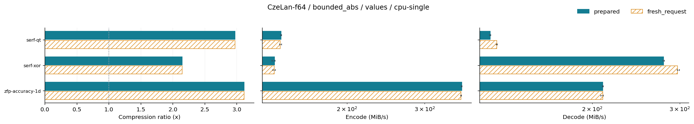

[SVG](figures/CzeLan-f64--bounded_abs--cpu-single.svg)

<details><summary>完整数值、有效批次及拒绝原因</summary>

| codec | 完整输出 bytes P / F | 压缩倍数 P / F | 编码 MiB/s P / F | 解码 MiB/s P / F | 有效批次 P / F |
|---|---:|---:|---:|---:|---:|
| serf-qt | 5.9e+05 / 5.9e+05 | 2.97 / 2.97 | 142 / 141 | 125 / 129 | 14/14 / 14/14 |
| serf-xor | 8.17e+05 / 8.17e+05 | 2.15 / 2.15 | 137 / 137 | 278 / 297 | 14/14 / 14/14 |
| zfp-accuracy-1d | 5.63e+05 / 5.63e+05 | 3.12 / 3.12 | 364 / 362 | 210 / 210 | 14/14 / 14/14 |

</details>

**<f8 · [19934, 11] · 经验质量（无最大误差保证） · values · cpu-single**

运行进程 CPU 亲和性（P / F）：`[(0, 1, 2, 3, 4, 5, 6, 7, 8, 9, 10, 11, 12, 13, 14, 15)]` / `[(0, 1, 2, 3, 4, 5, 6, 7, 8, 9, 10, 11, 12, 13, 14, 15)]`；逐配置创建时间见 CSV，是否处于并行窗口见调度记录。

<details><summary>完整数值、有效批次及拒绝原因</summary>

| codec | 完整输出 bytes P / F | 压缩倍数 P / F | 编码 MiB/s P / F | 解码 MiB/s P / F | 有效批次 P / F |
|---|---:|---:|---:|---:|---:|
| abba | — / — | — / — | — / — | — / — | 0/0 / 0/0 |
| cameo | — / — | — / — | — / — | — / — | 0/0 / 0/0 |
| dft | — / — | — / — | — / — | — / — | 0/0 / 0/0 |
| dwt-dct-ii | — / — | — / — | — / — | — / — | 0/0 / 0/0 |
| fabba | — / — | — / — | — / — | — / — | 0/0 / 0/0 |
| pip | — / — | — / — | — / — | — / — | 0/0 / 0/0 |
| pmc-mean | — / — | — / — | — / — | — / — | 0/0 / 0/0 |
| pmc-mr | — / — | — / — | — / — | — / — | 0/0 / 0/0 |
| qabba | — / — | — / — | — / — | — / — | 0/0 / 0/0 |
| sim-piece | — / — | — / — | — / — | — / — | 0/0 / 0/0 |
| swab | — / — | — / — | — / — | — / — | 0/0 / 0/0 |
| swing-connected | — / — | — / — | — / — | — / — | 0/0 / 0/0 |
| swing-filter | — / — | — / — | — / — | — / — | 0/0 / 0/0 |
| swing-filter-disjoint | — / — | — / — | — / — | — / — | 0/0 / 0/0 |
| swing-filter-disjoint-quantized / compatible | — / — | — / — | — / — | — / — | 0/0 / 0/0 |
| tp | — / — | — / — | — / — | — / — | 0/0 / 0/0 |
| vw | — / — | — / — | — / — | — / — | 0/0 / 0/0 |

拒绝或未完整完成的请求：

- `abba` / fresh_request：unsupported，abba: native_core requires rank1; use object/native_api for independent columns
- `abba` / prepared：unsupported，abba: native_core requires rank1; use object/native_api for independent columns
- `cameo` / fresh_request：unsupported，cameo: element limit exceeded
- `cameo` / prepared：unsupported，cameo: element limit exceeded
- `dft` / fresh_request：unsupported，dft: element limit exceeded
- `dft` / prepared：unsupported，dft: element limit exceeded
- `dwt-dct-ii` / fresh_request：unsupported，dwt-dct-ii: element limit exceeded
- `dwt-dct-ii` / prepared：unsupported，dwt-dct-ii: element limit exceeded
- `fabba` / fresh_request：unsupported，fabba: native_core requires rank1; use object/native_api for independent columns
- `fabba` / prepared：unsupported，fabba: native_core requires rank1; use object/native_api for independent columns
- `pip` / fresh_request：unsupported，pip: element limit exceeded
- `pip` / prepared：unsupported，pip: element limit exceeded
- `pmc-mean` / fresh_request：unsupported，pmc-mean: element limit exceeded
- `pmc-mean` / prepared：unsupported，pmc-mean: element limit exceeded
- `pmc-mr` / fresh_request：unsupported，pmc-mr: dtype must be one of ('<f4',)
- `pmc-mr` / prepared：unsupported，pmc-mr: dtype must be one of ('<f4',)
- `qabba` / fresh_request：unsupported，qabba: native_core requires rank1; use object/native_api for independent columns
- `qabba` / prepared：unsupported，qabba: native_core requires rank1; use object/native_api for independent columns
- `sim-piece` / fresh_request：unsupported，sim-piece: element limit exceeded
- `sim-piece` / prepared：unsupported，sim-piece: element limit exceeded
- `swab` / fresh_request：unsupported，swab: element limit exceeded
- `swab` / prepared：unsupported，swab: element limit exceeded
- `swing-connected` / fresh_request：unsupported，swing-connected: element limit exceeded
- `swing-connected` / prepared：unsupported，swing-connected: element limit exceeded
- `swing-filter` / fresh_request：unsupported，swing-filter: dtype must be one of ('<f4',)
- `swing-filter` / prepared：unsupported，swing-filter: dtype must be one of ('<f4',)
- `swing-filter-disjoint` / fresh_request：unsupported，swing-filter-disjoint: dtype must be one of ('<f4',)
- `swing-filter-disjoint` / prepared：unsupported，swing-filter-disjoint: dtype must be one of ('<f4',)
- `swing-filter-disjoint-quantized / compatible` / fresh_request：unsupported，swing-filter-disjoint-quantized: dtype must be one of ('<f4',)
- `swing-filter-disjoint-quantized / compatible` / prepared：unsupported，swing-filter-disjoint-quantized: dtype must be one of ('<f4',)
- `tp` / fresh_request：unsupported，tp: element limit exceeded
- `tp` / prepared：unsupported，tp: element limit exceeded
- `vw` / fresh_request：unsupported，vw: element limit exceeded
- `vw` / prepared：unsupported，vw: element limit exceeded

</details>

<a id="dataset-ETTh1"></a>

### ETTh1

**<f4 · [17420, 7] · 无损 · values · cpu-single**

运行进程 CPU 亲和性（P / F）：`[(0, 1, 2, 3, 4, 5, 6, 7, 8, 9, 10, 11, 12, 13, 14, 15)]` / `[(0, 1, 2, 3, 4, 5, 6, 7, 8, 9, 10, 11, 12, 13, 14, 15)]`；逐配置创建时间见 CSV，是否处于并行窗口见调度记录。

f64→f32 准备阶段转换的最大绝对差：**1.0658141e-14**；本组 codec 的恢复质量相对转换后的 f32 输入验证。

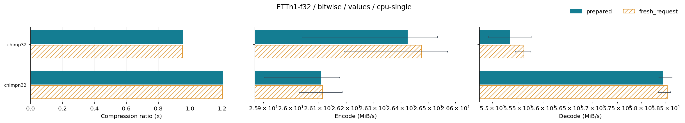

[SVG](figures/ETTh1-f32--bitwise--cpu-single.svg)

<details><summary>完整数值、有效批次及拒绝原因</summary>

| codec | 完整输出 bytes P / F | 压缩倍数 P / F | 编码 MiB/s P / F | 解码 MiB/s P / F | 有效批次 P / F |
|---|---:|---:|---:|---:|---:|
| chimp32 | 5.12e+05 / 5.12e+05 | 0.952 / 0.952 | 26.4 / 26.5 | 55.3 / 55.6 | 14/14 / 14/14 |
| chimpn32 | 4.05e+05 / 4.05e+05 | 1.2 / 1.2 | 26.1 / 26.1 | 58.4 / 58.5 | 14/14 / 14/14 |

</details>

**<f4 · [17420, 7] · 经验质量（无最大误差保证） · values · cpu-single**

运行进程 CPU 亲和性（P / F）：`[(0, 1, 2, 3, 4, 5, 6, 7, 8, 9, 10, 11, 12, 13, 14, 15)]` / `[(0, 1, 2, 3, 4, 5, 6, 7, 8, 9, 10, 11, 12, 13, 14, 15)]`；逐配置创建时间见 CSV，是否处于并行窗口见调度记录。

f64→f32 准备阶段转换的最大绝对差：**1.0658141e-14**；本组 codec 的恢复质量相对转换后的 f32 输入验证。

<details><summary>完整数值、有效批次及拒绝原因</summary>

| codec | 完整输出 bytes P / F | 压缩倍数 P / F | 编码 MiB/s P / F | 解码 MiB/s P / F | 有效批次 P / F |
|---|---:|---:|---:|---:|---:|
| pmc-mr | — / — | — / — | — / — | — / — | 0/0 / 0/0 |
| swing-filter | — / — | — / — | — / — | — / — | 0/0 / 0/0 |
| swing-filter-disjoint | — / — | — / — | — / — | — / — | 0/0 / 0/0 |
| swing-filter-disjoint-quantized / compatible | — / — | — / — | — / — | — / — | 0/0 / 0/0 |

拒绝或未完整完成的请求：

- `pmc-mr` / fresh_request：unsupported，filter native_core requires one column; object/native_api preserve independent columns
- `pmc-mr` / prepared：unsupported，filter native_core requires one column; object/native_api preserve independent columns
- `swing-filter` / fresh_request：unsupported，filter native_core requires one column; object/native_api preserve independent columns
- `swing-filter` / prepared：unsupported，filter native_core requires one column; object/native_api preserve independent columns
- `swing-filter-disjoint` / fresh_request：unsupported，filter native_core requires one column; object/native_api preserve independent columns
- `swing-filter-disjoint` / prepared：unsupported，filter native_core requires one column; object/native_api preserve independent columns
- `swing-filter-disjoint-quantized / compatible` / fresh_request：unsupported，filter native_core requires one column; object/native_api preserve independent columns
- `swing-filter-disjoint-quantized / compatible` / prepared：unsupported，filter native_core requires one column; object/native_api preserve independent columns

</details>

**<f8 · [17420, 7] · 无损 · values · cpu-single**

运行进程 CPU 亲和性（P / F）：`[(0, 1, 2, 3, 4, 5, 6, 7, 8, 9, 10, 11, 12, 13, 14, 15)]` / `[(0, 1, 2, 3, 4, 5, 6, 7, 8, 9, 10, 11, 12, 13, 14, 15)]`；逐配置创建时间见 CSV，是否处于并行窗口见调度记录。

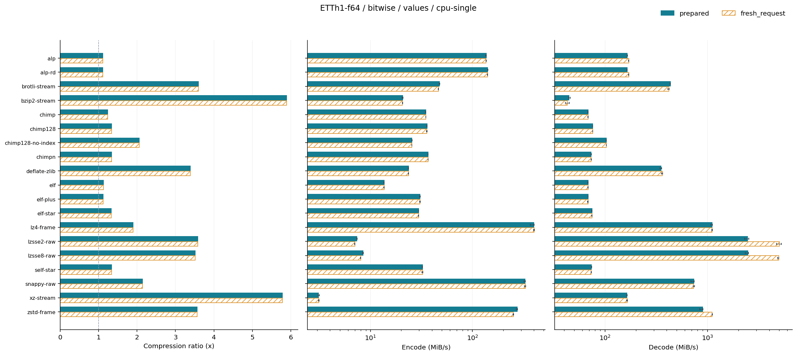

[SVG](figures/ETTh1-f64--bitwise--cpu-single.svg)

<details><summary>完整数值、有效批次及拒绝原因</summary>

| codec | 完整输出 bytes P / F | 压缩倍数 P / F | 编码 MiB/s P / F | 解码 MiB/s P / F | 有效批次 P / F |
|---|---:|---:|---:|---:|---:|
| alp | 8.77e+05 / 8.77e+05 | 1.11 / 1.11 | 136 / 136 | 165 / 170 | 14/14 / 14/14 |
| alp-rd | 8.77e+05 / 8.77e+05 | 1.11 / 1.11 | 141 / 141 | 165 / 170 | 14/14 / 14/14 |
| brotli-stream | 2.71e+05 / 2.71e+05 | 3.6 / 3.6 | 47.6 / 46.4 | 435 / 420 | 14/14 / 14/14 |
| bzip2-stream | 1.66e+05 / 1.66e+05 | 5.89 / 5.89 | 20.8 / 20.6 | 44.6 / 42.8 | 14/14 / 14/14 |
| chimp | 7.91e+05 / 7.91e+05 | 1.23 / 1.23 | 34.9 / 34.9 | 68.5 / 68.5 | 14/14 / 14/14 |
| chimp128 | 7.28e+05 / 7.28e+05 | 1.34 / 1.34 | 35.8 / 35.8 | 76 / 76 | 14/14 / 14/14 |
| chimp128-no-index | 4.74e+05 / 4.74e+05 | 2.06 / 2.06 | 25.5 / 25.5 | 103 / 103 | 14/14 / 14/14 |
| chimp32 | — / — | — / — | — / — | — / — | 0/0 / 0/0 |
| chimpn | 7.28e+05 / 7.28e+05 | 1.34 / 1.34 | 36.8 / 36.8 | 73.4 / 73.4 | 14/14 / 14/14 |
| chimpn32 | — / — | — / — | — / — | — / — | 0/0 / 0/0 |
| deflate-zlib | 2.88e+05 / 2.88e+05 | 3.39 / 3.39 | 23.6 / 23.6 | 353 / 362 | 14/14 / 14/14 |
| elf | 8.66e+05 / 8.66e+05 | 1.13 / 1.13 | 13.6 / 13.6 | 68.4 / 68.4 | 14/14 / 14/14 |
| elf-plus | 8.73e+05 / 8.73e+05 | 1.12 / 1.12 | 30.7 / 30.6 | 68.5 / 68.3 | 14/14 / 14/14 |
| elf-star | 7.34e+05 / 7.34e+05 | 1.33 / 1.33 | 29.7 / 29.7 | 74.9 / 75 | 14/14 / 14/14 |
| fse | — / — | — / — | — / — | — / — | 0/0 / 0/0 |
| gorilla-prometheus-xor | — / — | — / — | — / — | — / — | 0/0 / 0/0 |
| huff0 | — / — | — / — | — / — | — / — | 0/0 / 0/0 |
| leats-lossless-i64 | — / — | — / — | — / — | — / — | 0/0 / 0/0 |
| lz4-frame | 5.16e+05 / 5.16e+05 | 1.89 / 1.89 | 401 / 403 | 1.11e+03 / 1.11e+03 | 14/14 / 14/14 |
| lzsse2-raw | 2.73e+05 / 2.73e+05 | 3.58 / 3.58 | 7.36 / 7 | 2.46e+03 / 5.02e+03 | 14/14 / 14/14 |
| lzsse8-raw | 2.78e+05 / 2.78e+05 | 3.51 / 3.51 | 8.42 / 8.01 | 2.47e+03 / 4.95e+03 | 14/14 / 14/14 |
| neats-lossless-i64 | — / — | — / — | — / — | — / — | 0/0 / 0/0 |
| self-star | 7.3e+05 / 7.3e+05 | 1.34 / 1.34 | 32.3 / 32.3 | 73.9 / 73.4 | 14/14 / 14/14 |
| simdcomp-u32 | — / — | — / — | — / — | — / — | 0/0 / 0/0 |
| snappy-raw | 4.56e+05 / 4.56e+05 | 2.14 / 2.14 | 329 / 330 | 735 / 733 | 14/14 / 14/14 |
| sprintz-delta | — / — | — / — | — / — | — / — | 0/0 / 0/0 |
| sprintz-delta-huffman | — / — | — / — | — / — | — / — | 0/0 / 0/0 |
| sprintz-fire | — / — | — / — | — / — | — / — | 0/0 / 0/0 |
| sprintz-fire-huffman | — / — | — / — | — / — | — / — | 0/0 / 0/0 |
| xz-stream | 1.69e+05 / 1.69e+05 | 5.78 / 5.78 | 3.09 / 3.11 | 164 / 165 | 14/14 / 14/14 |
| zstd-frame | 2.74e+05 / 2.74e+05 | 3.56 / 3.56 | 276 / 252 | 900 / 1.11e+03 | 14/14 / 14/14 |

拒绝或未完整完成的请求：

- `chimp32` / fresh_request：unsupported，chimp32: dtype must be one of ('<f4',)
- `chimp32` / prepared：unsupported，chimp32: dtype must be one of ('<f4',)
- `chimpn32` / fresh_request：unsupported，chimpn32: dtype must be one of ('<f4',)
- `chimpn32` / prepared：unsupported，chimpn32: dtype must be one of ('<f4',)
- `fse` / fresh_request：unsupported，fse: n=17420 exceeds native limits
- `fse` / prepared：unsupported，fse: n=17420 exceeds native limits
- `gorilla-prometheus-xor` / fresh_request：unsupported，Gorilla requires actual paired T/V; values-only and timestamp-only are unsupported
- `gorilla-prometheus-xor` / prepared：unsupported，Gorilla requires actual paired T/V; values-only and timestamp-only are unsupported
- `huff0` / fresh_request：unsupported，huff0: n=17420 exceeds native limits
- `huff0` / prepared：unsupported，huff0: n=17420 exceeds native limits
- `leats-lossless-i64` / fresh_request：unsupported，leats-lossless-i64: dtype must be one of ('|i1', '<i2', '<i4', '<i8')
- `leats-lossless-i64` / prepared：unsupported，leats-lossless-i64: dtype must be one of ('|i1', '<i2', '<i4', '<i8')
- `neats-lossless-i64` / fresh_request：unsupported，neats-lossless-i64: dtype must be one of ('|i1', '<i2', '<i4', '<i8')
- `neats-lossless-i64` / prepared：unsupported，neats-lossless-i64: dtype must be one of ('|i1', '<i2', '<i4', '<i8')
- `simdcomp-u32` / fresh_request：unsupported，simdcomp-u32: dtype must be one of ('<u4',)
- `simdcomp-u32` / prepared：unsupported，simdcomp-u32: dtype must be one of ('<u4',)
- `sprintz-delta` / fresh_request：unsupported，sprintz-delta: dtype must be one of ('|u1', '|i1', '<u2', '<i2')
- `sprintz-delta` / prepared：unsupported，sprintz-delta: dtype must be one of ('|u1', '|i1', '<u2', '<i2')
- `sprintz-delta-huffman` / fresh_request：unsupported，sprintz-delta-huffman: dtype must be one of ('|u1', '|i1', '<u2', '<i2')
- `sprintz-delta-huffman` / prepared：unsupported，sprintz-delta-huffman: dtype must be one of ('|u1', '|i1', '<u2', '<i2')
- `sprintz-fire` / fresh_request：unsupported，sprintz-fire: dtype must be one of ('|u1', '|i1', '<u2', '<i2')
- `sprintz-fire` / prepared：unsupported，sprintz-fire: dtype must be one of ('|u1', '|i1', '<u2', '<i2')
- `sprintz-fire-huffman` / fresh_request：unsupported，sprintz-fire-huffman: dtype must be one of ('|u1', '|i1', '<u2', '<i2')
- `sprintz-fire-huffman` / prepared：unsupported，sprintz-fire-huffman: dtype must be one of ('|u1', '|i1', '<u2', '<i2')

</details>

**<f8 · [17420, 7] · ABS ≤ 0.01 · values · cpu-single**

运行进程 CPU 亲和性（P / F）：`[(0, 1, 2, 3, 4, 5, 6, 7, 8, 9, 10, 11, 12, 13, 14, 15)]` / `[(0, 1, 2, 3, 4, 5, 6, 7, 8, 9, 10, 11, 12, 13, 14, 15)]`；逐配置创建时间见 CSV，是否处于并行窗口见调度记录。


[SVG](figures/ETTh1-f64--bounded_abs--cpu-single.svg)

<details><summary>完整数值、有效批次及拒绝原因</summary>

| codec | 完整输出 bytes P / F | 压缩倍数 P / F | 编码 MiB/s P / F | 解码 MiB/s P / F | 有效批次 P / F |
|---|---:|---:|---:|---:|---:|
| serf-qt | 2.71e+05 / 2.71e+05 | 3.61 / 3.61 | 143 / 143 | 141 / 145 | 14/14 / 14/14 |
| serf-xor | 4.42e+05 / 4.42e+05 | 2.21 / 2.21 | 111 / 112 | 266 / 284 | 14/14 / 14/14 |
| zfp-accuracy-1d | 2.51e+05 / 2.51e+05 | 3.88 / 3.88 | 390 / 389 | 239 / 240 | 14/14 / 14/14 |

</details>

**<f8 · [17420, 7] · 经验质量（无最大误差保证） · values · cpu-single**

运行进程 CPU 亲和性（P / F）：`[(0, 1, 2, 3, 4, 5, 6, 7, 8, 9, 10, 11, 12, 13, 14, 15)]` / `[(0, 1, 2, 3, 4, 5, 6, 7, 8, 9, 10, 11, 12, 13, 14, 15)]`；逐配置创建时间见 CSV，是否处于并行窗口见调度记录。

<details><summary>完整数值、有效批次及拒绝原因</summary>

| codec | 完整输出 bytes P / F | 压缩倍数 P / F | 编码 MiB/s P / F | 解码 MiB/s P / F | 有效批次 P / F |
|---|---:|---:|---:|---:|---:|
| abba | — / — | — / — | — / — | — / — | 0/0 / 0/0 |
| cameo | — / — | — / — | — / — | — / — | 0/0 / 0/0 |
| dft | — / — | — / — | — / — | — / — | 0/0 / 0/0 |
| dwt-dct-ii | — / — | — / — | — / — | — / — | 0/0 / 0/0 |
| fabba | — / — | — / — | — / — | — / — | 0/0 / 0/0 |
| pip | — / — | — / — | — / — | — / — | 0/0 / 0/0 |
| pmc-mean | — / — | — / — | — / — | — / — | 0/0 / 0/0 |
| pmc-mr | — / — | — / — | — / — | — / — | 0/0 / 0/0 |
| qabba | — / — | — / — | — / — | — / — | 0/0 / 0/0 |
| sim-piece | — / — | — / — | — / — | — / — | 0/0 / 0/0 |
| swab | — / — | — / — | — / — | — / — | 0/0 / 0/0 |
| swing-connected | — / — | — / — | — / — | — / — | 0/0 / 0/0 |
| swing-filter | — / — | — / — | — / — | — / — | 0/0 / 0/0 |
| swing-filter-disjoint | — / — | — / — | — / — | — / — | 0/0 / 0/0 |
| swing-filter-disjoint-quantized / compatible | — / — | — / — | — / — | — / — | 0/0 / 0/0 |
| tp | — / — | — / — | — / — | — / — | 0/0 / 0/0 |
| vw | — / — | — / — | — / — | — / — | 0/0 / 0/0 |

拒绝或未完整完成的请求：

- `abba` / fresh_request：unsupported，abba: native_core requires rank1; use object/native_api for independent columns
- `abba` / prepared：unsupported，abba: native_core requires rank1; use object/native_api for independent columns
- `cameo` / fresh_request：unsupported，cameo: native_core requires rank1; use object/native_api for independent columns
- `cameo` / prepared：unsupported，cameo: native_core requires rank1; use object/native_api for independent columns
- `dft` / fresh_request：unsupported，dft: native_core requires rank1; use object/native_api for independent columns
- `dft` / prepared：unsupported，dft: native_core requires rank1; use object/native_api for independent columns
- `dwt-dct-ii` / fresh_request：unsupported，dwt-dct-ii: native_core requires rank1; use object/native_api for independent columns
- `dwt-dct-ii` / prepared：unsupported，dwt-dct-ii: native_core requires rank1; use object/native_api for independent columns
- `fabba` / fresh_request：unsupported，fabba: native_core requires rank1; use object/native_api for independent columns
- `fabba` / prepared：unsupported，fabba: native_core requires rank1; use object/native_api for independent columns
- `pip` / fresh_request：unsupported，pip: native_core requires rank1; use object/native_api for independent columns
- `pip` / prepared：unsupported，pip: native_core requires rank1; use object/native_api for independent columns
- `pmc-mean` / fresh_request：unsupported，pmc-mean: native_core requires rank1; use object/native_api for independent columns
- `pmc-mean` / prepared：unsupported，pmc-mean: native_core requires rank1; use object/native_api for independent columns
- `pmc-mr` / fresh_request：unsupported，pmc-mr: dtype must be one of ('<f4',)
- `pmc-mr` / prepared：unsupported，pmc-mr: dtype must be one of ('<f4',)
- `qabba` / fresh_request：unsupported，qabba: native_core requires rank1; use object/native_api for independent columns
- `qabba` / prepared：unsupported，qabba: native_core requires rank1; use object/native_api for independent columns
- `sim-piece` / fresh_request：unsupported，sim-piece: native_core requires rank1; use object/native_api for independent columns
- `sim-piece` / prepared：unsupported，sim-piece: native_core requires rank1; use object/native_api for independent columns
- `swab` / fresh_request：unsupported，swab: native_core requires rank1; use object/native_api for independent columns
- `swab` / prepared：unsupported，swab: native_core requires rank1; use object/native_api for independent columns
- `swing-connected` / fresh_request：unsupported，swing-connected: native_core requires rank1; use object/native_api for independent columns
- `swing-connected` / prepared：unsupported，swing-connected: native_core requires rank1; use object/native_api for independent columns
- `swing-filter` / fresh_request：unsupported，swing-filter: dtype must be one of ('<f4',)
- `swing-filter` / prepared：unsupported，swing-filter: dtype must be one of ('<f4',)
- `swing-filter-disjoint` / fresh_request：unsupported，swing-filter-disjoint: dtype must be one of ('<f4',)
- `swing-filter-disjoint` / prepared：unsupported，swing-filter-disjoint: dtype must be one of ('<f4',)
- `swing-filter-disjoint-quantized / compatible` / fresh_request：unsupported，swing-filter-disjoint-quantized: dtype must be one of ('<f4',)
- `swing-filter-disjoint-quantized / compatible` / prepared：unsupported，swing-filter-disjoint-quantized: dtype must be one of ('<f4',)
- `tp` / fresh_request：unsupported，tp: native_core requires rank1; use object/native_api for independent columns
- `tp` / prepared：unsupported，tp: native_core requires rank1; use object/native_api for independent columns
- `vw` / fresh_request：unsupported，vw: native_core requires rank1; use object/native_api for independent columns
- `vw` / prepared：unsupported，vw: native_core requires rank1; use object/native_api for independent columns

</details>

<a id="dataset-ETTh2"></a>

### ETTh2

**<f4 · [17420, 7] · 无损 · values · cpu-single**

运行进程 CPU 亲和性（P / F）：`[(0, 1, 2, 3, 4, 5, 6, 7, 8, 9, 10, 11, 12, 13, 14, 15)]` / `[(0, 1, 2, 3, 4, 5, 6, 7, 8, 9, 10, 11, 12, 13, 14, 15)]`；逐配置创建时间见 CSV，是否处于并行窗口见调度记录。

f64→f32 准备阶段转换的最大绝对差：**1.42108547e-14**；本组 codec 的恢复质量相对转换后的 f32 输入验证。

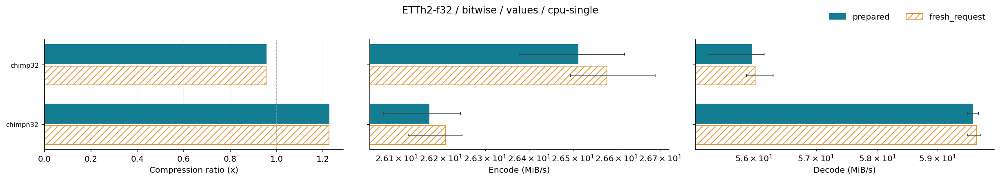

[SVG](figures/ETTh2-f32--bitwise--cpu-single.svg)

<details><summary>完整数值、有效批次及拒绝原因</summary>

| codec | 完整输出 bytes P / F | 压缩倍数 P / F | 编码 MiB/s P / F | 解码 MiB/s P / F | 有效批次 P / F |
|---|---:|---:|---:|---:|---:|
| chimp32 | 5.11e+05 / 5.11e+05 | 0.954 / 0.954 | 26.5 / 26.6 | 56 / 56 | 14/14 / 14/14 |
| chimpn32 | 3.98e+05 / 3.98e+05 | 1.23 / 1.23 | 26.2 / 26.2 | 59.6 / 59.7 | 14/14 / 14/14 |

</details>

**<f4 · [17420, 7] · 经验质量（无最大误差保证） · values · cpu-single**

运行进程 CPU 亲和性（P / F）：`[(0, 1, 2, 3, 4, 5, 6, 7, 8, 9, 10, 11, 12, 13, 14, 15)]` / `[(0, 1, 2, 3, 4, 5, 6, 7, 8, 9, 10, 11, 12, 13, 14, 15)]`；逐配置创建时间见 CSV，是否处于并行窗口见调度记录。

f64→f32 准备阶段转换的最大绝对差：**1.42108547e-14**；本组 codec 的恢复质量相对转换后的 f32 输入验证。

<details><summary>完整数值、有效批次及拒绝原因</summary>

| codec | 完整输出 bytes P / F | 压缩倍数 P / F | 编码 MiB/s P / F | 解码 MiB/s P / F | 有效批次 P / F |
|---|---:|---:|---:|---:|---:|
| pmc-mr | — / — | — / — | — / — | — / — | 0/0 / 0/0 |
| swing-filter | — / — | — / — | — / — | — / — | 0/0 / 0/0 |
| swing-filter-disjoint | — / — | — / — | — / — | — / — | 0/0 / 0/0 |
| swing-filter-disjoint-quantized / compatible | — / — | — / — | — / — | — / — | 0/0 / 0/0 |

拒绝或未完整完成的请求：

- `pmc-mr` / fresh_request：unsupported，filter native_core requires one column; object/native_api preserve independent columns
- `pmc-mr` / prepared：unsupported，filter native_core requires one column; object/native_api preserve independent columns
- `swing-filter` / fresh_request：unsupported，filter native_core requires one column; object/native_api preserve independent columns
- `swing-filter` / prepared：unsupported，filter native_core requires one column; object/native_api preserve independent columns
- `swing-filter-disjoint` / fresh_request：unsupported，filter native_core requires one column; object/native_api preserve independent columns
- `swing-filter-disjoint` / prepared：unsupported，filter native_core requires one column; object/native_api preserve independent columns
- `swing-filter-disjoint-quantized / compatible` / fresh_request：unsupported，filter native_core requires one column; object/native_api preserve independent columns
- `swing-filter-disjoint-quantized / compatible` / prepared：unsupported，filter native_core requires one column; object/native_api preserve independent columns

</details>

**<f8 · [17420, 7] · 无损 · values · cpu-single**

运行进程 CPU 亲和性（P / F）：`[(0, 1, 2, 3, 4, 5, 6, 7, 8, 9, 10, 11, 12, 13, 14, 15)]` / `[(0, 1, 2, 3, 4, 5, 6, 7, 8, 9, 10, 11, 12, 13, 14, 15)]`；逐配置创建时间见 CSV，是否处于并行窗口见调度记录。

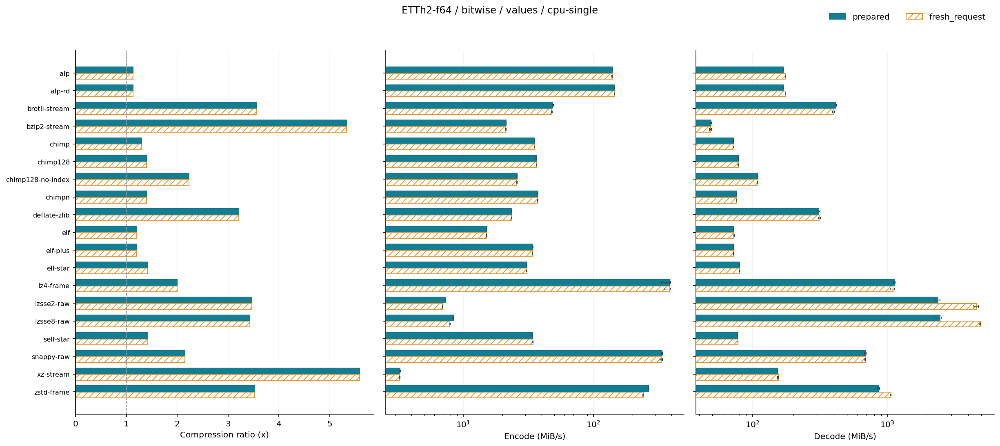

[SVG](figures/ETTh2-f64--bitwise--cpu-single.svg)

<details><summary>完整数值、有效批次及拒绝原因</summary>

| codec | 完整输出 bytes P / F | 压缩倍数 P / F | 编码 MiB/s P / F | 解码 MiB/s P / F | 有效批次 P / F |
|---|---:|---:|---:|---:|---:|
| alp | 8.6e+05 / 8.6e+05 | 1.13 / 1.13 | 140 / 140 | 169 / 175 | 14/14 / 14/14 |
| alp-rd | 8.6e+05 / 8.6e+05 | 1.13 / 1.13 | 146 / 145 | 169 / 174 | 14/14 / 14/14 |
| brotli-stream | 2.74e+05 / 2.74e+05 | 3.56 / 3.56 | 48.7 / 48.2 | 416 / 401 | 14/14 / 14/14 |
| bzip2-stream | 1.83e+05 / 1.83e+05 | 5.33 / 5.33 | 21.4 / 21.3 | 48.9 / 48.6 | 14/14 / 14/14 |
| chimp | 7.5e+05 / 7.5e+05 | 1.3 / 1.3 | 35.5 / 35.4 | 71.9 / 71.6 | 14/14 / 14/14 |
| chimp128 | 7e+05 / 7e+05 | 1.39 / 1.39 | 36.6 / 36.5 | 78.3 / 78.1 | 14/14 / 14/14 |
| chimp128-no-index | 4.37e+05 / 4.37e+05 | 2.23 / 2.23 | 25.9 / 25.8 | 109 / 109 | 14/14 / 14/14 |
| chimp32 | — / — | — / — | — / — | — / — | 0/0 / 0/0 |
| chimpn | 7e+05 / 7e+05 | 1.39 / 1.39 | 37.4 / 37.4 | 75.7 / 75.6 | 14/14 / 14/14 |
| chimpn32 | — / — | — / — | — / — | — / — | 0/0 / 0/0 |
| deflate-zlib | 3.04e+05 / 3.04e+05 | 3.21 / 3.21 | 23.6 / 23.6 | 311 / 313 | 14/14 / 14/14 |
| elf | 8.12e+05 / 8.12e+05 | 1.2 / 1.2 | 15.1 / 15.2 | 72.4 / 72.7 | 14/14 / 14/14 |
| elf-plus | 8.16e+05 / 8.16e+05 | 1.2 / 1.2 | 34.2 / 34.2 | 71.9 / 71.8 | 14/14 / 14/14 |
| elf-star | 6.92e+05 / 6.92e+05 | 1.41 / 1.41 | 30.9 / 30.9 | 80 / 79.9 | 14/14 / 14/14 |
| fse | — / — | — / — | — / — | — / — | 0/0 / 0/0 |
| gorilla-prometheus-xor | — / — | — / — | — / — | — / — | 0/0 / 0/0 |
| huff0 | — / — | — / — | — / — | — / — | 0/0 / 0/0 |
| leats-lossless-i64 | — / — | — / — | — / — | — / — | 0/0 / 0/0 |
| lz4-frame | 4.87e+05 / 4.87e+05 | 2 / 2 | 384 / 386 | 1.13e+03 / 1.1e+03 | 14/14 / 14/14 |
| lzsse2-raw | 2.81e+05 / 2.81e+05 | 3.47 / 3.47 | 7.35 / 6.95 | 2.39e+03 / 4.58e+03 | 14/14 / 14/14 |
| lzsse8-raw | 2.84e+05 / 2.84e+05 | 3.43 / 3.43 | 8.4 / 7.91 | 2.46e+03 / 4.9e+03 | 14/14 / 14/14 |
| neats-lossless-i64 | — / — | — / — | — / — | — / — | 0/0 / 0/0 |
| self-star | 6.87e+05 / 6.87e+05 | 1.42 / 1.42 | 34.1 / 34.3 | 77.1 / 77.7 | 14/14 / 14/14 |
| simdcomp-u32 | — / — | — / — | — / — | — / — | 0/0 / 0/0 |
| snappy-raw | 4.53e+05 / 4.53e+05 | 2.15 / 2.15 | 339 / 336 | 689 / 686 | 14/14 / 14/14 |
| sprintz-delta | — / — | — / — | — / — | — / — | 0/0 / 0/0 |
| sprintz-delta-huffman | — / — | — / — | — / — | — / — | 0/0 / 0/0 |
| sprintz-fire | — / — | — / — | — / — | — / — | 0/0 / 0/0 |
| sprintz-fire-huffman | — / — | — / — | — / — | — / — | 0/0 / 0/0 |
| xz-stream | 1.74e+05 / 1.74e+05 | 5.59 / 5.59 | 3.26 / 3.25 | 154 / 155 | 14/14 / 14/14 |
| zstd-frame | 2.77e+05 / 2.77e+05 | 3.52 / 3.52 | 266 / 243 | 867 / 1.06e+03 | 14/14 / 14/14 |

拒绝或未完整完成的请求：

- `chimp32` / fresh_request：unsupported，chimp32: dtype must be one of ('<f4',)
- `chimp32` / prepared：unsupported，chimp32: dtype must be one of ('<f4',)
- `chimpn32` / fresh_request：unsupported，chimpn32: dtype must be one of ('<f4',)
- `chimpn32` / prepared：unsupported，chimpn32: dtype must be one of ('<f4',)
- `fse` / fresh_request：unsupported，fse: n=17420 exceeds native limits
- `fse` / prepared：unsupported，fse: n=17420 exceeds native limits
- `gorilla-prometheus-xor` / fresh_request：unsupported，Gorilla requires actual paired T/V; values-only and timestamp-only are unsupported
- `gorilla-prometheus-xor` / prepared：unsupported，Gorilla requires actual paired T/V; values-only and timestamp-only are unsupported
- `huff0` / fresh_request：unsupported，huff0: n=17420 exceeds native limits
- `huff0` / prepared：unsupported，huff0: n=17420 exceeds native limits
- `leats-lossless-i64` / fresh_request：unsupported，leats-lossless-i64: dtype must be one of ('|i1', '<i2', '<i4', '<i8')
- `leats-lossless-i64` / prepared：unsupported，leats-lossless-i64: dtype must be one of ('|i1', '<i2', '<i4', '<i8')
- `neats-lossless-i64` / fresh_request：unsupported，neats-lossless-i64: dtype must be one of ('|i1', '<i2', '<i4', '<i8')
- `neats-lossless-i64` / prepared：unsupported，neats-lossless-i64: dtype must be one of ('|i1', '<i2', '<i4', '<i8')
- `simdcomp-u32` / fresh_request：unsupported，simdcomp-u32: dtype must be one of ('<u4',)
- `simdcomp-u32` / prepared：unsupported，simdcomp-u32: dtype must be one of ('<u4',)
- `sprintz-delta` / fresh_request：unsupported，sprintz-delta: dtype must be one of ('|u1', '|i1', '<u2', '<i2')
- `sprintz-delta` / prepared：unsupported，sprintz-delta: dtype must be one of ('|u1', '|i1', '<u2', '<i2')
- `sprintz-delta-huffman` / fresh_request：unsupported，sprintz-delta-huffman: dtype must be one of ('|u1', '|i1', '<u2', '<i2')
- `sprintz-delta-huffman` / prepared：unsupported，sprintz-delta-huffman: dtype must be one of ('|u1', '|i1', '<u2', '<i2')
- `sprintz-fire` / fresh_request：unsupported，sprintz-fire: dtype must be one of ('|u1', '|i1', '<u2', '<i2')
- `sprintz-fire` / prepared：unsupported，sprintz-fire: dtype must be one of ('|u1', '|i1', '<u2', '<i2')
- `sprintz-fire-huffman` / fresh_request：unsupported，sprintz-fire-huffman: dtype must be one of ('|u1', '|i1', '<u2', '<i2')
- `sprintz-fire-huffman` / prepared：unsupported，sprintz-fire-huffman: dtype must be one of ('|u1', '|i1', '<u2', '<i2')

</details>

**<f8 · [17420, 7] · ABS ≤ 0.01 · values · cpu-single**

运行进程 CPU 亲和性（P / F）：`[(0, 1, 2, 3, 4, 5, 6, 7, 8, 9, 10, 11, 12, 13, 14, 15)]` / `[(0, 1, 2, 3, 4, 5, 6, 7, 8, 9, 10, 11, 12, 13, 14, 15)]`；逐配置创建时间见 CSV，是否处于并行窗口见调度记录。


[SVG](figures/ETTh2-f64--bounded_abs--cpu-single.svg)

<details><summary>完整数值、有效批次及拒绝原因</summary>

| codec | 完整输出 bytes P / F | 压缩倍数 P / F | 编码 MiB/s P / F | 解码 MiB/s P / F | 有效批次 P / F |
|---|---:|---:|---:|---:|---:|
| serf-qt | 3.25e+05 / 3.25e+05 | 3.01 / 3.01 | 145 / 145 | 126 / 131 | 14/14 / 14/14 |
| serf-xor | 3.62e+05 / 3.62e+05 | 2.69 / 2.69 | 89.2 / 89.2 | 292 / 316 | 14/14 / 14/14 |
| zfp-accuracy-1d | 2.82e+05 / 2.82e+05 | 3.46 / 3.46 | 399 / 397 | 225 / 224 | 14/14 / 14/14 |

</details>

**<f8 · [17420, 7] · 经验质量（无最大误差保证） · values · cpu-single**

运行进程 CPU 亲和性（P / F）：`[(0, 1, 2, 3, 4, 5, 6, 7, 8, 9, 10, 11, 12, 13, 14, 15)]` / `[(0, 1, 2, 3, 4, 5, 6, 7, 8, 9, 10, 11, 12, 13, 14, 15)]`；逐配置创建时间见 CSV，是否处于并行窗口见调度记录。

<details><summary>完整数值、有效批次及拒绝原因</summary>

| codec | 完整输出 bytes P / F | 压缩倍数 P / F | 编码 MiB/s P / F | 解码 MiB/s P / F | 有效批次 P / F |
|---|---:|---:|---:|---:|---:|
| abba | — / — | — / — | — / — | — / — | 0/0 / 0/0 |
| cameo | — / — | — / — | — / — | — / — | 0/0 / 0/0 |
| dft | — / — | — / — | — / — | — / — | 0/0 / 0/0 |
| dwt-dct-ii | — / — | — / — | — / — | — / — | 0/0 / 0/0 |
| fabba | — / — | — / — | — / — | — / — | 0/0 / 0/0 |
| pip | — / — | — / — | — / — | — / — | 0/0 / 0/0 |
| pmc-mean | — / — | — / — | — / — | — / — | 0/0 / 0/0 |
| pmc-mr | — / — | — / — | — / — | — / — | 0/0 / 0/0 |
| qabba | — / — | — / — | — / — | — / — | 0/0 / 0/0 |
| sim-piece | — / — | — / — | — / — | — / — | 0/0 / 0/0 |
| swab | — / — | — / — | — / — | — / — | 0/0 / 0/0 |
| swing-connected | — / — | — / — | — / — | — / — | 0/0 / 0/0 |
| swing-filter | — / — | — / — | — / — | — / — | 0/0 / 0/0 |
| swing-filter-disjoint | — / — | — / — | — / — | — / — | 0/0 / 0/0 |
| swing-filter-disjoint-quantized / compatible | — / — | — / — | — / — | — / — | 0/0 / 0/0 |
| tp | — / — | — / — | — / — | — / — | 0/0 / 0/0 |
| vw | — / — | — / — | — / — | — / — | 0/0 / 0/0 |

拒绝或未完整完成的请求：

- `abba` / fresh_request：unsupported，abba: native_core requires rank1; use object/native_api for independent columns
- `abba` / prepared：unsupported，abba: native_core requires rank1; use object/native_api for independent columns
- `cameo` / fresh_request：unsupported，cameo: native_core requires rank1; use object/native_api for independent columns
- `cameo` / prepared：unsupported，cameo: native_core requires rank1; use object/native_api for independent columns
- `dft` / fresh_request：unsupported，dft: native_core requires rank1; use object/native_api for independent columns
- `dft` / prepared：unsupported，dft: native_core requires rank1; use object/native_api for independent columns
- `dwt-dct-ii` / fresh_request：unsupported，dwt-dct-ii: native_core requires rank1; use object/native_api for independent columns
- `dwt-dct-ii` / prepared：unsupported，dwt-dct-ii: native_core requires rank1; use object/native_api for independent columns
- `fabba` / fresh_request：unsupported，fabba: native_core requires rank1; use object/native_api for independent columns
- `fabba` / prepared：unsupported，fabba: native_core requires rank1; use object/native_api for independent columns
- `pip` / fresh_request：unsupported，pip: native_core requires rank1; use object/native_api for independent columns
- `pip` / prepared：unsupported，pip: native_core requires rank1; use object/native_api for independent columns
- `pmc-mean` / fresh_request：unsupported，pmc-mean: native_core requires rank1; use object/native_api for independent columns
- `pmc-mean` / prepared：unsupported，pmc-mean: native_core requires rank1; use object/native_api for independent columns
- `pmc-mr` / fresh_request：unsupported，pmc-mr: dtype must be one of ('<f4',)
- `pmc-mr` / prepared：unsupported，pmc-mr: dtype must be one of ('<f4',)
- `qabba` / fresh_request：unsupported，qabba: native_core requires rank1; use object/native_api for independent columns
- `qabba` / prepared：unsupported，qabba: native_core requires rank1; use object/native_api for independent columns
- `sim-piece` / fresh_request：unsupported，sim-piece: native_core requires rank1; use object/native_api for independent columns
- `sim-piece` / prepared：unsupported，sim-piece: native_core requires rank1; use object/native_api for independent columns
- `swab` / fresh_request：unsupported，swab: native_core requires rank1; use object/native_api for independent columns
- `swab` / prepared：unsupported，swab: native_core requires rank1; use object/native_api for independent columns
- `swing-connected` / fresh_request：unsupported，swing-connected: native_core requires rank1; use object/native_api for independent columns
- `swing-connected` / prepared：unsupported，swing-connected: native_core requires rank1; use object/native_api for independent columns
- `swing-filter` / fresh_request：unsupported，swing-filter: dtype must be one of ('<f4',)
- `swing-filter` / prepared：unsupported，swing-filter: dtype must be one of ('<f4',)
- `swing-filter-disjoint` / fresh_request：unsupported，swing-filter-disjoint: dtype must be one of ('<f4',)
- `swing-filter-disjoint` / prepared：unsupported，swing-filter-disjoint: dtype must be one of ('<f4',)
- `swing-filter-disjoint-quantized / compatible` / fresh_request：unsupported，swing-filter-disjoint-quantized: dtype must be one of ('<f4',)
- `swing-filter-disjoint-quantized / compatible` / prepared：unsupported，swing-filter-disjoint-quantized: dtype must be one of ('<f4',)
- `tp` / fresh_request：unsupported，tp: native_core requires rank1; use object/native_api for independent columns
- `tp` / prepared：unsupported，tp: native_core requires rank1; use object/native_api for independent columns
- `vw` / fresh_request：unsupported，vw: native_core requires rank1; use object/native_api for independent columns
- `vw` / prepared：unsupported，vw: native_core requires rank1; use object/native_api for independent columns

</details>

<a id="dataset-ETTm1"></a>

### ETTm1

**<f4 · [69680, 7] · 无损 · values · cpu-single**

运行进程 CPU 亲和性（P / F）：`[(0, 1, 2, 3, 4, 5, 6, 7, 8, 9, 10, 11, 12, 13, 14, 15)]` / `[(0, 1, 2, 3, 4, 5, 6, 7, 8, 9, 10, 11, 12, 13, 14, 15)]`；逐配置创建时间见 CSV，是否处于并行窗口见调度记录。

f64→f32 准备阶段转换的最大绝对差：**1.0658141e-14**；本组 codec 的恢复质量相对转换后的 f32 输入验证。

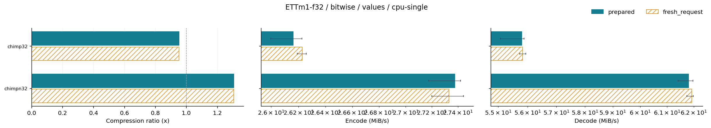

[SVG](figures/ETTm1-f32--bitwise--cpu-single.svg)

<details><summary>完整数值、有效批次及拒绝原因</summary>

| codec | 完整输出 bytes P / F | 压缩倍数 P / F | 编码 MiB/s P / F | 解码 MiB/s P / F | 有效批次 P / F |
|---|---:|---:|---:|---:|---:|
| chimp32 | 2.05e+06 / 2.05e+06 | 0.952 / 0.952 | 26.2 / 26.2 | 55.8 / 55.8 | 14/14 / 14/14 |
| chimpn32 | 1.49e+06 / 1.49e+06 | 1.31 / 1.31 | 27.4 / 27.3 | 61.8 / 61.9 | 14/14 / 14/14 |

</details>

**<f4 · [69680, 7] · 经验质量（无最大误差保证） · values · cpu-single**

运行进程 CPU 亲和性（P / F）：`[(0, 1, 2, 3, 4, 5, 6, 7, 8, 9, 10, 11, 12, 13, 14, 15)]` / `[(0, 1, 2, 3, 4, 5, 6, 7, 8, 9, 10, 11, 12, 13, 14, 15)]`；逐配置创建时间见 CSV，是否处于并行窗口见调度记录。

f64→f32 准备阶段转换的最大绝对差：**1.0658141e-14**；本组 codec 的恢复质量相对转换后的 f32 输入验证。

<details><summary>完整数值、有效批次及拒绝原因</summary>

| codec | 完整输出 bytes P / F | 压缩倍数 P / F | 编码 MiB/s P / F | 解码 MiB/s P / F | 有效批次 P / F |
|---|---:|---:|---:|---:|---:|
| pmc-mr | — / — | — / — | — / — | — / — | 0/0 / 0/0 |
| swing-filter | — / — | — / — | — / — | — / — | 0/0 / 0/0 |
| swing-filter-disjoint | — / — | — / — | — / — | — / — | 0/0 / 0/0 |
| swing-filter-disjoint-quantized / compatible | — / — | — / — | — / — | — / — | 0/0 / 0/0 |

拒绝或未完整完成的请求：

- `pmc-mr` / fresh_request：unsupported，filter native_core requires one column; object/native_api preserve independent columns
- `pmc-mr` / prepared：unsupported，filter native_core requires one column; object/native_api preserve independent columns
- `swing-filter` / fresh_request：unsupported，filter native_core requires one column; object/native_api preserve independent columns
- `swing-filter` / prepared：unsupported，filter native_core requires one column; object/native_api preserve independent columns
- `swing-filter-disjoint` / fresh_request：unsupported，filter native_core requires one column; object/native_api preserve independent columns
- `swing-filter-disjoint` / prepared：unsupported，filter native_core requires one column; object/native_api preserve independent columns
- `swing-filter-disjoint-quantized / compatible` / fresh_request：unsupported，filter native_core requires one column; object/native_api preserve independent columns
- `swing-filter-disjoint-quantized / compatible` / prepared：unsupported，filter native_core requires one column; object/native_api preserve independent columns

</details>

**<f8 · [69680, 7] · 无损 · values · cpu-single**

运行进程 CPU 亲和性（P / F）：`[(0, 1, 2, 3, 4, 5, 6, 7, 8, 9, 10, 11, 12, 13, 14, 15)]` / `[(0, 1, 2, 3, 4, 5, 6, 7, 8, 9, 10, 11, 12, 13, 14, 15)]`；逐配置创建时间见 CSV，是否处于并行窗口见调度记录。


[SVG](figures/ETTm1-f64--bitwise--cpu-single.svg)

<details><summary>完整数值、有效批次及拒绝原因</summary>

| codec | 完整输出 bytes P / F | 压缩倍数 P / F | 编码 MiB/s P / F | 解码 MiB/s P / F | 有效批次 P / F |
|---|---:|---:|---:|---:|---:|
| alp | 3.48e+06 / 3.48e+06 | 1.12 / 1.12 | 137 / 137 | 165 / 172 | 14/14 / 14/14 |
| alp-rd | 3.48e+06 / 3.48e+06 | 1.12 / 1.12 | 141 / 142 | 164 / 171 | 14/14 / 14/14 |
| brotli-stream | 9.84e+05 / 9.84e+05 | 3.97 / 3.97 | 46.7 / 46.7 | 478 / 480 | 14/14 / 14/14 |
| bzip2-stream | 6.1e+05 / 6.1e+05 | 6.4 / 6.4 | 20.4 / 20.4 | 47.9 / 48.5 | 14/14 / 14/14 |
| chimp | 3.16e+06 / 3.16e+06 | 1.23 / 1.23 | 34 / 34 | 68.5 / 68.6 | 14/14 / 14/14 |
| chimp128 | 2.89e+06 / 2.89e+06 | 1.35 / 1.35 | 35.5 / 35.5 | 76.7 / 76.7 | 14/14 / 14/14 |
| chimp128-no-index | 1.7e+06 / 1.7e+06 | 2.29 / 2.29 | 26.4 / 26.4 | 111 / 111 | 14/14 / 14/14 |
| chimp32 | — / — | — / — | — / — | — / — | 0/0 / 0/0 |
| chimpn | 2.89e+06 / 2.89e+06 | 1.35 / 1.35 | 36.4 / 36.5 | 74 / 74.1 | 14/14 / 14/14 |
| chimpn32 | — / — | — / — | — / — | — / — | 0/0 / 0/0 |
| deflate-zlib | 1.09e+06 / 1.09e+06 | 3.57 / 3.57 | 24.7 / 24.6 | 372 / 372 | 14/14 / 14/14 |
| elf | 3.46e+06 / 3.46e+06 | 1.13 / 1.13 | 13.5 / 13.5 | 67.9 / 67.9 | 14/14 / 14/14 |
| elf-plus | 3.49e+06 / 3.49e+06 | 1.12 / 1.12 | 31.2 / 31.2 | 67.8 / 67.7 | 14/14 / 14/14 |
| elf-star | 2.93e+06 / 2.93e+06 | 1.33 / 1.33 | 29.9 / 29.9 | 74.9 / 75.1 | 14/14 / 14/14 |
| fse | — / — | — / — | — / — | — / — | 0/0 / 0/0 |
| gorilla-prometheus-xor | — / — | — / — | — / — | — / — | 0/0 / 0/0 |
| huff0 | — / — | — / — | — / — | — / — | 0/0 / 0/0 |
| leats-lossless-i64 | — / — | — / — | — / — | — / — | 0/0 / 0/0 |
| lz4-frame | 1.99e+06 / 1.99e+06 | 1.96 / 1.96 | 419 / 419 | 1.13e+03 / 1.13e+03 | 14/14 / 14/14 |
| lzsse2-raw | 1.03e+06 / 1.03e+06 | 3.78 / 3.78 | 7.33 / 6.87 | 2.62e+03 / 5.06e+03 | 14/14 / 14/14 |
| lzsse8-raw | 1.06e+06 / 1.06e+06 | 3.68 / 3.68 | 8.36 / 7.76 | 2.53e+03 / 4.68e+03 | 14/14 / 14/14 |
| neats-lossless-i64 | — / — | — / — | — / — | — / — | 0/0 / 0/0 |
| self-star | 2.91e+06 / 2.91e+06 | 1.34 / 1.34 | 32.4 / 32.4 | 71.6 / 71.7 | 14/14 / 14/14 |
| simdcomp-u32 | — / — | — / — | — / — | — / — | 0/0 / 0/0 |
| snappy-raw | 1.74e+06 / 1.74e+06 | 2.25 / 2.25 | 346 / 347 | 771 / 768 | 14/14 / 14/14 |
| sprintz-delta | — / — | — / — | — / — | — / — | 0/0 / 0/0 |
| sprintz-delta-huffman | — / — | — / — | — / — | — / — | 0/0 / 0/0 |
| sprintz-fire | — / — | — / — | — / — | — / — | 0/0 / 0/0 |
| sprintz-fire-huffman | — / — | — / — | — / — | — / — | 0/0 / 0/0 |
| xz-stream | 6.04e+05 / 6.04e+05 | 6.46 / 6.46 | 2.53 / 2.58 | 190 / 192 | 14/14 / 14/14 |
| zstd-frame | 1.04e+06 / 1.04e+06 | 3.75 / 3.75 | 288 / 277 | 901 / 904 | 14/14 / 14/14 |

拒绝或未完整完成的请求：

- `chimp32` / fresh_request：unsupported，chimp32: dtype must be one of ('<f4',)
- `chimp32` / prepared：unsupported，chimp32: dtype must be one of ('<f4',)
- `chimpn32` / fresh_request：unsupported，chimpn32: dtype must be one of ('<f4',)
- `chimpn32` / prepared：unsupported，chimpn32: dtype must be one of ('<f4',)
- `fse` / fresh_request：unsupported，fse: n=69680 exceeds native limits
- `fse` / prepared：unsupported，fse: n=69680 exceeds native limits
- `gorilla-prometheus-xor` / fresh_request：unsupported，Gorilla requires actual paired T/V; values-only and timestamp-only are unsupported
- `gorilla-prometheus-xor` / prepared：unsupported，Gorilla requires actual paired T/V; values-only and timestamp-only are unsupported
- `huff0` / fresh_request：unsupported，huff0: n=69680 exceeds native limits
- `huff0` / prepared：unsupported，huff0: n=69680 exceeds native limits
- `leats-lossless-i64` / fresh_request：unsupported，leats-lossless-i64: dtype must be one of ('|i1', '<i2', '<i4', '<i8')
- `leats-lossless-i64` / prepared：unsupported，leats-lossless-i64: dtype must be one of ('|i1', '<i2', '<i4', '<i8')
- `neats-lossless-i64` / fresh_request：unsupported，neats-lossless-i64: dtype must be one of ('|i1', '<i2', '<i4', '<i8')
- `neats-lossless-i64` / prepared：unsupported，neats-lossless-i64: dtype must be one of ('|i1', '<i2', '<i4', '<i8')
- `simdcomp-u32` / fresh_request：unsupported，simdcomp-u32: dtype must be one of ('<u4',)
- `simdcomp-u32` / prepared：unsupported，simdcomp-u32: dtype must be one of ('<u4',)
- `sprintz-delta` / fresh_request：unsupported，sprintz-delta: dtype must be one of ('|u1', '|i1', '<u2', '<i2')
- `sprintz-delta` / prepared：unsupported，sprintz-delta: dtype must be one of ('|u1', '|i1', '<u2', '<i2')
- `sprintz-delta-huffman` / fresh_request：unsupported，sprintz-delta-huffman: dtype must be one of ('|u1', '|i1', '<u2', '<i2')
- `sprintz-delta-huffman` / prepared：unsupported，sprintz-delta-huffman: dtype must be one of ('|u1', '|i1', '<u2', '<i2')
- `sprintz-fire` / fresh_request：unsupported，sprintz-fire: dtype must be one of ('|u1', '|i1', '<u2', '<i2')
- `sprintz-fire` / prepared：unsupported，sprintz-fire: dtype must be one of ('|u1', '|i1', '<u2', '<i2')
- `sprintz-fire-huffman` / fresh_request：unsupported，sprintz-fire-huffman: dtype must be one of ('|u1', '|i1', '<u2', '<i2')
- `sprintz-fire-huffman` / prepared：unsupported，sprintz-fire-huffman: dtype must be one of ('|u1', '|i1', '<u2', '<i2')

</details>

**<f8 · [69680, 7] · ABS ≤ 0.01 · values · cpu-single**

运行进程 CPU 亲和性（P / F）：`[(0, 1, 2, 3, 4, 5, 6, 7, 8, 9, 10, 11, 12, 13, 14, 15)]` / `[(0, 1, 2, 3, 4, 5, 6, 7, 8, 9, 10, 11, 12, 13, 14, 15)]`；逐配置创建时间见 CSV，是否处于并行窗口见调度记录。

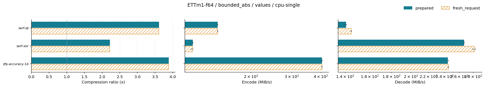

[SVG](figures/ETTm1-f64--bounded_abs--cpu-single.svg)

<details><summary>完整数值、有效批次及拒绝原因</summary>

| codec | 完整输出 bytes P / F | 压缩倍数 P / F | 编码 MiB/s P / F | 解码 MiB/s P / F | 有效批次 P / F |
|---|---:|---:|---:|---:|---:|
| serf-qt | 1.08e+06 / 1.08e+06 | 3.61 / 3.61 | 144 / 144 | 141 / 145 | 14/14 / 14/14 |
| serf-xor | 1.76e+06 / 1.76e+06 | 2.21 / 2.21 | 112 / 112 | 266 / 282 | 14/14 / 14/14 |
| zfp-accuracy-1d | 1.01e+06 / 1.01e+06 | 3.88 / 3.88 | 404 / 405 | 244 / 245 | 14/14 / 14/14 |

</details>

**<f8 · [69680, 7] · 经验质量（无最大误差保证） · values · cpu-single**

运行进程 CPU 亲和性（P / F）：`[(0, 1, 2, 3, 4, 5, 6, 7, 8, 9, 10, 11, 12, 13, 14, 15)]` / `[(0, 1, 2, 3, 4, 5, 6, 7, 8, 9, 10, 11, 12, 13, 14, 15)]`；逐配置创建时间见 CSV，是否处于并行窗口见调度记录。

<details><summary>完整数值、有效批次及拒绝原因</summary>

| codec | 完整输出 bytes P / F | 压缩倍数 P / F | 编码 MiB/s P / F | 解码 MiB/s P / F | 有效批次 P / F |
|---|---:|---:|---:|---:|---:|
| abba | — / — | — / — | — / — | — / — | 0/0 / 0/0 |
| cameo | — / — | — / — | — / — | — / — | 0/0 / 0/0 |
| dft | — / — | — / — | — / — | — / — | 0/0 / 0/0 |
| dwt-dct-ii | — / — | — / — | — / — | — / — | 0/0 / 0/0 |
| fabba | — / — | — / — | — / — | — / — | 0/0 / 0/0 |
| pip | — / — | — / — | — / — | — / — | 0/0 / 0/0 |
| pmc-mean | — / — | — / — | — / — | — / — | 0/0 / 0/0 |
| pmc-mr | — / — | — / — | — / — | — / — | 0/0 / 0/0 |
| qabba | — / — | — / — | — / — | — / — | 0/0 / 0/0 |
| sim-piece | — / — | — / — | — / — | — / — | 0/0 / 0/0 |
| swab | — / — | — / — | — / — | — / — | 0/0 / 0/0 |
| swing-connected | — / — | — / — | — / — | — / — | 0/0 / 0/0 |
| swing-filter | — / — | — / — | — / — | — / — | 0/0 / 0/0 |
| swing-filter-disjoint | — / — | — / — | — / — | — / — | 0/0 / 0/0 |
| swing-filter-disjoint-quantized / compatible | — / — | — / — | — / — | — / — | 0/0 / 0/0 |
| tp | — / — | — / — | — / — | — / — | 0/0 / 0/0 |
| vw | — / — | — / — | — / — | — / — | 0/0 / 0/0 |

拒绝或未完整完成的请求：

- `abba` / fresh_request：unsupported，abba: native_core requires rank1; use object/native_api for independent columns
- `abba` / prepared：unsupported，abba: native_core requires rank1; use object/native_api for independent columns
- `cameo` / fresh_request：unsupported，cameo: element limit exceeded
- `cameo` / prepared：unsupported，cameo: element limit exceeded
- `dft` / fresh_request：unsupported，dft: element limit exceeded
- `dft` / prepared：unsupported，dft: element limit exceeded
- `dwt-dct-ii` / fresh_request：unsupported，dwt-dct-ii: element limit exceeded
- `dwt-dct-ii` / prepared：unsupported，dwt-dct-ii: element limit exceeded
- `fabba` / fresh_request：unsupported，fabba: native_core requires rank1; use object/native_api for independent columns
- `fabba` / prepared：unsupported，fabba: native_core requires rank1; use object/native_api for independent columns
- `pip` / fresh_request：unsupported，pip: element limit exceeded
- `pip` / prepared：unsupported，pip: element limit exceeded
- `pmc-mean` / fresh_request：unsupported，pmc-mean: element limit exceeded
- `pmc-mean` / prepared：unsupported，pmc-mean: element limit exceeded
- `pmc-mr` / fresh_request：unsupported，pmc-mr: dtype must be one of ('<f4',)
- `pmc-mr` / prepared：unsupported，pmc-mr: dtype must be one of ('<f4',)
- `qabba` / fresh_request：unsupported，qabba: native_core requires rank1; use object/native_api for independent columns
- `qabba` / prepared：unsupported，qabba: native_core requires rank1; use object/native_api for independent columns
- `sim-piece` / fresh_request：unsupported，sim-piece: element limit exceeded
- `sim-piece` / prepared：unsupported，sim-piece: element limit exceeded
- `swab` / fresh_request：unsupported，swab: element limit exceeded
- `swab` / prepared：unsupported，swab: element limit exceeded
- `swing-connected` / fresh_request：unsupported，swing-connected: element limit exceeded
- `swing-connected` / prepared：unsupported，swing-connected: element limit exceeded
- `swing-filter` / fresh_request：unsupported，swing-filter: dtype must be one of ('<f4',)
- `swing-filter` / prepared：unsupported，swing-filter: dtype must be one of ('<f4',)
- `swing-filter-disjoint` / fresh_request：unsupported，swing-filter-disjoint: dtype must be one of ('<f4',)
- `swing-filter-disjoint` / prepared：unsupported，swing-filter-disjoint: dtype must be one of ('<f4',)
- `swing-filter-disjoint-quantized / compatible` / fresh_request：unsupported，swing-filter-disjoint-quantized: dtype must be one of ('<f4',)
- `swing-filter-disjoint-quantized / compatible` / prepared：unsupported，swing-filter-disjoint-quantized: dtype must be one of ('<f4',)
- `tp` / fresh_request：unsupported，tp: element limit exceeded
- `tp` / prepared：unsupported，tp: element limit exceeded
- `vw` / fresh_request：unsupported，vw: element limit exceeded
- `vw` / prepared：unsupported，vw: element limit exceeded

</details>

<a id="dataset-ETTm2"></a>

### ETTm2

**<f4 · [69680, 7] · 无损 · values · cpu-single**

运行进程 CPU 亲和性（P / F）：`[(0, 1, 2, 3, 4, 5, 6, 7, 8, 9, 10, 11, 12, 13, 14, 15)]` / `[(0, 1, 2, 3, 4, 5, 6, 7, 8, 9, 10, 11, 12, 13, 14, 15)]`；逐配置创建时间见 CSV，是否处于并行窗口见调度记录。

f64→f32 准备阶段转换的最大绝对差：**1.42108547e-14**；本组 codec 的恢复质量相对转换后的 f32 输入验证。

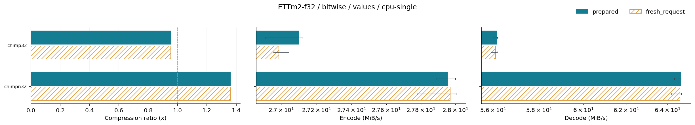

[SVG](figures/ETTm2-f32--bitwise--cpu-single.svg)

<details><summary>完整数值、有效批次及拒绝原因</summary>

| codec | 完整输出 bytes P / F | 压缩倍数 P / F | 编码 MiB/s P / F | 解码 MiB/s P / F | 有效批次 P / F |
|---|---:|---:|---:|---:|---:|
| chimp32 | 2.04e+06 / 2.04e+06 | 0.954 / 0.954 | 27.1 / 27 | 56.2 / 56.1 | 14/14 / 14/14 |
| chimpn32 | 1.43e+06 / 1.43e+06 | 1.36 / 1.36 | 28 / 28 | 64.6 / 64.6 | 14/14 / 14/14 |

</details>

**<f4 · [69680, 7] · 经验质量（无最大误差保证） · values · cpu-single**

运行进程 CPU 亲和性（P / F）：`[(0, 1, 2, 3, 4, 5, 6, 7, 8, 9, 10, 11, 12, 13, 14, 15)]` / `[(0, 1, 2, 3, 4, 5, 6, 7, 8, 9, 10, 11, 12, 13, 14, 15)]`；逐配置创建时间见 CSV，是否处于并行窗口见调度记录。

f64→f32 准备阶段转换的最大绝对差：**1.42108547e-14**；本组 codec 的恢复质量相对转换后的 f32 输入验证。

<details><summary>完整数值、有效批次及拒绝原因</summary>

| codec | 完整输出 bytes P / F | 压缩倍数 P / F | 编码 MiB/s P / F | 解码 MiB/s P / F | 有效批次 P / F |
|---|---:|---:|---:|---:|---:|
| pmc-mr | — / — | — / — | — / — | — / — | 0/0 / 0/0 |
| swing-filter | — / — | — / — | — / — | — / — | 0/0 / 0/0 |
| swing-filter-disjoint | — / — | — / — | — / — | — / — | 0/0 / 0/0 |
| swing-filter-disjoint-quantized / compatible | — / — | — / — | — / — | — / — | 0/0 / 0/0 |

拒绝或未完整完成的请求：

- `pmc-mr` / fresh_request：unsupported，filter native_core requires one column; object/native_api preserve independent columns
- `pmc-mr` / prepared：unsupported，filter native_core requires one column; object/native_api preserve independent columns
- `swing-filter` / fresh_request：unsupported，filter native_core requires one column; object/native_api preserve independent columns
- `swing-filter` / prepared：unsupported，filter native_core requires one column; object/native_api preserve independent columns
- `swing-filter-disjoint` / fresh_request：unsupported，filter native_core requires one column; object/native_api preserve independent columns
- `swing-filter-disjoint` / prepared：unsupported，filter native_core requires one column; object/native_api preserve independent columns
- `swing-filter-disjoint-quantized / compatible` / fresh_request：unsupported，filter native_core requires one column; object/native_api preserve independent columns
- `swing-filter-disjoint-quantized / compatible` / prepared：unsupported，filter native_core requires one column; object/native_api preserve independent columns

</details>

**<f8 · [69680, 7] · 无损 · values · cpu-single**

运行进程 CPU 亲和性（P / F）：`[(0, 1, 2, 3, 4, 5, 6, 7, 8, 9, 10, 11, 12, 13, 14, 15)]` / `[(0, 1, 2, 3, 4, 5, 6, 7, 8, 9, 10, 11, 12, 13, 14, 15)]`；逐配置创建时间见 CSV，是否处于并行窗口见调度记录。


[SVG](figures/ETTm2-f64--bitwise--cpu-single.svg)

<details><summary>完整数值、有效批次及拒绝原因</summary>

| codec | 完整输出 bytes P / F | 压缩倍数 P / F | 编码 MiB/s P / F | 解码 MiB/s P / F | 有效批次 P / F |
|---|---:|---:|---:|---:|---:|
| alp | 3.4e+06 / 3.4e+06 | 1.15 / 1.15 | 140 / 140 | 168 / 176 | 14/14 / 14/14 |
| alp-rd | 3.4e+06 / 3.4e+06 | 1.15 / 1.15 | 145 / 145 | 169 / 175 | 14/14 / 14/14 |
| brotli-stream | 9.4e+05 / 9.4e+05 | 4.15 / 4.15 | 49.7 / 49.4 | 474 / 476 | 14/14 / 14/14 |
| bzip2-stream | 6.44e+05 / 6.44e+05 | 6.06 / 6.06 | 21.1 / 21.1 | 53.9 / 54.3 | 14/14 / 14/14 |
| chimp | 3e+06 / 3e+06 | 1.3 / 1.3 | 36.5 / 36.3 | 71.9 / 71.7 | 14/14 / 14/14 |
| chimp128 | 2.76e+06 / 2.76e+06 | 1.41 / 1.41 | 36.9 / 36.9 | 79.3 / 79.2 | 14/14 / 14/14 |
| chimp128-no-index | 1.54e+06 / 1.54e+06 | 2.53 / 2.53 | 27.1 / 27.1 | 119 / 119 | 14/14 / 14/14 |
| chimp32 | — / — | — / — | — / — | — / — | 0/0 / 0/0 |
| chimpn | 2.76e+06 / 2.76e+06 | 1.41 / 1.41 | 37.8 / 37.8 | 76.6 / 76.7 | 14/14 / 14/14 |
| chimpn32 | — / — | — / — | — / — | — / — | 0/0 / 0/0 |
| deflate-zlib | 1.08e+06 / 1.08e+06 | 3.63 / 3.63 | 26.8 / 26.8 | 336 / 340 | 14/14 / 14/14 |
| elf | 3.25e+06 / 3.25e+06 | 1.2 / 1.2 | 15.3 / 15.2 | 73.4 / 73.4 | 14/14 / 14/14 |
| elf-plus | 3.26e+06 / 3.26e+06 | 1.2 / 1.2 | 35.2 / 35.2 | 72.6 / 72.5 | 14/14 / 14/14 |
| elf-star | 2.77e+06 / 2.77e+06 | 1.41 / 1.41 | 30.9 / 30.9 | 80.1 / 80.2 | 14/14 / 14/14 |
| fse | — / — | — / — | — / — | — / — | 0/0 / 0/0 |
| gorilla-prometheus-xor | — / — | — / — | — / — | — / — | 0/0 / 0/0 |
| huff0 | — / — | — / — | — / — | — / — | 0/0 / 0/0 |
| leats-lossless-i64 | — / — | — / — | — / — | — / — | 0/0 / 0/0 |
| lz4-frame | 1.79e+06 / 1.79e+06 | 2.19 / 2.19 | 422 / 421 | 1.16e+03 / 1.16e+03 | 14/14 / 14/14 |
| lzsse2-raw | 1.02e+06 / 1.02e+06 | 3.82 / 3.82 | 7.32 / 6.86 | 2.5e+03 / 4.92e+03 | 14/14 / 14/14 |
| lzsse8-raw | 1.04e+06 / 1.04e+06 | 3.75 / 3.75 | 8.26 / 7.65 | 2.54e+03 / 4.64e+03 | 14/14 / 14/14 |
| neats-lossless-i64 | — / — | — / — | — / — | — / — | 0/0 / 0/0 |
| self-star | 2.75e+06 / 2.75e+06 | 1.42 / 1.42 | 33.9 / 33.9 | 76 / 75.6 | 14/14 / 14/14 |
| simdcomp-u32 | — / — | — / — | — / — | — / — | 0/0 / 0/0 |
| snappy-raw | 1.64e+06 / 1.64e+06 | 2.38 / 2.38 | 368 / 367 | 758 / 763 | 14/14 / 14/14 |
| sprintz-delta | — / — | — / — | — / — | — / — | 0/0 / 0/0 |
| sprintz-delta-huffman | — / — | — / — | — / — | — / — | 0/0 / 0/0 |
| sprintz-fire | — / — | — / — | — / — | — / — | 0/0 / 0/0 |
| sprintz-fire-huffman | — / — | — / — | — / — | — / — | 0/0 / 0/0 |
| xz-stream | 5.83e+05 / 5.83e+05 | 6.7 / 6.7 | 2.78 / 2.78 | 175 / 176 | 14/14 / 14/14 |
| zstd-frame | 9.83e+05 / 9.83e+05 | 3.97 / 3.97 | 288 / 279 | 907 / 899 | 14/14 / 14/14 |

拒绝或未完整完成的请求：

- `chimp32` / fresh_request：unsupported，chimp32: dtype must be one of ('<f4',)
- `chimp32` / prepared：unsupported，chimp32: dtype must be one of ('<f4',)
- `chimpn32` / fresh_request：unsupported，chimpn32: dtype must be one of ('<f4',)
- `chimpn32` / prepared：unsupported，chimpn32: dtype must be one of ('<f4',)
- `fse` / fresh_request：unsupported，fse: n=69680 exceeds native limits
- `fse` / prepared：unsupported，fse: n=69680 exceeds native limits
- `gorilla-prometheus-xor` / fresh_request：unsupported，Gorilla requires actual paired T/V; values-only and timestamp-only are unsupported
- `gorilla-prometheus-xor` / prepared：unsupported，Gorilla requires actual paired T/V; values-only and timestamp-only are unsupported
- `huff0` / fresh_request：unsupported，huff0: n=69680 exceeds native limits
- `huff0` / prepared：unsupported，huff0: n=69680 exceeds native limits
- `leats-lossless-i64` / fresh_request：unsupported，leats-lossless-i64: dtype must be one of ('|i1', '<i2', '<i4', '<i8')
- `leats-lossless-i64` / prepared：unsupported，leats-lossless-i64: dtype must be one of ('|i1', '<i2', '<i4', '<i8')
- `neats-lossless-i64` / fresh_request：unsupported，neats-lossless-i64: dtype must be one of ('|i1', '<i2', '<i4', '<i8')
- `neats-lossless-i64` / prepared：unsupported，neats-lossless-i64: dtype must be one of ('|i1', '<i2', '<i4', '<i8')
- `simdcomp-u32` / fresh_request：unsupported，simdcomp-u32: dtype must be one of ('<u4',)
- `simdcomp-u32` / prepared：unsupported，simdcomp-u32: dtype must be one of ('<u4',)
- `sprintz-delta` / fresh_request：unsupported，sprintz-delta: dtype must be one of ('|u1', '|i1', '<u2', '<i2')
- `sprintz-delta` / prepared：unsupported，sprintz-delta: dtype must be one of ('|u1', '|i1', '<u2', '<i2')
- `sprintz-delta-huffman` / fresh_request：unsupported，sprintz-delta-huffman: dtype must be one of ('|u1', '|i1', '<u2', '<i2')
- `sprintz-delta-huffman` / prepared：unsupported，sprintz-delta-huffman: dtype must be one of ('|u1', '|i1', '<u2', '<i2')
- `sprintz-fire` / fresh_request：unsupported，sprintz-fire: dtype must be one of ('|u1', '|i1', '<u2', '<i2')
- `sprintz-fire` / prepared：unsupported，sprintz-fire: dtype must be one of ('|u1', '|i1', '<u2', '<i2')
- `sprintz-fire-huffman` / fresh_request：unsupported，sprintz-fire-huffman: dtype must be one of ('|u1', '|i1', '<u2', '<i2')
- `sprintz-fire-huffman` / prepared：unsupported，sprintz-fire-huffman: dtype must be one of ('|u1', '|i1', '<u2', '<i2')

</details>

**<f8 · [69680, 7] · ABS ≤ 0.01 · values · cpu-single**

运行进程 CPU 亲和性（P / F）：`[(0, 1, 2, 3, 4, 5, 6, 7, 8, 9, 10, 11, 12, 13, 14, 15)]` / `[(0, 1, 2, 3, 4, 5, 6, 7, 8, 9, 10, 11, 12, 13, 14, 15)]`；逐配置创建时间见 CSV，是否处于并行窗口见调度记录。

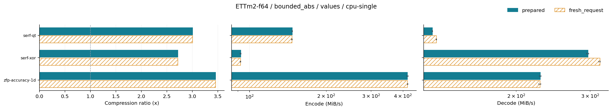

[SVG](figures/ETTm2-f64--bounded_abs--cpu-single.svg)

<details><summary>完整数值、有效批次及拒绝原因</summary>

| codec | 完整输出 bytes P / F | 压缩倍数 P / F | 编码 MiB/s P / F | 解码 MiB/s P / F | 有效批次 P / F |
|---|---:|---:|---:|---:|---:|
| serf-qt | 1.3e+06 / 1.3e+06 | 3.01 / 3.01 | 147 / 147 | 126 / 129 | 14/14 / 14/14 |
| serf-xor | 1.44e+06 / 1.44e+06 | 2.71 / 2.71 | 92.4 / 92.2 | 297 / 317 | 14/14 / 14/14 |
| zfp-accuracy-1d | 1.13e+06 / 1.13e+06 | 3.46 / 3.46 | 417 / 417 | 228 / 228 | 14/14 / 14/14 |

</details>

**<f8 · [69680, 7] · 经验质量（无最大误差保证） · values · cpu-single**

运行进程 CPU 亲和性（P / F）：`[(0, 1, 2, 3, 4, 5, 6, 7, 8, 9, 10, 11, 12, 13, 14, 15)]` / `[(0, 1, 2, 3, 4, 5, 6, 7, 8, 9, 10, 11, 12, 13, 14, 15)]`；逐配置创建时间见 CSV，是否处于并行窗口见调度记录。

<details><summary>完整数值、有效批次及拒绝原因</summary>

| codec | 完整输出 bytes P / F | 压缩倍数 P / F | 编码 MiB/s P / F | 解码 MiB/s P / F | 有效批次 P / F |
|---|---:|---:|---:|---:|---:|
| abba | — / — | — / — | — / — | — / — | 0/0 / 0/0 |
| cameo | — / — | — / — | — / — | — / — | 0/0 / 0/0 |
| dft | — / — | — / — | — / — | — / — | 0/0 / 0/0 |
| dwt-dct-ii | — / — | — / — | — / — | — / — | 0/0 / 0/0 |
| fabba | — / — | — / — | — / — | — / — | 0/0 / 0/0 |
| pip | — / — | — / — | — / — | — / — | 0/0 / 0/0 |
| pmc-mean | — / — | — / — | — / — | — / — | 0/0 / 0/0 |
| pmc-mr | — / — | — / — | — / — | — / — | 0/0 / 0/0 |
| qabba | — / — | — / — | — / — | — / — | 0/0 / 0/0 |
| sim-piece | — / — | — / — | — / — | — / — | 0/0 / 0/0 |
| swab | — / — | — / — | — / — | — / — | 0/0 / 0/0 |
| swing-connected | — / — | — / — | — / — | — / — | 0/0 / 0/0 |
| swing-filter | — / — | — / — | — / — | — / — | 0/0 / 0/0 |
| swing-filter-disjoint | — / — | — / — | — / — | — / — | 0/0 / 0/0 |
| swing-filter-disjoint-quantized / compatible | — / — | — / — | — / — | — / — | 0/0 / 0/0 |
| tp | — / — | — / — | — / — | — / — | 0/0 / 0/0 |
| vw | — / — | — / — | — / — | — / — | 0/0 / 0/0 |

拒绝或未完整完成的请求：

- `abba` / fresh_request：unsupported，abba: native_core requires rank1; use object/native_api for independent columns
- `abba` / prepared：unsupported，abba: native_core requires rank1; use object/native_api for independent columns
- `cameo` / fresh_request：unsupported，cameo: element limit exceeded
- `cameo` / prepared：unsupported，cameo: element limit exceeded
- `dft` / fresh_request：unsupported，dft: element limit exceeded
- `dft` / prepared：unsupported，dft: element limit exceeded
- `dwt-dct-ii` / fresh_request：unsupported，dwt-dct-ii: element limit exceeded
- `dwt-dct-ii` / prepared：unsupported，dwt-dct-ii: element limit exceeded
- `fabba` / fresh_request：unsupported，fabba: native_core requires rank1; use object/native_api for independent columns
- `fabba` / prepared：unsupported，fabba: native_core requires rank1; use object/native_api for independent columns
- `pip` / fresh_request：unsupported，pip: element limit exceeded
- `pip` / prepared：unsupported，pip: element limit exceeded
- `pmc-mean` / fresh_request：unsupported，pmc-mean: element limit exceeded
- `pmc-mean` / prepared：unsupported，pmc-mean: element limit exceeded
- `pmc-mr` / fresh_request：unsupported，pmc-mr: dtype must be one of ('<f4',)
- `pmc-mr` / prepared：unsupported，pmc-mr: dtype must be one of ('<f4',)
- `qabba` / fresh_request：unsupported，qabba: native_core requires rank1; use object/native_api for independent columns
- `qabba` / prepared：unsupported，qabba: native_core requires rank1; use object/native_api for independent columns
- `sim-piece` / fresh_request：unsupported，sim-piece: element limit exceeded
- `sim-piece` / prepared：unsupported，sim-piece: element limit exceeded
- `swab` / fresh_request：unsupported，swab: element limit exceeded
- `swab` / prepared：unsupported，swab: element limit exceeded
- `swing-connected` / fresh_request：unsupported，swing-connected: element limit exceeded
- `swing-connected` / prepared：unsupported，swing-connected: element limit exceeded
- `swing-filter` / fresh_request：unsupported，swing-filter: dtype must be one of ('<f4',)
- `swing-filter` / prepared：unsupported，swing-filter: dtype must be one of ('<f4',)
- `swing-filter-disjoint` / fresh_request：unsupported，swing-filter-disjoint: dtype must be one of ('<f4',)
- `swing-filter-disjoint` / prepared：unsupported，swing-filter-disjoint: dtype must be one of ('<f4',)
- `swing-filter-disjoint-quantized / compatible` / fresh_request：unsupported，swing-filter-disjoint-quantized: dtype must be one of ('<f4',)
- `swing-filter-disjoint-quantized / compatible` / prepared：unsupported，swing-filter-disjoint-quantized: dtype must be one of ('<f4',)
- `tp` / fresh_request：unsupported，tp: element limit exceeded
- `tp` / prepared：unsupported，tp: element limit exceeded
- `vw` / fresh_request：unsupported，vw: element limit exceeded
- `vw` / prepared：unsupported，vw: element limit exceeded

</details>

<a id="dataset-Electricity"></a>

### Electricity

**<f4 · [26304, 321] · 无损 · values · cpu-single**

运行进程 CPU 亲和性（P / F）：`[(0, 1, 2, 3, 4, 5, 6, 7, 8, 9, 10, 11, 12, 13, 14, 15)]` / `[(0, 1, 2, 3, 4, 5, 6, 7, 8, 9, 10, 11, 12, 13, 14, 15)]`；逐配置创建时间见 CSV，是否处于并行窗口见调度记录。

f64→f32 准备阶段转换的最大绝对差：**0**；本组 codec 的恢复质量相对转换后的 f32 输入验证。

<details><summary>完整数值、有效批次及拒绝原因</summary>

| codec | 完整输出 bytes P / F | 压缩倍数 P / F | 编码 MiB/s P / F | 解码 MiB/s P / F | 有效批次 P / F |
|---|---:|---:|---:|---:|---:|
| chimp32 | — / — | — / — | — / — | — / — | 0/0 / 0/0 |
| chimpn32 | — / — | — / — | — / — | — / — | 0/0 / 0/0 |

拒绝或未完整完成的请求：

- `chimp32` / fresh_request：unsupported，chimp32: element limit exceeded
- `chimp32` / prepared：unsupported，chimp32: element limit exceeded
- `chimpn32` / fresh_request：unsupported，chimpn32: element limit exceeded
- `chimpn32` / prepared：unsupported，chimpn32: element limit exceeded

</details>

**<f4 · [26304, 321] · 经验质量（无最大误差保证） · values · cpu-single**

运行进程 CPU 亲和性（P / F）：`[(0, 1, 2, 3, 4, 5, 6, 7, 8, 9, 10, 11, 12, 13, 14, 15)]` / `[(0, 1, 2, 3, 4, 5, 6, 7, 8, 9, 10, 11, 12, 13, 14, 15)]`；逐配置创建时间见 CSV，是否处于并行窗口见调度记录。

f64→f32 准备阶段转换的最大绝对差：**0**；本组 codec 的恢复质量相对转换后的 f32 输入验证。

<details><summary>完整数值、有效批次及拒绝原因</summary>

| codec | 完整输出 bytes P / F | 压缩倍数 P / F | 编码 MiB/s P / F | 解码 MiB/s P / F | 有效批次 P / F |
|---|---:|---:|---:|---:|---:|
| pmc-mr | — / — | — / — | — / — | — / — | 0/0 / 0/0 |
| swing-filter | — / — | — / — | — / — | — / — | 0/0 / 0/0 |
| swing-filter-disjoint | — / — | — / — | — / — | — / — | 0/0 / 0/0 |
| swing-filter-disjoint-quantized / compatible | — / — | — / — | — / — | — / — | 0/0 / 0/0 |

拒绝或未完整完成的请求：

- `pmc-mr` / fresh_request：unsupported，pmc-mr: element limit exceeded
- `pmc-mr` / prepared：unsupported，pmc-mr: element limit exceeded
- `swing-filter` / fresh_request：unsupported，swing-filter: element limit exceeded
- `swing-filter` / prepared：unsupported，swing-filter: element limit exceeded
- `swing-filter-disjoint` / fresh_request：unsupported，swing-filter-disjoint: element limit exceeded
- `swing-filter-disjoint` / prepared：unsupported，swing-filter-disjoint: element limit exceeded
- `swing-filter-disjoint-quantized / compatible` / fresh_request：unsupported，swing-filter-disjoint-quantized: element limit exceeded
- `swing-filter-disjoint-quantized / compatible` / prepared：unsupported，swing-filter-disjoint-quantized: element limit exceeded

</details>

**<f8 · [26304, 321] · 无损 · values · cpu-single**

运行进程 CPU 亲和性（P / F）：`[(0, 1, 2, 3, 4, 5, 6, 7, 8, 9, 10, 11, 12, 13, 14, 15)]` / `[(0, 1, 2, 3, 4, 5, 6, 7, 8, 9, 10, 11, 12, 13, 14, 15)]`；逐配置创建时间见 CSV，是否处于并行窗口见调度记录。

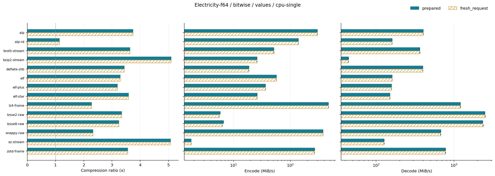

[SVG](figures/Electricity-f64--bitwise--cpu-single.svg)

<details><summary>完整数值、有效批次及拒绝原因</summary>

| codec | 完整输出 bytes P / F | 压缩倍数 P / F | 编码 MiB/s P / F | 解码 MiB/s P / F | 有效批次 P / F |
|---|---:|---:|---:|---:|---:|
| alp | 1.81e+07 / 1.81e+07 | 3.74 / 3.74 | 302 / 301 | 404 / 404 | 14/14 / 14/14 |
| alp-rd | 5.95e+07 / 5.95e+07 | 1.14 / 1.14 | 139 / 139 | 160 / 160 | 14/14 / 14/14 |
| brotli-stream | 1.86e+07 / 1.86e+07 | 3.63 / 3.63 | 51.3 / 51.5 | 364 / 364 | 14/14 / 14/14 |
| bzip2-stream | 1.33e+07 / 1.33e+07 | 5.09 / 5.09 | 25.8 / 25.9 | 44.2 / 44.2 | 14/14 / 14/14 |
| chimp | — / — | — / — | — / — | — / — | 0/0 / 0/0 |
| chimp128 | — / — | — / — | — / — | — / — | 0/0 / 0/0 |
| chimp128-no-index | — / — | — / — | — / — | — / — | 0/0 / 0/0 |
| chimp32 | — / — | — / — | — / — | — / — | 0/0 / 0/0 |
| chimpn | — / — | — / — | — / — | — / — | 0/0 / 0/0 |
| chimpn32 | — / — | — / — | — / — | — / — | 0/0 / 0/0 |
| deflate-zlib | 1.97e+07 / 1.97e+07 | 3.43 / 3.43 | 18.6 / 18.6 | 398 / 398 | 14/14 / 14/14 |
| elf | 2.05e+07 / 2.05e+07 | 3.29 / 3.29 | 57 / 57 | 161 / 161 | 14/14 / 14/14 |
| elf-plus | 2.12e+07 / 2.12e+07 | 3.19 / 3.19 | 36.5 / 36.5 | 158 / 158 | 14/14 / 14/14 |
| elf-star | 1.88e+07 / 1.88e+07 | 3.58 / 3.58 | 26.2 / 26.2 | 150 / 150 | 14/14 / 14/14 |
| fse | — / — | — / — | — / — | — / — | 0/0 / 0/0 |
| gorilla-prometheus-xor | — / — | — / — | — / — | — / — | 0/0 / 0/0 |
| huff0 | — / — | — / — | — / — | — / — | 0/0 / 0/0 |
| leats-lossless-i64 | — / — | — / — | — / — | — / — | 0/0 / 0/0 |
| lz4-frame | 2.97e+07 / 2.97e+07 | 2.28 / 2.28 | 471 / 471 | 1.21e+03 / 1.21e+03 | 14/14 / 14/14 |
| lzsse2-raw | 2.02e+07 / 2.02e+07 | 3.34 / 3.34 | 5.82 / 5.57 | 2.49e+03 / 2.5e+03 | 14/14 / 14/14 |
| lzsse8-raw | 2.09e+07 / 2.09e+07 | 3.24 / 3.24 | 6.64 / 6.31 | 2.33e+03 / 2.37e+03 | 14/14 / 14/14 |
| neats-lossless-i64 | — / — | — / — | — / — | — / — | 0/0 / 0/0 |
| self-star | — / — | — / — | — / — | — / — | 0/0 / 0/0 |
| simdcomp-u32 | — / — | — / — | — / — | — / — | 0/0 / 0/0 |
| snappy-raw | 2.9e+07 / 2.9e+07 | 2.33 / 2.33 | 380 / 380 | 678 / 675 | 14/14 / 14/14 |
| sprintz-delta | — / — | — / — | — / — | — / — | 0/0 / 0/0 |
| sprintz-delta-huffman | — / — | — / — | — / — | — / — | 0/0 / 0/0 |
| sprintz-fire | — / — | — / — | — / — | — / — | 0/0 / 0/0 |
| sprintz-fire-huffman | — / — | — / — | — / — | — / — | 0/0 / 0/0 |
| xz-stream | 1.33e+07 / 1.33e+07 | 5.07 / 5.07 | 1.78 / 1.78 | 127 / 127 | 14/14 / 14/14 |
| zstd-frame | 1.9e+07 / 1.9e+07 | 3.56 / 3.56 | 269 / 268 | 779 / 777 | 14/14 / 14/14 |

拒绝或未完整完成的请求：

- `chimp` / fresh_request：unsupported，chimp: element limit exceeded
- `chimp` / prepared：unsupported，chimp: element limit exceeded
- `chimp128` / fresh_request：unsupported，chimp128: element limit exceeded
- `chimp128` / prepared：unsupported，chimp128: element limit exceeded
- `chimp128-no-index` / fresh_request：unsupported，chimp128-no-index: element limit exceeded
- `chimp128-no-index` / prepared：unsupported，chimp128-no-index: element limit exceeded
- `chimp32` / fresh_request：unsupported，chimp32: dtype must be one of ('<f4',)
- `chimp32` / prepared：unsupported，chimp32: dtype must be one of ('<f4',)
- `chimpn` / fresh_request：unsupported，chimpn: element limit exceeded
- `chimpn` / prepared：unsupported，chimpn: element limit exceeded
- `chimpn32` / fresh_request：unsupported，chimpn32: dtype must be one of ('<f4',)
- `chimpn32` / prepared：unsupported，chimpn32: dtype must be one of ('<f4',)
- `fse` / fresh_request：unsupported，fse: n=26304 exceeds native limits
- `fse` / prepared：unsupported，fse: n=26304 exceeds native limits
- `gorilla-prometheus-xor` / fresh_request：unsupported，Gorilla requires actual paired T/V; values-only and timestamp-only are unsupported
- `gorilla-prometheus-xor` / prepared：unsupported，Gorilla requires actual paired T/V; values-only and timestamp-only are unsupported
- `huff0` / fresh_request：unsupported，huff0: n=26304 exceeds native limits
- `huff0` / prepared：unsupported，huff0: n=26304 exceeds native limits
- `leats-lossless-i64` / fresh_request：unsupported，leats-lossless-i64: dtype must be one of ('|i1', '<i2', '<i4', '<i8')
- `leats-lossless-i64` / prepared：unsupported，leats-lossless-i64: dtype must be one of ('|i1', '<i2', '<i4', '<i8')
- `neats-lossless-i64` / fresh_request：unsupported，neats-lossless-i64: dtype must be one of ('|i1', '<i2', '<i4', '<i8')
- `neats-lossless-i64` / prepared：unsupported，neats-lossless-i64: dtype must be one of ('|i1', '<i2', '<i4', '<i8')
- `self-star` / fresh_request：unsupported，SElfStar intrinsic session limits exceeded 
- `self-star` / prepared：unsupported，SElfStar intrinsic session limits exceeded 
- `simdcomp-u32` / fresh_request：unsupported，simdcomp-u32: dtype must be one of ('<u4',)
- `simdcomp-u32` / prepared：unsupported，simdcomp-u32: dtype must be one of ('<u4',)
- `sprintz-delta` / fresh_request：unsupported，sprintz-delta: dtype must be one of ('|u1', '|i1', '<u2', '<i2')
- `sprintz-delta` / prepared：unsupported，sprintz-delta: dtype must be one of ('|u1', '|i1', '<u2', '<i2')
- `sprintz-delta-huffman` / fresh_request：unsupported，sprintz-delta-huffman: dtype must be one of ('|u1', '|i1', '<u2', '<i2')
- `sprintz-delta-huffman` / prepared：unsupported，sprintz-delta-huffman: dtype must be one of ('|u1', '|i1', '<u2', '<i2')
- `sprintz-fire` / fresh_request：unsupported，sprintz-fire: dtype must be one of ('|u1', '|i1', '<u2', '<i2')
- `sprintz-fire` / prepared：unsupported，sprintz-fire: dtype must be one of ('|u1', '|i1', '<u2', '<i2')
- `sprintz-fire-huffman` / fresh_request：unsupported，sprintz-fire-huffman: dtype must be one of ('|u1', '|i1', '<u2', '<i2')
- `sprintz-fire-huffman` / prepared：unsupported，sprintz-fire-huffman: dtype must be one of ('|u1', '|i1', '<u2', '<i2')

</details>

**<f8 · [26304, 321] · ABS ≤ 0.01 · values · cpu-single**

运行进程 CPU 亲和性（P / F）：`[(0, 1, 2, 3, 4, 5, 6, 7, 8, 9, 10, 11, 12, 13, 14, 15)]` / `[(0, 1, 2, 3, 4, 5, 6, 7, 8, 9, 10, 11, 12, 13, 14, 15)]`；逐配置创建时间见 CSV，是否处于并行窗口见调度记录。

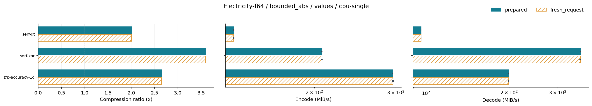

[SVG](figures/Electricity-f64--bounded_abs--cpu-single.svg)

<details><summary>完整数值、有效批次及拒绝原因</summary>

| codec | 完整输出 bytes P / F | 压缩倍数 P / F | 编码 MiB/s P / F | 解码 MiB/s P / F | 有效批次 P / F |
|---|---:|---:|---:|---:|---:|
| serf-qt | 3.37e+07 / 3.37e+07 | 2 / 2 | 134 / 134 | 96.1 / 96 | 14/14 / 14/14 |
| serf-xor | 1.88e+07 / 1.88e+07 | 3.6 / 3.6 | 208 / 208 | 363 / 363 | 14/14 / 14/14 |
| zfp-accuracy-1d | 2.55e+07 / 2.55e+07 | 2.65 / 2.65 | 296 / 296 | 199 / 199 | 14/14 / 14/14 |

</details>

**<f8 · [26304, 321] · 经验质量（无最大误差保证） · values · cpu-single**

运行进程 CPU 亲和性（P / F）：`[(0, 1, 2, 3, 4, 5, 6, 7, 8, 9, 10, 11, 12, 13, 14, 15)]` / `[(0, 1, 2, 3, 4, 5, 6, 7, 8, 9, 10, 11, 12, 13, 14, 15)]`；逐配置创建时间见 CSV，是否处于并行窗口见调度记录。

<details><summary>完整数值、有效批次及拒绝原因</summary>

| codec | 完整输出 bytes P / F | 压缩倍数 P / F | 编码 MiB/s P / F | 解码 MiB/s P / F | 有效批次 P / F |
|---|---:|---:|---:|---:|---:|
| abba | — / — | — / — | — / — | — / — | 0/0 / 0/0 |
| cameo | — / — | — / — | — / — | — / — | 0/0 / 0/0 |
| dft | — / — | — / — | — / — | — / — | 0/0 / 0/0 |
| dwt-dct-ii | — / — | — / — | — / — | — / — | 0/0 / 0/0 |
| fabba | — / — | — / — | — / — | — / — | 0/0 / 0/0 |
| pip | — / — | — / — | — / — | — / — | 0/0 / 0/0 |
| pmc-mean | — / — | — / — | — / — | — / — | 0/0 / 0/0 |
| pmc-mr | — / — | — / — | — / — | — / — | 0/0 / 0/0 |
| qabba | — / — | — / — | — / — | — / — | 0/0 / 0/0 |
| sim-piece | — / — | — / — | — / — | — / — | 0/0 / 0/0 |
| swab | — / — | — / — | — / — | — / — | 0/0 / 0/0 |
| swing-connected | — / — | — / — | — / — | — / — | 0/0 / 0/0 |
| swing-filter | — / — | — / — | — / — | — / — | 0/0 / 0/0 |
| swing-filter-disjoint | — / — | — / — | — / — | — / — | 0/0 / 0/0 |
| swing-filter-disjoint-quantized / compatible | — / — | — / — | — / — | — / — | 0/0 / 0/0 |
| tp | — / — | — / — | — / — | — / — | 0/0 / 0/0 |
| vw | — / — | — / — | — / — | — / — | 0/0 / 0/0 |

拒绝或未完整完成的请求：

- `abba` / fresh_request：unsupported，abba: element limit exceeded
- `abba` / prepared：unsupported，abba: element limit exceeded
- `cameo` / fresh_request：unsupported，cameo: element limit exceeded
- `cameo` / prepared：unsupported，cameo: element limit exceeded
- `dft` / fresh_request：unsupported，dft: element limit exceeded
- `dft` / prepared：unsupported，dft: element limit exceeded
- `dwt-dct-ii` / fresh_request：unsupported，dwt-dct-ii: element limit exceeded
- `dwt-dct-ii` / prepared：unsupported，dwt-dct-ii: element limit exceeded
- `fabba` / fresh_request：unsupported，fabba: element limit exceeded
- `fabba` / prepared：unsupported，fabba: element limit exceeded
- `pip` / fresh_request：unsupported，pip: element limit exceeded
- `pip` / prepared：unsupported，pip: element limit exceeded
- `pmc-mean` / fresh_request：unsupported，pmc-mean: element limit exceeded
- `pmc-mean` / prepared：unsupported，pmc-mean: element limit exceeded
- `pmc-mr` / fresh_request：unsupported，pmc-mr: dtype must be one of ('<f4',)
- `pmc-mr` / prepared：unsupported，pmc-mr: dtype must be one of ('<f4',)
- `qabba` / fresh_request：unsupported，qabba: element limit exceeded
- `qabba` / prepared：unsupported，qabba: element limit exceeded
- `sim-piece` / fresh_request：unsupported，sim-piece: element limit exceeded
- `sim-piece` / prepared：unsupported，sim-piece: element limit exceeded
- `swab` / fresh_request：unsupported，swab: element limit exceeded
- `swab` / prepared：unsupported，swab: element limit exceeded
- `swing-connected` / fresh_request：unsupported，swing-connected: element limit exceeded
- `swing-connected` / prepared：unsupported，swing-connected: element limit exceeded
- `swing-filter` / fresh_request：unsupported，swing-filter: dtype must be one of ('<f4',)
- `swing-filter` / prepared：unsupported，swing-filter: dtype must be one of ('<f4',)
- `swing-filter-disjoint` / fresh_request：unsupported，swing-filter-disjoint: dtype must be one of ('<f4',)
- `swing-filter-disjoint` / prepared：unsupported，swing-filter-disjoint: dtype must be one of ('<f4',)
- `swing-filter-disjoint-quantized / compatible` / fresh_request：unsupported，swing-filter-disjoint-quantized: dtype must be one of ('<f4',)
- `swing-filter-disjoint-quantized / compatible` / prepared：unsupported，swing-filter-disjoint-quantized: dtype must be one of ('<f4',)
- `tp` / fresh_request：unsupported，tp: element limit exceeded
- `tp` / prepared：unsupported，tp: element limit exceeded
- `vw` / fresh_request：unsupported，vw: element limit exceeded
- `vw` / prepared：unsupported，vw: element limit exceeded

</details>

**<i8 · [26304, 321] · 无损 · values · cpu-single**

运行进程 CPU 亲和性（P / F）：`[(0, 1, 2, 3, 4, 5, 6, 7, 8, 9, 10, 11, 12, 13, 14, 15)]` / `[(0, 1, 2, 3, 4, 5, 6, 7, 8, 9, 10, 11, 12, 13, 14, 15)]`；逐配置创建时间见 CSV，是否处于并行窗口见调度记录。

<details><summary>完整数值、有效批次及拒绝原因</summary>

| codec | 完整输出 bytes P / F | 压缩倍数 P / F | 编码 MiB/s P / F | 解码 MiB/s P / F | 有效批次 P / F |
|---|---:|---:|---:|---:|---:|
| leats-lossless-i64 | — / — | — / — | — / — | — / — | 0/0 / 0/0 |
| neats-lossless-i64 | — / — | — / — | — / — | — / — | 0/0 / 0/0 |

拒绝或未完整完成的请求：

- `leats-lossless-i64` / fresh_request：unsupported，leats-lossless-i64: m=321 exceeds native limits
- `leats-lossless-i64` / prepared：unsupported，leats-lossless-i64: m=321 exceeds native limits
- `neats-lossless-i64` / fresh_request：unsupported，neats-lossless-i64: m=321 exceeds native limits
- `neats-lossless-i64` / prepared：unsupported，neats-lossless-i64: m=321 exceeds native limits

</details>

**<u4 · [26304, 321] · 无损 · values · cpu-single**

运行进程 CPU 亲和性（P / F）：`[(0, 1, 2, 3, 4, 5, 6, 7, 8, 9, 10, 11, 12, 13, 14, 15)]` / `[(0, 1, 2, 3, 4, 5, 6, 7, 8, 9, 10, 11, 12, 13, 14, 15)]`；逐配置创建时间见 CSV，是否处于并行窗口见调度记录。

<details><summary>完整数值、有效批次及拒绝原因</summary>

| codec | 完整输出 bytes P / F | 压缩倍数 P / F | 编码 MiB/s P / F | 解码 MiB/s P / F | 有效批次 P / F |
|---|---:|---:|---:|---:|---:|
| simdcomp-u32 | — / — | — / — | — / — | — / — | 0/0 / 0/0 |

拒绝或未完整完成的请求：

- `simdcomp-u32` / fresh_request：unsupported，simdcomp-u32: rank must be one of (1,)
- `simdcomp-u32` / prepared：unsupported，simdcomp-u32: rank must be one of (1,)

</details>

<a id="dataset-Exchange"></a>

### Exchange

**<f4 · [7588, 8] · 无损 · values · cpu-single**

运行进程 CPU 亲和性（P / F）：`[(0, 1, 2, 3, 4, 5, 6, 7, 8, 9, 10, 11, 12, 13, 14, 15)]` / `[(0, 1, 2, 3, 4, 5, 6, 7, 8, 9, 10, 11, 12, 13, 14, 15)]`；逐配置创建时间见 CSV，是否处于并行窗口见调度记录。

f64→f32 准备阶段转换的最大绝对差：**1.18255615e-07**；本组 codec 的恢复质量相对转换后的 f32 输入验证。

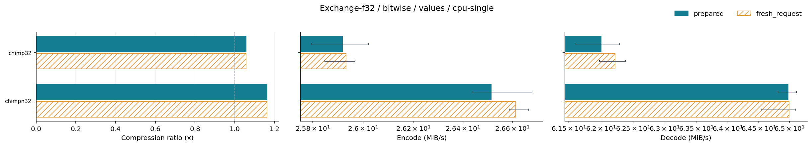

[SVG](figures/Exchange-f32--bitwise--cpu-single.svg)

<details><summary>完整数值、有效批次及拒绝原因</summary>

| codec | 完整输出 bytes P / F | 压缩倍数 P / F | 编码 MiB/s P / F | 解码 MiB/s P / F | 有效批次 P / F |
|---|---:|---:|---:|---:|---:|
| chimp32 | 2.3e+05 / 2.3e+05 | 1.06 / 1.06 | 25.9 / 25.9 | 62 / 62.2 | 14/14 / 14/14 |
| chimpn32 | 2.09e+05 / 2.09e+05 | 1.16 / 1.16 | 26.5 / 26.6 | 65 / 65 | 14/14 / 14/14 |

</details>

**<f4 · [7588, 8] · 经验质量（无最大误差保证） · values · cpu-single**

运行进程 CPU 亲和性（P / F）：`[(0, 1, 2, 3, 4, 5, 6, 7, 8, 9, 10, 11, 12, 13, 14, 15)]` / `[(0, 1, 2, 3, 4, 5, 6, 7, 8, 9, 10, 11, 12, 13, 14, 15)]`；逐配置创建时间见 CSV，是否处于并行窗口见调度记录。

f64→f32 准备阶段转换的最大绝对差：**1.18255615e-07**；本组 codec 的恢复质量相对转换后的 f32 输入验证。

<details><summary>完整数值、有效批次及拒绝原因</summary>

| codec | 完整输出 bytes P / F | 压缩倍数 P / F | 编码 MiB/s P / F | 解码 MiB/s P / F | 有效批次 P / F |
|---|---:|---:|---:|---:|---:|
| pmc-mr | — / — | — / — | — / — | — / — | 0/0 / 0/0 |
| swing-filter | — / — | — / — | — / — | — / — | 0/0 / 0/0 |
| swing-filter-disjoint | — / — | — / — | — / — | — / — | 0/0 / 0/0 |
| swing-filter-disjoint-quantized / compatible | — / — | — / — | — / — | — / — | 0/0 / 0/0 |

拒绝或未完整完成的请求：

- `pmc-mr` / fresh_request：unsupported，filter native_core requires one column; object/native_api preserve independent columns
- `pmc-mr` / prepared：unsupported，filter native_core requires one column; object/native_api preserve independent columns
- `swing-filter` / fresh_request：unsupported，filter native_core requires one column; object/native_api preserve independent columns
- `swing-filter` / prepared：unsupported，filter native_core requires one column; object/native_api preserve independent columns
- `swing-filter-disjoint` / fresh_request：unsupported，filter native_core requires one column; object/native_api preserve independent columns
- `swing-filter-disjoint` / prepared：unsupported，filter native_core requires one column; object/native_api preserve independent columns
- `swing-filter-disjoint-quantized / compatible` / fresh_request：unsupported，filter native_core requires one column; object/native_api preserve independent columns
- `swing-filter-disjoint-quantized / compatible` / prepared：unsupported，filter native_core requires one column; object/native_api preserve independent columns

</details>

**<f8 · [7588, 8] · 无损 · values · cpu-single**

运行进程 CPU 亲和性（P / F）：`[(0, 1, 2, 3, 4, 5, 6, 7, 8, 9, 10, 11, 12, 13, 14, 15)]` / `[(0, 1, 2, 3, 4, 5, 6, 7, 8, 9, 10, 11, 12, 13, 14, 15)]`；逐配置创建时间见 CSV，是否处于并行窗口见调度记录。

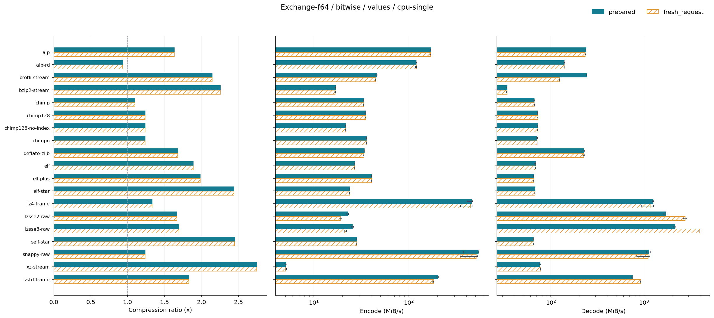

[SVG](figures/Exchange-f64--bitwise--cpu-single.svg)

<details><summary>完整数值、有效批次及拒绝原因</summary>

| codec | 完整输出 bytes P / F | 压缩倍数 P / F | 编码 MiB/s P / F | 解码 MiB/s P / F | 有效批次 P / F |
|---|---:|---:|---:|---:|---:|
| alp | 2.98e+05 / 2.98e+05 | 1.63 / 1.63 | 171 / 169 | 238 / 234 | 14/14 / 14/14 |
| alp-rd | 5.21e+05 / 5.21e+05 | 0.932 / 0.932 | 120 / 120 | 139 / 139 | 14/14 / 14/14 |
| brotli-stream | 2.27e+05 / 2.27e+05 | 2.14 / 2.14 | 45.6 / 44.7 | 243 / 124 | 14/14 / 14/14 |
| bzip2-stream | 2.15e+05 / 2.15e+05 | 2.25 / 2.25 | 16.8 / 16.8 | 33.7 / 33.7 | 14/14 / 14/14 |
| chimp | 4.42e+05 / 4.42e+05 | 1.1 / 1.1 | 33.4 / 33.4 | 66.3 / 66.3 | 14/14 / 14/14 |
| chimp128 | 3.93e+05 / 3.93e+05 | 1.24 / 1.24 | 34.9 / 35.1 | 71.6 / 72.5 | 14/14 / 14/14 |
| chimp128-no-index | 3.93e+05 / 3.93e+05 | 1.24 / 1.24 | 21.5 / 21.6 | 72 / 72.4 | 14/14 / 14/14 |
| chimp32 | — / — | — / — | — / — | — / — | 0/0 / 0/0 |
| chimpn | 3.93e+05 / 3.93e+05 | 1.24 / 1.24 | 35.7 / 35.7 | 70.7 / 70.9 | 14/14 / 14/14 |
| chimpn32 | — / — | — / — | — / — | — / — | 0/0 / 0/0 |
| deflate-zlib | 2.9e+05 / 2.9e+05 | 1.68 / 1.68 | 33.9 / 33.6 | 225 / 226 | 14/14 / 14/14 |
| elf | 2.58e+05 / 2.58e+05 | 1.89 / 1.89 | 27 / 27 | 67.8 / 67.7 | 14/14 / 14/14 |
| elf-plus | 2.45e+05 / 2.45e+05 | 1.98 / 1.98 | 40.5 / 40.4 | 65.5 / 65.4 | 14/14 / 14/14 |
| elf-star | 1.99e+05 / 1.99e+05 | 2.44 / 2.44 | 24 / 24 | 67.6 / 67.4 | 14/14 / 14/14 |
| fse | — / — | — / — | — / — | — / — | 0/0 / 0/0 |
| gorilla-prometheus-xor | — / — | — / — | — / — | — / — | 0/0 / 0/0 |
| huff0 | — / — | — / — | — / — | — / — | 0/0 / 0/0 |
| leats-lossless-i64 | — / — | — / — | — / — | — / — | 0/0 / 0/0 |
| lz4-frame | 3.65e+05 / 3.65e+05 | 1.33 / 1.33 | 455 / 443 | 1.25e+03 / 1.17e+03 | 14/14 / 14/14 |
| lzsse2-raw | 2.92e+05 / 2.92e+05 | 1.66 / 1.66 | 22.9 / 19.1 | 1.71e+03 / 2.77e+03 | 14/14 / 14/14 |
| lzsse8-raw | 2.87e+05 / 2.87e+05 | 1.69 / 1.69 | 25.4 / 21.7 | 2.14e+03 / 3.96e+03 | 14/14 / 14/14 |
| neats-lossless-i64 | — / — | — / — | — / — | — / — | 0/0 / 0/0 |
| self-star | 1.98e+05 / 1.98e+05 | 2.45 / 2.45 | 28.4 / 28.4 | 64.5 / 64.4 | 14/14 / 14/14 |
| simdcomp-u32 | — / — | — / — | — / — | — / — | 0/0 / 0/0 |
| snappy-raw | 3.93e+05 / 3.93e+05 | 1.24 / 1.24 | 534 / 511 | 1.13e+03 / 1.11e+03 | 14/14 / 14/14 |
| sprintz-delta | — / — | — / — | — / — | — / — | 0/0 / 0/0 |
| sprintz-delta-huffman | — / — | — / — | — / — | — / — | 0/0 / 0/0 |
| sprintz-fire | — / — | — / — | — / — | — / — | 0/0 / 0/0 |
| sprintz-fire-huffman | — / — | — / — | — / — | — / — | 0/0 / 0/0 |
| xz-stream | 1.77e+05 / 1.77e+05 | 2.75 / 2.75 | 5.08 / 5.07 | 76.2 / 77.1 | 14/14 / 14/14 |
| zstd-frame | 2.66e+05 / 2.66e+05 | 1.83 / 1.83 | 202 / 181 | 749 / 922 | 14/14 / 14/14 |

拒绝或未完整完成的请求：

- `chimp32` / fresh_request：unsupported，chimp32: dtype must be one of ('<f4',)
- `chimp32` / prepared：unsupported，chimp32: dtype must be one of ('<f4',)
- `chimpn32` / fresh_request：unsupported，chimpn32: dtype must be one of ('<f4',)
- `chimpn32` / prepared：unsupported，chimpn32: dtype must be one of ('<f4',)
- `fse` / fresh_request：unsupported，fse: native byte limit exceeded
- `fse` / prepared：unsupported，fse: native byte limit exceeded
- `gorilla-prometheus-xor` / fresh_request：unsupported，Gorilla requires actual paired T/V; values-only and timestamp-only are unsupported
- `gorilla-prometheus-xor` / prepared：unsupported，Gorilla requires actual paired T/V; values-only and timestamp-only are unsupported
- `huff0` / fresh_request：unsupported，huff0: native byte limit exceeded
- `huff0` / prepared：unsupported，huff0: native byte limit exceeded
- `leats-lossless-i64` / fresh_request：unsupported，leats-lossless-i64: dtype must be one of ('|i1', '<i2', '<i4', '<i8')
- `leats-lossless-i64` / prepared：unsupported，leats-lossless-i64: dtype must be one of ('|i1', '<i2', '<i4', '<i8')
- `neats-lossless-i64` / fresh_request：unsupported，neats-lossless-i64: dtype must be one of ('|i1', '<i2', '<i4', '<i8')
- `neats-lossless-i64` / prepared：unsupported，neats-lossless-i64: dtype must be one of ('|i1', '<i2', '<i4', '<i8')
- `simdcomp-u32` / fresh_request：unsupported，simdcomp-u32: dtype must be one of ('<u4',)
- `simdcomp-u32` / prepared：unsupported，simdcomp-u32: dtype must be one of ('<u4',)
- `sprintz-delta` / fresh_request：unsupported，sprintz-delta: dtype must be one of ('|u1', '|i1', '<u2', '<i2')
- `sprintz-delta` / prepared：unsupported，sprintz-delta: dtype must be one of ('|u1', '|i1', '<u2', '<i2')
- `sprintz-delta-huffman` / fresh_request：unsupported，sprintz-delta-huffman: dtype must be one of ('|u1', '|i1', '<u2', '<i2')
- `sprintz-delta-huffman` / prepared：unsupported，sprintz-delta-huffman: dtype must be one of ('|u1', '|i1', '<u2', '<i2')
- `sprintz-fire` / fresh_request：unsupported，sprintz-fire: dtype must be one of ('|u1', '|i1', '<u2', '<i2')
- `sprintz-fire` / prepared：unsupported，sprintz-fire: dtype must be one of ('|u1', '|i1', '<u2', '<i2')
- `sprintz-fire-huffman` / fresh_request：unsupported，sprintz-fire-huffman: dtype must be one of ('|u1', '|i1', '<u2', '<i2')
- `sprintz-fire-huffman` / prepared：unsupported，sprintz-fire-huffman: dtype must be one of ('|u1', '|i1', '<u2', '<i2')

</details>

**<f8 · [7588, 8] · ABS ≤ 0.01 · values · cpu-single**

运行进程 CPU 亲和性（P / F）：`[(0, 1, 2, 3, 4, 5, 6, 7, 8, 9, 10, 11, 12, 13, 14, 15)]` / `[(0, 1, 2, 3, 4, 5, 6, 7, 8, 9, 10, 11, 12, 13, 14, 15)]`；逐配置创建时间见 CSV，是否处于并行窗口见调度记录。

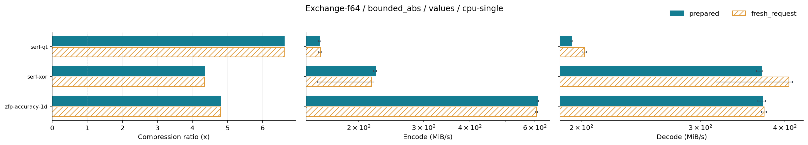

[SVG](figures/Exchange-f64--bounded_abs--cpu-single.svg)

<details><summary>完整数值、有效批次及拒绝原因</summary>

| codec | 完整输出 bytes P / F | 压缩倍数 P / F | 编码 MiB/s P / F | 解码 MiB/s P / F | 有效批次 P / F |
|---|---:|---:|---:|---:|---:|
| serf-qt | 7.34e+04 / 7.34e+04 | 6.62 / 6.62 | 157 / 158 | 194 / 202 | 14/14 / 14/14 |
| serf-xor | 1.12e+05 / 1.12e+05 | 4.35 / 4.35 | 223 / 217 | 369 / 406 | 14/14 / 14/14 |
| zfp-accuracy-1d | 1.01e+05 / 1.01e+05 | 4.81 / 4.81 | 612 / 607 | 371 / 373 | 14/14 / 14/14 |

</details>

**<f8 · [7588, 8] · 经验质量（无最大误差保证） · values · cpu-single**

运行进程 CPU 亲和性（P / F）：`[(0, 1, 2, 3, 4, 5, 6, 7, 8, 9, 10, 11, 12, 13, 14, 15)]` / `[(0, 1, 2, 3, 4, 5, 6, 7, 8, 9, 10, 11, 12, 13, 14, 15)]`；逐配置创建时间见 CSV，是否处于并行窗口见调度记录。

<details><summary>完整数值、有效批次及拒绝原因</summary>

| codec | 完整输出 bytes P / F | 压缩倍数 P / F | 编码 MiB/s P / F | 解码 MiB/s P / F | 有效批次 P / F |
|---|---:|---:|---:|---:|---:|
| abba | — / — | — / — | — / — | — / — | 0/0 / 0/0 |
| cameo | — / — | — / — | — / — | — / — | 0/0 / 0/0 |
| dft | — / — | — / — | — / — | — / — | 0/0 / 0/0 |
| dwt-dct-ii | — / — | — / — | — / — | — / — | 0/0 / 0/0 |
| fabba | — / — | — / — | — / — | — / — | 0/0 / 0/0 |
| pip | — / — | — / — | — / — | — / — | 0/0 / 0/0 |
| pmc-mean | — / — | — / — | — / — | — / — | 0/0 / 0/0 |
| pmc-mr | — / — | — / — | — / — | — / — | 0/0 / 0/0 |
| qabba | — / — | — / — | — / — | — / — | 0/0 / 0/0 |
| sim-piece | — / — | — / — | — / — | — / — | 0/0 / 0/0 |
| swab | — / — | — / — | — / — | — / — | 0/0 / 0/0 |
| swing-connected | — / — | — / — | — / — | — / — | 0/0 / 0/0 |
| swing-filter | — / — | — / — | — / — | — / — | 0/0 / 0/0 |
| swing-filter-disjoint | — / — | — / — | — / — | — / — | 0/0 / 0/0 |
| swing-filter-disjoint-quantized / compatible | — / — | — / — | — / — | — / — | 0/0 / 0/0 |
| tp | — / — | — / — | — / — | — / — | 0/0 / 0/0 |
| vw | — / — | — / — | — / — | — / — | 0/0 / 0/0 |

拒绝或未完整完成的请求：

- `abba` / fresh_request：unsupported，abba: native_core requires rank1; use object/native_api for independent columns
- `abba` / prepared：unsupported，abba: native_core requires rank1; use object/native_api for independent columns
- `cameo` / fresh_request：unsupported，cameo: native_core requires rank1; use object/native_api for independent columns
- `cameo` / prepared：unsupported，cameo: native_core requires rank1; use object/native_api for independent columns
- `dft` / fresh_request：unsupported，dft: native_core requires rank1; use object/native_api for independent columns
- `dft` / prepared：unsupported，dft: native_core requires rank1; use object/native_api for independent columns
- `dwt-dct-ii` / fresh_request：unsupported，dwt-dct-ii: native_core requires rank1; use object/native_api for independent columns
- `dwt-dct-ii` / prepared：unsupported，dwt-dct-ii: native_core requires rank1; use object/native_api for independent columns
- `fabba` / fresh_request：unsupported，fabba: native_core requires rank1; use object/native_api for independent columns
- `fabba` / prepared：unsupported，fabba: native_core requires rank1; use object/native_api for independent columns
- `pip` / fresh_request：unsupported，pip: native_core requires rank1; use object/native_api for independent columns
- `pip` / prepared：unsupported，pip: native_core requires rank1; use object/native_api for independent columns
- `pmc-mean` / fresh_request：unsupported，pmc-mean: native_core requires rank1; use object/native_api for independent columns
- `pmc-mean` / prepared：unsupported，pmc-mean: native_core requires rank1; use object/native_api for independent columns
- `pmc-mr` / fresh_request：unsupported，pmc-mr: dtype must be one of ('<f4',)
- `pmc-mr` / prepared：unsupported，pmc-mr: dtype must be one of ('<f4',)
- `qabba` / fresh_request：unsupported，qabba: native_core requires rank1; use object/native_api for independent columns
- `qabba` / prepared：unsupported，qabba: native_core requires rank1; use object/native_api for independent columns
- `sim-piece` / fresh_request：unsupported，sim-piece: native_core requires rank1; use object/native_api for independent columns
- `sim-piece` / prepared：unsupported，sim-piece: native_core requires rank1; use object/native_api for independent columns
- `swab` / fresh_request：unsupported，swab: native_core requires rank1; use object/native_api for independent columns
- `swab` / prepared：unsupported，swab: native_core requires rank1; use object/native_api for independent columns
- `swing-connected` / fresh_request：unsupported，swing-connected: native_core requires rank1; use object/native_api for independent columns
- `swing-connected` / prepared：unsupported，swing-connected: native_core requires rank1; use object/native_api for independent columns
- `swing-filter` / fresh_request：unsupported，swing-filter: dtype must be one of ('<f4',)
- `swing-filter` / prepared：unsupported，swing-filter: dtype must be one of ('<f4',)
- `swing-filter-disjoint` / fresh_request：unsupported，swing-filter-disjoint: dtype must be one of ('<f4',)
- `swing-filter-disjoint` / prepared：unsupported，swing-filter-disjoint: dtype must be one of ('<f4',)
- `swing-filter-disjoint-quantized / compatible` / fresh_request：unsupported，swing-filter-disjoint-quantized: dtype must be one of ('<f4',)
- `swing-filter-disjoint-quantized / compatible` / prepared：unsupported，swing-filter-disjoint-quantized: dtype must be one of ('<f4',)
- `tp` / fresh_request：unsupported，tp: native_core requires rank1; use object/native_api for independent columns
- `tp` / prepared：unsupported，tp: native_core requires rank1; use object/native_api for independent columns
- `vw` / fresh_request：unsupported，vw: native_core requires rank1; use object/native_api for independent columns
- `vw` / prepared：unsupported，vw: native_core requires rank1; use object/native_api for independent columns

</details>

<a id="dataset-FRED-MD"></a>

### FRED-MD

**<f4 · [728, 107] · 无损 · values · cpu-single**

运行进程 CPU 亲和性（P / F）：`[(0, 1, 2, 3, 4, 5, 6, 7, 8, 9, 10, 11, 12, 13, 14, 15)]` / `[(0, 1, 2, 3, 4, 5, 6, 7, 8, 9, 10, 11, 12, 13, 14, 15)]`；逐配置创建时间见 CSV，是否处于并行窗口见调度记录。

f64→f32 准备阶段转换的最大绝对差：**0.015**；本组 codec 的恢复质量相对转换后的 f32 输入验证。

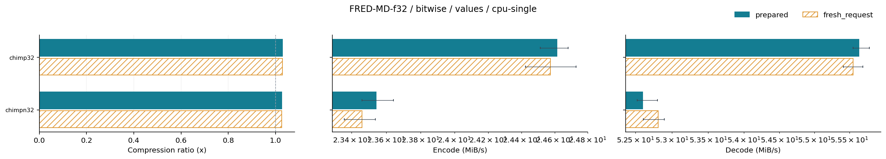

[SVG](figures/FRED-MD-f32--bitwise--cpu-single.svg)

<details><summary>完整数值、有效批次及拒绝原因</summary>

| codec | 完整输出 bytes P / F | 压缩倍数 P / F | 编码 MiB/s P / F | 解码 MiB/s P / F | 有效批次 P / F |
|---|---:|---:|---:|---:|---:|
| chimp32 | 3.03e+05 / 3.03e+05 | 1.03 / 1.03 | 24.6 / 24.6 | 55.6 / 55.6 | 14/14 / 14/14 |
| chimpn32 | 3.04e+05 / 3.04e+05 | 1.03 / 1.03 | 23.5 / 23.5 | 52.6 / 52.8 | 14/14 / 14/14 |

</details>

**<f4 · [728, 107] · 经验质量（无最大误差保证） · values · cpu-single**

运行进程 CPU 亲和性（P / F）：`[(0, 1, 2, 3, 4, 5, 6, 7, 8, 9, 10, 11, 12, 13, 14, 15)]` / `[(0, 1, 2, 3, 4, 5, 6, 7, 8, 9, 10, 11, 12, 13, 14, 15)]`；逐配置创建时间见 CSV，是否处于并行窗口见调度记录。

f64→f32 准备阶段转换的最大绝对差：**0.015**；本组 codec 的恢复质量相对转换后的 f32 输入验证。

<details><summary>完整数值、有效批次及拒绝原因</summary>

| codec | 完整输出 bytes P / F | 压缩倍数 P / F | 编码 MiB/s P / F | 解码 MiB/s P / F | 有效批次 P / F |
|---|---:|---:|---:|---:|---:|
| pmc-mr | — / — | — / — | — / — | — / — | 0/0 / 0/0 |
| swing-filter | — / — | — / — | — / — | — / — | 0/0 / 0/0 |
| swing-filter-disjoint | — / — | — / — | — / — | — / — | 0/0 / 0/0 |
| swing-filter-disjoint-quantized / compatible | — / — | — / — | — / — | — / — | 0/0 / 0/0 |

拒绝或未完整完成的请求：

- `pmc-mr` / fresh_request：unsupported，filter native_core requires one column; object/native_api preserve independent columns
- `pmc-mr` / prepared：unsupported，filter native_core requires one column; object/native_api preserve independent columns
- `swing-filter` / fresh_request：unsupported，filter native_core requires one column; object/native_api preserve independent columns
- `swing-filter` / prepared：unsupported，filter native_core requires one column; object/native_api preserve independent columns
- `swing-filter-disjoint` / fresh_request：unsupported，filter native_core requires one column; object/native_api preserve independent columns
- `swing-filter-disjoint` / prepared：unsupported，filter native_core requires one column; object/native_api preserve independent columns
- `swing-filter-disjoint-quantized / compatible` / fresh_request：unsupported，filter native_core requires one column; object/native_api preserve independent columns
- `swing-filter-disjoint-quantized / compatible` / prepared：unsupported，filter native_core requires one column; object/native_api preserve independent columns

</details>

**<f8 · [728, 107] · 无损 · values · cpu-single**

运行进程 CPU 亲和性（P / F）：`[(0, 1, 2, 3, 4, 5, 6, 7, 8, 9, 10, 11, 12, 13, 14, 15)]` / `[(0, 1, 2, 3, 4, 5, 6, 7, 8, 9, 10, 11, 12, 13, 14, 15)]`；逐配置创建时间见 CSV，是否处于并行窗口见调度记录。

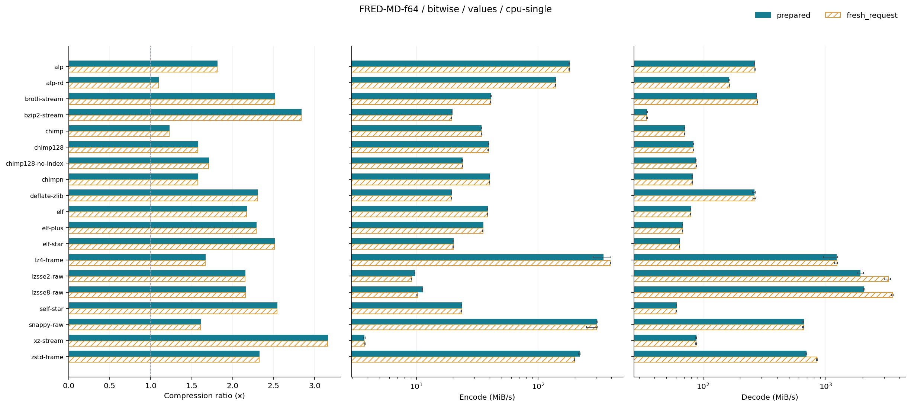

[SVG](figures/FRED-MD-f64--bitwise--cpu-single.svg)

<details><summary>完整数值、有效批次及拒绝原因</summary>

| codec | 完整输出 bytes P / F | 压缩倍数 P / F | 编码 MiB/s P / F | 解码 MiB/s P / F | 有效批次 P / F |
|---|---:|---:|---:|---:|---:|
| alp | 3.44e+05 / 3.44e+05 | 1.81 / 1.81 | 181 / 181 | 261 / 264 | 14/14 / 14/14 |
| alp-rd | 5.7e+05 / 5.7e+05 | 1.09 / 1.09 | 139 / 139 | 162 / 164 | 14/14 / 14/14 |
| brotli-stream | 2.48e+05 / 2.48e+05 | 2.51 / 2.51 | 41 / 40.6 | 271 / 276 | 14/14 / 14/14 |
| bzip2-stream | 2.2e+05 / 2.2e+05 | 2.83 / 2.83 | 19.6 / 19.5 | 34.7 / 34.7 | 14/14 / 14/14 |
| chimp | 5.08e+05 / 5.08e+05 | 1.23 / 1.23 | 34.1 / 34.3 | 70.4 / 70.2 | 14/14 / 14/14 |
| chimp128 | 3.95e+05 / 3.95e+05 | 1.58 / 1.58 | 39.2 / 39 | 83 / 82.9 | 14/14 / 14/14 |
| chimp128-no-index | 3.65e+05 / 3.65e+05 | 1.71 / 1.71 | 23.8 / 23.9 | 87.2 / 87.7 | 14/14 / 14/14 |
| chimp32 | — / — | — / — | — / — | — / — | 0/0 / 0/0 |
| chimpn | 3.95e+05 / 3.95e+05 | 1.58 / 1.58 | 39.9 / 39.8 | 81.6 / 81.4 | 14/14 / 14/14 |
| chimpn32 | — / — | — / — | — / — | — / — | 0/0 / 0/0 |
| deflate-zlib | 2.71e+05 / 2.71e+05 | 2.3 / 2.3 | 19.4 / 19.3 | 259 / 260 | 14/14 / 14/14 |
| elf | 2.88e+05 / 2.88e+05 | 2.17 / 2.17 | 38.4 / 38.3 | 79.3 / 79.4 | 14/14 / 14/14 |
| elf-plus | 2.73e+05 / 2.73e+05 | 2.28 / 2.28 | 35.2 / 35.2 | 67.8 / 68 | 14/14 / 14/14 |
| elf-star | 2.48e+05 / 2.48e+05 | 2.51 / 2.51 | 20.1 / 20.1 | 64.3 / 64.3 | 14/14 / 14/14 |
| fse | — / — | — / — | — / — | — / — | 0/0 / 0/0 |
| gorilla-prometheus-xor | — / — | — / — | — / — | — / — | 0/0 / 0/0 |
| huff0 | — / — | — / — | — / — | — / — | 0/0 / 0/0 |
| leats-lossless-i64 | — / — | — / — | — / — | — / — | 0/0 / 0/0 |
| lz4-frame | 3.74e+05 / 3.74e+05 | 1.67 / 1.67 | 342 / 392 | 1.22e+03 / 1.23e+03 | 14/14 / 14/14 |
| lzsse2-raw | 2.9e+05 / 2.9e+05 | 2.15 / 2.15 | 9.7 / 9.12 | 1.9e+03 / 3.23e+03 | 14/14 / 14/14 |
| lzsse8-raw | 2.89e+05 / 2.89e+05 | 2.15 / 2.15 | 11.2 / 10.2 | 2.05e+03 / 3.51e+03 | 14/14 / 14/14 |
| neats-lossless-i64 | — / — | — / — | — / — | — / — | 0/0 / 0/0 |
| self-star | 2.45e+05 / 2.45e+05 | 2.54 / 2.54 | 23.6 / 23.6 | 60.3 / 60.2 | 14/14 / 14/14 |
| simdcomp-u32 | — / — | — / — | — / — | — / — | 0/0 / 0/0 |
| snappy-raw | 3.87e+05 / 3.87e+05 | 1.61 / 1.61 | 303 / 302 | 657 / 656 | 14/14 / 14/14 |
| sprintz-delta | — / — | — / — | — / — | — / — | 0/0 / 0/0 |
| sprintz-delta-huffman | — / — | — / — | — / — | — / — | 0/0 / 0/0 |
| sprintz-fire | — / — | — / — | — / — | — / — | 0/0 / 0/0 |
| sprintz-fire-huffman | — / — | — / — | — / — | — / — | 0/0 / 0/0 |
| xz-stream | 1.97e+05 / 1.97e+05 | 3.16 / 3.16 | 3.73 / 3.75 | 87.4 / 87.8 | 14/14 / 14/14 |
| zstd-frame | 2.68e+05 / 2.68e+05 | 2.33 / 2.33 | 218 / 199 | 692 / 848 | 14/14 / 14/14 |

拒绝或未完整完成的请求：

- `chimp32` / fresh_request：unsupported，chimp32: dtype must be one of ('<f4',)
- `chimp32` / prepared：unsupported，chimp32: dtype must be one of ('<f4',)
- `chimpn32` / fresh_request：unsupported，chimpn32: dtype must be one of ('<f4',)
- `chimpn32` / prepared：unsupported，chimpn32: dtype must be one of ('<f4',)
- `fse` / fresh_request：unsupported，fse: m=107 exceeds native limits
- `fse` / prepared：unsupported，fse: m=107 exceeds native limits
- `gorilla-prometheus-xor` / fresh_request：unsupported，Gorilla requires actual paired T/V; values-only and timestamp-only are unsupported
- `gorilla-prometheus-xor` / prepared：unsupported，Gorilla requires actual paired T/V; values-only and timestamp-only are unsupported
- `huff0` / fresh_request：unsupported，huff0: m=107 exceeds native limits
- `huff0` / prepared：unsupported，huff0: m=107 exceeds native limits
- `leats-lossless-i64` / fresh_request：unsupported，leats-lossless-i64: dtype must be one of ('|i1', '<i2', '<i4', '<i8')
- `leats-lossless-i64` / prepared：unsupported，leats-lossless-i64: dtype must be one of ('|i1', '<i2', '<i4', '<i8')
- `neats-lossless-i64` / fresh_request：unsupported，neats-lossless-i64: dtype must be one of ('|i1', '<i2', '<i4', '<i8')
- `neats-lossless-i64` / prepared：unsupported，neats-lossless-i64: dtype must be one of ('|i1', '<i2', '<i4', '<i8')
- `simdcomp-u32` / fresh_request：unsupported，simdcomp-u32: dtype must be one of ('<u4',)
- `simdcomp-u32` / prepared：unsupported，simdcomp-u32: dtype must be one of ('<u4',)
- `sprintz-delta` / fresh_request：unsupported，sprintz-delta: dtype must be one of ('|u1', '|i1', '<u2', '<i2')
- `sprintz-delta` / prepared：unsupported，sprintz-delta: dtype must be one of ('|u1', '|i1', '<u2', '<i2')
- `sprintz-delta-huffman` / fresh_request：unsupported，sprintz-delta-huffman: dtype must be one of ('|u1', '|i1', '<u2', '<i2')
- `sprintz-delta-huffman` / prepared：unsupported，sprintz-delta-huffman: dtype must be one of ('|u1', '|i1', '<u2', '<i2')
- `sprintz-fire` / fresh_request：unsupported，sprintz-fire: dtype must be one of ('|u1', '|i1', '<u2', '<i2')
- `sprintz-fire` / prepared：unsupported，sprintz-fire: dtype must be one of ('|u1', '|i1', '<u2', '<i2')
- `sprintz-fire-huffman` / fresh_request：unsupported，sprintz-fire-huffman: dtype must be one of ('|u1', '|i1', '<u2', '<i2')
- `sprintz-fire-huffman` / prepared：unsupported，sprintz-fire-huffman: dtype must be one of ('|u1', '|i1', '<u2', '<i2')

</details>

**<f8 · [728, 107] · ABS ≤ 0.01 · values · cpu-single**

运行进程 CPU 亲和性（P / F）：`[(0, 1, 2, 3, 4, 5, 6, 7, 8, 9, 10, 11, 12, 13, 14, 15)]` / `[(0, 1, 2, 3, 4, 5, 6, 7, 8, 9, 10, 11, 12, 13, 14, 15)]`；逐配置创建时间见 CSV，是否处于并行窗口见调度记录。

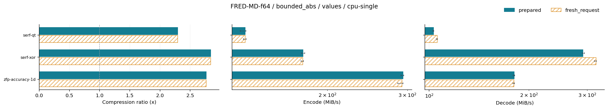

[SVG](figures/FRED-MD-f64--bounded_abs--cpu-single.svg)

<details><summary>完整数值、有效批次及拒绝原因</summary>

| codec | 完整输出 bytes P / F | 压缩倍数 P / F | 编码 MiB/s P / F | 解码 MiB/s P / F | 有效批次 P / F |
|---|---:|---:|---:|---:|---:|
| serf-qt | 2.72e+05 / 2.72e+05 | 2.29 / 2.29 | 132 / 132 | 103 / 106 | 14/14 / 14/14 |
| serf-xor | 2.2e+05 / 2.2e+05 | 2.84 / 2.84 | 177 / 176 | 291 / 319 | 14/14 / 14/14 |
| zfp-accuracy-1d | 2.25e+05 / 2.25e+05 | 2.77 / 2.77 | 293 / 292 | 180 / 180 | 14/14 / 14/14 |

</details>

**<f8 · [728, 107] · 经验质量（无最大误差保证） · values · cpu-single**

运行进程 CPU 亲和性（P / F）：`[(0, 1, 2, 3, 4, 5, 6, 7, 8, 9, 10, 11, 12, 13, 14, 15)]` / `[(0, 1, 2, 3, 4, 5, 6, 7, 8, 9, 10, 11, 12, 13, 14, 15)]`；逐配置创建时间见 CSV，是否处于并行窗口见调度记录。

<details><summary>完整数值、有效批次及拒绝原因</summary>

| codec | 完整输出 bytes P / F | 压缩倍数 P / F | 编码 MiB/s P / F | 解码 MiB/s P / F | 有效批次 P / F |
|---|---:|---:|---:|---:|---:|
| abba | — / — | — / — | — / — | — / — | 0/0 / 0/0 |
| cameo | — / — | — / — | — / — | — / — | 0/0 / 0/0 |
| dft | — / — | — / — | — / — | — / — | 0/0 / 0/0 |
| dwt-dct-ii | — / — | — / — | — / — | — / — | 0/0 / 0/0 |
| fabba | — / — | — / — | — / — | — / — | 0/0 / 0/0 |
| pip | — / — | — / — | — / — | — / — | 0/0 / 0/0 |
| pmc-mean | — / — | — / — | — / — | — / — | 0/0 / 0/0 |
| pmc-mr | — / — | — / — | — / — | — / — | 0/0 / 0/0 |
| qabba | — / — | — / — | — / — | — / — | 0/0 / 0/0 |
| sim-piece | — / — | — / — | — / — | — / — | 0/0 / 0/0 |
| swab | — / — | — / — | — / — | — / — | 0/0 / 0/0 |
| swing-connected | — / — | — / — | — / — | — / — | 0/0 / 0/0 |
| swing-filter | — / — | — / — | — / — | — / — | 0/0 / 0/0 |
| swing-filter-disjoint | — / — | — / — | — / — | — / — | 0/0 / 0/0 |
| swing-filter-disjoint-quantized / compatible | — / — | — / — | — / — | — / — | 0/0 / 0/0 |
| tp | — / — | — / — | — / — | — / — | 0/0 / 0/0 |
| vw | — / — | — / — | — / — | — / — | 0/0 / 0/0 |

拒绝或未完整完成的请求：

- `abba` / fresh_request：unsupported，abba: native_core requires rank1; use object/native_api for independent columns
- `abba` / prepared：unsupported，abba: native_core requires rank1; use object/native_api for independent columns
- `cameo` / fresh_request：unsupported，cameo: native_core requires rank1; use object/native_api for independent columns
- `cameo` / prepared：unsupported，cameo: native_core requires rank1; use object/native_api for independent columns
- `dft` / fresh_request：unsupported，dft: native_core requires rank1; use object/native_api for independent columns
- `dft` / prepared：unsupported，dft: native_core requires rank1; use object/native_api for independent columns
- `dwt-dct-ii` / fresh_request：unsupported，dwt-dct-ii: native_core requires rank1; use object/native_api for independent columns
- `dwt-dct-ii` / prepared：unsupported，dwt-dct-ii: native_core requires rank1; use object/native_api for independent columns
- `fabba` / fresh_request：unsupported，fabba: native_core requires rank1; use object/native_api for independent columns
- `fabba` / prepared：unsupported，fabba: native_core requires rank1; use object/native_api for independent columns
- `pip` / fresh_request：unsupported，pip: native_core requires rank1; use object/native_api for independent columns
- `pip` / prepared：unsupported，pip: native_core requires rank1; use object/native_api for independent columns
- `pmc-mean` / fresh_request：unsupported，pmc-mean: native_core requires rank1; use object/native_api for independent columns
- `pmc-mean` / prepared：unsupported，pmc-mean: native_core requires rank1; use object/native_api for independent columns
- `pmc-mr` / fresh_request：unsupported，pmc-mr: dtype must be one of ('<f4',)
- `pmc-mr` / prepared：unsupported，pmc-mr: dtype must be one of ('<f4',)
- `qabba` / fresh_request：unsupported，qabba: native_core requires rank1; use object/native_api for independent columns
- `qabba` / prepared：unsupported，qabba: native_core requires rank1; use object/native_api for independent columns
- `sim-piece` / fresh_request：unsupported，sim-piece: native_core requires rank1; use object/native_api for independent columns
- `sim-piece` / prepared：unsupported，sim-piece: native_core requires rank1; use object/native_api for independent columns
- `swab` / fresh_request：unsupported，swab: native_core requires rank1; use object/native_api for independent columns
- `swab` / prepared：unsupported，swab: native_core requires rank1; use object/native_api for independent columns
- `swing-connected` / fresh_request：unsupported，swing-connected: native_core requires rank1; use object/native_api for independent columns
- `swing-connected` / prepared：unsupported，swing-connected: native_core requires rank1; use object/native_api for independent columns
- `swing-filter` / fresh_request：unsupported，swing-filter: dtype must be one of ('<f4',)
- `swing-filter` / prepared：unsupported，swing-filter: dtype must be one of ('<f4',)
- `swing-filter-disjoint` / fresh_request：unsupported，swing-filter-disjoint: dtype must be one of ('<f4',)
- `swing-filter-disjoint` / prepared：unsupported，swing-filter-disjoint: dtype must be one of ('<f4',)
- `swing-filter-disjoint-quantized / compatible` / fresh_request：unsupported，swing-filter-disjoint-quantized: dtype must be one of ('<f4',)
- `swing-filter-disjoint-quantized / compatible` / prepared：unsupported，swing-filter-disjoint-quantized: dtype must be one of ('<f4',)
- `tp` / fresh_request：unsupported，tp: native_core requires rank1; use object/native_api for independent columns
- `tp` / prepared：unsupported，tp: native_core requires rank1; use object/native_api for independent columns
- `vw` / fresh_request：unsupported，vw: native_core requires rank1; use object/native_api for independent columns
- `vw` / prepared：unsupported，vw: native_core requires rank1; use object/native_api for independent columns

</details>

<a id="dataset-ILI"></a>

### ILI

**<f4 · [966, 7] · 无损 · values · cpu-single**

运行进程 CPU 亲和性（P / F）：`[(0, 1, 2, 3, 4, 5, 6, 7, 8, 9, 10, 11, 12, 13, 14, 15)]` / `[(0, 1, 2, 3, 4, 5, 6, 7, 8, 9, 10, 11, 12, 13, 14, 15)]`；逐配置创建时间见 CSV，是否处于并行窗口见调度记录。

f64→f32 准备阶段转换的最大绝对差：**2.3727417e-07**；本组 codec 的恢复质量相对转换后的 f32 输入验证。

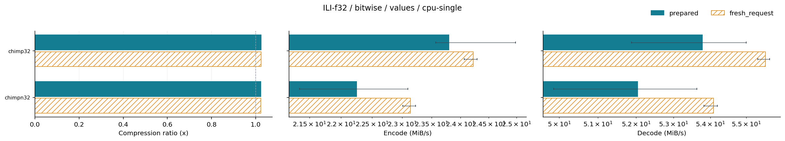

[SVG](figures/ILI-f32--bitwise--cpu-single.svg)

<details><summary>完整数值、有效批次及拒绝原因</summary>

| codec | 完整输出 bytes P / F | 压缩倍数 P / F | 编码 MiB/s P / F | 解码 MiB/s P / F | 有效批次 P / F |
|---|---:|---:|---:|---:|---:|
| chimp32 | 2.64e+04 / 2.64e+04 | 1.02 / 1.02 | 23.8 / 24.2 | 53.8 / 55.5 | 14/14 / 14/14 |
| chimpn32 | 2.64e+04 / 2.64e+04 | 1.02 / 1.02 | 22.2 / 23.1 | 52 / 54.1 | 14/14 / 14/14 |

</details>

**<f4 · [966, 7] · 经验质量（无最大误差保证） · values · cpu-single**

运行进程 CPU 亲和性（P / F）：`[(0, 1, 2, 3, 4, 5, 6, 7, 8, 9, 10, 11, 12, 13, 14, 15)]` / `[(0, 1, 2, 3, 4, 5, 6, 7, 8, 9, 10, 11, 12, 13, 14, 15)]`；逐配置创建时间见 CSV，是否处于并行窗口见调度记录。

f64→f32 准备阶段转换的最大绝对差：**2.3727417e-07**；本组 codec 的恢复质量相对转换后的 f32 输入验证。

<details><summary>完整数值、有效批次及拒绝原因</summary>

| codec | 完整输出 bytes P / F | 压缩倍数 P / F | 编码 MiB/s P / F | 解码 MiB/s P / F | 有效批次 P / F |
|---|---:|---:|---:|---:|---:|
| pmc-mr | — / — | — / — | — / — | — / — | 0/0 / 0/0 |
| swing-filter | — / — | — / — | — / — | — / — | 0/0 / 0/0 |
| swing-filter-disjoint | — / — | — / — | — / — | — / — | 0/0 / 0/0 |
| swing-filter-disjoint-quantized / compatible | — / — | — / — | — / — | — / — | 0/0 / 0/0 |

拒绝或未完整完成的请求：

- `pmc-mr` / fresh_request：unsupported，filter native_core requires one column; object/native_api preserve independent columns
- `pmc-mr` / prepared：unsupported，filter native_core requires one column; object/native_api preserve independent columns
- `swing-filter` / fresh_request：unsupported，filter native_core requires one column; object/native_api preserve independent columns
- `swing-filter` / prepared：unsupported，filter native_core requires one column; object/native_api preserve independent columns
- `swing-filter-disjoint` / fresh_request：unsupported，filter native_core requires one column; object/native_api preserve independent columns
- `swing-filter-disjoint` / prepared：unsupported，filter native_core requires one column; object/native_api preserve independent columns
- `swing-filter-disjoint-quantized / compatible` / fresh_request：unsupported，filter native_core requires one column; object/native_api preserve independent columns
- `swing-filter-disjoint-quantized / compatible` / prepared：unsupported，filter native_core requires one column; object/native_api preserve independent columns

</details>

**<f8 · [966, 7] · 无损 · values · cpu-single**

运行进程 CPU 亲和性（P / F）：`[(0, 1, 2, 3, 4, 5, 6, 7, 8, 9, 10, 11, 12, 13, 14, 15)]` / `[(0, 1, 2, 3, 4, 5, 6, 7, 8, 9, 10, 11, 12, 13, 14, 15)]`；逐配置创建时间见 CSV，是否处于并行窗口见调度记录。

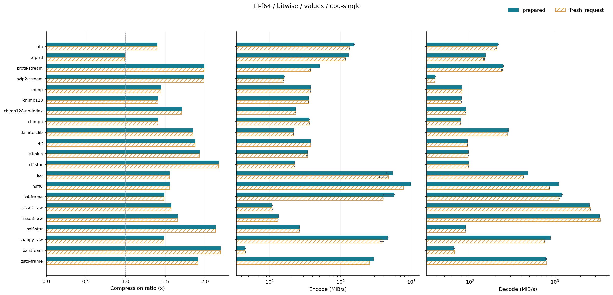

[SVG](figures/ILI-f64--bitwise--cpu-single.svg)

<details><summary>完整数值、有效批次及拒绝原因</summary>

| codec | 完整输出 bytes P / F | 压缩倍数 P / F | 编码 MiB/s P / F | 解码 MiB/s P / F | 有效批次 P / F |
|---|---:|---:|---:|---:|---:|
| alp | 3.88e+04 / 3.88e+04 | 1.39 / 1.39 | 156 / 133 | 215 / 207 | 14/14 / 14/14 |
| alp-rd | 5.51e+04 / 5.51e+04 | 0.982 / 0.982 | 130 / 117 | 152 / 148 | 14/14 / 14/14 |
| brotli-stream | 2.72e+04 / 2.72e+04 | 1.99 / 1.99 | 50.9 / 38 | 243 / 239 | 14/14 / 14/14 |
| bzip2-stream | 2.73e+04 / 2.73e+04 | 1.98 / 1.98 | 16.1 / 16 | 39 / 38.7 | 14/14 / 14/14 |
| chimp | 3.74e+04 / 3.74e+04 | 1.44 / 1.44 | 37.7 / 37.8 | 80.6 / 80.7 | 14/14 / 14/14 |
| chimp128 | 3.85e+04 / 3.85e+04 | 1.41 / 1.41 | 35.4 / 35.3 | 79.4 / 78.6 | 14/14 / 14/14 |
| chimp128-no-index | 3.17e+04 / 3.17e+04 | 1.71 / 1.71 | 23.4 / 23.5 | 89.1 / 89.4 | 14/14 / 14/14 |
| chimp32 | — / — | — / — | — / — | — / — | 0/0 / 0/0 |
| chimpn | 3.85e+04 / 3.85e+04 | 1.41 / 1.41 | 36 / 36.1 | 77.7 / 77.7 | 14/14 / 14/14 |
| chimpn32 | — / — | — / — | — / — | — / — | 0/0 / 0/0 |
| deflate-zlib | 2.93e+04 / 2.93e+04 | 1.85 / 1.85 | 22 / 21.8 | 283 / 275 | 14/14 / 14/14 |
| elf | 2.88e+04 / 2.88e+04 | 1.88 / 1.88 | 37.9 / 37.7 | 93.4 / 93.8 | 14/14 / 14/14 |
| elf-plus | 2.8e+04 / 2.8e+04 | 1.93 / 1.93 | 34.2 / 34.1 | 95.5 / 95.5 | 14/14 / 14/14 |
| elf-star | 2.5e+04 / 2.5e+04 | 2.17 / 2.17 | 22.7 / 22.7 | 96.8 / 96.8 | 14/14 / 14/14 |
| fse | 3.49e+04 / 3.49e+04 | 1.55 / 1.55 | 547 / 479 | 482 / 431 | 14/14 / 14/14 |
| gorilla-prometheus-xor | — / — | — / — | — / — | — / — | 0/0 / 0/0 |
| huff0 | 3.48e+04 / 3.48e+04 | 1.55 / 1.55 | 989 / 773 | 1.1e+03 / 862 | 14/14 / 14/14 |
| leats-lossless-i64 | — / — | — / — | — / — | — / — | 0/0 / 0/0 |
| lz4-frame | 3.64e+04 / 3.64e+04 | 1.48 / 1.48 | 574 / 401 | 1.21e+03 / 1.11e+03 | 14/14 / 14/14 |
| lzsse2-raw | 3.44e+04 / 3.44e+04 | 1.57 / 1.57 | 10.7 / 10.8 | 2.55e+03 / 2.61e+03 | 14/14 / 14/14 |
| lzsse8-raw | 3.27e+04 / 3.27e+04 | 1.66 / 1.66 | 13.3 / 13.1 | 3.37e+03 / 3.42e+03 | 14/14 / 14/14 |
| neats-lossless-i64 | — / — | — / — | — / — | — / — | 0/0 / 0/0 |
| self-star | 2.54e+04 / 2.54e+04 | 2.13 / 2.13 | 26.5 / 26.4 | 88.7 / 88.5 | 14/14 / 14/14 |
| simdcomp-u32 | — / — | — / — | — / — | — / — | 0/0 / 0/0 |
| snappy-raw | 3.65e+04 / 3.65e+04 | 1.48 / 1.48 | 463 / 387 | 884 / 758 | 14/14 / 14/14 |
| sprintz-delta | — / — | — / — | — / — | — / — | 0/0 / 0/0 |
| sprintz-delta-huffman | — / — | — / — | — / — | — / — | 0/0 / 0/0 |
| sprintz-fire | — / — | — / — | — / — | — / — | 0/0 / 0/0 |
| sprintz-fire-huffman | — / — | — / — | — / — | — / — | 0/0 / 0/0 |
| xz-stream | 2.47e+04 / 2.47e+04 | 2.19 / 2.19 | 4.52 / 4.52 | 65.3 / 65.9 | 14/14 / 14/14 |
| zstd-frame | 2.83e+04 / 2.83e+04 | 1.91 / 1.91 | 294 / 257 | 789 / 796 | 14/14 / 14/14 |

拒绝或未完整完成的请求：

- `chimp32` / fresh_request：unsupported，chimp32: dtype must be one of ('<f4',)
- `chimp32` / prepared：unsupported，chimp32: dtype must be one of ('<f4',)
- `chimpn32` / fresh_request：unsupported，chimpn32: dtype must be one of ('<f4',)
- `chimpn32` / prepared：unsupported，chimpn32: dtype must be one of ('<f4',)
- `gorilla-prometheus-xor` / fresh_request：unsupported，Gorilla requires actual paired T/V; values-only and timestamp-only are unsupported
- `gorilla-prometheus-xor` / prepared：unsupported，Gorilla requires actual paired T/V; values-only and timestamp-only are unsupported
- `leats-lossless-i64` / fresh_request：unsupported，leats-lossless-i64: dtype must be one of ('|i1', '<i2', '<i4', '<i8')
- `leats-lossless-i64` / prepared：unsupported，leats-lossless-i64: dtype must be one of ('|i1', '<i2', '<i4', '<i8')
- `neats-lossless-i64` / fresh_request：unsupported，neats-lossless-i64: dtype must be one of ('|i1', '<i2', '<i4', '<i8')
- `neats-lossless-i64` / prepared：unsupported，neats-lossless-i64: dtype must be one of ('|i1', '<i2', '<i4', '<i8')
- `simdcomp-u32` / fresh_request：unsupported，simdcomp-u32: dtype must be one of ('<u4',)
- `simdcomp-u32` / prepared：unsupported，simdcomp-u32: dtype must be one of ('<u4',)
- `sprintz-delta` / fresh_request：unsupported，sprintz-delta: dtype must be one of ('|u1', '|i1', '<u2', '<i2')
- `sprintz-delta` / prepared：unsupported，sprintz-delta: dtype must be one of ('|u1', '|i1', '<u2', '<i2')
- `sprintz-delta-huffman` / fresh_request：unsupported，sprintz-delta-huffman: dtype must be one of ('|u1', '|i1', '<u2', '<i2')
- `sprintz-delta-huffman` / prepared：unsupported，sprintz-delta-huffman: dtype must be one of ('|u1', '|i1', '<u2', '<i2')
- `sprintz-fire` / fresh_request：unsupported，sprintz-fire: dtype must be one of ('|u1', '|i1', '<u2', '<i2')
- `sprintz-fire` / prepared：unsupported，sprintz-fire: dtype must be one of ('|u1', '|i1', '<u2', '<i2')
- `sprintz-fire-huffman` / fresh_request：unsupported，sprintz-fire-huffman: dtype must be one of ('|u1', '|i1', '<u2', '<i2')
- `sprintz-fire-huffman` / prepared：unsupported，sprintz-fire-huffman: dtype must be one of ('|u1', '|i1', '<u2', '<i2')

</details>

**<f8 · [966, 7] · ABS ≤ 0.01 · values · cpu-single**

运行进程 CPU 亲和性（P / F）：`[(0, 1, 2, 3, 4, 5, 6, 7, 8, 9, 10, 11, 12, 13, 14, 15)]` / `[(0, 1, 2, 3, 4, 5, 6, 7, 8, 9, 10, 11, 12, 13, 14, 15)]`；逐配置创建时间见 CSV，是否处于并行窗口见调度记录。

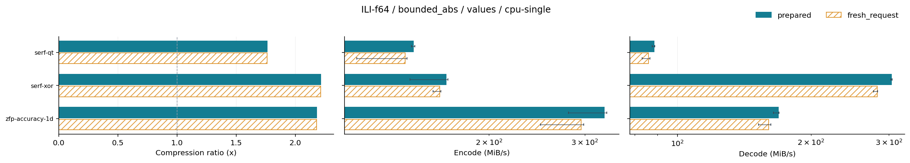

[SVG](figures/ILI-f64--bounded_abs--cpu-single.svg)

<details><summary>完整数值、有效批次及拒绝原因</summary>

| codec | 完整输出 bytes P / F | 压缩倍数 P / F | 编码 MiB/s P / F | 解码 MiB/s P / F | 有效批次 P / F |
|---|---:|---:|---:|---:|---:|
| serf-qt | 3.07e+04 / 3.07e+04 | 1.76 / 1.76 | 145 / 140 | 88.4 / 86 | 14/14 / 14/14 |
| serf-xor | 2.45e+04 / 2.45e+04 | 2.21 / 2.21 | 167 / 162 | 304 / 282 | 14/14 / 14/14 |
| zfp-accuracy-1d | 2.48e+04 / 2.48e+04 | 2.18 / 2.18 | 326 / 296 | 169 / 161 | 14/14 / 14/14 |

</details>

**<f8 · [966, 7] · 经验质量（无最大误差保证） · values · cpu-single**

运行进程 CPU 亲和性（P / F）：`[(0, 1, 2, 3, 4, 5, 6, 7, 8, 9, 10, 11, 12, 13, 14, 15)]` / `[(0, 1, 2, 3, 4, 5, 6, 7, 8, 9, 10, 11, 12, 13, 14, 15)]`；逐配置创建时间见 CSV，是否处于并行窗口见调度记录。

<details><summary>完整数值、有效批次及拒绝原因</summary>

| codec | 完整输出 bytes P / F | 压缩倍数 P / F | 编码 MiB/s P / F | 解码 MiB/s P / F | 有效批次 P / F |
|---|---:|---:|---:|---:|---:|
| abba | — / — | — / — | — / — | — / — | 0/0 / 0/0 |
| cameo | — / — | — / — | — / — | — / — | 0/0 / 0/0 |
| dft | — / — | — / — | — / — | — / — | 0/0 / 0/0 |
| dwt-dct-ii | — / — | — / — | — / — | — / — | 0/0 / 0/0 |
| fabba | — / — | — / — | — / — | — / — | 0/0 / 0/0 |
| pip | — / — | — / — | — / — | — / — | 0/0 / 0/0 |
| pmc-mean | — / — | — / — | — / — | — / — | 0/0 / 0/0 |
| pmc-mr | — / — | — / — | — / — | — / — | 0/0 / 0/0 |
| qabba | — / — | — / — | — / — | — / — | 0/0 / 0/0 |
| sim-piece | — / — | — / — | — / — | — / — | 0/0 / 0/0 |
| swab | — / — | — / — | — / — | — / — | 0/0 / 0/0 |
| swing-connected | — / — | — / — | — / — | — / — | 0/0 / 0/0 |
| swing-filter | — / — | — / — | — / — | — / — | 0/0 / 0/0 |
| swing-filter-disjoint | — / — | — / — | — / — | — / — | 0/0 / 0/0 |
| swing-filter-disjoint-quantized / compatible | — / — | — / — | — / — | — / — | 0/0 / 0/0 |
| tp | — / — | — / — | — / — | — / — | 0/0 / 0/0 |
| vw | — / — | — / — | — / — | — / — | 0/0 / 0/0 |

拒绝或未完整完成的请求：

- `abba` / fresh_request：unsupported，abba: native_core requires rank1; use object/native_api for independent columns
- `abba` / prepared：unsupported，abba: native_core requires rank1; use object/native_api for independent columns
- `cameo` / fresh_request：unsupported，cameo: native_core requires rank1; use object/native_api for independent columns
- `cameo` / prepared：unsupported，cameo: native_core requires rank1; use object/native_api for independent columns
- `dft` / fresh_request：unsupported，dft: native_core requires rank1; use object/native_api for independent columns
- `dft` / prepared：unsupported，dft: native_core requires rank1; use object/native_api for independent columns
- `dwt-dct-ii` / fresh_request：unsupported，dwt-dct-ii: native_core requires rank1; use object/native_api for independent columns
- `dwt-dct-ii` / prepared：unsupported，dwt-dct-ii: native_core requires rank1; use object/native_api for independent columns
- `fabba` / fresh_request：unsupported，fabba: native_core requires rank1; use object/native_api for independent columns
- `fabba` / prepared：unsupported，fabba: native_core requires rank1; use object/native_api for independent columns
- `pip` / fresh_request：unsupported，pip: native_core requires rank1; use object/native_api for independent columns
- `pip` / prepared：unsupported，pip: native_core requires rank1; use object/native_api for independent columns
- `pmc-mean` / fresh_request：unsupported，pmc-mean: native_core requires rank1; use object/native_api for independent columns
- `pmc-mean` / prepared：unsupported，pmc-mean: native_core requires rank1; use object/native_api for independent columns
- `pmc-mr` / fresh_request：unsupported，pmc-mr: dtype must be one of ('<f4',)
- `pmc-mr` / prepared：unsupported，pmc-mr: dtype must be one of ('<f4',)
- `qabba` / fresh_request：unsupported，qabba: native_core requires rank1; use object/native_api for independent columns
- `qabba` / prepared：unsupported，qabba: native_core requires rank1; use object/native_api for independent columns
- `sim-piece` / fresh_request：unsupported，sim-piece: native_core requires rank1; use object/native_api for independent columns
- `sim-piece` / prepared：unsupported，sim-piece: native_core requires rank1; use object/native_api for independent columns
- `swab` / fresh_request：unsupported，swab: native_core requires rank1; use object/native_api for independent columns
- `swab` / prepared：unsupported，swab: native_core requires rank1; use object/native_api for independent columns
- `swing-connected` / fresh_request：unsupported，swing-connected: native_core requires rank1; use object/native_api for independent columns
- `swing-connected` / prepared：unsupported，swing-connected: native_core requires rank1; use object/native_api for independent columns
- `swing-filter` / fresh_request：unsupported，swing-filter: dtype must be one of ('<f4',)
- `swing-filter` / prepared：unsupported，swing-filter: dtype must be one of ('<f4',)
- `swing-filter-disjoint` / fresh_request：unsupported，swing-filter-disjoint: dtype must be one of ('<f4',)
- `swing-filter-disjoint` / prepared：unsupported，swing-filter-disjoint: dtype must be one of ('<f4',)
- `swing-filter-disjoint-quantized / compatible` / fresh_request：unsupported，swing-filter-disjoint-quantized: dtype must be one of ('<f4',)
- `swing-filter-disjoint-quantized / compatible` / prepared：unsupported，swing-filter-disjoint-quantized: dtype must be one of ('<f4',)
- `tp` / fresh_request：unsupported，tp: native_core requires rank1; use object/native_api for independent columns
- `tp` / prepared：unsupported，tp: native_core requires rank1; use object/native_api for independent columns
- `vw` / fresh_request：unsupported，vw: native_core requires rank1; use object/native_api for independent columns
- `vw` / prepared：unsupported，vw: native_core requires rank1; use object/native_api for independent columns

</details>

<a id="dataset-METR-LA"></a>

### METR-LA

**<f4 · [34272, 207] · 无损 · values · cpu-single**

运行进程 CPU 亲和性（P / F）：`[(0, 1, 2, 3, 4, 5, 6, 7, 8, 9, 10, 11, 12, 13, 14, 15)]` / `[(0, 1, 2, 3, 4, 5, 6, 7, 8, 9, 10, 11, 12, 13, 14, 15)]`；逐配置创建时间见 CSV，是否处于并行窗口见调度记录。

f64→f32 准备阶段转换的最大绝对差：**3.39084201e-06**；本组 codec 的恢复质量相对转换后的 f32 输入验证。

<details><summary>完整数值、有效批次及拒绝原因</summary>

| codec | 完整输出 bytes P / F | 压缩倍数 P / F | 编码 MiB/s P / F | 解码 MiB/s P / F | 有效批次 P / F |
|---|---:|---:|---:|---:|---:|
| chimp32 | — / — | — / — | — / — | — / — | 0/0 / 0/0 |
| chimpn32 | — / — | — / — | — / — | — / — | 0/0 / 0/0 |

拒绝或未完整完成的请求：

- `chimp32` / fresh_request：unsupported，chimp32: element limit exceeded
- `chimp32` / prepared：unsupported，chimp32: element limit exceeded
- `chimpn32` / fresh_request：unsupported，chimpn32: element limit exceeded
- `chimpn32` / prepared：unsupported，chimpn32: element limit exceeded

</details>

**<f4 · [34272, 207] · 经验质量（无最大误差保证） · values · cpu-single**

运行进程 CPU 亲和性（P / F）：`[(0, 1, 2, 3, 4, 5, 6, 7, 8, 9, 10, 11, 12, 13, 14, 15)]` / `[(0, 1, 2, 3, 4, 5, 6, 7, 8, 9, 10, 11, 12, 13, 14, 15)]`；逐配置创建时间见 CSV，是否处于并行窗口见调度记录。

f64→f32 准备阶段转换的最大绝对差：**3.39084201e-06**；本组 codec 的恢复质量相对转换后的 f32 输入验证。

<details><summary>完整数值、有效批次及拒绝原因</summary>

| codec | 完整输出 bytes P / F | 压缩倍数 P / F | 编码 MiB/s P / F | 解码 MiB/s P / F | 有效批次 P / F |
|---|---:|---:|---:|---:|---:|
| pmc-mr | — / — | — / — | — / — | — / — | 0/0 / 0/0 |
| swing-filter | — / — | — / — | — / — | — / — | 0/0 / 0/0 |
| swing-filter-disjoint | — / — | — / — | — / — | — / — | 0/0 / 0/0 |
| swing-filter-disjoint-quantized / compatible | — / — | — / — | — / — | — / — | 0/0 / 0/0 |

拒绝或未完整完成的请求：

- `pmc-mr` / fresh_request：unsupported，pmc-mr: element limit exceeded
- `pmc-mr` / prepared：unsupported，pmc-mr: element limit exceeded
- `swing-filter` / fresh_request：unsupported，swing-filter: element limit exceeded
- `swing-filter` / prepared：unsupported，swing-filter: element limit exceeded
- `swing-filter-disjoint` / fresh_request：unsupported，swing-filter-disjoint: element limit exceeded
- `swing-filter-disjoint` / prepared：unsupported，swing-filter-disjoint: element limit exceeded
- `swing-filter-disjoint-quantized / compatible` / fresh_request：unsupported，swing-filter-disjoint-quantized: element limit exceeded
- `swing-filter-disjoint-quantized / compatible` / prepared：unsupported，swing-filter-disjoint-quantized: element limit exceeded

</details>

**<f8 · [34272, 207] · 无损 · values · cpu-single**

运行进程 CPU 亲和性（P / F）：`[(0, 1, 2, 3, 4, 5, 6, 7, 8, 9, 10, 11, 12, 13, 14, 15)]` / `[(0, 1, 2, 3, 4, 5, 6, 7, 8, 9, 10, 11, 12, 13, 14, 15)]`；逐配置创建时间见 CSV，是否处于并行窗口见调度记录。

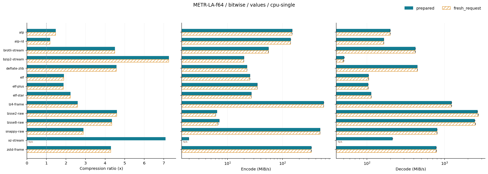

[SVG](figures/METR-LA-f64--bitwise--cpu-single.svg)

<details><summary>完整数值、有效批次及拒绝原因</summary>

| codec | 完整输出 bytes P / F | 压缩倍数 P / F | 编码 MiB/s P / F | 解码 MiB/s P / F | 有效批次 P / F |
|---|---:|---:|---:|---:|---:|
| alp | 3.86e+07 / 3.86e+07 | 1.47 / 1.47 | 149 / 149 | 199 / 199 | 14/14 / 14/14 |
| alp-rd | 4.81e+07 / 4.81e+07 | 1.18 / 1.18 | 140 / 141 | 165 / 165 | 14/14 / 14/14 |
| brotli-stream | 1.26e+07 / 1.26e+07 | 4.49 / 4.49 | 55.6 / 55.5 | 420 / 419 | 14/14 / 14/14 |
| bzip2-stream | 7.82e+06 / 7.82e+06 | 7.26 / 7.26 | 19.9 / 19.8 | 50.6 / 49.8 | 14/14 / 14/14 |
| chimp | — / — | — / — | — / — | — / — | 0/0 / 0/0 |
| chimp128 | — / — | — / — | — / — | — / — | 0/0 / 0/0 |
| chimp128-no-index | — / — | — / — | — / — | — / — | 0/0 / 0/0 |
| chimp32 | — / — | — / — | — / — | — / — | 0/0 / 0/0 |
| chimpn | — / — | — / — | — / — | — / — | 0/0 / 0/0 |
| chimpn32 | — / — | — / — | — / — | — / — | 0/0 / 0/0 |
| deflate-zlib | 1.24e+07 / 1.24e+07 | 4.58 / 4.58 | 22.6 / 22.6 | 445 / 446 | 14/14 / 14/14 |
| elf | 3.01e+07 / 3.01e+07 | 1.88 / 1.88 | 25.5 / 25.5 | 105 / 105 | 14/14 / 14/14 |
| elf-plus | 3.05e+07 / 3.05e+07 | 1.86 / 1.86 | 34.8 / 34.8 | 104 / 104 | 14/14 / 14/14 |
| elf-star | 2.55e+07 / 2.55e+07 | 2.22 / 2.22 | 27 / 27.1 | 113 / 113 | 14/14 / 14/14 |
| fse | — / — | — / — | — / — | — / — | 0/0 / 0/0 |
| gorilla-prometheus-xor | — / — | — / — | — / — | — / — | 0/0 / 0/0 |
| huff0 | — / — | — / — | — / — | — / — | 0/0 / 0/0 |
| leats-lossless-i64 | — / — | — / — | — / — | — / — | 0/0 / 0/0 |
| lz4-frame | 2.19e+07 / 2.19e+07 | 2.59 / 2.59 | 560 / 560 | 1.23e+03 / 1.22e+03 | 14/14 / 14/14 |
| lzsse2-raw | 1.24e+07 / 1.24e+07 | 4.59 / 4.59 | 6.41 / 6.12 | 2.65e+03 / 2.71e+03 | 14/14 / 14/14 |
| lzsse8-raw | 1.31e+07 / 1.31e+07 | 4.34 / 4.34 | 7.1 / 6.71 | 2.44e+03 / 2.48e+03 | 14/14 / 14/14 |
| neats-lossless-i64 | — / — | — / — | — / — | — / — | 0/0 / 0/0 |
| self-star | — / — | — / — | — / — | — / — | 0/0 / 0/0 |
| simdcomp-u32 | — / — | — / — | — / — | — / — | 0/0 / 0/0 |
| snappy-raw | 1.97e+07 / 1.97e+07 | 2.89 / 2.89 | 482 / 482 | 799 / 802 | 14/14 / 14/14 |
| sprintz-delta | — / — | — / — | — / — | — / — | 0/0 / 0/0 |
| sprintz-delta-huffman | — / — | — / — | — / — | — / — | 0/0 / 0/0 |
| sprintz-fire | — / — | — / — | — / — | — / — | 0/0 / 0/0 |
| sprintz-fire-huffman | — / — | — / — | — / — | — / — | 0/0 / 0/0 |
| xz-stream | 8.01e+06 / — | 7.09 / — | 1.98 / — | 213 / — | 14/14 / 13/14 |
| zstd-frame | 1.32e+07 / 1.32e+07 | 4.29 / 4.29 | 335 / 334 | 781 / 785 | 14/14 / 14/14 |

拒绝或未完整完成的请求：

- `chimp` / fresh_request：unsupported，chimp: element limit exceeded
- `chimp` / prepared：unsupported，chimp: element limit exceeded
- `chimp128` / fresh_request：unsupported，chimp128: element limit exceeded
- `chimp128` / prepared：unsupported，chimp128: element limit exceeded
- `chimp128-no-index` / fresh_request：unsupported，chimp128-no-index: element limit exceeded
- `chimp128-no-index` / prepared：unsupported，chimp128-no-index: element limit exceeded
- `chimp32` / fresh_request：unsupported，chimp32: dtype must be one of ('<f4',)
- `chimp32` / prepared：unsupported，chimp32: dtype must be one of ('<f4',)
- `chimpn` / fresh_request：unsupported，chimpn: element limit exceeded
- `chimpn` / prepared：unsupported，chimpn: element limit exceeded
- `chimpn32` / fresh_request：unsupported，chimpn32: dtype must be one of ('<f4',)
- `chimpn32` / prepared：unsupported，chimpn32: dtype must be one of ('<f4',)
- `fse` / fresh_request：unsupported，fse: n=34272 exceeds native limits
- `fse` / prepared：unsupported，fse: n=34272 exceeds native limits
- `gorilla-prometheus-xor` / fresh_request：unsupported，Gorilla requires actual paired T/V; values-only and timestamp-only are unsupported
- `gorilla-prometheus-xor` / prepared：unsupported，Gorilla requires actual paired T/V; values-only and timestamp-only are unsupported
- `huff0` / fresh_request：unsupported，huff0: n=34272 exceeds native limits
- `huff0` / prepared：unsupported，huff0: n=34272 exceeds native limits
- `leats-lossless-i64` / fresh_request：unsupported，leats-lossless-i64: dtype must be one of ('|i1', '<i2', '<i4', '<i8')
- `leats-lossless-i64` / prepared：unsupported，leats-lossless-i64: dtype must be one of ('|i1', '<i2', '<i4', '<i8')
- `neats-lossless-i64` / fresh_request：unsupported，neats-lossless-i64: dtype must be one of ('|i1', '<i2', '<i4', '<i8')
- `neats-lossless-i64` / prepared：unsupported，neats-lossless-i64: dtype must be one of ('|i1', '<i2', '<i4', '<i8')
- `self-star` / fresh_request：unsupported，SElfStar intrinsic session limits exceeded 
- `self-star` / prepared：unsupported，SElfStar intrinsic session limits exceeded 
- `simdcomp-u32` / fresh_request：unsupported，simdcomp-u32: dtype must be one of ('<u4',)
- `simdcomp-u32` / prepared：unsupported，simdcomp-u32: dtype must be one of ('<u4',)
- `sprintz-delta` / fresh_request：unsupported，sprintz-delta: dtype must be one of ('|u1', '|i1', '<u2', '<i2')
- `sprintz-delta` / prepared：unsupported，sprintz-delta: dtype must be one of ('|u1', '|i1', '<u2', '<i2')
- `sprintz-delta-huffman` / fresh_request：unsupported，sprintz-delta-huffman: dtype must be one of ('|u1', '|i1', '<u2', '<i2')
- `sprintz-delta-huffman` / prepared：unsupported，sprintz-delta-huffman: dtype must be one of ('|u1', '|i1', '<u2', '<i2')
- `sprintz-fire` / fresh_request：unsupported，sprintz-fire: dtype must be one of ('|u1', '|i1', '<u2', '<i2')
- `sprintz-fire` / prepared：unsupported，sprintz-fire: dtype must be one of ('|u1', '|i1', '<u2', '<i2')
- `sprintz-fire-huffman` / fresh_request：unsupported，sprintz-fire-huffman: dtype must be one of ('|u1', '|i1', '<u2', '<i2')
- `sprintz-fire-huffman` / prepared：unsupported，sprintz-fire-huffman: dtype must be one of ('|u1', '|i1', '<u2', '<i2')
- `xz-stream` / fresh_request：ready，{'interrupted_attempt_without_terminal': 1}

</details>

**<f8 · [34272, 207] · ABS ≤ 0.01 · values · cpu-single**

运行进程 CPU 亲和性（P / F）：`[(0, 1, 2, 3, 4, 5, 6, 7, 8, 9, 10, 11, 12, 13, 14, 15)]` / `[(0, 1, 2, 3, 4, 5, 6, 7, 8, 9, 10, 11, 12, 13, 14, 15)]`；逐配置创建时间见 CSV，是否处于并行窗口见调度记录。

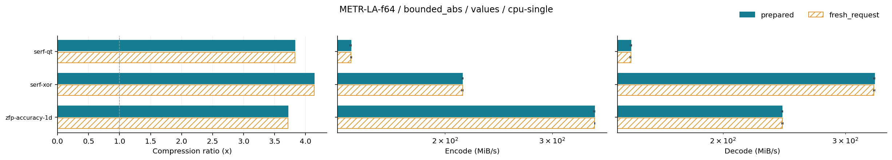

[SVG](figures/METR-LA-f64--bounded_abs--cpu-single.svg)

<details><summary>完整数值、有效批次及拒绝原因</summary>

| codec | 完整输出 bytes P / F | 压缩倍数 P / F | 编码 MiB/s P / F | 解码 MiB/s P / F | 有效批次 P / F |
|---|---:|---:|---:|---:|---:|
| serf-qt | 1.48e+07 / 1.48e+07 | 3.83 / 3.83 | 140 / 140 | 147 / 147 | 14/14 / 14/14 |
| serf-xor | 1.37e+07 / 1.37e+07 | 4.14 / 4.14 | 214 / 214 | 330 / 330 | 14/14 / 14/14 |
| zfp-accuracy-1d | 1.53e+07 / 1.53e+07 | 3.71 / 3.71 | 352 / 352 | 243 / 243 | 14/14 / 14/14 |

</details>

**<f8 · [34272, 207] · 经验质量（无最大误差保证） · values · cpu-single**

运行进程 CPU 亲和性（P / F）：`[(0, 1, 2, 3, 4, 5, 6, 7, 8, 9, 10, 11, 12, 13, 14, 15)]` / `[(0, 1, 2, 3, 4, 5, 6, 7, 8, 9, 10, 11, 12, 13, 14, 15)]`；逐配置创建时间见 CSV，是否处于并行窗口见调度记录。

<details><summary>完整数值、有效批次及拒绝原因</summary>

| codec | 完整输出 bytes P / F | 压缩倍数 P / F | 编码 MiB/s P / F | 解码 MiB/s P / F | 有效批次 P / F |
|---|---:|---:|---:|---:|---:|
| abba | — / — | — / — | — / — | — / — | 0/0 / 0/0 |
| cameo | — / — | — / — | — / — | — / — | 0/0 / 0/0 |
| dft | — / — | — / — | — / — | — / — | 0/0 / 0/0 |
| dwt-dct-ii | — / — | — / — | — / — | — / — | 0/0 / 0/0 |
| fabba | — / — | — / — | — / — | — / — | 0/0 / 0/0 |
| pip | — / — | — / — | — / — | — / — | 0/0 / 0/0 |
| pmc-mean | — / — | — / — | — / — | — / — | 0/0 / 0/0 |
| pmc-mr | — / — | — / — | — / — | — / — | 0/0 / 0/0 |
| qabba | — / — | — / — | — / — | — / — | 0/0 / 0/0 |
| sim-piece | — / — | — / — | — / — | — / — | 0/0 / 0/0 |
| swab | — / — | — / — | — / — | — / — | 0/0 / 0/0 |
| swing-connected | — / — | — / — | — / — | — / — | 0/0 / 0/0 |
| swing-filter | — / — | — / — | — / — | — / — | 0/0 / 0/0 |
| swing-filter-disjoint | — / — | — / — | — / — | — / — | 0/0 / 0/0 |
| swing-filter-disjoint-quantized / compatible | — / — | — / — | — / — | — / — | 0/0 / 0/0 |
| tp | — / — | — / — | — / — | — / — | 0/0 / 0/0 |
| vw | — / — | — / — | — / — | — / — | 0/0 / 0/0 |

拒绝或未完整完成的请求：

- `abba` / fresh_request：unsupported，abba: element limit exceeded
- `abba` / prepared：unsupported，abba: element limit exceeded
- `cameo` / fresh_request：unsupported，cameo: element limit exceeded
- `cameo` / prepared：unsupported，cameo: element limit exceeded
- `dft` / fresh_request：unsupported，dft: element limit exceeded
- `dft` / prepared：unsupported，dft: element limit exceeded
- `dwt-dct-ii` / fresh_request：unsupported，dwt-dct-ii: element limit exceeded
- `dwt-dct-ii` / prepared：unsupported，dwt-dct-ii: element limit exceeded
- `fabba` / fresh_request：unsupported，fabba: element limit exceeded
- `fabba` / prepared：unsupported，fabba: element limit exceeded
- `pip` / fresh_request：unsupported，pip: element limit exceeded
- `pip` / prepared：unsupported，pip: element limit exceeded
- `pmc-mean` / fresh_request：unsupported，pmc-mean: element limit exceeded
- `pmc-mean` / prepared：unsupported，pmc-mean: element limit exceeded
- `pmc-mr` / fresh_request：unsupported，pmc-mr: dtype must be one of ('<f4',)
- `pmc-mr` / prepared：unsupported，pmc-mr: dtype must be one of ('<f4',)
- `qabba` / fresh_request：unsupported，qabba: element limit exceeded
- `qabba` / prepared：unsupported，qabba: element limit exceeded
- `sim-piece` / fresh_request：unsupported，sim-piece: element limit exceeded
- `sim-piece` / prepared：unsupported，sim-piece: element limit exceeded
- `swab` / fresh_request：unsupported，swab: element limit exceeded
- `swab` / prepared：unsupported，swab: element limit exceeded
- `swing-connected` / fresh_request：unsupported，swing-connected: element limit exceeded
- `swing-connected` / prepared：unsupported，swing-connected: element limit exceeded
- `swing-filter` / fresh_request：unsupported，swing-filter: dtype must be one of ('<f4',)
- `swing-filter` / prepared：unsupported，swing-filter: dtype must be one of ('<f4',)
- `swing-filter-disjoint` / fresh_request：unsupported，swing-filter-disjoint: dtype must be one of ('<f4',)
- `swing-filter-disjoint` / prepared：unsupported，swing-filter-disjoint: dtype must be one of ('<f4',)
- `swing-filter-disjoint-quantized / compatible` / fresh_request：unsupported，swing-filter-disjoint-quantized: dtype must be one of ('<f4',)
- `swing-filter-disjoint-quantized / compatible` / prepared：unsupported，swing-filter-disjoint-quantized: dtype must be one of ('<f4',)
- `tp` / fresh_request：unsupported，tp: element limit exceeded
- `tp` / prepared：unsupported，tp: element limit exceeded
- `vw` / fresh_request：unsupported，vw: element limit exceeded
- `vw` / prepared：unsupported，vw: element limit exceeded

</details>

<a id="dataset-NASDAQ"></a>

### NASDAQ

**<f4 · [1245, 5] · 无损 · values · cpu-single**

运行进程 CPU 亲和性（P / F）：`[(0, 1, 2, 3, 4, 5, 6, 7, 8, 9, 10, 11, 12, 13, 14, 15)]` / `[(0, 1, 2, 3, 4, 5, 6, 7, 8, 9, 10, 11, 12, 13, 14, 15)]`；逐配置创建时间见 CSV，是否处于并行窗口见调度记录。

f64→f32 准备阶段转换的最大绝对差：**2.9800415e-08**；本组 codec 的恢复质量相对转换后的 f32 输入验证。

<details><summary>完整数值、有效批次及拒绝原因</summary>

| codec | 完整输出 bytes P / F | 压缩倍数 P / F | 编码 MiB/s P / F | 解码 MiB/s P / F | 有效批次 P / F |
|---|---:|---:|---:|---:|---:|
| chimp32 | — / — | — / — | — / — | — / — | 0/0 / 0/0 |
| chimpn32 | — / — | — / — | — / — | — / — | 0/0 / 0/0 |

拒绝或未完整完成的请求：

- `chimp32` / fresh_request：unsupported，canonical positive NaN is the Chimp EOF sentinel 
- `chimp32` / prepared：unsupported，canonical positive NaN is the Chimp EOF sentinel 
- `chimpn32` / fresh_request：unsupported，canonical positive NaN is the Chimp EOF sentinel 
- `chimpn32` / prepared：unsupported，canonical positive NaN is the Chimp EOF sentinel 

</details>

**<f4 · [1245, 5] · 经验质量（无最大误差保证） · values · cpu-single**

运行进程 CPU 亲和性（P / F）：`[(0, 1, 2, 3, 4, 5, 6, 7, 8, 9, 10, 11, 12, 13, 14, 15)]` / `[(0, 1, 2, 3, 4, 5, 6, 7, 8, 9, 10, 11, 12, 13, 14, 15)]`；逐配置创建时间见 CSV，是否处于并行窗口见调度记录。

f64→f32 准备阶段转换的最大绝对差：**2.9800415e-08**；本组 codec 的恢复质量相对转换后的 f32 输入验证。

<details><summary>完整数值、有效批次及拒绝原因</summary>

| codec | 完整输出 bytes P / F | 压缩倍数 P / F | 编码 MiB/s P / F | 解码 MiB/s P / F | 有效批次 P / F |
|---|---:|---:|---:|---:|---:|
| pmc-mr | — / — | — / — | — / — | — / — | 0/0 / 0/0 |
| swing-filter | — / — | — / — | — / — | — / — | 0/0 / 0/0 |
| swing-filter-disjoint | — / — | — / — | — / — | — / — | 0/0 / 0/0 |
| swing-filter-disjoint-quantized / compatible | — / — | — / — | — / — | — / — | 0/0 / 0/0 |

拒绝或未完整完成的请求：

- `pmc-mr` / fresh_request：unsupported，filter native_core requires one column; object/native_api preserve independent columns
- `pmc-mr` / prepared：unsupported，filter native_core requires one column; object/native_api preserve independent columns
- `swing-filter` / fresh_request：unsupported，filter native_core requires one column; object/native_api preserve independent columns
- `swing-filter` / prepared：unsupported，filter native_core requires one column; object/native_api preserve independent columns
- `swing-filter-disjoint` / fresh_request：unsupported，filter native_core requires one column; object/native_api preserve independent columns
- `swing-filter-disjoint` / prepared：unsupported，filter native_core requires one column; object/native_api preserve independent columns
- `swing-filter-disjoint-quantized / compatible` / fresh_request：unsupported，filter native_core requires one column; object/native_api preserve independent columns
- `swing-filter-disjoint-quantized / compatible` / prepared：unsupported，filter native_core requires one column; object/native_api preserve independent columns

</details>

**<f8 · [1245, 5] · 无损 · values · cpu-single**

运行进程 CPU 亲和性（P / F）：`[(0, 1, 2, 3, 4, 5, 6, 7, 8, 9, 10, 11, 12, 13, 14, 15)]` / `[(0, 1, 2, 3, 4, 5, 6, 7, 8, 9, 10, 11, 12, 13, 14, 15)]`；逐配置创建时间见 CSV，是否处于并行窗口见调度记录。

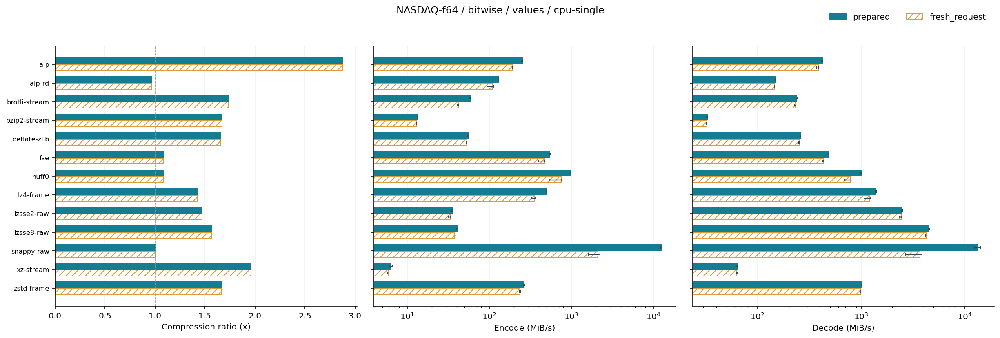

[SVG](figures/NASDAQ-f64--bitwise--cpu-single.svg)

<details><summary>完整数值、有效批次及拒绝原因</summary>

| codec | 完整输出 bytes P / F | 压缩倍数 P / F | 编码 MiB/s P / F | 解码 MiB/s P / F | 有效批次 P / F |
|---|---:|---:|---:|---:|---:|
| alp | 1.73e+04 / 1.73e+04 | 2.88 / 2.88 | 255 / 190 | 421 / 387 | 14/14 / 14/14 |
| alp-rd | 5.16e+04 / 5.16e+04 | 0.964 / 0.964 | 129 / 110 | 150 / 146 | 14/14 / 14/14 |
| brotli-stream | 2.87e+04 / 2.87e+04 | 1.73 / 1.73 | 58.5 / 42.2 | 236 / 232 | 14/14 / 14/14 |
| bzip2-stream | 2.98e+04 / 2.98e+04 | 1.67 / 1.67 | 13.1 / 13 | 32.8 / 32.4 | 14/14 / 14/14 |
| chimp | — / — | — / — | — / — | — / — | 0/0 / 0/0 |
| chimp128 | — / — | — / — | — / — | — / — | 0/0 / 0/0 |
| chimp128-no-index | — / — | — / — | — / — | — / — | 0/0 / 0/0 |
| chimp32 | — / — | — / — | — / — | — / — | 0/0 / 0/0 |
| chimpn | — / — | — / — | — / — | — / — | 0/0 / 0/0 |
| chimpn32 | — / — | — / — | — / — | — / — | 0/0 / 0/0 |
| deflate-zlib | 3.01e+04 / 3.01e+04 | 1.65 / 1.65 | 55.1 / 53.4 | 260 / 251 | 14/14 / 14/14 |
| elf | — / — | — / — | — / — | — / — | 0/0 / 0/0 |
| elf-plus | — / — | — / — | — / — | — / — | 0/0 / 0/0 |
| elf-star | — / — | — / — | — / — | — / — | 0/0 / 0/0 |
| fse | 4.59e+04 / 4.59e+04 | 1.08 / 1.08 | 549 / 475 | 487 / 431 | 14/14 / 14/14 |
| gorilla-prometheus-xor | — / — | — / — | — / — | — / — | 0/0 / 0/0 |
| huff0 | 4.59e+04 / 4.59e+04 | 1.08 / 1.08 | 973 / 758 | 1.01e+03 / 780 | 14/14 / 14/14 |
| leats-lossless-i64 | — / — | — / — | — / — | — / — | 0/0 / 0/0 |
| lz4-frame | 3.5e+04 / 3.5e+04 | 1.42 / 1.42 | 493 / 356 | 1.39e+03 / 1.2e+03 | 14/14 / 14/14 |
| lzsse2-raw | 3.39e+04 / 3.39e+04 | 1.47 / 1.47 | 35.2 / 33.4 | 2.47e+03 / 2.43e+03 | 14/14 / 14/14 |
| lzsse8-raw | 3.18e+04 / 3.18e+04 | 1.57 / 1.57 | 41 / 37.7 | 4.46e+03 / 4.22e+03 | 14/14 / 14/14 |
| neats-lossless-i64 | — / — | — / — | — / — | — / — | 0/0 / 0/0 |
| self-star | — / — | — / — | — / — | — / — | 0/0 / 0/0 |
| simdcomp-u32 | — / — | — / — | — / — | — / — | 0/0 / 0/0 |
| snappy-raw | 4.98e+04 / 4.98e+04 | 1 / 1 | 1.25e+04 / 2.11e+03 | 1.33e+04 / 3.7e+03 | 14/14 / 14/14 |
| sprintz-delta | — / — | — / — | — / — | — / — | 0/0 / 0/0 |
| sprintz-delta-huffman | — / — | — / — | — / — | — / — | 0/0 / 0/0 |
| sprintz-fire | — / — | — / — | — / — | — / — | 0/0 / 0/0 |
| sprintz-fire-huffman | — / — | — / — | — / — | — / — | 0/0 / 0/0 |
| xz-stream | 2.54e+04 / 2.54e+04 | 1.96 / 1.96 | 6.21 / 5.9 | 63.3 / 63.1 | 14/14 / 14/14 |
| zstd-frame | 3e+04 / 3e+04 | 1.66 / 1.66 | 265 / 237 | 1.01e+03 / 992 | 14/14 / 14/14 |

拒绝或未完整完成的请求：

- `chimp` / fresh_request：unsupported，canonical positive NaN is the Chimp EOF sentinel 
- `chimp` / prepared：unsupported，canonical positive NaN is the Chimp EOF sentinel 
- `chimp128` / fresh_request：unsupported，canonical positive NaN is the Chimp EOF sentinel 
- `chimp128` / prepared：unsupported，canonical positive NaN is the Chimp EOF sentinel 
- `chimp128-no-index` / fresh_request：unsupported，canonical positive NaN is the Chimp EOF sentinel 
- `chimp128-no-index` / prepared：unsupported，canonical positive NaN is the Chimp EOF sentinel 
- `chimp32` / fresh_request：unsupported，chimp32: dtype must be one of ('<f4',)
- `chimp32` / prepared：unsupported，chimp32: dtype must be one of ('<f4',)
- `chimpn` / fresh_request：unsupported，canonical positive NaN is the Chimp EOF sentinel 
- `chimpn` / prepared：unsupported，canonical positive NaN is the Chimp EOF sentinel 
- `chimpn32` / fresh_request：unsupported，chimpn32: dtype must be one of ('<f4',)
- `chimpn32` / prepared：unsupported，chimpn32: dtype must be one of ('<f4',)
- `elf` / fresh_request：unsupported，NaN is the source END marker 
- `elf` / prepared：unsupported，NaN is the source END marker 
- `elf-plus` / fresh_request：unsupported，NaN is the source END marker 
- `elf-plus` / prepared：unsupported，NaN is the source END marker 
- `elf-star` / fresh_request：unsupported，NaN is END, outside lossless domain 
- `elf-star` / prepared：unsupported，NaN is END, outside lossless domain 
- `gorilla-prometheus-xor` / fresh_request：unsupported，Gorilla requires actual paired T/V; values-only and timestamp-only are unsupported
- `gorilla-prometheus-xor` / prepared：unsupported，Gorilla requires actual paired T/V; values-only and timestamp-only are unsupported
- `leats-lossless-i64` / fresh_request：unsupported，leats-lossless-i64: dtype must be one of ('|i1', '<i2', '<i4', '<i8')
- `leats-lossless-i64` / prepared：unsupported，leats-lossless-i64: dtype must be one of ('|i1', '<i2', '<i4', '<i8')
- `neats-lossless-i64` / fresh_request：unsupported，neats-lossless-i64: dtype must be one of ('|i1', '<i2', '<i4', '<i8')
- `neats-lossless-i64` / prepared：unsupported，neats-lossless-i64: dtype must be one of ('|i1', '<i2', '<i4', '<i8')
- `self-star` / fresh_request：unsupported，NaN outside source lossless domain 
- `self-star` / prepared：unsupported，NaN outside source lossless domain 
- `simdcomp-u32` / fresh_request：unsupported，simdcomp-u32: dtype must be one of ('<u4',)
- `simdcomp-u32` / prepared：unsupported，simdcomp-u32: dtype must be one of ('<u4',)
- `sprintz-delta` / fresh_request：unsupported，sprintz-delta: dtype must be one of ('|u1', '|i1', '<u2', '<i2')
- `sprintz-delta` / prepared：unsupported，sprintz-delta: dtype must be one of ('|u1', '|i1', '<u2', '<i2')
- `sprintz-delta-huffman` / fresh_request：unsupported，sprintz-delta-huffman: dtype must be one of ('|u1', '|i1', '<u2', '<i2')
- `sprintz-delta-huffman` / prepared：unsupported，sprintz-delta-huffman: dtype must be one of ('|u1', '|i1', '<u2', '<i2')
- `sprintz-fire` / fresh_request：unsupported，sprintz-fire: dtype must be one of ('|u1', '|i1', '<u2', '<i2')
- `sprintz-fire` / prepared：unsupported，sprintz-fire: dtype must be one of ('|u1', '|i1', '<u2', '<i2')
- `sprintz-fire-huffman` / fresh_request：unsupported，sprintz-fire-huffman: dtype must be one of ('|u1', '|i1', '<u2', '<i2')
- `sprintz-fire-huffman` / prepared：unsupported，sprintz-fire-huffman: dtype must be one of ('|u1', '|i1', '<u2', '<i2')

</details>

**<f8 · [1245, 5] · ABS ≤ 0.01 · values · cpu-single**

运行进程 CPU 亲和性（P / F）：`[(0, 1, 2, 3, 4, 5, 6, 7, 8, 9, 10, 11, 12, 13, 14, 15)]` / `[(0, 1, 2, 3, 4, 5, 6, 7, 8, 9, 10, 11, 12, 13, 14, 15)]`；逐配置创建时间见 CSV，是否处于并行窗口见调度记录。

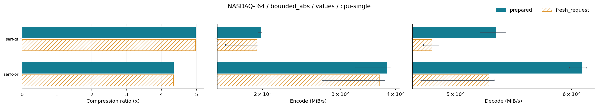

[SVG](figures/NASDAQ-f64--bounded_abs--cpu-single.svg)

<details><summary>完整数值、有效批次及拒绝原因</summary>

| codec | 完整输出 bytes P / F | 压缩倍数 P / F | 编码 MiB/s P / F | 解码 MiB/s P / F | 有效批次 P / F |
|---|---:|---:|---:|---:|---:|
| serf-qt | 1e+04 / 1e+04 | 4.97 / 4.97 | 198 / 194 | 533 / 482 | 14/14 / 14/14 |
| serf-xor | 1.15e+04 / 1.15e+04 | 4.35 / 4.35 | 383 / 368 | 610 / 527 | 14/14 / 14/14 |
| zfp-accuracy-1d | — / — | — / — | — / — | — / — | 0/0 / 0/0 |

拒绝或未完整完成的请求：

- `zfp-accuracy-1d` / fresh_request：unsupported，ZFP fixed accuracy excludes nonfinite, subnormal and negative zero inputs 
- `zfp-accuracy-1d` / prepared：unsupported，ZFP fixed accuracy excludes nonfinite, subnormal and negative zero inputs 

</details>

**<f8 · [1245, 5] · 经验质量（无最大误差保证） · values · cpu-single**

运行进程 CPU 亲和性（P / F）：`[(0, 1, 2, 3, 4, 5, 6, 7, 8, 9, 10, 11, 12, 13, 14, 15)]` / `[(0, 1, 2, 3, 4, 5, 6, 7, 8, 9, 10, 11, 12, 13, 14, 15)]`；逐配置创建时间见 CSV，是否处于并行窗口见调度记录。

<details><summary>完整数值、有效批次及拒绝原因</summary>

| codec | 完整输出 bytes P / F | 压缩倍数 P / F | 编码 MiB/s P / F | 解码 MiB/s P / F | 有效批次 P / F |
|---|---:|---:|---:|---:|---:|
| abba | — / — | — / — | — / — | — / — | 0/0 / 0/0 |
| cameo | — / — | — / — | — / — | — / — | 0/0 / 0/0 |
| dft | — / — | — / — | — / — | — / — | 0/0 / 0/0 |
| dwt-dct-ii | — / — | — / — | — / — | — / — | 0/0 / 0/0 |
| fabba | — / — | — / — | — / — | — / — | 0/0 / 0/0 |
| pip | — / — | — / — | — / — | — / — | 0/0 / 0/0 |
| pmc-mean | — / — | — / — | — / — | — / — | 0/0 / 0/0 |
| pmc-mr | — / — | — / — | — / — | — / — | 0/0 / 0/0 |
| qabba | — / — | — / — | — / — | — / — | 0/0 / 0/0 |
| sim-piece | — / — | — / — | — / — | — / — | 0/0 / 0/0 |
| swab | — / — | — / — | — / — | — / — | 0/0 / 0/0 |
| swing-connected | — / — | — / — | — / — | — / — | 0/0 / 0/0 |
| swing-filter | — / — | — / — | — / — | — / — | 0/0 / 0/0 |
| swing-filter-disjoint | — / — | — / — | — / — | — / — | 0/0 / 0/0 |
| swing-filter-disjoint-quantized / compatible | — / — | — / — | — / — | — / — | 0/0 / 0/0 |
| tp | — / — | — / — | — / — | — / — | 0/0 / 0/0 |
| vw | — / — | — / — | — / — | — / — | 0/0 / 0/0 |

拒绝或未完整完成的请求：

- `abba` / fresh_request：unsupported，abba: FINITE_INPUT_REQUIRED
- `abba` / prepared：unsupported，abba: FINITE_INPUT_REQUIRED
- `cameo` / fresh_request：unsupported，cameo: FINITE_INPUT_REQUIRED
- `cameo` / prepared：unsupported，cameo: FINITE_INPUT_REQUIRED
- `dft` / fresh_request：unsupported，dft: FINITE_INPUT_REQUIRED
- `dft` / prepared：unsupported，dft: FINITE_INPUT_REQUIRED
- `dwt-dct-ii` / fresh_request：unsupported，dwt-dct-ii: FINITE_INPUT_REQUIRED
- `dwt-dct-ii` / prepared：unsupported，dwt-dct-ii: FINITE_INPUT_REQUIRED
- `fabba` / fresh_request：unsupported，fabba: FINITE_INPUT_REQUIRED
- `fabba` / prepared：unsupported，fabba: FINITE_INPUT_REQUIRED
- `pip` / fresh_request：unsupported，pip: FINITE_INPUT_REQUIRED
- `pip` / prepared：unsupported，pip: FINITE_INPUT_REQUIRED
- `pmc-mean` / fresh_request：unsupported，pmc-mean: FINITE_INPUT_REQUIRED
- `pmc-mean` / prepared：unsupported，pmc-mean: FINITE_INPUT_REQUIRED
- `pmc-mr` / fresh_request：unsupported，pmc-mr: dtype must be one of ('<f4',)
- `pmc-mr` / prepared：unsupported，pmc-mr: dtype must be one of ('<f4',)
- `qabba` / fresh_request：unsupported，qabba: FINITE_INPUT_REQUIRED
- `qabba` / prepared：unsupported，qabba: FINITE_INPUT_REQUIRED
- `sim-piece` / fresh_request：unsupported，sim-piece: FINITE_INPUT_REQUIRED
- `sim-piece` / prepared：unsupported，sim-piece: FINITE_INPUT_REQUIRED
- `swab` / fresh_request：unsupported，swab: FINITE_INPUT_REQUIRED
- `swab` / prepared：unsupported，swab: FINITE_INPUT_REQUIRED
- `swing-connected` / fresh_request：unsupported，swing-connected: FINITE_INPUT_REQUIRED
- `swing-connected` / prepared：unsupported，swing-connected: FINITE_INPUT_REQUIRED
- `swing-filter` / fresh_request：unsupported，swing-filter: dtype must be one of ('<f4',)
- `swing-filter` / prepared：unsupported，swing-filter: dtype must be one of ('<f4',)
- `swing-filter-disjoint` / fresh_request：unsupported，swing-filter-disjoint: dtype must be one of ('<f4',)
- `swing-filter-disjoint` / prepared：unsupported，swing-filter-disjoint: dtype must be one of ('<f4',)
- `swing-filter-disjoint-quantized / compatible` / fresh_request：unsupported，swing-filter-disjoint-quantized: dtype must be one of ('<f4',)
- `swing-filter-disjoint-quantized / compatible` / prepared：unsupported，swing-filter-disjoint-quantized: dtype must be one of ('<f4',)
- `tp` / fresh_request：unsupported，tp: FINITE_INPUT_REQUIRED
- `tp` / prepared：unsupported，tp: FINITE_INPUT_REQUIRED
- `vw` / fresh_request：unsupported，vw: FINITE_INPUT_REQUIRED
- `vw` / prepared：unsupported，vw: FINITE_INPUT_REQUIRED

</details>

<a id="dataset-NN5"></a>

### NN5

**<f4 · [791, 111] · 无损 · values · cpu-single**

运行进程 CPU 亲和性（P / F）：`[(0, 1, 2, 3, 4, 5, 6, 7, 8, 9, 10, 11, 12, 13, 14, 15)]` / `[(0, 1, 2, 3, 4, 5, 6, 7, 8, 9, 10, 11, 12, 13, 14, 15)]`；逐配置创建时间见 CSV，是否处于并行窗口见调度记录。

f64→f32 准备阶段转换的最大绝对差：**3.80867728e-06**；本组 codec 的恢复质量相对转换后的 f32 输入验证。

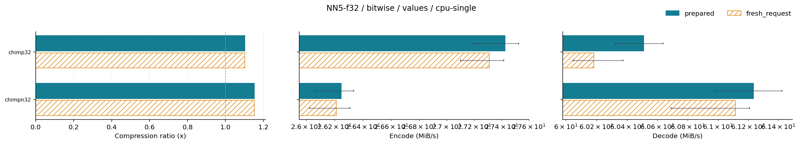

[SVG](figures/NN5-f32--bitwise--cpu-single.svg)

<details><summary>完整数值、有效批次及拒绝原因</summary>

| codec | 完整输出 bytes P / F | 压缩倍数 P / F | 编码 MiB/s P / F | 解码 MiB/s P / F | 有效批次 P / F |
|---|---:|---:|---:|---:|---:|
| chimp32 | 3.19e+05 / 3.19e+05 | 1.1 / 1.1 | 27.4 / 27.3 | 60.5 / 60.2 | 14/14 / 14/14 |
| chimpn32 | 3.05e+05 / 3.05e+05 | 1.15 / 1.15 | 26.2 / 26.2 | 61.2 / 61.1 | 14/14 / 14/14 |

</details>

**<f4 · [791, 111] · 经验质量（无最大误差保证） · values · cpu-single**

运行进程 CPU 亲和性（P / F）：`[(0, 1, 2, 3, 4, 5, 6, 7, 8, 9, 10, 11, 12, 13, 14, 15)]` / `[(0, 1, 2, 3, 4, 5, 6, 7, 8, 9, 10, 11, 12, 13, 14, 15)]`；逐配置创建时间见 CSV，是否处于并行窗口见调度记录。

f64→f32 准备阶段转换的最大绝对差：**3.80867728e-06**；本组 codec 的恢复质量相对转换后的 f32 输入验证。

<details><summary>完整数值、有效批次及拒绝原因</summary>

| codec | 完整输出 bytes P / F | 压缩倍数 P / F | 编码 MiB/s P / F | 解码 MiB/s P / F | 有效批次 P / F |
|---|---:|---:|---:|---:|---:|
| pmc-mr | — / — | — / — | — / — | — / — | 0/0 / 0/0 |
| swing-filter | — / — | — / — | — / — | — / — | 0/0 / 0/0 |
| swing-filter-disjoint | — / — | — / — | — / — | — / — | 0/0 / 0/0 |
| swing-filter-disjoint-quantized / compatible | — / — | — / — | — / — | — / — | 0/0 / 0/0 |

拒绝或未完整完成的请求：

- `pmc-mr` / fresh_request：unsupported，filter native_core requires one column; object/native_api preserve independent columns
- `pmc-mr` / prepared：unsupported，filter native_core requires one column; object/native_api preserve independent columns
- `swing-filter` / fresh_request：unsupported，filter native_core requires one column; object/native_api preserve independent columns
- `swing-filter` / prepared：unsupported，filter native_core requires one column; object/native_api preserve independent columns
- `swing-filter-disjoint` / fresh_request：unsupported，filter native_core requires one column; object/native_api preserve independent columns
- `swing-filter-disjoint` / prepared：unsupported，filter native_core requires one column; object/native_api preserve independent columns
- `swing-filter-disjoint-quantized / compatible` / fresh_request：unsupported，filter native_core requires one column; object/native_api preserve independent columns
- `swing-filter-disjoint-quantized / compatible` / prepared：unsupported，filter native_core requires one column; object/native_api preserve independent columns

</details>

**<f8 · [791, 111] · 无损 · values · cpu-single**

运行进程 CPU 亲和性（P / F）：`[(12,)]` / `[(13,)]`；逐配置创建时间见 CSV，是否处于并行窗口见调度记录。

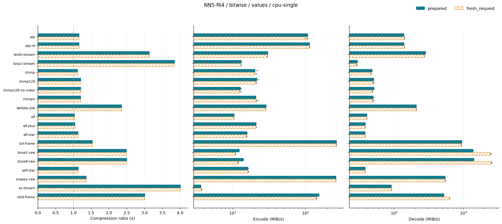

[SVG](figures/NN5-f64--bitwise--cpu-single.svg)

<details><summary>完整数值、有效批次及拒绝原因</summary>

| codec | 完整输出 bytes P / F | 压缩倍数 P / F | 编码 MiB/s P / F | 解码 MiB/s P / F | 有效批次 P / F |
|---|---:|---:|---:|---:|---:|
| alp | 6.06e+05 / 6.06e+05 | 1.16 / 1.16 | 107 / 108 | 139 / 142 | 14/14 / 14/14 |
| alp-rd | 6.06e+05 / 6.06e+05 | 1.16 / 1.16 | 114 / 114 | 139 / 141 | 14/14 / 14/14 |
| brotli-stream | 2.24e+05 / 2.24e+05 | 3.13 / 3.13 | 30.4 / 29.9 | 285 / 277 | 14/14 / 14/14 |
| bzip2-stream | 1.83e+05 / 1.83e+05 | 3.84 / 3.84 | 13.1 / 13.1 | 29.5 / 28.9 | 14/14 / 14/14 |
| chimp | 6.29e+05 / 6.29e+05 | 1.12 / 1.12 | 20.2 / 20.2 | 48.1 / 46.1 | 14/14 / 14/14 |
| chimp128 | 5.84e+05 / 5.84e+05 | 1.2 / 1.2 | 21.5 / 20.8 | 50.9 / 50.8 | 14/14 / 14/14 |
| chimp128-no-index | 5.84e+05 / 5.84e+05 | 1.2 / 1.2 | 12.8 / 12.6 | 51.2 / 48.8 | 14/14 / 14/14 |
| chimp32 | — / — | — / — | — / — | — / — | 0/0 / 0/0 |
| chimpn | 5.84e+05 / 5.84e+05 | 1.2 / 1.2 | 20.9 / 21.3 | 49.7 / 50.4 | 14/14 / 14/14 |
| chimpn32 | — / — | — / — | — / — | — / — | 0/0 / 0/0 |
| deflate-zlib | 2.98e+05 / 2.98e+05 | 2.36 / 2.36 | 28.8 / 28.6 | 210 / 211 | 14/14 / 14/14 |
| elf | 6.82e+05 / 6.82e+05 | 1.03 / 1.03 | 10.5 / 10.5 | 40.5 / 40.5 | 14/14 / 14/14 |
| elf-plus | 6.73e+05 / 6.73e+05 | 1.04 / 1.04 | 21 / 21 | 38.4 / 38.5 | 14/14 / 14/14 |
| elf-star | 6.23e+05 / 6.23e+05 | 1.13 / 1.13 | 15.6 / 15.5 | 38.2 / 38.4 | 14/14 / 14/14 |
| fse | — / — | — / — | — / — | — / — | 0/0 / 0/0 |
| gorilla-prometheus-xor | — / — | — / — | — / — | — / — | 0/0 / 0/0 |
| huff0 | — / — | — / — | — / — | — / — | 0/0 / 0/0 |
| leats-lossless-i64 | — / — | — / — | — / — | — / — | 0/0 / 0/0 |
| lz4-frame | 4.58e+05 / 4.58e+05 | 1.53 / 1.53 | 268 / 267 | 949 / 942 | 14/14 / 14/14 |
| lzsse2-raw | 2.82e+05 / 2.82e+05 | 2.49 / 2.49 | 12.2 / 10.9 | 1.38e+03 / 2.48e+03 | 14/14 / 14/14 |
| lzsse8-raw | 2.81e+05 / 2.81e+05 | 2.5 / 2.5 | 14 / 11.9 | 1.42e+03 / 2.57e+03 | 14/14 / 14/14 |
| neats-lossless-i64 | — / — | — / — | — / — | — / — | 0/0 / 0/0 |
| self-star | 6.2e+05 / 6.2e+05 | 1.13 / 1.13 | 16.2 / 16.3 | 38.3 / 38.4 | 14/14 / 14/14 |
| simdcomp-u32 | — / — | — / — | — / — | — / — | 0/0 / 0/0 |
| snappy-raw | 5.17e+05 / 5.17e+05 | 1.36 / 1.36 | 264 / 264 | 545 / 556 | 14/14 / 14/14 |
| sprintz-delta | — / — | — / — | — / — | — / — | 0/0 / 0/0 |
| sprintz-delta-huffman | — / — | — / — | — / — | — / — | 0/0 / 0/0 |
| sprintz-fire | — / — | — / — | — / — | — / — | 0/0 / 0/0 |
| sprintz-fire-huffman | — / — | — / — | — / — | — / — | 0/0 / 0/0 |
| xz-stream | 1.75e+05 / 1.75e+05 | 4.01 / 4.01 | 3.63 / 3.72 | 91.4 / 91.7 | 14/14 / 14/14 |
| zstd-frame | 2.33e+05 / 2.33e+05 | 3.01 / 3.01 | 154 / 143 | 524 / 641 | 14/14 / 14/14 |

拒绝或未完整完成的请求：

- `chimp32` / fresh_request：unsupported，chimp32: dtype must be one of ('<f4',)
- `chimp32` / prepared：unsupported，chimp32: dtype must be one of ('<f4',)
- `chimpn32` / fresh_request：unsupported，chimpn32: dtype must be one of ('<f4',)
- `chimpn32` / prepared：unsupported，chimpn32: dtype must be one of ('<f4',)
- `fse` / fresh_request：unsupported，fse: m=111 exceeds native limits
- `fse` / prepared：unsupported，fse: m=111 exceeds native limits
- `gorilla-prometheus-xor` / fresh_request：unsupported，Gorilla requires actual paired T/V; values-only and timestamp-only are unsupported
- `gorilla-prometheus-xor` / prepared：unsupported，Gorilla requires actual paired T/V; values-only and timestamp-only are unsupported
- `huff0` / fresh_request：unsupported，huff0: m=111 exceeds native limits
- `huff0` / prepared：unsupported，huff0: m=111 exceeds native limits
- `leats-lossless-i64` / fresh_request：unsupported，leats-lossless-i64: dtype must be one of ('|i1', '<i2', '<i4', '<i8')
- `leats-lossless-i64` / prepared：unsupported，leats-lossless-i64: dtype must be one of ('|i1', '<i2', '<i4', '<i8')
- `neats-lossless-i64` / fresh_request：unsupported，neats-lossless-i64: dtype must be one of ('|i1', '<i2', '<i4', '<i8')
- `neats-lossless-i64` / prepared：unsupported，neats-lossless-i64: dtype must be one of ('|i1', '<i2', '<i4', '<i8')
- `simdcomp-u32` / fresh_request：unsupported，simdcomp-u32: dtype must be one of ('<u4',)
- `simdcomp-u32` / prepared：unsupported，simdcomp-u32: dtype must be one of ('<u4',)
- `sprintz-delta` / fresh_request：unsupported，sprintz-delta: dtype must be one of ('|u1', '|i1', '<u2', '<i2')
- `sprintz-delta` / prepared：unsupported，sprintz-delta: dtype must be one of ('|u1', '|i1', '<u2', '<i2')
- `sprintz-delta-huffman` / fresh_request：unsupported，sprintz-delta-huffman: dtype must be one of ('|u1', '|i1', '<u2', '<i2')
- `sprintz-delta-huffman` / prepared：unsupported，sprintz-delta-huffman: dtype must be one of ('|u1', '|i1', '<u2', '<i2')
- `sprintz-fire` / fresh_request：unsupported，sprintz-fire: dtype must be one of ('|u1', '|i1', '<u2', '<i2')
- `sprintz-fire` / prepared：unsupported，sprintz-fire: dtype must be one of ('|u1', '|i1', '<u2', '<i2')
- `sprintz-fire-huffman` / fresh_request：unsupported，sprintz-fire-huffman: dtype must be one of ('|u1', '|i1', '<u2', '<i2')
- `sprintz-fire-huffman` / prepared：unsupported，sprintz-fire-huffman: dtype must be one of ('|u1', '|i1', '<u2', '<i2')

</details>

**<f8 · [791, 111] · ABS ≤ 0.01 · values · cpu-single**

运行进程 CPU 亲和性（P / F）：`[(0, 1, 2, 3, 4, 5, 6, 7, 8, 9, 10, 11, 12, 13, 14, 15)]` / `[(0, 1, 2, 3, 4, 5, 6, 7, 8, 9, 10, 11, 12, 13, 14, 15)]`；逐配置创建时间见 CSV，是否处于并行窗口见调度记录。

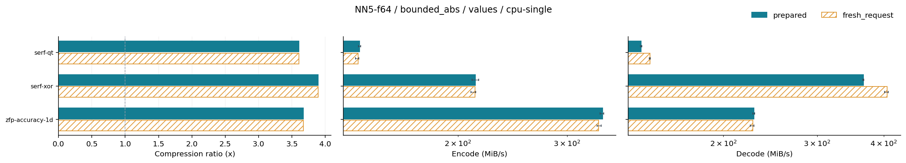

[SVG](figures/NN5-f64--bounded_abs--cpu-single.svg)

<details><summary>完整数值、有效批次及拒绝原因</summary>

| codec | 完整输出 bytes P / F | 压缩倍数 P / F | 编码 MiB/s P / F | 解码 MiB/s P / F | 有效批次 P / F |
|---|---:|---:|---:|---:|---:|
| serf-qt | 1.95e+05 / 1.95e+05 | 3.61 / 3.61 | 139 / 138 | 140 / 146 | 14/14 / 14/14 |
| serf-xor | 1.8e+05 / 1.8e+05 | 3.89 / 3.89 | 213 / 213 | 367 / 406 | 14/14 / 14/14 |
| zfp-accuracy-1d | 1.91e+05 / 1.91e+05 | 3.67 / 3.67 | 342 / 337 | 229 / 227 | 14/14 / 14/14 |

</details>

**<f8 · [791, 111] · 经验质量（无最大误差保证） · values · cpu-single**

运行进程 CPU 亲和性（P / F）：`[(0, 1, 2, 3, 4, 5, 6, 7, 8, 9, 10, 11, 12, 13, 14, 15)]` / `[(0, 1, 2, 3, 4, 5, 6, 7, 8, 9, 10, 11, 12, 13, 14, 15)]`；逐配置创建时间见 CSV，是否处于并行窗口见调度记录。

<details><summary>完整数值、有效批次及拒绝原因</summary>

| codec | 完整输出 bytes P / F | 压缩倍数 P / F | 编码 MiB/s P / F | 解码 MiB/s P / F | 有效批次 P / F |
|---|---:|---:|---:|---:|---:|
| abba | — / — | — / — | — / — | — / — | 0/0 / 0/0 |
| cameo | — / — | — / — | — / — | — / — | 0/0 / 0/0 |
| dft | — / — | — / — | — / — | — / — | 0/0 / 0/0 |
| dwt-dct-ii | — / — | — / — | — / — | — / — | 0/0 / 0/0 |
| fabba | — / — | — / — | — / — | — / — | 0/0 / 0/0 |
| pip | — / — | — / — | — / — | — / — | 0/0 / 0/0 |
| pmc-mean | — / — | — / — | — / — | — / — | 0/0 / 0/0 |
| pmc-mr | — / — | — / — | — / — | — / — | 0/0 / 0/0 |
| qabba | — / — | — / — | — / — | — / — | 0/0 / 0/0 |
| sim-piece | — / — | — / — | — / — | — / — | 0/0 / 0/0 |
| swab | — / — | — / — | — / — | — / — | 0/0 / 0/0 |
| swing-connected | — / — | — / — | — / — | — / — | 0/0 / 0/0 |
| swing-filter | — / — | — / — | — / — | — / — | 0/0 / 0/0 |
| swing-filter-disjoint | — / — | — / — | — / — | — / — | 0/0 / 0/0 |
| swing-filter-disjoint-quantized / compatible | — / — | — / — | — / — | — / — | 0/0 / 0/0 |
| tp | — / — | — / — | — / — | — / — | 0/0 / 0/0 |
| vw | — / — | — / — | — / — | — / — | 0/0 / 0/0 |

拒绝或未完整完成的请求：

- `abba` / fresh_request：unsupported，abba: native_core requires rank1; use object/native_api for independent columns
- `abba` / prepared：unsupported，abba: native_core requires rank1; use object/native_api for independent columns
- `cameo` / fresh_request：unsupported，cameo: native_core requires rank1; use object/native_api for independent columns
- `cameo` / prepared：unsupported，cameo: native_core requires rank1; use object/native_api for independent columns
- `dft` / fresh_request：unsupported，dft: native_core requires rank1; use object/native_api for independent columns
- `dft` / prepared：unsupported，dft: native_core requires rank1; use object/native_api for independent columns
- `dwt-dct-ii` / fresh_request：unsupported，dwt-dct-ii: native_core requires rank1; use object/native_api for independent columns
- `dwt-dct-ii` / prepared：unsupported，dwt-dct-ii: native_core requires rank1; use object/native_api for independent columns
- `fabba` / fresh_request：unsupported，fabba: native_core requires rank1; use object/native_api for independent columns
- `fabba` / prepared：unsupported，fabba: native_core requires rank1; use object/native_api for independent columns
- `pip` / fresh_request：unsupported，pip: native_core requires rank1; use object/native_api for independent columns
- `pip` / prepared：unsupported，pip: native_core requires rank1; use object/native_api for independent columns
- `pmc-mean` / fresh_request：unsupported，pmc-mean: native_core requires rank1; use object/native_api for independent columns
- `pmc-mean` / prepared：unsupported，pmc-mean: native_core requires rank1; use object/native_api for independent columns
- `pmc-mr` / fresh_request：unsupported，pmc-mr: dtype must be one of ('<f4',)
- `pmc-mr` / prepared：unsupported，pmc-mr: dtype must be one of ('<f4',)
- `qabba` / fresh_request：unsupported，qabba: native_core requires rank1; use object/native_api for independent columns
- `qabba` / prepared：unsupported，qabba: native_core requires rank1; use object/native_api for independent columns
- `sim-piece` / fresh_request：unsupported，sim-piece: native_core requires rank1; use object/native_api for independent columns
- `sim-piece` / prepared：unsupported，sim-piece: native_core requires rank1; use object/native_api for independent columns
- `swab` / fresh_request：unsupported，swab: native_core requires rank1; use object/native_api for independent columns
- `swab` / prepared：unsupported，swab: native_core requires rank1; use object/native_api for independent columns
- `swing-connected` / fresh_request：unsupported，swing-connected: native_core requires rank1; use object/native_api for independent columns
- `swing-connected` / prepared：unsupported，swing-connected: native_core requires rank1; use object/native_api for independent columns
- `swing-filter` / fresh_request：unsupported，swing-filter: dtype must be one of ('<f4',)
- `swing-filter` / prepared：unsupported，swing-filter: dtype must be one of ('<f4',)
- `swing-filter-disjoint` / fresh_request：unsupported，swing-filter-disjoint: dtype must be one of ('<f4',)
- `swing-filter-disjoint` / prepared：unsupported，swing-filter-disjoint: dtype must be one of ('<f4',)
- `swing-filter-disjoint-quantized / compatible` / fresh_request：unsupported，swing-filter-disjoint-quantized: dtype must be one of ('<f4',)
- `swing-filter-disjoint-quantized / compatible` / prepared：unsupported，swing-filter-disjoint-quantized: dtype must be one of ('<f4',)
- `tp` / fresh_request：unsupported，tp: native_core requires rank1; use object/native_api for independent columns
- `tp` / prepared：unsupported，tp: native_core requires rank1; use object/native_api for independent columns
- `vw` / fresh_request：unsupported，vw: native_core requires rank1; use object/native_api for independent columns
- `vw` / prepared：unsupported，vw: native_core requires rank1; use object/native_api for independent columns

</details>

<a id="dataset-NYSE"></a>

### NYSE

**<f4 · [1244, 5] · 无损 · values · cpu-single**

运行进程 CPU 亲和性（P / F）：`[(0, 1, 2, 3, 4, 5, 6, 7, 8, 9, 10, 11, 12, 13, 14, 15)]` / `[(0, 1, 2, 3, 4, 5, 6, 7, 8, 9, 10, 11, 12, 13, 14, 15)]`；逐配置创建时间见 CSV，是否处于并行窗口见调度记录。

f64→f32 准备阶段转换的最大绝对差：**2.97775269e-08**；本组 codec 的恢复质量相对转换后的 f32 输入验证。

<details><summary>完整数值、有效批次及拒绝原因</summary>

| codec | 完整输出 bytes P / F | 压缩倍数 P / F | 编码 MiB/s P / F | 解码 MiB/s P / F | 有效批次 P / F |
|---|---:|---:|---:|---:|---:|
| chimp32 | — / — | — / — | — / — | — / — | 0/0 / 0/0 |
| chimpn32 | — / — | — / — | — / — | — / — | 0/0 / 0/0 |

拒绝或未完整完成的请求：

- `chimp32` / fresh_request：unsupported，canonical positive NaN is the Chimp EOF sentinel 
- `chimp32` / prepared：unsupported，canonical positive NaN is the Chimp EOF sentinel 
- `chimpn32` / fresh_request：unsupported，canonical positive NaN is the Chimp EOF sentinel 
- `chimpn32` / prepared：unsupported，canonical positive NaN is the Chimp EOF sentinel 

</details>

**<f4 · [1244, 5] · 经验质量（无最大误差保证） · values · cpu-single**

运行进程 CPU 亲和性（P / F）：`[(0, 1, 2, 3, 4, 5, 6, 7, 8, 9, 10, 11, 12, 13, 14, 15)]` / `[(0, 1, 2, 3, 4, 5, 6, 7, 8, 9, 10, 11, 12, 13, 14, 15)]`；逐配置创建时间见 CSV，是否处于并行窗口见调度记录。

f64→f32 准备阶段转换的最大绝对差：**2.97775269e-08**；本组 codec 的恢复质量相对转换后的 f32 输入验证。

<details><summary>完整数值、有效批次及拒绝原因</summary>

| codec | 完整输出 bytes P / F | 压缩倍数 P / F | 编码 MiB/s P / F | 解码 MiB/s P / F | 有效批次 P / F |
|---|---:|---:|---:|---:|---:|
| pmc-mr | — / — | — / — | — / — | — / — | 0/0 / 0/0 |
| swing-filter | — / — | — / — | — / — | — / — | 0/0 / 0/0 |
| swing-filter-disjoint | — / — | — / — | — / — | — / — | 0/0 / 0/0 |
| swing-filter-disjoint-quantized / compatible | — / — | — / — | — / — | — / — | 0/0 / 0/0 |

拒绝或未完整完成的请求：

- `pmc-mr` / fresh_request：unsupported，filter native_core requires one column; object/native_api preserve independent columns
- `pmc-mr` / prepared：unsupported，filter native_core requires one column; object/native_api preserve independent columns
- `swing-filter` / fresh_request：unsupported，filter native_core requires one column; object/native_api preserve independent columns
- `swing-filter` / prepared：unsupported，filter native_core requires one column; object/native_api preserve independent columns
- `swing-filter-disjoint` / fresh_request：unsupported，filter native_core requires one column; object/native_api preserve independent columns
- `swing-filter-disjoint` / prepared：unsupported，filter native_core requires one column; object/native_api preserve independent columns
- `swing-filter-disjoint-quantized / compatible` / fresh_request：unsupported，filter native_core requires one column; object/native_api preserve independent columns
- `swing-filter-disjoint-quantized / compatible` / prepared：unsupported，filter native_core requires one column; object/native_api preserve independent columns

</details>

**<f8 · [1244, 5] · 无损 · values · cpu-single**

运行进程 CPU 亲和性（P / F）：`[(0, 1, 2, 3, 4, 5, 6, 7, 8, 9, 10, 11, 12, 13, 14, 15)]` / `[(0, 1, 2, 3, 4, 5, 6, 7, 8, 9, 10, 11, 12, 13, 14, 15)]`；逐配置创建时间见 CSV，是否处于并行窗口见调度记录。

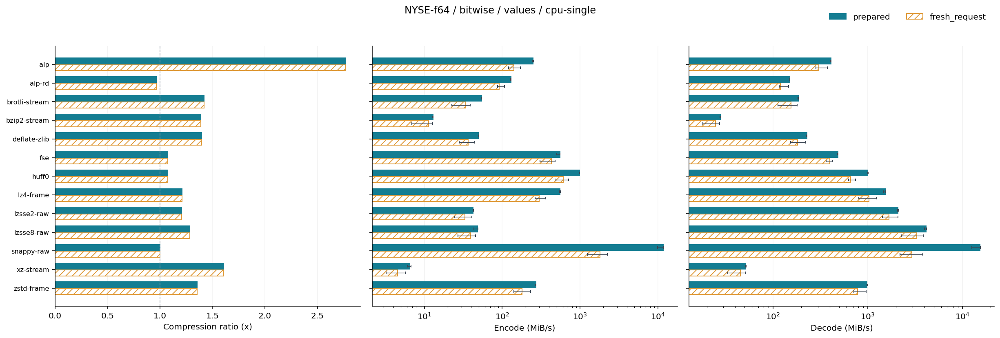

[SVG](figures/NYSE-f64--bitwise--cpu-single.svg)

<details><summary>完整数值、有效批次及拒绝原因</summary>

| codec | 完整输出 bytes P / F | 压缩倍数 P / F | 编码 MiB/s P / F | 解码 MiB/s P / F | 有效批次 P / F |
|---|---:|---:|---:|---:|---:|
| alp | 1.8e+04 / 1.8e+04 | 2.77 / 2.77 | 250 / 142 | 410 / 305 | 14/14 / 14/14 |
| alp-rd | 5.15e+04 / 5.15e+04 | 0.967 / 0.967 | 130 / 91.3 | 151 / 121 | 14/14 / 14/14 |
| brotli-stream | 3.51e+04 / 3.51e+04 | 1.42 / 1.42 | 54.6 / 33.9 | 186 / 156 | 14/14 / 14/14 |
| bzip2-stream | 3.58e+04 / 3.58e+04 | 1.39 / 1.39 | 12.9 / 11.3 | 28 / 24.7 | 14/14 / 14/14 |
| chimp | — / — | — / — | — / — | — / — | 0/0 / 0/0 |
| chimp128 | — / — | — / — | — / — | — / — | 0/0 / 0/0 |
| chimp128-no-index | — / — | — / — | — / — | — / — | 0/0 / 0/0 |
| chimp32 | — / — | — / — | — / — | — / — | 0/0 / 0/0 |
| chimpn | — / — | — / — | — / — | — / — | 0/0 / 0/0 |
| chimpn32 | — / — | — / — | — / — | — / — | 0/0 / 0/0 |
| deflate-zlib | 3.56e+04 / 3.56e+04 | 1.4 / 1.4 | 49.8 / 36.8 | 228 / 181 | 14/14 / 14/14 |
| elf | — / — | — / — | — / — | — / — | 0/0 / 0/0 |
| elf-plus | — / — | — / — | — / — | — / — | 0/0 / 0/0 |
| elf-star | — / — | — / — | — / — | — / — | 0/0 / 0/0 |
| fse | 4.63e+04 / 4.63e+04 | 1.07 / 1.07 | 552 / 432 | 487 / 397 | 14/14 / 14/14 |
| gorilla-prometheus-xor | — / — | — / — | — / — | — / — | 0/0 / 0/0 |
| huff0 | 4.62e+04 / 4.62e+04 | 1.08 / 1.08 | 985 / 609 | 1.01e+03 / 660 | 14/14 / 14/14 |
| leats-lossless-i64 | — / — | — / — | — / — | — / — | 0/0 / 0/0 |
| lz4-frame | 4.11e+04 / 4.11e+04 | 1.21 / 1.21 | 556 / 297 | 1.54e+03 / 1.03e+03 | 14/14 / 14/14 |
| lzsse2-raw | 4.12e+04 / 4.12e+04 | 1.21 / 1.21 | 42.3 / 33.3 | 2.1e+03 / 1.68e+03 | 14/14 / 14/14 |
| lzsse8-raw | 3.87e+04 / 3.87e+04 | 1.28 / 1.28 | 48 / 39.5 | 4.14e+03 / 3.31e+03 | 14/14 / 14/14 |
| neats-lossless-i64 | — / — | — / — | — / — | — / — | 0/0 / 0/0 |
| self-star | — / — | — / — | — / — | — / — | 0/0 / 0/0 |
| simdcomp-u32 | — / — | — / — | — / — | — / — | 0/0 / 0/0 |
| snappy-raw | 4.98e+04 / 4.98e+04 | 1 / 1 | 1.17e+04 / 1.81e+03 | 1.54e+04 / 2.95e+03 | 14/14 / 14/14 |
| sprintz-delta | — / — | — / — | — / — | — / — | 0/0 / 0/0 |
| sprintz-delta-huffman | — / — | — / — | — / — | — / — | 0/0 / 0/0 |
| sprintz-fire | — / — | — / — | — / — | — / — | 0/0 / 0/0 |
| sprintz-fire-huffman | — / — | — / — | — / — | — / — | 0/0 / 0/0 |
| xz-stream | 3.1e+04 / 3.1e+04 | 1.61 / 1.61 | 6.48 / 4.54 | 51.9 / 45.5 | 14/14 / 14/14 |
| zstd-frame | 3.67e+04 / 3.67e+04 | 1.36 / 1.36 | 271 / 179 | 987 / 780 | 14/14 / 14/14 |

拒绝或未完整完成的请求：

- `chimp` / fresh_request：unsupported，canonical positive NaN is the Chimp EOF sentinel 
- `chimp` / prepared：unsupported，canonical positive NaN is the Chimp EOF sentinel 
- `chimp128` / fresh_request：unsupported，canonical positive NaN is the Chimp EOF sentinel 
- `chimp128` / prepared：unsupported，canonical positive NaN is the Chimp EOF sentinel 
- `chimp128-no-index` / fresh_request：unsupported，canonical positive NaN is the Chimp EOF sentinel 
- `chimp128-no-index` / prepared：unsupported，canonical positive NaN is the Chimp EOF sentinel 
- `chimp32` / fresh_request：unsupported，chimp32: dtype must be one of ('<f4',)
- `chimp32` / prepared：unsupported，chimp32: dtype must be one of ('<f4',)
- `chimpn` / fresh_request：unsupported，canonical positive NaN is the Chimp EOF sentinel 
- `chimpn` / prepared：unsupported，canonical positive NaN is the Chimp EOF sentinel 
- `chimpn32` / fresh_request：unsupported，chimpn32: dtype must be one of ('<f4',)
- `chimpn32` / prepared：unsupported，chimpn32: dtype must be one of ('<f4',)
- `elf` / fresh_request：unsupported，NaN is the source END marker 
- `elf` / prepared：unsupported，NaN is the source END marker 
- `elf-plus` / fresh_request：unsupported，NaN is the source END marker 
- `elf-plus` / prepared：unsupported，NaN is the source END marker 
- `elf-star` / fresh_request：unsupported，NaN is END, outside lossless domain 
- `elf-star` / prepared：unsupported，NaN is END, outside lossless domain 
- `gorilla-prometheus-xor` / fresh_request：unsupported，Gorilla requires actual paired T/V; values-only and timestamp-only are unsupported
- `gorilla-prometheus-xor` / prepared：unsupported，Gorilla requires actual paired T/V; values-only and timestamp-only are unsupported
- `leats-lossless-i64` / fresh_request：unsupported，leats-lossless-i64: dtype must be one of ('|i1', '<i2', '<i4', '<i8')
- `leats-lossless-i64` / prepared：unsupported，leats-lossless-i64: dtype must be one of ('|i1', '<i2', '<i4', '<i8')
- `neats-lossless-i64` / fresh_request：unsupported，neats-lossless-i64: dtype must be one of ('|i1', '<i2', '<i4', '<i8')
- `neats-lossless-i64` / prepared：unsupported，neats-lossless-i64: dtype must be one of ('|i1', '<i2', '<i4', '<i8')
- `self-star` / fresh_request：unsupported，NaN outside source lossless domain 
- `self-star` / prepared：unsupported，NaN outside source lossless domain 
- `simdcomp-u32` / fresh_request：unsupported，simdcomp-u32: dtype must be one of ('<u4',)
- `simdcomp-u32` / prepared：unsupported，simdcomp-u32: dtype must be one of ('<u4',)
- `sprintz-delta` / fresh_request：unsupported，sprintz-delta: dtype must be one of ('|u1', '|i1', '<u2', '<i2')
- `sprintz-delta` / prepared：unsupported，sprintz-delta: dtype must be one of ('|u1', '|i1', '<u2', '<i2')
- `sprintz-delta-huffman` / fresh_request：unsupported，sprintz-delta-huffman: dtype must be one of ('|u1', '|i1', '<u2', '<i2')
- `sprintz-delta-huffman` / prepared：unsupported，sprintz-delta-huffman: dtype must be one of ('|u1', '|i1', '<u2', '<i2')
- `sprintz-fire` / fresh_request：unsupported，sprintz-fire: dtype must be one of ('|u1', '|i1', '<u2', '<i2')
- `sprintz-fire` / prepared：unsupported，sprintz-fire: dtype must be one of ('|u1', '|i1', '<u2', '<i2')
- `sprintz-fire-huffman` / fresh_request：unsupported，sprintz-fire-huffman: dtype must be one of ('|u1', '|i1', '<u2', '<i2')
- `sprintz-fire-huffman` / prepared：unsupported，sprintz-fire-huffman: dtype must be one of ('|u1', '|i1', '<u2', '<i2')

</details>

**<f8 · [1244, 5] · ABS ≤ 0.01 · values · cpu-single**

运行进程 CPU 亲和性（P / F）：`[(0, 1, 2, 3, 4, 5, 6, 7, 8, 9, 10, 11, 12, 13, 14, 15)]` / `[(0, 1, 2, 3, 4, 5, 6, 7, 8, 9, 10, 11, 12, 13, 14, 15)]`；逐配置创建时间见 CSV，是否处于并行窗口见调度记录。

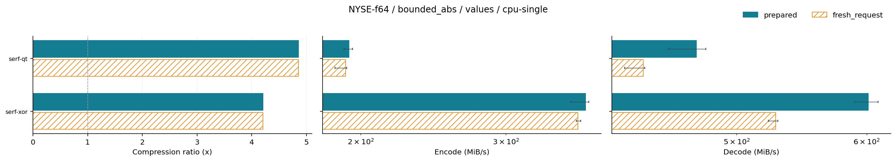

[SVG](figures/NYSE-f64--bounded_abs--cpu-single.svg)

<details><summary>完整数值、有效批次及拒绝原因</summary>

| codec | 完整输出 bytes P / F | 压缩倍数 P / F | 编码 MiB/s P / F | 解码 MiB/s P / F | 有效批次 P / F |
|---|---:|---:|---:|---:|---:|
| serf-qt | 1.02e+04 / 1.02e+04 | 4.86 / 4.86 | 194 / 192 | 473 / 439 | 14/14 / 14/14 |
| serf-xor | 1.18e+04 / 1.18e+04 | 4.2 / 4.2 | 375 / 367 | 601 / 528 | 14/14 / 14/14 |
| zfp-accuracy-1d | — / — | — / — | — / — | — / — | 0/0 / 0/0 |

拒绝或未完整完成的请求：

- `zfp-accuracy-1d` / fresh_request：unsupported，ZFP fixed accuracy excludes nonfinite, subnormal and negative zero inputs 
- `zfp-accuracy-1d` / prepared：unsupported，ZFP fixed accuracy excludes nonfinite, subnormal and negative zero inputs 

</details>

**<f8 · [1244, 5] · 经验质量（无最大误差保证） · values · cpu-single**

运行进程 CPU 亲和性（P / F）：`[(0, 1, 2, 3, 4, 5, 6, 7, 8, 9, 10, 11, 12, 13, 14, 15)]` / `[(0, 1, 2, 3, 4, 5, 6, 7, 8, 9, 10, 11, 12, 13, 14, 15)]`；逐配置创建时间见 CSV，是否处于并行窗口见调度记录。

<details><summary>完整数值、有效批次及拒绝原因</summary>

| codec | 完整输出 bytes P / F | 压缩倍数 P / F | 编码 MiB/s P / F | 解码 MiB/s P / F | 有效批次 P / F |
|---|---:|---:|---:|---:|---:|
| abba | — / — | — / — | — / — | — / — | 0/0 / 0/0 |
| cameo | — / — | — / — | — / — | — / — | 0/0 / 0/0 |
| dft | — / — | — / — | — / — | — / — | 0/0 / 0/0 |
| dwt-dct-ii | — / — | — / — | — / — | — / — | 0/0 / 0/0 |
| fabba | — / — | — / — | — / — | — / — | 0/0 / 0/0 |
| pip | — / — | — / — | — / — | — / — | 0/0 / 0/0 |
| pmc-mean | — / — | — / — | — / — | — / — | 0/0 / 0/0 |
| pmc-mr | — / — | — / — | — / — | — / — | 0/0 / 0/0 |
| qabba | — / — | — / — | — / — | — / — | 0/0 / 0/0 |
| sim-piece | — / — | — / — | — / — | — / — | 0/0 / 0/0 |
| swab | — / — | — / — | — / — | — / — | 0/0 / 0/0 |
| swing-connected | — / — | — / — | — / — | — / — | 0/0 / 0/0 |
| swing-filter | — / — | — / — | — / — | — / — | 0/0 / 0/0 |
| swing-filter-disjoint | — / — | — / — | — / — | — / — | 0/0 / 0/0 |
| swing-filter-disjoint-quantized / compatible | — / — | — / — | — / — | — / — | 0/0 / 0/0 |
| tp | — / — | — / — | — / — | — / — | 0/0 / 0/0 |
| vw | — / — | — / — | — / — | — / — | 0/0 / 0/0 |

拒绝或未完整完成的请求：

- `abba` / fresh_request：unsupported，abba: FINITE_INPUT_REQUIRED
- `abba` / prepared：unsupported，abba: FINITE_INPUT_REQUIRED
- `cameo` / fresh_request：unsupported，cameo: FINITE_INPUT_REQUIRED
- `cameo` / prepared：unsupported，cameo: FINITE_INPUT_REQUIRED
- `dft` / fresh_request：unsupported，dft: FINITE_INPUT_REQUIRED
- `dft` / prepared：unsupported，dft: FINITE_INPUT_REQUIRED
- `dwt-dct-ii` / fresh_request：unsupported，dwt-dct-ii: FINITE_INPUT_REQUIRED
- `dwt-dct-ii` / prepared：unsupported，dwt-dct-ii: FINITE_INPUT_REQUIRED
- `fabba` / fresh_request：unsupported，fabba: FINITE_INPUT_REQUIRED
- `fabba` / prepared：unsupported，fabba: FINITE_INPUT_REQUIRED
- `pip` / fresh_request：unsupported，pip: FINITE_INPUT_REQUIRED
- `pip` / prepared：unsupported，pip: FINITE_INPUT_REQUIRED
- `pmc-mean` / fresh_request：unsupported，pmc-mean: FINITE_INPUT_REQUIRED
- `pmc-mean` / prepared：unsupported，pmc-mean: FINITE_INPUT_REQUIRED
- `pmc-mr` / fresh_request：unsupported，pmc-mr: dtype must be one of ('<f4',)
- `pmc-mr` / prepared：unsupported，pmc-mr: dtype must be one of ('<f4',)
- `qabba` / fresh_request：unsupported，qabba: FINITE_INPUT_REQUIRED
- `qabba` / prepared：unsupported，qabba: FINITE_INPUT_REQUIRED
- `sim-piece` / fresh_request：unsupported，sim-piece: FINITE_INPUT_REQUIRED
- `sim-piece` / prepared：unsupported，sim-piece: FINITE_INPUT_REQUIRED
- `swab` / fresh_request：unsupported，swab: FINITE_INPUT_REQUIRED
- `swab` / prepared：unsupported，swab: FINITE_INPUT_REQUIRED
- `swing-connected` / fresh_request：unsupported，swing-connected: FINITE_INPUT_REQUIRED
- `swing-connected` / prepared：unsupported，swing-connected: FINITE_INPUT_REQUIRED
- `swing-filter` / fresh_request：unsupported，swing-filter: dtype must be one of ('<f4',)
- `swing-filter` / prepared：unsupported，swing-filter: dtype must be one of ('<f4',)
- `swing-filter-disjoint` / fresh_request：unsupported，swing-filter-disjoint: dtype must be one of ('<f4',)
- `swing-filter-disjoint` / prepared：unsupported，swing-filter-disjoint: dtype must be one of ('<f4',)
- `swing-filter-disjoint-quantized / compatible` / fresh_request：unsupported，swing-filter-disjoint-quantized: dtype must be one of ('<f4',)
- `swing-filter-disjoint-quantized / compatible` / prepared：unsupported，swing-filter-disjoint-quantized: dtype must be one of ('<f4',)
- `tp` / fresh_request：unsupported，tp: FINITE_INPUT_REQUIRED
- `tp` / prepared：unsupported，tp: FINITE_INPUT_REQUIRED
- `vw` / fresh_request：unsupported，vw: FINITE_INPUT_REQUIRED
- `vw` / prepared：unsupported，vw: FINITE_INPUT_REQUIRED

</details>

<a id="dataset-PEMS-BAY"></a>

### PEMS-BAY

**<f4 · [52116, 325] · 无损 · values · cpu-single**

运行进程 CPU 亲和性（P / F）：`[(0, 1, 2, 3, 4, 5, 6, 7, 8, 9, 10, 11, 12, 13, 14, 15)]` / `[(0, 1, 2, 3, 4, 5, 6, 7, 8, 9, 10, 11, 12, 13, 14, 15)]`；逐配置创建时间见 CSV，是否处于并行窗口见调度记录。

f64→f32 准备阶段转换的最大绝对差：**3.05175782e-06**；本组 codec 的恢复质量相对转换后的 f32 输入验证。

<details><summary>完整数值、有效批次及拒绝原因</summary>

| codec | 完整输出 bytes P / F | 压缩倍数 P / F | 编码 MiB/s P / F | 解码 MiB/s P / F | 有效批次 P / F |
|---|---:|---:|---:|---:|---:|
| chimp32 | — / — | — / — | — / — | — / — | 0/0 / 0/0 |
| chimpn32 | — / — | — / — | — / — | — / — | 0/0 / 0/0 |

拒绝或未完整完成的请求：

- `chimp32` / fresh_request：unsupported，chimp32: element limit exceeded
- `chimp32` / prepared：unsupported，chimp32: element limit exceeded
- `chimpn32` / fresh_request：unsupported，chimpn32: element limit exceeded
- `chimpn32` / prepared：unsupported，chimpn32: element limit exceeded

</details>

**<f4 · [52116, 325] · 经验质量（无最大误差保证） · values · cpu-single**

运行进程 CPU 亲和性（P / F）：`[(0, 1, 2, 3, 4, 5, 6, 7, 8, 9, 10, 11, 12, 13, 14, 15)]` / `[(0, 1, 2, 3, 4, 5, 6, 7, 8, 9, 10, 11, 12, 13, 14, 15)]`；逐配置创建时间见 CSV，是否处于并行窗口见调度记录。

f64→f32 准备阶段转换的最大绝对差：**3.05175782e-06**；本组 codec 的恢复质量相对转换后的 f32 输入验证。

<details><summary>完整数值、有效批次及拒绝原因</summary>

| codec | 完整输出 bytes P / F | 压缩倍数 P / F | 编码 MiB/s P / F | 解码 MiB/s P / F | 有效批次 P / F |
|---|---:|---:|---:|---:|---:|
| pmc-mr | — / — | — / — | — / — | — / — | 0/0 / 0/0 |
| swing-filter | — / — | — / — | — / — | — / — | 0/0 / 0/0 |
| swing-filter-disjoint | — / — | — / — | — / — | — / — | 0/0 / 0/0 |
| swing-filter-disjoint-quantized / compatible | — / — | — / — | — / — | — / — | 0/0 / 0/0 |

拒绝或未完整完成的请求：

- `pmc-mr` / fresh_request：unsupported，pmc-mr: element limit exceeded
- `pmc-mr` / prepared：unsupported，pmc-mr: element limit exceeded
- `swing-filter` / fresh_request：unsupported，swing-filter: element limit exceeded
- `swing-filter` / prepared：unsupported，swing-filter: element limit exceeded
- `swing-filter-disjoint` / fresh_request：unsupported，swing-filter-disjoint: element limit exceeded
- `swing-filter-disjoint` / prepared：unsupported，swing-filter-disjoint: element limit exceeded
- `swing-filter-disjoint-quantized / compatible` / fresh_request：unsupported，swing-filter-disjoint-quantized: element limit exceeded
- `swing-filter-disjoint-quantized / compatible` / prepared：unsupported，swing-filter-disjoint-quantized: element limit exceeded

</details>

**<f8 · [52116, 325] · 无损 · values · cpu-single**

运行进程 CPU 亲和性（P / F）：`[(0, 1, 2, 3, 4, 5, 6, 7, 8, 9, 10, 11, 12, 13, 14, 15)]` / `[(0, 1, 2, 3, 4, 5, 6, 7, 8, 9, 10, 11, 12, 13, 14, 15)]`；逐配置创建时间见 CSV，是否处于并行窗口见调度记录。

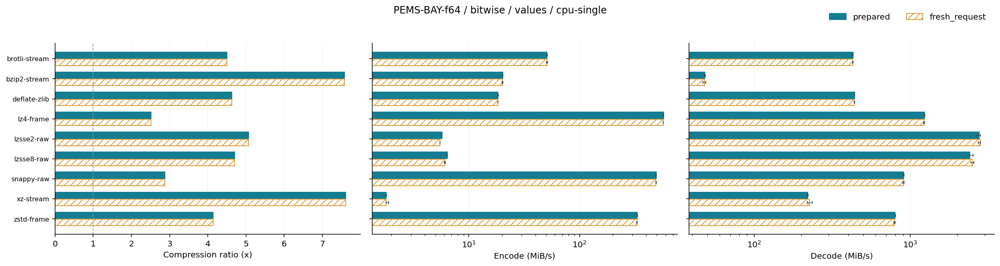

[SVG](figures/PEMS-BAY-f64--bitwise--cpu-single.svg)

<details><summary>完整数值、有效批次及拒绝原因</summary>

| codec | 完整输出 bytes P / F | 压缩倍数 P / F | 编码 MiB/s P / F | 解码 MiB/s P / F | 有效批次 P / F |
|---|---:|---:|---:|---:|---:|
| alp | — / — | — / — | — / — | — / — | 0/0 / 0/0 |
| alp-rd | — / — | — / — | — / — | — / — | 0/0 / 0/0 |
| brotli-stream | 3.01e+07 / 3.01e+07 | 4.5 / 4.5 | 50.9 / 50.9 | 429 / 428 | 14/14 / 14/14 |
| bzip2-stream | 1.79e+07 / 1.79e+07 | 7.58 / 7.58 | 20.3 / 20.2 | 48.5 / 48.1 | 14/14 / 14/14 |
| chimp | — / — | — / — | — / — | — / — | 0/0 / 0/0 |
| chimp128 | — / — | — / — | — / — | — / — | 0/0 / 0/0 |
| chimp128-no-index | — / — | — / — | — / — | — / — | 0/0 / 0/0 |
| chimp32 | — / — | — / — | — / — | — / — | 0/0 / 0/0 |
| chimpn | — / — | — / — | — / — | — / — | 0/0 / 0/0 |
| chimpn32 | — / — | — / — | — / — | — / — | 0/0 / 0/0 |
| deflate-zlib | 2.93e+07 / 2.93e+07 | 4.63 / 4.63 | 18.4 / 18.4 | 440 / 439 | 14/14 / 14/14 |
| elf | — / — | — / — | — / — | — / — | 0/0 / 0/0 |
| elf-plus | — / — | — / — | — / — | — / — | 0/0 / 0/0 |
| elf-star | — / — | — / — | — / — | — / — | 0/0 / 0/0 |
| fse | — / — | — / — | — / — | — / — | 0/0 / 0/0 |
| gorilla-prometheus-xor | — / — | — / — | — / — | — / — | 0/0 / 0/0 |
| huff0 | — / — | — / — | — / — | — / — | 0/0 / 0/0 |
| leats-lossless-i64 | — / — | — / — | — / — | — / — | 0/0 / 0/0 |
| lz4-frame | 5.39e+07 / 5.39e+07 | 2.52 / 2.52 | 574 / 572 | 1.24e+03 / 1.23e+03 | 14/14 / 14/14 |
| lzsse2-raw | 2.68e+07 / 2.68e+07 | 5.07 / 5.07 | 5.75 / 5.5 | 2.77e+03 / 2.81e+03 | 14/14 / 14/14 |
| lzsse8-raw | 2.88e+07 / 2.88e+07 | 4.71 / 4.71 | 6.4 / 6.07 | 2.41e+03 / 2.51e+03 | 14/14 / 14/14 |
| neats-lossless-i64 | — / — | — / — | — / — | — / — | 0/0 / 0/0 |
| self-star | — / — | — / — | — / — | — / — | 0/0 / 0/0 |
| simdcomp-u32 | — / — | — / — | — / — | — / — | 0/0 / 0/0 |
| snappy-raw | 4.71e+07 / 4.71e+07 | 2.88 / 2.88 | 494 / 492 | 909 / 906 | 14/14 / 14/14 |
| sprintz-delta | — / — | — / — | — / — | — / — | 0/0 / 0/0 |
| sprintz-delta-huffman | — / — | — / — | — / — | — / — | 0/0 / 0/0 |
| sprintz-fire | — / — | — / — | — / — | — / — | 0/0 / 0/0 |
| sprintz-fire-huffman | — / — | — / — | — / — | — / — | 0/0 / 0/0 |
| xz-stream | 1.78e+07 / 1.78e+07 | 7.61 / 7.61 | 1.8 / 1.8 | 220 / 226 | 14/14 / 14/14 |
| zstd-frame | 3.27e+07 / 3.27e+07 | 4.14 / 4.14 | 333 / 331 | 802 / 797 | 14/14 / 14/14 |

拒绝或未完整完成的请求：

- `alp` / fresh_request：unsupported，alp: element limit exceeded
- `alp` / prepared：unsupported，alp: element limit exceeded
- `alp-rd` / fresh_request：unsupported，alp-rd: element limit exceeded
- `alp-rd` / prepared：unsupported，alp-rd: element limit exceeded
- `chimp` / fresh_request：unsupported，chimp: element limit exceeded
- `chimp` / prepared：unsupported，chimp: element limit exceeded
- `chimp128` / fresh_request：unsupported，chimp128: element limit exceeded
- `chimp128` / prepared：unsupported，chimp128: element limit exceeded
- `chimp128-no-index` / fresh_request：unsupported，chimp128-no-index: element limit exceeded
- `chimp128-no-index` / prepared：unsupported，chimp128-no-index: element limit exceeded
- `chimp32` / fresh_request：unsupported，chimp32: dtype must be one of ('<f4',)
- `chimp32` / prepared：unsupported，chimp32: dtype must be one of ('<f4',)
- `chimpn` / fresh_request：unsupported，chimpn: element limit exceeded
- `chimpn` / prepared：unsupported，chimpn: element limit exceeded
- `chimpn32` / fresh_request：unsupported，chimpn32: dtype must be one of ('<f4',)
- `chimpn32` / prepared：unsupported，chimpn32: dtype must be one of ('<f4',)
- `elf` / fresh_request：unsupported，elf: element limit exceeded
- `elf` / prepared：unsupported，elf: element limit exceeded
- `elf-plus` / fresh_request：unsupported，elf-plus: element limit exceeded
- `elf-plus` / prepared：unsupported，elf-plus: element limit exceeded
- `elf-star` / fresh_request：unsupported，elf-star: element limit exceeded
- `elf-star` / prepared：unsupported，elf-star: element limit exceeded
- `fse` / fresh_request：unsupported，fse: n=52116 exceeds native limits
- `fse` / prepared：unsupported，fse: n=52116 exceeds native limits
- `gorilla-prometheus-xor` / fresh_request：unsupported，Gorilla requires actual paired T/V; values-only and timestamp-only are unsupported
- `gorilla-prometheus-xor` / prepared：unsupported，Gorilla requires actual paired T/V; values-only and timestamp-only are unsupported
- `huff0` / fresh_request：unsupported，huff0: n=52116 exceeds native limits
- `huff0` / prepared：unsupported，huff0: n=52116 exceeds native limits
- `leats-lossless-i64` / fresh_request：unsupported，leats-lossless-i64: dtype must be one of ('|i1', '<i2', '<i4', '<i8')
- `leats-lossless-i64` / prepared：unsupported，leats-lossless-i64: dtype must be one of ('|i1', '<i2', '<i4', '<i8')
- `neats-lossless-i64` / fresh_request：unsupported，neats-lossless-i64: dtype must be one of ('|i1', '<i2', '<i4', '<i8')
- `neats-lossless-i64` / prepared：unsupported，neats-lossless-i64: dtype must be one of ('|i1', '<i2', '<i4', '<i8')
- `self-star` / fresh_request：unsupported，self-star: element limit exceeded
- `self-star` / prepared：unsupported，self-star: element limit exceeded
- `simdcomp-u32` / fresh_request：unsupported，simdcomp-u32: dtype must be one of ('<u4',)
- `simdcomp-u32` / prepared：unsupported，simdcomp-u32: dtype must be one of ('<u4',)
- `sprintz-delta` / fresh_request：unsupported，sprintz-delta: dtype must be one of ('|u1', '|i1', '<u2', '<i2')
- `sprintz-delta` / prepared：unsupported，sprintz-delta: dtype must be one of ('|u1', '|i1', '<u2', '<i2')
- `sprintz-delta-huffman` / fresh_request：unsupported，sprintz-delta-huffman: dtype must be one of ('|u1', '|i1', '<u2', '<i2')
- `sprintz-delta-huffman` / prepared：unsupported，sprintz-delta-huffman: dtype must be one of ('|u1', '|i1', '<u2', '<i2')
- `sprintz-fire` / fresh_request：unsupported，sprintz-fire: dtype must be one of ('|u1', '|i1', '<u2', '<i2')
- `sprintz-fire` / prepared：unsupported，sprintz-fire: dtype must be one of ('|u1', '|i1', '<u2', '<i2')
- `sprintz-fire-huffman` / fresh_request：unsupported，sprintz-fire-huffman: dtype must be one of ('|u1', '|i1', '<u2', '<i2')
- `sprintz-fire-huffman` / prepared：unsupported，sprintz-fire-huffman: dtype must be one of ('|u1', '|i1', '<u2', '<i2')

</details>

**<f8 · [52116, 325] · ABS ≤ 0.01 · values · cpu-single**

运行进程 CPU 亲和性（P / F）：`[(0, 1, 2, 3, 4, 5, 6, 7, 8, 9, 10, 11, 12, 13, 14, 15)]` / `[(0, 1, 2, 3, 4, 5, 6, 7, 8, 9, 10, 11, 12, 13, 14, 15)]`；逐配置创建时间见 CSV，是否处于并行窗口见调度记录。

<details><summary>完整数值、有效批次及拒绝原因</summary>

| codec | 完整输出 bytes P / F | 压缩倍数 P / F | 编码 MiB/s P / F | 解码 MiB/s P / F | 有效批次 P / F |
|---|---:|---:|---:|---:|---:|
| serf-qt | — / — | — / — | — / — | — / — | 0/0 / 0/0 |
| serf-xor | — / — | — / — | — / — | — / — | 0/0 / 0/0 |
| zfp-accuracy-1d | — / — | — / — | — / — | — / — | 0/0 / 0/0 |

拒绝或未完整完成的请求：

- `serf-qt` / fresh_request：unsupported，serf-qt: native byte limit exceeded
- `serf-qt` / prepared：unsupported，serf-qt: native byte limit exceeded
- `serf-xor` / fresh_request：unsupported，serf-xor: native byte limit exceeded
- `serf-xor` / prepared：unsupported，serf-xor: native byte limit exceeded
- `zfp-accuracy-1d` / fresh_request：unsupported，zfp-accuracy-1d: native byte limit exceeded
- `zfp-accuracy-1d` / prepared：unsupported，zfp-accuracy-1d: native byte limit exceeded

</details>

**<f8 · [52116, 325] · 经验质量（无最大误差保证） · values · cpu-single**

运行进程 CPU 亲和性（P / F）：`[(0, 1, 2, 3, 4, 5, 6, 7, 8, 9, 10, 11, 12, 13, 14, 15)]` / `[(0, 1, 2, 3, 4, 5, 6, 7, 8, 9, 10, 11, 12, 13, 14, 15)]`；逐配置创建时间见 CSV，是否处于并行窗口见调度记录。

<details><summary>完整数值、有效批次及拒绝原因</summary>

| codec | 完整输出 bytes P / F | 压缩倍数 P / F | 编码 MiB/s P / F | 解码 MiB/s P / F | 有效批次 P / F |
|---|---:|---:|---:|---:|---:|
| abba | — / — | — / — | — / — | — / — | 0/0 / 0/0 |
| cameo | — / — | — / — | — / — | — / — | 0/0 / 0/0 |
| dft | — / — | — / — | — / — | — / — | 0/0 / 0/0 |
| dwt-dct-ii | — / — | — / — | — / — | — / — | 0/0 / 0/0 |
| fabba | — / — | — / — | — / — | — / — | 0/0 / 0/0 |
| pip | — / — | — / — | — / — | — / — | 0/0 / 0/0 |
| pmc-mean | — / — | — / — | — / — | — / — | 0/0 / 0/0 |
| pmc-mr | — / — | — / — | — / — | — / — | 0/0 / 0/0 |
| qabba | — / — | — / — | — / — | — / — | 0/0 / 0/0 |
| sim-piece | — / — | — / — | — / — | — / — | 0/0 / 0/0 |
| swab | — / — | — / — | — / — | — / — | 0/0 / 0/0 |
| swing-connected | — / — | — / — | — / — | — / — | 0/0 / 0/0 |
| swing-filter | — / — | — / — | — / — | — / — | 0/0 / 0/0 |
| swing-filter-disjoint | — / — | — / — | — / — | — / — | 0/0 / 0/0 |
| swing-filter-disjoint-quantized / compatible | — / — | — / — | — / — | — / — | 0/0 / 0/0 |
| tp | — / — | — / — | — / — | — / — | 0/0 / 0/0 |
| vw | — / — | — / — | — / — | — / — | 0/0 / 0/0 |

拒绝或未完整完成的请求：

- `abba` / fresh_request：unsupported，abba: element limit exceeded
- `abba` / prepared：unsupported，abba: element limit exceeded
- `cameo` / fresh_request：unsupported，cameo: element limit exceeded
- `cameo` / prepared：unsupported，cameo: element limit exceeded
- `dft` / fresh_request：unsupported，dft: element limit exceeded
- `dft` / prepared：unsupported，dft: element limit exceeded
- `dwt-dct-ii` / fresh_request：unsupported，dwt-dct-ii: element limit exceeded
- `dwt-dct-ii` / prepared：unsupported，dwt-dct-ii: element limit exceeded
- `fabba` / fresh_request：unsupported，fabba: element limit exceeded
- `fabba` / prepared：unsupported，fabba: element limit exceeded
- `pip` / fresh_request：unsupported，pip: element limit exceeded
- `pip` / prepared：unsupported，pip: element limit exceeded
- `pmc-mean` / fresh_request：unsupported，pmc-mean: element limit exceeded
- `pmc-mean` / prepared：unsupported，pmc-mean: element limit exceeded
- `pmc-mr` / fresh_request：unsupported，pmc-mr: dtype must be one of ('<f4',)
- `pmc-mr` / prepared：unsupported，pmc-mr: dtype must be one of ('<f4',)
- `qabba` / fresh_request：unsupported，qabba: element limit exceeded
- `qabba` / prepared：unsupported，qabba: element limit exceeded
- `sim-piece` / fresh_request：unsupported，sim-piece: element limit exceeded
- `sim-piece` / prepared：unsupported，sim-piece: element limit exceeded
- `swab` / fresh_request：unsupported，swab: element limit exceeded
- `swab` / prepared：unsupported，swab: element limit exceeded
- `swing-connected` / fresh_request：unsupported，swing-connected: element limit exceeded
- `swing-connected` / prepared：unsupported，swing-connected: element limit exceeded
- `swing-filter` / fresh_request：unsupported，swing-filter: dtype must be one of ('<f4',)
- `swing-filter` / prepared：unsupported，swing-filter: dtype must be one of ('<f4',)
- `swing-filter-disjoint` / fresh_request：unsupported，swing-filter-disjoint: dtype must be one of ('<f4',)
- `swing-filter-disjoint` / prepared：unsupported，swing-filter-disjoint: dtype must be one of ('<f4',)
- `swing-filter-disjoint-quantized / compatible` / fresh_request：unsupported，swing-filter-disjoint-quantized: dtype must be one of ('<f4',)
- `swing-filter-disjoint-quantized / compatible` / prepared：unsupported，swing-filter-disjoint-quantized: dtype must be one of ('<f4',)
- `tp` / fresh_request：unsupported，tp: element limit exceeded
- `tp` / prepared：unsupported，tp: element limit exceeded
- `vw` / fresh_request：unsupported，vw: element limit exceeded
- `vw` / prepared：unsupported，vw: element limit exceeded

</details>

<a id="dataset-PEMS04"></a>

### PEMS04

**<f4 · [16992, 307] · 无损 · values · cpu-single**

运行进程 CPU 亲和性（P / F）：`[(0, 1, 2, 3, 4, 5, 6, 7, 8, 9, 10, 11, 12, 13, 14, 15)]` / `[(0, 1, 2, 3, 4, 5, 6, 7, 8, 9, 10, 11, 12, 13, 14, 15)]`；逐配置创建时间见 CSV，是否处于并行窗口见调度记录。

f64→f32 准备阶段转换的最大绝对差：**0**；本组 codec 的恢复质量相对转换后的 f32 输入验证。

<details><summary>完整数值、有效批次及拒绝原因</summary>

| codec | 完整输出 bytes P / F | 压缩倍数 P / F | 编码 MiB/s P / F | 解码 MiB/s P / F | 有效批次 P / F |
|---|---:|---:|---:|---:|---:|
| chimp32 | — / — | — / — | — / — | — / — | 0/0 / 0/0 |
| chimpn32 | — / — | — / — | — / — | — / — | 0/0 / 0/0 |

拒绝或未完整完成的请求：

- `chimp32` / fresh_request：unsupported，chimp32: element limit exceeded
- `chimp32` / prepared：unsupported，chimp32: element limit exceeded
- `chimpn32` / fresh_request：unsupported，chimpn32: element limit exceeded
- `chimpn32` / prepared：unsupported，chimpn32: element limit exceeded

</details>

**<f4 · [16992, 307] · 经验质量（无最大误差保证） · values · cpu-single**

运行进程 CPU 亲和性（P / F）：`[(0, 1, 2, 3, 4, 5, 6, 7, 8, 9, 10, 11, 12, 13, 14, 15)]` / `[(0, 1, 2, 3, 4, 5, 6, 7, 8, 9, 10, 11, 12, 13, 14, 15)]`；逐配置创建时间见 CSV，是否处于并行窗口见调度记录。

f64→f32 准备阶段转换的最大绝对差：**0**；本组 codec 的恢复质量相对转换后的 f32 输入验证。

<details><summary>完整数值、有效批次及拒绝原因</summary>

| codec | 完整输出 bytes P / F | 压缩倍数 P / F | 编码 MiB/s P / F | 解码 MiB/s P / F | 有效批次 P / F |
|---|---:|---:|---:|---:|---:|
| pmc-mr | — / — | — / — | — / — | — / — | 0/0 / 0/0 |
| swing-filter | — / — | — / — | — / — | — / — | 0/0 / 0/0 |
| swing-filter-disjoint | — / — | — / — | — / — | — / — | 0/0 / 0/0 |
| swing-filter-disjoint-quantized / compatible | — / — | — / — | — / — | — / — | 0/0 / 0/0 |

拒绝或未完整完成的请求：

- `pmc-mr` / fresh_request：unsupported，pmc-mr: element limit exceeded
- `pmc-mr` / prepared：unsupported，pmc-mr: element limit exceeded
- `swing-filter` / fresh_request：unsupported，swing-filter: element limit exceeded
- `swing-filter` / prepared：unsupported，swing-filter: element limit exceeded
- `swing-filter-disjoint` / fresh_request：unsupported，swing-filter-disjoint: element limit exceeded
- `swing-filter-disjoint` / prepared：unsupported，swing-filter-disjoint: element limit exceeded
- `swing-filter-disjoint-quantized / compatible` / fresh_request：unsupported，swing-filter-disjoint-quantized: element limit exceeded
- `swing-filter-disjoint-quantized / compatible` / prepared：unsupported，swing-filter-disjoint-quantized: element limit exceeded

</details>

**<f8 · [16992, 307] · 无损 · values · cpu-single**

运行进程 CPU 亲和性（P / F）：`[(0, 1, 2, 3, 4, 5, 6, 7, 8, 9, 10, 11, 12, 13, 14, 15)]` / `[(0, 1, 2, 3, 4, 5, 6, 7, 8, 9, 10, 11, 12, 13, 14, 15)]`；逐配置创建时间见 CSV，是否处于并行窗口见调度记录。

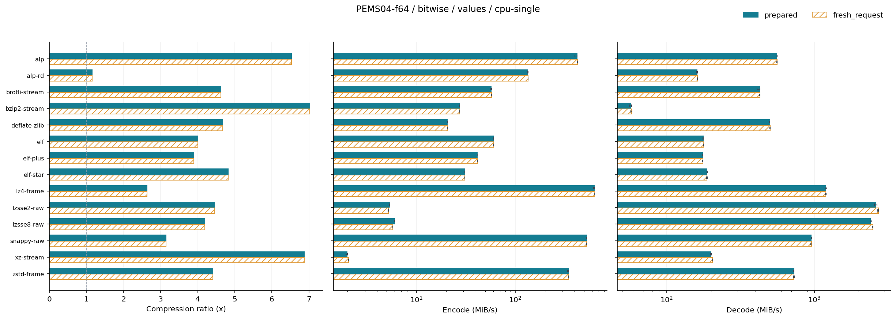

[SVG](figures/PEMS04-f64--bitwise--cpu-single.svg)

<details><summary>完整数值、有效批次及拒绝原因</summary>

| codec | 完整输出 bytes P / F | 压缩倍数 P / F | 编码 MiB/s P / F | 解码 MiB/s P / F | 有效批次 P / F |
|---|---:|---:|---:|---:|---:|
| alp | 6.39e+06 / 6.39e+06 | 6.53 / 6.53 | 423 / 426 | 556 / 561 | 14/14 / 14/14 |
| alp-rd | 3.63e+07 / 3.63e+07 | 1.15 / 1.15 | 134 / 135 | 161 / 162 | 14/14 / 14/14 |
| brotli-stream | 9.02e+06 / 9.02e+06 | 4.63 / 4.63 | 57.2 / 57.8 | 427 / 428 | 14/14 / 14/14 |
| bzip2-stream | 5.94e+06 / 5.94e+06 | 7.02 / 7.02 | 27.3 / 27.3 | 57.4 / 57.9 | 14/14 / 14/14 |
| chimp | — / — | — / — | — / — | — / — | 0/0 / 0/0 |
| chimp128 | — / — | — / — | — / — | — / — | 0/0 / 0/0 |
| chimp128-no-index | — / — | — / — | — / — | — / — | 0/0 / 0/0 |
| chimp32 | — / — | — / — | — / — | — / — | 0/0 / 0/0 |
| chimpn | — / — | — / — | — / — | — / — | 0/0 / 0/0 |
| chimpn32 | — / — | — / — | — / — | — / — | 0/0 / 0/0 |
| deflate-zlib | 8.93e+06 / 8.93e+06 | 4.67 / 4.67 | 20.6 / 20.6 | 501 / 503 | 14/14 / 14/14 |
| elf | 1.04e+07 / 1.04e+07 | 4.01 / 4.01 | 60.4 / 60.4 | 177 / 178 | 14/14 / 14/14 |
| elf-plus | 1.07e+07 / 1.07e+07 | 3.89 / 3.89 | 41.4 / 41.5 | 176 / 176 | 14/14 / 14/14 |
| elf-star | 8.65e+06 / 8.65e+06 | 4.83 / 4.83 | 31 / 30.9 | 188 / 188 | 14/14 / 14/14 |
| fse | — / — | — / — | — / — | — / — | 0/0 / 0/0 |
| gorilla-prometheus-xor | — / — | — / — | — / — | — / — | 0/0 / 0/0 |
| huff0 | — / — | — / — | — / — | — / — | 0/0 / 0/0 |
| leats-lossless-i64 | — / — | — / — | — / — | — / — | 0/0 / 0/0 |
| lz4-frame | 1.59e+07 / 1.59e+07 | 2.63 / 2.63 | 635 / 635 | 1.2e+03 / 1.19e+03 | 14/14 / 14/14 |
| lzsse2-raw | 9.38e+06 / 9.38e+06 | 4.45 / 4.45 | 5.38 / 5.18 | 2.61e+03 / 2.72e+03 | 14/14 / 14/14 |
| lzsse8-raw | 9.95e+06 / 9.95e+06 | 4.2 / 4.2 | 6.01 / 5.74 | 2.4e+03 / 2.49e+03 | 14/14 / 14/14 |
| neats-lossless-i64 | — / — | — / — | — / — | — / — | 0/0 / 0/0 |
| self-star | — / — | — / — | — / — | — / — | 0/0 / 0/0 |
| simdcomp-u32 | — / — | — / — | — / — | — / — | 0/0 / 0/0 |
| snappy-raw | 1.33e+07 / 1.33e+07 | 3.14 / 3.14 | 528 / 528 | 955 / 958 | 14/14 / 14/14 |
| sprintz-delta | — / — | — / — | — / — | — / — | 0/0 / 0/0 |
| sprintz-delta-huffman | — / — | — / — | — / — | — / — | 0/0 / 0/0 |
| sprintz-fire | — / — | — / — | — / — | — / — | 0/0 / 0/0 |
| sprintz-fire-huffman | — / — | — / — | — / — | — / — | 0/0 / 0/0 |
| xz-stream | 6.07e+06 / 6.07e+06 | 6.87 / 6.87 | 1.99 / 2.05 | 200 / 205 | 14/14 / 14/14 |
| zstd-frame | 9.46e+06 / 9.46e+06 | 4.41 / 4.41 | 345 / 347 | 729 / 729 | 14/14 / 14/14 |

拒绝或未完整完成的请求：

- `chimp` / fresh_request：unsupported，chimp: element limit exceeded
- `chimp` / prepared：unsupported，chimp: element limit exceeded
- `chimp128` / fresh_request：unsupported，chimp128: element limit exceeded
- `chimp128` / prepared：unsupported，chimp128: element limit exceeded
- `chimp128-no-index` / fresh_request：unsupported，chimp128-no-index: element limit exceeded
- `chimp128-no-index` / prepared：unsupported，chimp128-no-index: element limit exceeded
- `chimp32` / fresh_request：unsupported，chimp32: dtype must be one of ('<f4',)
- `chimp32` / prepared：unsupported，chimp32: dtype must be one of ('<f4',)
- `chimpn` / fresh_request：unsupported，chimpn: element limit exceeded
- `chimpn` / prepared：unsupported，chimpn: element limit exceeded
- `chimpn32` / fresh_request：unsupported，chimpn32: dtype must be one of ('<f4',)
- `chimpn32` / prepared：unsupported，chimpn32: dtype must be one of ('<f4',)
- `fse` / fresh_request：unsupported，fse: n=16992 exceeds native limits
- `fse` / prepared：unsupported，fse: n=16992 exceeds native limits
- `gorilla-prometheus-xor` / fresh_request：unsupported，Gorilla requires actual paired T/V; values-only and timestamp-only are unsupported
- `gorilla-prometheus-xor` / prepared：unsupported，Gorilla requires actual paired T/V; values-only and timestamp-only are unsupported
- `huff0` / fresh_request：unsupported，huff0: n=16992 exceeds native limits
- `huff0` / prepared：unsupported，huff0: n=16992 exceeds native limits
- `leats-lossless-i64` / fresh_request：unsupported，leats-lossless-i64: dtype must be one of ('|i1', '<i2', '<i4', '<i8')
- `leats-lossless-i64` / prepared：unsupported，leats-lossless-i64: dtype must be one of ('|i1', '<i2', '<i4', '<i8')
- `neats-lossless-i64` / fresh_request：unsupported，neats-lossless-i64: dtype must be one of ('|i1', '<i2', '<i4', '<i8')
- `neats-lossless-i64` / prepared：unsupported，neats-lossless-i64: dtype must be one of ('|i1', '<i2', '<i4', '<i8')
- `self-star` / fresh_request：unsupported，SElfStar intrinsic session limits exceeded 
- `self-star` / prepared：unsupported，SElfStar intrinsic session limits exceeded 
- `simdcomp-u32` / fresh_request：unsupported，simdcomp-u32: dtype must be one of ('<u4',)
- `simdcomp-u32` / prepared：unsupported，simdcomp-u32: dtype must be one of ('<u4',)
- `sprintz-delta` / fresh_request：unsupported，sprintz-delta: dtype must be one of ('|u1', '|i1', '<u2', '<i2')
- `sprintz-delta` / prepared：unsupported，sprintz-delta: dtype must be one of ('|u1', '|i1', '<u2', '<i2')
- `sprintz-delta-huffman` / fresh_request：unsupported，sprintz-delta-huffman: dtype must be one of ('|u1', '|i1', '<u2', '<i2')
- `sprintz-delta-huffman` / prepared：unsupported，sprintz-delta-huffman: dtype must be one of ('|u1', '|i1', '<u2', '<i2')
- `sprintz-fire` / fresh_request：unsupported，sprintz-fire: dtype must be one of ('|u1', '|i1', '<u2', '<i2')
- `sprintz-fire` / prepared：unsupported，sprintz-fire: dtype must be one of ('|u1', '|i1', '<u2', '<i2')
- `sprintz-fire-huffman` / fresh_request：unsupported，sprintz-fire-huffman: dtype must be one of ('|u1', '|i1', '<u2', '<i2')
- `sprintz-fire-huffman` / prepared：unsupported，sprintz-fire-huffman: dtype must be one of ('|u1', '|i1', '<u2', '<i2')

</details>

**<f8 · [16992, 307] · ABS ≤ 0.01 · values · cpu-single**

运行进程 CPU 亲和性（P / F）：`[(0, 1, 2, 3, 4, 5, 6, 7, 8, 9, 10, 11, 12, 13, 14, 15)]` / `[(0, 1, 2, 3, 4, 5, 6, 7, 8, 9, 10, 11, 12, 13, 14, 15)]`；逐配置创建时间见 CSV，是否处于并行窗口见调度记录。

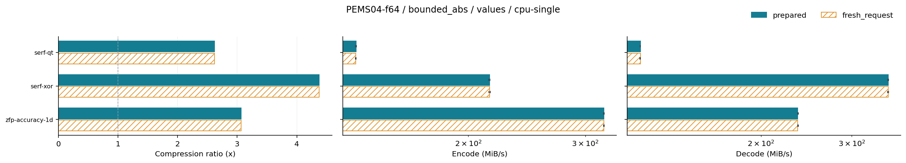

[SVG](figures/PEMS04-f64--bounded_abs--cpu-single.svg)

<details><summary>完整数值、有效批次及拒绝原因</summary>

| codec | 完整输出 bytes P / F | 压缩倍数 P / F | 编码 MiB/s P / F | 解码 MiB/s P / F | 有效批次 P / F |
|---|---:|---:|---:|---:|---:|
| serf-qt | 1.59e+07 / 1.59e+07 | 2.62 / 2.62 | 136 / 136 | 117 / 117 | 14/14 / 14/14 |
| serf-xor | 9.54e+06 / 9.54e+06 | 4.38 / 4.38 | 215 / 216 | 353 / 353 | 14/14 / 14/14 |
| zfp-accuracy-1d | 1.36e+07 / 1.36e+07 | 3.07 / 3.07 | 320 / 320 | 236 / 236 | 14/14 / 14/14 |

</details>

**<f8 · [16992, 307] · 经验质量（无最大误差保证） · values · cpu-single**

运行进程 CPU 亲和性（P / F）：`[(0, 1, 2, 3, 4, 5, 6, 7, 8, 9, 10, 11, 12, 13, 14, 15)]` / `[(0, 1, 2, 3, 4, 5, 6, 7, 8, 9, 10, 11, 12, 13, 14, 15)]`；逐配置创建时间见 CSV，是否处于并行窗口见调度记录。

<details><summary>完整数值、有效批次及拒绝原因</summary>

| codec | 完整输出 bytes P / F | 压缩倍数 P / F | 编码 MiB/s P / F | 解码 MiB/s P / F | 有效批次 P / F |
|---|---:|---:|---:|---:|---:|
| abba | — / — | — / — | — / — | — / — | 0/0 / 0/0 |
| cameo | — / — | — / — | — / — | — / — | 0/0 / 0/0 |
| dft | — / — | — / — | — / — | — / — | 0/0 / 0/0 |
| dwt-dct-ii | — / — | — / — | — / — | — / — | 0/0 / 0/0 |
| fabba | — / — | — / — | — / — | — / — | 0/0 / 0/0 |
| pip | — / — | — / — | — / — | — / — | 0/0 / 0/0 |
| pmc-mean | — / — | — / — | — / — | — / — | 0/0 / 0/0 |
| pmc-mr | — / — | — / — | — / — | — / — | 0/0 / 0/0 |
| qabba | — / — | — / — | — / — | — / — | 0/0 / 0/0 |
| sim-piece | — / — | — / — | — / — | — / — | 0/0 / 0/0 |
| swab | — / — | — / — | — / — | — / — | 0/0 / 0/0 |
| swing-connected | — / — | — / — | — / — | — / — | 0/0 / 0/0 |
| swing-filter | — / — | — / — | — / — | — / — | 0/0 / 0/0 |
| swing-filter-disjoint | — / — | — / — | — / — | — / — | 0/0 / 0/0 |
| swing-filter-disjoint-quantized / compatible | — / — | — / — | — / — | — / — | 0/0 / 0/0 |
| tp | — / — | — / — | — / — | — / — | 0/0 / 0/0 |
| vw | — / — | — / — | — / — | — / — | 0/0 / 0/0 |

拒绝或未完整完成的请求：

- `abba` / fresh_request：unsupported，abba: element limit exceeded
- `abba` / prepared：unsupported，abba: element limit exceeded
- `cameo` / fresh_request：unsupported，cameo: element limit exceeded
- `cameo` / prepared：unsupported，cameo: element limit exceeded
- `dft` / fresh_request：unsupported，dft: element limit exceeded
- `dft` / prepared：unsupported，dft: element limit exceeded
- `dwt-dct-ii` / fresh_request：unsupported，dwt-dct-ii: element limit exceeded
- `dwt-dct-ii` / prepared：unsupported，dwt-dct-ii: element limit exceeded
- `fabba` / fresh_request：unsupported，fabba: element limit exceeded
- `fabba` / prepared：unsupported，fabba: element limit exceeded
- `pip` / fresh_request：unsupported，pip: element limit exceeded
- `pip` / prepared：unsupported，pip: element limit exceeded
- `pmc-mean` / fresh_request：unsupported，pmc-mean: element limit exceeded
- `pmc-mean` / prepared：unsupported，pmc-mean: element limit exceeded
- `pmc-mr` / fresh_request：unsupported，pmc-mr: dtype must be one of ('<f4',)
- `pmc-mr` / prepared：unsupported，pmc-mr: dtype must be one of ('<f4',)
- `qabba` / fresh_request：unsupported，qabba: element limit exceeded
- `qabba` / prepared：unsupported，qabba: element limit exceeded
- `sim-piece` / fresh_request：unsupported，sim-piece: element limit exceeded
- `sim-piece` / prepared：unsupported，sim-piece: element limit exceeded
- `swab` / fresh_request：unsupported，swab: element limit exceeded
- `swab` / prepared：unsupported，swab: element limit exceeded
- `swing-connected` / fresh_request：unsupported，swing-connected: element limit exceeded
- `swing-connected` / prepared：unsupported，swing-connected: element limit exceeded
- `swing-filter` / fresh_request：unsupported，swing-filter: dtype must be one of ('<f4',)
- `swing-filter` / prepared：unsupported，swing-filter: dtype must be one of ('<f4',)
- `swing-filter-disjoint` / fresh_request：unsupported，swing-filter-disjoint: dtype must be one of ('<f4',)
- `swing-filter-disjoint` / prepared：unsupported，swing-filter-disjoint: dtype must be one of ('<f4',)
- `swing-filter-disjoint-quantized / compatible` / fresh_request：unsupported，swing-filter-disjoint-quantized: dtype must be one of ('<f4',)
- `swing-filter-disjoint-quantized / compatible` / prepared：unsupported，swing-filter-disjoint-quantized: dtype must be one of ('<f4',)
- `tp` / fresh_request：unsupported，tp: element limit exceeded
- `tp` / prepared：unsupported，tp: element limit exceeded
- `vw` / fresh_request：unsupported，vw: element limit exceeded
- `vw` / prepared：unsupported，vw: element limit exceeded

</details>

**<i2 · [16992, 307] · 无损 · values · cpu-single**

运行进程 CPU 亲和性（P / F）：`[(0, 1, 2, 3, 4, 5, 6, 7, 8, 9, 10, 11, 12, 13, 14, 15)]` / `[(0, 1, 2, 3, 4, 5, 6, 7, 8, 9, 10, 11, 12, 13, 14, 15)]`；逐配置创建时间见 CSV，是否处于并行窗口见调度记录。

<details><summary>完整数值、有效批次及拒绝原因</summary>

| codec | 完整输出 bytes P / F | 压缩倍数 P / F | 编码 MiB/s P / F | 解码 MiB/s P / F | 有效批次 P / F |
|---|---:|---:|---:|---:|---:|
| sprintz-delta | — / — | — / — | — / — | — / — | 0/0 / 0/0 |
| sprintz-delta-huffman | — / — | — / — | — / — | — / — | 0/0 / 0/0 |
| sprintz-fire | — / — | — / — | — / — | — / — | 0/0 / 0/0 |
| sprintz-fire-huffman | — / — | — / — | — / — | — / — | 0/0 / 0/0 |

拒绝或未完整完成的请求：

- `sprintz-delta` / fresh_request：unsupported，sprintz-delta: m=307 exceeds native limits
- `sprintz-delta` / prepared：unsupported，sprintz-delta: m=307 exceeds native limits
- `sprintz-delta-huffman` / fresh_request：unsupported，sprintz-delta-huffman: m=307 exceeds native limits
- `sprintz-delta-huffman` / prepared：unsupported，sprintz-delta-huffman: m=307 exceeds native limits
- `sprintz-fire` / fresh_request：unsupported，sprintz-fire: m=307 exceeds native limits
- `sprintz-fire` / prepared：unsupported，sprintz-fire: m=307 exceeds native limits
- `sprintz-fire-huffman` / fresh_request：unsupported，sprintz-fire-huffman: m=307 exceeds native limits
- `sprintz-fire-huffman` / prepared：unsupported，sprintz-fire-huffman: m=307 exceeds native limits

</details>

**<i8 · [16992, 307] · 无损 · values · cpu-single**

运行进程 CPU 亲和性（P / F）：`[(0, 1, 2, 3, 4, 5, 6, 7, 8, 9, 10, 11, 12, 13, 14, 15)]` / `[(0, 1, 2, 3, 4, 5, 6, 7, 8, 9, 10, 11, 12, 13, 14, 15)]`；逐配置创建时间见 CSV，是否处于并行窗口见调度记录。

<details><summary>完整数值、有效批次及拒绝原因</summary>

| codec | 完整输出 bytes P / F | 压缩倍数 P / F | 编码 MiB/s P / F | 解码 MiB/s P / F | 有效批次 P / F |
|---|---:|---:|---:|---:|---:|
| leats-lossless-i64 | — / — | — / — | — / — | — / — | 0/0 / 0/0 |
| neats-lossless-i64 | — / — | — / — | — / — | — / — | 0/0 / 0/0 |

拒绝或未完整完成的请求：

- `leats-lossless-i64` / fresh_request：unsupported，leats-lossless-i64: m=307 exceeds native limits
- `leats-lossless-i64` / prepared：unsupported，leats-lossless-i64: m=307 exceeds native limits
- `neats-lossless-i64` / fresh_request：unsupported，neats-lossless-i64: m=307 exceeds native limits
- `neats-lossless-i64` / prepared：unsupported，neats-lossless-i64: m=307 exceeds native limits

</details>

**<u4 · [16992, 307] · 无损 · values · cpu-single**

运行进程 CPU 亲和性（P / F）：`[(0, 1, 2, 3, 4, 5, 6, 7, 8, 9, 10, 11, 12, 13, 14, 15)]` / `[(0, 1, 2, 3, 4, 5, 6, 7, 8, 9, 10, 11, 12, 13, 14, 15)]`；逐配置创建时间见 CSV，是否处于并行窗口见调度记录。

<details><summary>完整数值、有效批次及拒绝原因</summary>

| codec | 完整输出 bytes P / F | 压缩倍数 P / F | 编码 MiB/s P / F | 解码 MiB/s P / F | 有效批次 P / F |
|---|---:|---:|---:|---:|---:|
| simdcomp-u32 | — / — | — / — | — / — | — / — | 0/0 / 0/0 |

拒绝或未完整完成的请求：

- `simdcomp-u32` / fresh_request：unsupported，simdcomp-u32: rank must be one of (1,)
- `simdcomp-u32` / prepared：unsupported，simdcomp-u32: rank must be one of (1,)

</details>

<a id="dataset-PEMS08"></a>

### PEMS08

**<f4 · [17856, 170] · 无损 · values · cpu-single**

运行进程 CPU 亲和性（P / F）：`[(0, 1, 2, 3, 4, 5, 6, 7, 8, 9, 10, 11, 12, 13, 14, 15)]` / `[(0, 1, 2, 3, 4, 5, 6, 7, 8, 9, 10, 11, 12, 13, 14, 15)]`；逐配置创建时间见 CSV，是否处于并行窗口见调度记录。

f64→f32 准备阶段转换的最大绝对差：**0**；本组 codec 的恢复质量相对转换后的 f32 输入验证。

<details><summary>完整数值、有效批次及拒绝原因</summary>

| codec | 完整输出 bytes P / F | 压缩倍数 P / F | 编码 MiB/s P / F | 解码 MiB/s P / F | 有效批次 P / F |
|---|---:|---:|---:|---:|---:|
| chimp32 | — / — | — / — | — / — | — / — | 0/0 / 0/0 |
| chimpn32 | — / — | — / — | — / — | — / — | 0/0 / 0/0 |

拒绝或未完整完成的请求：

- `chimp32` / fresh_request：unsupported，chimp32: element limit exceeded
- `chimp32` / prepared：unsupported，chimp32: element limit exceeded
- `chimpn32` / fresh_request：unsupported，chimpn32: element limit exceeded
- `chimpn32` / prepared：unsupported，chimpn32: element limit exceeded

</details>

**<f4 · [17856, 170] · 经验质量（无最大误差保证） · values · cpu-single**

运行进程 CPU 亲和性（P / F）：`[(0, 1, 2, 3, 4, 5, 6, 7, 8, 9, 10, 11, 12, 13, 14, 15)]` / `[(0, 1, 2, 3, 4, 5, 6, 7, 8, 9, 10, 11, 12, 13, 14, 15)]`；逐配置创建时间见 CSV，是否处于并行窗口见调度记录。

f64→f32 准备阶段转换的最大绝对差：**0**；本组 codec 的恢复质量相对转换后的 f32 输入验证。

<details><summary>完整数值、有效批次及拒绝原因</summary>

| codec | 完整输出 bytes P / F | 压缩倍数 P / F | 编码 MiB/s P / F | 解码 MiB/s P / F | 有效批次 P / F |
|---|---:|---:|---:|---:|---:|
| pmc-mr | — / — | — / — | — / — | — / — | 0/0 / 0/0 |
| swing-filter | — / — | — / — | — / — | — / — | 0/0 / 0/0 |
| swing-filter-disjoint | — / — | — / — | — / — | — / — | 0/0 / 0/0 |
| swing-filter-disjoint-quantized / compatible | — / — | — / — | — / — | — / — | 0/0 / 0/0 |

拒绝或未完整完成的请求：

- `pmc-mr` / fresh_request：unsupported，pmc-mr: element limit exceeded
- `pmc-mr` / prepared：unsupported，pmc-mr: element limit exceeded
- `swing-filter` / fresh_request：unsupported，swing-filter: element limit exceeded
- `swing-filter` / prepared：unsupported，swing-filter: element limit exceeded
- `swing-filter-disjoint` / fresh_request：unsupported，swing-filter-disjoint: element limit exceeded
- `swing-filter-disjoint` / prepared：unsupported，swing-filter-disjoint: element limit exceeded
- `swing-filter-disjoint-quantized / compatible` / fresh_request：unsupported，swing-filter-disjoint-quantized: element limit exceeded
- `swing-filter-disjoint-quantized / compatible` / prepared：unsupported，swing-filter-disjoint-quantized: element limit exceeded

</details>

**<f8 · [17856, 170] · 无损 · values · cpu-single**

运行进程 CPU 亲和性（P / F）：`[(0, 1, 2, 3, 4, 5, 6, 7, 8, 9, 10, 11, 12, 13, 14, 15)]` / `[(0, 1, 2, 3, 4, 5, 6, 7, 8, 9, 10, 11, 12, 13, 14, 15)]`；逐配置创建时间见 CSV，是否处于并行窗口见调度记录。

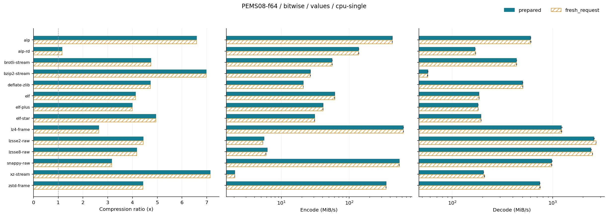

[SVG](figures/PEMS08-f64--bitwise--cpu-single.svg)

<details><summary>完整数值、有效批次及拒绝原因</summary>

| codec | 完整输出 bytes P / F | 压缩倍数 P / F | 编码 MiB/s P / F | 解码 MiB/s P / F | 有效批次 P / F |
|---|---:|---:|---:|---:|---:|
| alp | 3.69e+06 / 3.69e+06 | 6.59 / 6.59 | 431 / 432 | 603 / 604 | 14/14 / 14/14 |
| alp-rd | 2.11e+07 / 2.11e+07 | 1.15 / 1.15 | 138 / 138 | 169 / 170 | 14/14 / 14/14 |
| brotli-stream | 5.12e+06 / 5.12e+06 | 4.74 / 4.74 | 56 / 56 | 437 / 437 | 14/14 / 14/14 |
| bzip2-stream | 3.48e+06 / 3.48e+06 | 6.98 / 6.98 | 26.7 / 26.6 | 57.1 / 56.8 | 14/14 / 14/14 |
| chimp | — / — | — / — | — / — | — / — | 0/0 / 0/0 |
| chimp128 | — / — | — / — | — / — | — / — | 0/0 / 0/0 |
| chimp128-no-index | — / — | — / — | — / — | — / — | 0/0 / 0/0 |
| chimp32 | — / — | — / — | — / — | — / — | 0/0 / 0/0 |
| chimpn | — / — | — / — | — / — | — / — | 0/0 / 0/0 |
| chimpn32 | — / — | — / — | — / — | — / — | 0/0 / 0/0 |
| deflate-zlib | 5.14e+06 / 5.14e+06 | 4.73 / 4.73 | 21 / 21 | 502 / 504 | 14/14 / 14/14 |
| elf | 5.89e+06 / 5.89e+06 | 4.13 / 4.13 | 61.1 / 61 | 185 / 185 | 14/14 / 14/14 |
| elf-plus | 6.08e+06 / 6.08e+06 | 4 / 4 | 41.1 / 41 | 181 / 181 | 14/14 / 14/14 |
| elf-star | 4.91e+06 / 4.91e+06 | 4.94 / 4.94 | 30.9 / 30.8 | 193 / 193 | 14/14 / 14/14 |
| fse | — / — | — / — | — / — | — / — | 0/0 / 0/0 |
| gorilla-prometheus-xor | — / — | — / — | — / — | — / — | 0/0 / 0/0 |
| huff0 | — / — | — / — | — / — | — / — | 0/0 / 0/0 |
| leats-lossless-i64 | — / — | — / — | — / — | — / — | 0/0 / 0/0 |
| lz4-frame | 9.22e+06 / 9.22e+06 | 2.63 / 2.63 | 629 / 629 | 1.22e+03 / 1.22e+03 | 14/14 / 14/14 |
| lzsse2-raw | 5.48e+06 / 5.48e+06 | 4.43 / 4.43 | 5.53 / 5.31 | 2.58e+03 / 2.71e+03 | 14/14 / 14/14 |
| lzsse8-raw | 5.81e+06 / 5.81e+06 | 4.18 / 4.18 | 6.2 / 5.91 | 2.41e+03 / 2.49e+03 | 14/14 / 14/14 |
| neats-lossless-i64 | — / — | — / — | — / — | — / — | 0/0 / 0/0 |
| self-star | — / — | — / — | — / — | — / — | 0/0 / 0/0 |
| simdcomp-u32 | — / — | — / — | — / — | — / — | 0/0 / 0/0 |
| snappy-raw | 7.68e+06 / 7.68e+06 | 3.16 / 3.16 | 548 / 548 | 978 / 976 | 14/14 / 14/14 |
| sprintz-delta | — / — | — / — | — / — | — / — | 0/0 / 0/0 |
| sprintz-delta-huffman | — / — | — / — | — / — | — / — | 0/0 / 0/0 |
| sprintz-fire | — / — | — / — | — / — | — / — | 0/0 / 0/0 |
| sprintz-fire-huffman | — / — | — / — | — / — | — / — | 0/0 / 0/0 |
| xz-stream | 3.4e+06 / 3.4e+06 | 7.14 / 7.14 | 2.05 / 2.04 | 204 / 209 | 14/14 / 14/14 |
| zstd-frame | 5.5e+06 / 5.5e+06 | 4.42 / 4.42 | 351 / 350 | 744 / 747 | 14/14 / 14/14 |

拒绝或未完整完成的请求：

- `chimp` / fresh_request：unsupported，chimp: element limit exceeded
- `chimp` / prepared：unsupported，chimp: element limit exceeded
- `chimp128` / fresh_request：unsupported，chimp128: element limit exceeded
- `chimp128` / prepared：unsupported，chimp128: element limit exceeded
- `chimp128-no-index` / fresh_request：unsupported，chimp128-no-index: element limit exceeded
- `chimp128-no-index` / prepared：unsupported，chimp128-no-index: element limit exceeded
- `chimp32` / fresh_request：unsupported，chimp32: dtype must be one of ('<f4',)
- `chimp32` / prepared：unsupported，chimp32: dtype must be one of ('<f4',)
- `chimpn` / fresh_request：unsupported，chimpn: element limit exceeded
- `chimpn` / prepared：unsupported，chimpn: element limit exceeded
- `chimpn32` / fresh_request：unsupported，chimpn32: dtype must be one of ('<f4',)
- `chimpn32` / prepared：unsupported，chimpn32: dtype must be one of ('<f4',)
- `fse` / fresh_request：unsupported，fse: n=17856 exceeds native limits
- `fse` / prepared：unsupported，fse: n=17856 exceeds native limits
- `gorilla-prometheus-xor` / fresh_request：unsupported，Gorilla requires actual paired T/V; values-only and timestamp-only are unsupported
- `gorilla-prometheus-xor` / prepared：unsupported，Gorilla requires actual paired T/V; values-only and timestamp-only are unsupported
- `huff0` / fresh_request：unsupported，huff0: n=17856 exceeds native limits
- `huff0` / prepared：unsupported，huff0: n=17856 exceeds native limits
- `leats-lossless-i64` / fresh_request：unsupported，leats-lossless-i64: dtype must be one of ('|i1', '<i2', '<i4', '<i8')
- `leats-lossless-i64` / prepared：unsupported，leats-lossless-i64: dtype must be one of ('|i1', '<i2', '<i4', '<i8')
- `neats-lossless-i64` / fresh_request：unsupported，neats-lossless-i64: dtype must be one of ('|i1', '<i2', '<i4', '<i8')
- `neats-lossless-i64` / prepared：unsupported，neats-lossless-i64: dtype must be one of ('|i1', '<i2', '<i4', '<i8')
- `self-star` / fresh_request：unsupported，SElfStar intrinsic session limits exceeded 
- `self-star` / prepared：unsupported，SElfStar intrinsic session limits exceeded 
- `simdcomp-u32` / fresh_request：unsupported，simdcomp-u32: dtype must be one of ('<u4',)
- `simdcomp-u32` / prepared：unsupported，simdcomp-u32: dtype must be one of ('<u4',)
- `sprintz-delta` / fresh_request：unsupported，sprintz-delta: dtype must be one of ('|u1', '|i1', '<u2', '<i2')
- `sprintz-delta` / prepared：unsupported，sprintz-delta: dtype must be one of ('|u1', '|i1', '<u2', '<i2')
- `sprintz-delta-huffman` / fresh_request：unsupported，sprintz-delta-huffman: dtype must be one of ('|u1', '|i1', '<u2', '<i2')
- `sprintz-delta-huffman` / prepared：unsupported，sprintz-delta-huffman: dtype must be one of ('|u1', '|i1', '<u2', '<i2')
- `sprintz-fire` / fresh_request：unsupported，sprintz-fire: dtype must be one of ('|u1', '|i1', '<u2', '<i2')
- `sprintz-fire` / prepared：unsupported，sprintz-fire: dtype must be one of ('|u1', '|i1', '<u2', '<i2')
- `sprintz-fire-huffman` / fresh_request：unsupported，sprintz-fire-huffman: dtype must be one of ('|u1', '|i1', '<u2', '<i2')
- `sprintz-fire-huffman` / prepared：unsupported，sprintz-fire-huffman: dtype must be one of ('|u1', '|i1', '<u2', '<i2')

</details>

**<f8 · [17856, 170] · ABS ≤ 0.01 · values · cpu-single**

运行进程 CPU 亲和性（P / F）：`[(0, 1, 2, 3, 4, 5, 6, 7, 8, 9, 10, 11, 12, 13, 14, 15)]` / `[(0, 1, 2, 3, 4, 5, 6, 7, 8, 9, 10, 11, 12, 13, 14, 15)]`；逐配置创建时间见 CSV，是否处于并行窗口见调度记录。

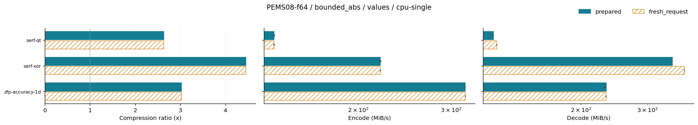

[SVG](figures/PEMS08-f64--bounded_abs--cpu-single.svg)

<details><summary>完整数值、有效批次及拒绝原因</summary>

| codec | 完整输出 bytes P / F | 压缩倍数 P / F | 编码 MiB/s P / F | 解码 MiB/s P / F | 有效批次 P / F |
|---|---:|---:|---:|---:|---:|
| serf-qt | 9.22e+06 / 9.22e+06 | 2.63 / 2.63 | 139 / 139 | 117 / 120 | 14/14 / 14/14 |
| serf-xor | 5.46e+06 / 5.46e+06 | 4.45 / 4.45 | 220 / 220 | 349 / 376 | 14/14 / 14/14 |
| zfp-accuracy-1d | 8.03e+06 / 8.03e+06 | 3.02 / 3.02 | 319 / 319 | 233 / 233 | 14/14 / 14/14 |

</details>

**<f8 · [17856, 170] · 经验质量（无最大误差保证） · values · cpu-single**

运行进程 CPU 亲和性（P / F）：`[(0, 1, 2, 3, 4, 5, 6, 7, 8, 9, 10, 11, 12, 13, 14, 15)]` / `[(0, 1, 2, 3, 4, 5, 6, 7, 8, 9, 10, 11, 12, 13, 14, 15)]`；逐配置创建时间见 CSV，是否处于并行窗口见调度记录。

<details><summary>完整数值、有效批次及拒绝原因</summary>

| codec | 完整输出 bytes P / F | 压缩倍数 P / F | 编码 MiB/s P / F | 解码 MiB/s P / F | 有效批次 P / F |
|---|---:|---:|---:|---:|---:|
| abba | — / — | — / — | — / — | — / — | 0/0 / 0/0 |
| cameo | — / — | — / — | — / — | — / — | 0/0 / 0/0 |
| dft | — / — | — / — | — / — | — / — | 0/0 / 0/0 |
| dwt-dct-ii | — / — | — / — | — / — | — / — | 0/0 / 0/0 |
| fabba | — / — | — / — | — / — | — / — | 0/0 / 0/0 |
| pip | — / — | — / — | — / — | — / — | 0/0 / 0/0 |
| pmc-mean | — / — | — / — | — / — | — / — | 0/0 / 0/0 |
| pmc-mr | — / — | — / — | — / — | — / — | 0/0 / 0/0 |
| qabba | — / — | — / — | — / — | — / — | 0/0 / 0/0 |
| sim-piece | — / — | — / — | — / — | — / — | 0/0 / 0/0 |
| swab | — / — | — / — | — / — | — / — | 0/0 / 0/0 |
| swing-connected | — / — | — / — | — / — | — / — | 0/0 / 0/0 |
| swing-filter | — / — | — / — | — / — | — / — | 0/0 / 0/0 |
| swing-filter-disjoint | — / — | — / — | — / — | — / — | 0/0 / 0/0 |
| swing-filter-disjoint-quantized / compatible | — / — | — / — | — / — | — / — | 0/0 / 0/0 |
| tp | — / — | — / — | — / — | — / — | 0/0 / 0/0 |
| vw | — / — | — / — | — / — | — / — | 0/0 / 0/0 |

拒绝或未完整完成的请求：

- `abba` / fresh_request：unsupported，abba: element limit exceeded
- `abba` / prepared：unsupported，abba: element limit exceeded
- `cameo` / fresh_request：unsupported，cameo: element limit exceeded
- `cameo` / prepared：unsupported，cameo: element limit exceeded
- `dft` / fresh_request：unsupported，dft: element limit exceeded
- `dft` / prepared：unsupported，dft: element limit exceeded
- `dwt-dct-ii` / fresh_request：unsupported，dwt-dct-ii: element limit exceeded
- `dwt-dct-ii` / prepared：unsupported，dwt-dct-ii: element limit exceeded
- `fabba` / fresh_request：unsupported，fabba: element limit exceeded
- `fabba` / prepared：unsupported，fabba: element limit exceeded
- `pip` / fresh_request：unsupported，pip: element limit exceeded
- `pip` / prepared：unsupported，pip: element limit exceeded
- `pmc-mean` / fresh_request：unsupported，pmc-mean: element limit exceeded
- `pmc-mean` / prepared：unsupported，pmc-mean: element limit exceeded
- `pmc-mr` / fresh_request：unsupported，pmc-mr: dtype must be one of ('<f4',)
- `pmc-mr` / prepared：unsupported，pmc-mr: dtype must be one of ('<f4',)
- `qabba` / fresh_request：unsupported，qabba: element limit exceeded
- `qabba` / prepared：unsupported，qabba: element limit exceeded
- `sim-piece` / fresh_request：unsupported，sim-piece: element limit exceeded
- `sim-piece` / prepared：unsupported，sim-piece: element limit exceeded
- `swab` / fresh_request：unsupported，swab: element limit exceeded
- `swab` / prepared：unsupported，swab: element limit exceeded
- `swing-connected` / fresh_request：unsupported，swing-connected: element limit exceeded
- `swing-connected` / prepared：unsupported，swing-connected: element limit exceeded
- `swing-filter` / fresh_request：unsupported，swing-filter: dtype must be one of ('<f4',)
- `swing-filter` / prepared：unsupported，swing-filter: dtype must be one of ('<f4',)
- `swing-filter-disjoint` / fresh_request：unsupported，swing-filter-disjoint: dtype must be one of ('<f4',)
- `swing-filter-disjoint` / prepared：unsupported，swing-filter-disjoint: dtype must be one of ('<f4',)
- `swing-filter-disjoint-quantized / compatible` / fresh_request：unsupported，swing-filter-disjoint-quantized: dtype must be one of ('<f4',)
- `swing-filter-disjoint-quantized / compatible` / prepared：unsupported，swing-filter-disjoint-quantized: dtype must be one of ('<f4',)
- `tp` / fresh_request：unsupported，tp: element limit exceeded
- `tp` / prepared：unsupported，tp: element limit exceeded
- `vw` / fresh_request：unsupported，vw: element limit exceeded
- `vw` / prepared：unsupported，vw: element limit exceeded

</details>

**<i2 · [17856, 170] · 无损 · values · cpu-single**

运行进程 CPU 亲和性（P / F）：`[(0, 1, 2, 3, 4, 5, 6, 7, 8, 9, 10, 11, 12, 13, 14, 15)]` / `[(0, 1, 2, 3, 4, 5, 6, 7, 8, 9, 10, 11, 12, 13, 14, 15)]`；逐配置创建时间见 CSV，是否处于并行窗口见调度记录。

<details><summary>完整数值、有效批次及拒绝原因</summary>

| codec | 完整输出 bytes P / F | 压缩倍数 P / F | 编码 MiB/s P / F | 解码 MiB/s P / F | 有效批次 P / F |
|---|---:|---:|---:|---:|---:|
| sprintz-delta | — / — | — / — | — / — | — / — | 0/0 / 0/0 |
| sprintz-delta-huffman | — / — | — / — | — / — | — / — | 0/0 / 0/0 |
| sprintz-fire | — / — | — / — | — / — | — / — | 0/0 / 0/0 |
| sprintz-fire-huffman | — / — | — / — | — / — | — / — | 0/0 / 0/0 |

拒绝或未完整完成的请求：

- `sprintz-delta` / fresh_request：unsupported，sprintz-delta: m=170 exceeds native limits
- `sprintz-delta` / prepared：unsupported，sprintz-delta: m=170 exceeds native limits
- `sprintz-delta-huffman` / fresh_request：unsupported，sprintz-delta-huffman: m=170 exceeds native limits
- `sprintz-delta-huffman` / prepared：unsupported，sprintz-delta-huffman: m=170 exceeds native limits
- `sprintz-fire` / fresh_request：unsupported，sprintz-fire: m=170 exceeds native limits
- `sprintz-fire` / prepared：unsupported，sprintz-fire: m=170 exceeds native limits
- `sprintz-fire-huffman` / fresh_request：unsupported，sprintz-fire-huffman: m=170 exceeds native limits
- `sprintz-fire-huffman` / prepared：unsupported，sprintz-fire-huffman: m=170 exceeds native limits

</details>

**<i8 · [17856, 170] · 无损 · values · cpu-single**

运行进程 CPU 亲和性（P / F）：`[(0, 1, 2, 3, 4, 5, 6, 7, 8, 9, 10, 11, 12, 13, 14, 15)]` / `[(0, 1, 2, 3, 4, 5, 6, 7, 8, 9, 10, 11, 12, 13, 14, 15)]`；逐配置创建时间见 CSV，是否处于并行窗口见调度记录。

<details><summary>完整数值、有效批次及拒绝原因</summary>

| codec | 完整输出 bytes P / F | 压缩倍数 P / F | 编码 MiB/s P / F | 解码 MiB/s P / F | 有效批次 P / F |
|---|---:|---:|---:|---:|---:|
| leats-lossless-i64 | — / — | — / — | — / — | — / — | 0/0 / 0/0 |
| neats-lossless-i64 | — / — | — / — | — / — | — / — | 0/0 / 0/0 |

拒绝或未完整完成的请求：

- `leats-lossless-i64` / fresh_request：unsupported，leats-lossless-i64: m=170 exceeds native limits
- `leats-lossless-i64` / prepared：unsupported，leats-lossless-i64: m=170 exceeds native limits
- `neats-lossless-i64` / fresh_request：unsupported，neats-lossless-i64: m=170 exceeds native limits
- `neats-lossless-i64` / prepared：unsupported，neats-lossless-i64: m=170 exceeds native limits

</details>

**<u4 · [17856, 170] · 无损 · values · cpu-single**

运行进程 CPU 亲和性（P / F）：`[(0, 1, 2, 3, 4, 5, 6, 7, 8, 9, 10, 11, 12, 13, 14, 15)]` / `[(0, 1, 2, 3, 4, 5, 6, 7, 8, 9, 10, 11, 12, 13, 14, 15)]`；逐配置创建时间见 CSV，是否处于并行窗口见调度记录。

<details><summary>完整数值、有效批次及拒绝原因</summary>

| codec | 完整输出 bytes P / F | 压缩倍数 P / F | 编码 MiB/s P / F | 解码 MiB/s P / F | 有效批次 P / F |
|---|---:|---:|---:|---:|---:|
| simdcomp-u32 | — / — | — / — | — / — | — / — | 0/0 / 0/0 |

拒绝或未完整完成的请求：

- `simdcomp-u32` / fresh_request：unsupported，simdcomp-u32: rank must be one of (1,)
- `simdcomp-u32` / prepared：unsupported，simdcomp-u32: rank must be one of (1,)

</details>

<a id="dataset-Solar"></a>

### Solar

**<f4 · [52560, 137] · 无损 · values · cpu-single**

运行进程 CPU 亲和性（P / F）：`[(0, 1, 2, 3, 4, 5, 6, 7, 8, 9, 10, 11, 12, 13, 14, 15)]` / `[(0, 1, 2, 3, 4, 5, 6, 7, 8, 9, 10, 11, 12, 13, 14, 15)]`；逐配置创建时间见 CSV，是否处于并行窗口见调度记录。

f64→f32 准备阶段转换的最大绝对差：**3.05175782e-06**；本组 codec 的恢复质量相对转换后的 f32 输入验证。

<details><summary>完整数值、有效批次及拒绝原因</summary>

| codec | 完整输出 bytes P / F | 压缩倍数 P / F | 编码 MiB/s P / F | 解码 MiB/s P / F | 有效批次 P / F |
|---|---:|---:|---:|---:|---:|
| chimp32 | — / — | — / — | — / — | — / — | 0/0 / 0/0 |
| chimpn32 | — / — | — / — | — / — | — / — | 0/0 / 0/0 |

拒绝或未完整完成的请求：

- `chimp32` / fresh_request：unsupported，chimp32: element limit exceeded
- `chimp32` / prepared：unsupported，chimp32: element limit exceeded
- `chimpn32` / fresh_request：unsupported，chimpn32: element limit exceeded
- `chimpn32` / prepared：unsupported，chimpn32: element limit exceeded

</details>

**<f4 · [52560, 137] · 经验质量（无最大误差保证） · values · cpu-single**

运行进程 CPU 亲和性（P / F）：`[(0, 1, 2, 3, 4, 5, 6, 7, 8, 9, 10, 11, 12, 13, 14, 15)]` / `[(0, 1, 2, 3, 4, 5, 6, 7, 8, 9, 10, 11, 12, 13, 14, 15)]`；逐配置创建时间见 CSV，是否处于并行窗口见调度记录。

f64→f32 准备阶段转换的最大绝对差：**3.05175782e-06**；本组 codec 的恢复质量相对转换后的 f32 输入验证。

<details><summary>完整数值、有效批次及拒绝原因</summary>

| codec | 完整输出 bytes P / F | 压缩倍数 P / F | 编码 MiB/s P / F | 解码 MiB/s P / F | 有效批次 P / F |
|---|---:|---:|---:|---:|---:|
| pmc-mr | — / — | — / — | — / — | — / — | 0/0 / 0/0 |
| swing-filter | — / — | — / — | — / — | — / — | 0/0 / 0/0 |
| swing-filter-disjoint | — / — | — / — | — / — | — / — | 0/0 / 0/0 |
| swing-filter-disjoint-quantized / compatible | — / — | — / — | — / — | — / — | 0/0 / 0/0 |

拒绝或未完整完成的请求：

- `pmc-mr` / fresh_request：unsupported，pmc-mr: element limit exceeded
- `pmc-mr` / prepared：unsupported，pmc-mr: element limit exceeded
- `swing-filter` / fresh_request：unsupported，swing-filter: element limit exceeded
- `swing-filter` / prepared：unsupported，swing-filter: element limit exceeded
- `swing-filter-disjoint` / fresh_request：unsupported，swing-filter-disjoint: element limit exceeded
- `swing-filter-disjoint` / prepared：unsupported，swing-filter-disjoint: element limit exceeded
- `swing-filter-disjoint-quantized / compatible` / fresh_request：unsupported，swing-filter-disjoint-quantized: element limit exceeded
- `swing-filter-disjoint-quantized / compatible` / prepared：unsupported，swing-filter-disjoint-quantized: element limit exceeded

</details>

**<f8 · [52560, 137] · 无损 · values · cpu-single**

运行进程 CPU 亲和性（P / F）：`[(0, 1, 2, 3, 4, 5, 6, 7, 8, 9, 10, 11, 12, 13, 14, 15)]` / `[(0, 1, 2, 3, 4, 5, 6, 7, 8, 9, 10, 11, 12, 13, 14, 15)]`；逐配置创建时间见 CSV，是否处于并行窗口见调度记录。

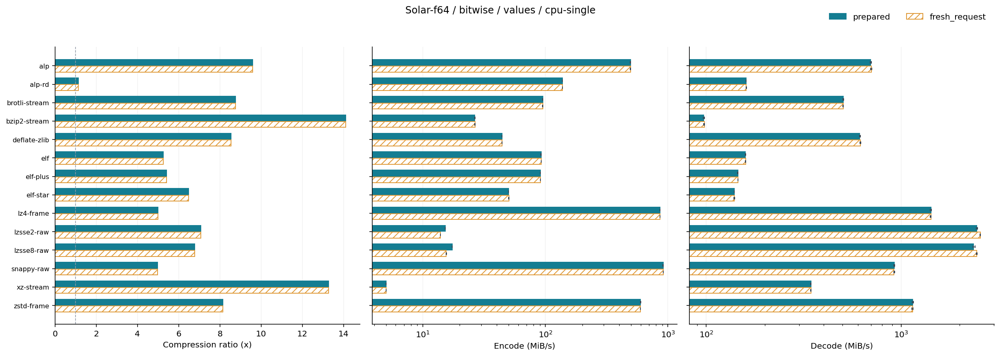

[SVG](figures/Solar-f64--bitwise--cpu-single.svg)

<details><summary>完整数值、有效批次及拒绝原因</summary>

| codec | 完整输出 bytes P / F | 压缩倍数 P / F | 编码 MiB/s P / F | 解码 MiB/s P / F | 有效批次 P / F |
|---|---:|---:|---:|---:|---:|
| alp | 6e+06 / 6e+06 | 9.6 / 9.6 | 495 / 494 | 698 / 704 | 14/14 / 14/14 |
| alp-rd | 5.06e+07 / 5.06e+07 | 1.14 / 1.14 | 138 / 138 | 160 / 160 | 14/14 / 14/14 |
| brotli-stream | 6.58e+06 / 6.58e+06 | 8.75 / 8.75 | 95 / 95.2 | 506 / 505 | 14/14 / 14/14 |
| bzip2-stream | 4.09e+06 / 4.09e+06 | 14.1 / 14.1 | 26.5 / 26.6 | 97.2 / 97.8 | 14/14 / 14/14 |
| chimp | — / — | — / — | — / — | — / — | 0/0 / 0/0 |
| chimp128 | — / — | — / — | — / — | — / — | 0/0 / 0/0 |
| chimp128-no-index | — / — | — / — | — / — | — / — | 0/0 / 0/0 |
| chimp32 | — / — | — / — | — / — | — / — | 0/0 / 0/0 |
| chimpn | — / — | — / — | — / — | — / — | 0/0 / 0/0 |
| chimpn32 | — / — | — / — | — / — | — / — | 0/0 / 0/0 |
| deflate-zlib | 6.74e+06 / 6.74e+06 | 8.55 / 8.55 | 44.2 / 44.2 | 614 / 618 | 14/14 / 14/14 |
| elf | 1.1e+07 / 1.1e+07 | 5.25 / 5.25 | 92.2 / 92.3 | 159 / 159 | 14/14 / 14/14 |
| elf-plus | 1.07e+07 / 1.07e+07 | 5.4 / 5.4 | 91.1 / 91 | 145 / 146 | 14/14 / 14/14 |
| elf-star | 8.89e+06 / 8.89e+06 | 6.48 / 6.48 | 50.1 / 50.3 | 139 / 139 | 14/14 / 14/14 |
| fse | — / — | — / — | — / — | — / — | 0/0 / 0/0 |
| gorilla-prometheus-xor | — / — | — / — | — / — | — / — | 0/0 / 0/0 |
| huff0 | — / — | — / — | — / — | — / — | 0/0 / 0/0 |
| leats-lossless-i64 | — / — | — / — | — / — | — / — | 0/0 / 0/0 |
| lz4-frame | 1.16e+07 / 1.16e+07 | 4.99 / 4.99 | 862 / 862 | 1.42e+03 / 1.42e+03 | 14/14 / 14/14 |
| lzsse2-raw | 8.15e+06 / 8.15e+06 | 7.07 / 7.07 | 15.2 / 13.9 | 2.45e+03 / 2.55e+03 | 14/14 / 14/14 |
| lzsse8-raw | 8.51e+06 / 8.51e+06 | 6.77 / 6.77 | 17.3 / 15.5 | 2.35e+03 / 2.45e+03 | 14/14 / 14/14 |
| neats-lossless-i64 | — / — | — / — | — / — | — / — | 0/0 / 0/0 |
| self-star | — / — | — / — | — / — | — / — | 0/0 / 0/0 |
| simdcomp-u32 | — / — | — / — | — / — | — / — | 0/0 / 0/0 |
| snappy-raw | 1.16e+07 / 1.16e+07 | 4.98 / 4.98 | 915 / 917 | 923 / 920 | 14/14 / 14/14 |
| sprintz-delta | — / — | — / — | — / — | — / — | 0/0 / 0/0 |
| sprintz-delta-huffman | — / — | — / — | — / — | — / — | 0/0 / 0/0 |
| sprintz-fire | — / — | — / — | — / — | — / — | 0/0 / 0/0 |
| sprintz-fire-huffman | — / — | — / — | — / — | — / — | 0/0 / 0/0 |
| xz-stream | 4.34e+06 / 4.34e+06 | 13.3 / 13.3 | 5.02 / 5.02 | 345 / 345 | 14/14 / 14/14 |
| zstd-frame | 7.07e+06 / 7.07e+06 | 8.15 / 8.15 | 598 / 597 | 1.15e+03 / 1.15e+03 | 14/14 / 14/14 |

拒绝或未完整完成的请求：

- `chimp` / fresh_request：unsupported，chimp: element limit exceeded
- `chimp` / prepared：unsupported，chimp: element limit exceeded
- `chimp128` / fresh_request：unsupported，chimp128: element limit exceeded
- `chimp128` / prepared：unsupported，chimp128: element limit exceeded
- `chimp128-no-index` / fresh_request：unsupported，chimp128-no-index: element limit exceeded
- `chimp128-no-index` / prepared：unsupported，chimp128-no-index: element limit exceeded
- `chimp32` / fresh_request：unsupported，chimp32: dtype must be one of ('<f4',)
- `chimp32` / prepared：unsupported，chimp32: dtype must be one of ('<f4',)
- `chimpn` / fresh_request：unsupported，chimpn: element limit exceeded
- `chimpn` / prepared：unsupported，chimpn: element limit exceeded
- `chimpn32` / fresh_request：unsupported，chimpn32: dtype must be one of ('<f4',)
- `chimpn32` / prepared：unsupported，chimpn32: dtype must be one of ('<f4',)
- `fse` / fresh_request：unsupported，fse: n=52560 exceeds native limits
- `fse` / prepared：unsupported，fse: n=52560 exceeds native limits
- `gorilla-prometheus-xor` / fresh_request：unsupported，Gorilla requires actual paired T/V; values-only and timestamp-only are unsupported
- `gorilla-prometheus-xor` / prepared：unsupported，Gorilla requires actual paired T/V; values-only and timestamp-only are unsupported
- `huff0` / fresh_request：unsupported，huff0: n=52560 exceeds native limits
- `huff0` / prepared：unsupported，huff0: n=52560 exceeds native limits
- `leats-lossless-i64` / fresh_request：unsupported，leats-lossless-i64: dtype must be one of ('|i1', '<i2', '<i4', '<i8')
- `leats-lossless-i64` / prepared：unsupported，leats-lossless-i64: dtype must be one of ('|i1', '<i2', '<i4', '<i8')
- `neats-lossless-i64` / fresh_request：unsupported，neats-lossless-i64: dtype must be one of ('|i1', '<i2', '<i4', '<i8')
- `neats-lossless-i64` / prepared：unsupported，neats-lossless-i64: dtype must be one of ('|i1', '<i2', '<i4', '<i8')
- `self-star` / fresh_request：unsupported，SElfStar intrinsic session limits exceeded 
- `self-star` / prepared：unsupported，SElfStar intrinsic session limits exceeded 
- `simdcomp-u32` / fresh_request：unsupported，simdcomp-u32: dtype must be one of ('<u4',)
- `simdcomp-u32` / prepared：unsupported，simdcomp-u32: dtype must be one of ('<u4',)
- `sprintz-delta` / fresh_request：unsupported，sprintz-delta: dtype must be one of ('|u1', '|i1', '<u2', '<i2')
- `sprintz-delta` / prepared：unsupported，sprintz-delta: dtype must be one of ('|u1', '|i1', '<u2', '<i2')
- `sprintz-delta-huffman` / fresh_request：unsupported，sprintz-delta-huffman: dtype must be one of ('|u1', '|i1', '<u2', '<i2')
- `sprintz-delta-huffman` / prepared：unsupported，sprintz-delta-huffman: dtype must be one of ('|u1', '|i1', '<u2', '<i2')
- `sprintz-fire` / fresh_request：unsupported，sprintz-fire: dtype must be one of ('|u1', '|i1', '<u2', '<i2')
- `sprintz-fire` / prepared：unsupported，sprintz-fire: dtype must be one of ('|u1', '|i1', '<u2', '<i2')
- `sprintz-fire-huffman` / fresh_request：unsupported，sprintz-fire-huffman: dtype must be one of ('|u1', '|i1', '<u2', '<i2')
- `sprintz-fire-huffman` / prepared：unsupported，sprintz-fire-huffman: dtype must be one of ('|u1', '|i1', '<u2', '<i2')

</details>

**<f8 · [52560, 137] · ABS ≤ 0.01 · values · cpu-single**

运行进程 CPU 亲和性（P / F）：`[(0, 1, 2, 3, 4, 5, 6, 7, 8, 9, 10, 11, 12, 13, 14, 15)]` / `[(0, 1, 2, 3, 4, 5, 6, 7, 8, 9, 10, 11, 12, 13, 14, 15)]`；逐配置创建时间见 CSV，是否处于并行窗口见调度记录。

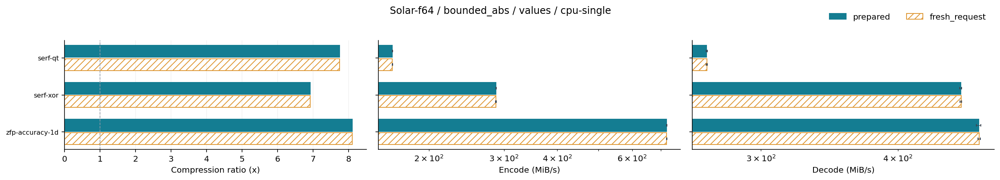

[SVG](figures/Solar-f64--bounded_abs--cpu-single.svg)

<details><summary>完整数值、有效批次及拒绝原因</summary>

| codec | 完整输出 bytes P / F | 压缩倍数 P / F | 编码 MiB/s P / F | 解码 MiB/s P / F | 有效批次 P / F |
|---|---:|---:|---:|---:|---:|
| serf-qt | 7.44e+06 / 7.44e+06 | 7.75 / 7.75 | 164 / 164 | 268 / 268 | 14/14 / 14/14 |
| serf-xor | 8.32e+06 / 8.32e+06 | 6.92 / 6.92 | 287 / 287 | 457 / 457 | 14/14 / 14/14 |
| zfp-accuracy-1d | 7.11e+06 / 7.11e+06 | 8.1 / 8.1 | 722 / 723 | 474 / 475 | 14/14 / 14/14 |

</details>

**<f8 · [52560, 137] · 经验质量（无最大误差保证） · values · cpu-single**

运行进程 CPU 亲和性（P / F）：`[(0, 1, 2, 3, 4, 5, 6, 7, 8, 9, 10, 11, 12, 13, 14, 15)]` / `[(0, 1, 2, 3, 4, 5, 6, 7, 8, 9, 10, 11, 12, 13, 14, 15)]`；逐配置创建时间见 CSV，是否处于并行窗口见调度记录。

<details><summary>完整数值、有效批次及拒绝原因</summary>

| codec | 完整输出 bytes P / F | 压缩倍数 P / F | 编码 MiB/s P / F | 解码 MiB/s P / F | 有效批次 P / F |
|---|---:|---:|---:|---:|---:|
| abba | — / — | — / — | — / — | — / — | 0/0 / 0/0 |
| cameo | — / — | — / — | — / — | — / — | 0/0 / 0/0 |
| dft | — / — | — / — | — / — | — / — | 0/0 / 0/0 |
| dwt-dct-ii | — / — | — / — | — / — | — / — | 0/0 / 0/0 |
| fabba | — / — | — / — | — / — | — / — | 0/0 / 0/0 |
| pip | — / — | — / — | — / — | — / — | 0/0 / 0/0 |
| pmc-mean | — / — | — / — | — / — | — / — | 0/0 / 0/0 |
| pmc-mr | — / — | — / — | — / — | — / — | 0/0 / 0/0 |
| qabba | — / — | — / — | — / — | — / — | 0/0 / 0/0 |
| sim-piece | — / — | — / — | — / — | — / — | 0/0 / 0/0 |
| swab | — / — | — / — | — / — | — / — | 0/0 / 0/0 |
| swing-connected | — / — | — / — | — / — | — / — | 0/0 / 0/0 |
| swing-filter | — / — | — / — | — / — | — / — | 0/0 / 0/0 |
| swing-filter-disjoint | — / — | — / — | — / — | — / — | 0/0 / 0/0 |
| swing-filter-disjoint-quantized / compatible | — / — | — / — | — / — | — / — | 0/0 / 0/0 |
| tp | — / — | — / — | — / — | — / — | 0/0 / 0/0 |
| vw | — / — | — / — | — / — | — / — | 0/0 / 0/0 |

拒绝或未完整完成的请求：

- `abba` / fresh_request：unsupported，abba: element limit exceeded
- `abba` / prepared：unsupported，abba: element limit exceeded
- `cameo` / fresh_request：unsupported，cameo: element limit exceeded
- `cameo` / prepared：unsupported，cameo: element limit exceeded
- `dft` / fresh_request：unsupported，dft: element limit exceeded
- `dft` / prepared：unsupported，dft: element limit exceeded
- `dwt-dct-ii` / fresh_request：unsupported，dwt-dct-ii: element limit exceeded
- `dwt-dct-ii` / prepared：unsupported，dwt-dct-ii: element limit exceeded
- `fabba` / fresh_request：unsupported，fabba: element limit exceeded
- `fabba` / prepared：unsupported，fabba: element limit exceeded
- `pip` / fresh_request：unsupported，pip: element limit exceeded
- `pip` / prepared：unsupported，pip: element limit exceeded
- `pmc-mean` / fresh_request：unsupported，pmc-mean: element limit exceeded
- `pmc-mean` / prepared：unsupported，pmc-mean: element limit exceeded
- `pmc-mr` / fresh_request：unsupported，pmc-mr: dtype must be one of ('<f4',)
- `pmc-mr` / prepared：unsupported，pmc-mr: dtype must be one of ('<f4',)
- `qabba` / fresh_request：unsupported，qabba: element limit exceeded
- `qabba` / prepared：unsupported，qabba: element limit exceeded
- `sim-piece` / fresh_request：unsupported，sim-piece: element limit exceeded
- `sim-piece` / prepared：unsupported，sim-piece: element limit exceeded
- `swab` / fresh_request：unsupported，swab: element limit exceeded
- `swab` / prepared：unsupported，swab: element limit exceeded
- `swing-connected` / fresh_request：unsupported，swing-connected: element limit exceeded
- `swing-connected` / prepared：unsupported，swing-connected: element limit exceeded
- `swing-filter` / fresh_request：unsupported，swing-filter: dtype must be one of ('<f4',)
- `swing-filter` / prepared：unsupported，swing-filter: dtype must be one of ('<f4',)
- `swing-filter-disjoint` / fresh_request：unsupported，swing-filter-disjoint: dtype must be one of ('<f4',)
- `swing-filter-disjoint` / prepared：unsupported，swing-filter-disjoint: dtype must be one of ('<f4',)
- `swing-filter-disjoint-quantized / compatible` / fresh_request：unsupported，swing-filter-disjoint-quantized: dtype must be one of ('<f4',)
- `swing-filter-disjoint-quantized / compatible` / prepared：unsupported，swing-filter-disjoint-quantized: dtype must be one of ('<f4',)
- `tp` / fresh_request：unsupported，tp: element limit exceeded
- `tp` / prepared：unsupported，tp: element limit exceeded
- `vw` / fresh_request：unsupported，vw: element limit exceeded
- `vw` / prepared：unsupported，vw: element limit exceeded

</details>

<a id="dataset-Traffic"></a>

### Traffic

**<f4 · [17544, 862] · 无损 · values · cpu-single**

运行进程 CPU 亲和性（P / F）：`[(0, 1, 2, 3, 4, 5, 6, 7, 8, 9, 10, 11, 12, 13, 14, 15)]` / `[(0, 1, 2, 3, 4, 5, 6, 7, 8, 9, 10, 11, 12, 13, 14, 15)]`；逐配置创建时间见 CSV，是否处于并行窗口见调度记录。

f64→f32 准备阶段转换的最大绝对差：**2.97546386e-08**；本组 codec 的恢复质量相对转换后的 f32 输入验证。

<details><summary>完整数值、有效批次及拒绝原因</summary>

| codec | 完整输出 bytes P / F | 压缩倍数 P / F | 编码 MiB/s P / F | 解码 MiB/s P / F | 有效批次 P / F |
|---|---:|---:|---:|---:|---:|
| chimp32 | — / — | — / — | — / — | — / — | 0/0 / 0/0 |
| chimpn32 | — / — | — / — | — / — | — / — | 0/0 / 0/0 |

拒绝或未完整完成的请求：

- `chimp32` / fresh_request：unsupported，chimp32: element limit exceeded
- `chimp32` / prepared：unsupported，chimp32: element limit exceeded
- `chimpn32` / fresh_request：unsupported，chimpn32: element limit exceeded
- `chimpn32` / prepared：unsupported，chimpn32: element limit exceeded

</details>

**<f4 · [17544, 862] · 经验质量（无最大误差保证） · values · cpu-single**

运行进程 CPU 亲和性（P / F）：`[(0, 1, 2, 3, 4, 5, 6, 7, 8, 9, 10, 11, 12, 13, 14, 15)]` / `[(0, 1, 2, 3, 4, 5, 6, 7, 8, 9, 10, 11, 12, 13, 14, 15)]`；逐配置创建时间见 CSV，是否处于并行窗口见调度记录。

f64→f32 准备阶段转换的最大绝对差：**2.97546386e-08**；本组 codec 的恢复质量相对转换后的 f32 输入验证。

<details><summary>完整数值、有效批次及拒绝原因</summary>

| codec | 完整输出 bytes P / F | 压缩倍数 P / F | 编码 MiB/s P / F | 解码 MiB/s P / F | 有效批次 P / F |
|---|---:|---:|---:|---:|---:|
| pmc-mr | — / — | — / — | — / — | — / — | 0/0 / 0/0 |
| swing-filter | — / — | — / — | — / — | — / — | 0/0 / 0/0 |
| swing-filter-disjoint | — / — | — / — | — / — | — / — | 0/0 / 0/0 |
| swing-filter-disjoint-quantized / compatible | — / — | — / — | — / — | — / — | 0/0 / 0/0 |

拒绝或未完整完成的请求：

- `pmc-mr` / fresh_request：unsupported，pmc-mr: element limit exceeded
- `pmc-mr` / prepared：unsupported，pmc-mr: element limit exceeded
- `swing-filter` / fresh_request：unsupported，swing-filter: element limit exceeded
- `swing-filter` / prepared：unsupported，swing-filter: element limit exceeded
- `swing-filter-disjoint` / fresh_request：unsupported，swing-filter-disjoint: element limit exceeded
- `swing-filter-disjoint` / prepared：unsupported，swing-filter-disjoint: element limit exceeded
- `swing-filter-disjoint-quantized / compatible` / fresh_request：unsupported，swing-filter-disjoint-quantized: element limit exceeded
- `swing-filter-disjoint-quantized / compatible` / prepared：unsupported，swing-filter-disjoint-quantized: element limit exceeded

</details>

**<f8 · [17544, 862] · 无损 · values · cpu-single**

运行进程 CPU 亲和性（P / F）：`[(0, 1, 2, 3, 4, 5, 6, 7, 8, 9, 10, 11, 12, 13, 14, 15)]` / `[(0, 1, 2, 3, 4, 5, 6, 7, 8, 9, 10, 11, 12, 13, 14, 15)]`；逐配置创建时间见 CSV，是否处于并行窗口见调度记录。

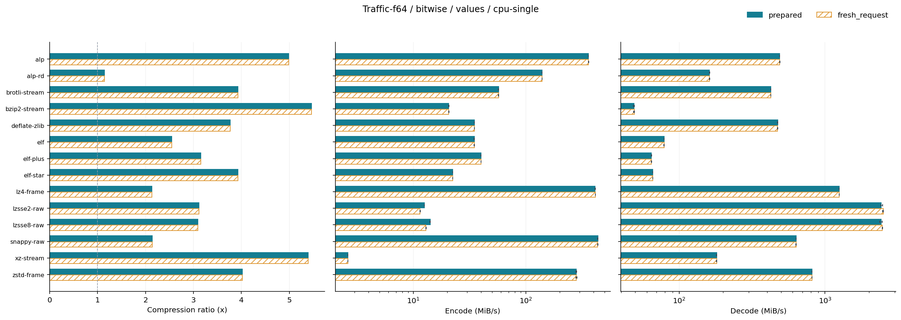

[SVG](figures/Traffic-f64--bitwise--cpu-single.svg)

<details><summary>完整数值、有效批次及拒绝原因</summary>

| codec | 完整输出 bytes P / F | 压缩倍数 P / F | 编码 MiB/s P / F | 解码 MiB/s P / F | 有效批次 P / F |
|---|---:|---:|---:|---:|---:|
| alp | 2.43e+07 / 2.43e+07 | 4.98 / 4.98 | 360 / 360 | 489 / 488 | 14/14 / 14/14 |
| alp-rd | 1.06e+08 / 1.06e+08 | 1.14 / 1.14 | 139 / 139 | 162 / 162 | 14/14 / 14/14 |
| brotli-stream | 3.08e+07 / 3.08e+07 | 3.93 / 3.93 | 57.3 / 57.2 | 426 / 426 | 14/14 / 14/14 |
| bzip2-stream | 2.21e+07 / 2.21e+07 | 5.46 / 5.46 | 20.6 / 20.6 | 49.2 / 49.2 | 14/14 / 14/14 |
| chimp | — / — | — / — | — / — | — / — | 0/0 / 0/0 |
| chimp128 | — / — | — / — | — / — | — / — | 0/0 / 0/0 |
| chimp128-no-index | — / — | — / — | — / — | — / — | 0/0 / 0/0 |
| chimp32 | — / — | — / — | — / — | — / — | 0/0 / 0/0 |
| chimpn | — / — | — / — | — / — | — / — | 0/0 / 0/0 |
| chimpn32 | — / — | — / — | — / — | — / — | 0/0 / 0/0 |
| deflate-zlib | 3.22e+07 / 3.22e+07 | 3.76 / 3.76 | 34.9 / 34.9 | 473 / 473 | 14/14 / 14/14 |
| elf | 4.74e+07 / 4.74e+07 | 2.55 / 2.55 | 34.7 / 34.7 | 78.8 / 78.7 | 14/14 / 14/14 |
| elf-plus | 3.83e+07 / 3.83e+07 | 3.16 / 3.16 | 40 / 40 | 64.6 / 64.6 | 14/14 / 14/14 |
| elf-star | 3.08e+07 / 3.08e+07 | 3.93 / 3.93 | 22.3 / 22.4 | 65.9 / 65.8 | 14/14 / 14/14 |
| fse | — / — | — / — | — / — | — / — | 0/0 / 0/0 |
| gorilla-prometheus-xor | — / — | — / — | — / — | — / — | 0/0 / 0/0 |
| huff0 | — / — | — / — | — / — | — / — | 0/0 / 0/0 |
| leats-lossless-i64 | — / — | — / — | — / — | — / — | 0/0 / 0/0 |
| lz4-frame | 5.68e+07 / 5.68e+07 | 2.13 / 2.13 | 414 / 415 | 1.25e+03 / 1.25e+03 | 14/14 / 14/14 |
| lzsse2-raw | 3.88e+07 / 3.88e+07 | 3.12 / 3.12 | 12.5 / 11.5 | 2.43e+03 / 2.51e+03 | 14/14 / 14/14 |
| lzsse8-raw | 3.91e+07 / 3.91e+07 | 3.09 / 3.09 | 14.1 / 12.9 | 2.42e+03 / 2.47e+03 | 14/14 / 14/14 |
| neats-lossless-i64 | — / — | — / — | — / — | — / — | 0/0 / 0/0 |
| self-star | — / — | — / — | — / — | — / — | 0/0 / 0/0 |
| simdcomp-u32 | — / — | — / — | — / — | — / — | 0/0 / 0/0 |
| snappy-raw | 5.66e+07 / 5.66e+07 | 2.14 / 2.14 | 436 / 436 | 635 / 634 | 14/14 / 14/14 |
| sprintz-delta | — / — | — / — | — / — | — / — | 0/0 / 0/0 |
| sprintz-delta-huffman | — / — | — / — | — / — | — / — | 0/0 / 0/0 |
| sprintz-fire | — / — | — / — | — / — | — / — | 0/0 / 0/0 |
| sprintz-fire-huffman | — / — | — / — | — / — | — / — | 0/0 / 0/0 |
| xz-stream | 2.24e+07 / 2.24e+07 | 5.39 / 5.39 | 2.61 / 2.61 | 181 / 181 | 14/14 / 14/14 |
| zstd-frame | 3.01e+07 / 3.01e+07 | 4.02 / 4.02 | 280 / 281 | 816 / 815 | 14/14 / 14/14 |

拒绝或未完整完成的请求：

- `chimp` / fresh_request：unsupported，chimp: element limit exceeded
- `chimp` / prepared：unsupported，chimp: element limit exceeded
- `chimp128` / fresh_request：unsupported，chimp128: element limit exceeded
- `chimp128` / prepared：unsupported，chimp128: element limit exceeded
- `chimp128-no-index` / fresh_request：unsupported，chimp128-no-index: element limit exceeded
- `chimp128-no-index` / prepared：unsupported，chimp128-no-index: element limit exceeded
- `chimp32` / fresh_request：unsupported，chimp32: dtype must be one of ('<f4',)
- `chimp32` / prepared：unsupported，chimp32: dtype must be one of ('<f4',)
- `chimpn` / fresh_request：unsupported，chimpn: element limit exceeded
- `chimpn` / prepared：unsupported，chimpn: element limit exceeded
- `chimpn32` / fresh_request：unsupported，chimpn32: dtype must be one of ('<f4',)
- `chimpn32` / prepared：unsupported，chimpn32: dtype must be one of ('<f4',)
- `fse` / fresh_request：unsupported，fse: n=17544 exceeds native limits
- `fse` / prepared：unsupported，fse: n=17544 exceeds native limits
- `gorilla-prometheus-xor` / fresh_request：unsupported，Gorilla requires actual paired T/V; values-only and timestamp-only are unsupported
- `gorilla-prometheus-xor` / prepared：unsupported，Gorilla requires actual paired T/V; values-only and timestamp-only are unsupported
- `huff0` / fresh_request：unsupported，huff0: n=17544 exceeds native limits
- `huff0` / prepared：unsupported，huff0: n=17544 exceeds native limits
- `leats-lossless-i64` / fresh_request：unsupported，leats-lossless-i64: dtype must be one of ('|i1', '<i2', '<i4', '<i8')
- `leats-lossless-i64` / prepared：unsupported，leats-lossless-i64: dtype must be one of ('|i1', '<i2', '<i4', '<i8')
- `neats-lossless-i64` / fresh_request：unsupported，neats-lossless-i64: dtype must be one of ('|i1', '<i2', '<i4', '<i8')
- `neats-lossless-i64` / prepared：unsupported，neats-lossless-i64: dtype must be one of ('|i1', '<i2', '<i4', '<i8')
- `self-star` / fresh_request：unsupported，SElfStar intrinsic session limits exceeded 
- `self-star` / prepared：unsupported，SElfStar intrinsic session limits exceeded 
- `simdcomp-u32` / fresh_request：unsupported，simdcomp-u32: dtype must be one of ('<u4',)
- `simdcomp-u32` / prepared：unsupported，simdcomp-u32: dtype must be one of ('<u4',)
- `sprintz-delta` / fresh_request：unsupported，sprintz-delta: dtype must be one of ('|u1', '|i1', '<u2', '<i2')
- `sprintz-delta` / prepared：unsupported，sprintz-delta: dtype must be one of ('|u1', '|i1', '<u2', '<i2')
- `sprintz-delta-huffman` / fresh_request：unsupported，sprintz-delta-huffman: dtype must be one of ('|u1', '|i1', '<u2', '<i2')
- `sprintz-delta-huffman` / prepared：unsupported，sprintz-delta-huffman: dtype must be one of ('|u1', '|i1', '<u2', '<i2')
- `sprintz-fire` / fresh_request：unsupported，sprintz-fire: dtype must be one of ('|u1', '|i1', '<u2', '<i2')
- `sprintz-fire` / prepared：unsupported，sprintz-fire: dtype must be one of ('|u1', '|i1', '<u2', '<i2')
- `sprintz-fire-huffman` / fresh_request：unsupported，sprintz-fire-huffman: dtype must be one of ('|u1', '|i1', '<u2', '<i2')
- `sprintz-fire-huffman` / prepared：unsupported，sprintz-fire-huffman: dtype must be one of ('|u1', '|i1', '<u2', '<i2')

</details>

**<f8 · [17544, 862] · ABS ≤ 0.01 · values · cpu-single**

运行进程 CPU 亲和性（P / F）：`[(0, 1, 2, 3, 4, 5, 6, 7, 8, 9, 10, 11, 12, 13, 14, 15)]` / `[(0, 1, 2, 3, 4, 5, 6, 7, 8, 9, 10, 11, 12, 13, 14, 15)]`；逐配置创建时间见 CSV，是否处于并行窗口见调度记录。

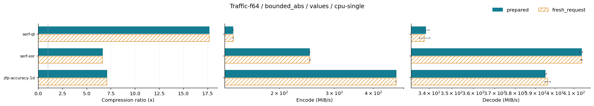

[SVG](figures/Traffic-f64--bounded_abs--cpu-single.svg)

<details><summary>完整数值、有效批次及拒绝原因</summary>

| codec | 完整输出 bytes P / F | 压缩倍数 P / F | 编码 MiB/s P / F | 解码 MiB/s P / F | 有效批次 P / F |
|---|---:|---:|---:|---:|---:|
| serf-qt | 6.85e+06 / 6.85e+06 | 17.7 / 17.7 | 142 / 142 | 338 / 338 | 14/14 / 14/14 |
| serf-xor | 1.82e+07 / 1.82e+07 | 6.64 / 6.64 | 250 / 251 | 414 / 414 | 14/14 / 14/14 |
| zfp-accuracy-1d | 1.71e+07 / 1.71e+07 | 7.09 / 7.09 | 474 / 473 | 395 / 396 | 14/14 / 14/14 |

</details>

**<f8 · [17544, 862] · 经验质量（无最大误差保证） · values · cpu-single**

运行进程 CPU 亲和性（P / F）：`[(0, 1, 2, 3, 4, 5, 6, 7, 8, 9, 10, 11, 12, 13, 14, 15)]` / `[(0, 1, 2, 3, 4, 5, 6, 7, 8, 9, 10, 11, 12, 13, 14, 15)]`；逐配置创建时间见 CSV，是否处于并行窗口见调度记录。

<details><summary>完整数值、有效批次及拒绝原因</summary>

| codec | 完整输出 bytes P / F | 压缩倍数 P / F | 编码 MiB/s P / F | 解码 MiB/s P / F | 有效批次 P / F |
|---|---:|---:|---:|---:|---:|
| abba | — / — | — / — | — / — | — / — | 0/0 / 0/0 |
| cameo | — / — | — / — | — / — | — / — | 0/0 / 0/0 |
| dft | — / — | — / — | — / — | — / — | 0/0 / 0/0 |
| dwt-dct-ii | — / — | — / — | — / — | — / — | 0/0 / 0/0 |
| fabba | — / — | — / — | — / — | — / — | 0/0 / 0/0 |
| pip | — / — | — / — | — / — | — / — | 0/0 / 0/0 |
| pmc-mean | — / — | — / — | — / — | — / — | 0/0 / 0/0 |
| pmc-mr | — / — | — / — | — / — | — / — | 0/0 / 0/0 |
| qabba | — / — | — / — | — / — | — / — | 0/0 / 0/0 |
| sim-piece | — / — | — / — | — / — | — / — | 0/0 / 0/0 |
| swab | — / — | — / — | — / — | — / — | 0/0 / 0/0 |
| swing-connected | — / — | — / — | — / — | — / — | 0/0 / 0/0 |
| swing-filter | — / — | — / — | — / — | — / — | 0/0 / 0/0 |
| swing-filter-disjoint | — / — | — / — | — / — | — / — | 0/0 / 0/0 |
| swing-filter-disjoint-quantized / compatible | — / — | — / — | — / — | — / — | 0/0 / 0/0 |
| tp | — / — | — / — | — / — | — / — | 0/0 / 0/0 |
| vw | — / — | — / — | — / — | — / — | 0/0 / 0/0 |

拒绝或未完整完成的请求：

- `abba` / fresh_request：unsupported，abba: element limit exceeded
- `abba` / prepared：unsupported，abba: element limit exceeded
- `cameo` / fresh_request：unsupported，cameo: element limit exceeded
- `cameo` / prepared：unsupported，cameo: element limit exceeded
- `dft` / fresh_request：unsupported，dft: element limit exceeded
- `dft` / prepared：unsupported，dft: element limit exceeded
- `dwt-dct-ii` / fresh_request：unsupported，dwt-dct-ii: element limit exceeded
- `dwt-dct-ii` / prepared：unsupported，dwt-dct-ii: element limit exceeded
- `fabba` / fresh_request：unsupported，fabba: element limit exceeded
- `fabba` / prepared：unsupported，fabba: element limit exceeded
- `pip` / fresh_request：unsupported，pip: element limit exceeded
- `pip` / prepared：unsupported，pip: element limit exceeded
- `pmc-mean` / fresh_request：unsupported，pmc-mean: element limit exceeded
- `pmc-mean` / prepared：unsupported，pmc-mean: element limit exceeded
- `pmc-mr` / fresh_request：unsupported，pmc-mr: dtype must be one of ('<f4',)
- `pmc-mr` / prepared：unsupported，pmc-mr: dtype must be one of ('<f4',)
- `qabba` / fresh_request：unsupported，qabba: element limit exceeded
- `qabba` / prepared：unsupported，qabba: element limit exceeded
- `sim-piece` / fresh_request：unsupported，sim-piece: element limit exceeded
- `sim-piece` / prepared：unsupported，sim-piece: element limit exceeded
- `swab` / fresh_request：unsupported，swab: element limit exceeded
- `swab` / prepared：unsupported，swab: element limit exceeded
- `swing-connected` / fresh_request：unsupported，swing-connected: element limit exceeded
- `swing-connected` / prepared：unsupported，swing-connected: element limit exceeded
- `swing-filter` / fresh_request：unsupported，swing-filter: dtype must be one of ('<f4',)
- `swing-filter` / prepared：unsupported，swing-filter: dtype must be one of ('<f4',)
- `swing-filter-disjoint` / fresh_request：unsupported，swing-filter-disjoint: dtype must be one of ('<f4',)
- `swing-filter-disjoint` / prepared：unsupported，swing-filter-disjoint: dtype must be one of ('<f4',)
- `swing-filter-disjoint-quantized / compatible` / fresh_request：unsupported，swing-filter-disjoint-quantized: dtype must be one of ('<f4',)
- `swing-filter-disjoint-quantized / compatible` / prepared：unsupported，swing-filter-disjoint-quantized: dtype must be one of ('<f4',)
- `tp` / fresh_request：unsupported，tp: element limit exceeded
- `tp` / prepared：unsupported，tp: element limit exceeded
- `vw` / fresh_request：unsupported，vw: element limit exceeded
- `vw` / prepared：unsupported，vw: element limit exceeded

</details>

<a id="dataset-Weather"></a>

### Weather

**<f4 · [52696, 21] · 无损 · values · cpu-single**

运行进程 CPU 亲和性（P / F）：`[(0, 1, 2, 3, 4, 5, 6, 7, 8, 9, 10, 11, 12, 13, 14, 15)]` / `[(0, 1, 2, 3, 4, 5, 6, 7, 8, 9, 10, 11, 12, 13, 14, 15)]`；逐配置创建时间见 CSV，是否处于并行窗口见调度记录。

f64→f32 准备阶段转换的最大绝对差：**0.0001171875**；本组 codec 的恢复质量相对转换后的 f32 输入验证。

<details><summary>完整数值、有效批次及拒绝原因</summary>

| codec | 完整输出 bytes P / F | 压缩倍数 P / F | 编码 MiB/s P / F | 解码 MiB/s P / F | 有效批次 P / F |
|---|---:|---:|---:|---:|---:|
| chimp32 | — / — | — / — | — / — | — / — | 0/0 / 0/0 |
| chimpn32 | — / — | — / — | — / — | — / — | 0/0 / 0/0 |

拒绝或未完整完成的请求：

- `chimp32` / fresh_request：unsupported，chimp32: element limit exceeded
- `chimp32` / prepared：unsupported，chimp32: element limit exceeded
- `chimpn32` / fresh_request：unsupported，chimpn32: element limit exceeded
- `chimpn32` / prepared：unsupported，chimpn32: element limit exceeded

</details>

**<f4 · [52696, 21] · 经验质量（无最大误差保证） · values · cpu-single**

运行进程 CPU 亲和性（P / F）：`[(0, 1, 2, 3, 4, 5, 6, 7, 8, 9, 10, 11, 12, 13, 14, 15)]` / `[(0, 1, 2, 3, 4, 5, 6, 7, 8, 9, 10, 11, 12, 13, 14, 15)]`；逐配置创建时间见 CSV，是否处于并行窗口见调度记录。

f64→f32 准备阶段转换的最大绝对差：**0.0001171875**；本组 codec 的恢复质量相对转换后的 f32 输入验证。

<details><summary>完整数值、有效批次及拒绝原因</summary>

| codec | 完整输出 bytes P / F | 压缩倍数 P / F | 编码 MiB/s P / F | 解码 MiB/s P / F | 有效批次 P / F |
|---|---:|---:|---:|---:|---:|
| pmc-mr | — / — | — / — | — / — | — / — | 0/0 / 0/0 |
| swing-filter | — / — | — / — | — / — | — / — | 0/0 / 0/0 |
| swing-filter-disjoint | — / — | — / — | — / — | — / — | 0/0 / 0/0 |
| swing-filter-disjoint-quantized / compatible | — / — | — / — | — / — | — / — | 0/0 / 0/0 |

拒绝或未完整完成的请求：

- `pmc-mr` / fresh_request：unsupported，pmc-mr: element limit exceeded
- `pmc-mr` / prepared：unsupported，pmc-mr: element limit exceeded
- `swing-filter` / fresh_request：unsupported，swing-filter: element limit exceeded
- `swing-filter` / prepared：unsupported，swing-filter: element limit exceeded
- `swing-filter-disjoint` / fresh_request：unsupported，swing-filter-disjoint: element limit exceeded
- `swing-filter-disjoint` / prepared：unsupported，swing-filter-disjoint: element limit exceeded
- `swing-filter-disjoint-quantized / compatible` / fresh_request：unsupported，swing-filter-disjoint-quantized: element limit exceeded
- `swing-filter-disjoint-quantized / compatible` / prepared：unsupported，swing-filter-disjoint-quantized: element limit exceeded

</details>

**<f8 · [52696, 21] · 无损 · values · cpu-single**

运行进程 CPU 亲和性（P / F）：`[(0, 1, 2, 3, 4, 5, 6, 7, 8, 9, 10, 11, 12, 13, 14, 15)]` / `[(0, 1, 2, 3, 4, 5, 6, 7, 8, 9, 10, 11, 12, 13, 14, 15)]`；逐配置创建时间见 CSV，是否处于并行窗口见调度记录。


[SVG](figures/Weather-f64--bitwise--cpu-single.svg)

<details><summary>完整数值、有效批次及拒绝原因</summary>

| codec | 完整输出 bytes P / F | 压缩倍数 P / F | 编码 MiB/s P / F | 解码 MiB/s P / F | 有效批次 P / F |
|---|---:|---:|---:|---:|---:|
| alp | 2.42e+06 / 2.42e+06 | 3.66 / 3.66 | 304 / 304 | 440 / 439 | 14/14 / 14/14 |
| alp-rd | 7.83e+06 / 7.83e+06 | 1.13 / 1.13 | 140 / 140 | 167 / 173 | 14/14 / 14/14 |
| brotli-stream | 2.63e+06 / 2.63e+06 | 3.37 / 3.37 | 44.6 / 44.1 | 373 / 405 | 14/14 / 14/14 |
| bzip2-stream | 1.76e+06 / 1.76e+06 | 5.02 / 5.02 | 22.1 / 22.1 | 47.6 / 47.4 | 14/14 / 14/14 |
| chimp | — / — | — / — | — / — | — / — | 0/0 / 0/0 |
| chimp128 | — / — | — / — | — / — | — / — | 0/0 / 0/0 |
| chimp128-no-index | — / — | — / — | — / — | — / — | 0/0 / 0/0 |
| chimp32 | — / — | — / — | — / — | — / — | 0/0 / 0/0 |
| chimpn | — / — | — / — | — / — | — / — | 0/0 / 0/0 |
| chimpn32 | — / — | — / — | — / — | — / — | 0/0 / 0/0 |
| deflate-zlib | 2.67e+06 / 2.67e+06 | 3.32 / 3.32 | 16.4 / 16.4 | 342 / 343 | 14/14 / 14/14 |
| elf | 4.06e+06 / 4.06e+06 | 2.18 / 2.18 | 45.9 / 45.9 | 77.5 / 77.5 | 14/14 / 14/14 |
| elf-plus | 3.94e+06 / 3.94e+06 | 2.24 / 2.24 | 42.4 / 42.4 | 68.5 / 68.6 | 14/14 / 14/14 |
| elf-star | 3.4e+06 / 3.4e+06 | 2.6 / 2.6 | 24.4 / 24.4 | 67.1 / 67.1 | 14/14 / 14/14 |
| fse | — / — | — / — | — / — | — / — | 0/0 / 0/0 |
| gorilla-prometheus-xor | — / — | — / — | — / — | — / — | 0/0 / 0/0 |
| huff0 | — / — | — / — | — / — | — / — | 0/0 / 0/0 |
| leats-lossless-i64 | — / — | — / — | — / — | — / — | 0/0 / 0/0 |
| lz4-frame | 4.08e+06 / 4.08e+06 | 2.17 / 2.17 | 477 / 477 | 1.21e+03 / 1.22e+03 | 14/14 / 14/14 |
| lzsse2-raw | 2.78e+06 / 2.78e+06 | 3.18 / 3.18 | 7.51 / 7.11 | 2.32e+03 / 2.44e+03 | 14/14 / 14/14 |
| lzsse8-raw | 2.82e+06 / 2.82e+06 | 3.14 / 3.14 | 8.54 / 8.03 | 2.28e+03 / 2.37e+03 | 14/14 / 14/14 |
| neats-lossless-i64 | — / — | — / — | — / — | — / — | 0/0 / 0/0 |
| self-star | — / — | — / — | — / — | — / — | 0/0 / 0/0 |
| simdcomp-u32 | — / — | — / — | — / — | — / — | 0/0 / 0/0 |
| snappy-raw | 4.06e+06 / 4.06e+06 | 2.18 / 2.18 | 389 / 389 | 653 / 653 | 14/14 / 14/14 |
| sprintz-delta | — / — | — / — | — / — | — / — | 0/0 / 0/0 |
| sprintz-delta-huffman | — / — | — / — | — / — | — / — | 0/0 / 0/0 |
| sprintz-fire | — / — | — / — | — / — | — / — | 0/0 / 0/0 |
| sprintz-fire-huffman | — / — | — / — | — / — | — / — | 0/0 / 0/0 |
| xz-stream | 1.8e+06 / 1.8e+06 | 4.91 / 4.91 | 2.57 / 2.57 | 149 / 151 | 14/14 / 14/14 |
| zstd-frame | 2.7e+06 / 2.7e+06 | 3.28 / 3.28 | 246 / 245 | 868 / 866 | 14/14 / 14/14 |

拒绝或未完整完成的请求：

- `chimp` / fresh_request：unsupported，chimp: element limit exceeded
- `chimp` / prepared：unsupported，chimp: element limit exceeded
- `chimp128` / fresh_request：unsupported，chimp128: element limit exceeded
- `chimp128` / prepared：unsupported，chimp128: element limit exceeded
- `chimp128-no-index` / fresh_request：unsupported，chimp128-no-index: element limit exceeded
- `chimp128-no-index` / prepared：unsupported，chimp128-no-index: element limit exceeded
- `chimp32` / fresh_request：unsupported，chimp32: dtype must be one of ('<f4',)
- `chimp32` / prepared：unsupported，chimp32: dtype must be one of ('<f4',)
- `chimpn` / fresh_request：unsupported，chimpn: element limit exceeded
- `chimpn` / prepared：unsupported，chimpn: element limit exceeded
- `chimpn32` / fresh_request：unsupported，chimpn32: dtype must be one of ('<f4',)
- `chimpn32` / prepared：unsupported，chimpn32: dtype must be one of ('<f4',)
- `fse` / fresh_request：unsupported，fse: n=52696 exceeds native limits
- `fse` / prepared：unsupported，fse: n=52696 exceeds native limits
- `gorilla-prometheus-xor` / fresh_request：unsupported，Gorilla requires actual paired T/V; values-only and timestamp-only are unsupported
- `gorilla-prometheus-xor` / prepared：unsupported，Gorilla requires actual paired T/V; values-only and timestamp-only are unsupported
- `huff0` / fresh_request：unsupported，huff0: n=52696 exceeds native limits
- `huff0` / prepared：unsupported，huff0: n=52696 exceeds native limits
- `leats-lossless-i64` / fresh_request：unsupported，leats-lossless-i64: dtype must be one of ('|i1', '<i2', '<i4', '<i8')
- `leats-lossless-i64` / prepared：unsupported，leats-lossless-i64: dtype must be one of ('|i1', '<i2', '<i4', '<i8')
- `neats-lossless-i64` / fresh_request：unsupported，neats-lossless-i64: dtype must be one of ('|i1', '<i2', '<i4', '<i8')
- `neats-lossless-i64` / prepared：unsupported，neats-lossless-i64: dtype must be one of ('|i1', '<i2', '<i4', '<i8')
- `self-star` / fresh_request：unsupported，SElfStar intrinsic session limits exceeded 
- `self-star` / prepared：unsupported，SElfStar intrinsic session limits exceeded 
- `simdcomp-u32` / fresh_request：unsupported，simdcomp-u32: dtype must be one of ('<u4',)
- `simdcomp-u32` / prepared：unsupported，simdcomp-u32: dtype must be one of ('<u4',)
- `sprintz-delta` / fresh_request：unsupported，sprintz-delta: dtype must be one of ('|u1', '|i1', '<u2', '<i2')
- `sprintz-delta` / prepared：unsupported，sprintz-delta: dtype must be one of ('|u1', '|i1', '<u2', '<i2')
- `sprintz-delta-huffman` / fresh_request：unsupported，sprintz-delta-huffman: dtype must be one of ('|u1', '|i1', '<u2', '<i2')
- `sprintz-delta-huffman` / prepared：unsupported，sprintz-delta-huffman: dtype must be one of ('|u1', '|i1', '<u2', '<i2')
- `sprintz-fire` / fresh_request：unsupported，sprintz-fire: dtype must be one of ('|u1', '|i1', '<u2', '<i2')
- `sprintz-fire` / prepared：unsupported，sprintz-fire: dtype must be one of ('|u1', '|i1', '<u2', '<i2')
- `sprintz-fire-huffman` / fresh_request：unsupported，sprintz-fire-huffman: dtype must be one of ('|u1', '|i1', '<u2', '<i2')
- `sprintz-fire-huffman` / prepared：unsupported，sprintz-fire-huffman: dtype must be one of ('|u1', '|i1', '<u2', '<i2')

</details>

**<f8 · [52696, 21] · ABS ≤ 0.01 · values · cpu-single**

运行进程 CPU 亲和性（P / F）：`[(0, 1, 2, 3, 4, 5, 6, 7, 8, 9, 10, 11, 12, 13, 14, 15)]` / `[(0, 1, 2, 3, 4, 5, 6, 7, 8, 9, 10, 11, 12, 13, 14, 15)]`；逐配置创建时间见 CSV，是否处于并行窗口见调度记录。


[SVG](figures/Weather-f64--bounded_abs--cpu-single.svg)

<details><summary>完整数值、有效批次及拒绝原因</summary>

| codec | 完整输出 bytes P / F | 压缩倍数 P / F | 编码 MiB/s P / F | 解码 MiB/s P / F | 有效批次 P / F |
|---|---:|---:|---:|---:|---:|
| serf-qt | 3.42e+06 / 3.42e+06 | 2.59 / 2.59 | 143 / 142 | 116 / 118 | 14/14 / 14/14 |
| serf-xor | 3.56e+06 / 3.56e+06 | 2.49 / 2.49 | 154 / 154 | 291 / 308 | 14/14 / 14/14 |
| zfp-accuracy-1d | 2.99e+06 / 2.99e+06 | 2.96 / 2.96 | 375 / 375 | 202 / 201 | 14/14 / 14/14 |

</details>

**<f8 · [52696, 21] · 经验质量（无最大误差保证） · values · cpu-single**

运行进程 CPU 亲和性（P / F）：`[(0, 1, 2, 3, 4, 5, 6, 7, 8, 9, 10, 11, 12, 13, 14, 15)]` / `[(0, 1, 2, 3, 4, 5, 6, 7, 8, 9, 10, 11, 12, 13, 14, 15)]`；逐配置创建时间见 CSV，是否处于并行窗口见调度记录。

<details><summary>完整数值、有效批次及拒绝原因</summary>

| codec | 完整输出 bytes P / F | 压缩倍数 P / F | 编码 MiB/s P / F | 解码 MiB/s P / F | 有效批次 P / F |
|---|---:|---:|---:|---:|---:|
| abba | — / — | — / — | — / — | — / — | 0/0 / 0/0 |
| cameo | — / — | — / — | — / — | — / — | 0/0 / 0/0 |
| dft | — / — | — / — | — / — | — / — | 0/0 / 0/0 |
| dwt-dct-ii | — / — | — / — | — / — | — / — | 0/0 / 0/0 |
| fabba | — / — | — / — | — / — | — / — | 0/0 / 0/0 |
| pip | — / — | — / — | — / — | — / — | 0/0 / 0/0 |
| pmc-mean | — / — | — / — | — / — | — / — | 0/0 / 0/0 |
| pmc-mr | — / — | — / — | — / — | — / — | 0/0 / 0/0 |
| qabba | — / — | — / — | — / — | — / — | 0/0 / 0/0 |
| sim-piece | — / — | — / — | — / — | — / — | 0/0 / 0/0 |
| swab | — / — | — / — | — / — | — / — | 0/0 / 0/0 |
| swing-connected | — / — | — / — | — / — | — / — | 0/0 / 0/0 |
| swing-filter | — / — | — / — | — / — | — / — | 0/0 / 0/0 |
| swing-filter-disjoint | — / — | — / — | — / — | — / — | 0/0 / 0/0 |
| swing-filter-disjoint-quantized / compatible | — / — | — / — | — / — | — / — | 0/0 / 0/0 |
| tp | — / — | — / — | — / — | — / — | 0/0 / 0/0 |
| vw | — / — | — / — | — / — | — / — | 0/0 / 0/0 |

拒绝或未完整完成的请求：

- `abba` / fresh_request：unsupported，abba: element limit exceeded
- `abba` / prepared：unsupported，abba: element limit exceeded
- `cameo` / fresh_request：unsupported，cameo: element limit exceeded
- `cameo` / prepared：unsupported，cameo: element limit exceeded
- `dft` / fresh_request：unsupported，dft: element limit exceeded
- `dft` / prepared：unsupported，dft: element limit exceeded
- `dwt-dct-ii` / fresh_request：unsupported，dwt-dct-ii: element limit exceeded
- `dwt-dct-ii` / prepared：unsupported，dwt-dct-ii: element limit exceeded
- `fabba` / fresh_request：unsupported，fabba: element limit exceeded
- `fabba` / prepared：unsupported，fabba: element limit exceeded
- `pip` / fresh_request：unsupported，pip: element limit exceeded
- `pip` / prepared：unsupported，pip: element limit exceeded
- `pmc-mean` / fresh_request：unsupported，pmc-mean: element limit exceeded
- `pmc-mean` / prepared：unsupported，pmc-mean: element limit exceeded
- `pmc-mr` / fresh_request：unsupported，pmc-mr: dtype must be one of ('<f4',)
- `pmc-mr` / prepared：unsupported，pmc-mr: dtype must be one of ('<f4',)
- `qabba` / fresh_request：unsupported，qabba: element limit exceeded
- `qabba` / prepared：unsupported，qabba: element limit exceeded
- `sim-piece` / fresh_request：unsupported，sim-piece: element limit exceeded
- `sim-piece` / prepared：unsupported，sim-piece: element limit exceeded
- `swab` / fresh_request：unsupported，swab: element limit exceeded
- `swab` / prepared：unsupported，swab: element limit exceeded
- `swing-connected` / fresh_request：unsupported，swing-connected: element limit exceeded
- `swing-connected` / prepared：unsupported，swing-connected: element limit exceeded
- `swing-filter` / fresh_request：unsupported，swing-filter: dtype must be one of ('<f4',)
- `swing-filter` / prepared：unsupported，swing-filter: dtype must be one of ('<f4',)
- `swing-filter-disjoint` / fresh_request：unsupported，swing-filter-disjoint: dtype must be one of ('<f4',)
- `swing-filter-disjoint` / prepared：unsupported，swing-filter-disjoint: dtype must be one of ('<f4',)
- `swing-filter-disjoint-quantized / compatible` / fresh_request：unsupported，swing-filter-disjoint-quantized: dtype must be one of ('<f4',)
- `swing-filter-disjoint-quantized / compatible` / prepared：unsupported，swing-filter-disjoint-quantized: dtype must be one of ('<f4',)
- `tp` / fresh_request：unsupported，tp: element limit exceeded
- `tp` / prepared：unsupported，tp: element limit exceeded
- `vw` / fresh_request：unsupported，vw: element limit exceeded
- `vw` / prepared：unsupported，vw: element limit exceeded

</details>

<a id="dataset-Wike2000"></a>

### Wike2000

**<f4 · [792, 2000] · 无损 · values · cpu-single**

运行进程 CPU 亲和性（P / F）：`[(0, 1, 2, 3, 4, 5, 6, 7, 8, 9, 10, 11, 12, 13, 14, 15)]` / `[(0, 1, 2, 3, 4, 5, 6, 7, 8, 9, 10, 11, 12, 13, 14, 15)]`；逐配置创建时间见 CSV，是否处于并行窗口见调度记录。

f64→f32 准备阶段转换的最大绝对差：**0**；本组 codec 的恢复质量相对转换后的 f32 输入验证。

<details><summary>完整数值、有效批次及拒绝原因</summary>

| codec | 完整输出 bytes P / F | 压缩倍数 P / F | 编码 MiB/s P / F | 解码 MiB/s P / F | 有效批次 P / F |
|---|---:|---:|---:|---:|---:|
| chimp32 | — / — | — / — | — / — | — / — | 0/0 / 0/0 |
| chimpn32 | — / — | — / — | — / — | — / — | 0/0 / 0/0 |

拒绝或未完整完成的请求：

- `chimp32` / fresh_request：unsupported，chimp32: element limit exceeded
- `chimp32` / prepared：unsupported，chimp32: element limit exceeded
- `chimpn32` / fresh_request：unsupported，chimpn32: element limit exceeded
- `chimpn32` / prepared：unsupported，chimpn32: element limit exceeded

</details>

**<f4 · [792, 2000] · 经验质量（无最大误差保证） · values · cpu-single**

运行进程 CPU 亲和性（P / F）：`[(0, 1, 2, 3, 4, 5, 6, 7, 8, 9, 10, 11, 12, 13, 14, 15)]` / `[(0, 1, 2, 3, 4, 5, 6, 7, 8, 9, 10, 11, 12, 13, 14, 15)]`；逐配置创建时间见 CSV，是否处于并行窗口见调度记录。

f64→f32 准备阶段转换的最大绝对差：**0**；本组 codec 的恢复质量相对转换后的 f32 输入验证。

<details><summary>完整数值、有效批次及拒绝原因</summary>

| codec | 完整输出 bytes P / F | 压缩倍数 P / F | 编码 MiB/s P / F | 解码 MiB/s P / F | 有效批次 P / F |
|---|---:|---:|---:|---:|---:|
| pmc-mr | — / — | — / — | — / — | — / — | 0/0 / 0/0 |
| swing-filter | — / — | — / — | — / — | — / — | 0/0 / 0/0 |
| swing-filter-disjoint | — / — | — / — | — / — | — / — | 0/0 / 0/0 |
| swing-filter-disjoint-quantized / compatible | — / — | — / — | — / — | — / — | 0/0 / 0/0 |

拒绝或未完整完成的请求：

- `pmc-mr` / fresh_request：unsupported，pmc-mr: element limit exceeded
- `pmc-mr` / prepared：unsupported，pmc-mr: element limit exceeded
- `swing-filter` / fresh_request：unsupported，swing-filter: element limit exceeded
- `swing-filter` / prepared：unsupported，swing-filter: element limit exceeded
- `swing-filter-disjoint` / fresh_request：unsupported，swing-filter-disjoint: element limit exceeded
- `swing-filter-disjoint` / prepared：unsupported，swing-filter-disjoint: element limit exceeded
- `swing-filter-disjoint-quantized / compatible` / fresh_request：unsupported，swing-filter-disjoint-quantized: element limit exceeded
- `swing-filter-disjoint-quantized / compatible` / prepared：unsupported，swing-filter-disjoint-quantized: element limit exceeded

</details>

**<f8 · [792, 2000] · 无损 · values · cpu-single**

运行进程 CPU 亲和性（P / F）：`[(0, 1, 2, 3, 4, 5, 6, 7, 8, 9, 10, 11, 12, 13, 14, 15)]` / `[(0, 1, 2, 3, 4, 5, 6, 7, 8, 9, 10, 11, 12, 13, 14, 15)]`；逐配置创建时间见 CSV，是否处于并行窗口见调度记录。


[SVG](figures/Wike2000-f64--bitwise--cpu-single.svg)

<details><summary>完整数值、有效批次及拒绝原因</summary>

| codec | 完整输出 bytes P / F | 压缩倍数 P / F | 编码 MiB/s P / F | 解码 MiB/s P / F | 有效批次 P / F |
|---|---:|---:|---:|---:|---:|
| alp | 3.31e+06 / 3.31e+06 | 3.83 / 3.83 | 318 / 318 | 443 / 447 | 14/14 / 14/14 |
| alp-rd | 1.1e+07 / 1.1e+07 | 1.15 / 1.15 | 145 / 145 | 169 / 177 | 14/14 / 14/14 |
| brotli-stream | 3.78e+06 / 3.78e+06 | 3.35 / 3.35 | 47.3 / 47.3 | 366 / 379 | 14/14 / 14/14 |
| bzip2-stream | 2.75e+06 / 2.75e+06 | 4.61 / 4.61 | 24.1 / 24.2 | 45.1 / 44.7 | 14/14 / 14/14 |
| chimp | — / — | — / — | — / — | — / — | 0/0 / 0/0 |
| chimp128 | — / — | — / — | — / — | — / — | 0/0 / 0/0 |
| chimp128-no-index | — / — | — / — | — / — | — / — | 0/0 / 0/0 |
| chimp32 | — / — | — / — | — / — | — / — | 0/0 / 0/0 |
| chimpn | — / — | — / — | — / — | — / — | 0/0 / 0/0 |
| chimpn32 | — / — | — / — | — / — | — / — | 0/0 / 0/0 |
| deflate-zlib | 3.99e+06 / 3.99e+06 | 3.18 / 3.18 | 17.3 / 17.3 | 368 / 368 | 14/14 / 14/14 |
| elf | 4.09e+06 / 4.09e+06 | 3.1 / 3.1 | 56.4 / 56.4 | 155 / 156 | 14/14 / 14/14 |
| elf-plus | 4.19e+06 / 4.19e+06 | 3.03 / 3.03 | 36.2 / 36.2 | 154 / 154 | 14/14 / 14/14 |
| elf-star | 3.55e+06 / 3.55e+06 | 3.57 / 3.57 | 27.4 / 27.5 | 168 / 168 | 14/14 / 14/14 |
| fse | — / — | — / — | — / — | — / — | 0/0 / 0/0 |
| gorilla-prometheus-xor | — / — | — / — | — / — | — / — | 0/0 / 0/0 |
| huff0 | — / — | — / — | — / — | — / — | 0/0 / 0/0 |
| leats-lossless-i64 | — / — | — / — | — / — | — / — | 0/0 / 0/0 |
| lz4-frame | 5.92e+06 / 5.92e+06 | 2.14 / 2.14 | 486 / 486 | 1.24e+03 / 1.24e+03 | 14/14 / 14/14 |
| lzsse2-raw | 4.12e+06 / 4.12e+06 | 3.08 / 3.08 | 6.26 / 5.96 | 2.37e+03 / 2.46e+03 | 14/14 / 14/14 |
| lzsse8-raw | 4.2e+06 / 4.2e+06 | 3.01 / 3.01 | 7.31 / 6.94 | 2.25e+03 / 2.36e+03 | 14/14 / 14/14 |
| neats-lossless-i64 | — / — | — / — | — / — | — / — | 0/0 / 0/0 |
| self-star | — / — | — / — | — / — | — / — | 0/0 / 0/0 |
| simdcomp-u32 | — / — | — / — | — / — | — / — | 0/0 / 0/0 |
| snappy-raw | 5.84e+06 / 5.84e+06 | 2.17 / 2.17 | 411 / 411 | 619 / 618 | 14/14 / 14/14 |
| sprintz-delta | — / — | — / — | — / — | — / — | 0/0 / 0/0 |
| sprintz-delta-huffman | — / — | — / — | — / — | — / — | 0/0 / 0/0 |
| sprintz-fire | — / — | — / — | — / — | — / — | 0/0 / 0/0 |
| sprintz-fire-huffman | — / — | — / — | — / — | — / — | 0/0 / 0/0 |
| xz-stream | 2.87e+06 / 2.87e+06 | 4.41 / 4.41 | 2.3 / 2.3 | 122 / 126 | 14/14 / 14/14 |
| zstd-frame | 3.75e+06 / 3.75e+06 | 3.38 / 3.38 | 248 / 246 | 815 / 814 | 14/14 / 14/14 |

拒绝或未完整完成的请求：

- `chimp` / fresh_request：unsupported，chimp: element limit exceeded
- `chimp` / prepared：unsupported，chimp: element limit exceeded
- `chimp128` / fresh_request：unsupported，chimp128: element limit exceeded
- `chimp128` / prepared：unsupported，chimp128: element limit exceeded
- `chimp128-no-index` / fresh_request：unsupported，chimp128-no-index: element limit exceeded
- `chimp128-no-index` / prepared：unsupported，chimp128-no-index: element limit exceeded
- `chimp32` / fresh_request：unsupported，chimp32: dtype must be one of ('<f4',)
- `chimp32` / prepared：unsupported，chimp32: dtype must be one of ('<f4',)
- `chimpn` / fresh_request：unsupported，chimpn: element limit exceeded
- `chimpn` / prepared：unsupported，chimpn: element limit exceeded
- `chimpn32` / fresh_request：unsupported，chimpn32: dtype must be one of ('<f4',)
- `chimpn32` / prepared：unsupported，chimpn32: dtype must be one of ('<f4',)
- `fse` / fresh_request：unsupported，fse: m=2000 exceeds native limits
- `fse` / prepared：unsupported，fse: m=2000 exceeds native limits
- `gorilla-prometheus-xor` / fresh_request：unsupported，Gorilla requires actual paired T/V; values-only and timestamp-only are unsupported
- `gorilla-prometheus-xor` / prepared：unsupported，Gorilla requires actual paired T/V; values-only and timestamp-only are unsupported
- `huff0` / fresh_request：unsupported，huff0: m=2000 exceeds native limits
- `huff0` / prepared：unsupported，huff0: m=2000 exceeds native limits
- `leats-lossless-i64` / fresh_request：unsupported，leats-lossless-i64: dtype must be one of ('|i1', '<i2', '<i4', '<i8')
- `leats-lossless-i64` / prepared：unsupported，leats-lossless-i64: dtype must be one of ('|i1', '<i2', '<i4', '<i8')
- `neats-lossless-i64` / fresh_request：unsupported，neats-lossless-i64: dtype must be one of ('|i1', '<i2', '<i4', '<i8')
- `neats-lossless-i64` / prepared：unsupported，neats-lossless-i64: dtype must be one of ('|i1', '<i2', '<i4', '<i8')
- `self-star` / fresh_request：unsupported，SElfStar intrinsic session limits exceeded 
- `self-star` / prepared：unsupported，SElfStar intrinsic session limits exceeded 
- `simdcomp-u32` / fresh_request：unsupported，simdcomp-u32: dtype must be one of ('<u4',)
- `simdcomp-u32` / prepared：unsupported，simdcomp-u32: dtype must be one of ('<u4',)
- `sprintz-delta` / fresh_request：unsupported，sprintz-delta: dtype must be one of ('|u1', '|i1', '<u2', '<i2')
- `sprintz-delta` / prepared：unsupported，sprintz-delta: dtype must be one of ('|u1', '|i1', '<u2', '<i2')
- `sprintz-delta-huffman` / fresh_request：unsupported，sprintz-delta-huffman: dtype must be one of ('|u1', '|i1', '<u2', '<i2')
- `sprintz-delta-huffman` / prepared：unsupported，sprintz-delta-huffman: dtype must be one of ('|u1', '|i1', '<u2', '<i2')
- `sprintz-fire` / fresh_request：unsupported，sprintz-fire: dtype must be one of ('|u1', '|i1', '<u2', '<i2')
- `sprintz-fire` / prepared：unsupported，sprintz-fire: dtype must be one of ('|u1', '|i1', '<u2', '<i2')
- `sprintz-fire-huffman` / fresh_request：unsupported，sprintz-fire-huffman: dtype must be one of ('|u1', '|i1', '<u2', '<i2')
- `sprintz-fire-huffman` / prepared：unsupported，sprintz-fire-huffman: dtype must be one of ('|u1', '|i1', '<u2', '<i2')

</details>

**<f8 · [792, 2000] · ABS ≤ 0.01 · values · cpu-single**

运行进程 CPU 亲和性（P / F）：`[(0, 1, 2, 3, 4, 5, 6, 7, 8, 9, 10, 11, 12, 13, 14, 15)]` / `[(0, 1, 2, 3, 4, 5, 6, 7, 8, 9, 10, 11, 12, 13, 14, 15)]`；逐配置创建时间见 CSV，是否处于并行窗口见调度记录。


[SVG](figures/Wike2000-f64--bounded_abs--cpu-single.svg)

<details><summary>完整数值、有效批次及拒绝原因</summary>

| codec | 完整输出 bytes P / F | 压缩倍数 P / F | 编码 MiB/s P / F | 解码 MiB/s P / F | 有效批次 P / F |
|---|---:|---:|---:|---:|---:|
| serf-qt | 6.79e+06 / 6.79e+06 | 1.87 / 1.87 | 135 / 134 | 91.5 / 91.5 | 14/14 / 14/14 |
| serf-xor | 3.63e+06 / 3.63e+06 | 3.49 / 3.49 | 223 / 223 | 373 / 402 | 14/14 / 14/14 |
| zfp-accuracy-1d | 5.04e+06 / 5.04e+06 | 2.51 / 2.51 | 294 / 295 | 190 / 190 | 14/14 / 14/14 |

</details>

**<f8 · [792, 2000] · 经验质量（无最大误差保证） · values · cpu-single**

运行进程 CPU 亲和性（P / F）：`[(0, 1, 2, 3, 4, 5, 6, 7, 8, 9, 10, 11, 12, 13, 14, 15)]` / `[(0, 1, 2, 3, 4, 5, 6, 7, 8, 9, 10, 11, 12, 13, 14, 15)]`；逐配置创建时间见 CSV，是否处于并行窗口见调度记录。

<details><summary>完整数值、有效批次及拒绝原因</summary>

| codec | 完整输出 bytes P / F | 压缩倍数 P / F | 编码 MiB/s P / F | 解码 MiB/s P / F | 有效批次 P / F |
|---|---:|---:|---:|---:|---:|
| abba | — / — | — / — | — / — | — / — | 0/0 / 0/0 |
| cameo | — / — | — / — | — / — | — / — | 0/0 / 0/0 |
| dft | — / — | — / — | — / — | — / — | 0/0 / 0/0 |
| dwt-dct-ii | — / — | — / — | — / — | — / — | 0/0 / 0/0 |
| fabba | — / — | — / — | — / — | — / — | 0/0 / 0/0 |
| pip | — / — | — / — | — / — | — / — | 0/0 / 0/0 |
| pmc-mean | — / — | — / — | — / — | — / — | 0/0 / 0/0 |
| pmc-mr | — / — | — / — | — / — | — / — | 0/0 / 0/0 |
| qabba | — / — | — / — | — / — | — / — | 0/0 / 0/0 |
| sim-piece | — / — | — / — | — / — | — / — | 0/0 / 0/0 |
| swab | — / — | — / — | — / — | — / — | 0/0 / 0/0 |
| swing-connected | — / — | — / — | — / — | — / — | 0/0 / 0/0 |
| swing-filter | — / — | — / — | — / — | — / — | 0/0 / 0/0 |
| swing-filter-disjoint | — / — | — / — | — / — | — / — | 0/0 / 0/0 |
| swing-filter-disjoint-quantized / compatible | — / — | — / — | — / — | — / — | 0/0 / 0/0 |
| tp | — / — | — / — | — / — | — / — | 0/0 / 0/0 |
| vw | — / — | — / — | — / — | — / — | 0/0 / 0/0 |

拒绝或未完整完成的请求：

- `abba` / fresh_request：unsupported，abba: element limit exceeded
- `abba` / prepared：unsupported，abba: element limit exceeded
- `cameo` / fresh_request：unsupported，cameo: element limit exceeded
- `cameo` / prepared：unsupported，cameo: element limit exceeded
- `dft` / fresh_request：unsupported，dft: element limit exceeded
- `dft` / prepared：unsupported，dft: element limit exceeded
- `dwt-dct-ii` / fresh_request：unsupported，dwt-dct-ii: element limit exceeded
- `dwt-dct-ii` / prepared：unsupported，dwt-dct-ii: element limit exceeded
- `fabba` / fresh_request：unsupported，fabba: element limit exceeded
- `fabba` / prepared：unsupported，fabba: element limit exceeded
- `pip` / fresh_request：unsupported，pip: element limit exceeded
- `pip` / prepared：unsupported，pip: element limit exceeded
- `pmc-mean` / fresh_request：unsupported，pmc-mean: element limit exceeded
- `pmc-mean` / prepared：unsupported，pmc-mean: element limit exceeded
- `pmc-mr` / fresh_request：unsupported，pmc-mr: dtype must be one of ('<f4',)
- `pmc-mr` / prepared：unsupported，pmc-mr: dtype must be one of ('<f4',)
- `qabba` / fresh_request：unsupported，qabba: element limit exceeded
- `qabba` / prepared：unsupported，qabba: element limit exceeded
- `sim-piece` / fresh_request：unsupported，sim-piece: element limit exceeded
- `sim-piece` / prepared：unsupported，sim-piece: element limit exceeded
- `swab` / fresh_request：unsupported，swab: element limit exceeded
- `swab` / prepared：unsupported，swab: element limit exceeded
- `swing-connected` / fresh_request：unsupported，swing-connected: element limit exceeded
- `swing-connected` / prepared：unsupported，swing-connected: element limit exceeded
- `swing-filter` / fresh_request：unsupported，swing-filter: dtype must be one of ('<f4',)
- `swing-filter` / prepared：unsupported，swing-filter: dtype must be one of ('<f4',)
- `swing-filter-disjoint` / fresh_request：unsupported，swing-filter-disjoint: dtype must be one of ('<f4',)
- `swing-filter-disjoint` / prepared：unsupported，swing-filter-disjoint: dtype must be one of ('<f4',)
- `swing-filter-disjoint-quantized / compatible` / fresh_request：unsupported，swing-filter-disjoint-quantized: dtype must be one of ('<f4',)
- `swing-filter-disjoint-quantized / compatible` / prepared：unsupported，swing-filter-disjoint-quantized: dtype must be one of ('<f4',)
- `tp` / fresh_request：unsupported，tp: element limit exceeded
- `tp` / prepared：unsupported，tp: element limit exceeded
- `vw` / fresh_request：unsupported，vw: element limit exceeded
- `vw` / prepared：unsupported，vw: element limit exceeded

</details>

**<i8 · [792, 2000] · 无损 · values · cpu-single**

运行进程 CPU 亲和性（P / F）：`[(0, 1, 2, 3, 4, 5, 6, 7, 8, 9, 10, 11, 12, 13, 14, 15)]` / `[(0, 1, 2, 3, 4, 5, 6, 7, 8, 9, 10, 11, 12, 13, 14, 15)]`；逐配置创建时间见 CSV，是否处于并行窗口见调度记录。

<details><summary>完整数值、有效批次及拒绝原因</summary>

| codec | 完整输出 bytes P / F | 压缩倍数 P / F | 编码 MiB/s P / F | 解码 MiB/s P / F | 有效批次 P / F |
|---|---:|---:|---:|---:|---:|
| leats-lossless-i64 | — / — | — / — | — / — | — / — | 0/0 / 0/0 |
| neats-lossless-i64 | — / — | — / — | — / — | — / — | 0/0 / 0/0 |

拒绝或未完整完成的请求：

- `leats-lossless-i64` / fresh_request：unsupported，leats-lossless-i64: m=2000 exceeds native limits
- `leats-lossless-i64` / prepared：unsupported，leats-lossless-i64: m=2000 exceeds native limits
- `neats-lossless-i64` / fresh_request：unsupported，neats-lossless-i64: m=2000 exceeds native limits
- `neats-lossless-i64` / prepared：unsupported，neats-lossless-i64: m=2000 exceeds native limits

</details>

**<u4 · [792, 2000] · 无损 · values · cpu-single**

运行进程 CPU 亲和性（P / F）：`[(0, 1, 2, 3, 4, 5, 6, 7, 8, 9, 10, 11, 12, 13, 14, 15)]` / `[(0, 1, 2, 3, 4, 5, 6, 7, 8, 9, 10, 11, 12, 13, 14, 15)]`；逐配置创建时间见 CSV，是否处于并行窗口见调度记录。

<details><summary>完整数值、有效批次及拒绝原因</summary>

| codec | 完整输出 bytes P / F | 压缩倍数 P / F | 编码 MiB/s P / F | 解码 MiB/s P / F | 有效批次 P / F |
|---|---:|---:|---:|---:|---:|
| simdcomp-u32 | — / — | — / — | — / — | — / — | 0/0 / 0/0 |

拒绝或未完整完成的请求：

- `simdcomp-u32` / fresh_request：unsupported，simdcomp-u32: rank must be one of (1,)
- `simdcomp-u32` / prepared：unsupported，simdcomp-u32: rank must be one of (1,)

</details>

<a id="dataset-Wind"></a>

### Wind

**<f4 · [48673, 7] · 无损 · values · cpu-single**

运行进程 CPU 亲和性（P / F）：`[(12,)]` / `[(12,)]`；逐配置创建时间见 CSV，是否处于并行窗口见调度记录。

f64→f32 准备阶段转换的最大绝对差：**3.78417968e-06**；本组 codec 的恢复质量相对转换后的 f32 输入验证。


[SVG](figures/Wind-f32--bitwise--cpu-single.svg)

<details><summary>完整数值、有效批次及拒绝原因</summary>

| codec | 完整输出 bytes P / F | 压缩倍数 P / F | 编码 MiB/s P / F | 解码 MiB/s P / F | 有效批次 P / F |
|---|---:|---:|---:|---:|---:|
| chimp32 | 1.38e+06 / 1.38e+06 | 0.989 / 0.989 | 15.9 / 15.7 | 41 / 41.1 | 14/14 / 14/14 |
| chimpn32 | 1.26e+06 / 1.26e+06 | 1.08 / 1.08 | 15.9 / 15.8 | 40.5 / 40.4 | 14/14 / 14/14 |

</details>

**<f4 · [48673, 7] · 经验质量（无最大误差保证） · values · cpu-single**

运行进程 CPU 亲和性（P / F）：`[(12,)]` / `[(12,)]`；逐配置创建时间见 CSV，是否处于并行窗口见调度记录。

f64→f32 准备阶段转换的最大绝对差：**3.78417968e-06**；本组 codec 的恢复质量相对转换后的 f32 输入验证。

<details><summary>完整数值、有效批次及拒绝原因</summary>

| codec | 完整输出 bytes P / F | 压缩倍数 P / F | 编码 MiB/s P / F | 解码 MiB/s P / F | 有效批次 P / F |
|---|---:|---:|---:|---:|---:|
| pmc-mr | — / — | — / — | — / — | — / — | 0/0 / 0/0 |
| swing-filter | — / — | — / — | — / — | — / — | 0/0 / 0/0 |
| swing-filter-disjoint | — / — | — / — | — / — | — / — | 0/0 / 0/0 |
| swing-filter-disjoint-quantized / compatible | — / — | — / — | — / — | — / — | 0/0 / 0/0 |

拒绝或未完整完成的请求：

- `pmc-mr` / fresh_request：unsupported，filter native_core requires one column; object/native_api preserve independent columns
- `pmc-mr` / prepared：unsupported，filter native_core requires one column; object/native_api preserve independent columns
- `swing-filter` / fresh_request：unsupported，filter native_core requires one column; object/native_api preserve independent columns
- `swing-filter` / prepared：unsupported，filter native_core requires one column; object/native_api preserve independent columns
- `swing-filter-disjoint` / fresh_request：unsupported，filter native_core requires one column; object/native_api preserve independent columns
- `swing-filter-disjoint` / prepared：unsupported，filter native_core requires one column; object/native_api preserve independent columns
- `swing-filter-disjoint-quantized / compatible` / fresh_request：unsupported，filter native_core requires one column; object/native_api preserve independent columns
- `swing-filter-disjoint-quantized / compatible` / prepared：unsupported，filter native_core requires one column; object/native_api preserve independent columns

</details>

**<f8 · [48673, 7] · 无损 · values · cpu-single**

运行进程 CPU 亲和性（P / F）：`[(12,)]` / `[(12,)]`；逐配置创建时间见 CSV，是否处于并行窗口见调度记录。


[SVG](figures/Wind-f64--bitwise--cpu-single.svg)

<details><summary>完整数值、有效批次及拒绝原因</summary>

| codec | 完整输出 bytes P / F | 压缩倍数 P / F | 编码 MiB/s P / F | 解码 MiB/s P / F | 有效批次 P / F |
|---|---:|---:|---:|---:|---:|
| alp | 8.62e+05 / 8.62e+05 | 3.16 / 3.16 | 193 / 192 | 306 / 305 | 14/14 / 14/14 |
| alp-rd | 2.43e+06 / 2.43e+06 | 1.12 / 1.12 | 106 / 107 | 133 / 138 | 14/14 / 14/14 |
| brotli-stream | 5.92e+05 / 5.92e+05 | 4.61 / 4.61 | 29.6 / 29.8 | 266 / 264 | 14/14 / 14/14 |
| bzip2-stream | 4.07e+05 / 4.07e+05 | 6.69 / 6.69 | 16.1 / 16.3 | 36 / 36.6 | 14/14 / 14/14 |
| chimp | 2.17e+06 / 2.17e+06 | 1.26 / 1.26 | 21.7 / 21.6 | 53.4 / 53.3 | 14/14 / 14/14 |
| chimp128 | 1.33e+06 / 1.33e+06 | 2.05 / 2.05 | 27.9 / 28 | 67.7 / 71.5 | 14/14 / 14/14 |
| chimp128-no-index | 9.2e+05 / 9.2e+05 | 2.96 / 2.96 | 16.5 / 16.5 | 92.8 / 92 | 14/14 / 14/14 |
| chimp32 | — / — | — / — | — / — | — / — | 0/0 / 0/0 |
| chimpn | 1.33e+06 / 1.33e+06 | 2.05 / 2.05 | 27.8 / 27.9 | 69.8 / 72.9 | 14/14 / 14/14 |
| chimpn32 | — / — | — / — | — / — | — / — | 0/0 / 0/0 |
| deflate-zlib | 6.33e+05 / 6.33e+05 | 4.3 / 4.3 | 18.2 / 18.1 | 274 / 274 | 14/14 / 14/14 |
| elf | 1.05e+06 / 1.05e+06 | 2.59 / 2.59 | 32 / 31.9 | 69.6 / 69.6 | 14/14 / 14/14 |
| elf-plus | 1.05e+06 / 1.05e+06 | 2.6 / 2.6 | 28.4 / 28.4 | 65.8 / 66.2 | 14/14 / 14/14 |
| elf-star | 8.57e+05 / 8.57e+05 | 3.18 / 3.18 | 18.9 / 18.9 | 64.1 / 64.1 | 14/14 / 14/14 |
| fse | — / — | — / — | — / — | — / — | 0/0 / 0/0 |
| gorilla-prometheus-xor | — / — | — / — | — / — | — / — | 0/0 / 0/0 |
| huff0 | — / — | — / — | — / — | — / — | 0/0 / 0/0 |
| leats-lossless-i64 | — / — | — / — | — / — | — / — | 0/0 / 0/0 |
| lz4-frame | 1.05e+06 / 1.05e+06 | 2.59 / 2.59 | 392 / 392 | 956 / 933 | 14/14 / 14/14 |
| lzsse2-raw | 6.67e+05 / 6.67e+05 | 4.08 / 4.08 | 5.07 / 4.77 | 1.67e+03 / 3.27e+03 | 14/14 / 14/14 |
| lzsse8-raw | 6.93e+05 / 6.93e+05 | 3.93 / 3.93 | 5.39 / 5 | 1.59e+03 / 2.97e+03 | 14/14 / 14/14 |
| neats-lossless-i64 | — / — | — / — | — / — | — / — | 0/0 / 0/0 |
| self-star | 8.52e+05 / 8.52e+05 | 3.2 / 3.2 | 21.6 / 21.6 | 61.7 / 61.6 | 14/14 / 14/14 |
| simdcomp-u32 | — / — | — / — | — / — | — / — | 0/0 / 0/0 |
| snappy-raw | 1e+06 / 1e+06 | 2.73 / 2.73 | 285 / 288 | 501 / 506 | 14/14 / 14/14 |
| sprintz-delta | — / — | — / — | — / — | — / — | 0/0 / 0/0 |
| sprintz-delta-huffman | — / — | — / — | — / — | — / — | 0/0 / 0/0 |
| sprintz-fire | — / — | — / — | — / — | — / — | 0/0 / 0/0 |
| sprintz-fire-huffman | — / — | — / — | — / — | — / — | 0/0 / 0/0 |
| xz-stream | 4.01e+05 / 4.01e+05 | 6.79 / 6.79 | 1.86 / 1.88 | 119 / 118 | 14/14 / 14/14 |
| zstd-frame | 6.97e+05 / 6.97e+05 | 3.91 / 3.91 | 183 / 190 | 475 / 479 | 14/14 / 14/14 |

拒绝或未完整完成的请求：

- `chimp32` / fresh_request：unsupported，chimp32: dtype must be one of ('<f4',)
- `chimp32` / prepared：unsupported，chimp32: dtype must be one of ('<f4',)
- `chimpn32` / fresh_request：unsupported，chimpn32: dtype must be one of ('<f4',)
- `chimpn32` / prepared：unsupported，chimpn32: dtype must be one of ('<f4',)
- `fse` / fresh_request：unsupported，fse: n=48673 exceeds native limits
- `fse` / prepared：unsupported，fse: n=48673 exceeds native limits
- `gorilla-prometheus-xor` / fresh_request：unsupported，Gorilla requires actual paired T/V; values-only and timestamp-only are unsupported
- `gorilla-prometheus-xor` / prepared：unsupported，Gorilla requires actual paired T/V; values-only and timestamp-only are unsupported
- `huff0` / fresh_request：unsupported，huff0: n=48673 exceeds native limits
- `huff0` / prepared：unsupported，huff0: n=48673 exceeds native limits
- `leats-lossless-i64` / fresh_request：unsupported，leats-lossless-i64: dtype must be one of ('|i1', '<i2', '<i4', '<i8')
- `leats-lossless-i64` / prepared：unsupported，leats-lossless-i64: dtype must be one of ('|i1', '<i2', '<i4', '<i8')
- `neats-lossless-i64` / fresh_request：unsupported，neats-lossless-i64: dtype must be one of ('|i1', '<i2', '<i4', '<i8')
- `neats-lossless-i64` / prepared：unsupported，neats-lossless-i64: dtype must be one of ('|i1', '<i2', '<i4', '<i8')
- `simdcomp-u32` / fresh_request：unsupported，simdcomp-u32: dtype must be one of ('<u4',)
- `simdcomp-u32` / prepared：unsupported，simdcomp-u32: dtype must be one of ('<u4',)
- `sprintz-delta` / fresh_request：unsupported，sprintz-delta: dtype must be one of ('|u1', '|i1', '<u2', '<i2')
- `sprintz-delta` / prepared：unsupported，sprintz-delta: dtype must be one of ('|u1', '|i1', '<u2', '<i2')
- `sprintz-delta-huffman` / fresh_request：unsupported，sprintz-delta-huffman: dtype must be one of ('|u1', '|i1', '<u2', '<i2')
- `sprintz-delta-huffman` / prepared：unsupported，sprintz-delta-huffman: dtype must be one of ('|u1', '|i1', '<u2', '<i2')
- `sprintz-fire` / fresh_request：unsupported，sprintz-fire: dtype must be one of ('|u1', '|i1', '<u2', '<i2')
- `sprintz-fire` / prepared：unsupported，sprintz-fire: dtype must be one of ('|u1', '|i1', '<u2', '<i2')
- `sprintz-fire-huffman` / fresh_request：unsupported，sprintz-fire-huffman: dtype must be one of ('|u1', '|i1', '<u2', '<i2')
- `sprintz-fire-huffman` / prepared：unsupported，sprintz-fire-huffman: dtype must be one of ('|u1', '|i1', '<u2', '<i2')

</details>

**<f8 · [48673, 7] · ABS ≤ 0.01 · values · cpu-single**

运行进程 CPU 亲和性（P / F）：`[(12,)]` / `[(12,)]`；逐配置创建时间见 CSV，是否处于并行窗口见调度记录。


[SVG](figures/Wind-f64--bounded_abs--cpu-single.svg)

<details><summary>完整数值、有效批次及拒绝原因</summary>

| codec | 完整输出 bytes P / F | 压缩倍数 P / F | 编码 MiB/s P / F | 解码 MiB/s P / F | 有效批次 P / F |
|---|---:|---:|---:|---:|---:|
| serf-qt | 1.12e+06 / 1.12e+06 | 2.43 / 2.43 | 80.8 / 80.4 | 69.8 / 69.4 | 14/14 / 14/14 |
| serf-xor | 8.22e+05 / 8.22e+05 | 3.31 / 3.31 | 108 / 108 | 232 / 252 | 14/14 / 14/14 |
| zfp-accuracy-1d | 9.22e+05 / 9.22e+05 | 2.96 / 2.96 | 247 / 247 | 144 / 145 | 14/14 / 14/14 |

</details>

**<f8 · [48673, 7] · 经验质量（无最大误差保证） · values · cpu-single**

运行进程 CPU 亲和性（P / F）：`[(12,)]` / `[(12,)]`；逐配置创建时间见 CSV，是否处于并行窗口见调度记录。

<details><summary>完整数值、有效批次及拒绝原因</summary>

| codec | 完整输出 bytes P / F | 压缩倍数 P / F | 编码 MiB/s P / F | 解码 MiB/s P / F | 有效批次 P / F |
|---|---:|---:|---:|---:|---:|
| abba | — / — | — / — | — / — | — / — | 0/0 / 0/0 |
| cameo | — / — | — / — | — / — | — / — | 0/0 / 0/0 |
| dft | — / — | — / — | — / — | — / — | 0/0 / 0/0 |
| dwt-dct-ii | — / — | — / — | — / — | — / — | 0/0 / 0/0 |
| fabba | — / — | — / — | — / — | — / — | 0/0 / 0/0 |
| pip | — / — | — / — | — / — | — / — | 0/0 / 0/0 |
| pmc-mean | — / — | — / — | — / — | — / — | 0/0 / 0/0 |
| pmc-mr | — / — | — / — | — / — | — / — | 0/0 / 0/0 |
| qabba | — / — | — / — | — / — | — / — | 0/0 / 0/0 |
| sim-piece | — / — | — / — | — / — | — / — | 0/0 / 0/0 |
| swab | — / — | — / — | — / — | — / — | 0/0 / 0/0 |
| swing-connected | — / — | — / — | — / — | — / — | 0/0 / 0/0 |
| swing-filter | — / — | — / — | — / — | — / — | 0/0 / 0/0 |
| swing-filter-disjoint | — / — | — / — | — / — | — / — | 0/0 / 0/0 |
| swing-filter-disjoint-quantized / compatible | — / — | — / — | — / — | — / — | 0/0 / 0/0 |
| tp | — / — | — / — | — / — | — / — | 0/0 / 0/0 |
| vw | — / — | — / — | — / — | — / — | 0/0 / 0/0 |

拒绝或未完整完成的请求：

- `abba` / fresh_request：unsupported，abba: native_core requires rank1; use object/native_api for independent columns
- `abba` / prepared：unsupported，abba: native_core requires rank1; use object/native_api for independent columns
- `cameo` / fresh_request：unsupported，cameo: element limit exceeded
- `cameo` / prepared：unsupported，cameo: element limit exceeded
- `dft` / fresh_request：unsupported，dft: element limit exceeded
- `dft` / prepared：unsupported，dft: element limit exceeded
- `dwt-dct-ii` / fresh_request：unsupported，dwt-dct-ii: element limit exceeded
- `dwt-dct-ii` / prepared：unsupported，dwt-dct-ii: element limit exceeded
- `fabba` / fresh_request：unsupported，fabba: native_core requires rank1; use object/native_api for independent columns
- `fabba` / prepared：unsupported，fabba: native_core requires rank1; use object/native_api for independent columns
- `pip` / fresh_request：unsupported，pip: element limit exceeded
- `pip` / prepared：unsupported，pip: element limit exceeded
- `pmc-mean` / fresh_request：unsupported，pmc-mean: element limit exceeded
- `pmc-mean` / prepared：unsupported，pmc-mean: element limit exceeded
- `pmc-mr` / fresh_request：unsupported，pmc-mr: dtype must be one of ('<f4',)
- `pmc-mr` / prepared：unsupported，pmc-mr: dtype must be one of ('<f4',)
- `qabba` / fresh_request：unsupported，qabba: native_core requires rank1; use object/native_api for independent columns
- `qabba` / prepared：unsupported，qabba: native_core requires rank1; use object/native_api for independent columns
- `sim-piece` / fresh_request：unsupported，sim-piece: element limit exceeded
- `sim-piece` / prepared：unsupported，sim-piece: element limit exceeded
- `swab` / fresh_request：unsupported，swab: element limit exceeded
- `swab` / prepared：unsupported，swab: element limit exceeded
- `swing-connected` / fresh_request：unsupported，swing-connected: element limit exceeded
- `swing-connected` / prepared：unsupported，swing-connected: element limit exceeded
- `swing-filter` / fresh_request：unsupported，swing-filter: dtype must be one of ('<f4',)
- `swing-filter` / prepared：unsupported，swing-filter: dtype must be one of ('<f4',)
- `swing-filter-disjoint` / fresh_request：unsupported，swing-filter-disjoint: dtype must be one of ('<f4',)
- `swing-filter-disjoint` / prepared：unsupported，swing-filter-disjoint: dtype must be one of ('<f4',)
- `swing-filter-disjoint-quantized / compatible` / fresh_request：unsupported，swing-filter-disjoint-quantized: dtype must be one of ('<f4',)
- `swing-filter-disjoint-quantized / compatible` / prepared：unsupported，swing-filter-disjoint-quantized: dtype must be one of ('<f4',)
- `tp` / fresh_request：unsupported，tp: element limit exceeded
- `tp` / prepared：unsupported，tp: element limit exceeded
- `vw` / fresh_request：unsupported，vw: element limit exceeded
- `vw` / prepared：unsupported，vw: element limit exceeded

</details>

<a id="dataset-ZafNoo"></a>

### ZafNoo

**<f4 · [19225, 11] · 无损 · values · cpu-single**

运行进程 CPU 亲和性（P / F）：`[(13,)]` / `[(13,)]`；逐配置创建时间见 CSV，是否处于并行窗口见调度记录。

f64→f32 准备阶段转换的最大绝对差：**0.00047416346**；本组 codec 的恢复质量相对转换后的 f32 输入验证。


[SVG](figures/ZafNoo-f32--bitwise--cpu-single.svg)

<details><summary>完整数值、有效批次及拒绝原因</summary>

| codec | 完整输出 bytes P / F | 压缩倍数 P / F | 编码 MiB/s P / F | 解码 MiB/s P / F | 有效批次 P / F |
|---|---:|---:|---:|---:|---:|
| chimp32 | 8.3e+05 / 8.3e+05 | 1.02 / 1.02 | 16.9 / 16.8 | 43.2 / 43.5 | 14/14 / 14/14 |
| chimpn32 | 6.93e+05 / 6.93e+05 | 1.22 / 1.22 | 16.3 / 16.3 | 44.9 / 45.4 | 14/14 / 14/14 |

</details>

**<f4 · [19225, 11] · 经验质量（无最大误差保证） · values · cpu-single**

运行进程 CPU 亲和性（P / F）：`[(13,)]` / `[(13,)]`；逐配置创建时间见 CSV，是否处于并行窗口见调度记录。

f64→f32 准备阶段转换的最大绝对差：**0.00047416346**；本组 codec 的恢复质量相对转换后的 f32 输入验证。

<details><summary>完整数值、有效批次及拒绝原因</summary>

| codec | 完整输出 bytes P / F | 压缩倍数 P / F | 编码 MiB/s P / F | 解码 MiB/s P / F | 有效批次 P / F |
|---|---:|---:|---:|---:|---:|
| pmc-mr | — / — | — / — | — / — | — / — | 0/0 / 0/0 |
| swing-filter | — / — | — / — | — / — | — / — | 0/0 / 0/0 |
| swing-filter-disjoint | — / — | — / — | — / — | — / — | 0/0 / 0/0 |
| swing-filter-disjoint-quantized / compatible | — / — | — / — | — / — | — / — | 0/0 / 0/0 |

拒绝或未完整完成的请求：

- `pmc-mr` / fresh_request：unsupported，filter native_core requires one column; object/native_api preserve independent columns
- `pmc-mr` / prepared：unsupported，filter native_core requires one column; object/native_api preserve independent columns
- `swing-filter` / fresh_request：unsupported，filter native_core requires one column; object/native_api preserve independent columns
- `swing-filter` / prepared：unsupported，filter native_core requires one column; object/native_api preserve independent columns
- `swing-filter-disjoint` / fresh_request：unsupported，filter native_core requires one column; object/native_api preserve independent columns
- `swing-filter-disjoint` / prepared：unsupported，filter native_core requires one column; object/native_api preserve independent columns
- `swing-filter-disjoint-quantized / compatible` / fresh_request：unsupported，filter native_core requires one column; object/native_api preserve independent columns
- `swing-filter-disjoint-quantized / compatible` / prepared：unsupported，filter native_core requires one column; object/native_api preserve independent columns

</details>

**<f8 · [19225, 11] · 无损 · values · cpu-single**

运行进程 CPU 亲和性（P / F）：`[(13,)]` / `[(13,)]`；逐配置创建时间见 CSV，是否处于并行窗口见调度记录。


[SVG](figures/ZafNoo-f64--bitwise--cpu-single.svg)

<details><summary>完整数值、有效批次及拒绝原因</summary>

| codec | 完整输出 bytes P / F | 压缩倍数 P / F | 编码 MiB/s P / F | 解码 MiB/s P / F | 有效批次 P / F |
|---|---:|---:|---:|---:|---:|
| alp | 1.2e+06 / 1.2e+06 | 1.41 / 1.41 | 108 / 106 | 165 / 171 | 14/14 / 14/14 |
| alp-rd | 1.52e+06 / 1.52e+06 | 1.12 / 1.12 | 111 / 111 | 134 / 136 | 14/14 / 14/14 |
| brotli-stream | 7.01e+05 / 7.01e+05 | 2.41 / 2.41 | 28.4 / 28.6 | 196 / 197 | 14/14 / 14/14 |
| bzip2-stream | 6.39e+05 / 6.39e+05 | 2.65 / 2.65 | 13.3 / 13.1 | 25.5 / 25.1 | 14/14 / 14/14 |
| chimp | 1.57e+06 / 1.57e+06 | 1.08 / 1.08 | 20.4 / 20.5 | 46.1 / 45.7 | 14/14 / 14/14 |
| chimp128 | 1.09e+06 / 1.09e+06 | 1.56 / 1.56 | 24.9 / 25.1 | 57.9 / 59.1 | 14/14 / 14/14 |
| chimp128-no-index | 1.06e+06 / 1.06e+06 | 1.59 / 1.59 | 13.6 / 13.7 | 63 / 62.5 | 14/14 / 14/14 |
| chimp32 | — / — | — / — | — / — | — / — | 0/0 / 0/0 |
| chimpn | 1.09e+06 / 1.09e+06 | 1.56 / 1.56 | 23.8 / 23.9 | 59.6 / 58.5 | 14/14 / 14/14 |
| chimpn32 | — / — | — / — | — / — | — / — | 0/0 / 0/0 |
| deflate-zlib | 7.62e+05 / 7.62e+05 | 2.22 / 2.22 | 18.2 / 18.2 | 240 / 240 | 14/14 / 14/14 |
| elf | 1.39e+06 / 1.39e+06 | 1.21 / 1.21 | 18.2 / 18.2 | 43.6 / 43.7 | 14/14 / 14/14 |
| elf-plus | 1.38e+06 / 1.38e+06 | 1.23 / 1.23 | 18.8 / 18.9 | 41 / 41 | 14/14 / 14/14 |
| elf-star | 1.15e+06 / 1.15e+06 | 1.48 / 1.48 | 13 / 12.9 | 42.4 / 42.3 | 14/14 / 14/14 |
| fse | — / — | — / — | — / — | — / — | 0/0 / 0/0 |
| gorilla-prometheus-xor | — / — | — / — | — / — | — / — | 0/0 / 0/0 |
| huff0 | — / — | — / — | — / — | — / — | 0/0 / 0/0 |
| leats-lossless-i64 | — / — | — / — | — / — | — / — | 0/0 / 0/0 |
| lz4-frame | 9.66e+05 / 9.66e+05 | 1.75 / 1.75 | 337 / 339 | 918 / 918 | 14/14 / 14/14 |
| lzsse2-raw | 8.28e+05 / 8.28e+05 | 2.04 / 2.04 | 6.69 / 6.17 | 1.29e+03 / 2.09e+03 | 14/14 / 14/14 |
| lzsse8-raw | 7.75e+05 / 7.75e+05 | 2.18 / 2.18 | 6.85 / 6.38 | 1.53e+03 / 2.77e+03 | 14/14 / 14/14 |
| neats-lossless-i64 | — / — | — / — | — / — | — / — | 0/0 / 0/0 |
| self-star | 1.14e+06 / 1.14e+06 | 1.49 / 1.49 | 14.3 / 14.2 | 41.2 / 41.3 | 14/14 / 14/14 |
| simdcomp-u32 | — / — | — / — | — / — | — / — | 0/0 / 0/0 |
| snappy-raw | 9.51e+05 / 9.51e+05 | 1.78 / 1.78 | 266 / 265 | 526 / 529 | 14/14 / 14/14 |
| sprintz-delta | — / — | — / — | — / — | — / — | 0/0 / 0/0 |
| sprintz-delta-huffman | — / — | — / — | — / — | — / — | 0/0 / 0/0 |
| sprintz-fire | — / — | — / — | — / — | — / — | 0/0 / 0/0 |
| sprintz-fire-huffman | — / — | — / — | — / — | — / — | 0/0 / 0/0 |
| xz-stream | 5.82e+05 / 5.82e+05 | 2.91 / 2.91 | 2.41 / 2.4 | 69.6 / 69.1 | 14/14 / 14/14 |
| zstd-frame | 7.33e+05 / 7.33e+05 | 2.31 / 2.31 | 143 / 141 | 522 / 509 | 14/14 / 14/14 |

拒绝或未完整完成的请求：

- `chimp32` / fresh_request：unsupported，chimp32: dtype must be one of ('<f4',)
- `chimp32` / prepared：unsupported，chimp32: dtype must be one of ('<f4',)
- `chimpn32` / fresh_request：unsupported，chimpn32: dtype must be one of ('<f4',)
- `chimpn32` / prepared：unsupported，chimpn32: dtype must be one of ('<f4',)
- `fse` / fresh_request：unsupported，fse: n=19225 exceeds native limits
- `fse` / prepared：unsupported，fse: n=19225 exceeds native limits
- `gorilla-prometheus-xor` / fresh_request：unsupported，Gorilla requires actual paired T/V; values-only and timestamp-only are unsupported
- `gorilla-prometheus-xor` / prepared：unsupported，Gorilla requires actual paired T/V; values-only and timestamp-only are unsupported
- `huff0` / fresh_request：unsupported，huff0: n=19225 exceeds native limits
- `huff0` / prepared：unsupported，huff0: n=19225 exceeds native limits
- `leats-lossless-i64` / fresh_request：unsupported，leats-lossless-i64: dtype must be one of ('|i1', '<i2', '<i4', '<i8')
- `leats-lossless-i64` / prepared：unsupported，leats-lossless-i64: dtype must be one of ('|i1', '<i2', '<i4', '<i8')
- `neats-lossless-i64` / fresh_request：unsupported，neats-lossless-i64: dtype must be one of ('|i1', '<i2', '<i4', '<i8')
- `neats-lossless-i64` / prepared：unsupported，neats-lossless-i64: dtype must be one of ('|i1', '<i2', '<i4', '<i8')
- `simdcomp-u32` / fresh_request：unsupported，simdcomp-u32: dtype must be one of ('<u4',)
- `simdcomp-u32` / prepared：unsupported，simdcomp-u32: dtype must be one of ('<u4',)
- `sprintz-delta` / fresh_request：unsupported，sprintz-delta: dtype must be one of ('|u1', '|i1', '<u2', '<i2')
- `sprintz-delta` / prepared：unsupported，sprintz-delta: dtype must be one of ('|u1', '|i1', '<u2', '<i2')
- `sprintz-delta-huffman` / fresh_request：unsupported，sprintz-delta-huffman: dtype must be one of ('|u1', '|i1', '<u2', '<i2')
- `sprintz-delta-huffman` / prepared：unsupported，sprintz-delta-huffman: dtype must be one of ('|u1', '|i1', '<u2', '<i2')
- `sprintz-fire` / fresh_request：unsupported，sprintz-fire: dtype must be one of ('|u1', '|i1', '<u2', '<i2')
- `sprintz-fire` / prepared：unsupported，sprintz-fire: dtype must be one of ('|u1', '|i1', '<u2', '<i2')
- `sprintz-fire-huffman` / fresh_request：unsupported，sprintz-fire-huffman: dtype must be one of ('|u1', '|i1', '<u2', '<i2')
- `sprintz-fire-huffman` / prepared：unsupported，sprintz-fire-huffman: dtype must be one of ('|u1', '|i1', '<u2', '<i2')

</details>

**<f8 · [19225, 11] · ABS ≤ 0.01 · values · cpu-single**

运行进程 CPU 亲和性（P / F）：`[(13,)]` / `[(13,)]`；逐配置创建时间见 CSV，是否处于并行窗口见调度记录。


[SVG](figures/ZafNoo-f64--bounded_abs--cpu-single.svg)

<details><summary>完整数值、有效批次及拒绝原因</summary>

| codec | 完整输出 bytes P / F | 压缩倍数 P / F | 编码 MiB/s P / F | 解码 MiB/s P / F | 有效批次 P / F |
|---|---:|---:|---:|---:|---:|
| serf-qt | 5.17e+05 / 5.17e+05 | 3.27 / 3.27 | 94.6 / 93.7 | 103 / 101 | 14/14 / 14/14 |
| serf-xor | 7.76e+05 / 7.76e+05 | 2.18 / 2.18 | 62.1 / 61.4 | 200 / 212 | 14/14 / 14/14 |
| zfp-accuracy-1d | 5.08e+05 / 5.08e+05 | 3.33 / 3.33 | 265 / 261 | 172 / 170 | 14/14 / 14/14 |

</details>

**<f8 · [19225, 11] · 经验质量（无最大误差保证） · values · cpu-single**

运行进程 CPU 亲和性（P / F）：`[(13,)]` / `[(13,)]`；逐配置创建时间见 CSV，是否处于并行窗口见调度记录。

<details><summary>完整数值、有效批次及拒绝原因</summary>

| codec | 完整输出 bytes P / F | 压缩倍数 P / F | 编码 MiB/s P / F | 解码 MiB/s P / F | 有效批次 P / F |
|---|---:|---:|---:|---:|---:|
| abba | — / — | — / — | — / — | — / — | 0/0 / 0/0 |
| cameo | — / — | — / — | — / — | — / — | 0/0 / 0/0 |
| dft | — / — | — / — | — / — | — / — | 0/0 / 0/0 |
| dwt-dct-ii | — / — | — / — | — / — | — / — | 0/0 / 0/0 |
| fabba | — / — | — / — | — / — | — / — | 0/0 / 0/0 |
| pip | — / — | — / — | — / — | — / — | 0/0 / 0/0 |
| pmc-mean | — / — | — / — | — / — | — / — | 0/0 / 0/0 |
| pmc-mr | — / — | — / — | — / — | — / — | 0/0 / 0/0 |
| qabba | — / — | — / — | — / — | — / — | 0/0 / 0/0 |
| sim-piece | — / — | — / — | — / — | — / — | 0/0 / 0/0 |
| swab | — / — | — / — | — / — | — / — | 0/0 / 0/0 |
| swing-connected | — / — | — / — | — / — | — / — | 0/0 / 0/0 |
| swing-filter | — / — | — / — | — / — | — / — | 0/0 / 0/0 |
| swing-filter-disjoint | — / — | — / — | — / — | — / — | 0/0 / 0/0 |
| swing-filter-disjoint-quantized / compatible | — / — | — / — | — / — | — / — | 0/0 / 0/0 |
| tp | — / — | — / — | — / — | — / — | 0/0 / 0/0 |
| vw | — / — | — / — | — / — | — / — | 0/0 / 0/0 |

拒绝或未完整完成的请求：

- `abba` / fresh_request：unsupported，abba: native_core requires rank1; use object/native_api for independent columns
- `abba` / prepared：unsupported，abba: native_core requires rank1; use object/native_api for independent columns
- `cameo` / fresh_request：unsupported，cameo: element limit exceeded
- `cameo` / prepared：unsupported，cameo: element limit exceeded
- `dft` / fresh_request：unsupported，dft: element limit exceeded
- `dft` / prepared：unsupported，dft: element limit exceeded
- `dwt-dct-ii` / fresh_request：unsupported，dwt-dct-ii: element limit exceeded
- `dwt-dct-ii` / prepared：unsupported，dwt-dct-ii: element limit exceeded
- `fabba` / fresh_request：unsupported，fabba: native_core requires rank1; use object/native_api for independent columns
- `fabba` / prepared：unsupported，fabba: native_core requires rank1; use object/native_api for independent columns
- `pip` / fresh_request：unsupported，pip: element limit exceeded
- `pip` / prepared：unsupported，pip: element limit exceeded
- `pmc-mean` / fresh_request：unsupported，pmc-mean: element limit exceeded
- `pmc-mean` / prepared：unsupported，pmc-mean: element limit exceeded
- `pmc-mr` / fresh_request：unsupported，pmc-mr: dtype must be one of ('<f4',)
- `pmc-mr` / prepared：unsupported，pmc-mr: dtype must be one of ('<f4',)
- `qabba` / fresh_request：unsupported，qabba: native_core requires rank1; use object/native_api for independent columns
- `qabba` / prepared：unsupported，qabba: native_core requires rank1; use object/native_api for independent columns
- `sim-piece` / fresh_request：unsupported，sim-piece: element limit exceeded
- `sim-piece` / prepared：unsupported，sim-piece: element limit exceeded
- `swab` / fresh_request：unsupported，swab: element limit exceeded
- `swab` / prepared：unsupported，swab: element limit exceeded
- `swing-connected` / fresh_request：unsupported，swing-connected: element limit exceeded
- `swing-connected` / prepared：unsupported，swing-connected: element limit exceeded
- `swing-filter` / fresh_request：unsupported，swing-filter: dtype must be one of ('<f4',)
- `swing-filter` / prepared：unsupported，swing-filter: dtype must be one of ('<f4',)
- `swing-filter-disjoint` / fresh_request：unsupported，swing-filter-disjoint: dtype must be one of ('<f4',)
- `swing-filter-disjoint` / prepared：unsupported，swing-filter-disjoint: dtype must be one of ('<f4',)
- `swing-filter-disjoint-quantized / compatible` / fresh_request：unsupported，swing-filter-disjoint-quantized: dtype must be one of ('<f4',)
- `swing-filter-disjoint-quantized / compatible` / prepared：unsupported，swing-filter-disjoint-quantized: dtype must be one of ('<f4',)
- `tp` / fresh_request：unsupported，tp: element limit exceeded
- `tp` / prepared：unsupported，tp: element limit exceeded
- `vw` / fresh_request：unsupported，vw: element limit exceeded
- `vw` / prepared：unsupported，vw: element limit exceeded

</details>

<a id="dataset-bitcoin_dataset_without_missing_values_9"></a>

### bitcoin_dataset_without_missing_values_9

**<f4 · [4021] · 无损 · values · cpu-single**

运行进程 CPU 亲和性（P / F）：`[(0, 1, 2, 3, 4, 5, 6, 7, 8, 9, 10, 11, 12, 13, 14, 15)]` / `[(0, 1, 2, 3, 4, 5, 6, 7, 8, 9, 10, 11, 12, 13, 14, 15)]`；逐配置创建时间见 CSV，是否处于并行窗口见调度记录。

f64→f32 准备阶段转换的最大绝对差：**1.83105469e-06**；本组 codec 的恢复质量相对转换后的 f32 输入验证。


[SVG](figures/bitcoin_dataset_without_missing_values_9-f32--bitwise--cpu-single.svg)

<details><summary>完整数值、有效批次及拒绝原因</summary>

| codec | 完整输出 bytes P / F | 压缩倍数 P / F | 编码 MiB/s P / F | 解码 MiB/s P / F | 有效批次 P / F |
|---|---:|---:|---:|---:|---:|
| chimp32 | 1.38e+04 / 1.38e+04 | 1.17 / 1.17 | 26.4 / 27.6 | 61.6 / 63.2 | 14/14 / 14/14 |
| chimpn32 | 1.24e+04 / 1.24e+04 | 1.29 / 1.29 | 25.2 / 26.1 | 58.5 / 62.5 | 14/14 / 14/14 |

</details>

**<f4 · [4021] · 经验质量（无最大误差保证） · values · cpu-single**

运行进程 CPU 亲和性（P / F）：`[(0, 1, 2, 3, 4, 5, 6, 7, 8, 9, 10, 11, 12, 13, 14, 15)]` / `[(0, 1, 2, 3, 4, 5, 6, 7, 8, 9, 10, 11, 12, 13, 14, 15)]`；逐配置创建时间见 CSV，是否处于并行窗口见调度记录。

f64→f32 准备阶段转换的最大绝对差：**1.83105469e-06**；本组 codec 的恢复质量相对转换后的 f32 输入验证。


[SVG](figures/bitcoin_dataset_without_missing_values_9-f32--empirical_quality--cpu-single.svg)

<details><summary>完整数值、有效批次及拒绝原因</summary>

| codec | 完整输出 bytes P / F | 压缩倍数 P / F | 编码 MiB/s P / F | 解码 MiB/s P / F | 有效批次 P / F |
|---|---:|---:|---:|---:|---:|
| pmc-mr | 1.24e+05 / 1.24e+05 | 0.129 / 0.129 | 11.5 / 11.5 | 12.2 / 12.2 | 14/14 / 14/14 |
| swing-filter | 1.04e+05 / 1.04e+05 | 0.155 / 0.155 | 13.2 / 13.3 | 14.4 / 14.4 | 14/14 / 14/14 |
| swing-filter-disjoint | 6.62e+04 / 6.62e+04 | 0.243 / 0.243 | 19.9 / 20 | 22.2 / 22.3 | 14/14 / 14/14 |
| swing-filter-disjoint-quantized / compatible | — / — | — / — | — / — | — / — | 0/0 / 0/0 |

拒绝或未完整完成的请求：

- `swing-filter-disjoint-quantized / compatible` / fresh_request：error，implementation boundary fixture did not recover
- `swing-filter-disjoint-quantized / compatible` / prepared：error，implementation boundary fixture did not recover

</details>

**<f8 · [4021] · 无损 · values · cpu-single**

运行进程 CPU 亲和性（P / F）：`[(0, 1, 2, 3, 4, 5, 6, 7, 8, 9, 10, 11, 12, 13, 14, 15)]` / `[(0, 1, 2, 3, 4, 5, 6, 7, 8, 9, 10, 11, 12, 13, 14, 15)]`；逐配置创建时间见 CSV，是否处于并行窗口见调度记录。


[SVG](figures/bitcoin_dataset_without_missing_values_9-f64--bitwise--cpu-single.svg)

<details><summary>完整数值、有效批次及拒绝原因</summary>

| codec | 完整输出 bytes P / F | 压缩倍数 P / F | 编码 MiB/s P / F | 解码 MiB/s P / F | 有效批次 P / F |
|---|---:|---:|---:|---:|---:|
| alp | 1.2e+04 / 1.2e+04 | 2.68 / 2.68 | 242 / 160 | 388 / 324 | 14/14 / 14/14 |
| alp-rd | 3.15e+04 / 3.15e+04 | 1.02 / 1.02 | 133 / 85.7 | 155 / 123 | 14/14 / 14/14 |
| brotli-stream | 1.23e+04 / 1.23e+04 | 2.61 / 2.61 | 51.2 / 36.7 | 309 / 242 | 14/14 / 14/14 |
| bzip2-stream | 1.2e+04 / 1.2e+04 | 2.67 / 2.67 | 13.7 / 12 | 47.5 / 41.5 | 14/14 / 14/14 |
| chimp | 2.79e+04 / 2.79e+04 | 1.15 / 1.15 | 34.1 / 26.8 | 68 / 59.8 | 14/14 / 14/14 |
| chimp128 | 1.9e+04 / 1.9e+04 | 1.69 / 1.69 | 38.8 / 33.1 | 88 / 77.9 | 14/14 / 14/14 |
| chimp128-no-index | 1.89e+04 / 1.89e+04 | 1.71 / 1.71 | 23.6 / 21.1 | 87.6 / 77.7 | 14/14 / 14/14 |
| chimp32 | — / — | — / — | — / — | — / — | 0/0 / 0/0 |
| chimpn | 1.9e+04 / 1.9e+04 | 1.69 / 1.69 | 39.6 / 30 | 86.1 / 76.9 | 14/14 / 14/14 |
| chimpn32 | — / — | — / — | — / — | — / — | 0/0 / 0/0 |
| deflate-zlib | 1.29e+04 / 1.29e+04 | 2.49 / 2.49 | 37.9 / 33.1 | 335 / 298 | 14/14 / 14/14 |
| elf | 1.13e+04 / 1.13e+04 | 2.85 / 2.85 | 35.5 / 29 | 84.1 / 74.1 | 14/14 / 14/14 |
| elf-plus | 9.47e+03 / 9.47e+03 | 3.4 / 3.4 | 47.7 / 37.9 | 79.4 / 65.7 | 14/14 / 14/14 |
| elf-star | 8.22e+03 / 8.22e+03 | 3.91 / 3.91 | 24.9 / 21.8 | 79.1 / 70.5 | 14/14 / 14/14 |
| fse | 2.98e+04 / 2.98e+04 | 1.08 / 1.08 | 536 / 371 | 471 / 388 | 14/14 / 14/14 |
| gorilla-prometheus-xor | — / — | — / — | — / — | — / — | 0/0 / 0/0 |
| huff0 | 2.97e+04 / 2.97e+04 | 1.08 / 1.08 | 954 / 478 | 971 / 615 | 14/14 / 14/14 |
| leats-lossless-i64 | — / — | — / — | — / — | — / — | 0/0 / 0/0 |
| lz4-frame | 1.77e+04 / 1.77e+04 | 1.82 / 1.82 | 537 / 286 | 1.25e+03 / 942 | 14/14 / 14/14 |
| lzsse2-raw | 1.62e+04 / 1.62e+04 | 1.99 / 1.99 | 18.3 / 15.6 | 2.74e+03 / 2.48e+03 | 14/14 / 14/14 |
| lzsse8-raw | 1.58e+04 / 1.58e+04 | 2.03 / 2.03 | 21.3 / 18.3 | 3.22e+03 / 2.92e+03 | 14/14 / 14/14 |
| neats-lossless-i64 | — / — | — / — | — / — | — / — | 0/0 / 0/0 |
| self-star | 1.09e+04 / 1.09e+04 | 2.95 / 2.95 | 28.6 / 22.4 | 68.2 / 61 | 14/14 / 14/14 |
| simdcomp-u32 | — / — | — / — | — / — | — / — | 0/0 / 0/0 |
| snappy-raw | 1.79e+04 / 1.79e+04 | 1.8 / 1.8 | 645 / 399 | 790 / 554 | 14/14 / 14/14 |
| sprintz-delta | — / — | — / — | — / — | — / — | 0/0 / 0/0 |
| sprintz-delta-huffman | — / — | — / — | — / — | — / — | 0/0 / 0/0 |
| sprintz-fire | — / — | — / — | — / — | — / — | 0/0 / 0/0 |
| sprintz-fire-huffman | — / — | — / — | — / — | — / — | 0/0 / 0/0 |
| xz-stream | 1.02e+04 / 1.02e+04 | 3.16 / 3.16 | 5.97 / 4.69 | 83 / 74.3 | 14/14 / 14/14 |
| zstd-frame | 1.36e+04 / 1.36e+04 | 2.36 / 2.36 | 276 / 147 | 887 / 730 | 14/14 / 14/14 |

拒绝或未完整完成的请求：

- `chimp32` / fresh_request：unsupported，chimp32: dtype must be one of ('<f4',)
- `chimp32` / prepared：unsupported，chimp32: dtype must be one of ('<f4',)
- `chimpn32` / fresh_request：unsupported，chimpn32: dtype must be one of ('<f4',)
- `chimpn32` / prepared：unsupported，chimpn32: dtype must be one of ('<f4',)
- `gorilla-prometheus-xor` / fresh_request：unsupported，Gorilla requires actual paired T/V; values-only and timestamp-only are unsupported
- `gorilla-prometheus-xor` / prepared：unsupported，Gorilla requires actual paired T/V; values-only and timestamp-only are unsupported
- `leats-lossless-i64` / fresh_request：unsupported，leats-lossless-i64: dtype must be one of ('|i1', '<i2', '<i4', '<i8')
- `leats-lossless-i64` / prepared：unsupported，leats-lossless-i64: dtype must be one of ('|i1', '<i2', '<i4', '<i8')
- `neats-lossless-i64` / fresh_request：unsupported，neats-lossless-i64: dtype must be one of ('|i1', '<i2', '<i4', '<i8')
- `neats-lossless-i64` / prepared：unsupported，neats-lossless-i64: dtype must be one of ('|i1', '<i2', '<i4', '<i8')
- `simdcomp-u32` / fresh_request：unsupported，simdcomp-u32: dtype must be one of ('<u4',)
- `simdcomp-u32` / prepared：unsupported，simdcomp-u32: dtype must be one of ('<u4',)
- `sprintz-delta` / fresh_request：unsupported，sprintz-delta: dtype must be one of ('|u1', '|i1', '<u2', '<i2')
- `sprintz-delta` / prepared：unsupported，sprintz-delta: dtype must be one of ('|u1', '|i1', '<u2', '<i2')
- `sprintz-delta-huffman` / fresh_request：unsupported，sprintz-delta-huffman: dtype must be one of ('|u1', '|i1', '<u2', '<i2')
- `sprintz-delta-huffman` / prepared：unsupported，sprintz-delta-huffman: dtype must be one of ('|u1', '|i1', '<u2', '<i2')
- `sprintz-fire` / fresh_request：unsupported，sprintz-fire: dtype must be one of ('|u1', '|i1', '<u2', '<i2')
- `sprintz-fire` / prepared：unsupported，sprintz-fire: dtype must be one of ('|u1', '|i1', '<u2', '<i2')
- `sprintz-fire-huffman` / fresh_request：unsupported，sprintz-fire-huffman: dtype must be one of ('|u1', '|i1', '<u2', '<i2')
- `sprintz-fire-huffman` / prepared：unsupported，sprintz-fire-huffman: dtype must be one of ('|u1', '|i1', '<u2', '<i2')

</details>

**<f8 · [4021] · ABS ≤ 0.01 · values · cpu-single**

运行进程 CPU 亲和性（P / F）：`[(0, 1, 2, 3, 4, 5, 6, 7, 8, 9, 10, 11, 12, 13, 14, 15)]` / `[(0, 1, 2, 3, 4, 5, 6, 7, 8, 9, 10, 11, 12, 13, 14, 15)]`；逐配置创建时间见 CSV，是否处于并行窗口见调度记录。


[SVG](figures/bitcoin_dataset_without_missing_values_9-f64--bounded_abs--cpu-single.svg)

<details><summary>完整数值、有效批次及拒绝原因</summary>

| codec | 完整输出 bytes P / F | 压缩倍数 P / F | 编码 MiB/s P / F | 解码 MiB/s P / F | 有效批次 P / F |
|---|---:|---:|---:|---:|---:|
| serf-qt | 4.26e+03 / 4.26e+03 | 7.56 / 7.56 | 156 / 150 | 214 / 203 | 14/14 / 14/14 |
| serf-xor | 6.07e+03 / 6.07e+03 | 5.3 / 5.3 | 258 / 251 | 423 / 382 | 14/14 / 14/14 |
| zfp-accuracy-1d | 6.38e+03 / 6.38e+03 | 5.04 / 5.04 | 442 / 394 | 367 / 332 | 14/14 / 14/14 |

</details>

**<f8 · [4021] · 经验质量（无最大误差保证） · values · cpu-single**

运行进程 CPU 亲和性（P / F）：`[(0, 1, 2, 3, 4, 5, 6, 7, 8, 9, 10, 11, 12, 13, 14, 15)]` / `[(0, 1, 2, 3, 4, 5, 6, 7, 8, 9, 10, 11, 12, 13, 14, 15)]`；逐配置创建时间见 CSV，是否处于并行窗口见调度记录。


[SVG](figures/bitcoin_dataset_without_missing_values_9-f64--empirical_quality--cpu-single.svg)

<details><summary>完整数值、有效批次及拒绝原因</summary>

| codec | 完整输出 bytes P / F | 压缩倍数 P / F | 编码 MiB/s P / F | 解码 MiB/s P / F | 有效批次 P / F |
|---|---:|---:|---:|---:|---:|
| abba | 5.55e+03 / 5.55e+03 | 5.8 / 5.8 | 2.11 / 2.44 | 45.3 / 52.7 | 14/14 / 14/14 |
| cameo | — / — | — / — | — / — | — / — | 0/0 / 0/0 |
| dft | 4.83e+04 / 4.83e+04 | 0.666 / 0.666 | 25 / 28.8 | 38.8 / 44.7 | 14/14 / 14/14 |
| dwt-dct-ii | 3.22e+04 / 3.22e+04 | 0.998 / 0.998 | 16.4 / 18.8 | 28.6 / 32.9 | 14/14 / 14/14 |
| fabba | 2.07e+03 / 2.07e+03 | 15.6 / 15.6 | 17 / 23.4 | 85 / 98.6 | 14/14 / 14/14 |
| pip | — / — | — / — | — / — | — / — | 0/0 / 0/0 |
| pmc-mean | 5.33e+04 / 5.33e+04 | 0.603 / 0.603 | 49.2 / 55.7 | 58.7 / 66.2 | 14/14 / 14/14 |
| pmc-mr | — / — | — / — | — / — | — / — | 0/0 / 0/0 |
| qabba | — / — | — / — | — / — | — / — | 0/0 / 0/0 |
| sim-piece | 4.99e+04 / 4.99e+04 | 0.645 / 0.645 | 22 / 26.5 | 54.9 / 63.3 | 14/14 / 14/14 |
| swab | 6.04e+04 / 6.04e+04 | 0.533 / 0.533 | 0.709 / 0.834 | 52 / 58.8 | 14/14 / 14/14 |
| swing-connected | 5.43e+04 / 5.43e+04 | 0.592 / 0.592 | 48.6 / 56 | 57.1 / 65.7 | 14/14 / 14/14 |
| swing-filter | — / — | — / — | — / — | — / — | 0/0 / 0/0 |
| swing-filter-disjoint | — / — | — / — | — / — | — / — | 0/0 / 0/0 |
| swing-filter-disjoint-quantized / compatible | — / — | — / — | — / — | — / — | 0/0 / 0/0 |
| tp | — / — | — / — | — / — | — / — | 0/0 / 0/0 |
| vw | — / — | — / — | — / — | — / — | 0/0 / 0/0 |

拒绝或未完整完成的请求：

- `cameo` / fresh_request：unsupported，ACF length/lag/aggregate/work domain 
- `cameo` / prepared：unsupported，ACF length/lag/aggregate/work domain 
- `pip` / fresh_request：unsupported，ACF length/lag/aggregate/work domain 
- `pip` / prepared：unsupported，ACF length/lag/aggregate/work domain 
- `pmc-mr` / fresh_request：unsupported，pmc-mr: dtype must be one of ('<f4',)
- `pmc-mr` / prepared：unsupported，pmc-mr: dtype must be one of ('<f4',)
- `qabba` / fresh_request：unsupported，SOURCE_RECONSTRUCTED_LENGTH_DIFFERS_FROM_GRID 
- `qabba` / prepared：unsupported，SOURCE_RECONSTRUCTED_LENGTH_DIFFERS_FROM_GRID 
- `swing-filter` / fresh_request：unsupported，swing-filter: dtype must be one of ('<f4',)
- `swing-filter` / prepared：unsupported，swing-filter: dtype must be one of ('<f4',)
- `swing-filter-disjoint` / fresh_request：unsupported，swing-filter-disjoint: dtype must be one of ('<f4',)
- `swing-filter-disjoint` / prepared：unsupported，swing-filter-disjoint: dtype must be one of ('<f4',)
- `swing-filter-disjoint-quantized / compatible` / fresh_request：unsupported，swing-filter-disjoint-quantized: dtype must be one of ('<f4',)
- `swing-filter-disjoint-quantized / compatible` / prepared：unsupported，swing-filter-disjoint-quantized: dtype must be one of ('<f4',)
- `tp` / fresh_request：unsupported，ACF length/lag/aggregate/work domain 
- `tp` / prepared：unsupported，ACF length/lag/aggregate/work domain 
- `vw` / fresh_request：unsupported，ACF length/lag/aggregate/work domain 
- `vw` / prepared：unsupported，ACF length/lag/aggregate/work domain 

</details>

**<f8 · [4021] · 无损 · records · cpu-single**

运行进程 CPU 亲和性（P / F）：`[(0, 1, 2, 3, 4, 5, 6, 7, 8, 9, 10, 11, 12, 13, 14, 15)]` / `[(0, 1, 2, 3, 4, 5, 6, 7, 8, 9, 10, 11, 12, 13, 14, 15)]`；逐配置创建时间见 CSV，是否处于并行窗口见调度记录。


[SVG](figures/bitcoin_dataset_without_missing_values_9-records--bitwise--cpu-single.svg)

<details><summary>完整数值、有效批次及拒绝原因</summary>

| codec | 完整输出 bytes P / F | 压缩倍数 P / F | 编码 MiB/s P / F | 解码 MiB/s P / F | 有效批次 P / F |
|---|---:|---:|---:|---:|---:|
| gorilla-prometheus-xor | 3.22e+04 / 3.22e+04 | 2 / 2 | 258 / 250 | 226 / 215 | 14/14 / 14/14 |

</details>

<a id="dataset-dominick_dataset_12816"></a>

### dominick_dataset_12816

**<f4 · [216] · 无损 · values · cpu-single**

运行进程 CPU 亲和性（P / F）：`[(0, 1, 2, 3, 4, 5, 6, 7, 8, 9, 10, 11, 12, 13, 14, 15)]` / `[(0, 1, 2, 3, 4, 5, 6, 7, 8, 9, 10, 11, 12, 13, 14, 15)]`；逐配置创建时间见 CSV，是否处于并行窗口见调度记录。

f64→f32 准备阶段转换的最大绝对差：**3.66210938e-06**；本组 codec 的恢复质量相对转换后的 f32 输入验证。


[SVG](figures/dominick_dataset_12816-f32--bitwise--cpu-single.svg)

<details><summary>完整数值、有效批次及拒绝原因</summary>

| codec | 完整输出 bytes P / F | 压缩倍数 P / F | 编码 MiB/s P / F | 解码 MiB/s P / F | 有效批次 P / F |
|---|---:|---:|---:|---:|---:|
| chimp32 | 475 / 475 | 1.82 / 1.82 | 58.5 / 55.6 | 80.6 / 85 | 14/14 / 14/14 |
| chimpn32 | 368 / 368 | 2.35 / 2.35 | 53.5 / 50.4 | 110 / 112 | 14/14 / 14/14 |

</details>

**<f4 · [216] · 经验质量（无最大误差保证） · values · cpu-single**

运行进程 CPU 亲和性（P / F）：`[(0, 1, 2, 3, 4, 5, 6, 7, 8, 9, 10, 11, 12, 13, 14, 15)]` / `[(0, 1, 2, 3, 4, 5, 6, 7, 8, 9, 10, 11, 12, 13, 14, 15)]`；逐配置创建时间见 CSV，是否处于并行窗口见调度记录。

f64→f32 准备阶段转换的最大绝对差：**3.66210938e-06**；本组 codec 的恢复质量相对转换后的 f32 输入验证。


[SVG](figures/dominick_dataset_12816-f32--empirical_quality--cpu-single.svg)

<details><summary>完整数值、有效批次及拒绝原因</summary>

| codec | 完整输出 bytes P / F | 压缩倍数 P / F | 编码 MiB/s P / F | 解码 MiB/s P / F | 有效批次 P / F |
|---|---:|---:|---:|---:|---:|
| pmc-mr | 4.92e+03 / 4.92e+03 | 0.175 / 0.175 | 15.9 / 15.5 | 18.1 / 18.1 | 14/14 / 14/14 |
| swing-filter | 7e+03 / 7e+03 | 0.123 / 0.123 | 9.94 / 11.1 | 13 / 13 | 14/14 / 14/14 |
| swing-filter-disjoint | 3.83e+03 / 3.83e+03 | 0.225 / 0.225 | 19.7 / 19.3 | 22.7 / 22.6 | 14/14 / 14/14 |
| swing-filter-disjoint-quantized / compatible | — / — | — / — | — / — | — / — | 0/0 / 0/0 |

拒绝或未完整完成的请求：

- `swing-filter-disjoint-quantized / compatible` / fresh_request：error，implementation boundary fixture did not recover
- `swing-filter-disjoint-quantized / compatible` / prepared：error，implementation boundary fixture did not recover

</details>

**<f8 · [216] · 无损 · values · cpu-single**

运行进程 CPU 亲和性（P / F）：`[(0, 1, 2, 3, 4, 5, 6, 7, 8, 9, 10, 11, 12, 13, 14, 15)]` / `[(0, 1, 2, 3, 4, 5, 6, 7, 8, 9, 10, 11, 12, 13, 14, 15)]`；逐配置创建时间见 CSV，是否处于并行窗口见调度记录。


[SVG](figures/dominick_dataset_12816-f64--bitwise--cpu-single.svg)

<details><summary>完整数值、有效批次及拒绝原因</summary>

| codec | 完整输出 bytes P / F | 压缩倍数 P / F | 编码 MiB/s P / F | 解码 MiB/s P / F | 有效批次 P / F |
|---|---:|---:|---:|---:|---:|
| alp | 1.83e+03 / 1.83e+03 | 0.942 / 0.942 | 39.9 / 29.5 | 135 / 126 | 14/14 / 14/14 |
| alp-rd | 6.5e+03 / 6.5e+03 | 0.266 / 0.266 | 34.7 / 27.3 | 41.5 / 40.2 | 14/14 / 14/14 |
| brotli-stream | 322 / 322 | 5.37 / 5.37 | 58 / 46.1 | 322 / 269 | 14/14 / 14/14 |
| bzip2-stream | 354 / 354 | 4.88 / 4.88 | 13.7 / 12.5 | 90.9 / 75.4 | 14/14 / 14/14 |
| chimp | 861 / 861 | 2.01 / 2.01 | 68.3 / 58.8 | 108 / 98.9 | 14/14 / 14/14 |
| chimp128 | 444 / 444 | 3.89 / 3.89 | 74.5 / 60.7 | 186 / 173 | 14/14 / 14/14 |
| chimp128-no-index | 416 / 416 | 4.15 / 4.15 | 35 / 33.8 | 189 / 177 | 14/14 / 14/14 |
| chimp32 | — / — | — / — | — / — | — / — | 0/0 / 0/0 |
| chimpn | 444 / 444 | 3.89 / 3.89 | 75.1 / 65.6 | 185 / 169 | 14/14 / 14/14 |
| chimpn32 | — / — | — / — | — / — | — / — | 0/0 / 0/0 |
| deflate-zlib | 299 / 299 | 5.78 / 5.78 | 101 / 60.4 | 869 / 570 | 14/14 / 14/14 |
| elf | 507 / 507 | 3.41 / 3.41 | 63.2 / 58.7 | 120 / 112 | 14/14 / 14/14 |
| elf-plus | 414 / 414 | 4.17 / 4.17 | 69.5 / 57.4 | 102 / 95 | 14/14 / 14/14 |
| elf-star | 411 / 411 | 4.2 / 4.2 | 25.5 / 22.9 | 94.8 / 87.1 | 14/14 / 14/14 |
| fse | 1.04e+03 / 1.04e+03 | 1.67 / 1.67 | 364 / 304 | 377 / 332 | 14/14 / 14/14 |
| gorilla-prometheus-xor | — / — | — / — | — / — | — / — | 0/0 / 0/0 |
| huff0 | 999 / 999 | 1.73 / 1.73 | 390 / 307 | 521 / 437 | 14/14 / 14/14 |
| leats-lossless-i64 | — / — | — / — | — / — | — / — | 0/0 / 0/0 |
| lz4-frame | 536 / 536 | 3.22 / 3.22 | 973 / 32.4 | 1.82e+03 / 479 | 14/14 / 14/14 |
| lzsse2-raw | 466 / 466 | 3.71 / 3.71 | 7.08 / 6.72 | 3.1e+03 / 2.45e+03 | 14/14 / 14/14 |
| lzsse8-raw | 471 / 471 | 3.67 / 3.67 | 7.23 / 6.75 | 3.34e+03 / 3e+03 | 14/14 / 14/14 |
| neats-lossless-i64 | — / — | — / — | — / — | — / — | 0/0 / 0/0 |
| self-star | 427 / 427 | 4.05 / 4.05 | 26.4 / 25 | 86.5 / 80.6 | 14/14 / 14/14 |
| simdcomp-u32 | — / — | — / — | — / — | — / — | 0/0 / 0/0 |
| snappy-raw | 442 / 442 | 3.91 / 3.91 | 1.21e+03 / 768 | 1.3e+03 / 1.05e+03 | 14/14 / 14/14 |
| sprintz-delta | — / — | — / — | — / — | — / — | 0/0 / 0/0 |
| sprintz-delta-huffman | — / — | — / — | — / — | — / — | 0/0 / 0/0 |
| sprintz-fire | — / — | — / — | — / — | — / — | 0/0 / 0/0 |
| sprintz-fire-huffman | — / — | — / — | — / — | — / — | 0/0 / 0/0 |
| xz-stream | 328 / 328 | 5.27 / 5.27 | 1.07 / 1.08 | 166 / 139 | 14/14 / 14/14 |
| zstd-frame | 356 / 356 | 4.85 / 4.85 | 244 / 179 | 982 / 752 | 14/14 / 14/14 |

拒绝或未完整完成的请求：

- `chimp32` / fresh_request：unsupported，chimp32: dtype must be one of ('<f4',)
- `chimp32` / prepared：unsupported，chimp32: dtype must be one of ('<f4',)
- `chimpn32` / fresh_request：unsupported，chimpn32: dtype must be one of ('<f4',)
- `chimpn32` / prepared：unsupported，chimpn32: dtype must be one of ('<f4',)
- `gorilla-prometheus-xor` / fresh_request：unsupported，Gorilla requires actual paired T/V; values-only and timestamp-only are unsupported
- `gorilla-prometheus-xor` / prepared：unsupported，Gorilla requires actual paired T/V; values-only and timestamp-only are unsupported
- `leats-lossless-i64` / fresh_request：unsupported，leats-lossless-i64: dtype must be one of ('|i1', '<i2', '<i4', '<i8')
- `leats-lossless-i64` / prepared：unsupported，leats-lossless-i64: dtype must be one of ('|i1', '<i2', '<i4', '<i8')
- `neats-lossless-i64` / fresh_request：unsupported，neats-lossless-i64: dtype must be one of ('|i1', '<i2', '<i4', '<i8')
- `neats-lossless-i64` / prepared：unsupported，neats-lossless-i64: dtype must be one of ('|i1', '<i2', '<i4', '<i8')
- `simdcomp-u32` / fresh_request：unsupported，simdcomp-u32: dtype must be one of ('<u4',)
- `simdcomp-u32` / prepared：unsupported，simdcomp-u32: dtype must be one of ('<u4',)
- `sprintz-delta` / fresh_request：unsupported，sprintz-delta: dtype must be one of ('|u1', '|i1', '<u2', '<i2')
- `sprintz-delta` / prepared：unsupported，sprintz-delta: dtype must be one of ('|u1', '|i1', '<u2', '<i2')
- `sprintz-delta-huffman` / fresh_request：unsupported，sprintz-delta-huffman: dtype must be one of ('|u1', '|i1', '<u2', '<i2')
- `sprintz-delta-huffman` / prepared：unsupported，sprintz-delta-huffman: dtype must be one of ('|u1', '|i1', '<u2', '<i2')
- `sprintz-fire` / fresh_request：unsupported，sprintz-fire: dtype must be one of ('|u1', '|i1', '<u2', '<i2')
- `sprintz-fire` / prepared：unsupported，sprintz-fire: dtype must be one of ('|u1', '|i1', '<u2', '<i2')
- `sprintz-fire-huffman` / fresh_request：unsupported，sprintz-fire-huffman: dtype must be one of ('|u1', '|i1', '<u2', '<i2')
- `sprintz-fire-huffman` / prepared：unsupported，sprintz-fire-huffman: dtype must be one of ('|u1', '|i1', '<u2', '<i2')

</details>

**<f8 · [216] · ABS ≤ 0.01 · values · cpu-single**

运行进程 CPU 亲和性（P / F）：`[(0, 1, 2, 3, 4, 5, 6, 7, 8, 9, 10, 11, 12, 13, 14, 15)]` / `[(0, 1, 2, 3, 4, 5, 6, 7, 8, 9, 10, 11, 12, 13, 14, 15)]`；逐配置创建时间见 CSV，是否处于并行窗口见调度记录。


[SVG](figures/dominick_dataset_12816-f64--bounded_abs--cpu-single.svg)

<details><summary>完整数值、有效批次及拒绝原因</summary>

| codec | 完整输出 bytes P / F | 压缩倍数 P / F | 编码 MiB/s P / F | 解码 MiB/s P / F | 有效批次 P / F |
|---|---:|---:|---:|---:|---:|
| serf-qt | 368 / 368 | 4.7 / 4.7 | 176 / 155 | 232 / 220 | 14/14 / 14/14 |
| serf-xor | 374 / 374 | 4.62 / 4.62 | 365 / 282 | 458 / 455 | 14/14 / 14/14 |
| zfp-accuracy-1d | 480 / 480 | 3.6 / 3.6 | 428 / 367 | 513 / 425 | 14/14 / 14/14 |

</details>

**<f8 · [216] · 经验质量（无最大误差保证） · values · cpu-single**

运行进程 CPU 亲和性（P / F）：`[(0, 1, 2, 3, 4, 5, 6, 7, 8, 9, 10, 11, 12, 13, 14, 15)]` / `[(0, 1, 2, 3, 4, 5, 6, 7, 8, 9, 10, 11, 12, 13, 14, 15)]`；逐配置创建时间见 CSV，是否处于并行窗口见调度记录。


[SVG](figures/dominick_dataset_12816-f64--empirical_quality--cpu-single.svg)

<details><summary>完整数值、有效批次及拒绝原因</summary>

| codec | 完整输出 bytes P / F | 压缩倍数 P / F | 编码 MiB/s P / F | 解码 MiB/s P / F | 有效批次 P / F |
|---|---:|---:|---:|---:|---:|
| abba | 711 / 711 | 2.43 / 2.43 | 3.99 / 4.61 | 25.3 / 32.2 | 14/14 / 14/14 |
| cameo | 1.91e+03 / 1.91e+03 | 0.906 / 0.906 | 11.7 / 11.9 | 90.5 / 95.2 | 14/14 / 14/14 |
| dft | 2.66e+03 / 2.66e+03 | 0.65 / 0.65 | 45.8 / 49.6 | 60.4 / 67.2 | 14/14 / 14/14 |
| dwt-dct-ii | 1.8e+03 / 1.8e+03 | 0.962 / 0.962 | 52.3 / 54.9 | 73 / 79.7 | 14/14 / 14/14 |
| fabba | 677 / 677 | 2.55 / 2.55 | 7.53 / 10 | 31.3 / 35 | 14/14 / 14/14 |
| pip | 1.84e+03 / 1.84e+03 | 0.937 / 0.937 | 42.6 / 42.8 | 92.9 / 99.4 | 14/14 / 14/14 |
| pmc-mean | 1.68e+03 / 1.68e+03 | 1.03 / 1.03 | 75 / 79.5 | 98.3 / 108 | 14/14 / 14/14 |
| pmc-mr | — / — | — / — | — / — | — / — | 0/0 / 0/0 |
| qabba | — / — | — / — | — / — | — / — | 0/0 / 0/0 |
| sim-piece | 1.73e+03 / 1.73e+03 | 0.997 / 0.997 | 42.2 / 44.6 | 89.3 / 97.5 | 14/14 / 14/14 |
| swab | 2.76e+03 / 2.76e+03 | 0.627 / 0.627 | 12.4 / 13.5 | 60.5 / 67.3 | 14/14 / 14/14 |
| swing-connected | 2.35e+03 / 2.35e+03 | 0.736 / 0.736 | 58.1 / 61.7 | 71.8 / 79.8 | 14/14 / 14/14 |
| swing-filter | — / — | — / — | — / — | — / — | 0/0 / 0/0 |
| swing-filter-disjoint | — / — | — / — | — / — | — / — | 0/0 / 0/0 |
| swing-filter-disjoint-quantized / compatible | — / — | — / — | — / — | — / — | 0/0 / 0/0 |
| tp | 2.21e+03 / 2.21e+03 | 0.781 / 0.781 | 46.2 / 49.5 | 74.5 / 83 | 14/14 / 14/14 |
| vw | 1.83e+03 / 1.83e+03 | 0.945 / 0.945 | 42.8 / 45 | 90.8 / 99.9 | 14/14 / 14/14 |

拒绝或未完整完成的请求：

- `pmc-mr` / fresh_request：unsupported，pmc-mr: dtype must be one of ('<f4',)
- `pmc-mr` / prepared：unsupported，pmc-mr: dtype must be one of ('<f4',)
- `qabba` / fresh_request：unsupported，SOURCE_RECONSTRUCTED_LENGTH_DIFFERS_FROM_GRID 
- `qabba` / prepared：unsupported，SOURCE_RECONSTRUCTED_LENGTH_DIFFERS_FROM_GRID 
- `swing-filter` / fresh_request：unsupported，swing-filter: dtype must be one of ('<f4',)
- `swing-filter` / prepared：unsupported，swing-filter: dtype must be one of ('<f4',)
- `swing-filter-disjoint` / fresh_request：unsupported，swing-filter-disjoint: dtype must be one of ('<f4',)
- `swing-filter-disjoint` / prepared：unsupported，swing-filter-disjoint: dtype must be one of ('<f4',)
- `swing-filter-disjoint-quantized / compatible` / fresh_request：unsupported，swing-filter-disjoint-quantized: dtype must be one of ('<f4',)
- `swing-filter-disjoint-quantized / compatible` / prepared：unsupported，swing-filter-disjoint-quantized: dtype must be one of ('<f4',)

</details>

**<f8 · [216] · 无损 · records · cpu-single**

运行进程 CPU 亲和性（P / F）：`[(0, 1, 2, 3, 4, 5, 6, 7, 8, 9, 10, 11, 12, 13, 14, 15)]` / `[(0, 1, 2, 3, 4, 5, 6, 7, 8, 9, 10, 11, 12, 13, 14, 15)]`；逐配置创建时间见 CSV，是否处于并行窗口见调度记录。


[SVG](figures/dominick_dataset_12816-records--bitwise--cpu-single.svg)

<details><summary>完整数值、有效批次及拒绝原因</summary>

| codec | 完整输出 bytes P / F | 压缩倍数 P / F | 编码 MiB/s P / F | 解码 MiB/s P / F | 有效批次 P / F |
|---|---:|---:|---:|---:|---:|
| gorilla-prometheus-xor | 876 / 876 | 3.95 / 3.95 | 408 / 382 | 373 / 336 | 14/14 / 14/14 |

</details>

<a id="dataset-economics_52"></a>

### economics_52

**<f4 · [264] · 无损 · values · cpu-single**

运行进程 CPU 亲和性（P / F）：`[(0, 1, 2, 3, 4, 5, 6, 7, 8, 9, 10, 11, 12, 13, 14, 15)]` / `[(0, 1, 2, 3, 4, 5, 6, 7, 8, 9, 10, 11, 12, 13, 14, 15)]`；逐配置创建时间见 CSV，是否处于并行窗口见调度记录。

f64→f32 准备阶段转换的最大绝对差：**0.0009702936**；本组 codec 的恢复质量相对转换后的 f32 输入验证。


[SVG](figures/economics_52-f32--bitwise--cpu-single.svg)

<details><summary>完整数值、有效批次及拒绝原因</summary>

| codec | 完整输出 bytes P / F | 压缩倍数 P / F | 编码 MiB/s P / F | 解码 MiB/s P / F | 有效批次 P / F |
|---|---:|---:|---:|---:|---:|
| chimp32 | 840 / 840 | 1.26 / 1.26 | 44.6 / 43.3 | 65.8 / 66.7 | 14/14 / 14/14 |
| chimpn32 | 844 / 844 | 1.25 / 1.25 | 36.7 / 36 | 66.3 / 69.3 | 14/14 / 14/14 |

</details>

**<f4 · [264] · 经验质量（无最大误差保证） · values · cpu-single**

运行进程 CPU 亲和性（P / F）：`[(0, 1, 2, 3, 4, 5, 6, 7, 8, 9, 10, 11, 12, 13, 14, 15)]` / `[(0, 1, 2, 3, 4, 5, 6, 7, 8, 9, 10, 11, 12, 13, 14, 15)]`；逐配置创建时间见 CSV，是否处于并行窗口见调度记录。

f64→f32 准备阶段转换的最大绝对差：**0.0009702936**；本组 codec 的恢复质量相对转换后的 f32 输入验证。


[SVG](figures/economics_52-f32--empirical_quality--cpu-single.svg)

<details><summary>完整数值、有效批次及拒绝原因</summary>

| codec | 完整输出 bytes P / F | 压缩倍数 P / F | 编码 MiB/s P / F | 解码 MiB/s P / F | 有效批次 P / F |
|---|---:|---:|---:|---:|---:|
| pmc-mr | 1.38e+04 / 1.38e+04 | 0.0767 / 0.0767 | 6.68 / 7.38 | 7.72 / 8.29 | 14/14 / 14/14 |
| swing-filter | 1.36e+04 / 1.36e+04 | 0.0776 / 0.0776 | 7.11 / 7.17 | 8.4 / 8.38 | 14/14 / 14/14 |
| swing-filter-disjoint | 6.9e+03 / 6.9e+03 | 0.153 / 0.153 | 14.1 / 13.9 | 15.9 / 15.8 | 14/14 / 14/14 |
| swing-filter-disjoint-quantized / compatible | — / — | — / — | — / — | — / — | 0/0 / 0/0 |

拒绝或未完整完成的请求：

- `swing-filter-disjoint-quantized / compatible` / fresh_request：error，implementation boundary fixture did not recover
- `swing-filter-disjoint-quantized / compatible` / prepared：error，implementation boundary fixture did not recover

</details>

**<f8 · [264] · 无损 · values · cpu-single**

运行进程 CPU 亲和性（P / F）：`[(0, 1, 2, 3, 4, 5, 6, 7, 8, 9, 10, 11, 12, 13, 14, 15)]` / `[(0, 1, 2, 3, 4, 5, 6, 7, 8, 9, 10, 11, 12, 13, 14, 15)]`；逐配置创建时间见 CSV，是否处于并行窗口见调度记录。


[SVG](figures/economics_52-f64--bitwise--cpu-single.svg)

<details><summary>完整数值、有效批次及拒绝原因</summary>

| codec | 完整输出 bytes P / F | 压缩倍数 P / F | 编码 MiB/s P / F | 解码 MiB/s P / F | 有效批次 P / F |
|---|---:|---:|---:|---:|---:|
| alp | 2.72e+03 / 2.72e+03 | 0.776 / 0.776 | 43.1 / 34.7 | 119 / 115 | 14/14 / 14/14 |
| alp-rd | 7.59e+03 / 7.59e+03 | 0.278 / 0.278 | 35.5 / 29.7 | 43.4 / 43.1 | 14/14 / 14/14 |
| brotli-stream | 2.02e+03 / 2.02e+03 | 1.05 / 1.05 | 86.9 / 71.2 | 230 / 230 | 14/14 / 14/14 |
| bzip2-stream | 2.46e+03 / 2.46e+03 | 0.859 / 0.859 | 3.79 / 3.75 | 26.3 / 25.5 | 14/14 / 14/14 |
| chimp | 1.82e+03 / 1.82e+03 | 1.16 / 1.16 | 40.7 / 39.7 | 66.9 / 66.5 | 14/14 / 14/14 |
| chimp128 | 1.82e+03 / 1.82e+03 | 1.16 / 1.16 | 37.9 / 37.2 | 68.6 / 68 | 14/14 / 14/14 |
| chimp128-no-index | 1.82e+03 / 1.82e+03 | 1.16 / 1.16 | 21.9 / 22.2 | 67.2 / 67 | 14/14 / 14/14 |
| chimp32 | — / — | — / — | — / — | — / — | 0/0 / 0/0 |
| chimpn | 1.82e+03 / 1.82e+03 | 1.16 / 1.16 | 38.6 / 37.6 | 66.4 / 64.6 | 14/14 / 14/14 |
| chimpn32 | — / — | — / — | — / — | — / — | 0/0 / 0/0 |
| deflate-zlib | 2.04e+03 / 2.04e+03 | 1.03 / 1.03 | 59.2 / 53.1 | 182 / 169 | 14/14 / 14/14 |
| elf | 2e+03 / 2e+03 | 1.06 / 1.06 | 17.9 / 14.8 | 57.9 / 55.4 | 14/14 / 14/14 |
| elf-plus | 1.95e+03 / 1.95e+03 | 1.08 / 1.08 | 27.3 / 27.2 | 48.5 / 48.2 | 14/14 / 14/14 |
| elf-star | 1.8e+03 / 1.8e+03 | 1.17 / 1.17 | 17.6 / 17.5 | 49.5 / 49.7 | 14/14 / 14/14 |
| fse | 2.12e+03 / 2.12e+03 | 0.996 / 0.996 | 321 / 283 | 3.43e+04 / 2.97e+03 | 14/14 / 14/14 |
| gorilla-prometheus-xor | — / — | — / — | — / — | — / — | 0/0 / 0/0 |
| huff0 | 2.04e+03 / 2.04e+03 | 1.03 / 1.03 | 268 / 238 | 578 / 484 | 14/14 / 14/14 |
| leats-lossless-i64 | — / — | — / — | — / — | — / — | 0/0 / 0/0 |
| lz4-frame | 2.14e+03 / 2.14e+03 | 0.987 / 0.987 | 1.7e+03 / 50.2 | 3.17e+03 / 678 | 14/14 / 14/14 |
| lzsse2-raw | 2.12e+03 / 2.12e+03 | 0.996 / 0.996 | 14.3 / 14.7 | 1.32e+04 / 9.89e+03 | 14/14 / 14/14 |
| lzsse8-raw | 2.12e+03 / 2.12e+03 | 0.996 / 0.996 | 15.1 / 15.1 | 1.41e+04 / 9.77e+03 | 14/14 / 14/14 |
| neats-lossless-i64 | — / — | — / — | — / — | — / — | 0/0 / 0/0 |
| self-star | 1.88e+03 / 1.88e+03 | 1.12 / 1.12 | 17.8 / 17.6 | 47.4 / 47.1 | 14/14 / 14/14 |
| simdcomp-u32 | — / — | — / — | — / — | — / — | 0/0 / 0/0 |
| snappy-raw | 2.12e+03 / 2.12e+03 | 0.998 / 0.998 | 7.03e+03 / 1.9e+03 | 2.48e+04 / 8.71e+03 | 14/14 / 14/14 |
| sprintz-delta | — / — | — / — | — / — | — / — | 0/0 / 0/0 |
| sprintz-delta-huffman | — / — | — / — | — / — | — / — | 0/0 / 0/0 |
| sprintz-fire | — / — | — / — | — / — | — / — | 0/0 / 0/0 |
| sprintz-fire-huffman | — / — | — / — | — / — | — / — | 0/0 / 0/0 |
| xz-stream | 1.9e+03 / 1.9e+03 | 1.11 / 1.11 | 1.56 / 1.67 | 43.2 / 42.7 | 14/14 / 14/14 |
| zstd-frame | 2.05e+03 / 2.05e+03 | 1.03 / 1.03 | 318 / 238 | 620 / 534 | 14/14 / 14/14 |

拒绝或未完整完成的请求：

- `chimp32` / fresh_request：unsupported，chimp32: dtype must be one of ('<f4',)
- `chimp32` / prepared：unsupported，chimp32: dtype must be one of ('<f4',)
- `chimpn32` / fresh_request：unsupported，chimpn32: dtype must be one of ('<f4',)
- `chimpn32` / prepared：unsupported，chimpn32: dtype must be one of ('<f4',)
- `gorilla-prometheus-xor` / fresh_request：unsupported，Gorilla requires actual paired T/V; values-only and timestamp-only are unsupported
- `gorilla-prometheus-xor` / prepared：unsupported，Gorilla requires actual paired T/V; values-only and timestamp-only are unsupported
- `leats-lossless-i64` / fresh_request：unsupported，leats-lossless-i64: dtype must be one of ('|i1', '<i2', '<i4', '<i8')
- `leats-lossless-i64` / prepared：unsupported，leats-lossless-i64: dtype must be one of ('|i1', '<i2', '<i4', '<i8')
- `neats-lossless-i64` / fresh_request：unsupported，neats-lossless-i64: dtype must be one of ('|i1', '<i2', '<i4', '<i8')
- `neats-lossless-i64` / prepared：unsupported，neats-lossless-i64: dtype must be one of ('|i1', '<i2', '<i4', '<i8')
- `simdcomp-u32` / fresh_request：unsupported，simdcomp-u32: dtype must be one of ('<u4',)
- `simdcomp-u32` / prepared：unsupported，simdcomp-u32: dtype must be one of ('<u4',)
- `sprintz-delta` / fresh_request：unsupported，sprintz-delta: dtype must be one of ('|u1', '|i1', '<u2', '<i2')
- `sprintz-delta` / prepared：unsupported，sprintz-delta: dtype must be one of ('|u1', '|i1', '<u2', '<i2')
- `sprintz-delta-huffman` / fresh_request：unsupported，sprintz-delta-huffman: dtype must be one of ('|u1', '|i1', '<u2', '<i2')
- `sprintz-delta-huffman` / prepared：unsupported，sprintz-delta-huffman: dtype must be one of ('|u1', '|i1', '<u2', '<i2')
- `sprintz-fire` / fresh_request：unsupported，sprintz-fire: dtype must be one of ('|u1', '|i1', '<u2', '<i2')
- `sprintz-fire` / prepared：unsupported，sprintz-fire: dtype must be one of ('|u1', '|i1', '<u2', '<i2')
- `sprintz-fire-huffman` / fresh_request：unsupported，sprintz-fire-huffman: dtype must be one of ('|u1', '|i1', '<u2', '<i2')
- `sprintz-fire-huffman` / prepared：unsupported，sprintz-fire-huffman: dtype must be one of ('|u1', '|i1', '<u2', '<i2')

</details>

**<f8 · [264] · ABS ≤ 0.01 · values · cpu-single**

运行进程 CPU 亲和性（P / F）：`[(0, 1, 2, 3, 4, 5, 6, 7, 8, 9, 10, 11, 12, 13, 14, 15)]` / `[(0, 1, 2, 3, 4, 5, 6, 7, 8, 9, 10, 11, 12, 13, 14, 15)]`；逐配置创建时间见 CSV，是否处于并行窗口见调度记录。


[SVG](figures/economics_52-f64--bounded_abs--cpu-single.svg)

<details><summary>完整数值、有效批次及拒绝原因</summary>

| codec | 完整输出 bytes P / F | 压缩倍数 P / F | 编码 MiB/s P / F | 解码 MiB/s P / F | 有效批次 P / F |
|---|---:|---:|---:|---:|---:|
| serf-qt | 879 / 879 | 2.4 / 2.4 | 147 / 136 | 116 / 117 | 14/14 / 14/14 |
| serf-xor | 745 / 745 | 2.83 / 2.83 | 259 / 230 | 372 / 340 | 14/14 / 14/14 |
| zfp-accuracy-1d | 760 / 760 | 2.78 / 2.78 | 366 / 317 | 379 / 318 | 14/14 / 14/14 |

</details>

**<f8 · [264] · 经验质量（无最大误差保证） · values · cpu-single**

运行进程 CPU 亲和性（P / F）：`[(0, 1, 2, 3, 4, 5, 6, 7, 8, 9, 10, 11, 12, 13, 14, 15)]` / `[(0, 1, 2, 3, 4, 5, 6, 7, 8, 9, 10, 11, 12, 13, 14, 15)]`；逐配置创建时间见 CSV，是否处于并行窗口见调度记录。


[SVG](figures/economics_52-f64--empirical_quality--cpu-single.svg)

<details><summary>完整数值、有效批次及拒绝原因</summary>

| codec | 完整输出 bytes P / F | 压缩倍数 P / F | 编码 MiB/s P / F | 解码 MiB/s P / F | 有效批次 P / F |
|---|---:|---:|---:|---:|---:|
| abba | 3.53e+03 / 3.53e+03 | 0.598 / 0.598 | 1.43 / 1.44 | 13 / 13.7 | 14/14 / 14/14 |
| cameo | 100 / 100 | 21.1 / 21.1 | 4.9 / 4.56 | 1.28e+03 / 1.16e+03 | 14/14 / 14/14 |
| dft | 3.24e+03 / 3.24e+03 | 0.653 / 0.653 | 50.2 / 49.6 | 66.8 / 67.8 | 14/14 / 14/14 |
| dwt-dct-ii | 2.18e+03 / 2.18e+03 | 0.969 / 0.969 | 58.6 / 58.1 | 80.5 / 81.2 | 14/14 / 14/14 |
| fabba | 847 / 847 | 2.49 / 2.49 | 7.96 / 8.05 | 26.8 / 27.7 | 14/14 / 14/14 |
| pip | 100 / 100 | 21.1 / 21.1 | 35.8 / 34.4 | 1.32e+03 / 1.23e+03 | 14/14 / 14/14 |
| pmc-mean | 4.29e+03 / 4.29e+03 | 0.492 / 0.492 | 44.4 / 43.2 | 52.5 / 53.2 | 14/14 / 14/14 |
| pmc-mr | — / — | — / — | — / — | — / — | 0/0 / 0/0 |
| qabba | — / — | — / — | — / — | — / — | 0/0 / 0/0 |
| sim-piece | 5.36e+03 / 5.36e+03 | 0.394 / 0.394 | 22.4 / 22 | 42.6 / 42.2 | 14/14 / 14/14 |
| swab | 4.26e+03 / 4.26e+03 | 0.496 / 0.496 | 12.2 / 12.2 | 53.5 / 54.4 | 14/14 / 14/14 |
| swing-connected | 4.28e+03 / 4.28e+03 | 0.493 / 0.493 | 44.9 / 43.4 | 53.2 / 53.7 | 14/14 / 14/14 |
| swing-filter | — / — | — / — | — / — | — / — | 0/0 / 0/0 |
| swing-filter-disjoint | — / — | — / — | — / — | — / — | 0/0 / 0/0 |
| swing-filter-disjoint-quantized / compatible | — / — | — / — | — / — | — / — | 0/0 / 0/0 |
| tp | 100 / 100 | 21.1 / 21.1 | 73.5 / 65.4 | 1.22e+03 / 1.14e+03 | 14/14 / 14/14 |
| vw | 100 / 100 | 21.1 / 21.1 | 35 / 33.1 | 1.33e+03 / 1.21e+03 | 14/14 / 14/14 |

拒绝或未完整完成的请求：

- `pmc-mr` / fresh_request：unsupported，pmc-mr: dtype must be one of ('<f4',)
- `pmc-mr` / prepared：unsupported，pmc-mr: dtype must be one of ('<f4',)
- `qabba` / fresh_request：unsupported，SOURCE_RECONSTRUCTED_LENGTH_DIFFERS_FROM_GRID 
- `qabba` / prepared：unsupported，SOURCE_RECONSTRUCTED_LENGTH_DIFFERS_FROM_GRID 
- `swing-filter` / fresh_request：unsupported，swing-filter: dtype must be one of ('<f4',)
- `swing-filter` / prepared：unsupported，swing-filter: dtype must be one of ('<f4',)
- `swing-filter-disjoint` / fresh_request：unsupported，swing-filter-disjoint: dtype must be one of ('<f4',)
- `swing-filter-disjoint` / prepared：unsupported，swing-filter-disjoint: dtype must be one of ('<f4',)
- `swing-filter-disjoint-quantized / compatible` / fresh_request：unsupported，swing-filter-disjoint-quantized: dtype must be one of ('<f4',)
- `swing-filter-disjoint-quantized / compatible` / prepared：unsupported，swing-filter-disjoint-quantized: dtype must be one of ('<f4',)

</details>

**<f8 · [264] · 无损 · records · cpu-single**

运行进程 CPU 亲和性（P / F）：`[(0, 1, 2, 3, 4, 5, 6, 7, 8, 9, 10, 11, 12, 13, 14, 15)]` / `[(0, 1, 2, 3, 4, 5, 6, 7, 8, 9, 10, 11, 12, 13, 14, 15)]`；逐配置创建时间见 CSV，是否处于并行窗口见调度记录。


[SVG](figures/economics_52-records--bitwise--cpu-single.svg)

<details><summary>完整数值、有效批次及拒绝原因</summary>

| codec | 完整输出 bytes P / F | 压缩倍数 P / F | 编码 MiB/s P / F | 解码 MiB/s P / F | 有效批次 P / F |
|---|---:|---:|---:|---:|---:|
| gorilla-prometheus-xor | 1.94e+03 / 1.94e+03 | 2.17 / 2.17 | 297 / 280 | 245 / 225 | 14/14 / 14/14 |

</details>

<a id="dataset-finance_44"></a>

### finance_44

**<f4 · [1657] · 无损 · values · cpu-single**

运行进程 CPU 亲和性（P / F）：`[(0, 1, 2, 3, 4, 5, 6, 7, 8, 9, 10, 11, 12, 13, 14, 15)]` / `[(0, 1, 2, 3, 4, 5, 6, 7, 8, 9, 10, 11, 12, 13, 14, 15)]`；逐配置创建时间见 CSV，是否处于并行窗口见调度记录。

f64→f32 准备阶段转换的最大绝对差：**0.0004850568**；本组 codec 的恢复质量相对转换后的 f32 输入验证。


[SVG](figures/finance_44-f32--bitwise--cpu-single.svg)

<details><summary>完整数值、有效批次及拒绝原因</summary>

| codec | 完整输出 bytes P / F | 压缩倍数 P / F | 编码 MiB/s P / F | 解码 MiB/s P / F | 有效批次 P / F |
|---|---:|---:|---:|---:|---:|
| chimp32 | 4.92e+03 / 4.92e+03 | 1.35 / 1.35 | 30.1 / 32.6 | 66 / 69.8 | 14/14 / 14/14 |
| chimpn32 | 4.92e+03 / 4.92e+03 | 1.35 / 1.35 | 29.5 / 30.7 | 69.9 / 71.6 | 14/14 / 14/14 |

</details>

**<f4 · [1657] · 经验质量（无最大误差保证） · values · cpu-single**

运行进程 CPU 亲和性（P / F）：`[(0, 1, 2, 3, 4, 5, 6, 7, 8, 9, 10, 11, 12, 13, 14, 15)]` / `[(0, 1, 2, 3, 4, 5, 6, 7, 8, 9, 10, 11, 12, 13, 14, 15)]`；逐配置创建时间见 CSV，是否处于并行窗口见调度记录。

f64→f32 准备阶段转换的最大绝对差：**0.0004850568**；本组 codec 的恢复质量相对转换后的 f32 输入验证。


[SVG](figures/finance_44-f32--empirical_quality--cpu-single.svg)

<details><summary>完整数值、有效批次及拒绝原因</summary>

| codec | 完整输出 bytes P / F | 压缩倍数 P / F | 编码 MiB/s P / F | 解码 MiB/s P / F | 有效批次 P / F |
|---|---:|---:|---:|---:|---:|
| pmc-mr | 8.62e+04 / 8.62e+04 | 0.0769 / 0.0769 | 7.03 / 7.03 | 7.5 / 7.5 | 14/14 / 14/14 |
| swing-filter | 8.6e+04 / 8.6e+04 | 0.0771 / 0.0771 | 6.89 / 6.88 | 7.51 / 7.52 | 14/14 / 14/14 |
| swing-filter-disjoint | 4.31e+04 / 4.31e+04 | 0.154 / 0.154 | 14.5 / 14.5 | 16.2 / 16.2 | 14/14 / 14/14 |
| swing-filter-disjoint-quantized / compatible | — / — | — / — | — / — | — / — | 0/0 / 0/0 |

拒绝或未完整完成的请求：

- `swing-filter-disjoint-quantized / compatible` / fresh_request：error，implementation boundary fixture did not recover
- `swing-filter-disjoint-quantized / compatible` / prepared：error，implementation boundary fixture did not recover

</details>

**<f8 · [1657] · 无损 · values · cpu-single**

运行进程 CPU 亲和性（P / F）：`[(0, 1, 2, 3, 4, 5, 6, 7, 8, 9, 10, 11, 12, 13, 14, 15)]` / `[(0, 1, 2, 3, 4, 5, 6, 7, 8, 9, 10, 11, 12, 13, 14, 15)]`；逐配置创建时间见 CSV，是否处于并行窗口见调度记录。


[SVG](figures/finance_44-f64--bitwise--cpu-single.svg)

<details><summary>完整数值、有效批次及拒绝原因</summary>

| codec | 完整输出 bytes P / F | 压缩倍数 P / F | 编码 MiB/s P / F | 解码 MiB/s P / F | 有效批次 P / F |
|---|---:|---:|---:|---:|---:|
| alp | 1.63e+04 / 1.63e+04 | 0.812 / 0.812 | 95.8 / 81.7 | 127 / 124 | 14/14 / 14/14 |
| alp-rd | 1.63e+04 / 1.63e+04 | 0.812 / 0.812 | 112 / 94.1 | 128 / 124 | 14/14 / 14/14 |
| brotli-stream | 1.21e+04 / 1.21e+04 | 1.1 / 1.1 | 81.4 / 74.9 | 185 / 176 | 14/14 / 14/14 |
| bzip2-stream | 1.29e+04 / 1.29e+04 | 1.02 / 1.02 | 7.51 / 7.5 | 26.1 / 25.4 | 14/14 / 14/14 |
| chimp | 1.1e+04 / 1.1e+04 | 1.21 / 1.21 | 35.4 / 35.3 | 69.1 / 69.1 | 14/14 / 14/14 |
| chimp128 | 1.1e+04 / 1.1e+04 | 1.21 / 1.21 | 32.9 / 32.9 | 70.5 / 70.6 | 14/14 / 14/14 |
| chimp128-no-index | 1.1e+04 / 1.1e+04 | 1.21 / 1.21 | 20.9 / 20.8 | 68.8 / 68.4 | 14/14 / 14/14 |
| chimp32 | — / — | — / — | — / — | — / — | 0/0 / 0/0 |
| chimpn | 1.1e+04 / 1.1e+04 | 1.21 / 1.21 | 33.8 / 34.1 | 69.5 / 69.2 | 14/14 / 14/14 |
| chimpn32 | — / — | — / — | — / — | — / — | 0/0 / 0/0 |
| deflate-zlib | 1.24e+04 / 1.24e+04 | 1.07 / 1.07 | 73.9 / 68.8 | 218 / 215 | 14/14 / 14/14 |
| elf | 1.2e+04 / 1.2e+04 | 1.11 / 1.11 | 18.1 / 18.1 | 62.9 / 62.9 | 14/14 / 14/14 |
| elf-plus | 1.19e+04 / 1.19e+04 | 1.12 / 1.12 | 27 / 26.9 | 56.6 / 56.6 | 14/14 / 14/14 |
| elf-star | 1.09e+04 / 1.09e+04 | 1.22 / 1.22 | 19 / 19.2 | 57.6 / 57.8 | 14/14 / 14/14 |
| fse | 1.26e+04 / 1.26e+04 | 1.05 / 1.05 | 496 / 424 | 451 / 393 | 14/14 / 14/14 |
| gorilla-prometheus-xor | — / — | — / — | — / — | — / — | 0/0 / 0/0 |
| huff0 | 1.24e+04 / 1.24e+04 | 1.07 / 1.07 | 660 / 559 | 943 / 743 | 14/14 / 14/14 |
| leats-lossless-i64 | — / — | — / — | — / — | — / — | 0/0 / 0/0 |
| lz4-frame | 1.33e+04 / 1.33e+04 | 0.998 / 0.998 | 2.21e+03 / 290 | 2.09e+03 / 1.33e+03 | 14/14 / 14/14 |
| lzsse2-raw | 1.33e+04 / 1.33e+04 | 0.999 / 0.999 | 51.8 / 47.9 | 1.2e+04 / 1.84e+04 | 14/14 / 14/14 |
| lzsse8-raw | 1.33e+04 / 1.33e+04 | 0.999 / 0.999 | 51 / 46.5 | 1.33e+04 / 1.82e+04 | 14/14 / 14/14 |
| neats-lossless-i64 | — / — | — / — | — / — | — / — | 0/0 / 0/0 |
| self-star | 1.14e+04 / 1.14e+04 | 1.17 / 1.17 | 21.8 / 21.9 | 54.7 / 55 | 14/14 / 14/14 |
| simdcomp-u32 | — / — | — / — | — / — | — / — | 0/0 / 0/0 |
| snappy-raw | 1.33e+04 / 1.33e+04 | 1 / 1 | 1.46e+04 / 1.95e+03 | 2.76e+04 / 5.25e+03 | 14/14 / 14/14 |
| sprintz-delta | — / — | — / — | — / — | — / — | 0/0 / 0/0 |
| sprintz-delta-huffman | — / — | — / — | — / — | — / — | 0/0 / 0/0 |
| sprintz-fire | — / — | — / — | — / — | — / — | 0/0 / 0/0 |
| sprintz-fire-huffman | — / — | — / — | — / — | — / — | 0/0 / 0/0 |
| xz-stream | 1.09e+04 / 1.09e+04 | 1.21 / 1.21 | 5.43 / 5.66 | 43.7 / 43.7 | 14/14 / 14/14 |
| zstd-frame | 1.24e+04 / 1.24e+04 | 1.07 / 1.07 | 802 / 516 | 998 / 996 | 14/14 / 14/14 |

拒绝或未完整完成的请求：

- `chimp32` / fresh_request：unsupported，chimp32: dtype must be one of ('<f4',)
- `chimp32` / prepared：unsupported，chimp32: dtype must be one of ('<f4',)
- `chimpn32` / fresh_request：unsupported，chimpn32: dtype must be one of ('<f4',)
- `chimpn32` / prepared：unsupported，chimpn32: dtype must be one of ('<f4',)
- `gorilla-prometheus-xor` / fresh_request：unsupported，Gorilla requires actual paired T/V; values-only and timestamp-only are unsupported
- `gorilla-prometheus-xor` / prepared：unsupported，Gorilla requires actual paired T/V; values-only and timestamp-only are unsupported
- `leats-lossless-i64` / fresh_request：unsupported，leats-lossless-i64: dtype must be one of ('|i1', '<i2', '<i4', '<i8')
- `leats-lossless-i64` / prepared：unsupported，leats-lossless-i64: dtype must be one of ('|i1', '<i2', '<i4', '<i8')
- `neats-lossless-i64` / fresh_request：unsupported，neats-lossless-i64: dtype must be one of ('|i1', '<i2', '<i4', '<i8')
- `neats-lossless-i64` / prepared：unsupported，neats-lossless-i64: dtype must be one of ('|i1', '<i2', '<i4', '<i8')
- `simdcomp-u32` / fresh_request：unsupported，simdcomp-u32: dtype must be one of ('<u4',)
- `simdcomp-u32` / prepared：unsupported，simdcomp-u32: dtype must be one of ('<u4',)
- `sprintz-delta` / fresh_request：unsupported，sprintz-delta: dtype must be one of ('|u1', '|i1', '<u2', '<i2')
- `sprintz-delta` / prepared：unsupported，sprintz-delta: dtype must be one of ('|u1', '|i1', '<u2', '<i2')
- `sprintz-delta-huffman` / fresh_request：unsupported，sprintz-delta-huffman: dtype must be one of ('|u1', '|i1', '<u2', '<i2')
- `sprintz-delta-huffman` / prepared：unsupported，sprintz-delta-huffman: dtype must be one of ('|u1', '|i1', '<u2', '<i2')
- `sprintz-fire` / fresh_request：unsupported，sprintz-fire: dtype must be one of ('|u1', '|i1', '<u2', '<i2')
- `sprintz-fire` / prepared：unsupported，sprintz-fire: dtype must be one of ('|u1', '|i1', '<u2', '<i2')
- `sprintz-fire-huffman` / fresh_request：unsupported，sprintz-fire-huffman: dtype must be one of ('|u1', '|i1', '<u2', '<i2')
- `sprintz-fire-huffman` / prepared：unsupported，sprintz-fire-huffman: dtype must be one of ('|u1', '|i1', '<u2', '<i2')

</details>

**<f8 · [1657] · ABS ≤ 0.01 · values · cpu-single**

运行进程 CPU 亲和性（P / F）：`[(0, 1, 2, 3, 4, 5, 6, 7, 8, 9, 10, 11, 12, 13, 14, 15)]` / `[(0, 1, 2, 3, 4, 5, 6, 7, 8, 9, 10, 11, 12, 13, 14, 15)]`；逐配置创建时间见 CSV，是否处于并行窗口见调度记录。


[SVG](figures/finance_44-f64--bounded_abs--cpu-single.svg)

<details><summary>完整数值、有效批次及拒绝原因</summary>

| codec | 完整输出 bytes P / F | 压缩倍数 P / F | 编码 MiB/s P / F | 解码 MiB/s P / F | 有效批次 P / F |
|---|---:|---:|---:|---:|---:|
| serf-qt | 5.18e+03 / 5.18e+03 | 2.56 / 2.56 | 147 / 142 | 118 / 115 | 14/14 / 14/14 |
| serf-xor | 4.31e+03 / 4.31e+03 | 3.08 / 3.08 | 272 / 215 | 344 / 302 | 14/14 / 14/14 |
| zfp-accuracy-1d | 4.81e+03 / 4.81e+03 | 2.76 / 2.76 | 338 / 302 | 231 / 214 | 14/14 / 14/14 |

</details>

**<f8 · [1657] · 经验质量（无最大误差保证） · values · cpu-single**

运行进程 CPU 亲和性（P / F）：`[(0, 1, 2, 3, 4, 5, 6, 7, 8, 9, 10, 11, 12, 13, 14, 15)]` / `[(0, 1, 2, 3, 4, 5, 6, 7, 8, 9, 10, 11, 12, 13, 14, 15)]`；逐配置创建时间见 CSV，是否处于并行窗口见调度记录。


[SVG](figures/finance_44-f64--empirical_quality--cpu-single.svg)

<details><summary>完整数值、有效批次及拒绝原因</summary>

| codec | 完整输出 bytes P / F | 压缩倍数 P / F | 编码 MiB/s P / F | 解码 MiB/s P / F | 有效批次 P / F |
|---|---:|---:|---:|---:|---:|
| abba | 4.8e+03 / 4.8e+03 | 2.76 / 2.76 | 1.29 / 1.2 | 27.7 / 26 | 14/14 / 14/14 |
| cameo | 100 / 100 | 133 / 133 | 3.55 / 3.11 | 2.83e+03 / 2.56e+03 | 14/14 / 14/14 |
| dft | 1.99e+04 / 1.99e+04 | 0.665 / 0.665 | 33.3 / 31 | 46.7 / 43.3 | 14/14 / 14/14 |
| dwt-dct-ii | 1.33e+04 / 1.33e+04 | 0.994 / 0.994 | 19 / 18 | 32.8 / 30 | 14/14 / 14/14 |
| fabba | 2.01e+03 / 2.01e+03 | 6.58 / 6.58 | 11.1 / 10.3 | 39.4 / 37.5 | 14/14 / 14/14 |
| pip | 100 / 100 | 133 / 133 | 21.9 / 20.4 | 2.89e+03 / 2.67e+03 | 14/14 / 14/14 |
| pmc-mean | 2.66e+04 / 2.66e+04 | 0.499 / 0.499 | 47.5 / 45.2 | 55.1 / 52.4 | 14/14 / 14/14 |
| pmc-mr | — / — | — / — | — / — | — / — | 0/0 / 0/0 |
| qabba | — / — | — / — | — / — | — / — | 0/0 / 0/0 |
| sim-piece | 3.32e+04 / 3.32e+04 | 0.399 / 0.399 | 19.7 / 18.6 | 42.9 / 40.3 | 14/14 / 14/14 |
| swab | 2.65e+04 / 2.65e+04 | 0.499 / 0.499 | 1.88 / 1.8 | 55.2 / 53 | 14/14 / 14/14 |
| swing-connected | 2.66e+04 / 2.66e+04 | 0.499 / 0.499 | 48.1 / 45.8 | 55.5 / 53.2 | 14/14 / 14/14 |
| swing-filter | — / — | — / — | — / — | — / — | 0/0 / 0/0 |
| swing-filter-disjoint | — / — | — / — | — / — | — / — | 0/0 / 0/0 |
| swing-filter-disjoint-quantized / compatible | — / — | — / — | — / — | — / — | 0/0 / 0/0 |
| tp | 100 / 100 | 133 / 133 | 31.6 / 29.3 | 2.9e+03 / 2.65e+03 | 14/14 / 14/14 |
| vw | 100 / 100 | 133 / 133 | 24.3 / 21.7 | 2.9e+03 / 2.6e+03 | 14/14 / 14/14 |

拒绝或未完整完成的请求：

- `pmc-mr` / fresh_request：unsupported，pmc-mr: dtype must be one of ('<f4',)
- `pmc-mr` / prepared：unsupported，pmc-mr: dtype must be one of ('<f4',)
- `qabba` / fresh_request：unsupported，SOURCE_RECONSTRUCTED_LENGTH_DIFFERS_FROM_GRID 
- `qabba` / prepared：unsupported，SOURCE_RECONSTRUCTED_LENGTH_DIFFERS_FROM_GRID 
- `swing-filter` / fresh_request：unsupported，swing-filter: dtype must be one of ('<f4',)
- `swing-filter` / prepared：unsupported，swing-filter: dtype must be one of ('<f4',)
- `swing-filter-disjoint` / fresh_request：unsupported，swing-filter-disjoint: dtype must be one of ('<f4',)
- `swing-filter-disjoint` / prepared：unsupported，swing-filter-disjoint: dtype must be one of ('<f4',)
- `swing-filter-disjoint-quantized / compatible` / fresh_request：unsupported，swing-filter-disjoint-quantized: dtype must be one of ('<f4',)
- `swing-filter-disjoint-quantized / compatible` / prepared：unsupported，swing-filter-disjoint-quantized: dtype must be one of ('<f4',)

</details>

**<f8 · [1657] · 无损 · records · cpu-single**

运行进程 CPU 亲和性（P / F）：`[(0, 1, 2, 3, 4, 5, 6, 7, 8, 9, 10, 11, 12, 13, 14, 15)]` / `[(0, 1, 2, 3, 4, 5, 6, 7, 8, 9, 10, 11, 12, 13, 14, 15)]`；逐配置创建时间见 CSV，是否处于并行窗口见调度记录。


[SVG](figures/finance_44-records--bitwise--cpu-single.svg)

<details><summary>完整数值、有效批次及拒绝原因</summary>

| codec | 完整输出 bytes P / F | 压缩倍数 P / F | 编码 MiB/s P / F | 解码 MiB/s P / F | 有效批次 P / F |
|---|---:|---:|---:|---:|---:|
| gorilla-prometheus-xor | 1.17e+04 / 1.17e+04 | 2.27 / 2.27 | 253 / 248 | 251 / 238 | 14/14 / 14/14 |

</details>

<a id="dataset-human_26"></a>

### human_26

**<f4 · [1464] · 无损 · values · cpu-single**

运行进程 CPU 亲和性（P / F）：`[(0, 1, 2, 3, 4, 5, 6, 7, 8, 9, 10, 11, 12, 13, 14, 15)]` / `[(0, 1, 2, 3, 4, 5, 6, 7, 8, 9, 10, 11, 12, 13, 14, 15)]`；逐配置创建时间见 CSV，是否处于并行窗口见调度记录。

f64→f32 准备阶段转换的最大绝对差：**3.13515075e-05**；本组 codec 的恢复质量相对转换后的 f32 输入验证。


[SVG](figures/human_26-f32--bitwise--cpu-single.svg)

<details><summary>完整数值、有效批次及拒绝原因</summary>

| codec | 完整输出 bytes P / F | 压缩倍数 P / F | 编码 MiB/s P / F | 解码 MiB/s P / F | 有效批次 P / F |
|---|---:|---:|---:|---:|---:|
| chimp32 | 5.47e+03 / 5.47e+03 | 1.07 / 1.07 | 27.6 / 27.9 | 55.8 / 56.9 | 14/14 / 14/14 |
| chimpn32 | 4.54e+03 / 4.54e+03 | 1.29 / 1.29 | 28.8 / 29.1 | 67.1 / 67.5 | 14/14 / 14/14 |

</details>

**<f4 · [1464] · 经验质量（无最大误差保证） · values · cpu-single**

运行进程 CPU 亲和性（P / F）：`[(0, 1, 2, 3, 4, 5, 6, 7, 8, 9, 10, 11, 12, 13, 14, 15)]` / `[(0, 1, 2, 3, 4, 5, 6, 7, 8, 9, 10, 11, 12, 13, 14, 15)]`；逐配置创建时间见 CSV，是否处于并行窗口见调度记录。

f64→f32 准备阶段转换的最大绝对差：**3.13515075e-05**；本组 codec 的恢复质量相对转换后的 f32 输入验证。


[SVG](figures/human_26-f32--empirical_quality--cpu-single.svg)

<details><summary>完整数值、有效批次及拒绝原因</summary>

| codec | 完整输出 bytes P / F | 压缩倍数 P / F | 编码 MiB/s P / F | 解码 MiB/s P / F | 有效批次 P / F |
|---|---:|---:|---:|---:|---:|
| pmc-mr | 7.39e+04 / 7.39e+04 | 0.0793 / 0.0793 | 7.26 / 7.2 | 8.27 / 7.75 | 14/14 / 14/14 |
| swing-filter | 7.54e+04 / 7.54e+04 | 0.0777 / 0.0777 | 6.96 / 6.95 | 7.6 / 7.99 | 14/14 / 14/14 |
| swing-filter-disjoint | 3.79e+04 / 3.79e+04 | 0.154 / 0.154 | 14.7 / 14.6 | 16.3 / 16.2 | 14/14 / 14/14 |
| swing-filter-disjoint-quantized / compatible | — / — | — / — | — / — | — / — | 0/0 / 0/0 |

拒绝或未完整完成的请求：

- `swing-filter-disjoint-quantized / compatible` / fresh_request：error，implementation boundary fixture did not recover
- `swing-filter-disjoint-quantized / compatible` / prepared：error，implementation boundary fixture did not recover

</details>

**<f8 · [1464] · 无损 · values · cpu-single**

运行进程 CPU 亲和性（P / F）：`[(0, 1, 2, 3, 4, 5, 6, 7, 8, 9, 10, 11, 12, 13, 14, 15)]` / `[(0, 1, 2, 3, 4, 5, 6, 7, 8, 9, 10, 11, 12, 13, 14, 15)]`；逐配置创建时间见 CSV，是否处于并行窗口见调度记录。


[SVG](figures/human_26-f64--bitwise--cpu-single.svg)

<details><summary>完整数值、有效批次及拒绝原因</summary>

| codec | 完整输出 bytes P / F | 压缩倍数 P / F | 编码 MiB/s P / F | 解码 MiB/s P / F | 有效批次 P / F |
|---|---:|---:|---:|---:|---:|
| alp | 1.76e+04 / 1.76e+04 | 0.667 / 0.667 | 77.2 / 67.9 | 105 / 102 | 14/14 / 14/14 |
| alp-rd | 1.76e+04 / 1.76e+04 | 0.667 / 0.667 | 89.3 / 76.8 | 104 / 102 | 14/14 / 14/14 |
| brotli-stream | 5.75e+03 / 5.75e+03 | 2.04 / 2.04 | 70.7 / 65.6 | 351 / 328 | 14/14 / 14/14 |
| bzip2-stream | 6.84e+03 / 6.84e+03 | 1.71 / 1.71 | 7.63 / 7.61 | 34.2 / 33.9 | 14/14 / 14/14 |
| chimp | 1.03e+04 / 1.03e+04 | 1.14 / 1.14 | 34.2 / 34 | 66 / 66 | 14/14 / 14/14 |
| chimp128 | 8.08e+03 / 8.08e+03 | 1.45 / 1.45 | 37.2 / 37.2 | 81.3 / 82.5 | 14/14 / 14/14 |
| chimp128-no-index | 8.08e+03 / 8.08e+03 | 1.45 / 1.45 | 22.6 / 22.5 | 79.6 / 80.3 | 14/14 / 14/14 |
| chimp32 | — / — | — / — | — / — | — / — | 0/0 / 0/0 |
| chimpn | 8.08e+03 / 8.08e+03 | 1.45 / 1.45 | 37.8 / 37.9 | 79.9 / 80.2 | 14/14 / 14/14 |
| chimpn32 | — / — | — / — | — / — | — / — | 0/0 / 0/0 |
| deflate-zlib | 5.96e+03 / 5.96e+03 | 1.97 / 1.97 | 93.9 / 87.2 | 345 / 328 | 14/14 / 14/14 |
| elf | 1.11e+04 / 1.11e+04 | 1.06 / 1.06 | 16.2 / 16.3 | 60 / 59.5 | 14/14 / 14/14 |
| elf-plus | 1.11e+04 / 1.11e+04 | 1.06 / 1.06 | 28.8 / 28.9 | 56.1 / 56.3 | 14/14 / 14/14 |
| elf-star | 1.04e+04 / 1.04e+04 | 1.13 / 1.13 | 21.4 / 21.3 | 56.4 / 56.5 | 14/14 / 14/14 |
| fse | 1.11e+04 / 1.11e+04 | 1.06 / 1.06 | 478 / 420 | 450 / 389 | 14/14 / 14/14 |
| gorilla-prometheus-xor | — / — | — / — | — / — | — / — | 0/0 / 0/0 |
| huff0 | 1.09e+04 / 1.09e+04 | 1.08 / 1.08 | 743 / 605 | 900 / 699 | 14/14 / 14/14 |
| leats-lossless-i64 | — / — | — / — | — / — | — / — | 0/0 / 0/0 |
| lz4-frame | 6.96e+03 / 6.96e+03 | 1.68 / 1.68 | 690 / 208 | 1.69e+03 / 901 | 14/14 / 14/14 |
| lzsse2-raw | 7.31e+03 / 7.31e+03 | 1.6 / 1.6 | 28.1 / 27 | 2.77e+03 / 2.59e+03 | 14/14 / 14/14 |
| lzsse8-raw | 6.53e+03 / 6.53e+03 | 1.79 / 1.79 | 27 / 26.3 | 5.23e+03 / 5.04e+03 | 14/14 / 14/14 |
| neats-lossless-i64 | — / — | — / — | — / — | — / — | 0/0 / 0/0 |
| self-star | 1.05e+04 / 1.05e+04 | 1.11 / 1.11 | 23.8 / 23.9 | 54.6 / 54.9 | 14/14 / 14/14 |
| simdcomp-u32 | — / — | — / — | — / — | — / — | 0/0 / 0/0 |
| snappy-raw | 6.79e+03 / 6.79e+03 | 1.72 / 1.72 | 1.05e+03 / 711 | 1.51e+03 / 1.2e+03 | 14/14 / 14/14 |
| sprintz-delta | — / — | — / — | — / — | — / — | 0/0 / 0/0 |
| sprintz-delta-huffman | — / — | — / — | — / — | — / — | 0/0 / 0/0 |
| sprintz-fire | — / — | — / — | — / — | — / — | 0/0 / 0/0 |
| sprintz-fire-huffman | — / — | — / — | — / — | — / — | 0/0 / 0/0 |
| xz-stream | 5.41e+03 / 5.41e+03 | 2.17 / 2.17 | 4.49 / 5.02 | 79.6 / 79.9 | 14/14 / 14/14 |
| zstd-frame | 5.82e+03 / 5.82e+03 | 2.01 / 2.01 | 274 / 226 | 869 / 891 | 14/14 / 14/14 |

拒绝或未完整完成的请求：

- `chimp32` / fresh_request：unsupported，chimp32: dtype must be one of ('<f4',)
- `chimp32` / prepared：unsupported，chimp32: dtype must be one of ('<f4',)
- `chimpn32` / fresh_request：unsupported，chimpn32: dtype must be one of ('<f4',)
- `chimpn32` / prepared：unsupported，chimpn32: dtype must be one of ('<f4',)
- `gorilla-prometheus-xor` / fresh_request：unsupported，Gorilla requires actual paired T/V; values-only and timestamp-only are unsupported
- `gorilla-prometheus-xor` / prepared：unsupported，Gorilla requires actual paired T/V; values-only and timestamp-only are unsupported
- `leats-lossless-i64` / fresh_request：unsupported，leats-lossless-i64: dtype must be one of ('|i1', '<i2', '<i4', '<i8')
- `leats-lossless-i64` / prepared：unsupported，leats-lossless-i64: dtype must be one of ('|i1', '<i2', '<i4', '<i8')
- `neats-lossless-i64` / fresh_request：unsupported，neats-lossless-i64: dtype must be one of ('|i1', '<i2', '<i4', '<i8')
- `neats-lossless-i64` / prepared：unsupported，neats-lossless-i64: dtype must be one of ('|i1', '<i2', '<i4', '<i8')
- `simdcomp-u32` / fresh_request：unsupported，simdcomp-u32: dtype must be one of ('<u4',)
- `simdcomp-u32` / prepared：unsupported，simdcomp-u32: dtype must be one of ('<u4',)
- `sprintz-delta` / fresh_request：unsupported，sprintz-delta: dtype must be one of ('|u1', '|i1', '<u2', '<i2')
- `sprintz-delta` / prepared：unsupported，sprintz-delta: dtype must be one of ('|u1', '|i1', '<u2', '<i2')
- `sprintz-delta-huffman` / fresh_request：unsupported，sprintz-delta-huffman: dtype must be one of ('|u1', '|i1', '<u2', '<i2')
- `sprintz-delta-huffman` / prepared：unsupported，sprintz-delta-huffman: dtype must be one of ('|u1', '|i1', '<u2', '<i2')
- `sprintz-fire` / fresh_request：unsupported，sprintz-fire: dtype must be one of ('|u1', '|i1', '<u2', '<i2')
- `sprintz-fire` / prepared：unsupported，sprintz-fire: dtype must be one of ('|u1', '|i1', '<u2', '<i2')
- `sprintz-fire-huffman` / fresh_request：unsupported，sprintz-fire-huffman: dtype must be one of ('|u1', '|i1', '<u2', '<i2')
- `sprintz-fire-huffman` / prepared：unsupported，sprintz-fire-huffman: dtype must be one of ('|u1', '|i1', '<u2', '<i2')

</details>

**<f8 · [1464] · ABS ≤ 0.01 · values · cpu-single**

运行进程 CPU 亲和性（P / F）：`[(0, 1, 2, 3, 4, 5, 6, 7, 8, 9, 10, 11, 12, 13, 14, 15)]` / `[(0, 1, 2, 3, 4, 5, 6, 7, 8, 9, 10, 11, 12, 13, 14, 15)]`；逐配置创建时间见 CSV，是否处于并行窗口见调度记录。


[SVG](figures/human_26-f64--bounded_abs--cpu-single.svg)

<details><summary>完整数值、有效批次及拒绝原因</summary>

| codec | 完整输出 bytes P / F | 压缩倍数 P / F | 编码 MiB/s P / F | 解码 MiB/s P / F | 有效批次 P / F |
|---|---:|---:|---:|---:|---:|
| serf-qt | 4.53e+03 / 4.53e+03 | 2.58 / 2.58 | 145 / 141 | 120 / 117 | 14/14 / 14/14 |
| serf-xor | 3.8e+03 / 3.8e+03 | 3.08 / 3.08 | 278 / 267 | 368 / 329 | 14/14 / 14/14 |
| zfp-accuracy-1d | 3.87e+03 / 3.87e+03 | 3.02 / 3.02 | 401 / 349 | 275 / 255 | 14/14 / 14/14 |

</details>

**<f8 · [1464] · 经验质量（无最大误差保证） · values · cpu-single**

运行进程 CPU 亲和性（P / F）：`[(0, 1, 2, 3, 4, 5, 6, 7, 8, 9, 10, 11, 12, 13, 14, 15)]` / `[(0, 1, 2, 3, 4, 5, 6, 7, 8, 9, 10, 11, 12, 13, 14, 15)]`；逐配置创建时间见 CSV，是否处于并行窗口见调度记录。


[SVG](figures/human_26-f64--empirical_quality--cpu-single.svg)

<details><summary>完整数值、有效批次及拒绝原因</summary>

| codec | 完整输出 bytes P / F | 压缩倍数 P / F | 编码 MiB/s P / F | 解码 MiB/s P / F | 有效批次 P / F |
|---|---:|---:|---:|---:|---:|
| abba | 4.69e+03 / 4.69e+03 | 2.5 / 2.5 | 1.34 / 1.31 | 26.9 / 26.7 | 14/14 / 14/14 |
| cameo | 1.04e+04 / 1.04e+04 | 1.13 / 1.13 | 8.37 / 8.25 | 119 / 118 | 14/14 / 14/14 |
| dft | 1.76e+04 / 1.76e+04 | 0.664 / 0.664 | 42.5 / 41.9 | 65.6 / 64.6 | 14/14 / 14/14 |
| dwt-dct-ii | 1.18e+04 / 1.18e+04 | 0.994 / 0.994 | 47.6 / 47.4 | 69.7 / 69.3 | 14/14 / 14/14 |
| fabba | 1.5e+03 / 1.5e+03 | 7.79 / 7.79 | 11.1 / 10.8 | 39.8 / 39.7 | 14/14 / 14/14 |
| pip | 7.36e+03 / 7.36e+03 | 1.59 / 1.59 | 38.3 / 37.6 | 167 / 166 | 14/14 / 14/14 |
| pmc-mean | 2.28e+04 / 2.28e+04 | 0.514 / 0.514 | 48.6 / 47.8 | 56.6 / 55.7 | 14/14 / 14/14 |
| pmc-mr | — / — | — / — | — / — | — / — | 0/0 / 0/0 |
| qabba | — / — | — / — | — / — | — / — | 0/0 / 0/0 |
| sim-piece | 2.31e+04 / 2.31e+04 | 0.508 / 0.508 | 22.2 / 21.9 | 52.6 / 53 | 14/14 / 14/14 |
| swab | 2.35e+04 / 2.35e+04 | 0.499 / 0.499 | 2.14 / 2.13 | 55.2 / 54.9 | 14/14 / 14/14 |
| swing-connected | 2.33e+04 / 2.33e+04 | 0.504 / 0.504 | 48.4 / 48.1 | 55.9 / 55.9 | 14/14 / 14/14 |
| swing-filter | — / — | — / — | — / — | — / — | 0/0 / 0/0 |
| swing-filter-disjoint | — / — | — / — | — / — | — / — | 0/0 / 0/0 |
| swing-filter-disjoint-quantized / compatible | — / — | — / — | — / — | — / — | 0/0 / 0/0 |
| tp | 2.35e+04 / 2.35e+04 | 0.499 / 0.499 | 43.6 / 42.5 | 55.1 / 55.1 | 14/14 / 14/14 |
| vw | 7.76e+03 / 7.76e+03 | 1.51 / 1.51 | 39.1 / 37.9 | 157 / 156 | 14/14 / 14/14 |

拒绝或未完整完成的请求：

- `pmc-mr` / fresh_request：unsupported，pmc-mr: dtype must be one of ('<f4',)
- `pmc-mr` / prepared：unsupported，pmc-mr: dtype must be one of ('<f4',)
- `qabba` / fresh_request：unsupported，SOURCE_RECONSTRUCTED_LENGTH_DIFFERS_FROM_GRID 
- `qabba` / prepared：unsupported，SOURCE_RECONSTRUCTED_LENGTH_DIFFERS_FROM_GRID 
- `swing-filter` / fresh_request：unsupported，swing-filter: dtype must be one of ('<f4',)
- `swing-filter` / prepared：unsupported，swing-filter: dtype must be one of ('<f4',)
- `swing-filter-disjoint` / fresh_request：unsupported，swing-filter-disjoint: dtype must be one of ('<f4',)
- `swing-filter-disjoint` / prepared：unsupported，swing-filter-disjoint: dtype must be one of ('<f4',)
- `swing-filter-disjoint-quantized / compatible` / fresh_request：unsupported，swing-filter-disjoint-quantized: dtype must be one of ('<f4',)
- `swing-filter-disjoint-quantized / compatible` / prepared：unsupported，swing-filter-disjoint-quantized: dtype must be one of ('<f4',)

</details>

**<f8 · [1464] · 无损 · records · cpu-single**

运行进程 CPU 亲和性（P / F）：`[(0, 1, 2, 3, 4, 5, 6, 7, 8, 9, 10, 11, 12, 13, 14, 15)]` / `[(0, 1, 2, 3, 4, 5, 6, 7, 8, 9, 10, 11, 12, 13, 14, 15)]`；逐配置创建时间见 CSV，是否处于并行窗口见调度记录。


[SVG](figures/human_26-records--bitwise--cpu-single.svg)

<details><summary>完整数值、有效批次及拒绝原因</summary>

| codec | 完整输出 bytes P / F | 压缩倍数 P / F | 编码 MiB/s P / F | 解码 MiB/s P / F | 有效批次 P / F |
|---|---:|---:|---:|---:|---:|
| gorilla-prometheus-xor | 1.05e+04 / 1.05e+04 | 2.23 / 2.23 | 276 / 272 | 252 / 226 | 14/14 / 14/14 |

</details>

<a id="dataset-kdd_cup_2018_dataset_without_missing_values_3"></a>

### kdd_cup_2018_dataset_without_missing_values_3

**<f4 · [10898] · 无损 · values · cpu-single**

运行进程 CPU 亲和性（P / F）：`[(0, 1, 2, 3, 4, 5, 6, 7, 8, 9, 10, 11, 12, 13, 14, 15)]` / `[(0, 1, 2, 3, 4, 5, 6, 7, 8, 9, 10, 11, 12, 13, 14, 15)]`；逐配置创建时间见 CSV，是否处于并行窗口见调度记录。

f64→f32 准备阶段转换的最大绝对差：**0**；本组 codec 的恢复质量相对转换后的 f32 输入验证。


[SVG](figures/kdd_cup_2018_dataset_without_missing_values_3-f32--bitwise--cpu-single.svg)

<details><summary>完整数值、有效批次及拒绝原因</summary>

| codec | 完整输出 bytes P / F | 压缩倍数 P / F | 编码 MiB/s P / F | 解码 MiB/s P / F | 有效批次 P / F |
|---|---:|---:|---:|---:|---:|
| chimp32 | 1.88e+04 / 1.88e+04 | 2.32 / 2.32 | 36 / 37.8 | 90.2 / 93 | 14/14 / 14/14 |
| chimpn32 | 2.83e+04 / 2.83e+04 | 1.54 / 1.54 | 27.4 / 28.9 | 68.2 / 70.8 | 14/14 / 14/14 |

</details>

**<f4 · [10898] · 经验质量（无最大误差保证） · values · cpu-single**

运行进程 CPU 亲和性（P / F）：`[(0, 1, 2, 3, 4, 5, 6, 7, 8, 9, 10, 11, 12, 13, 14, 15)]` / `[(0, 1, 2, 3, 4, 5, 6, 7, 8, 9, 10, 11, 12, 13, 14, 15)]`；逐配置创建时间见 CSV，是否处于并行窗口见调度记录。

f64→f32 准备阶段转换的最大绝对差：**0**；本组 codec 的恢复质量相对转换后的 f32 输入验证。


[SVG](figures/kdd_cup_2018_dataset_without_missing_values_3-f32--empirical_quality--cpu-single.svg)

<details><summary>完整数值、有效批次及拒绝原因</summary>

| codec | 完整输出 bytes P / F | 压缩倍数 P / F | 编码 MiB/s P / F | 解码 MiB/s P / F | 有效批次 P / F |
|---|---:|---:|---:|---:|---:|
| pmc-mr | 4.78e+05 / 4.78e+05 | 0.0912 / 0.0912 | 8.02 / 8.03 | 8.38 / 8.42 | 14/14 / 14/14 |
| swing-filter | 5e+05 / 5e+05 | 0.0872 / 0.0872 | 7.48 / 7.48 | 8.05 / 8.08 | 14/14 / 14/14 |
| swing-filter-disjoint | 2.58e+05 / 2.58e+05 | 0.169 / 0.169 | 14.3 / 14.3 | 15.3 / 15.3 | 14/14 / 14/14 |
| swing-filter-disjoint-quantized / compatible | — / — | — / — | — / — | — / — | 0/0 / 0/0 |

拒绝或未完整完成的请求：

- `swing-filter-disjoint-quantized / compatible` / fresh_request：error，implementation boundary fixture did not recover
- `swing-filter-disjoint-quantized / compatible` / prepared：error，implementation boundary fixture did not recover

</details>

**<f8 · [10898] · 无损 · values · cpu-single**

运行进程 CPU 亲和性（P / F）：`[(0, 1, 2, 3, 4, 5, 6, 7, 8, 9, 10, 11, 12, 13, 14, 15)]` / `[(0, 1, 2, 3, 4, 5, 6, 7, 8, 9, 10, 11, 12, 13, 14, 15)]`；逐配置创建时间见 CSV，是否处于并行窗口见调度记录。


[SVG](figures/kdd_cup_2018_dataset_without_missing_values_3-f64--bitwise--cpu-single.svg)

<details><summary>完整数值、有效批次及拒绝原因</summary>

| codec | 完整输出 bytes P / F | 压缩倍数 P / F | 编码 MiB/s P / F | 解码 MiB/s P / F | 有效批次 P / F |
|---|---:|---:|---:|---:|---:|
| alp | 1.12e+04 / 1.12e+04 | 7.75 / 7.75 | 484 / 303 | 970 / 815 | 14/14 / 14/14 |
| alp-rd | 7.91e+04 / 7.91e+04 | 1.1 / 1.1 | 149 / 129 | 171 / 166 | 14/14 / 14/14 |
| brotli-stream | 1.35e+04 / 1.35e+04 | 6.43 / 6.43 | 71.6 / 65.9 | 594 / 541 | 14/14 / 14/14 |
| bzip2-stream | 8.03e+03 / 8.03e+03 | 10.9 / 10.9 | 19.7 / 19.6 | 111 / 108 | 14/14 / 14/14 |
| chimp | 1.93e+04 / 1.93e+04 | 4.51 / 4.51 | 72.5 / 72 | 170 / 169 | 14/14 / 14/14 |
| chimp128 | 2.89e+04 / 2.89e+04 | 3.02 / 3.02 | 54.2 / 55.8 | 133 / 133 | 14/14 / 14/14 |
| chimp128-no-index | 1.81e+04 / 1.81e+04 | 4.83 / 4.83 | 31.5 / 31.2 | 187 / 186 | 14/14 / 14/14 |
| chimp32 | — / — | — / — | — / — | — / — | 0/0 / 0/0 |
| chimpn | 2.89e+04 / 2.89e+04 | 3.02 / 3.02 | 56.5 / 54.5 | 131 / 132 | 14/14 / 14/14 |
| chimpn32 | — / — | — / — | — / — | — / — | 0/0 / 0/0 |
| deflate-zlib | 1.32e+04 / 1.32e+04 | 6.58 / 6.58 | 33 / 32.7 | 698 / 607 | 14/14 / 14/14 |
| elf | 1.5e+04 / 1.5e+04 | 5.81 / 5.81 | 67.1 / 66.9 | 245 / 245 | 14/14 / 14/14 |
| elf-plus | 1.58e+04 / 1.58e+04 | 5.54 / 5.54 | 48.1 / 48.1 | 237 / 238 | 14/14 / 14/14 |
| elf-star | 1.28e+04 / 1.28e+04 | 6.83 / 6.83 | 34 / 33.7 | 229 / 229 | 14/14 / 14/14 |
| fse | — / — | — / — | — / — | — / — | 0/0 / 0/0 |
| gorilla-prometheus-xor | — / — | — / — | — / — | — / — | 0/0 / 0/0 |
| huff0 | — / — | — / — | — / — | — / — | 0/0 / 0/0 |
| leats-lossless-i64 | — / — | — / — | — / — | — / — | 0/0 / 0/0 |
| lz4-frame | 2.97e+04 / 2.97e+04 | 2.94 / 2.94 | 724 / 714 | 1.59e+03 / 1.18e+03 | 14/14 / 14/14 |
| lzsse2-raw | 1.49e+04 / 1.49e+04 | 5.85 / 5.85 | 5.82 / 5.77 | 4.1e+03 / 5.71e+03 | 14/14 / 14/14 |
| lzsse8-raw | 1.56e+04 / 1.56e+04 | 5.59 / 5.59 | 6.51 / 6.44 | 3.81e+03 / 5.1e+03 | 14/14 / 14/14 |
| neats-lossless-i64 | — / — | — / — | — / — | — / — | 0/0 / 0/0 |
| self-star | 1.27e+04 / 1.27e+04 | 6.88 / 6.88 | 39.4 / 39.4 | 208 / 208 | 14/14 / 14/14 |
| simdcomp-u32 | — / — | — / — | — / — | — / — | 0/0 / 0/0 |
| snappy-raw | 2.22e+04 / 2.22e+04 | 3.92 / 3.92 | 799 / 603 | 1.25e+03 / 1.08e+03 | 14/14 / 14/14 |
| sprintz-delta | — / — | — / — | — / — | — / — | 0/0 / 0/0 |
| sprintz-delta-huffman | — / — | — / — | — / — | — / — | 0/0 / 0/0 |
| sprintz-fire | — / — | — / — | — / — | — / — | 0/0 / 0/0 |
| sprintz-fire-huffman | — / — | — / — | — / — | — / — | 0/0 / 0/0 |
| xz-stream | 9.53e+03 / 9.53e+03 | 9.15 / 9.15 | 3.1 / 3.09 | 200 / 199 | 14/14 / 14/14 |
| zstd-frame | 1.63e+04 / 1.63e+04 | 5.36 / 5.36 | 446 / 360 | 811 / 764 | 14/14 / 14/14 |

拒绝或未完整完成的请求：

- `chimp32` / fresh_request：unsupported，chimp32: dtype must be one of ('<f4',)
- `chimp32` / prepared：unsupported，chimp32: dtype must be one of ('<f4',)
- `chimpn32` / fresh_request：unsupported，chimpn32: dtype must be one of ('<f4',)
- `chimpn32` / prepared：unsupported，chimpn32: dtype must be one of ('<f4',)
- `fse` / fresh_request：unsupported，fse: n=10898 exceeds native limits
- `fse` / prepared：unsupported，fse: n=10898 exceeds native limits
- `gorilla-prometheus-xor` / fresh_request：unsupported，Gorilla requires actual paired T/V; values-only and timestamp-only are unsupported
- `gorilla-prometheus-xor` / prepared：unsupported，Gorilla requires actual paired T/V; values-only and timestamp-only are unsupported
- `huff0` / fresh_request：unsupported，huff0: n=10898 exceeds native limits
- `huff0` / prepared：unsupported，huff0: n=10898 exceeds native limits
- `leats-lossless-i64` / fresh_request：unsupported，leats-lossless-i64: dtype must be one of ('|i1', '<i2', '<i4', '<i8')
- `leats-lossless-i64` / prepared：unsupported，leats-lossless-i64: dtype must be one of ('|i1', '<i2', '<i4', '<i8')
- `neats-lossless-i64` / fresh_request：unsupported，neats-lossless-i64: dtype must be one of ('|i1', '<i2', '<i4', '<i8')
- `neats-lossless-i64` / prepared：unsupported，neats-lossless-i64: dtype must be one of ('|i1', '<i2', '<i4', '<i8')
- `simdcomp-u32` / fresh_request：unsupported，simdcomp-u32: dtype must be one of ('<u4',)
- `simdcomp-u32` / prepared：unsupported，simdcomp-u32: dtype must be one of ('<u4',)
- `sprintz-delta` / fresh_request：unsupported，sprintz-delta: dtype must be one of ('|u1', '|i1', '<u2', '<i2')
- `sprintz-delta` / prepared：unsupported，sprintz-delta: dtype must be one of ('|u1', '|i1', '<u2', '<i2')
- `sprintz-delta-huffman` / fresh_request：unsupported，sprintz-delta-huffman: dtype must be one of ('|u1', '|i1', '<u2', '<i2')
- `sprintz-delta-huffman` / prepared：unsupported，sprintz-delta-huffman: dtype must be one of ('|u1', '|i1', '<u2', '<i2')
- `sprintz-fire` / fresh_request：unsupported，sprintz-fire: dtype must be one of ('|u1', '|i1', '<u2', '<i2')
- `sprintz-fire` / prepared：unsupported，sprintz-fire: dtype must be one of ('|u1', '|i1', '<u2', '<i2')
- `sprintz-fire-huffman` / fresh_request：unsupported，sprintz-fire-huffman: dtype must be one of ('|u1', '|i1', '<u2', '<i2')
- `sprintz-fire-huffman` / prepared：unsupported，sprintz-fire-huffman: dtype must be one of ('|u1', '|i1', '<u2', '<i2')

</details>

**<f8 · [10898] · ABS ≤ 0.01 · values · cpu-single**

运行进程 CPU 亲和性（P / F）：`[(0, 1, 2, 3, 4, 5, 6, 7, 8, 9, 10, 11, 12, 13, 14, 15)]` / `[(0, 1, 2, 3, 4, 5, 6, 7, 8, 9, 10, 11, 12, 13, 14, 15)]`；逐配置创建时间见 CSV，是否处于并行窗口见调度记录。


[SVG](figures/kdd_cup_2018_dataset_without_missing_values_3-f64--bounded_abs--cpu-single.svg)

<details><summary>完整数值、有效批次及拒绝原因</summary>

| codec | 完整输出 bytes P / F | 压缩倍数 P / F | 编码 MiB/s P / F | 解码 MiB/s P / F | 有效批次 P / F |
|---|---:|---:|---:|---:|---:|
| serf-qt | 2.12e+04 / 2.12e+04 | 4.11 / 4.11 | 148 / 147 | 163 / 158 | 14/14 / 14/14 |
| serf-xor | 1.32e+04 / 1.32e+04 | 6.62 / 6.62 | 273 / 263 | 446 / 411 | 14/14 / 14/14 |
| zfp-accuracy-1d | 2.4e+04 / 2.4e+04 | 3.63 / 3.63 | 336 / 312 | 312 / 295 | 14/14 / 14/14 |

</details>

**<f8 · [10898] · 经验质量（无最大误差保证） · values · cpu-single**

运行进程 CPU 亲和性（P / F）：`[(0, 1, 2, 3, 4, 5, 6, 7, 8, 9, 10, 11, 12, 13, 14, 15)]` / `[(0, 1, 2, 3, 4, 5, 6, 7, 8, 9, 10, 11, 12, 13, 14, 15)]`；逐配置创建时间见 CSV，是否处于并行窗口见调度记录。


[SVG](figures/kdd_cup_2018_dataset_without_missing_values_3-f64--empirical_quality--cpu-single.svg)

<details><summary>完整数值、有效批次及拒绝原因</summary>

| codec | 完整输出 bytes P / F | 压缩倍数 P / F | 编码 MiB/s P / F | 解码 MiB/s P / F | 有效批次 P / F |
|---|---:|---:|---:|---:|---:|
| abba | 1.21e+04 / 1.21e+04 | 7.18 / 7.18 | 2.67 / 2.66 | 39.6 / 39.3 | 14/14 / 14/14 |
| cameo | — / — | — / — | — / — | — / — | 0/0 / 0/0 |
| dft | 1.31e+05 / 1.31e+05 | 0.666 / 0.666 | 26.1 / 26.1 | 42.1 / 42 | 14/14 / 14/14 |
| dwt-dct-ii | 8.73e+04 / 8.73e+04 | 0.999 / 0.999 | 16.3 / 16.3 | 28.8 / 28.9 | 14/14 / 14/14 |
| fabba | 8.68e+03 / 8.68e+03 | 10 / 10 | 13.1 / 12.9 | 46.5 / 46.3 | 14/14 / 14/14 |
| pip | — / — | — / — | — / — | — / — | 0/0 / 0/0 |
| pmc-mean | 1.47e+05 / 1.47e+05 | 0.593 / 0.593 | 51.4 / 51.8 | 64.3 / 64.3 | 14/14 / 14/14 |
| pmc-mr | — / — | — / — | — / — | — / — | 0/0 / 0/0 |
| qabba | — / — | — / — | — / — | — / — | 0/0 / 0/0 |
| sim-piece | 8.46e+04 / 8.46e+04 | 1.03 / 1.03 | 33.2 / 33.2 | 84.8 / 85 | 14/14 / 14/14 |
| swab | — / — | — / — | — / — | — / — | 0/0 / 0/0 |
| swing-connected | 1.54e+05 / 1.54e+05 | 0.567 / 0.567 | 50.1 / 50.1 | 62.3 / 62.3 | 14/14 / 14/14 |
| swing-filter | — / — | — / — | — / — | — / — | 0/0 / 0/0 |
| swing-filter-disjoint | — / — | — / — | — / — | — / — | 0/0 / 0/0 |
| swing-filter-disjoint-quantized / compatible | — / — | — / — | — / — | — / — | 0/0 / 0/0 |
| tp | — / — | — / — | — / — | — / — | 0/0 / 0/0 |
| vw | — / — | — / — | — / — | — / — | 0/0 / 0/0 |

拒绝或未完整完成的请求：

- `cameo` / fresh_request：unsupported，ACF length/lag/aggregate/work domain 
- `cameo` / prepared：unsupported，ACF length/lag/aggregate/work domain 
- `pip` / fresh_request：unsupported，ACF length/lag/aggregate/work domain 
- `pip` / prepared：unsupported，ACF length/lag/aggregate/work domain 
- `pmc-mr` / fresh_request：unsupported，pmc-mr: dtype must be one of ('<f4',)
- `pmc-mr` / prepared：unsupported，pmc-mr: dtype must be one of ('<f4',)
- `qabba` / fresh_request：unsupported，SOURCE_RECONSTRUCTED_LENGTH_DIFFERS_FROM_GRID 
- `qabba` / prepared：unsupported，SOURCE_RECONSTRUCTED_LENGTH_DIFFERS_FROM_GRID 
- `swab` / fresh_request：unsupported，SWAB window/work domain 
- `swab` / prepared：unsupported，SWAB window/work domain 
- `swing-filter` / fresh_request：unsupported，swing-filter: dtype must be one of ('<f4',)
- `swing-filter` / prepared：unsupported，swing-filter: dtype must be one of ('<f4',)
- `swing-filter-disjoint` / fresh_request：unsupported，swing-filter-disjoint: dtype must be one of ('<f4',)
- `swing-filter-disjoint` / prepared：unsupported，swing-filter-disjoint: dtype must be one of ('<f4',)
- `swing-filter-disjoint-quantized / compatible` / fresh_request：unsupported，swing-filter-disjoint-quantized: dtype must be one of ('<f4',)
- `swing-filter-disjoint-quantized / compatible` / prepared：unsupported，swing-filter-disjoint-quantized: dtype must be one of ('<f4',)
- `tp` / fresh_request：unsupported，ACF length/lag/aggregate/work domain 
- `tp` / prepared：unsupported，ACF length/lag/aggregate/work domain 
- `vw` / fresh_request：unsupported，ACF length/lag/aggregate/work domain 
- `vw` / prepared：unsupported，ACF length/lag/aggregate/work domain 

</details>

**<i2 · [10898] · 无损 · values · cpu-single**

运行进程 CPU 亲和性（P / F）：`[(0, 1, 2, 3, 4, 5, 6, 7, 8, 9, 10, 11, 12, 13, 14, 15)]` / `[(0, 1, 2, 3, 4, 5, 6, 7, 8, 9, 10, 11, 12, 13, 14, 15)]`；逐配置创建时间见 CSV，是否处于并行窗口见调度记录。


[SVG](figures/kdd_cup_2018_dataset_without_missing_values_3-i16--bitwise--cpu-single.svg)

<details><summary>完整数值、有效批次及拒绝原因</summary>

| codec | 完整输出 bytes P / F | 压缩倍数 P / F | 编码 MiB/s P / F | 解码 MiB/s P / F | 有效批次 P / F |
|---|---:|---:|---:|---:|---:|
| sprintz-delta | 7.89e+03 / 7.89e+03 | 2.76 / 2.76 | 574 / 384 | 999 / 803 | 14/14 / 14/14 |
| sprintz-delta-huffman | 7.47e+03 / 7.47e+03 | 2.92 / 2.92 | 435 / 258 | 698 / 607 | 14/14 / 14/14 |
| sprintz-fire | 7.9e+03 / 7.9e+03 | 2.76 / 2.76 | 689 / 429 | 679 / 574 | 14/14 / 14/14 |
| sprintz-fire-huffman | 7.47e+03 / 7.47e+03 | 2.92 / 2.92 | 492 / 278 | 512 / 464 | 14/14 / 14/14 |

</details>

**<i8 · [10898] · 无损 · values · cpu-single**

运行进程 CPU 亲和性（P / F）：`[(0, 1, 2, 3, 4, 5, 6, 7, 8, 9, 10, 11, 12, 13, 14, 15)]` / `[(0, 1, 2, 3, 4, 5, 6, 7, 8, 9, 10, 11, 12, 13, 14, 15)]`；逐配置创建时间见 CSV，是否处于并行窗口见调度记录。


[SVG](figures/kdd_cup_2018_dataset_without_missing_values_3-i64--bitwise--cpu-single.svg)

<details><summary>完整数值、有效批次及拒绝原因</summary>

| codec | 完整输出 bytes P / F | 压缩倍数 P / F | 编码 MiB/s P / F | 解码 MiB/s P / F | 有效批次 P / F |
|---|---:|---:|---:|---:|---:|
| leats-lossless-i64 | 9.97e+03 / 9.97e+03 | 8.75 / 8.75 | 7.27 / 6.98 | 1.12e+03 / 1.08e+03 | 14/14 / 14/14 |
| neats-lossless-i64 | 9.97e+03 / 9.97e+03 | 8.74 / 8.74 | 1.58 / 1.55 | 962 / 987 | 14/14 / 14/14 |

</details>

**<f8 · [10898] · 无损 · records · cpu-single**

运行进程 CPU 亲和性（P / F）：`[(0, 1, 2, 3, 4, 5, 6, 7, 8, 9, 10, 11, 12, 13, 14, 15)]` / `[(0, 1, 2, 3, 4, 5, 6, 7, 8, 9, 10, 11, 12, 13, 14, 15)]`；逐配置创建时间见 CSV，是否处于并行窗口见调度记录。


[SVG](figures/kdd_cup_2018_dataset_without_missing_values_3-records--bitwise--cpu-single.svg)

<details><summary>完整数值、有效批次及拒绝原因</summary>

| codec | 完整输出 bytes P / F | 压缩倍数 P / F | 编码 MiB/s P / F | 解码 MiB/s P / F | 有效批次 P / F |
|---|---:|---:|---:|---:|---:|
| gorilla-prometheus-xor | 1.38e+04 / 1.38e+04 | 12.7 / 12.7 | 253 / 251 | 616 / 607 | 14/14 / 14/14 |

</details>

**<u4 · [10898] · 无损 · values · cpu-single**

运行进程 CPU 亲和性（P / F）：`[(0, 1, 2, 3, 4, 5, 6, 7, 8, 9, 10, 11, 12, 13, 14, 15)]` / `[(0, 1, 2, 3, 4, 5, 6, 7, 8, 9, 10, 11, 12, 13, 14, 15)]`；逐配置创建时间见 CSV，是否处于并行窗口见调度记录。


[SVG](figures/kdd_cup_2018_dataset_without_missing_values_3-u32--bitwise--cpu-single.svg)

<details><summary>完整数值、有效批次及拒绝原因</summary>

| codec | 完整输出 bytes P / F | 压缩倍数 P / F | 编码 MiB/s P / F | 解码 MiB/s P / F | 有效批次 P / F |
|---|---:|---:|---:|---:|---:|
| simdcomp-u32 | 1.01e+04 / 1.01e+04 | 4.32 / 4.32 | 1.56e+04 / 3.09e+03 | 7.54e+03 / 3.24e+03 | 14/14 / 14/14 |

</details>

<a id="dataset-m1_monthly_dataset_404"></a>

### m1_monthly_dataset_404

**<f4 · [129] · 无损 · values · cpu-single**

运行进程 CPU 亲和性（P / F）：`[(0, 1, 2, 3, 4, 5, 6, 7, 8, 9, 10, 11, 12, 13, 14, 15)]` / `[(0, 1, 2, 3, 4, 5, 6, 7, 8, 9, 10, 11, 12, 13, 14, 15)]`；逐配置创建时间见 CSV，是否处于并行窗口见调度记录。

f64→f32 准备阶段转换的最大绝对差：**0**；本组 codec 的恢复质量相对转换后的 f32 输入验证。


[SVG](figures/m1_monthly_dataset_404-f32--bitwise--cpu-single.svg)

<details><summary>完整数值、有效批次及拒绝原因</summary>

| codec | 完整输出 bytes P / F | 压缩倍数 P / F | 编码 MiB/s P / F | 解码 MiB/s P / F | 有效批次 P / F |
|---|---:|---:|---:|---:|---:|
| chimp32 | 239 / 239 | 2.16 / 2.16 | 62.1 / 59.2 | 95.1 / 97.8 | 14/14 / 14/14 |
| chimpn32 | 352 / 352 | 1.47 / 1.47 | 38.8 / 34.4 | 71.7 / 74.2 | 14/14 / 14/14 |

</details>

**<f4 · [129] · 经验质量（无最大误差保证） · values · cpu-single**

运行进程 CPU 亲和性（P / F）：`[(0, 1, 2, 3, 4, 5, 6, 7, 8, 9, 10, 11, 12, 13, 14, 15)]` / `[(0, 1, 2, 3, 4, 5, 6, 7, 8, 9, 10, 11, 12, 13, 14, 15)]`；逐配置创建时间见 CSV，是否处于并行窗口见调度记录。

f64→f32 准备阶段转换的最大绝对差：**0**；本组 codec 的恢复质量相对转换后的 f32 输入验证。


[SVG](figures/m1_monthly_dataset_404-f32--empirical_quality--cpu-single.svg)

<details><summary>完整数值、有效批次及拒绝原因</summary>

| codec | 完整输出 bytes P / F | 压缩倍数 P / F | 编码 MiB/s P / F | 解码 MiB/s P / F | 有效批次 P / F |
|---|---:|---:|---:|---:|---:|
| pmc-mr | 5.81e+03 / 5.81e+03 | 0.0888 / 0.0888 | 8.34 / 8.23 | 9.46 / 9.51 | 14/14 / 14/14 |
| swing-filter | 5.65e+03 / 5.65e+03 | 0.0913 / 0.0913 | 8.37 / 8.29 | 9.69 / 9.7 | 14/14 / 14/14 |
| swing-filter-disjoint | 3.05e+03 / 3.05e+03 | 0.169 / 0.169 | 14.9 / 14.6 | 17.3 / 17.5 | 14/14 / 14/14 |
| swing-filter-disjoint-quantized / compatible | — / — | — / — | — / — | — / — | 0/0 / 0/0 |

拒绝或未完整完成的请求：

- `swing-filter-disjoint-quantized / compatible` / fresh_request：error，implementation boundary fixture did not recover
- `swing-filter-disjoint-quantized / compatible` / prepared：error，implementation boundary fixture did not recover

</details>

**<f8 · [129] · 无损 · values · cpu-single**

运行进程 CPU 亲和性（P / F）：`[(0, 1, 2, 3, 4, 5, 6, 7, 8, 9, 10, 11, 12, 13, 14, 15)]` / `[(0, 1, 2, 3, 4, 5, 6, 7, 8, 9, 10, 11, 12, 13, 14, 15)]`；逐配置创建时间见 CSV，是否处于并行窗口见调度记录。


[SVG](figures/m1_monthly_dataset_404-f64--bitwise--cpu-single.svg)

<details><summary>完整数值、有效批次及拒绝原因</summary>

| codec | 完整输出 bytes P / F | 压缩倍数 P / F | 编码 MiB/s P / F | 解码 MiB/s P / F | 有效批次 P / F |
|---|---:|---:|---:|---:|---:|
| alp | 1.1e+03 / 1.1e+03 | 0.935 / 0.935 | 26.5 / 20.4 | 125 / 122 | 14/14 / 14/14 |
| alp-rd | 6.97e+03 / 6.97e+03 | 0.148 / 0.148 | 19 / 15.8 | 23.2 / 23.2 | 14/14 / 14/14 |
| brotli-stream | 179 / 179 | 5.77 / 5.77 | 52.8 / 46.1 | 314 / 299 | 14/14 / 14/14 |
| bzip2-stream | 202 / 202 | 5.11 / 5.11 | 15.4 / 15.4 | 109 / 102 | 14/14 / 14/14 |
| chimp | 256 / 256 | 4.03 / 4.03 | 125 / 109 | 188 / 182 | 14/14 / 14/14 |
| chimp128 | 369 / 369 | 2.8 / 2.8 | 76 / 69.3 | 144 / 141 | 14/14 / 14/14 |
| chimp128-no-index | 296 / 296 | 3.49 / 3.49 | 35.2 / 34.3 | 168 / 165 | 14/14 / 14/14 |
| chimp32 | — / — | — / — | — / — | — / — | 0/0 / 0/0 |
| chimpn | 369 / 369 | 2.8 / 2.8 | 62.6 / 57.1 | 141 / 137 | 14/14 / 14/14 |
| chimpn32 | — / — | — / — | — / — | — / — | 0/0 / 0/0 |
| deflate-zlib | 198 / 198 | 5.21 / 5.21 | 48.4 / 39.6 | 351 / 297 | 14/14 / 14/14 |
| elf | 204 / 204 | 5.06 / 5.06 | 70.7 / 69.1 | 269 / 243 | 14/14 / 14/14 |
| elf-plus | 211 / 211 | 4.89 / 4.89 | 47.3 / 46.1 | 264 / 266 | 14/14 / 14/14 |
| elf-star | 175 / 175 | 5.9 / 5.9 | 19.4 / 19.2 | 229 / 227 | 14/14 / 14/14 |
| fse | 315 / 315 | 3.28 / 3.28 | 223 / 206 | 289 / 265 | 14/14 / 14/14 |
| gorilla-prometheus-xor | — / — | — / — | — / — | — / — | 0/0 / 0/0 |
| huff0 | 322 / 322 | 3.2 / 3.2 | 227 / 219 | 359 / 326 | 14/14 / 14/14 |
| leats-lossless-i64 | — / — | — / — | — / — | — / — | 0/0 / 0/0 |
| lz4-frame | 459 / 459 | 2.25 / 2.25 | 699 / 24.6 | 1.41e+03 / 431 | 14/14 / 14/14 |
| lzsse2-raw | 365 / 365 | 2.83 / 2.83 | 5.52 / 5.29 | 1.83e+03 / 1.73e+03 | 14/14 / 14/14 |
| lzsse8-raw | 381 / 381 | 2.71 / 2.71 | 5.92 / 5.78 | 1.82e+03 / 1.67e+03 | 14/14 / 14/14 |
| neats-lossless-i64 | — / — | — / — | — / — | — / — | 0/0 / 0/0 |
| self-star | 195 / 195 | 5.29 / 5.29 | 20.1 / 19.5 | 181 / 185 | 14/14 / 14/14 |
| simdcomp-u32 | — / — | — / — | — / — | — / — | 0/0 / 0/0 |
| snappy-raw | 388 / 388 | 2.66 / 2.66 | 915 / 657 | 919 / 796 | 14/14 / 14/14 |
| sprintz-delta | — / — | — / — | — / — | — / — | 0/0 / 0/0 |
| sprintz-delta-huffman | — / — | — / — | — / — | — / — | 0/0 / 0/0 |
| sprintz-fire | — / — | — / — | — / — | — / — | 0/0 / 0/0 |
| sprintz-fire-huffman | — / — | — / — | — / — | — / — | 0/0 / 0/0 |
| xz-stream | 252 / 252 | 4.1 / 4.1 | 0.675 / 0.647 | 125 / 109 | 14/14 / 14/14 |
| zstd-frame | 216 / 216 | 4.78 / 4.78 | 179 / 139 | 310 / 287 | 14/14 / 14/14 |

拒绝或未完整完成的请求：

- `chimp32` / fresh_request：unsupported，chimp32: dtype must be one of ('<f4',)
- `chimp32` / prepared：unsupported，chimp32: dtype must be one of ('<f4',)
- `chimpn32` / fresh_request：unsupported，chimpn32: dtype must be one of ('<f4',)
- `chimpn32` / prepared：unsupported，chimpn32: dtype must be one of ('<f4',)
- `gorilla-prometheus-xor` / fresh_request：unsupported，Gorilla requires actual paired T/V; values-only and timestamp-only are unsupported
- `gorilla-prometheus-xor` / prepared：unsupported，Gorilla requires actual paired T/V; values-only and timestamp-only are unsupported
- `leats-lossless-i64` / fresh_request：unsupported，leats-lossless-i64: dtype must be one of ('|i1', '<i2', '<i4', '<i8')
- `leats-lossless-i64` / prepared：unsupported，leats-lossless-i64: dtype must be one of ('|i1', '<i2', '<i4', '<i8')
- `neats-lossless-i64` / fresh_request：unsupported，neats-lossless-i64: dtype must be one of ('|i1', '<i2', '<i4', '<i8')
- `neats-lossless-i64` / prepared：unsupported，neats-lossless-i64: dtype must be one of ('|i1', '<i2', '<i4', '<i8')
- `simdcomp-u32` / fresh_request：unsupported，simdcomp-u32: dtype must be one of ('<u4',)
- `simdcomp-u32` / prepared：unsupported，simdcomp-u32: dtype must be one of ('<u4',)
- `sprintz-delta` / fresh_request：unsupported，sprintz-delta: dtype must be one of ('|u1', '|i1', '<u2', '<i2')
- `sprintz-delta` / prepared：unsupported，sprintz-delta: dtype must be one of ('|u1', '|i1', '<u2', '<i2')
- `sprintz-delta-huffman` / fresh_request：unsupported，sprintz-delta-huffman: dtype must be one of ('|u1', '|i1', '<u2', '<i2')
- `sprintz-delta-huffman` / prepared：unsupported，sprintz-delta-huffman: dtype must be one of ('|u1', '|i1', '<u2', '<i2')
- `sprintz-fire` / fresh_request：unsupported，sprintz-fire: dtype must be one of ('|u1', '|i1', '<u2', '<i2')
- `sprintz-fire` / prepared：unsupported，sprintz-fire: dtype must be one of ('|u1', '|i1', '<u2', '<i2')
- `sprintz-fire-huffman` / fresh_request：unsupported，sprintz-fire-huffman: dtype must be one of ('|u1', '|i1', '<u2', '<i2')
- `sprintz-fire-huffman` / prepared：unsupported，sprintz-fire-huffman: dtype must be one of ('|u1', '|i1', '<u2', '<i2')

</details>

**<f8 · [129] · ABS ≤ 0.01 · values · cpu-single**

运行进程 CPU 亲和性（P / F）：`[(0, 1, 2, 3, 4, 5, 6, 7, 8, 9, 10, 11, 12, 13, 14, 15)]` / `[(0, 1, 2, 3, 4, 5, 6, 7, 8, 9, 10, 11, 12, 13, 14, 15)]`；逐配置创建时间见 CSV，是否处于并行窗口见调度记录。


[SVG](figures/m1_monthly_dataset_404-f64--bounded_abs--cpu-single.svg)

<details><summary>完整数值、有效批次及拒绝原因</summary>

| codec | 完整输出 bytes P / F | 压缩倍数 P / F | 编码 MiB/s P / F | 解码 MiB/s P / F | 有效批次 P / F |
|---|---:|---:|---:|---:|---:|
| serf-qt | 295 / 295 | 3.5 / 3.5 | 153 / 131 | 180 / 175 | 14/14 / 14/14 |
| serf-xor | 193 / 193 | 5.35 / 5.35 | 247 / 189 | 431 / 419 | 14/14 / 14/14 |
| zfp-accuracy-1d | 312 / 312 | 3.31 / 3.31 | 403 / 339 | 503 / 410 | 14/14 / 14/14 |

</details>

**<f8 · [129] · 经验质量（无最大误差保证） · values · cpu-single**

运行进程 CPU 亲和性（P / F）：`[(0, 1, 2, 3, 4, 5, 6, 7, 8, 9, 10, 11, 12, 13, 14, 15)]` / `[(0, 1, 2, 3, 4, 5, 6, 7, 8, 9, 10, 11, 12, 13, 14, 15)]`；逐配置创建时间见 CSV，是否处于并行窗口见调度记录。


[SVG](figures/m1_monthly_dataset_404-f64--empirical_quality--cpu-single.svg)

<details><summary>完整数值、有效批次及拒绝原因</summary>

| codec | 完整输出 bytes P / F | 压缩倍数 P / F | 编码 MiB/s P / F | 解码 MiB/s P / F | 有效批次 P / F |
|---|---:|---:|---:|---:|---:|
| abba | 826 / 826 | 1.25 / 1.25 | 4.82 / 4.59 | 21.2 / 20.7 | 14/14 / 14/14 |
| cameo | 132 / 132 | 7.82 / 7.82 | 6.1 / 5.91 | 659 / 601 | 14/14 / 14/14 |
| dft | 1.6e+03 / 1.6e+03 | 0.643 / 0.643 | 44.1 / 42.1 | 61.8 / 58.1 | 14/14 / 14/14 |
| dwt-dct-ii | 1.11e+03 / 1.11e+03 | 0.931 / 0.931 | 46.5 / 44.5 | 65.1 / 64.4 | 14/14 / 14/14 |
| fabba | 670 / 670 | 1.54 / 1.54 | 6.51 / 6.31 | 22.1 / 22.1 | 14/14 / 14/14 |
| pip | 132 / 132 | 7.82 / 7.82 | 37.2 / 34.6 | 661 / 604 | 14/14 / 14/14 |
| pmc-mean | 1.84e+03 / 1.84e+03 | 0.559 / 0.559 | 49.6 / 46.9 | 59.8 / 59.3 | 14/14 / 14/14 |
| pmc-mr | — / — | — / — | — / — | — / — | 0/0 / 0/0 |
| qabba | — / — | — / — | — / — | — / — | 0/0 / 0/0 |
| sim-piece | 2.08e+03 / 2.08e+03 | 0.497 / 0.497 | 26 / 24.8 | 52.4 / 52 | 14/14 / 14/14 |
| swab | 1.97e+03 / 1.97e+03 | 0.523 / 0.523 | 21.6 / 20.1 | 57.5 / 57.1 | 14/14 / 14/14 |
| swing-connected | 1.8e+03 / 1.8e+03 | 0.572 / 0.572 | 51.6 / 48.2 | 61.2 / 60.6 | 14/14 / 14/14 |
| swing-filter | — / — | — / — | — / — | — / — | 0/0 / 0/0 |
| swing-filter-disjoint | — / — | — / — | — / — | — / — | 0/0 / 0/0 |
| swing-filter-disjoint-quantized / compatible | — / — | — / — | — / — | — / — | 0/0 / 0/0 |
| tp | 180 / 180 | 5.73 / 5.73 | 47.3 / 42.2 | 516 / 482 | 14/14 / 14/14 |
| vw | 148 / 148 | 6.97 / 6.97 | 38.1 / 35.6 | 591 / 550 | 14/14 / 14/14 |

拒绝或未完整完成的请求：

- `pmc-mr` / fresh_request：unsupported，pmc-mr: dtype must be one of ('<f4',)
- `pmc-mr` / prepared：unsupported，pmc-mr: dtype must be one of ('<f4',)
- `qabba` / fresh_request：unsupported，SOURCE_RECONSTRUCTED_LENGTH_DIFFERS_FROM_GRID 
- `qabba` / prepared：unsupported，SOURCE_RECONSTRUCTED_LENGTH_DIFFERS_FROM_GRID 
- `swing-filter` / fresh_request：unsupported，swing-filter: dtype must be one of ('<f4',)
- `swing-filter` / prepared：unsupported，swing-filter: dtype must be one of ('<f4',)
- `swing-filter-disjoint` / fresh_request：unsupported，swing-filter-disjoint: dtype must be one of ('<f4',)
- `swing-filter-disjoint` / prepared：unsupported，swing-filter-disjoint: dtype must be one of ('<f4',)
- `swing-filter-disjoint-quantized / compatible` / fresh_request：unsupported，swing-filter-disjoint-quantized: dtype must be one of ('<f4',)
- `swing-filter-disjoint-quantized / compatible` / prepared：unsupported，swing-filter-disjoint-quantized: dtype must be one of ('<f4',)

</details>

**<i2 · [129] · 无损 · values · cpu-single**

运行进程 CPU 亲和性（P / F）：`[(0, 1, 2, 3, 4, 5, 6, 7, 8, 9, 10, 11, 12, 13, 14, 15)]` / `[(0, 1, 2, 3, 4, 5, 6, 7, 8, 9, 10, 11, 12, 13, 14, 15)]`；逐配置创建时间见 CSV，是否处于并行窗口见调度记录。


[SVG](figures/m1_monthly_dataset_404-i16--bitwise--cpu-single.svg)

<details><summary>完整数值、有效批次及拒绝原因</summary>

| codec | 完整输出 bytes P / F | 压缩倍数 P / F | 编码 MiB/s P / F | 解码 MiB/s P / F | 有效批次 P / F |
|---|---:|---:|---:|---:|---:|
| sprintz-delta | 101 / 101 | 2.55 / 2.55 | 163 / 54.7 | 271 / 172 | 14/14 / 14/14 |
| sprintz-delta-huffman | 109 / 109 | 2.37 / 2.37 | 57.8 / 25.8 | 258 / 179 | 14/14 / 14/14 |
| sprintz-fire | 104 / 104 | 2.48 / 2.48 | 156 / 54.2 | 220 / 149 | 14/14 / 14/14 |
| sprintz-fire-huffman | 113 / 113 | 2.28 / 2.28 | 59.8 / 28.6 | 216 / 148 | 14/14 / 14/14 |

</details>

**<i8 · [129] · 无损 · values · cpu-single**

运行进程 CPU 亲和性（P / F）：`[(0, 1, 2, 3, 4, 5, 6, 7, 8, 9, 10, 11, 12, 13, 14, 15)]` / `[(0, 1, 2, 3, 4, 5, 6, 7, 8, 9, 10, 11, 12, 13, 14, 15)]`；逐配置创建时间见 CSV，是否处于并行窗口见调度记录。


[SVG](figures/m1_monthly_dataset_404-i64--bitwise--cpu-single.svg)

<details><summary>完整数值、有效批次及拒绝原因</summary>

| codec | 完整输出 bytes P / F | 压缩倍数 P / F | 编码 MiB/s P / F | 解码 MiB/s P / F | 有效批次 P / F |
|---|---:|---:|---:|---:|---:|
| leats-lossless-i64 | 262 / 262 | 3.94 / 3.94 | 4.92 / 4.69 | 610 / 459 | 14/14 / 14/14 |
| neats-lossless-i64 | 326 / 326 | 3.17 / 3.17 | 1.14 / 1.13 | 460 / 333 | 14/14 / 14/14 |

</details>

**<f8 · [129] · 无损 · records · cpu-single**

运行进程 CPU 亲和性（P / F）：`[(0, 1, 2, 3, 4, 5, 6, 7, 8, 9, 10, 11, 12, 13, 14, 15)]` / `[(0, 1, 2, 3, 4, 5, 6, 7, 8, 9, 10, 11, 12, 13, 14, 15)]`；逐配置创建时间见 CSV，是否处于并行窗口见调度记录。


[SVG](figures/m1_monthly_dataset_404-records--bitwise--cpu-single.svg)

<details><summary>完整数值、有效批次及拒绝原因</summary>

| codec | 完整输出 bytes P / F | 压缩倍数 P / F | 编码 MiB/s P / F | 解码 MiB/s P / F | 有效批次 P / F |
|---|---:|---:|---:|---:|---:|
| gorilla-prometheus-xor | 1.05e+03 / 1.05e+03 | 1.96 / 1.96 | 202 / 202 | 206 / 187 | 14/14 / 14/14 |

</details>

**<u4 · [129] · 无损 · values · cpu-single**

运行进程 CPU 亲和性（P / F）：`[(0, 1, 2, 3, 4, 5, 6, 7, 8, 9, 10, 11, 12, 13, 14, 15)]` / `[(0, 1, 2, 3, 4, 5, 6, 7, 8, 9, 10, 11, 12, 13, 14, 15)]`；逐配置创建时间见 CSV，是否处于并行窗口见调度记录。


[SVG](figures/m1_monthly_dataset_404-u32--bitwise--cpu-single.svg)

<details><summary>完整数值、有效批次及拒绝原因</summary>

| codec | 完整输出 bytes P / F | 压缩倍数 P / F | 编码 MiB/s P / F | 解码 MiB/s P / F | 有效批次 P / F |
|---|---:|---:|---:|---:|---:|
| simdcomp-u32 | 151 / 151 | 3.42 / 3.42 | 7.94e+03 / 620 | 1.16e+04 / 1.64e+03 | 14/14 / 14/14 |

</details>

<a id="dataset-m3_monthly_dataset_726"></a>

### m3_monthly_dataset_726

**<f4 · [144] · 无损 · values · cpu-single**

运行进程 CPU 亲和性（P / F）：`[(0, 1, 2, 3, 4, 5, 6, 7, 8, 9, 10, 11, 12, 13, 14, 15)]` / `[(0, 1, 2, 3, 4, 5, 6, 7, 8, 9, 10, 11, 12, 13, 14, 15)]`；逐配置创建时间见 CSV，是否处于并行窗口见调度记录。

f64→f32 准备阶段转换的最大绝对差：**0.000390625**；本组 codec 的恢复质量相对转换后的 f32 输入验证。


[SVG](figures/m3_monthly_dataset_726-f32--bitwise--cpu-single.svg)

<details><summary>完整数值、有效批次及拒绝原因</summary>

| codec | 完整输出 bytes P / F | 压缩倍数 P / F | 编码 MiB/s P / F | 解码 MiB/s P / F | 有效批次 P / F |
|---|---:|---:|---:|---:|---:|
| chimp32 | 458 / 458 | 1.26 / 1.26 | 44.4 / 42.7 | 62.1 / 65.6 | 14/14 / 14/14 |
| chimpn32 | 547 / 547 | 1.05 / 1.05 | 35.4 / 34.1 | 55.6 / 57.2 | 14/14 / 14/14 |

</details>

**<f4 · [144] · 经验质量（无最大误差保证） · values · cpu-single**

运行进程 CPU 亲和性（P / F）：`[(0, 1, 2, 3, 4, 5, 6, 7, 8, 9, 10, 11, 12, 13, 14, 15)]` / `[(0, 1, 2, 3, 4, 5, 6, 7, 8, 9, 10, 11, 12, 13, 14, 15)]`；逐配置创建时间见 CSV，是否处于并行窗口见调度记录。

f64→f32 准备阶段转换的最大绝对差：**0.000390625**；本组 codec 的恢复质量相对转换后的 f32 输入验证。


[SVG](figures/m3_monthly_dataset_726-f32--empirical_quality--cpu-single.svg)

<details><summary>完整数值、有效批次及拒绝原因</summary>

| codec | 完整输出 bytes P / F | 压缩倍数 P / F | 编码 MiB/s P / F | 解码 MiB/s P / F | 有效批次 P / F |
|---|---:|---:|---:|---:|---:|
| pmc-mr | 7.52e+03 / 7.52e+03 | 0.0766 / 0.0766 | 7.28 / 7.19 | 8.23 / 8.24 | 14/14 / 14/14 |
| swing-filter | 7.47e+03 / 7.47e+03 | 0.0771 / 0.0771 | 7.11 / 7.05 | 8.29 / 8.27 | 14/14 / 14/14 |
| swing-filter-disjoint | 3.78e+03 / 3.78e+03 | 0.152 / 0.152 | 13.8 / 13.5 | 15.8 / 15.8 | 14/14 / 14/14 |
| swing-filter-disjoint-quantized / compatible | — / — | — / — | — / — | — / — | 0/0 / 0/0 |

拒绝或未完整完成的请求：

- `swing-filter-disjoint-quantized / compatible` / fresh_request：error，implementation boundary fixture did not recover
- `swing-filter-disjoint-quantized / compatible` / prepared：error，implementation boundary fixture did not recover

</details>

**<f8 · [144] · 无损 · values · cpu-single**

运行进程 CPU 亲和性（P / F）：`[(0, 1, 2, 3, 4, 5, 6, 7, 8, 9, 10, 11, 12, 13, 14, 15)]` / `[(0, 1, 2, 3, 4, 5, 6, 7, 8, 9, 10, 11, 12, 13, 14, 15)]`；逐配置创建时间见 CSV，是否处于并行窗口见调度记录。


[SVG](figures/m3_monthly_dataset_726-f64--bitwise--cpu-single.svg)

<details><summary>完整数值、有效批次及拒绝原因</summary>

| codec | 完整输出 bytes P / F | 压缩倍数 P / F | 编码 MiB/s P / F | 解码 MiB/s P / F | 有效批次 P / F |
|---|---:|---:|---:|---:|---:|
| alp | 1.52e+03 / 1.52e+03 | 0.758 / 0.758 | 27.9 / 21.7 | 113 / 111 | 14/14 / 14/14 |
| alp-rd | 7.13e+03 / 7.13e+03 | 0.162 / 0.162 | 21.3 / 17.6 | 25.2 / 25 | 14/14 / 14/14 |
| brotli-stream | 393 / 393 | 2.93 / 2.93 | 43.1 / 38.8 | 253 / 240 | 14/14 / 14/14 |
| bzip2-stream | 480 / 480 | 2.4 / 2.4 | 10.2 / 9.94 | 61.3 / 60.4 | 14/14 / 14/14 |
| chimp | 509 / 509 | 2.26 / 2.26 | 82.8 / 74.5 | 122 / 119 | 14/14 / 14/14 |
| chimp128 | 600 / 600 | 1.92 / 1.92 | 58.9 / 54.7 | 107 / 99.4 | 14/14 / 14/14 |
| chimp128-no-index | 493 / 493 | 2.34 / 2.34 | 30.9 / 30 | 123 / 120 | 14/14 / 14/14 |
| chimp32 | — / — | — / — | — / — | — / — | 0/0 / 0/0 |
| chimpn | 600 / 600 | 1.92 / 1.92 | 59.1 / 55 | 105 / 101 | 14/14 / 14/14 |
| chimpn32 | — / — | — / — | — / — | — / — | 0/0 / 0/0 |
| deflate-zlib | 466 / 466 | 2.47 / 2.47 | 25.7 / 23.2 | 244 / 222 | 14/14 / 14/14 |
| elf | 386 / 386 | 2.98 / 2.98 | 59.1 / 57.5 | 164 / 162 | 14/14 / 14/14 |
| elf-plus | 390 / 390 | 2.95 / 2.95 | 37.3 / 36 | 155 / 154 | 14/14 / 14/14 |
| elf-star | 359 / 359 | 3.21 / 3.21 | 17.7 / 17.6 | 138 / 138 | 14/14 / 14/14 |
| fse | 641 / 641 | 1.8 / 1.8 | 211 / 186 | 265 / 244 | 14/14 / 14/14 |
| gorilla-prometheus-xor | — / — | — / — | — / — | — / — | 0/0 / 0/0 |
| huff0 | 555 / 555 | 2.08 / 2.08 | 217 / 202 | 424 / 380 | 14/14 / 14/14 |
| leats-lossless-i64 | — / — | — / — | — / — | — / — | 0/0 / 0/0 |
| lz4-frame | 669 / 669 | 1.72 / 1.72 | 613 / 41.5 | 1.38e+03 / 465 | 14/14 / 14/14 |
| lzsse2-raw | 615 / 615 | 1.87 / 1.87 | 6.75 / 6.48 | 2.33e+03 / 2.08e+03 | 14/14 / 14/14 |
| lzsse8-raw | 615 / 615 | 1.87 / 1.87 | 7.14 / 6.96 | 2.47e+03 / 2.1e+03 | 14/14 / 14/14 |
| neats-lossless-i64 | — / — | — / — | — / — | — / — | 0/0 / 0/0 |
| self-star | 397 / 397 | 2.9 / 2.9 | 18 / 18.2 | 120 / 121 | 14/14 / 14/14 |
| simdcomp-u32 | — / — | — / — | — / — | — / — | 0/0 / 0/0 |
| snappy-raw | 628 / 628 | 1.83 / 1.83 | 778 / 590 | 705 / 635 | 14/14 / 14/14 |
| sprintz-delta | — / — | — / — | — / — | — / — | 0/0 / 0/0 |
| sprintz-delta-huffman | — / — | — / — | — / — | — / — | 0/0 / 0/0 |
| sprintz-fire | — / — | — / — | — / — | — / — | 0/0 / 0/0 |
| sprintz-fire-huffman | — / — | — / — | — / — | — / — | 0/0 / 0/0 |
| xz-stream | 428 / 428 | 2.69 / 2.69 | 0.784 / 0.826 | 84.1 / 77.8 | 14/14 / 14/14 |
| zstd-frame | 391 / 391 | 2.95 / 2.95 | 168 / 134 | 698 / 604 | 14/14 / 14/14 |

拒绝或未完整完成的请求：

- `chimp32` / fresh_request：unsupported，chimp32: dtype must be one of ('<f4',)
- `chimp32` / prepared：unsupported，chimp32: dtype must be one of ('<f4',)
- `chimpn32` / fresh_request：unsupported，chimpn32: dtype must be one of ('<f4',)
- `chimpn32` / prepared：unsupported，chimpn32: dtype must be one of ('<f4',)
- `gorilla-prometheus-xor` / fresh_request：unsupported，Gorilla requires actual paired T/V; values-only and timestamp-only are unsupported
- `gorilla-prometheus-xor` / prepared：unsupported，Gorilla requires actual paired T/V; values-only and timestamp-only are unsupported
- `leats-lossless-i64` / fresh_request：unsupported，leats-lossless-i64: dtype must be one of ('|i1', '<i2', '<i4', '<i8')
- `leats-lossless-i64` / prepared：unsupported，leats-lossless-i64: dtype must be one of ('|i1', '<i2', '<i4', '<i8')
- `neats-lossless-i64` / fresh_request：unsupported，neats-lossless-i64: dtype must be one of ('|i1', '<i2', '<i4', '<i8')
- `neats-lossless-i64` / prepared：unsupported，neats-lossless-i64: dtype must be one of ('|i1', '<i2', '<i4', '<i8')
- `simdcomp-u32` / fresh_request：unsupported，simdcomp-u32: dtype must be one of ('<u4',)
- `simdcomp-u32` / prepared：unsupported，simdcomp-u32: dtype must be one of ('<u4',)
- `sprintz-delta` / fresh_request：unsupported，sprintz-delta: dtype must be one of ('|u1', '|i1', '<u2', '<i2')
- `sprintz-delta` / prepared：unsupported，sprintz-delta: dtype must be one of ('|u1', '|i1', '<u2', '<i2')
- `sprintz-delta-huffman` / fresh_request：unsupported，sprintz-delta-huffman: dtype must be one of ('|u1', '|i1', '<u2', '<i2')
- `sprintz-delta-huffman` / prepared：unsupported，sprintz-delta-huffman: dtype must be one of ('|u1', '|i1', '<u2', '<i2')
- `sprintz-fire` / fresh_request：unsupported，sprintz-fire: dtype must be one of ('|u1', '|i1', '<u2', '<i2')
- `sprintz-fire` / prepared：unsupported，sprintz-fire: dtype must be one of ('|u1', '|i1', '<u2', '<i2')
- `sprintz-fire-huffman` / fresh_request：unsupported，sprintz-fire-huffman: dtype must be one of ('|u1', '|i1', '<u2', '<i2')
- `sprintz-fire-huffman` / prepared：unsupported，sprintz-fire-huffman: dtype must be one of ('|u1', '|i1', '<u2', '<i2')

</details>

**<f8 · [144] · ABS ≤ 0.01 · values · cpu-single**

运行进程 CPU 亲和性（P / F）：`[(0, 1, 2, 3, 4, 5, 6, 7, 8, 9, 10, 11, 12, 13, 14, 15)]` / `[(0, 1, 2, 3, 4, 5, 6, 7, 8, 9, 10, 11, 12, 13, 14, 15)]`；逐配置创建时间见 CSV，是否处于并行窗口见调度记录。


[SVG](figures/m3_monthly_dataset_726-f64--bounded_abs--cpu-single.svg)

<details><summary>完整数值、有效批次及拒绝原因</summary>

| codec | 完整输出 bytes P / F | 压缩倍数 P / F | 编码 MiB/s P / F | 解码 MiB/s P / F | 有效批次 P / F |
|---|---:|---:|---:|---:|---:|
| serf-qt | 687 / 687 | 1.68 / 1.68 | 143 / 127 | 94.5 / 91.6 | 14/14 / 14/14 |
| serf-xor | 399 / 399 | 2.89 / 2.89 | 236 / 183 | 407 / 384 | 14/14 / 14/14 |
| zfp-accuracy-1d | 480 / 480 | 2.4 / 2.4 | 387 / 326 | 386 / 344 | 14/14 / 14/14 |

</details>

**<f8 · [144] · 经验质量（无最大误差保证） · values · cpu-single**

运行进程 CPU 亲和性（P / F）：`[(0, 1, 2, 3, 4, 5, 6, 7, 8, 9, 10, 11, 12, 13, 14, 15)]` / `[(0, 1, 2, 3, 4, 5, 6, 7, 8, 9, 10, 11, 12, 13, 14, 15)]`；逐配置创建时间见 CSV，是否处于并行窗口见调度记录。


[SVG](figures/m3_monthly_dataset_726-f64--empirical_quality--cpu-single.svg)

<details><summary>完整数值、有效批次及拒绝原因</summary>

| codec | 完整输出 bytes P / F | 压缩倍数 P / F | 编码 MiB/s P / F | 解码 MiB/s P / F | 有效批次 P / F |
|---|---:|---:|---:|---:|---:|
| abba | 2.16e+03 / 2.16e+03 | 0.534 / 0.534 | 1.44 / 1.43 | 10.7 / 10.6 | 14/14 / 14/14 |
| cameo | 1.68e+03 / 1.68e+03 | 0.684 / 0.684 | 16.3 / 15.5 | 73.8 / 73.2 | 14/14 / 14/14 |
| dft | 1.8e+03 / 1.8e+03 | 0.641 / 0.641 | 50.5 / 47.9 | 66.2 / 65.1 | 14/14 / 14/14 |
| dwt-dct-ii | 1.22e+03 / 1.22e+03 | 0.944 / 0.944 | 55.4 / 51.6 | 79.9 / 79.2 | 14/14 / 14/14 |
| fabba | 629 / 629 | 1.83 / 1.83 | 6.89 / 6.68 | 22.8 / 22.8 | 14/14 / 14/14 |
| pip | 1.67e+03 / 1.67e+03 | 0.691 / 0.691 | 44.2 / 39.3 | 75.2 / 74.4 | 14/14 / 14/14 |
| pmc-mean | 2.37e+03 / 2.37e+03 | 0.485 / 0.485 | 43.3 / 41.5 | 52.7 / 52.3 | 14/14 / 14/14 |
| pmc-mr | — / — | — / — | — / — | — / — | 0/0 / 0/0 |
| qabba | 942 / 942 | 1.22 / 1.22 | 5.17 / 4.88 | 20.7 / 20.7 | 14/14 / 14/14 |
| sim-piece | 2.92e+03 / 2.92e+03 | 0.394 / 0.394 | 20.4 / 19.4 | 41.5 / 41.4 | 14/14 / 14/14 |
| swab | 2.34e+03 / 2.34e+03 | 0.492 / 0.492 | 20.1 / 19.1 | 54.1 / 53.6 | 14/14 / 14/14 |
| swing-connected | 2.36e+03 / 2.36e+03 | 0.487 / 0.487 | 44.6 / 42.4 | 53.5 / 53.2 | 14/14 / 14/14 |
| swing-filter | — / — | — / — | — / — | — / — | 0/0 / 0/0 |
| swing-filter-disjoint | — / — | — / — | — / — | — / — | 0/0 / 0/0 |
| swing-filter-disjoint-quantized / compatible | — / — | — / — | — / — | — / — | 0/0 / 0/0 |
| tp | 2.37e+03 / 2.37e+03 | 0.486 / 0.486 | 38.7 / 35.6 | 53.5 / 53.1 | 14/14 / 14/14 |
| vw | 1.64e+03 / 1.64e+03 | 0.704 / 0.704 | 42.4 / 37.7 | 76.2 / 75.5 | 14/14 / 14/14 |

拒绝或未完整完成的请求：

- `pmc-mr` / fresh_request：unsupported，pmc-mr: dtype must be one of ('<f4',)
- `pmc-mr` / prepared：unsupported，pmc-mr: dtype must be one of ('<f4',)
- `swing-filter` / fresh_request：unsupported，swing-filter: dtype must be one of ('<f4',)
- `swing-filter` / prepared：unsupported，swing-filter: dtype must be one of ('<f4',)
- `swing-filter-disjoint` / fresh_request：unsupported，swing-filter-disjoint: dtype must be one of ('<f4',)
- `swing-filter-disjoint` / prepared：unsupported，swing-filter-disjoint: dtype must be one of ('<f4',)
- `swing-filter-disjoint-quantized / compatible` / fresh_request：unsupported，swing-filter-disjoint-quantized: dtype must be one of ('<f4',)
- `swing-filter-disjoint-quantized / compatible` / prepared：unsupported，swing-filter-disjoint-quantized: dtype must be one of ('<f4',)

</details>

**<f8 · [144] · 无损 · records · cpu-single**

运行进程 CPU 亲和性（P / F）：`[(0, 1, 2, 3, 4, 5, 6, 7, 8, 9, 10, 11, 12, 13, 14, 15)]` / `[(0, 1, 2, 3, 4, 5, 6, 7, 8, 9, 10, 11, 12, 13, 14, 15)]`；逐配置创建时间见 CSV，是否处于并行窗口见调度记录。


[SVG](figures/m3_monthly_dataset_726-records--bitwise--cpu-single.svg)

<details><summary>完整数值、有效批次及拒绝原因</summary>

| codec | 完整输出 bytes P / F | 压缩倍数 P / F | 编码 MiB/s P / F | 解码 MiB/s P / F | 有效批次 P / F |
|---|---:|---:|---:|---:|---:|
| gorilla-prometheus-xor | 1.4e+03 / 1.4e+03 | 1.64 / 1.64 | 184 / 183 | 200 / 191 | 14/14 / 14/14 |

</details>

<a id="dataset-m4_daily_dataset_1507"></a>

### m4_daily_dataset_1507

**<f4 · [2201] · 无损 · values · cpu-single**

运行进程 CPU 亲和性（P / F）：`[(0, 1, 2, 3, 4, 5, 6, 7, 8, 9, 10, 11, 12, 13, 14, 15)]` / `[(0, 1, 2, 3, 4, 5, 6, 7, 8, 9, 10, 11, 12, 13, 14, 15)]`；逐配置创建时间见 CSV，是否处于并行窗口见调度记录。

f64→f32 准备阶段转换的最大绝对差：**5.85937501e-05**；本组 codec 的恢复质量相对转换后的 f32 输入验证。


[SVG](figures/m4_daily_dataset_1507-f32--bitwise--cpu-single.svg)

<details><summary>完整数值、有效批次及拒绝原因</summary>

| codec | 完整输出 bytes P / F | 压缩倍数 P / F | 编码 MiB/s P / F | 解码 MiB/s P / F | 有效批次 P / F |
|---|---:|---:|---:|---:|---:|
| chimp32 | 6.46e+03 / 6.46e+03 | 1.36 / 1.36 | 32.3 / 33.6 | 69.6 / 70.7 | 14/14 / 14/14 |
| chimpn32 | 6.98e+03 / 6.98e+03 | 1.26 / 1.26 | 25.1 / 26.6 | 62.1 / 63.1 | 14/14 / 14/14 |

</details>

**<f4 · [2201] · 经验质量（无最大误差保证） · values · cpu-single**

运行进程 CPU 亲和性（P / F）：`[(0, 1, 2, 3, 4, 5, 6, 7, 8, 9, 10, 11, 12, 13, 14, 15)]` / `[(0, 1, 2, 3, 4, 5, 6, 7, 8, 9, 10, 11, 12, 13, 14, 15)]`；逐配置创建时间见 CSV，是否处于并行窗口见调度记录。

f64→f32 准备阶段转换的最大绝对差：**5.85937501e-05**；本组 codec 的恢复质量相对转换后的 f32 输入验证。


[SVG](figures/m4_daily_dataset_1507-f32--empirical_quality--cpu-single.svg)

<details><summary>完整数值、有效批次及拒绝原因</summary>

| codec | 完整输出 bytes P / F | 压缩倍数 P / F | 编码 MiB/s P / F | 解码 MiB/s P / F | 有效批次 P / F |
|---|---:|---:|---:|---:|---:|
| pmc-mr | 1.14e+05 / 1.14e+05 | 0.0775 / 0.0775 | 7.56 / 7.55 | 8.36 / 8.35 | 14/14 / 14/14 |
| swing-filter | 1.13e+05 / 1.13e+05 | 0.0776 / 0.0776 | 7.36 / 7.35 | 8.34 / 8.37 | 14/14 / 14/14 |
| swing-filter-disjoint | 5.71e+04 / 5.71e+04 | 0.154 / 0.154 | 14.6 / 14.5 | 16.3 / 16.3 | 14/14 / 14/14 |
| swing-filter-disjoint-quantized / compatible | — / — | — / — | — / — | — / — | 0/0 / 0/0 |

拒绝或未完整完成的请求：

- `swing-filter-disjoint-quantized / compatible` / fresh_request：error，implementation boundary fixture did not recover
- `swing-filter-disjoint-quantized / compatible` / prepared：error，implementation boundary fixture did not recover

</details>

**<f8 · [2201] · 无损 · values · cpu-single**

运行进程 CPU 亲和性（P / F）：`[(0, 1, 2, 3, 4, 5, 6, 7, 8, 9, 10, 11, 12, 13, 14, 15)]` / `[(0, 1, 2, 3, 4, 5, 6, 7, 8, 9, 10, 11, 12, 13, 14, 15)]`；逐配置创建时间见 CSV，是否处于并行窗口见调度记录。


[SVG](figures/m4_daily_dataset_1507-f64--bitwise--cpu-single.svg)

<details><summary>完整数值、有效批次及拒绝原因</summary>

| codec | 完整输出 bytes P / F | 压缩倍数 P / F | 编码 MiB/s P / F | 解码 MiB/s P / F | 有效批次 P / F |
|---|---:|---:|---:|---:|---:|
| alp | 6.77e+03 / 6.77e+03 | 2.6 / 2.6 | 199 / 144 | 383 / 353 | 14/14 / 14/14 |
| alp-rd | 2.4e+04 / 2.4e+04 | 0.732 / 0.732 | 98.4 / 85.3 | 115 / 112 | 14/14 / 14/14 |
| brotli-stream | 6.16e+03 / 6.16e+03 | 2.86 / 2.86 | 55.2 / 54.8 | 297 / 298 | 14/14 / 14/14 |
| bzip2-stream | 5.97e+03 / 5.97e+03 | 2.95 / 2.95 | 10.8 / 10.9 | 55.8 / 55.2 | 14/14 / 14/14 |
| chimp | 1.42e+04 / 1.42e+04 | 1.24 / 1.24 | 36.5 / 35.5 | 69.8 / 70.2 | 14/14 / 14/14 |
| chimp128 | 7.96e+03 / 7.96e+03 | 2.21 / 2.21 | 46.8 / 47.2 | 112 / 112 | 14/14 / 14/14 |
| chimp128-no-index | 7.79e+03 / 7.79e+03 | 2.26 / 2.26 | 26.7 / 26.6 | 108 / 109 | 14/14 / 14/14 |
| chimp32 | — / — | — / — | — / — | — / — | 0/0 / 0/0 |
| chimpn | 7.96e+03 / 7.96e+03 | 2.21 / 2.21 | 47.3 / 46.9 | 110 / 110 | 14/14 / 14/14 |
| chimpn32 | — / — | — / — | — / — | — / — | 0/0 / 0/0 |
| deflate-zlib | 6.75e+03 / 6.75e+03 | 2.61 / 2.61 | 34.7 / 34.3 | 378 / 379 | 14/14 / 14/14 |
| elf | 7.16e+03 / 7.16e+03 | 2.46 / 2.46 | 41.9 / 42.4 | 77.7 / 79.1 | 14/14 / 14/14 |
| elf-plus | 5.98e+03 / 5.98e+03 | 2.94 / 2.94 | 36.8 / 37 | 57.4 / 57.3 | 14/14 / 14/14 |
| elf-star | 5.26e+03 / 5.26e+03 | 3.35 / 3.35 | 19.8 / 19.6 | 58 / 57.7 | 14/14 / 14/14 |
| fse | 1.35e+04 / 1.35e+04 | 1.31 / 1.31 | 511 / 425 | 461 / 403 | 14/14 / 14/14 |
| gorilla-prometheus-xor | — / — | — / — | — / — | — / — | 0/0 / 0/0 |
| huff0 | 1.33e+04 / 1.33e+04 | 1.32 / 1.32 | 821 / 673 | 1.03e+03 / 795 | 14/14 / 14/14 |
| leats-lossless-i64 | — / — | — / — | — / — | — / — | 0/0 / 0/0 |
| lz4-frame | 9.46e+03 / 9.46e+03 | 1.86 / 1.86 | 568 / 249 | 1.49e+03 / 960 | 14/14 / 14/14 |
| lzsse2-raw | 9.15e+03 / 9.15e+03 | 1.93 / 1.93 | 14.7 / 14.6 | 2.69e+03 / 2.82e+03 | 14/14 / 14/14 |
| lzsse8-raw | 9.12e+03 / 9.12e+03 | 1.93 / 1.93 | 16.4 / 17.2 | 2.91e+03 / 2.97e+03 | 14/14 / 14/14 |
| neats-lossless-i64 | — / — | — / — | — / — | — / — | 0/0 / 0/0 |
| self-star | 5.44e+03 / 5.44e+03 | 3.24 / 3.24 | 23.7 / 23.6 | 54.9 / 55.1 | 14/14 / 14/14 |
| simdcomp-u32 | — / — | — / — | — / — | — / — | 0/0 / 0/0 |
| snappy-raw | 9.84e+03 / 9.84e+03 | 1.79 / 1.79 | 753 / 533 | 762 / 681 | 14/14 / 14/14 |
| sprintz-delta | — / — | — / — | — / — | — / — | 0/0 / 0/0 |
| sprintz-delta-huffman | — / — | — / — | — / — | — / — | 0/0 / 0/0 |
| sprintz-fire | — / — | — / — | — / — | — / — | 0/0 / 0/0 |
| sprintz-fire-huffman | — / — | — / — | — / — | — / — | 0/0 / 0/0 |
| xz-stream | 5.36e+03 / 5.36e+03 | 3.29 / 3.29 | 4.93 / 4.93 | 80.9 / 81.5 | 14/14 / 14/14 |
| zstd-frame | 6.66e+03 / 6.66e+03 | 2.64 / 2.64 | 277 / 230 | 770 / 759 | 14/14 / 14/14 |

拒绝或未完整完成的请求：

- `chimp32` / fresh_request：unsupported，chimp32: dtype must be one of ('<f4',)
- `chimp32` / prepared：unsupported，chimp32: dtype must be one of ('<f4',)
- `chimpn32` / fresh_request：unsupported，chimpn32: dtype must be one of ('<f4',)
- `chimpn32` / prepared：unsupported，chimpn32: dtype must be one of ('<f4',)
- `gorilla-prometheus-xor` / fresh_request：unsupported，Gorilla requires actual paired T/V; values-only and timestamp-only are unsupported
- `gorilla-prometheus-xor` / prepared：unsupported，Gorilla requires actual paired T/V; values-only and timestamp-only are unsupported
- `leats-lossless-i64` / fresh_request：unsupported，leats-lossless-i64: dtype must be one of ('|i1', '<i2', '<i4', '<i8')
- `leats-lossless-i64` / prepared：unsupported，leats-lossless-i64: dtype must be one of ('|i1', '<i2', '<i4', '<i8')
- `neats-lossless-i64` / fresh_request：unsupported，neats-lossless-i64: dtype must be one of ('|i1', '<i2', '<i4', '<i8')
- `neats-lossless-i64` / prepared：unsupported，neats-lossless-i64: dtype must be one of ('|i1', '<i2', '<i4', '<i8')
- `simdcomp-u32` / fresh_request：unsupported，simdcomp-u32: dtype must be one of ('<u4',)
- `simdcomp-u32` / prepared：unsupported，simdcomp-u32: dtype must be one of ('<u4',)
- `sprintz-delta` / fresh_request：unsupported，sprintz-delta: dtype must be one of ('|u1', '|i1', '<u2', '<i2')
- `sprintz-delta` / prepared：unsupported，sprintz-delta: dtype must be one of ('|u1', '|i1', '<u2', '<i2')
- `sprintz-delta-huffman` / fresh_request：unsupported，sprintz-delta-huffman: dtype must be one of ('|u1', '|i1', '<u2', '<i2')
- `sprintz-delta-huffman` / prepared：unsupported，sprintz-delta-huffman: dtype must be one of ('|u1', '|i1', '<u2', '<i2')
- `sprintz-fire` / fresh_request：unsupported，sprintz-fire: dtype must be one of ('|u1', '|i1', '<u2', '<i2')
- `sprintz-fire` / prepared：unsupported，sprintz-fire: dtype must be one of ('|u1', '|i1', '<u2', '<i2')
- `sprintz-fire-huffman` / fresh_request：unsupported，sprintz-fire-huffman: dtype must be one of ('|u1', '|i1', '<u2', '<i2')
- `sprintz-fire-huffman` / prepared：unsupported，sprintz-fire-huffman: dtype must be one of ('|u1', '|i1', '<u2', '<i2')

</details>

**<f8 · [2201] · ABS ≤ 0.01 · values · cpu-single**

运行进程 CPU 亲和性（P / F）：`[(0, 1, 2, 3, 4, 5, 6, 7, 8, 9, 10, 11, 12, 13, 14, 15)]` / `[(0, 1, 2, 3, 4, 5, 6, 7, 8, 9, 10, 11, 12, 13, 14, 15)]`；逐配置创建时间见 CSV，是否处于并行窗口见调度记录。


[SVG](figures/m4_daily_dataset_1507-f64--bounded_abs--cpu-single.svg)

<details><summary>完整数值、有效批次及拒绝原因</summary>

| codec | 完整输出 bytes P / F | 压缩倍数 P / F | 编码 MiB/s P / F | 解码 MiB/s P / F | 有效批次 P / F |
|---|---:|---:|---:|---:|---:|
| serf-qt | 5.47e+03 / 5.47e+03 | 3.22 / 3.22 | 149 / 146 | 137 / 134 | 14/14 / 14/14 |
| serf-xor | 4.76e+03 / 4.76e+03 | 3.7 / 3.7 | 277 / 257 | 389 / 357 | 14/14 / 14/14 |
| zfp-accuracy-1d | 5.73e+03 / 5.73e+03 | 3.07 / 3.07 | 320 / 287 | 239 / 217 | 14/14 / 14/14 |

</details>

**<f8 · [2201] · 经验质量（无最大误差保证） · values · cpu-single**

运行进程 CPU 亲和性（P / F）：`[(0, 1, 2, 3, 4, 5, 6, 7, 8, 9, 10, 11, 12, 13, 14, 15)]` / `[(0, 1, 2, 3, 4, 5, 6, 7, 8, 9, 10, 11, 12, 13, 14, 15)]`；逐配置创建时间见 CSV，是否处于并行窗口见调度记录。


[SVG](figures/m4_daily_dataset_1507-f64--empirical_quality--cpu-single.svg)

<details><summary>完整数值、有效批次及拒绝原因</summary>

| codec | 完整输出 bytes P / F | 压缩倍数 P / F | 编码 MiB/s P / F | 解码 MiB/s P / F | 有效批次 P / F |
|---|---:|---:|---:|---:|---:|
| abba | 5.31e+03 / 5.31e+03 | 3.31 / 3.31 | 1.28 / 1.28 | 28.5 / 28.5 | 14/14 / 14/14 |
| cameo | 100 / 100 | 176 / 176 | 3.32 / 3.03 | 2.97e+03 / 2.87e+03 | 14/14 / 14/14 |
| dft | 2.65e+04 / 2.65e+04 | 0.665 / 0.665 | 39.3 / 39.1 | 62.7 / 62.7 | 14/14 / 14/14 |
| dwt-dct-ii | 1.77e+04 / 1.77e+04 | 0.996 / 0.996 | 39.3 / 39.4 | 60.7 / 60.8 | 14/14 / 14/14 |
| fabba | 2.44e+03 / 2.44e+03 | 7.22 / 7.22 | 10.9 / 10.9 | 39.9 / 39.8 | 14/14 / 14/14 |
| pip | 100 / 100 | 176 / 176 | 22.3 / 22.3 | 3.06e+03 / 2.99e+03 | 14/14 / 14/14 |
| pmc-mean | 3.52e+04 / 3.52e+04 | 0.5 / 0.5 | 47.5 / 47.6 | 55.2 / 55.2 | 14/14 / 14/14 |
| pmc-mr | — / — | — / — | — / — | — / — | 0/0 / 0/0 |
| qabba | — / — | — / — | — / — | — / — | 0/0 / 0/0 |
| sim-piece | 4.4e+04 / 4.4e+04 | 0.4 / 0.4 | 18.8 / 19 | 42.5 / 42.7 | 14/14 / 14/14 |
| swab | 3.53e+04 / 3.53e+04 | 0.499 / 0.499 | 1.4 / 1.4 | 55.3 / 55.3 | 14/14 / 14/14 |
| swing-connected | 3.53e+04 / 3.53e+04 | 0.499 / 0.499 | 47.6 / 47.7 | 55.3 / 55.4 | 14/14 / 14/14 |
| swing-filter | — / — | — / — | — / — | — / — | 0/0 / 0/0 |
| swing-filter-disjoint | — / — | — / — | — / — | — / — | 0/0 / 0/0 |
| swing-filter-disjoint-quantized / compatible | — / — | — / — | — / — | — / — | 0/0 / 0/0 |
| tp | 100 / 100 | 176 / 176 | 30.7 / 30.5 | 3.03e+03 / 2.95e+03 | 14/14 / 14/14 |
| vw | 100 / 100 | 176 / 176 | 24 / 23.9 | 3.03e+03 / 2.94e+03 | 14/14 / 14/14 |

拒绝或未完整完成的请求：

- `pmc-mr` / fresh_request：unsupported，pmc-mr: dtype must be one of ('<f4',)
- `pmc-mr` / prepared：unsupported，pmc-mr: dtype must be one of ('<f4',)
- `qabba` / fresh_request：unsupported，SOURCE_RECONSTRUCTED_LENGTH_DIFFERS_FROM_GRID 
- `qabba` / prepared：unsupported，SOURCE_RECONSTRUCTED_LENGTH_DIFFERS_FROM_GRID 
- `swing-filter` / fresh_request：unsupported，swing-filter: dtype must be one of ('<f4',)
- `swing-filter` / prepared：unsupported，swing-filter: dtype must be one of ('<f4',)
- `swing-filter-disjoint` / fresh_request：unsupported，swing-filter-disjoint: dtype must be one of ('<f4',)
- `swing-filter-disjoint` / prepared：unsupported，swing-filter-disjoint: dtype must be one of ('<f4',)
- `swing-filter-disjoint-quantized / compatible` / fresh_request：unsupported，swing-filter-disjoint-quantized: dtype must be one of ('<f4',)
- `swing-filter-disjoint-quantized / compatible` / prepared：unsupported，swing-filter-disjoint-quantized: dtype must be one of ('<f4',)

</details>

**<f8 · [2201] · 无损 · records · cpu-single**

运行进程 CPU 亲和性（P / F）：`[(0, 1, 2, 3, 4, 5, 6, 7, 8, 9, 10, 11, 12, 13, 14, 15)]` / `[(0, 1, 2, 3, 4, 5, 6, 7, 8, 9, 10, 11, 12, 13, 14, 15)]`；逐配置创建时间见 CSV，是否处于并行窗口见调度记录。


[SVG](figures/m4_daily_dataset_1507-records--bitwise--cpu-single.svg)

<details><summary>完整数值、有效批次及拒绝原因</summary>

| codec | 完整输出 bytes P / F | 压缩倍数 P / F | 编码 MiB/s P / F | 解码 MiB/s P / F | 有效批次 P / F |
|---|---:|---:|---:|---:|---:|
| gorilla-prometheus-xor | 1.62e+04 / 1.62e+04 | 2.17 / 2.17 | 250 / 246 | 248 / 229 | 14/14 / 14/14 |

</details>

<a id="dataset-m4_hourly_dataset_207"></a>

### m4_hourly_dataset_207

**<f4 · [1008] · 无损 · values · cpu-single**

运行进程 CPU 亲和性（P / F）：`[(0, 1, 2, 3, 4, 5, 6, 7, 8, 9, 10, 11, 12, 13, 14, 15)]` / `[(0, 1, 2, 3, 4, 5, 6, 7, 8, 9, 10, 11, 12, 13, 14, 15)]`；逐配置创建时间见 CSV，是否处于并行窗口见调度记录。

f64→f32 准备阶段转换的最大绝对差：**7.62939454e-07**；本组 codec 的恢复质量相对转换后的 f32 输入验证。


[SVG](figures/m4_hourly_dataset_207-f32--bitwise--cpu-single.svg)

<details><summary>完整数值、有效批次及拒绝原因</summary>

| codec | 完整输出 bytes P / F | 压缩倍数 P / F | 编码 MiB/s P / F | 解码 MiB/s P / F | 有效批次 P / F |
|---|---:|---:|---:|---:|---:|
| chimp32 | 2.87e+03 / 2.87e+03 | 1.41 / 1.41 | 32.4 / 32 | 69.8 / 70.2 | 14/14 / 14/14 |
| chimpn32 | 2.7e+03 / 2.7e+03 | 1.49 / 1.49 | 31.7 / 31.4 | 73.8 / 73.8 | 14/14 / 14/14 |

</details>

**<f4 · [1008] · 经验质量（无最大误差保证） · values · cpu-single**

运行进程 CPU 亲和性（P / F）：`[(0, 1, 2, 3, 4, 5, 6, 7, 8, 9, 10, 11, 12, 13, 14, 15)]` / `[(0, 1, 2, 3, 4, 5, 6, 7, 8, 9, 10, 11, 12, 13, 14, 15)]`；逐配置创建时间见 CSV，是否处于并行窗口见调度记录。

f64→f32 准备阶段转换的最大绝对差：**7.62939454e-07**；本组 codec 的恢复质量相对转换后的 f32 输入验证。


[SVG](figures/m4_hourly_dataset_207-f32--empirical_quality--cpu-single.svg)

<details><summary>完整数值、有效批次及拒绝原因</summary>

| codec | 完整输出 bytes P / F | 压缩倍数 P / F | 编码 MiB/s P / F | 解码 MiB/s P / F | 有效批次 P / F |
|---|---:|---:|---:|---:|---:|
| pmc-mr | 5e+04 / 5e+04 | 0.0807 / 0.0807 | 7.81 / 7.82 | 8.7 / 8.7 | 14/14 / 14/14 |
| swing-filter | 3.01e+04 / 3.01e+04 | 0.134 / 0.134 | 12.3 / 12.2 | 14.2 / 14.1 | 14/14 / 14/14 |
| swing-filter-disjoint | 2.04e+04 / 2.04e+04 | 0.197 / 0.197 | 18.3 / 18.2 | 20.7 / 20.5 | 14/14 / 14/14 |
| swing-filter-disjoint-quantized / compatible | — / — | — / — | — / — | — / — | 0/0 / 0/0 |

拒绝或未完整完成的请求：

- `swing-filter-disjoint-quantized / compatible` / fresh_request：error，implementation boundary fixture did not recover
- `swing-filter-disjoint-quantized / compatible` / prepared：error，implementation boundary fixture did not recover

</details>

**<f8 · [1008] · 无损 · values · cpu-single**

运行进程 CPU 亲和性（P / F）：`[(0, 1, 2, 3, 4, 5, 6, 7, 8, 9, 10, 11, 12, 13, 14, 15)]` / `[(0, 1, 2, 3, 4, 5, 6, 7, 8, 9, 10, 11, 12, 13, 14, 15)]`；逐配置创建时间见 CSV，是否处于并行窗口见调度记录。


[SVG](figures/m4_hourly_dataset_207-f64--bitwise--cpu-single.svg)

<details><summary>完整数值、有效批次及拒绝原因</summary>

| codec | 完整输出 bytes P / F | 压缩倍数 P / F | 编码 MiB/s P / F | 解码 MiB/s P / F | 有效批次 P / F |
|---|---:|---:|---:|---:|---:|
| alp | 1.23e+03 / 1.23e+03 | 6.55 / 6.55 | 161 / 163 | 717 / 699 | 14/14 / 14/14 |
| alp-rd | 6.93e+03 / 6.93e+03 | 1.16 / 1.16 | 149 / 124 | 182 / 174 | 14/14 / 14/14 |
| brotli-stream | 1.71e+03 / 1.71e+03 | 4.72 / 4.72 | 46.4 / 51.9 | 415 / 430 | 14/14 / 14/14 |
| bzip2-stream | 1.09e+03 / 1.09e+03 | 7.38 / 7.38 | 11.9 / 11.8 | 112 / 109 | 14/14 / 14/14 |
| chimp | 5.55e+03 / 5.55e+03 | 1.45 / 1.45 | 39.4 / 40.1 | 77.6 / 79.5 | 14/14 / 14/14 |
| chimp128 | 2.91e+03 / 2.91e+03 | 2.77 / 2.77 | 51.9 / 52 | 125 / 136 | 14/14 / 14/14 |
| chimp128-no-index | 1.88e+03 / 1.88e+03 | 4.3 / 4.3 | 26.4 / 31.8 | 162 / 176 | 14/14 / 14/14 |
| chimp32 | — / — | — / — | — / — | — / — | 0/0 / 0/0 |
| chimpn | 2.91e+03 / 2.91e+03 | 2.77 / 2.77 | 52.9 / 52 | 132 / 132 | 14/14 / 14/14 |
| chimpn32 | — / — | — / — | — / — | — / — | 0/0 / 0/0 |
| deflate-zlib | 1.7e+03 / 1.7e+03 | 4.76 / 4.76 | 26.6 / 26.5 | 551 / 486 | 14/14 / 14/14 |
| elf | 2.15e+03 / 2.15e+03 | 3.75 / 3.75 | 37.9 / 59.5 | 69 / 102 | 14/14 / 14/14 |
| elf-plus | 1.64e+03 / 1.64e+03 | 4.9 / 4.9 | 56 / 56 | 88.2 / 88.8 | 14/14 / 14/14 |
| elf-star | 1.46e+03 / 1.46e+03 | 5.54 / 5.54 | 25.6 / 25.3 | 85.4 / 84.8 | 14/14 / 14/14 |
| fse | 3.86e+03 / 3.86e+03 | 2.09 / 2.09 | 502 / 424 | 462 / 402 | 14/14 / 14/14 |
| gorilla-prometheus-xor | — / — | — / — | — / — | — / — | 0/0 / 0/0 |
| huff0 | 3.87e+03 / 3.87e+03 | 2.08 / 2.08 | 826 / 676 | 897 / 725 | 14/14 / 14/14 |
| leats-lossless-i64 | — / — | — / — | — / — | — / — | 0/0 / 0/0 |
| lz4-frame | 3.35e+03 / 3.35e+03 | 2.41 / 2.41 | 572 / 291 | 1.33e+03 / 737 | 14/14 / 14/14 |
| lzsse2-raw | 2.25e+03 / 2.25e+03 | 3.59 / 3.59 | 8.37 / 8.9 | 4.32e+03 / 4.52e+03 | 14/14 / 14/14 |
| lzsse8-raw | 2.33e+03 / 2.33e+03 | 3.47 / 3.47 | 10.2 / 10.3 | 4.1e+03 / 4.08e+03 | 14/14 / 14/14 |
| neats-lossless-i64 | — / — | — / — | — / — | — / — | 0/0 / 0/0 |
| self-star | 1.73e+03 / 1.73e+03 | 4.66 / 4.66 | 29.1 / 29.3 | 79.1 / 79.2 | 14/14 / 14/14 |
| simdcomp-u32 | — / — | — / — | — / — | — / — | 0/0 / 0/0 |
| snappy-raw | 2.81e+03 / 2.81e+03 | 2.87 / 2.87 | 909 / 701 | 934 / 811 | 14/14 / 14/14 |
| sprintz-delta | — / — | — / — | — / — | — / — | 0/0 / 0/0 |
| sprintz-delta-huffman | — / — | — / — | — / — | — / — | 0/0 / 0/0 |
| sprintz-fire | — / — | — / — | — / — | — / — | 0/0 / 0/0 |
| sprintz-fire-huffman | — / — | — / — | — / — | — / — | 0/0 / 0/0 |
| xz-stream | 1.35e+03 / 1.35e+03 | 5.98 / 5.98 | 2.74 / 2.92 | 177 / 174 | 14/14 / 14/14 |
| zstd-frame | 1.86e+03 / 1.86e+03 | 4.34 / 4.34 | 277 / 286 | 649 / 827 | 14/14 / 14/14 |

拒绝或未完整完成的请求：

- `chimp32` / fresh_request：unsupported，chimp32: dtype must be one of ('<f4',)
- `chimp32` / prepared：unsupported，chimp32: dtype must be one of ('<f4',)
- `chimpn32` / fresh_request：unsupported，chimpn32: dtype must be one of ('<f4',)
- `chimpn32` / prepared：unsupported，chimpn32: dtype must be one of ('<f4',)
- `gorilla-prometheus-xor` / fresh_request：unsupported，Gorilla requires actual paired T/V; values-only and timestamp-only are unsupported
- `gorilla-prometheus-xor` / prepared：unsupported，Gorilla requires actual paired T/V; values-only and timestamp-only are unsupported
- `leats-lossless-i64` / fresh_request：unsupported，leats-lossless-i64: dtype must be one of ('|i1', '<i2', '<i4', '<i8')
- `leats-lossless-i64` / prepared：unsupported，leats-lossless-i64: dtype must be one of ('|i1', '<i2', '<i4', '<i8')
- `neats-lossless-i64` / fresh_request：unsupported，neats-lossless-i64: dtype must be one of ('|i1', '<i2', '<i4', '<i8')
- `neats-lossless-i64` / prepared：unsupported，neats-lossless-i64: dtype must be one of ('|i1', '<i2', '<i4', '<i8')
- `simdcomp-u32` / fresh_request：unsupported，simdcomp-u32: dtype must be one of ('<u4',)
- `simdcomp-u32` / prepared：unsupported，simdcomp-u32: dtype must be one of ('<u4',)
- `sprintz-delta` / fresh_request：unsupported，sprintz-delta: dtype must be one of ('|u1', '|i1', '<u2', '<i2')
- `sprintz-delta` / prepared：unsupported，sprintz-delta: dtype must be one of ('|u1', '|i1', '<u2', '<i2')
- `sprintz-delta-huffman` / fresh_request：unsupported，sprintz-delta-huffman: dtype must be one of ('|u1', '|i1', '<u2', '<i2')
- `sprintz-delta-huffman` / prepared：unsupported，sprintz-delta-huffman: dtype must be one of ('|u1', '|i1', '<u2', '<i2')
- `sprintz-fire` / fresh_request：unsupported，sprintz-fire: dtype must be one of ('|u1', '|i1', '<u2', '<i2')
- `sprintz-fire` / prepared：unsupported，sprintz-fire: dtype must be one of ('|u1', '|i1', '<u2', '<i2')
- `sprintz-fire-huffman` / fresh_request：unsupported，sprintz-fire-huffman: dtype must be one of ('|u1', '|i1', '<u2', '<i2')
- `sprintz-fire-huffman` / prepared：unsupported，sprintz-fire-huffman: dtype must be one of ('|u1', '|i1', '<u2', '<i2')

</details>

**<f8 · [1008] · ABS ≤ 0.01 · values · cpu-single**

运行进程 CPU 亲和性（P / F）：`[(0, 1, 2, 3, 4, 5, 6, 7, 8, 9, 10, 11, 12, 13, 14, 15)]` / `[(0, 1, 2, 3, 4, 5, 6, 7, 8, 9, 10, 11, 12, 13, 14, 15)]`；逐配置创建时间见 CSV，是否处于并行窗口见调度记录。


[SVG](figures/m4_hourly_dataset_207-f64--bounded_abs--cpu-single.svg)

<details><summary>完整数值、有效批次及拒绝原因</summary>

| codec | 完整输出 bytes P / F | 压缩倍数 P / F | 编码 MiB/s P / F | 解码 MiB/s P / F | 有效批次 P / F |
|---|---:|---:|---:|---:|---:|
| serf-qt | 1.66e+03 / 1.66e+03 | 4.85 / 4.85 | 156 / 150 | 164 / 162 | 14/14 / 14/14 |
| serf-xor | 1.66e+03 / 1.66e+03 | 4.85 / 4.85 | 336 / 293 | 424 / 362 | 14/14 / 14/14 |
| zfp-accuracy-1d | 2.02e+03 / 2.02e+03 | 3.98 / 3.98 | 326 / 376 | 317 / 403 | 14/14 / 14/14 |

</details>

**<f8 · [1008] · 经验质量（无最大误差保证） · values · cpu-single**

运行进程 CPU 亲和性（P / F）：`[(0, 1, 2, 3, 4, 5, 6, 7, 8, 9, 10, 11, 12, 13, 14, 15)]` / `[(0, 1, 2, 3, 4, 5, 6, 7, 8, 9, 10, 11, 12, 13, 14, 15)]`；逐配置创建时间见 CSV，是否处于并行窗口见调度记录。


[SVG](figures/m4_hourly_dataset_207-f64--empirical_quality--cpu-single.svg)

<details><summary>完整数值、有效批次及拒绝原因</summary>

| codec | 完整输出 bytes P / F | 压缩倍数 P / F | 编码 MiB/s P / F | 解码 MiB/s P / F | 有效批次 P / F |
|---|---:|---:|---:|---:|---:|
| abba | 3.08e+03 / 3.08e+03 | 2.62 / 2.62 | 3.23 / 3.23 | 34.8 / 34.6 | 14/14 / 14/14 |
| cameo | 2.6e+03 / 2.6e+03 | 3.11 / 3.11 | 6 / 6.03 | 299 / 297 | 14/14 / 14/14 |
| dft | 1.22e+04 / 1.22e+04 | 0.663 / 0.663 | 51.4 / 51.1 | 69.9 / 69.8 | 14/14 / 14/14 |
| dwt-dct-ii | 8.13e+03 / 8.13e+03 | 0.992 / 0.992 | 61.8 / 61.4 | 82.8 / 82.7 | 14/14 / 14/14 |
| fabba | 1.17e+03 / 1.17e+03 | 6.88 / 6.88 | 20.1 / 19.7 | 69.6 / 69.6 | 14/14 / 14/14 |
| pip | 2.16e+03 / 2.16e+03 | 3.73 / 3.73 | 36.6 / 36.4 | 355 / 352 | 14/14 / 14/14 |
| pmc-mean | 1.56e+04 / 1.56e+04 | 0.517 / 0.517 | 48.7 / 48.4 | 56.3 / 56.3 | 14/14 / 14/14 |
| pmc-mr | — / — | — / — | — / — | — / — | 0/0 / 0/0 |
| qabba | — / — | — / — | — / — | — / — | 0/0 / 0/0 |
| sim-piece | 1.37e+04 / 1.37e+04 | 0.587 / 0.587 | 27.1 / 26.8 | 61.2 / 61 | 14/14 / 14/14 |
| swab | 1.56e+04 / 1.56e+04 | 0.516 / 0.516 | 2.94 / 2.94 | 57 / 56.9 | 14/14 / 14/14 |
| swing-connected | 1.45e+04 / 1.45e+04 | 0.556 / 0.556 | 52.8 / 52.4 | 61.7 / 61.7 | 14/14 / 14/14 |
| swing-filter | — / — | — / — | — / — | — / — | 0/0 / 0/0 |
| swing-filter-disjoint | — / — | — / — | — / — | — / — | 0/0 / 0/0 |
| swing-filter-disjoint-quantized / compatible | — / — | — / — | — / — | — / — | 0/0 / 0/0 |
| tp | 1.62e+04 / 1.62e+04 | 0.498 / 0.498 | 43.6 / 42.6 | 55.1 / 55 | 14/14 / 14/14 |
| vw | 2.56e+03 / 2.56e+03 | 3.15 / 3.15 | 39.1 / 38.5 | 308 / 306 | 14/14 / 14/14 |

拒绝或未完整完成的请求：

- `pmc-mr` / fresh_request：unsupported，pmc-mr: dtype must be one of ('<f4',)
- `pmc-mr` / prepared：unsupported，pmc-mr: dtype must be one of ('<f4',)
- `qabba` / fresh_request：unsupported，SOURCE_RECONSTRUCTED_LENGTH_DIFFERS_FROM_GRID 
- `qabba` / prepared：unsupported，SOURCE_RECONSTRUCTED_LENGTH_DIFFERS_FROM_GRID 
- `swing-filter` / fresh_request：unsupported，swing-filter: dtype must be one of ('<f4',)
- `swing-filter` / prepared：unsupported，swing-filter: dtype must be one of ('<f4',)
- `swing-filter-disjoint` / fresh_request：unsupported，swing-filter-disjoint: dtype must be one of ('<f4',)
- `swing-filter-disjoint` / prepared：unsupported，swing-filter-disjoint: dtype must be one of ('<f4',)
- `swing-filter-disjoint-quantized / compatible` / fresh_request：unsupported，swing-filter-disjoint-quantized: dtype must be one of ('<f4',)
- `swing-filter-disjoint-quantized / compatible` / prepared：unsupported，swing-filter-disjoint-quantized: dtype must be one of ('<f4',)

</details>

**<f8 · [1008] · 无损 · records · cpu-single**

运行进程 CPU 亲和性（P / F）：`[(0, 1, 2, 3, 4, 5, 6, 7, 8, 9, 10, 11, 12, 13, 14, 15)]` / `[(0, 1, 2, 3, 4, 5, 6, 7, 8, 9, 10, 11, 12, 13, 14, 15)]`；逐配置创建时间见 CSV，是否处于并行窗口见调度记录。


[SVG](figures/m4_hourly_dataset_207-records--bitwise--cpu-single.svg)

<details><summary>完整数值、有效批次及拒绝原因</summary>

| codec | 完整输出 bytes P / F | 压缩倍数 P / F | 编码 MiB/s P / F | 解码 MiB/s P / F | 有效批次 P / F |
|---|---:|---:|---:|---:|---:|
| gorilla-prometheus-xor | 6.82e+03 / 6.82e+03 | 2.36 / 2.36 | 276 / 270 | 264 / 248 | 14/14 / 14/14 |

</details>

<a id="dataset-m4_monthly_dataset_41446"></a>

### m4_monthly_dataset_41446

**<f4 · [302] · 无损 · values · cpu-single**

运行进程 CPU 亲和性（P / F）：`[(0, 1, 2, 3, 4, 5, 6, 7, 8, 9, 10, 11, 12, 13, 14, 15)]` / `[(0, 1, 2, 3, 4, 5, 6, 7, 8, 9, 10, 11, 12, 13, 14, 15)]`；逐配置创建时间见 CSV，是否处于并行窗口见调度记录。

f64→f32 准备阶段转换的最大绝对差：**0**；本组 codec 的恢复质量相对转换后的 f32 输入验证。


[SVG](figures/m4_monthly_dataset_41446-f32--bitwise--cpu-single.svg)

<details><summary>完整数值、有效批次及拒绝原因</summary>

| codec | 完整输出 bytes P / F | 压缩倍数 P / F | 编码 MiB/s P / F | 解码 MiB/s P / F | 有效批次 P / F |
|---|---:|---:|---:|---:|---:|
| chimp32 | 621 / 621 | 1.95 / 1.95 | 58 / 55.1 | 94.5 / 93.6 | 14/14 / 14/14 |
| chimpn32 | 885 / 885 | 1.36 / 1.36 | 35.4 / 34.7 | 65.6 / 72 | 14/14 / 14/14 |

</details>

**<f4 · [302] · 经验质量（无最大误差保证） · values · cpu-single**

运行进程 CPU 亲和性（P / F）：`[(0, 1, 2, 3, 4, 5, 6, 7, 8, 9, 10, 11, 12, 13, 14, 15)]` / `[(0, 1, 2, 3, 4, 5, 6, 7, 8, 9, 10, 11, 12, 13, 14, 15)]`；逐配置创建时间见 CSV，是否处于并行窗口见调度记录。

f64→f32 准备阶段转换的最大绝对差：**0**；本组 codec 的恢复质量相对转换后的 f32 输入验证。


[SVG](figures/m4_monthly_dataset_41446-f32--empirical_quality--cpu-single.svg)

<details><summary>完整数值、有效批次及拒绝原因</summary>

| codec | 完整输出 bytes P / F | 压缩倍数 P / F | 编码 MiB/s P / F | 解码 MiB/s P / F | 有效批次 P / F |
|---|---:|---:|---:|---:|---:|
| pmc-mr | 1.2e+04 / 1.2e+04 | 0.101 / 0.101 | 9.65 / 9.58 | 10.7 / 10.7 | 14/14 / 14/14 |
| swing-filter | 1.3e+04 / 1.3e+04 | 0.093 / 0.093 | 8.73 / 8.66 | 9.94 / 9.98 | 14/14 / 14/14 |
| swing-filter-disjoint | 6.95e+03 / 6.95e+03 | 0.174 / 0.174 | 15.9 / 15.7 | 18 / 18 | 14/14 / 14/14 |
| swing-filter-disjoint-quantized / compatible | — / — | — / — | — / — | — / — | 0/0 / 0/0 |

拒绝或未完整完成的请求：

- `swing-filter-disjoint-quantized / compatible` / fresh_request：error，implementation boundary fixture did not recover
- `swing-filter-disjoint-quantized / compatible` / prepared：error，implementation boundary fixture did not recover

</details>

**<f8 · [302] · 无损 · values · cpu-single**

运行进程 CPU 亲和性（P / F）：`[(0, 1, 2, 3, 4, 5, 6, 7, 8, 9, 10, 11, 12, 13, 14, 15)]` / `[(0, 1, 2, 3, 4, 5, 6, 7, 8, 9, 10, 11, 12, 13, 14, 15)]`；逐配置创建时间见 CSV，是否处于并行窗口见调度记录。


[SVG](figures/m4_monthly_dataset_41446-f64--bitwise--cpu-single.svg)

<details><summary>完整数值、有效批次及拒绝原因</summary>

| codec | 完整输出 bytes P / F | 压缩倍数 P / F | 编码 MiB/s P / F | 解码 MiB/s P / F | 有效批次 P / F |
|---|---:|---:|---:|---:|---:|
| alp | 1.96e+03 / 1.96e+03 | 1.24 / 1.24 | 52.4 / 43 | 174 / 169 | 14/14 / 14/14 |
| alp-rd | 6.76e+03 / 6.76e+03 | 0.357 / 0.357 | 43.7 / 38.6 | 55.3 / 55.1 | 14/14 / 14/14 |
| brotli-stream | 321 / 321 | 7.53 / 7.53 | 81.6 / 63.2 | 541 / 539 | 14/14 / 14/14 |
| bzip2-stream | 285 / 285 | 8.48 / 8.48 | 11 / 13.5 | 139 / 136 | 14/14 / 14/14 |
| chimp | 628 / 628 | 3.85 / 3.85 | 99.8 / 95.9 | 179 / 173 | 14/14 / 14/14 |
| chimp128 | 892 / 892 | 2.71 / 2.71 | 61.5 / 61.9 | 138 / 139 | 14/14 / 14/14 |
| chimp128-no-index | 420 / 420 | 5.75 / 5.75 | 36.5 / 36 | 236 / 231 | 14/14 / 14/14 |
| chimp32 | — / — | — / — | — / — | — / — | 0/0 / 0/0 |
| chimpn | 892 / 892 | 2.71 / 2.71 | 51.8 / 62.7 | 133 / 135 | 14/14 / 14/14 |
| chimpn32 | — / — | — / — | — / — | — / — | 0/0 / 0/0 |
| deflate-zlib | 336 / 336 | 7.19 / 7.19 | 85.9 / 103 | 440 / 502 | 14/14 / 14/14 |
| elf | 481 / 481 | 5.02 / 5.02 | 45 / 71.3 | 179 / 259 | 14/14 / 14/14 |
| elf-plus | 509 / 509 | 4.75 / 4.75 | 41.2 / 40.9 | 231 / 241 | 14/14 / 14/14 |
| elf-star | 429 / 429 | 5.63 / 5.63 | 17.8 / 26.8 | 178 / 235 | 14/14 / 14/14 |
| fse | 756 / 756 | 3.2 / 3.2 | 306 / 281 | 365 / 295 | 14/14 / 14/14 |
| gorilla-prometheus-xor | — / — | — / — | — / — | — / — | 0/0 / 0/0 |
| huff0 | 765 / 765 | 3.16 / 3.16 | 448 / 396 | 538 / 457 | 14/14 / 14/14 |
| leats-lossless-i64 | — / — | — / — | — / — | — / — | 0/0 / 0/0 |
| lz4-frame | 778 / 778 | 3.11 / 3.11 | 792 / 57.7 | 1.75e+03 / 552 | 14/14 / 14/14 |
| lzsse2-raw | 471 / 471 | 5.13 / 5.13 | 6.22 / 6.22 | 4.54e+03 / 4.54e+03 | 14/14 / 14/14 |
| lzsse8-raw | 487 / 487 | 4.96 / 4.96 | 6.54 / 6.63 | 3.54e+03 / 3.91e+03 | 14/14 / 14/14 |
| neats-lossless-i64 | — / — | — / — | — / — | — / — | 0/0 / 0/0 |
| self-star | 539 / 539 | 4.48 / 4.48 | 23.8 / 27.5 | 188 / 193 | 14/14 / 14/14 |
| simdcomp-u32 | — / — | — / — | — / — | — / — | 0/0 / 0/0 |
| snappy-raw | 570 / 570 | 4.24 / 4.24 | 893 / 736 | 1.11e+03 / 1.1e+03 | 14/14 / 14/14 |
| sprintz-delta | — / — | — / — | — / — | — / — | 0/0 / 0/0 |
| sprintz-delta-huffman | — / — | — / — | — / — | — / — | 0/0 / 0/0 |
| sprintz-fire | — / — | — / — | — / — | — / — | 0/0 / 0/0 |
| sprintz-fire-huffman | — / — | — / — | — / — | — / — | 0/0 / 0/0 |
| xz-stream | 360 / 360 | 6.71 / 6.71 | 1.24 / 1.37 | 217 / 202 | 14/14 / 14/14 |
| zstd-frame | 372 / 372 | 6.49 / 6.49 | 288 / 293 | 619 / 778 | 14/14 / 14/14 |

拒绝或未完整完成的请求：

- `chimp32` / fresh_request：unsupported，chimp32: dtype must be one of ('<f4',)
- `chimp32` / prepared：unsupported，chimp32: dtype must be one of ('<f4',)
- `chimpn32` / fresh_request：unsupported，chimpn32: dtype must be one of ('<f4',)
- `chimpn32` / prepared：unsupported，chimpn32: dtype must be one of ('<f4',)
- `gorilla-prometheus-xor` / fresh_request：unsupported，Gorilla requires actual paired T/V; values-only and timestamp-only are unsupported
- `gorilla-prometheus-xor` / prepared：unsupported，Gorilla requires actual paired T/V; values-only and timestamp-only are unsupported
- `leats-lossless-i64` / fresh_request：unsupported，leats-lossless-i64: dtype must be one of ('|i1', '<i2', '<i4', '<i8')
- `leats-lossless-i64` / prepared：unsupported，leats-lossless-i64: dtype must be one of ('|i1', '<i2', '<i4', '<i8')
- `neats-lossless-i64` / fresh_request：unsupported，neats-lossless-i64: dtype must be one of ('|i1', '<i2', '<i4', '<i8')
- `neats-lossless-i64` / prepared：unsupported，neats-lossless-i64: dtype must be one of ('|i1', '<i2', '<i4', '<i8')
- `simdcomp-u32` / fresh_request：unsupported，simdcomp-u32: dtype must be one of ('<u4',)
- `simdcomp-u32` / prepared：unsupported，simdcomp-u32: dtype must be one of ('<u4',)
- `sprintz-delta` / fresh_request：unsupported，sprintz-delta: dtype must be one of ('|u1', '|i1', '<u2', '<i2')
- `sprintz-delta` / prepared：unsupported，sprintz-delta: dtype must be one of ('|u1', '|i1', '<u2', '<i2')
- `sprintz-delta-huffman` / fresh_request：unsupported，sprintz-delta-huffman: dtype must be one of ('|u1', '|i1', '<u2', '<i2')
- `sprintz-delta-huffman` / prepared：unsupported，sprintz-delta-huffman: dtype must be one of ('|u1', '|i1', '<u2', '<i2')
- `sprintz-fire` / fresh_request：unsupported，sprintz-fire: dtype must be one of ('|u1', '|i1', '<u2', '<i2')
- `sprintz-fire` / prepared：unsupported，sprintz-fire: dtype must be one of ('|u1', '|i1', '<u2', '<i2')
- `sprintz-fire-huffman` / fresh_request：unsupported，sprintz-fire-huffman: dtype must be one of ('|u1', '|i1', '<u2', '<i2')
- `sprintz-fire-huffman` / prepared：unsupported，sprintz-fire-huffman: dtype must be one of ('|u1', '|i1', '<u2', '<i2')

</details>

**<f8 · [302] · ABS ≤ 0.01 · values · cpu-single**

运行进程 CPU 亲和性（P / F）：`[(0, 1, 2, 3, 4, 5, 6, 7, 8, 9, 10, 11, 12, 13, 14, 15)]` / `[(0, 1, 2, 3, 4, 5, 6, 7, 8, 9, 10, 11, 12, 13, 14, 15)]`；逐配置创建时间见 CSV，是否处于并行窗口见调度记录。


[SVG](figures/m4_monthly_dataset_41446-f64--bounded_abs--cpu-single.svg)

<details><summary>完整数值、有效批次及拒绝原因</summary>

| codec | 完整输出 bytes P / F | 压缩倍数 P / F | 编码 MiB/s P / F | 解码 MiB/s P / F | 有效批次 P / F |
|---|---:|---:|---:|---:|---:|
| serf-qt | 920 / 920 | 2.63 / 2.63 | 165 / 149 | 137 / 133 | 14/14 / 14/14 |
| serf-xor | 509 / 509 | 4.75 / 4.75 | 333 / 279 | 439 / 413 | 14/14 / 14/14 |
| zfp-accuracy-1d | 880 / 880 | 2.75 / 2.75 | 371 / 329 | 422 / 364 | 14/14 / 14/14 |

</details>

**<f8 · [302] · 经验质量（无最大误差保证） · values · cpu-single**

运行进程 CPU 亲和性（P / F）：`[(0, 1, 2, 3, 4, 5, 6, 7, 8, 9, 10, 11, 12, 13, 14, 15)]` / `[(0, 1, 2, 3, 4, 5, 6, 7, 8, 9, 10, 11, 12, 13, 14, 15)]`；逐配置创建时间见 CSV，是否处于并行窗口见调度记录。


[SVG](figures/m4_monthly_dataset_41446-f64--empirical_quality--cpu-single.svg)

<details><summary>完整数值、有效批次及拒绝原因</summary>

| codec | 完整输出 bytes P / F | 压缩倍数 P / F | 编码 MiB/s P / F | 解码 MiB/s P / F | 有效批次 P / F |
|---|---:|---:|---:|---:|---:|
| abba | 923 / 923 | 2.62 / 2.62 | 6.66 / 6.44 | 30.2 / 30 | 14/14 / 14/14 |
| cameo | 2.61e+03 / 2.61e+03 | 0.925 / 0.925 | 11.8 / 11.5 | 97.7 / 97.2 | 14/14 / 14/14 |
| dft | 3.69e+03 / 3.69e+03 | 0.654 / 0.654 | 35.5 / 34.3 | 52.9 / 53 | 14/14 / 14/14 |
| dwt-dct-ii | 2.48e+03 / 2.48e+03 | 0.973 / 0.973 | 35.3 / 34.5 | 55.4 / 55.2 | 14/14 / 14/14 |
| fabba | 867 / 867 | 2.79 / 2.79 | 9.2 / 9.06 | 31 / 30.9 | 14/14 / 14/14 |
| pip | 2.45e+03 / 2.45e+03 | 0.985 / 0.985 | 49 / 46.1 | 105 / 104 | 14/14 / 14/14 |
| pmc-mean | 3.75e+03 / 3.75e+03 | 0.644 / 0.644 | 57.5 / 55.7 | 69.1 / 68.8 | 14/14 / 14/14 |
| pmc-mr | — / — | — / — | — / — | — / — | 0/0 / 0/0 |
| qabba | — / — | — / — | — / — | — / — | 0/0 / 0/0 |
| sim-piece | 2.42e+03 / 2.42e+03 | 0.998 / 0.998 | 47.8 / 47 | 96.7 / 96.3 | 14/14 / 14/14 |
| swab | 4.55e+03 / 4.55e+03 | 0.531 / 0.531 | 9.6 / 9.63 | 58 / 57.8 | 14/14 / 14/14 |
| swing-connected | 4.06e+03 / 4.06e+03 | 0.595 / 0.595 | 54.6 / 52.5 | 64.5 / 64.2 | 14/14 / 14/14 |
| swing-filter | — / — | — / — | — / — | — / — | 0/0 / 0/0 |
| swing-filter-disjoint | — / — | — / — | — / — | — / — | 0/0 / 0/0 |
| swing-filter-disjoint-quantized / compatible | — / — | — / — | — / — | — / — | 0/0 / 0/0 |
| tp | 4.9e+03 / 4.9e+03 | 0.493 / 0.493 | 41.9 / 39.8 | 54.3 / 54.4 | 14/14 / 14/14 |
| vw | 3.09e+03 / 3.09e+03 | 0.781 / 0.781 | 47.1 / 44.8 | 84.1 / 83.6 | 14/14 / 14/14 |

拒绝或未完整完成的请求：

- `pmc-mr` / fresh_request：unsupported，pmc-mr: dtype must be one of ('<f4',)
- `pmc-mr` / prepared：unsupported，pmc-mr: dtype must be one of ('<f4',)
- `qabba` / fresh_request：unsupported，SOURCE_RECONSTRUCTED_LENGTH_DIFFERS_FROM_GRID 
- `qabba` / prepared：unsupported，SOURCE_RECONSTRUCTED_LENGTH_DIFFERS_FROM_GRID 
- `swing-filter` / fresh_request：unsupported，swing-filter: dtype must be one of ('<f4',)
- `swing-filter` / prepared：unsupported，swing-filter: dtype must be one of ('<f4',)
- `swing-filter-disjoint` / fresh_request：unsupported，swing-filter-disjoint: dtype must be one of ('<f4',)
- `swing-filter-disjoint` / prepared：unsupported，swing-filter-disjoint: dtype must be one of ('<f4',)
- `swing-filter-disjoint-quantized / compatible` / fresh_request：unsupported，swing-filter-disjoint-quantized: dtype must be one of ('<f4',)
- `swing-filter-disjoint-quantized / compatible` / prepared：unsupported，swing-filter-disjoint-quantized: dtype must be one of ('<f4',)

</details>

**<i2 · [302] · 无损 · values · cpu-single**

运行进程 CPU 亲和性（P / F）：`[(0, 1, 2, 3, 4, 5, 6, 7, 8, 9, 10, 11, 12, 13, 14, 15)]` / `[(0, 1, 2, 3, 4, 5, 6, 7, 8, 9, 10, 11, 12, 13, 14, 15)]`；逐配置创建时间见 CSV，是否处于并行窗口见调度记录。


[SVG](figures/m4_monthly_dataset_41446-i16--bitwise--cpu-single.svg)

<details><summary>完整数值、有效批次及拒绝原因</summary>

| codec | 完整输出 bytes P / F | 压缩倍数 P / F | 编码 MiB/s P / F | 解码 MiB/s P / F | 有效批次 P / F |
|---|---:|---:|---:|---:|---:|
| sprintz-delta | 441 / 441 | 1.37 / 1.37 | 297 / 109 | 469 / 279 | 14/14 / 14/14 |
| sprintz-delta-huffman | 398 / 398 | 1.52 / 1.52 | 110 / 42.1 | 187 / 127 | 14/14 / 14/14 |
| sprintz-fire | 441 / 441 | 1.37 / 1.37 | 284 / 105 | 361 / 266 | 14/14 / 14/14 |
| sprintz-fire-huffman | 425 / 425 | 1.42 / 1.42 | 108 / 48.3 | 169 / 143 | 14/14 / 14/14 |

</details>

**<i8 · [302] · 无损 · values · cpu-single**

运行进程 CPU 亲和性（P / F）：`[(0, 1, 2, 3, 4, 5, 6, 7, 8, 9, 10, 11, 12, 13, 14, 15)]` / `[(0, 1, 2, 3, 4, 5, 6, 7, 8, 9, 10, 11, 12, 13, 14, 15)]`；逐配置创建时间见 CSV，是否处于并行窗口见调度记录。


[SVG](figures/m4_monthly_dataset_41446-i64--bitwise--cpu-single.svg)

<details><summary>完整数值、有效批次及拒绝原因</summary>

| codec | 完整输出 bytes P / F | 压缩倍数 P / F | 编码 MiB/s P / F | 解码 MiB/s P / F | 有效批次 P / F |
|---|---:|---:|---:|---:|---:|
| leats-lossless-i64 | 586 / 586 | 4.12 / 4.12 | 7.07 / 6.8 | 718 / 668 | 14/14 / 14/14 |
| neats-lossless-i64 | 650 / 650 | 3.72 / 3.72 | 1.59 / 1.57 | 564 / 461 | 14/14 / 14/14 |

</details>

**<f8 · [302] · 无损 · records · cpu-single**

运行进程 CPU 亲和性（P / F）：`[(0, 1, 2, 3, 4, 5, 6, 7, 8, 9, 10, 11, 12, 13, 14, 15)]` / `[(0, 1, 2, 3, 4, 5, 6, 7, 8, 9, 10, 11, 12, 13, 14, 15)]`；逐配置创建时间见 CSV，是否处于并行窗口见调度记录。


[SVG](figures/m4_monthly_dataset_41446-records--bitwise--cpu-single.svg)

<details><summary>完整数值、有效批次及拒绝原因</summary>

| codec | 完整输出 bytes P / F | 压缩倍数 P / F | 编码 MiB/s P / F | 解码 MiB/s P / F | 有效批次 P / F |
|---|---:|---:|---:|---:|---:|
| gorilla-prometheus-xor | 2.53e+03 / 2.53e+03 | 1.91 / 1.91 | 205 / 209 | 200 / 190 | 14/14 / 14/14 |

</details>

**<u4 · [302] · 无损 · values · cpu-single**

运行进程 CPU 亲和性（P / F）：`[(0, 1, 2, 3, 4, 5, 6, 7, 8, 9, 10, 11, 12, 13, 14, 15)]` / `[(0, 1, 2, 3, 4, 5, 6, 7, 8, 9, 10, 11, 12, 13, 14, 15)]`；逐配置创建时间见 CSV，是否处于并行窗口见调度记录。


[SVG](figures/m4_monthly_dataset_41446-u32--bitwise--cpu-single.svg)

<details><summary>完整数值、有效批次及拒绝原因</summary>

| codec | 完整输出 bytes P / F | 压缩倍数 P / F | 编码 MiB/s P / F | 解码 MiB/s P / F | 有效批次 P / F |
|---|---:|---:|---:|---:|---:|
| simdcomp-u32 | 472 / 472 | 2.56 / 2.56 | 1.02e+04 / 945 | 1.68e+04 / 1.96e+03 | 14/14 / 14/14 |

</details>

<a id="dataset-m4_quarterly_dataset_13508"></a>

### m4_quarterly_dataset_13508

**<f4 · [145] · 无损 · values · cpu-single**

运行进程 CPU 亲和性（P / F）：`[(0, 1, 2, 3, 4, 5, 6, 7, 8, 9, 10, 11, 12, 13, 14, 15)]` / `[(0, 1, 2, 3, 4, 5, 6, 7, 8, 9, 10, 11, 12, 13, 14, 15)]`；逐配置创建时间见 CSV，是否处于并行窗口见调度记录。

f64→f32 准备阶段转换的最大绝对差：**0.000487948861**；本组 codec 的恢复质量相对转换后的 f32 输入验证。


[SVG](figures/m4_quarterly_dataset_13508-f32--bitwise--cpu-single.svg)

<details><summary>完整数值、有效批次及拒绝原因</summary>

| codec | 完整输出 bytes P / F | 压缩倍数 P / F | 编码 MiB/s P / F | 解码 MiB/s P / F | 有效批次 P / F |
|---|---:|---:|---:|---:|---:|
| chimp32 | 464 / 464 | 1.25 / 1.25 | 48.6 / 45.6 | 67.7 / 66.4 | 14/14 / 14/14 |
| chimpn32 | 464 / 464 | 1.25 / 1.25 | 27.3 / 37.7 | 50.4 / 68.7 | 14/14 / 14/14 |

</details>

**<f4 · [145] · 经验质量（无最大误差保证） · values · cpu-single**

运行进程 CPU 亲和性（P / F）：`[(0, 1, 2, 3, 4, 5, 6, 7, 8, 9, 10, 11, 12, 13, 14, 15)]` / `[(0, 1, 2, 3, 4, 5, 6, 7, 8, 9, 10, 11, 12, 13, 14, 15)]`；逐配置创建时间见 CSV，是否处于并行窗口见调度记录。

f64→f32 准备阶段转换的最大绝对差：**0.000487948861**；本组 codec 的恢复质量相对转换后的 f32 输入验证。


[SVG](figures/m4_quarterly_dataset_13508-f32--empirical_quality--cpu-single.svg)

<details><summary>完整数值、有效批次及拒绝原因</summary>

| codec | 完整输出 bytes P / F | 压缩倍数 P / F | 编码 MiB/s P / F | 解码 MiB/s P / F | 有效批次 P / F |
|---|---:|---:|---:|---:|---:|
| pmc-mr | 7.52e+03 / 7.52e+03 | 0.0771 / 0.0771 | 7.32 / 7.22 | 8.29 / 8.27 | 14/14 / 14/14 |
| swing-filter | 7.47e+03 / 7.47e+03 | 0.0776 / 0.0776 | 7.09 / 7.05 | 8.32 / 8.29 | 14/14 / 14/14 |
| swing-filter-disjoint | 3.83e+03 / 3.83e+03 | 0.151 / 0.151 | 13.4 / 13.4 | 15.5 / 15.7 | 14/14 / 14/14 |
| swing-filter-disjoint-quantized / compatible | — / — | — / — | — / — | — / — | 0/0 / 0/0 |

拒绝或未完整完成的请求：

- `swing-filter-disjoint-quantized / compatible` / fresh_request：error，implementation boundary fixture did not recover
- `swing-filter-disjoint-quantized / compatible` / prepared：error，implementation boundary fixture did not recover

</details>

**<f8 · [145] · 无损 · values · cpu-single**

运行进程 CPU 亲和性（P / F）：`[(0, 1, 2, 3, 4, 5, 6, 7, 8, 9, 10, 11, 12, 13, 14, 15)]` / `[(0, 1, 2, 3, 4, 5, 6, 7, 8, 9, 10, 11, 12, 13, 14, 15)]`；逐配置创建时间见 CSV，是否处于并行窗口见调度记录。


[SVG](figures/m4_quarterly_dataset_13508-f64--bitwise--cpu-single.svg)

<details><summary>完整数值、有效批次及拒绝原因</summary>

| codec | 完整输出 bytes P / F | 压缩倍数 P / F | 编码 MiB/s P / F | 解码 MiB/s P / F | 有效批次 P / F |
|---|---:|---:|---:|---:|---:|
| alp | 1.53e+03 / 1.53e+03 | 0.758 / 0.758 | 27.4 / 21.9 | 113 / 111 | 14/14 / 14/14 |
| alp-rd | 6.95e+03 / 6.95e+03 | 0.167 / 0.167 | 21.4 / 17.9 | 25.9 / 26.1 | 14/14 / 14/14 |
| brotli-stream | 1.1e+03 / 1.1e+03 | 1.06 / 1.06 | 50.6 / 46.5 | 177 / 172 | 14/14 / 14/14 |
| bzip2-stream | 1.36e+03 / 1.36e+03 | 0.855 / 0.855 | 3.44 / 3.47 | 27.3 / 26.1 | 14/14 / 14/14 |
| chimp | 992 / 992 | 1.17 / 1.17 | 36 / 45.4 | 50.5 / 66.8 | 14/14 / 14/14 |
| chimp128 | 963 / 963 | 1.2 / 1.2 | 40.5 / 39.2 | 68.2 / 67.6 | 14/14 / 14/14 |
| chimp128-no-index | 963 / 963 | 1.2 / 1.2 | 23.7 / 23.3 | 70 / 68.7 | 14/14 / 14/14 |
| chimp32 | — / — | — / — | — / — | — / — | 0/0 / 0/0 |
| chimpn | 963 / 963 | 1.2 / 1.2 | 37 / 41.5 | 58.9 / 66.2 | 14/14 / 14/14 |
| chimpn32 | — / — | — / — | — / — | — / — | 0/0 / 0/0 |
| deflate-zlib | 1.08e+03 / 1.08e+03 | 1.07 / 1.07 | 19.4 / 35.8 | 129 / 146 | 14/14 / 14/14 |
| elf | 1.09e+03 / 1.09e+03 | 1.07 / 1.07 | 17.9 / 17.9 | 61.9 / 62.2 | 14/14 / 14/14 |
| elf-plus | 1.07e+03 / 1.07e+03 | 1.08 / 1.08 | 26.3 / 26.7 | 51.4 / 54.2 | 14/14 / 14/14 |
| elf-star | 1.01e+03 / 1.01e+03 | 1.14 / 1.14 | 14.8 / 14.6 | 57.6 / 56.4 | 14/14 / 14/14 |
| fse | 1.17e+03 / 1.17e+03 | 0.992 / 0.992 | 189 / 231 | 1.78e+04 / 3.84e+03 | 14/14 / 14/14 |
| gorilla-prometheus-xor | — / — | — / — | — / — | — / — | 0/0 / 0/0 |
| huff0 | 1.13e+03 / 1.13e+03 | 1.03 / 1.03 | 102 / 159 | 330 / 388 | 14/14 / 14/14 |
| leats-lossless-i64 | — / — | — / — | — / — | — / — | 0/0 / 0/0 |
| lz4-frame | 1.16e+03 / 1.16e+03 | 1 / 1 | 651 / 41.3 | 2.24e+03 / 544 | 14/14 / 14/14 |
| lzsse2-raw | 1.17e+03 / 1.17e+03 | 0.993 / 0.993 | 8.84 / 8.9 | 8e+03 / 7.39e+03 | 14/14 / 14/14 |
| lzsse8-raw | 1.17e+03 / 1.17e+03 | 0.993 / 0.993 | 8.81 / 8.66 | 1.1e+04 / 7.56e+03 | 14/14 / 14/14 |
| neats-lossless-i64 | — / — | — / — | — / — | — / — | 0/0 / 0/0 |
| self-star | 1.04e+03 / 1.04e+03 | 1.11 / 1.11 | 14.5 / 14.6 | 52.4 / 51.4 | 14/14 / 14/14 |
| simdcomp-u32 | — / — | — / — | — / — | — / — | 0/0 / 0/0 |
| snappy-raw | 1.16e+03 / 1.16e+03 | 0.996 / 0.996 | 2.75e+03 / 1.81e+03 | 9.64e+03 / 5.41e+03 | 14/14 / 14/14 |
| sprintz-delta | — / — | — / — | — / — | — / — | 0/0 / 0/0 |
| sprintz-delta-huffman | — / — | — / — | — / — | — / — | 0/0 / 0/0 |
| sprintz-fire | — / — | — / — | — / — | — / — | 0/0 / 0/0 |
| sprintz-fire-huffman | — / — | — / — | — / — | — / — | 0/0 / 0/0 |
| xz-stream | 1.03e+03 / 1.03e+03 | 1.13 / 1.13 | 0.894 / 0.921 | 44.1 / 42 | 14/14 / 14/14 |
| zstd-frame | 1.1e+03 / 1.1e+03 | 1.05 / 1.05 | 149 / 129 | 461 / 428 | 14/14 / 14/14 |

拒绝或未完整完成的请求：

- `chimp32` / fresh_request：unsupported，chimp32: dtype must be one of ('<f4',)
- `chimp32` / prepared：unsupported，chimp32: dtype must be one of ('<f4',)
- `chimpn32` / fresh_request：unsupported，chimpn32: dtype must be one of ('<f4',)
- `chimpn32` / prepared：unsupported，chimpn32: dtype must be one of ('<f4',)
- `gorilla-prometheus-xor` / fresh_request：unsupported，Gorilla requires actual paired T/V; values-only and timestamp-only are unsupported
- `gorilla-prometheus-xor` / prepared：unsupported，Gorilla requires actual paired T/V; values-only and timestamp-only are unsupported
- `leats-lossless-i64` / fresh_request：unsupported，leats-lossless-i64: dtype must be one of ('|i1', '<i2', '<i4', '<i8')
- `leats-lossless-i64` / prepared：unsupported，leats-lossless-i64: dtype must be one of ('|i1', '<i2', '<i4', '<i8')
- `neats-lossless-i64` / fresh_request：unsupported，neats-lossless-i64: dtype must be one of ('|i1', '<i2', '<i4', '<i8')
- `neats-lossless-i64` / prepared：unsupported，neats-lossless-i64: dtype must be one of ('|i1', '<i2', '<i4', '<i8')
- `simdcomp-u32` / fresh_request：unsupported，simdcomp-u32: dtype must be one of ('<u4',)
- `simdcomp-u32` / prepared：unsupported，simdcomp-u32: dtype must be one of ('<u4',)
- `sprintz-delta` / fresh_request：unsupported，sprintz-delta: dtype must be one of ('|u1', '|i1', '<u2', '<i2')
- `sprintz-delta` / prepared：unsupported，sprintz-delta: dtype must be one of ('|u1', '|i1', '<u2', '<i2')
- `sprintz-delta-huffman` / fresh_request：unsupported，sprintz-delta-huffman: dtype must be one of ('|u1', '|i1', '<u2', '<i2')
- `sprintz-delta-huffman` / prepared：unsupported，sprintz-delta-huffman: dtype must be one of ('|u1', '|i1', '<u2', '<i2')
- `sprintz-fire` / fresh_request：unsupported，sprintz-fire: dtype must be one of ('|u1', '|i1', '<u2', '<i2')
- `sprintz-fire` / prepared：unsupported，sprintz-fire: dtype must be one of ('|u1', '|i1', '<u2', '<i2')
- `sprintz-fire-huffman` / fresh_request：unsupported，sprintz-fire-huffman: dtype must be one of ('|u1', '|i1', '<u2', '<i2')
- `sprintz-fire-huffman` / prepared：unsupported，sprintz-fire-huffman: dtype must be one of ('|u1', '|i1', '<u2', '<i2')

</details>

**<f8 · [145] · ABS ≤ 0.01 · values · cpu-single**

运行进程 CPU 亲和性（P / F）：`[(0, 1, 2, 3, 4, 5, 6, 7, 8, 9, 10, 11, 12, 13, 14, 15)]` / `[(0, 1, 2, 3, 4, 5, 6, 7, 8, 9, 10, 11, 12, 13, 14, 15)]`；逐配置创建时间见 CSV，是否处于并行窗口见调度记录。


[SVG](figures/m4_quarterly_dataset_13508-f64--bounded_abs--cpu-single.svg)

<details><summary>完整数值、有效批次及拒绝原因</summary>

| codec | 完整输出 bytes P / F | 压缩倍数 P / F | 编码 MiB/s P / F | 解码 MiB/s P / F | 有效批次 P / F |
|---|---:|---:|---:|---:|---:|
| serf-qt | 536 / 536 | 2.16 / 2.16 | 147 / 117 | 117 / 110 | 14/14 / 14/14 |
| serf-xor | 449 / 449 | 2.58 / 2.58 | 243 / 168 | 355 / 350 | 14/14 / 14/14 |
| zfp-accuracy-1d | 448 / 448 | 2.59 / 2.59 | 337 / 284 | 387 / 340 | 14/14 / 14/14 |

</details>

**<f8 · [145] · 经验质量（无最大误差保证） · values · cpu-single**

运行进程 CPU 亲和性（P / F）：`[(0, 1, 2, 3, 4, 5, 6, 7, 8, 9, 10, 11, 12, 13, 14, 15)]` / `[(0, 1, 2, 3, 4, 5, 6, 7, 8, 9, 10, 11, 12, 13, 14, 15)]`；逐配置创建时间见 CSV，是否处于并行窗口见调度记录。


[SVG](figures/m4_quarterly_dataset_13508-f64--empirical_quality--cpu-single.svg)

<details><summary>完整数值、有效批次及拒绝原因</summary>

| codec | 完整输出 bytes P / F | 压缩倍数 P / F | 编码 MiB/s P / F | 解码 MiB/s P / F | 有效批次 P / F |
|---|---:|---:|---:|---:|---:|
| abba | 2.87e+03 / 2.87e+03 | 0.405 / 0.405 | 1.42 / 1.41 | 10.1 / 10 | 14/14 / 14/14 |
| cameo | 100 / 100 | 11.6 / 11.6 | 5.69 / 5.65 | 886 / 793 | 14/14 / 14/14 |
| dft | 1.8e+03 / 1.8e+03 | 0.646 / 0.646 | 44.1 / 42.5 | 63.2 / 62.5 | 14/14 / 14/14 |
| dwt-dct-ii | 1.24e+03 / 1.24e+03 | 0.939 / 0.939 | 45.2 / 42.5 | 72.8 / 72.1 | 14/14 / 14/14 |
| fabba | 669 / 669 | 1.73 / 1.73 | 6.91 / 6.76 | 23.3 / 23.3 | 14/14 / 14/14 |
| pip | 100 / 100 | 11.6 / 11.6 | 38.3 / 34.5 | 906 / 814 | 14/14 / 14/14 |
| pmc-mean | 2.37e+03 / 2.37e+03 | 0.489 / 0.489 | 43.5 / 41.6 | 53.1 / 52.7 | 14/14 / 14/14 |
| pmc-mr | — / — | — / — | — / — | — / — | 0/0 / 0/0 |
| qabba | 932 / 932 | 1.24 / 1.24 | 5.27 / 4.96 | 21.1 / 21 | 14/14 / 14/14 |
| sim-piece | 3e+03 / 3e+03 | 0.387 / 0.387 | 20.9 / 20.4 | 41.2 / 41.1 | 14/14 / 14/14 |
| swab | 2.36e+03 / 2.36e+03 | 0.492 / 0.492 | 20.2 / 19.1 | 53.6 / 53.6 | 14/14 / 14/14 |
| swing-connected | 2.36e+03 / 2.36e+03 | 0.49 / 0.49 | 44.5 / 42.6 | 53.8 / 53.5 | 14/14 / 14/14 |
| swing-filter | — / — | — / — | — / — | — / — | 0/0 / 0/0 |
| swing-filter-disjoint | — / — | — / — | — / — | — / — | 0/0 / 0/0 |
| swing-filter-disjoint-quantized / compatible | — / — | — / — | — / — | — / — | 0/0 / 0/0 |
| tp | 100 / 100 | 11.6 / 11.6 | 49.6 / 45.8 | 906 / 811 | 14/14 / 14/14 |
| vw | 100 / 100 | 11.6 / 11.6 | 35.7 / 32.9 | 901 / 811 | 14/14 / 14/14 |

拒绝或未完整完成的请求：

- `pmc-mr` / fresh_request：unsupported，pmc-mr: dtype must be one of ('<f4',)
- `pmc-mr` / prepared：unsupported，pmc-mr: dtype must be one of ('<f4',)
- `swing-filter` / fresh_request：unsupported，swing-filter: dtype must be one of ('<f4',)
- `swing-filter` / prepared：unsupported，swing-filter: dtype must be one of ('<f4',)
- `swing-filter-disjoint` / fresh_request：unsupported，swing-filter-disjoint: dtype must be one of ('<f4',)
- `swing-filter-disjoint` / prepared：unsupported，swing-filter-disjoint: dtype must be one of ('<f4',)
- `swing-filter-disjoint-quantized / compatible` / fresh_request：unsupported，swing-filter-disjoint-quantized: dtype must be one of ('<f4',)
- `swing-filter-disjoint-quantized / compatible` / prepared：unsupported，swing-filter-disjoint-quantized: dtype must be one of ('<f4',)

</details>

**<f8 · [145] · 无损 · records · cpu-single**

运行进程 CPU 亲和性（P / F）：`[(0, 1, 2, 3, 4, 5, 6, 7, 8, 9, 10, 11, 12, 13, 14, 15)]` / `[(0, 1, 2, 3, 4, 5, 6, 7, 8, 9, 10, 11, 12, 13, 14, 15)]`；逐配置创建时间见 CSV，是否处于并行窗口见调度记录。


[SVG](figures/m4_quarterly_dataset_13508-records--bitwise--cpu-single.svg)

<details><summary>完整数值、有效批次及拒绝原因</summary>

| codec | 完整输出 bytes P / F | 压缩倍数 P / F | 编码 MiB/s P / F | 解码 MiB/s P / F | 有效批次 P / F |
|---|---:|---:|---:|---:|---:|
| gorilla-prometheus-xor | 1.84e+03 / 1.84e+03 | 1.26 / 1.26 | 203 / 199 | 139 / 136 | 14/14 / 14/14 |

</details>

<a id="dataset-m4_weekly_dataset_275"></a>

### m4_weekly_dataset_275

**<f4 · [1057] · 无损 · values · cpu-single**

运行进程 CPU 亲和性（P / F）：`[(0, 1, 2, 3, 4, 5, 6, 7, 8, 9, 10, 11, 12, 13, 14, 15)]` / `[(0, 1, 2, 3, 4, 5, 6, 7, 8, 9, 10, 11, 12, 13, 14, 15)]`；逐配置创建时间见 CSV，是否处于并行窗口见调度记录。

f64→f32 准备阶段转换的最大绝对差：**0.000781250001**；本组 codec 的恢复质量相对转换后的 f32 输入验证。


[SVG](figures/m4_weekly_dataset_275-f32--bitwise--cpu-single.svg)

<details><summary>完整数值、有效批次及拒绝原因</summary>

| codec | 完整输出 bytes P / F | 压缩倍数 P / F | 编码 MiB/s P / F | 解码 MiB/s P / F | 有效批次 P / F |
|---|---:|---:|---:|---:|---:|
| chimp32 | 3.28e+03 / 3.28e+03 | 1.29 / 1.29 | 31.8 / 31.4 | 64.9 / 64.9 | 14/14 / 14/14 |
| chimpn32 | 3.56e+03 / 3.56e+03 | 1.19 / 1.19 | 27.8 / 27.4 | 62.3 / 62 | 14/14 / 14/14 |

</details>

**<f4 · [1057] · 经验质量（无最大误差保证） · values · cpu-single**

运行进程 CPU 亲和性（P / F）：`[(0, 1, 2, 3, 4, 5, 6, 7, 8, 9, 10, 11, 12, 13, 14, 15)]` / `[(0, 1, 2, 3, 4, 5, 6, 7, 8, 9, 10, 11, 12, 13, 14, 15)]`；逐配置创建时间见 CSV，是否处于并行窗口见调度记录。

f64→f32 准备阶段转换的最大绝对差：**0.000781250001**；本组 codec 的恢复质量相对转换后的 f32 输入验证。


[SVG](figures/m4_weekly_dataset_275-f32--empirical_quality--cpu-single.svg)

<details><summary>完整数值、有效批次及拒绝原因</summary>

| codec | 完整输出 bytes P / F | 压缩倍数 P / F | 编码 MiB/s P / F | 解码 MiB/s P / F | 有效批次 P / F |
|---|---:|---:|---:|---:|---:|
| pmc-mr | 5.5e+04 / 5.5e+04 | 0.0769 / 0.0769 | 7.46 / 7.47 | 8.3 / 8.31 | 14/14 / 14/14 |
| swing-filter | 5.48e+04 / 5.48e+04 | 0.0771 / 0.0771 | 7.31 / 7.32 | 8.33 / 8.36 | 14/14 / 14/14 |
| swing-filter-disjoint | 2.75e+04 / 2.75e+04 | 0.154 / 0.154 | 14.5 / 14.4 | 16.2 / 16.2 | 14/14 / 14/14 |
| swing-filter-disjoint-quantized / compatible | — / — | — / — | — / — | — / — | 0/0 / 0/0 |

拒绝或未完整完成的请求：

- `swing-filter-disjoint-quantized / compatible` / fresh_request：error，implementation boundary fixture did not recover
- `swing-filter-disjoint-quantized / compatible` / prepared：error，implementation boundary fixture did not recover

</details>

**<f8 · [1057] · 无损 · values · cpu-single**

运行进程 CPU 亲和性（P / F）：`[(0, 1, 2, 3, 4, 5, 6, 7, 8, 9, 10, 11, 12, 13, 14, 15)]` / `[(0, 1, 2, 3, 4, 5, 6, 7, 8, 9, 10, 11, 12, 13, 14, 15)]`；逐配置创建时间见 CSV，是否处于并行窗口见调度记录。


[SVG](figures/m4_weekly_dataset_275-f64--bitwise--cpu-single.svg)

<details><summary>完整数值、有效批次及拒绝原因</summary>

| codec | 完整输出 bytes P / F | 压缩倍数 P / F | 编码 MiB/s P / F | 解码 MiB/s P / F | 有效批次 P / F |
|---|---:|---:|---:|---:|---:|
| alp | 4.58e+03 / 4.58e+03 | 1.85 / 1.85 | 128 / 94 | 271 / 258 | 14/14 / 14/14 |
| alp-rd | 1.77e+04 / 1.77e+04 | 0.479 / 0.479 | 60.3 / 56.3 | 74.3 / 74.3 | 14/14 / 14/14 |
| brotli-stream | 3.15e+03 / 3.15e+03 | 2.69 / 2.69 | 41.3 / 41.5 | 276 / 286 | 14/14 / 14/14 |
| bzip2-stream | 3.15e+03 / 3.15e+03 | 2.69 / 2.69 | 7.83 / 7.83 | 51.8 / 50.9 | 14/14 / 14/14 |
| chimp | 6.33e+03 / 6.33e+03 | 1.34 / 1.34 | 38.7 / 37.2 | 73.6 / 73.8 | 14/14 / 14/14 |
| chimp128 | 4.03e+03 / 4.03e+03 | 2.1 / 2.1 | 46.4 / 45.8 | 110 / 110 | 14/14 / 14/14 |
| chimp128-no-index | 3.68e+03 / 3.68e+03 | 2.3 / 2.3 | 27.8 / 27.8 | 109 / 111 | 14/14 / 14/14 |
| chimp32 | — / — | — / — | — / — | — / — | 0/0 / 0/0 |
| chimpn | 4.03e+03 / 4.03e+03 | 2.1 / 2.1 | 30.5 / 47.3 | 96.1 / 108 | 14/14 / 14/14 |
| chimpn32 | — / — | — / — | — / — | — / — | 0/0 / 0/0 |
| deflate-zlib | 3.32e+03 / 3.32e+03 | 2.54 / 2.54 | 25.4 / 24.7 | 350 / 330 | 14/14 / 14/14 |
| elf | 3.36e+03 / 3.36e+03 | 2.52 / 2.52 | 50.9 / 51.6 | 81.2 / 86.1 | 14/14 / 14/14 |
| elf-plus | 2.89e+03 / 2.89e+03 | 2.92 / 2.92 | 37.4 / 38 | 57.2 / 58.4 | 14/14 / 14/14 |
| elf-star | 2.72e+03 / 2.72e+03 | 3.11 / 3.11 | 18.4 / 18.8 | 56.8 / 57 | 14/14 / 14/14 |
| fse | 5.6e+03 / 5.6e+03 | 1.51 / 1.51 | 318 / 391 | 415 / 377 | 14/14 / 14/14 |
| gorilla-prometheus-xor | — / — | — / — | — / — | — / — | 0/0 / 0/0 |
| huff0 | 5.42e+03 / 5.42e+03 | 1.56 / 1.56 | 638 / 541 | 862 / 691 | 14/14 / 14/14 |
| leats-lossless-i64 | — / — | — / — | — / — | — / — | 0/0 / 0/0 |
| lz4-frame | 5.1e+03 / 5.1e+03 | 1.66 / 1.66 | 522 / 152 | 1.32e+03 / 748 | 14/14 / 14/14 |
| lzsse2-raw | 4.58e+03 / 4.58e+03 | 1.84 / 1.84 | 12.6 / 12.5 | 2.66e+03 / 2.64e+03 | 14/14 / 14/14 |
| lzsse8-raw | 4.57e+03 / 4.57e+03 | 1.85 / 1.85 | 15 / 14.9 | 2.77e+03 / 2.79e+03 | 14/14 / 14/14 |
| neats-lossless-i64 | — / — | — / — | — / — | — / — | 0/0 / 0/0 |
| self-star | 2.86e+03 / 2.86e+03 | 2.96 / 2.96 | 20.6 / 20.9 | 54 / 54.2 | 14/14 / 14/14 |
| simdcomp-u32 | — / — | — / — | — / — | — / — | 0/0 / 0/0 |
| snappy-raw | 5.11e+03 / 5.11e+03 | 1.66 / 1.66 | 704 / 514 | 754 / 714 | 14/14 / 14/14 |
| sprintz-delta | — / — | — / — | — / — | — / — | 0/0 / 0/0 |
| sprintz-delta-huffman | — / — | — / — | — / — | — / — | 0/0 / 0/0 |
| sprintz-fire | — / — | — / — | — / — | — / — | 0/0 / 0/0 |
| sprintz-fire-huffman | — / — | — / — | — / — | — / — | 0/0 / 0/0 |
| xz-stream | 2.76e+03 / 2.76e+03 | 3.06 / 3.06 | 3.47 / 3.71 | 84.9 / 84.2 | 14/14 / 14/14 |
| zstd-frame | 3.47e+03 / 3.47e+03 | 2.44 / 2.44 | 154 / 207 | 437 / 635 | 14/14 / 14/14 |

拒绝或未完整完成的请求：

- `chimp32` / fresh_request：unsupported，chimp32: dtype must be one of ('<f4',)
- `chimp32` / prepared：unsupported，chimp32: dtype must be one of ('<f4',)
- `chimpn32` / fresh_request：unsupported，chimpn32: dtype must be one of ('<f4',)
- `chimpn32` / prepared：unsupported，chimpn32: dtype must be one of ('<f4',)
- `gorilla-prometheus-xor` / fresh_request：unsupported，Gorilla requires actual paired T/V; values-only and timestamp-only are unsupported
- `gorilla-prometheus-xor` / prepared：unsupported，Gorilla requires actual paired T/V; values-only and timestamp-only are unsupported
- `leats-lossless-i64` / fresh_request：unsupported，leats-lossless-i64: dtype must be one of ('|i1', '<i2', '<i4', '<i8')
- `leats-lossless-i64` / prepared：unsupported，leats-lossless-i64: dtype must be one of ('|i1', '<i2', '<i4', '<i8')
- `neats-lossless-i64` / fresh_request：unsupported，neats-lossless-i64: dtype must be one of ('|i1', '<i2', '<i4', '<i8')
- `neats-lossless-i64` / prepared：unsupported，neats-lossless-i64: dtype must be one of ('|i1', '<i2', '<i4', '<i8')
- `simdcomp-u32` / fresh_request：unsupported，simdcomp-u32: dtype must be one of ('<u4',)
- `simdcomp-u32` / prepared：unsupported，simdcomp-u32: dtype must be one of ('<u4',)
- `sprintz-delta` / fresh_request：unsupported，sprintz-delta: dtype must be one of ('|u1', '|i1', '<u2', '<i2')
- `sprintz-delta` / prepared：unsupported，sprintz-delta: dtype must be one of ('|u1', '|i1', '<u2', '<i2')
- `sprintz-delta-huffman` / fresh_request：unsupported，sprintz-delta-huffman: dtype must be one of ('|u1', '|i1', '<u2', '<i2')
- `sprintz-delta-huffman` / prepared：unsupported，sprintz-delta-huffman: dtype must be one of ('|u1', '|i1', '<u2', '<i2')
- `sprintz-fire` / fresh_request：unsupported，sprintz-fire: dtype must be one of ('|u1', '|i1', '<u2', '<i2')
- `sprintz-fire` / prepared：unsupported，sprintz-fire: dtype must be one of ('|u1', '|i1', '<u2', '<i2')
- `sprintz-fire-huffman` / fresh_request：unsupported，sprintz-fire-huffman: dtype must be one of ('|u1', '|i1', '<u2', '<i2')
- `sprintz-fire-huffman` / prepared：unsupported，sprintz-fire-huffman: dtype must be one of ('|u1', '|i1', '<u2', '<i2')

</details>

**<f8 · [1057] · ABS ≤ 0.01 · values · cpu-single**

运行进程 CPU 亲和性（P / F）：`[(0, 1, 2, 3, 4, 5, 6, 7, 8, 9, 10, 11, 12, 13, 14, 15)]` / `[(0, 1, 2, 3, 4, 5, 6, 7, 8, 9, 10, 11, 12, 13, 14, 15)]`；逐配置创建时间见 CSV，是否处于并行窗口见调度记录。


[SVG](figures/m4_weekly_dataset_275-f64--bounded_abs--cpu-single.svg)

<details><summary>完整数值、有效批次及拒绝原因</summary>

| codec | 完整输出 bytes P / F | 压缩倍数 P / F | 编码 MiB/s P / F | 解码 MiB/s P / F | 有效批次 P / F |
|---|---:|---:|---:|---:|---:|
| serf-qt | 3.84e+03 / 3.84e+03 | 2.2 / 2.2 | 143 / 139 | 107 / 104 | 14/14 / 14/14 |
| serf-xor | 2.98e+03 / 2.98e+03 | 2.84 / 2.84 | 284 / 261 | 362 / 334 | 14/14 / 14/14 |
| zfp-accuracy-1d | 3.26e+03 / 3.26e+03 | 2.59 / 2.59 | 343 / 306 | 248 / 226 | 14/14 / 14/14 |

</details>

**<f8 · [1057] · 经验质量（无最大误差保证） · values · cpu-single**

运行进程 CPU 亲和性（P / F）：`[(0, 1, 2, 3, 4, 5, 6, 7, 8, 9, 10, 11, 12, 13, 14, 15)]` / `[(0, 1, 2, 3, 4, 5, 6, 7, 8, 9, 10, 11, 12, 13, 14, 15)]`；逐配置创建时间见 CSV，是否处于并行窗口见调度记录。


[SVG](figures/m4_weekly_dataset_275-f64--empirical_quality--cpu-single.svg)

<details><summary>完整数值、有效批次及拒绝原因</summary>

| codec | 完整输出 bytes P / F | 压缩倍数 P / F | 编码 MiB/s P / F | 解码 MiB/s P / F | 有效批次 P / F |
|---|---:|---:|---:|---:|---:|
| abba | 4.17e+03 / 4.17e+03 | 2.03 / 2.03 | 1.26 / 1.27 | 24.6 / 24.9 | 14/14 / 14/14 |
| cameo | 3.44e+03 / 3.44e+03 | 2.46 / 2.46 | 6.4 / 6.5 | 242 / 241 | 14/14 / 14/14 |
| dft | 1.27e+04 / 1.27e+04 | 0.664 / 0.664 | 38.4 / 38.3 | 58.3 / 58.2 | 14/14 / 14/14 |
| dwt-dct-ii | 8.53e+03 / 8.53e+03 | 0.991 / 0.991 | 37.9 / 37.7 | 58.8 / 58.8 | 14/14 / 14/14 |
| fabba | 1.53e+03 / 1.53e+03 | 5.52 / 5.52 | 10.4 / 10.4 | 37.3 / 37.5 | 14/14 / 14/14 |
| pip | 1.11e+03 / 1.11e+03 | 7.63 / 7.63 | 33.4 / 32.8 | 660 / 651 | 14/14 / 14/14 |
| pmc-mean | 1.7e+04 / 1.7e+04 | 0.498 / 0.498 | 46.8 / 47 | 54.6 / 54.6 | 14/14 / 14/14 |
| pmc-mr | — / — | — / — | — / — | — / — | 0/0 / 0/0 |
| qabba | 2.02e+03 / 2.02e+03 | 4.18 / 4.18 | 8.81 / 8.54 | 36 / 35.6 | 14/14 / 14/14 |
| sim-piece | 2.12e+04 / 2.12e+04 | 0.399 / 0.399 | 19.6 / 19.4 | 42.8 / 42.7 | 14/14 / 14/14 |
| swab | 1.69e+04 / 1.69e+04 | 0.499 / 0.499 | 2.95 / 2.97 | 55.1 / 55.2 | 14/14 / 14/14 |
| swing-connected | 1.7e+04 / 1.7e+04 | 0.498 / 0.498 | 47.7 / 47.4 | 55.2 / 55.2 | 14/14 / 14/14 |
| swing-filter | — / — | — / — | — / — | — / — | 0/0 / 0/0 |
| swing-filter-disjoint | — / — | — / — | — / — | — / — | 0/0 / 0/0 |
| swing-filter-disjoint-quantized / compatible | — / — | — / — | — / — | — / — | 0/0 / 0/0 |
| tp | 3.28e+03 / 3.28e+03 | 2.57 / 2.57 | 68 / 66.9 | 255 / 253 | 14/14 / 14/14 |
| vw | 1.54e+03 / 1.54e+03 | 5.49 / 5.49 | 35.1 / 34.7 | 494 / 491 | 14/14 / 14/14 |

拒绝或未完整完成的请求：

- `pmc-mr` / fresh_request：unsupported，pmc-mr: dtype must be one of ('<f4',)
- `pmc-mr` / prepared：unsupported，pmc-mr: dtype must be one of ('<f4',)
- `swing-filter` / fresh_request：unsupported，swing-filter: dtype must be one of ('<f4',)
- `swing-filter` / prepared：unsupported，swing-filter: dtype must be one of ('<f4',)
- `swing-filter-disjoint` / fresh_request：unsupported，swing-filter-disjoint: dtype must be one of ('<f4',)
- `swing-filter-disjoint` / prepared：unsupported，swing-filter-disjoint: dtype must be one of ('<f4',)
- `swing-filter-disjoint-quantized / compatible` / fresh_request：unsupported，swing-filter-disjoint-quantized: dtype must be one of ('<f4',)
- `swing-filter-disjoint-quantized / compatible` / prepared：unsupported，swing-filter-disjoint-quantized: dtype must be one of ('<f4',)

</details>

**<f8 · [1057] · 无损 · records · cpu-single**

运行进程 CPU 亲和性（P / F）：`[(0, 1, 2, 3, 4, 5, 6, 7, 8, 9, 10, 11, 12, 13, 14, 15)]` / `[(0, 1, 2, 3, 4, 5, 6, 7, 8, 9, 10, 11, 12, 13, 14, 15)]`；逐配置创建时间见 CSV，是否处于并行窗口见调度记录。


[SVG](figures/m4_weekly_dataset_275-records--bitwise--cpu-single.svg)

<details><summary>完整数值、有效批次及拒绝原因</summary>

| codec | 完整输出 bytes P / F | 压缩倍数 P / F | 编码 MiB/s P / F | 解码 MiB/s P / F | 有效批次 P / F |
|---|---:|---:|---:|---:|---:|
| gorilla-prometheus-xor | 7.56e+03 / 7.56e+03 | 2.24 / 2.24 | 250 / 252 | 248 / 235 | 14/14 / 14/14 |

</details>

<a id="dataset-m4_yearly_dataset_12343"></a>

### m4_yearly_dataset_12343

**<f4 · [204] · 无损 · values · cpu-single**

运行进程 CPU 亲和性（P / F）：`[(0, 1, 2, 3, 4, 5, 6, 7, 8, 9, 10, 11, 12, 13, 14, 15)]` / `[(0, 1, 2, 3, 4, 5, 6, 7, 8, 9, 10, 11, 12, 13, 14, 15)]`；逐配置创建时间见 CSV，是否处于并行窗口见调度记录。

f64→f32 准备阶段转换的最大绝对差：**0**；本组 codec 的恢复质量相对转换后的 f32 输入验证。


[SVG](figures/m4_yearly_dataset_12343-f32--bitwise--cpu-single.svg)

<details><summary>完整数值、有效批次及拒绝原因</summary>

| codec | 完整输出 bytes P / F | 压缩倍数 P / F | 编码 MiB/s P / F | 解码 MiB/s P / F | 有效批次 P / F |
|---|---:|---:|---:|---:|---:|
| chimp32 | 628 / 628 | 1.3 / 1.3 | 46.2 / 43.5 | 67.4 / 68 | 14/14 / 14/14 |
| chimpn32 | 770 / 770 | 1.06 / 1.06 | 35.9 / 34.3 | 59.3 / 57.9 | 14/14 / 14/14 |

</details>

**<f4 · [204] · 经验质量（无最大误差保证） · values · cpu-single**

运行进程 CPU 亲和性（P / F）：`[(0, 1, 2, 3, 4, 5, 6, 7, 8, 9, 10, 11, 12, 13, 14, 15)]` / `[(0, 1, 2, 3, 4, 5, 6, 7, 8, 9, 10, 11, 12, 13, 14, 15)]`；逐配置创建时间见 CSV，是否处于并行窗口见调度记录。

f64→f32 准备阶段转换的最大绝对差：**0**；本组 codec 的恢复质量相对转换后的 f32 输入验证。


[SVG](figures/m4_yearly_dataset_12343-f32--empirical_quality--cpu-single.svg)

<details><summary>完整数值、有效批次及拒绝原因</summary>

| codec | 完整输出 bytes P / F | 压缩倍数 P / F | 编码 MiB/s P / F | 解码 MiB/s P / F | 有效批次 P / F |
|---|---:|---:|---:|---:|---:|
| pmc-mr | 1.06e+04 / 1.06e+04 | 0.0767 / 0.0767 | 7.33 / 7.3 | 8.23 / 8.18 | 14/14 / 14/14 |
| swing-filter | 1.06e+04 / 1.06e+04 | 0.077 / 0.077 | 7.2 / 7.2 | 8.25 / 8.28 | 14/14 / 14/14 |
| swing-filter-disjoint | 5.34e+03 / 5.34e+03 | 0.153 / 0.153 | 12.5 / 13.9 | 14.7 / 15.9 | 14/14 / 14/14 |
| swing-filter-disjoint-quantized / compatible | — / — | — / — | — / — | — / — | 0/0 / 0/0 |

拒绝或未完整完成的请求：

- `swing-filter-disjoint-quantized / compatible` / fresh_request：error，implementation boundary fixture did not recover
- `swing-filter-disjoint-quantized / compatible` / prepared：error，implementation boundary fixture did not recover

</details>

**<f8 · [204] · 无损 · values · cpu-single**

运行进程 CPU 亲和性（P / F）：`[(0, 1, 2, 3, 4, 5, 6, 7, 8, 9, 10, 11, 12, 13, 14, 15)]` / `[(0, 1, 2, 3, 4, 5, 6, 7, 8, 9, 10, 11, 12, 13, 14, 15)]`；逐配置创建时间见 CSV，是否处于并行窗口见调度记录。


[SVG](figures/m4_yearly_dataset_12343-f64--bitwise--cpu-single.svg)

<details><summary>完整数值、有效批次及拒绝原因</summary>

| codec | 完整输出 bytes P / F | 压缩倍数 P / F | 编码 MiB/s P / F | 解码 MiB/s P / F | 有效批次 P / F |
|---|---:|---:|---:|---:|---:|
| alp | 1.87e+03 / 1.87e+03 | 0.872 / 0.872 | 23.1 / 18.2 | 92.5 / 92.9 | 14/14 / 14/14 |
| alp-rd | 7.29e+03 / 7.29e+03 | 0.224 / 0.224 | 20.7 / 23.7 | 27.4 / 34.8 | 14/14 / 14/14 |
| brotli-stream | 506 / 506 | 3.23 / 3.23 | 25.5 / 45.7 | 176 / 275 | 14/14 / 14/14 |
| bzip2-stream | 548 / 548 | 2.98 / 2.98 | 8.85 / 11.2 | 56.4 / 76.7 | 14/14 / 14/14 |
| chimp | 619 / 619 | 2.64 / 2.64 | 52.7 / 80.4 | 90.5 / 135 | 14/14 / 14/14 |
| chimp128 | 798 / 798 | 2.05 / 2.05 | 35.9 / 55.6 | 74.8 / 111 | 14/14 / 14/14 |
| chimp128-no-index | 666 / 666 | 2.45 / 2.45 | 18.7 / 29.6 | 81.6 / 127 | 14/14 / 14/14 |
| chimp32 | — / — | — / — | — / — | — / — | 0/0 / 0/0 |
| chimpn | 798 / 798 | 2.05 / 2.05 | 50.4 / 52.8 | 93.5 / 105 | 14/14 / 14/14 |
| chimpn32 | — / — | — / — | — / — | — / — | 0/0 / 0/0 |
| deflate-zlib | 604 / 604 | 2.7 / 2.7 | 16.6 / 22.7 | 210 / 242 | 14/14 / 14/14 |
| elf | 520 / 520 | 3.14 / 3.14 | 34.5 / 56.9 | 127 / 187 | 14/14 / 14/14 |
| elf-plus | 531 / 531 | 3.07 / 3.07 | 22.7 / 36.5 | 116 / 181 | 14/14 / 14/14 |
| elf-star | 464 / 464 | 3.52 / 3.52 | 13.2 / 20.5 | 114 / 177 | 14/14 / 14/14 |
| fse | 771 / 771 | 2.12 / 2.12 | 190 / 252 | 243 / 269 | 14/14 / 14/14 |
| gorilla-prometheus-xor | — / — | — / — | — / — | — / — | 0/0 / 0/0 |
| huff0 | 693 / 693 | 2.35 / 2.35 | 230 / 311 | 387 / 442 | 14/14 / 14/14 |
| leats-lossless-i64 | — / — | — / — | — / — | — / — | 0/0 / 0/0 |
| lz4-frame | 901 / 901 | 1.81 / 1.81 | 457 / 34.9 | 964 / 473 | 14/14 / 14/14 |
| lzsse2-raw | 836 / 836 | 1.95 / 1.95 | 5.27 / 7.48 | 1.67e+03 / 2.36e+03 | 14/14 / 14/14 |
| lzsse8-raw | 836 / 836 | 1.95 / 1.95 | 5.94 / 8.21 | 1.7e+03 / 2.4e+03 | 14/14 / 14/14 |
| neats-lossless-i64 | — / — | — / — | — / — | — / — | 0/0 / 0/0 |
| self-star | 517 / 517 | 3.16 / 3.16 | 17.8 / 21.5 | 134 / 152 | 14/14 / 14/14 |
| simdcomp-u32 | — / — | — / — | — / — | — / — | 0/0 / 0/0 |
| snappy-raw | 876 / 876 | 1.86 / 1.86 | 552 / 604 | 411 / 664 | 14/14 / 14/14 |
| sprintz-delta | — / — | — / — | — / — | — / — | 0/0 / 0/0 |
| sprintz-delta-huffman | — / — | — / — | — / — | — / — | 0/0 / 0/0 |
| sprintz-fire | — / — | — / — | — / — | — / — | 0/0 / 0/0 |
| sprintz-fire-huffman | — / — | — / — | — / — | — / — | 0/0 / 0/0 |
| xz-stream | 504 / 504 | 3.24 / 3.24 | 0.637 / 1.14 | 68.3 / 86.5 | 14/14 / 14/14 |
| zstd-frame | 473 / 473 | 3.45 / 3.45 | 125 / 163 | 474 / 650 | 14/14 / 14/14 |

拒绝或未完整完成的请求：

- `chimp32` / fresh_request：unsupported，chimp32: dtype must be one of ('<f4',)
- `chimp32` / prepared：unsupported，chimp32: dtype must be one of ('<f4',)
- `chimpn32` / fresh_request：unsupported，chimpn32: dtype must be one of ('<f4',)
- `chimpn32` / prepared：unsupported，chimpn32: dtype must be one of ('<f4',)
- `gorilla-prometheus-xor` / fresh_request：unsupported，Gorilla requires actual paired T/V; values-only and timestamp-only are unsupported
- `gorilla-prometheus-xor` / prepared：unsupported，Gorilla requires actual paired T/V; values-only and timestamp-only are unsupported
- `leats-lossless-i64` / fresh_request：unsupported，leats-lossless-i64: dtype must be one of ('|i1', '<i2', '<i4', '<i8')
- `leats-lossless-i64` / prepared：unsupported，leats-lossless-i64: dtype must be one of ('|i1', '<i2', '<i4', '<i8')
- `neats-lossless-i64` / fresh_request：unsupported，neats-lossless-i64: dtype must be one of ('|i1', '<i2', '<i4', '<i8')
- `neats-lossless-i64` / prepared：unsupported，neats-lossless-i64: dtype must be one of ('|i1', '<i2', '<i4', '<i8')
- `simdcomp-u32` / fresh_request：unsupported，simdcomp-u32: dtype must be one of ('<u4',)
- `simdcomp-u32` / prepared：unsupported，simdcomp-u32: dtype must be one of ('<u4',)
- `sprintz-delta` / fresh_request：unsupported，sprintz-delta: dtype must be one of ('|u1', '|i1', '<u2', '<i2')
- `sprintz-delta` / prepared：unsupported，sprintz-delta: dtype must be one of ('|u1', '|i1', '<u2', '<i2')
- `sprintz-delta-huffman` / fresh_request：unsupported，sprintz-delta-huffman: dtype must be one of ('|u1', '|i1', '<u2', '<i2')
- `sprintz-delta-huffman` / prepared：unsupported，sprintz-delta-huffman: dtype must be one of ('|u1', '|i1', '<u2', '<i2')
- `sprintz-fire` / fresh_request：unsupported，sprintz-fire: dtype must be one of ('|u1', '|i1', '<u2', '<i2')
- `sprintz-fire` / prepared：unsupported，sprintz-fire: dtype must be one of ('|u1', '|i1', '<u2', '<i2')
- `sprintz-fire-huffman` / fresh_request：unsupported，sprintz-fire-huffman: dtype must be one of ('|u1', '|i1', '<u2', '<i2')
- `sprintz-fire-huffman` / prepared：unsupported，sprintz-fire-huffman: dtype must be one of ('|u1', '|i1', '<u2', '<i2')

</details>

**<f8 · [204] · ABS ≤ 0.01 · values · cpu-single**

运行进程 CPU 亲和性（P / F）：`[(0, 1, 2, 3, 4, 5, 6, 7, 8, 9, 10, 11, 12, 13, 14, 15)]` / `[(0, 1, 2, 3, 4, 5, 6, 7, 8, 9, 10, 11, 12, 13, 14, 15)]`；逐配置创建时间见 CSV，是否处于并行窗口见调度记录。


[SVG](figures/m4_yearly_dataset_12343-f64--bounded_abs--cpu-single.svg)

<details><summary>完整数值、有效批次及拒绝原因</summary>

| codec | 完整输出 bytes P / F | 压缩倍数 P / F | 编码 MiB/s P / F | 解码 MiB/s P / F | 有效批次 P / F |
|---|---:|---:|---:|---:|---:|
| serf-qt | 883 / 883 | 1.85 / 1.85 | 149 / 135 | 97.5 / 102 | 14/14 / 14/14 |
| serf-xor | 496 / 496 | 3.29 / 3.29 | 258 / 216 | 417 / 408 | 14/14 / 14/14 |
| zfp-accuracy-1d | 640 / 640 | 2.55 / 2.55 | 375 / 344 | 402 / 363 | 14/14 / 14/14 |

</details>

**<f8 · [204] · 经验质量（无最大误差保证） · values · cpu-single**

运行进程 CPU 亲和性（P / F）：`[(0, 1, 2, 3, 4, 5, 6, 7, 8, 9, 10, 11, 12, 13, 14, 15)]` / `[(0, 1, 2, 3, 4, 5, 6, 7, 8, 9, 10, 11, 12, 13, 14, 15)]`；逐配置创建时间见 CSV，是否处于并行窗口见调度记录。


[SVG](figures/m4_yearly_dataset_12343-f64--empirical_quality--cpu-single.svg)

<details><summary>完整数值、有效批次及拒绝原因</summary>

| codec | 完整输出 bytes P / F | 压缩倍数 P / F | 编码 MiB/s P / F | 解码 MiB/s P / F | 有效批次 P / F |
|---|---:|---:|---:|---:|---:|
| abba | 2.64e+03 / 2.64e+03 | 0.617 / 0.617 | 1.24 / 1.35 | 11.4 / 12.2 | 14/14 / 14/14 |
| cameo | 1.89e+03 / 1.89e+03 | 0.863 / 0.863 | 11.3 / 11.2 | 87.3 / 91.1 | 14/14 / 14/14 |
| dft | 2.52e+03 / 2.52e+03 | 0.649 / 0.649 | 45.8 / 47.4 | 61.2 / 65.3 | 14/14 / 14/14 |
| dwt-dct-ii | 1.7e+03 / 1.7e+03 | 0.96 / 0.96 | 50.5 / 50.6 | 74.5 / 78.3 | 14/14 / 14/14 |
| fabba | 715 / 715 | 2.28 / 2.28 | 6.85 / 7.51 | 23.8 / 25.5 | 14/14 / 14/14 |
| pip | 1.89e+03 / 1.89e+03 | 0.863 / 0.863 | 44 / 43 | 88.2 / 92.3 | 14/14 / 14/14 |
| pmc-mean | 3.33e+03 / 3.33e+03 | 0.49 / 0.49 | 42.8 / 43.1 | 52.1 / 53.5 | 14/14 / 14/14 |
| pmc-mr | — / — | — / — | — / — | — / — | 0/0 / 0/0 |
| qabba | 1.04e+03 / 1.04e+03 | 1.57 / 1.57 | 5.31 / 5.7 | 22.3 / 23.6 | 14/14 / 14/14 |
| sim-piece | 4.12e+03 / 4.12e+03 | 0.396 / 0.396 | 19 / 20.3 | 40 / 42.4 | 14/14 / 14/14 |
| swab | 3.3e+03 / 3.3e+03 | 0.495 / 0.495 | 14.8 / 15.2 | 52.9 / 54.1 | 14/14 / 14/14 |
| swing-connected | 3.32e+03 / 3.32e+03 | 0.491 / 0.491 | 43.5 / 43.7 | 52 / 54.2 | 14/14 / 14/14 |
| swing-filter | — / — | — / — | — / — | — / — | 0/0 / 0/0 |
| swing-filter-disjoint | — / — | — / — | — / — | — / — | 0/0 / 0/0 |
| swing-filter-disjoint-quantized / compatible | — / — | — / — | — / — | — / — | 0/0 / 0/0 |
| tp | 3.33e+03 / 3.33e+03 | 0.49 / 0.49 | 38.9 / 38 | 51.6 / 53.8 | 14/14 / 14/14 |
| vw | 1.89e+03 / 1.89e+03 | 0.863 / 0.863 | 41.2 / 40.7 | 89.6 / 92.1 | 14/14 / 14/14 |

拒绝或未完整完成的请求：

- `pmc-mr` / fresh_request：unsupported，pmc-mr: dtype must be one of ('<f4',)
- `pmc-mr` / prepared：unsupported，pmc-mr: dtype must be one of ('<f4',)
- `swing-filter` / fresh_request：unsupported，swing-filter: dtype must be one of ('<f4',)
- `swing-filter` / prepared：unsupported，swing-filter: dtype must be one of ('<f4',)
- `swing-filter-disjoint` / fresh_request：unsupported，swing-filter-disjoint: dtype must be one of ('<f4',)
- `swing-filter-disjoint` / prepared：unsupported，swing-filter-disjoint: dtype must be one of ('<f4',)
- `swing-filter-disjoint-quantized / compatible` / fresh_request：unsupported，swing-filter-disjoint-quantized: dtype must be one of ('<f4',)
- `swing-filter-disjoint-quantized / compatible` / prepared：unsupported，swing-filter-disjoint-quantized: dtype must be one of ('<f4',)

</details>

**<i2 · [204] · 无损 · values · cpu-single**

运行进程 CPU 亲和性（P / F）：`[(0, 1, 2, 3, 4, 5, 6, 7, 8, 9, 10, 11, 12, 13, 14, 15)]` / `[(0, 1, 2, 3, 4, 5, 6, 7, 8, 9, 10, 11, 12, 13, 14, 15)]`；逐配置创建时间见 CSV，是否处于并行窗口见调度记录。


[SVG](figures/m4_yearly_dataset_12343-i16--bitwise--cpu-single.svg)

<details><summary>完整数值、有效批次及拒绝原因</summary>

| codec | 完整输出 bytes P / F | 压缩倍数 P / F | 编码 MiB/s P / F | 解码 MiB/s P / F | 有效批次 P / F |
|---|---:|---:|---:|---:|---:|
| sprintz-delta | 375 / 375 | 1.09 / 1.09 | 227 / 80.9 | 369 / 241 | 14/14 / 14/14 |
| sprintz-delta-huffman | 383 / 383 | 1.07 / 1.07 | 64.4 / 35.9 | 350 / 243 | 14/14 / 14/14 |
| sprintz-fire | 374 / 374 | 1.09 / 1.09 | 224 / 87.6 | 294 / 188 | 14/14 / 14/14 |
| sprintz-fire-huffman | 383 / 383 | 1.07 / 1.07 | 63.5 / 30.1 | 294 / 201 | 14/14 / 14/14 |

</details>

**<i8 · [204] · 无损 · values · cpu-single**

运行进程 CPU 亲和性（P / F）：`[(0, 1, 2, 3, 4, 5, 6, 7, 8, 9, 10, 11, 12, 13, 14, 15)]` / `[(0, 1, 2, 3, 4, 5, 6, 7, 8, 9, 10, 11, 12, 13, 14, 15)]`；逐配置创建时间见 CSV，是否处于并行窗口见调度记录。


[SVG](figures/m4_yearly_dataset_12343-i64--bitwise--cpu-single.svg)

<details><summary>完整数值、有效批次及拒绝原因</summary>

| codec | 完整输出 bytes P / F | 压缩倍数 P / F | 编码 MiB/s P / F | 解码 MiB/s P / F | 有效批次 P / F |
|---|---:|---:|---:|---:|---:|
| leats-lossless-i64 | 530 / 530 | 3.08 / 3.08 | 7.96 / 7.53 | 628 / 585 | 14/14 / 14/14 |
| neats-lossless-i64 | 598 / 598 | 2.73 / 2.73 | 1.77 / 1.75 | 513 / 425 | 14/14 / 14/14 |

</details>

**<f8 · [204] · 无损 · records · cpu-single**

运行进程 CPU 亲和性（P / F）：`[(0, 1, 2, 3, 4, 5, 6, 7, 8, 9, 10, 11, 12, 13, 14, 15)]` / `[(0, 1, 2, 3, 4, 5, 6, 7, 8, 9, 10, 11, 12, 13, 14, 15)]`；逐配置创建时间见 CSV，是否处于并行窗口见调度记录。


[SVG](figures/m4_yearly_dataset_12343-records--bitwise--cpu-single.svg)

<details><summary>完整数值、有效批次及拒绝原因</summary>

| codec | 完整输出 bytes P / F | 压缩倍数 P / F | 编码 MiB/s P / F | 解码 MiB/s P / F | 有效批次 P / F |
|---|---:|---:|---:|---:|---:|
| gorilla-prometheus-xor | 1.3e+03 / 1.3e+03 | 2.51 / 2.51 | 213 / 209 | 279 / 257 | 14/14 / 14/14 |

</details>

**<u4 · [204] · 无损 · values · cpu-single**

运行进程 CPU 亲和性（P / F）：`[(0, 1, 2, 3, 4, 5, 6, 7, 8, 9, 10, 11, 12, 13, 14, 15)]` / `[(0, 1, 2, 3, 4, 5, 6, 7, 8, 9, 10, 11, 12, 13, 14, 15)]`；逐配置创建时间见 CSV，是否处于并行窗口见调度记录。


[SVG](figures/m4_yearly_dataset_12343-u32--bitwise--cpu-single.svg)

<details><summary>完整数值、有效批次及拒绝原因</summary>

| codec | 完整输出 bytes P / F | 压缩倍数 P / F | 编码 MiB/s P / F | 解码 MiB/s P / F | 有效批次 P / F |
|---|---:|---:|---:|---:|---:|
| simdcomp-u32 | 359 / 359 | 2.27 / 2.27 | 9.52e+03 / 833 | 1.4e+04 / 1.88e+03 | 14/14 / 14/14 |

</details>

<a id="dataset-nature_44"></a>

### nature_44

**<f4 · [864] · 无损 · values · cpu-single**

运行进程 CPU 亲和性（P / F）：`[(0, 1, 2, 3, 4, 5, 6, 7, 8, 9, 10, 11, 12, 13, 14, 15)]` / `[(0, 1, 2, 3, 4, 5, 6, 7, 8, 9, 10, 11, 12, 13, 14, 15)]`；逐配置创建时间见 CSV，是否处于并行窗口见调度记录。

f64→f32 准备阶段转换的最大绝对差：**9.45715882e-07**；本组 codec 的恢复质量相对转换后的 f32 输入验证。


[SVG](figures/nature_44-f32--bitwise--cpu-single.svg)

<details><summary>完整数值、有效批次及拒绝原因</summary>

| codec | 完整输出 bytes P / F | 压缩倍数 P / F | 编码 MiB/s P / F | 解码 MiB/s P / F | 有效批次 P / F |
|---|---:|---:|---:|---:|---:|
| chimp32 | 3.24e+03 / 3.24e+03 | 1.07 / 1.07 | 20.1 / 28.5 | 57.1 / 58 | 14/14 / 14/14 |
| chimpn32 | 2.65e+03 / 2.65e+03 | 1.3 / 1.3 | 29.8 / 29.8 | 68.6 / 69.1 | 14/14 / 14/14 |

</details>

**<f4 · [864] · 经验质量（无最大误差保证） · values · cpu-single**

运行进程 CPU 亲和性（P / F）：`[(0, 1, 2, 3, 4, 5, 6, 7, 8, 9, 10, 11, 12, 13, 14, 15)]` / `[(0, 1, 2, 3, 4, 5, 6, 7, 8, 9, 10, 11, 12, 13, 14, 15)]`；逐配置创建时间见 CSV，是否处于并行窗口见调度记录。

f64→f32 准备阶段转换的最大绝对差：**9.45715882e-07**；本组 codec 的恢复质量相对转换后的 f32 输入验证。


[SVG](figures/nature_44-f32--empirical_quality--cpu-single.svg)

<details><summary>完整数值、有效批次及拒绝原因</summary>

| codec | 完整输出 bytes P / F | 压缩倍数 P / F | 编码 MiB/s P / F | 解码 MiB/s P / F | 有效批次 P / F |
|---|---:|---:|---:|---:|---:|
| pmc-mr | 4.45e+04 / 4.45e+04 | 0.0776 / 0.0776 | 7.51 / 7.57 | 8.34 / 8.37 | 14/14 / 14/14 |
| swing-filter | 4.13e+04 / 4.13e+04 | 0.0836 / 0.0836 | 7.91 / 7.88 | 8.99 / 9.01 | 14/14 / 14/14 |
| swing-filter-disjoint | 2.19e+04 / 2.19e+04 | 0.158 / 0.158 | 14.8 / 14.8 | 16.7 / 16.6 | 14/14 / 14/14 |
| swing-filter-disjoint-quantized / compatible | — / — | — / — | — / — | — / — | 0/0 / 0/0 |

拒绝或未完整完成的请求：

- `swing-filter-disjoint-quantized / compatible` / fresh_request：error，implementation boundary fixture did not recover
- `swing-filter-disjoint-quantized / compatible` / prepared：error，implementation boundary fixture did not recover

</details>

**<f8 · [864] · 无损 · values · cpu-single**

运行进程 CPU 亲和性（P / F）：`[(0, 1, 2, 3, 4, 5, 6, 7, 8, 9, 10, 11, 12, 13, 14, 15)]` / `[(0, 1, 2, 3, 4, 5, 6, 7, 8, 9, 10, 11, 12, 13, 14, 15)]`；逐配置创建时间见 CSV，是否处于并行窗口见调度记录。


[SVG](figures/nature_44-f64--bitwise--cpu-single.svg)

<details><summary>完整数值、有效批次及拒绝原因</summary>

| codec | 完整输出 bytes P / F | 压缩倍数 P / F | 编码 MiB/s P / F | 解码 MiB/s P / F | 有效批次 P / F |
|---|---:|---:|---:|---:|---:|
| alp | 7.99e+03 / 7.99e+03 | 0.865 / 0.865 | 56.7 / 68.6 | 103 / 130 | 14/14 / 14/14 |
| alp-rd | 7.99e+03 / 7.99e+03 | 0.865 / 0.865 | 77.8 / 90.8 | 99.4 / 130 | 14/14 / 14/14 |
| brotli-stream | 3.4e+03 / 3.4e+03 | 2.03 / 2.03 | 41.8 / 65.5 | 217 / 341 | 14/14 / 14/14 |
| bzip2-stream | 4.38e+03 / 4.38e+03 | 1.58 / 1.58 | 4.9 / 6.36 | 22.3 / 32 | 14/14 / 14/14 |
| chimp | 6.45e+03 / 6.45e+03 | 1.07 / 1.07 | 20.2 / 31.5 | 43.2 / 61.2 | 14/14 / 14/14 |
| chimp128 | 4.94e+03 / 4.94e+03 | 1.4 / 1.4 | 23.3 / 36.3 | 53.3 / 78.7 | 14/14 / 14/14 |
| chimp128-no-index | 4.92e+03 / 4.92e+03 | 1.41 / 1.41 | 13.4 / 22.4 | 52.2 / 77.2 | 14/14 / 14/14 |
| chimp32 | — / — | — / — | — / — | — / — | 0/0 / 0/0 |
| chimpn | 4.94e+03 / 4.94e+03 | 1.4 / 1.4 | 21.5 / 37.4 | 52.6 / 78.6 | 14/14 / 14/14 |
| chimpn32 | — / — | — / — | — / — | — / — | 0/0 / 0/0 |
| deflate-zlib | 3.57e+03 / 3.57e+03 | 1.94 / 1.94 | 69.4 / 83.9 | 250 / 295 | 14/14 / 14/14 |
| elf | 7.13e+03 / 7.13e+03 | 0.969 / 0.969 | 8.34 / 14.6 | 33.2 / 52.8 | 14/14 / 14/14 |
| elf-plus | 7.01e+03 / 7.01e+03 | 0.985 / 0.985 | 20.8 / 31.8 | 35.4 / 50.4 | 14/14 / 14/14 |
| elf-star | 6.4e+03 / 6.4e+03 | 1.08 / 1.08 | 15.5 / 23 | 37.7 / 52.8 | 14/14 / 14/14 |
| fse | 6.72e+03 / 6.72e+03 | 1.03 / 1.03 | 314 / 389 | 374 / 384 | 14/14 / 14/14 |
| gorilla-prometheus-xor | — / — | — / — | — / — | — / — | 0/0 / 0/0 |
| huff0 | 6.54e+03 / 6.54e+03 | 1.06 / 1.06 | 298 / 454 | 648 / 688 | 14/14 / 14/14 |
| leats-lossless-i64 | — / — | — / — | — / — | — / — | 0/0 / 0/0 |
| lz4-frame | 4.13e+03 / 4.13e+03 | 1.67 / 1.67 | 515 / 141 | 1.43e+03 / 738 | 14/14 / 14/14 |
| lzsse2-raw | 4.43e+03 / 4.43e+03 | 1.56 / 1.56 | 15.8 / 29 | 1.52e+03 / 2.23e+03 | 14/14 / 14/14 |
| lzsse8-raw | 3.95e+03 / 3.95e+03 | 1.75 / 1.75 | 14.5 / 28 | 2.79e+03 / 4.75e+03 | 14/14 / 14/14 |
| neats-lossless-i64 | — / — | — / — | — / — | — / — | 0/0 / 0/0 |
| self-star | 6.74e+03 / 6.74e+03 | 1.03 / 1.03 | 15.6 / 23.6 | 33.5 / 49.5 | 14/14 / 14/14 |
| simdcomp-u32 | — / — | — / — | — / — | — / — | 0/0 / 0/0 |
| snappy-raw | 4.11e+03 / 4.11e+03 | 1.68 / 1.68 | 669 / 748 | 855 / 1.13e+03 | 14/14 / 14/14 |
| sprintz-delta | — / — | — / — | — / — | — / — | 0/0 / 0/0 |
| sprintz-delta-huffman | — / — | — / — | — / — | — / — | 0/0 / 0/0 |
| sprintz-fire | — / — | — / — | — / — | — / — | 0/0 / 0/0 |
| sprintz-fire-huffman | — / — | — / — | — / — | — / — | 0/0 / 0/0 |
| xz-stream | 3.31e+03 / 3.31e+03 | 2.09 / 2.09 | 2.13 / 3.87 | 54.6 / 78.2 | 14/14 / 14/14 |
| zstd-frame | 3.48e+03 / 3.48e+03 | 1.99 / 1.99 | 177 / 214 | 896 / 1.28e+03 | 14/14 / 14/14 |

拒绝或未完整完成的请求：

- `chimp32` / fresh_request：unsupported，chimp32: dtype must be one of ('<f4',)
- `chimp32` / prepared：unsupported，chimp32: dtype must be one of ('<f4',)
- `chimpn32` / fresh_request：unsupported，chimpn32: dtype must be one of ('<f4',)
- `chimpn32` / prepared：unsupported，chimpn32: dtype must be one of ('<f4',)
- `gorilla-prometheus-xor` / fresh_request：unsupported，Gorilla requires actual paired T/V; values-only and timestamp-only are unsupported
- `gorilla-prometheus-xor` / prepared：unsupported，Gorilla requires actual paired T/V; values-only and timestamp-only are unsupported
- `leats-lossless-i64` / fresh_request：unsupported，leats-lossless-i64: dtype must be one of ('|i1', '<i2', '<i4', '<i8')
- `leats-lossless-i64` / prepared：unsupported，leats-lossless-i64: dtype must be one of ('|i1', '<i2', '<i4', '<i8')
- `neats-lossless-i64` / fresh_request：unsupported，neats-lossless-i64: dtype must be one of ('|i1', '<i2', '<i4', '<i8')
- `neats-lossless-i64` / prepared：unsupported，neats-lossless-i64: dtype must be one of ('|i1', '<i2', '<i4', '<i8')
- `simdcomp-u32` / fresh_request：unsupported，simdcomp-u32: dtype must be one of ('<u4',)
- `simdcomp-u32` / prepared：unsupported，simdcomp-u32: dtype must be one of ('<u4',)
- `sprintz-delta` / fresh_request：unsupported，sprintz-delta: dtype must be one of ('|u1', '|i1', '<u2', '<i2')
- `sprintz-delta` / prepared：unsupported，sprintz-delta: dtype must be one of ('|u1', '|i1', '<u2', '<i2')
- `sprintz-delta-huffman` / fresh_request：unsupported，sprintz-delta-huffman: dtype must be one of ('|u1', '|i1', '<u2', '<i2')
- `sprintz-delta-huffman` / prepared：unsupported，sprintz-delta-huffman: dtype must be one of ('|u1', '|i1', '<u2', '<i2')
- `sprintz-fire` / fresh_request：unsupported，sprintz-fire: dtype must be one of ('|u1', '|i1', '<u2', '<i2')
- `sprintz-fire` / prepared：unsupported，sprintz-fire: dtype must be one of ('|u1', '|i1', '<u2', '<i2')
- `sprintz-fire-huffman` / fresh_request：unsupported，sprintz-fire-huffman: dtype must be one of ('|u1', '|i1', '<u2', '<i2')
- `sprintz-fire-huffman` / prepared：unsupported，sprintz-fire-huffman: dtype must be one of ('|u1', '|i1', '<u2', '<i2')

</details>

**<f8 · [864] · ABS ≤ 0.01 · values · cpu-single**

运行进程 CPU 亲和性（P / F）：`[(0, 1, 2, 3, 4, 5, 6, 7, 8, 9, 10, 11, 12, 13, 14, 15)]` / `[(0, 1, 2, 3, 4, 5, 6, 7, 8, 9, 10, 11, 12, 13, 14, 15)]`；逐配置创建时间见 CSV，是否处于并行窗口见调度记录。


[SVG](figures/nature_44-f64--bounded_abs--cpu-single.svg)

<details><summary>完整数值、有效批次及拒绝原因</summary>

| codec | 完整输出 bytes P / F | 压缩倍数 P / F | 编码 MiB/s P / F | 解码 MiB/s P / F | 有效批次 P / F |
|---|---:|---:|---:|---:|---:|
| serf-qt | 1.78e+03 / 1.78e+03 | 3.89 / 3.89 | 158 / 151 | 148 / 152 | 14/14 / 14/14 |
| serf-xor | 2.25e+03 / 2.25e+03 | 3.07 / 3.07 | 246 / 225 | 352 / 339 | 14/14 / 14/14 |
| zfp-accuracy-1d | 1.81e+03 / 1.81e+03 | 3.82 / 3.82 | 485 / 408 | 488 / 414 | 14/14 / 14/14 |

</details>

**<f8 · [864] · 经验质量（无最大误差保证） · values · cpu-single**

运行进程 CPU 亲和性（P / F）：`[(0, 1, 2, 3, 4, 5, 6, 7, 8, 9, 10, 11, 12, 13, 14, 15)]` / `[(0, 1, 2, 3, 4, 5, 6, 7, 8, 9, 10, 11, 12, 13, 14, 15)]`；逐配置创建时间见 CSV，是否处于并行窗口见调度记录。


[SVG](figures/nature_44-f64--empirical_quality--cpu-single.svg)

<details><summary>完整数值、有效批次及拒绝原因</summary>

| codec | 完整输出 bytes P / F | 压缩倍数 P / F | 编码 MiB/s P / F | 解码 MiB/s P / F | 有效批次 P / F |
|---|---:|---:|---:|---:|---:|
| abba | 4.19e+03 / 4.19e+03 | 1.65 / 1.65 | 1.32 / 1.4 | 21.9 / 23.7 | 14/14 / 14/14 |
| cameo | 4.21e+03 / 4.21e+03 | 1.64 / 1.64 | 7.01 / 7.65 | 159 / 168 | 14/14 / 14/14 |
| dft | 1.04e+04 / 1.04e+04 | 0.662 / 0.662 | 48.5 / 50 | 66.6 / 69.4 | 14/14 / 14/14 |
| dwt-dct-ii | 6.98e+03 / 6.98e+03 | 0.99 / 0.99 | 56.5 / 61 | 76.8 / 82.6 | 14/14 / 14/14 |
| fabba | 1.5e+03 / 1.5e+03 | 4.61 / 4.61 | 10.3 / 11.3 | 36.8 / 40 | 14/14 / 14/14 |
| pip | 3.16e+03 / 3.16e+03 | 2.19 / 2.19 | 39.7 / 40.6 | 216 / 224 | 14/14 / 14/14 |
| pmc-mean | 1.39e+04 / 1.39e+04 | 0.499 / 0.499 | 45.4 / 46.7 | 53 / 55.1 | 14/14 / 14/14 |
| pmc-mr | — / — | — / — | — / — | — / — | 0/0 / 0/0 |
| qabba | — / — | — / — | — / — | — / — | 0/0 / 0/0 |
| sim-piece | 1.41e+04 / 1.41e+04 | 0.489 / 0.489 | 21.7 / 22.5 | 49 / 51.9 | 14/14 / 14/14 |
| swab | 1.39e+04 / 1.39e+04 | 0.499 / 0.499 | 3.45 / 3.62 | 52.7 / 55 | 14/14 / 14/14 |
| swing-connected | 1.38e+04 / 1.38e+04 | 0.502 / 0.502 | 44.4 / 47.6 | 52 / 56 | 14/14 / 14/14 |
| swing-filter | — / — | — / — | — / — | — / — | 0/0 / 0/0 |
| swing-filter-disjoint | — / — | — / — | — / — | — / — | 0/0 / 0/0 |
| swing-filter-disjoint-quantized / compatible | — / — | — / — | — / — | — / — | 0/0 / 0/0 |
| tp | 1.39e+04 / 1.39e+04 | 0.498 / 0.498 | 40.9 / 41.9 | 53 / 55 | 14/14 / 14/14 |
| vw | 2.84e+03 / 2.84e+03 | 2.44 / 2.44 | 40.3 / 40 | 236 / 245 | 14/14 / 14/14 |

拒绝或未完整完成的请求：

- `pmc-mr` / fresh_request：unsupported，pmc-mr: dtype must be one of ('<f4',)
- `pmc-mr` / prepared：unsupported，pmc-mr: dtype must be one of ('<f4',)
- `qabba` / fresh_request：unsupported，SOURCE_RECONSTRUCTED_LENGTH_DIFFERS_FROM_GRID 
- `qabba` / prepared：unsupported，SOURCE_RECONSTRUCTED_LENGTH_DIFFERS_FROM_GRID 
- `swing-filter` / fresh_request：unsupported，swing-filter: dtype must be one of ('<f4',)
- `swing-filter` / prepared：unsupported，swing-filter: dtype must be one of ('<f4',)
- `swing-filter-disjoint` / fresh_request：unsupported，swing-filter-disjoint: dtype must be one of ('<f4',)
- `swing-filter-disjoint` / prepared：unsupported，swing-filter-disjoint: dtype must be one of ('<f4',)
- `swing-filter-disjoint-quantized / compatible` / fresh_request：unsupported，swing-filter-disjoint-quantized: dtype must be one of ('<f4',)
- `swing-filter-disjoint-quantized / compatible` / prepared：unsupported，swing-filter-disjoint-quantized: dtype must be one of ('<f4',)

</details>

**<f8 · [864] · 无损 · records · cpu-single**

运行进程 CPU 亲和性（P / F）：`[(0, 1, 2, 3, 4, 5, 6, 7, 8, 9, 10, 11, 12, 13, 14, 15)]` / `[(0, 1, 2, 3, 4, 5, 6, 7, 8, 9, 10, 11, 12, 13, 14, 15)]`；逐配置创建时间见 CSV，是否处于并行窗口见调度记录。


[SVG](figures/nature_44-records--bitwise--cpu-single.svg)

<details><summary>完整数值、有效批次及拒绝原因</summary>

| codec | 完整输出 bytes P / F | 压缩倍数 P / F | 编码 MiB/s P / F | 解码 MiB/s P / F | 有效批次 P / F |
|---|---:|---:|---:|---:|---:|
| gorilla-prometheus-xor | 7.21e+03 / 7.21e+03 | 1.92 / 1.92 | 276 / 272 | 218 / 214 | 14/14 / 14/14 |

</details>

<a id="dataset-pedestrian_counts_dataset_58"></a>

### pedestrian_counts_dataset_58

**<f4 · [13872] · 无损 · values · cpu-single**

运行进程 CPU 亲和性（P / F）：`[(0, 1, 2, 3, 4, 5, 6, 7, 8, 9, 10, 11, 12, 13, 14, 15)]` / `[(0, 1, 2, 3, 4, 5, 6, 7, 8, 9, 10, 11, 12, 13, 14, 15)]`；逐配置创建时间见 CSV，是否处于并行窗口见调度记录。

f64→f32 准备阶段转换的最大绝对差：**0**；本组 codec 的恢复质量相对转换后的 f32 输入验证。


[SVG](figures/pedestrian_counts_dataset_58-f32--bitwise--cpu-single.svg)

<details><summary>完整数值、有效批次及拒绝原因</summary>

| codec | 完整输出 bytes P / F | 压缩倍数 P / F | 编码 MiB/s P / F | 解码 MiB/s P / F | 有效批次 P / F |
|---|---:|---:|---:|---:|---:|
| chimp32 | 3.64e+04 / 3.64e+04 | 1.52 / 1.52 | 31.3 / 30.4 | 70.6 / 71.1 | 14/14 / 14/14 |
| chimpn32 | 4.77e+04 / 4.77e+04 | 1.16 / 1.16 | 25.5 / 25.5 | 57.8 / 58 | 14/14 / 14/14 |

</details>

**<f4 · [13872] · 经验质量（无最大误差保证） · values · cpu-single**

运行进程 CPU 亲和性（P / F）：`[(0, 1, 2, 3, 4, 5, 6, 7, 8, 9, 10, 11, 12, 13, 14, 15)]` / `[(0, 1, 2, 3, 4, 5, 6, 7, 8, 9, 10, 11, 12, 13, 14, 15)]`；逐配置创建时间见 CSV，是否处于并行窗口见调度记录。

f64→f32 准备阶段转换的最大绝对差：**0**；本组 codec 的恢复质量相对转换后的 f32 输入验证。


[SVG](figures/pedestrian_counts_dataset_58-f32--empirical_quality--cpu-single.svg)

<details><summary>完整数值、有效批次及拒绝原因</summary>

| codec | 完整输出 bytes P / F | 压缩倍数 P / F | 编码 MiB/s P / F | 解码 MiB/s P / F | 有效批次 P / F |
|---|---:|---:|---:|---:|---:|
| pmc-mr | 7.18e+05 / 7.18e+05 | 0.0773 / 0.0773 | 6.83 / 6.89 | 7.18 / 7.21 | 14/14 / 14/14 |
| swing-filter | 7.19e+05 / 7.19e+05 | 0.0772 / 0.0772 | 6.69 / 6.7 | 7.18 / 7.2 | 14/14 / 14/14 |
| swing-filter-disjoint | 3.6e+05 / 3.6e+05 | 0.154 / 0.154 | 13.2 / 13.2 | 14 / 14 | 14/14 / 14/14 |
| swing-filter-disjoint-quantized / compatible | — / — | — / — | — / — | — / — | 0/0 / 0/0 |

拒绝或未完整完成的请求：

- `swing-filter-disjoint-quantized / compatible` / fresh_request：error，implementation boundary fixture did not recover
- `swing-filter-disjoint-quantized / compatible` / prepared：error，implementation boundary fixture did not recover

</details>

**<f8 · [13872] · 无损 · values · cpu-single**

运行进程 CPU 亲和性（P / F）：`[(0, 1, 2, 3, 4, 5, 6, 7, 8, 9, 10, 11, 12, 13, 14, 15)]` / `[(0, 1, 2, 3, 4, 5, 6, 7, 8, 9, 10, 11, 12, 13, 14, 15)]`；逐配置创建时间见 CSV，是否处于并行窗口见调度记录。


[SVG](figures/pedestrian_counts_dataset_58-f64--bitwise--cpu-single.svg)

<details><summary>完整数值、有效批次及拒绝原因</summary>

| codec | 完整输出 bytes P / F | 压缩倍数 P / F | 编码 MiB/s P / F | 解码 MiB/s P / F | 有效批次 P / F |
|---|---:|---:|---:|---:|---:|
| alp | 2.14e+04 / 2.14e+04 | 5.18 / 5.18 | 266 / 219 | 534 / 605 | 14/14 / 14/14 |
| alp-rd | 1.02e+05 / 1.02e+05 | 1.08 / 1.08 | 121 / 127 | 148 / 163 | 14/14 / 14/14 |
| brotli-stream | 2.76e+04 / 2.76e+04 | 4.02 / 4.02 | 54.8 / 58.9 | 325 / 366 | 14/14 / 14/14 |
| bzip2-stream | 1.89e+04 / 1.89e+04 | 5.89 / 5.89 | 21.3 / 24.8 | 78.1 / 80.7 | 14/14 / 14/14 |
| chimp | 3.57e+04 / 3.57e+04 | 3.11 / 3.11 | 47.8 / 59 | 112 / 137 | 14/14 / 14/14 |
| chimp128 | 4.78e+04 / 4.78e+04 | 2.32 / 2.32 | 38.5 / 48.9 | 96.7 / 112 | 14/14 / 14/14 |
| chimp128-no-index | 3.82e+04 / 3.82e+04 | 2.9 / 2.9 | 24.2 / 27.5 | 112 / 126 | 14/14 / 14/14 |
| chimp32 | — / — | — / — | — / — | — / — | 0/0 / 0/0 |
| chimpn | 4.78e+04 / 4.78e+04 | 2.32 / 2.32 | 35.6 / 47.9 | 86.8 / 110 | 14/14 / 14/14 |
| chimpn32 | — / — | — / — | — / — | — / — | 0/0 / 0/0 |
| deflate-zlib | 2.95e+04 / 2.95e+04 | 3.77 / 3.77 | 19.9 / 22.5 | 473 / 453 | 14/14 / 14/14 |
| elf | 2.99e+04 / 2.99e+04 | 3.71 / 3.71 | 48.1 / 57.7 | 162 / 184 | 14/14 / 14/14 |
| elf-plus | 3.06e+04 / 3.06e+04 | 3.62 / 3.62 | 33.3 / 37.2 | 158 / 178 | 14/14 / 14/14 |
| elf-star | 2.65e+04 / 2.65e+04 | 4.19 / 4.19 | 24.8 / 28.3 | 163 / 187 | 14/14 / 14/14 |
| fse | — / — | — / — | — / — | — / — | 0/0 / 0/0 |
| gorilla-prometheus-xor | — / — | — / — | — / — | — / — | 0/0 / 0/0 |
| huff0 | — / — | — / — | — / — | — / — | 0/0 / 0/0 |
| leats-lossless-i64 | — / — | — / — | — / — | — / — | 0/0 / 0/0 |
| lz4-frame | 4.69e+04 / 4.69e+04 | 2.37 / 2.37 | 399 / 521 | 1.15e+03 / 1.18e+03 | 14/14 / 14/14 |
| lzsse2-raw | 3.21e+04 / 3.21e+04 | 3.46 / 3.46 | 5.67 / 6.16 | 2.49e+03 / 4.67e+03 | 14/14 / 14/14 |
| lzsse8-raw | 3.32e+04 / 3.32e+04 | 3.34 / 3.34 | 6.23 / 7.12 | 2.3e+03 / 4.24e+03 | 14/14 / 14/14 |
| neats-lossless-i64 | — / — | — / — | — / — | — / — | 0/0 / 0/0 |
| self-star | 2.63e+04 / 2.63e+04 | 4.22 / 4.22 | 28.8 / 32.8 | 151 / 172 | 14/14 / 14/14 |
| simdcomp-u32 | — / — | — / — | — / — | — / — | 0/0 / 0/0 |
| snappy-raw | 4.46e+04 / 4.46e+04 | 2.49 / 2.49 | 369 / 412 | 643 / 738 | 14/14 / 14/14 |
| sprintz-delta | — / — | — / — | — / — | — / — | 0/0 / 0/0 |
| sprintz-delta-huffman | — / — | — / — | — / — | — / — | 0/0 / 0/0 |
| sprintz-fire | — / — | — / — | — / — | — / — | 0/0 / 0/0 |
| sprintz-fire-huffman | — / — | — / — | — / — | — / — | 0/0 / 0/0 |
| xz-stream | 2.17e+04 / 2.17e+04 | 5.12 / 5.12 | 3.48 / 3.81 | 99.8 / 106 | 14/14 / 14/14 |
| zstd-frame | 3.01e+04 / 3.01e+04 | 3.68 / 3.68 | 264 / 288 | 663 / 774 | 14/14 / 14/14 |

拒绝或未完整完成的请求：

- `chimp32` / fresh_request：unsupported，chimp32: dtype must be one of ('<f4',)
- `chimp32` / prepared：unsupported，chimp32: dtype must be one of ('<f4',)
- `chimpn32` / fresh_request：unsupported，chimpn32: dtype must be one of ('<f4',)
- `chimpn32` / prepared：unsupported，chimpn32: dtype must be one of ('<f4',)
- `fse` / fresh_request：unsupported，fse: n=13872 exceeds native limits
- `fse` / prepared：unsupported，fse: n=13872 exceeds native limits
- `gorilla-prometheus-xor` / fresh_request：unsupported，Gorilla requires actual paired T/V; values-only and timestamp-only are unsupported
- `gorilla-prometheus-xor` / prepared：unsupported，Gorilla requires actual paired T/V; values-only and timestamp-only are unsupported
- `huff0` / fresh_request：unsupported，huff0: n=13872 exceeds native limits
- `huff0` / prepared：unsupported，huff0: n=13872 exceeds native limits
- `leats-lossless-i64` / fresh_request：unsupported，leats-lossless-i64: dtype must be one of ('|i1', '<i2', '<i4', '<i8')
- `leats-lossless-i64` / prepared：unsupported，leats-lossless-i64: dtype must be one of ('|i1', '<i2', '<i4', '<i8')
- `neats-lossless-i64` / fresh_request：unsupported，neats-lossless-i64: dtype must be one of ('|i1', '<i2', '<i4', '<i8')
- `neats-lossless-i64` / prepared：unsupported，neats-lossless-i64: dtype must be one of ('|i1', '<i2', '<i4', '<i8')
- `simdcomp-u32` / fresh_request：unsupported，simdcomp-u32: dtype must be one of ('<u4',)
- `simdcomp-u32` / prepared：unsupported，simdcomp-u32: dtype must be one of ('<u4',)
- `sprintz-delta` / fresh_request：unsupported，sprintz-delta: dtype must be one of ('|u1', '|i1', '<u2', '<i2')
- `sprintz-delta` / prepared：unsupported，sprintz-delta: dtype must be one of ('|u1', '|i1', '<u2', '<i2')
- `sprintz-delta-huffman` / fresh_request：unsupported，sprintz-delta-huffman: dtype must be one of ('|u1', '|i1', '<u2', '<i2')
- `sprintz-delta-huffman` / prepared：unsupported，sprintz-delta-huffman: dtype must be one of ('|u1', '|i1', '<u2', '<i2')
- `sprintz-fire` / fresh_request：unsupported，sprintz-fire: dtype must be one of ('|u1', '|i1', '<u2', '<i2')
- `sprintz-fire` / prepared：unsupported，sprintz-fire: dtype must be one of ('|u1', '|i1', '<u2', '<i2')
- `sprintz-fire-huffman` / fresh_request：unsupported，sprintz-fire-huffman: dtype must be one of ('|u1', '|i1', '<u2', '<i2')
- `sprintz-fire-huffman` / prepared：unsupported，sprintz-fire-huffman: dtype must be one of ('|u1', '|i1', '<u2', '<i2')

</details>

**<f8 · [13872] · ABS ≤ 0.01 · values · cpu-single**

运行进程 CPU 亲和性（P / F）：`[(0, 1, 2, 3, 4, 5, 6, 7, 8, 9, 10, 11, 12, 13, 14, 15)]` / `[(0, 1, 2, 3, 4, 5, 6, 7, 8, 9, 10, 11, 12, 13, 14, 15)]`；逐配置创建时间见 CSV，是否处于并行窗口见调度记录。


[SVG](figures/pedestrian_counts_dataset_58-f64--bounded_abs--cpu-single.svg)

<details><summary>完整数值、有效批次及拒绝原因</summary>

| codec | 完整输出 bytes P / F | 压缩倍数 P / F | 编码 MiB/s P / F | 解码 MiB/s P / F | 有效批次 P / F |
|---|---:|---:|---:|---:|---:|
| serf-qt | 4.67e+04 / 4.67e+04 | 2.38 / 2.38 | 146 / 144 | 110 / 108 | 14/14 / 14/14 |
| serf-xor | 2.7e+04 / 2.7e+04 | 4.1 / 4.1 | 245 / 238 | 377 / 358 | 14/14 / 14/14 |
| zfp-accuracy-1d | 3.86e+04 / 3.86e+04 | 2.88 / 2.88 | 325 / 295 | 237 / 228 | 14/14 / 14/14 |

</details>

**<f8 · [13872] · 经验质量（无最大误差保证） · values · cpu-single**

运行进程 CPU 亲和性（P / F）：`[(0, 1, 2, 3, 4, 5, 6, 7, 8, 9, 10, 11, 12, 13, 14, 15)]` / `[(0, 1, 2, 3, 4, 5, 6, 7, 8, 9, 10, 11, 12, 13, 14, 15)]`；逐配置创建时间见 CSV，是否处于并行窗口见调度记录。


[SVG](figures/pedestrian_counts_dataset_58-f64--empirical_quality--cpu-single.svg)

<details><summary>完整数值、有效批次及拒绝原因</summary>

| codec | 完整输出 bytes P / F | 压缩倍数 P / F | 编码 MiB/s P / F | 解码 MiB/s P / F | 有效批次 P / F |
|---|---:|---:|---:|---:|---:|
| abba | 1.56e+04 / 1.56e+04 | 7.12 / 7.12 | 1.53 / 1.6 | 34.4 / 36 | 14/14 / 14/14 |
| cameo | — / — | — / — | — / — | — / — | 0/0 / 0/0 |
| dft | 1.67e+05 / 1.67e+05 | 0.666 / 0.666 | 36.5 / 37.2 | 65.2 / 66 | 14/14 / 14/14 |
| dwt-dct-ii | 1.11e+05 / 1.11e+05 | 0.999 / 0.999 | 43.9 / 44.1 | 63.2 / 65.7 | 14/14 / 14/14 |
| fabba | 9.52e+03 / 9.52e+03 | 11.7 / 11.7 | 11 / 11.5 | 41.3 / 42.4 | 14/14 / 14/14 |
| pip | — / — | — / — | — / — | — / — | 0/0 / 0/0 |
| pmc-mean | 2.21e+05 / 2.21e+05 | 0.502 / 0.502 | 45.5 / 46.4 | 54.5 / 55.3 | 14/14 / 14/14 |
| pmc-mr | — / — | — / — | — / — | — / — | 0/0 / 0/0 |
| qabba | — / — | — / — | — / — | — / — | 0/0 / 0/0 |
| sim-piece | 1.97e+05 / 1.97e+05 | 0.563 / 0.563 | 20.6 / 21.4 | 51.1 / 52.3 | 14/14 / 14/14 |
| swab | — / — | — / — | — / — | — / — | 0/0 / 0/0 |
| swing-connected | 2.21e+05 / 2.21e+05 | 0.502 / 0.502 | 46.1 / 46.4 | 55.4 / 55.7 | 14/14 / 14/14 |
| swing-filter | — / — | — / — | — / — | — / — | 0/0 / 0/0 |
| swing-filter-disjoint | — / — | — / — | — / — | — / — | 0/0 / 0/0 |
| swing-filter-disjoint-quantized / compatible | — / — | — / — | — / — | — / — | 0/0 / 0/0 |
| tp | — / — | — / — | — / — | — / — | 0/0 / 0/0 |
| vw | — / — | — / — | — / — | — / — | 0/0 / 0/0 |

拒绝或未完整完成的请求：

- `cameo` / fresh_request：unsupported，ACF length/lag/aggregate/work domain 
- `cameo` / prepared：unsupported，ACF length/lag/aggregate/work domain 
- `pip` / fresh_request：unsupported，ACF length/lag/aggregate/work domain 
- `pip` / prepared：unsupported，ACF length/lag/aggregate/work domain 
- `pmc-mr` / fresh_request：unsupported，pmc-mr: dtype must be one of ('<f4',)
- `pmc-mr` / prepared：unsupported，pmc-mr: dtype must be one of ('<f4',)
- `qabba` / fresh_request：unsupported，SOURCE_RECONSTRUCTED_LENGTH_DIFFERS_FROM_GRID 
- `qabba` / prepared：unsupported，SOURCE_RECONSTRUCTED_LENGTH_DIFFERS_FROM_GRID 
- `swab` / fresh_request：unsupported，SWAB window/work domain 
- `swab` / prepared：unsupported，SWAB window/work domain 
- `swing-filter` / fresh_request：unsupported，swing-filter: dtype must be one of ('<f4',)
- `swing-filter` / prepared：unsupported，swing-filter: dtype must be one of ('<f4',)
- `swing-filter-disjoint` / fresh_request：unsupported，swing-filter-disjoint: dtype must be one of ('<f4',)
- `swing-filter-disjoint` / prepared：unsupported，swing-filter-disjoint: dtype must be one of ('<f4',)
- `swing-filter-disjoint-quantized / compatible` / fresh_request：unsupported，swing-filter-disjoint-quantized: dtype must be one of ('<f4',)
- `swing-filter-disjoint-quantized / compatible` / prepared：unsupported，swing-filter-disjoint-quantized: dtype must be one of ('<f4',)
- `tp` / fresh_request：unsupported，ACF length/lag/aggregate/work domain 
- `tp` / prepared：unsupported，ACF length/lag/aggregate/work domain 
- `vw` / fresh_request：unsupported，ACF length/lag/aggregate/work domain 
- `vw` / prepared：unsupported，ACF length/lag/aggregate/work domain 

</details>

**<i2 · [13872] · 无损 · values · cpu-single**

运行进程 CPU 亲和性（P / F）：`[(0, 1, 2, 3, 4, 5, 6, 7, 8, 9, 10, 11, 12, 13, 14, 15)]` / `[(0, 1, 2, 3, 4, 5, 6, 7, 8, 9, 10, 11, 12, 13, 14, 15)]`；逐配置创建时间见 CSV，是否处于并行窗口见调度记录。


[SVG](figures/pedestrian_counts_dataset_58-i16--bitwise--cpu-single.svg)

<details><summary>完整数值、有效批次及拒绝原因</summary>

| codec | 完整输出 bytes P / F | 压缩倍数 P / F | 编码 MiB/s P / F | 解码 MiB/s P / F | 有效批次 P / F |
|---|---:|---:|---:|---:|---:|
| sprintz-delta | 1.93e+04 / 1.93e+04 | 1.44 / 1.44 | 680 / 417 | 988 / 755 | 14/14 / 14/14 |
| sprintz-delta-huffman | 1.89e+04 / 1.89e+04 | 1.47 / 1.47 | 375 / 259 | 572 / 507 | 14/14 / 14/14 |
| sprintz-fire | 1.92e+04 / 1.92e+04 | 1.44 / 1.44 | 690 / 401 | 663 / 537 | 14/14 / 14/14 |
| sprintz-fire-huffman | 1.88e+04 / 1.88e+04 | 1.47 / 1.47 | 383 / 257 | 448 / 400 | 14/14 / 14/14 |

</details>

**<i8 · [13872] · 无损 · values · cpu-single**

运行进程 CPU 亲和性（P / F）：`[(0, 1, 2, 3, 4, 5, 6, 7, 8, 9, 10, 11, 12, 13, 14, 15)]` / `[(0, 1, 2, 3, 4, 5, 6, 7, 8, 9, 10, 11, 12, 13, 14, 15)]`；逐配置创建时间见 CSV，是否处于并行窗口见调度记录。


[SVG](figures/pedestrian_counts_dataset_58-i64--bitwise--cpu-single.svg)

<details><summary>完整数值、有效批次及拒绝原因</summary>

| codec | 完整输出 bytes P / F | 压缩倍数 P / F | 编码 MiB/s P / F | 解码 MiB/s P / F | 有效批次 P / F |
|---|---:|---:|---:|---:|---:|
| leats-lossless-i64 | 2.07e+04 / 2.07e+04 | 5.37 / 5.37 | 9.02 / 8.59 | 1.14e+03 / 1.18e+03 | 14/14 / 14/14 |
| neats-lossless-i64 | 2.07e+04 / 2.07e+04 | 5.35 / 5.35 | 1.86 / 1.86 | 967 / 916 | 14/14 / 14/14 |

</details>

**<f8 · [13872] · 无损 · records · cpu-single**

运行进程 CPU 亲和性（P / F）：`[(0, 1, 2, 3, 4, 5, 6, 7, 8, 9, 10, 11, 12, 13, 14, 15)]` / `[(0, 1, 2, 3, 4, 5, 6, 7, 8, 9, 10, 11, 12, 13, 14, 15)]`；逐配置创建时间见 CSV，是否处于并行窗口见调度记录。


[SVG](figures/pedestrian_counts_dataset_58-records--bitwise--cpu-single.svg)

<details><summary>完整数值、有效批次及拒绝原因</summary>

| codec | 完整输出 bytes P / F | 压缩倍数 P / F | 编码 MiB/s P / F | 解码 MiB/s P / F | 有效批次 P / F |
|---|---:|---:|---:|---:|---:|
| gorilla-prometheus-xor | 2.89e+04 / 2.89e+04 | 7.67 / 7.67 | 219 / 216 | 510 / 507 | 14/14 / 14/14 |

</details>

**<u4 · [13872] · 无损 · values · cpu-single**

运行进程 CPU 亲和性（P / F）：`[(0, 1, 2, 3, 4, 5, 6, 7, 8, 9, 10, 11, 12, 13, 14, 15)]` / `[(0, 1, 2, 3, 4, 5, 6, 7, 8, 9, 10, 11, 12, 13, 14, 15)]`；逐配置创建时间见 CSV，是否处于并行窗口见调度记录。


[SVG](figures/pedestrian_counts_dataset_58-u32--bitwise--cpu-single.svg)

<details><summary>完整数值、有效批次及拒绝原因</summary>

| codec | 完整输出 bytes P / F | 压缩倍数 P / F | 编码 MiB/s P / F | 解码 MiB/s P / F | 有效批次 P / F |
|---|---:|---:|---:|---:|---:|
| simdcomp-u32 | 2.05e+04 / 2.05e+04 | 2.7 / 2.7 | 1.94e+04 / 3.18e+03 | 1.33e+04 / 3.17e+03 | 14/14 / 14/14 |

</details>

<a id="dataset-tourism_monthly_dataset_189"></a>

### tourism_monthly_dataset_189

**<f4 · [333] · 无损 · values · cpu-single**

运行进程 CPU 亲和性（P / F）：`[(0, 1, 2, 3, 4, 5, 6, 7, 8, 9, 10, 11, 12, 13, 14, 15)]` / `[(0, 1, 2, 3, 4, 5, 6, 7, 8, 9, 10, 11, 12, 13, 14, 15)]`；逐配置创建时间见 CSV，是否处于并行窗口见调度记录。

f64→f32 准备阶段转换的最大绝对差：**0**；本组 codec 的恢复质量相对转换后的 f32 输入验证。


[SVG](figures/tourism_monthly_dataset_189-f32--bitwise--cpu-single.svg)

<details><summary>完整数值、有效批次及拒绝原因</summary>

| codec | 完整输出 bytes P / F | 压缩倍数 P / F | 编码 MiB/s P / F | 解码 MiB/s P / F | 有效批次 P / F |
|---|---:|---:|---:|---:|---:|
| chimp32 | 929 / 929 | 1.43 / 1.43 | 43.6 / 42.4 | 73 / 72.7 | 14/14 / 14/14 |
| chimpn32 | 1.17e+03 / 1.17e+03 | 1.14 / 1.14 | 30.3 / 29.4 | 60.3 / 59.7 | 14/14 / 14/14 |

</details>

**<f4 · [333] · 经验质量（无最大误差保证） · values · cpu-single**

运行进程 CPU 亲和性（P / F）：`[(0, 1, 2, 3, 4, 5, 6, 7, 8, 9, 10, 11, 12, 13, 14, 15)]` / `[(0, 1, 2, 3, 4, 5, 6, 7, 8, 9, 10, 11, 12, 13, 14, 15)]`；逐配置创建时间见 CSV，是否处于并行窗口见调度记录。

f64→f32 准备阶段转换的最大绝对差：**0**；本组 codec 的恢复质量相对转换后的 f32 输入验证。


[SVG](figures/tourism_monthly_dataset_189-f32--empirical_quality--cpu-single.svg)

<details><summary>完整数值、有效批次及拒绝原因</summary>

| codec | 完整输出 bytes P / F | 压缩倍数 P / F | 编码 MiB/s P / F | 解码 MiB/s P / F | 有效批次 P / F |
|---|---:|---:|---:|---:|---:|
| pmc-mr | 1.74e+04 / 1.74e+04 | 0.0768 / 0.0768 | 7.45 / 7.38 | 8.31 / 8.31 | 14/14 / 14/14 |
| swing-filter | 1.73e+04 / 1.73e+04 | 0.077 / 0.077 | 7.27 / 7.21 | 8.35 / 8.34 | 14/14 / 14/14 |
| swing-filter-disjoint | 8.72e+03 / 8.72e+03 | 0.153 / 0.153 | 14.2 / 14 | 16.1 / 16 | 14/14 / 14/14 |
| swing-filter-disjoint-quantized / compatible | — / — | — / — | — / — | — / — | 0/0 / 0/0 |

拒绝或未完整完成的请求：

- `swing-filter-disjoint-quantized / compatible` / fresh_request：error，implementation boundary fixture did not recover
- `swing-filter-disjoint-quantized / compatible` / prepared：error，implementation boundary fixture did not recover

</details>

**<f8 · [333] · 无损 · values · cpu-single**

运行进程 CPU 亲和性（P / F）：`[(0, 1, 2, 3, 4, 5, 6, 7, 8, 9, 10, 11, 12, 13, 14, 15)]` / `[(0, 1, 2, 3, 4, 5, 6, 7, 8, 9, 10, 11, 12, 13, 14, 15)]`；逐配置创建时间见 CSV，是否处于并行窗口见调度记录。


[SVG](figures/tourism_monthly_dataset_189-f64--bitwise--cpu-single.svg)

<details><summary>完整数值、有效批次及拒绝原因</summary>

| codec | 完整输出 bytes P / F | 压缩倍数 P / F | 编码 MiB/s P / F | 解码 MiB/s P / F | 有效批次 P / F |
|---|---:|---:|---:|---:|---:|
| alp | 1.87e+03 / 1.87e+03 | 1.42 / 1.42 | 59 / 48.7 | 192 / 194 | 14/14 / 14/14 |
| alp-rd | 7.15e+03 / 7.15e+03 | 0.372 / 0.372 | 39.5 / 39.3 | 55 / 57.2 | 14/14 / 14/14 |
| brotli-stream | 768 / 768 | 3.47 / 3.47 | 53.4 / 49.5 | 295 / 288 | 14/14 / 14/14 |
| bzip2-stream | 898 / 898 | 2.97 / 2.97 | 7.08 / 7.63 | 75.3 / 73.8 | 14/14 / 14/14 |
| chimp | 938 / 938 | 2.84 / 2.84 | 77.9 / 76.6 | 139 / 139 | 14/14 / 14/14 |
| chimp128 | 1.23e+03 / 1.23e+03 | 2.17 / 2.17 | 49.3 / 50.1 | 110 / 114 | 14/14 / 14/14 |
| chimp128-no-index | 1.05e+03 / 1.05e+03 | 2.53 / 2.53 | 28.7 / 29 | 121 / 126 | 14/14 / 14/14 |
| chimp32 | — / — | — / — | — / — | — / — | 0/0 / 0/0 |
| chimpn | 1.23e+03 / 1.23e+03 | 2.17 / 2.17 | 50.1 / 50.6 | 106 / 110 | 14/14 / 14/14 |
| chimpn32 | — / — | — / — | — / — | — / — | 0/0 / 0/0 |
| deflate-zlib | 876 / 876 | 3.04 / 3.04 | 22.7 / 23.3 | 292 / 277 | 14/14 / 14/14 |
| elf | 783 / 783 | 3.4 / 3.4 | 56.4 / 58.4 | 183 / 189 | 14/14 / 14/14 |
| elf-plus | 802 / 802 | 3.32 / 3.32 | 34 / 36.3 | 173 / 187 | 14/14 / 14/14 |
| elf-star | 708 / 708 | 3.76 / 3.76 | 21.1 / 22.9 | 171 / 176 | 14/14 / 14/14 |
| fse | 1.27e+03 / 1.27e+03 | 2.09 / 2.09 | 330 / 295 | 364 / 335 | 14/14 / 14/14 |
| gorilla-prometheus-xor | — / — | — / — | — / — | — / — | 0/0 / 0/0 |
| huff0 | 1.13e+03 / 1.13e+03 | 2.35 / 2.35 | 385 / 364 | 540 / 514 | 14/14 / 14/14 |
| leats-lossless-i64 | — / — | — / — | — / — | — / — | 0/0 / 0/0 |
| lz4-frame | 1.46e+03 / 1.46e+03 | 1.83 / 1.83 | 569 / 115 | 1.39e+03 / 509 | 14/14 / 14/14 |
| lzsse2-raw | 1.33e+03 / 1.33e+03 | 2 / 2 | 8.51 / 8.71 | 2.47e+03 / 2.51e+03 | 14/14 / 14/14 |
| lzsse8-raw | 1.33e+03 / 1.33e+03 | 2 / 2 | 9.65 / 9.7 | 2.52e+03 / 2.57e+03 | 14/14 / 14/14 |
| neats-lossless-i64 | — / — | — / — | — / — | — / — | 0/0 / 0/0 |
| self-star | 825 / 825 | 3.23 / 3.23 | 22.5 / 23.9 | 143 / 148 | 14/14 / 14/14 |
| simdcomp-u32 | — / — | — / — | — / — | — / — | 0/0 / 0/0 |
| snappy-raw | 1.42e+03 / 1.42e+03 | 1.88 / 1.88 | 718 / 437 | 679 / 530 | 14/14 / 14/14 |
| sprintz-delta | — / — | — / — | — / — | — / — | 0/0 / 0/0 |
| sprintz-delta-huffman | — / — | — / — | — / — | — / — | 0/0 / 0/0 |
| sprintz-fire | — / — | — / — | — / — | — / — | 0/0 / 0/0 |
| sprintz-fire-huffman | — / — | — / — | — / — | — / — | 0/0 / 0/0 |
| xz-stream | 772 / 772 | 3.45 / 3.45 | 1.45 / 1.63 | 100 / 98.4 | 14/14 / 14/14 |
| zstd-frame | 817 / 817 | 3.26 / 3.26 | 220 / 158 | 507 / 515 | 14/14 / 14/14 |

拒绝或未完整完成的请求：

- `chimp32` / fresh_request：unsupported，chimp32: dtype must be one of ('<f4',)
- `chimp32` / prepared：unsupported，chimp32: dtype must be one of ('<f4',)
- `chimpn32` / fresh_request：unsupported，chimpn32: dtype must be one of ('<f4',)
- `chimpn32` / prepared：unsupported，chimpn32: dtype must be one of ('<f4',)
- `gorilla-prometheus-xor` / fresh_request：unsupported，Gorilla requires actual paired T/V; values-only and timestamp-only are unsupported
- `gorilla-prometheus-xor` / prepared：unsupported，Gorilla requires actual paired T/V; values-only and timestamp-only are unsupported
- `leats-lossless-i64` / fresh_request：unsupported，leats-lossless-i64: dtype must be one of ('|i1', '<i2', '<i4', '<i8')
- `leats-lossless-i64` / prepared：unsupported，leats-lossless-i64: dtype must be one of ('|i1', '<i2', '<i4', '<i8')
- `neats-lossless-i64` / fresh_request：unsupported，neats-lossless-i64: dtype must be one of ('|i1', '<i2', '<i4', '<i8')
- `neats-lossless-i64` / prepared：unsupported，neats-lossless-i64: dtype must be one of ('|i1', '<i2', '<i4', '<i8')
- `simdcomp-u32` / fresh_request：unsupported，simdcomp-u32: dtype must be one of ('<u4',)
- `simdcomp-u32` / prepared：unsupported，simdcomp-u32: dtype must be one of ('<u4',)
- `sprintz-delta` / fresh_request：unsupported，sprintz-delta: dtype must be one of ('|u1', '|i1', '<u2', '<i2')
- `sprintz-delta` / prepared：unsupported，sprintz-delta: dtype must be one of ('|u1', '|i1', '<u2', '<i2')
- `sprintz-delta-huffman` / fresh_request：unsupported，sprintz-delta-huffman: dtype must be one of ('|u1', '|i1', '<u2', '<i2')
- `sprintz-delta-huffman` / prepared：unsupported，sprintz-delta-huffman: dtype must be one of ('|u1', '|i1', '<u2', '<i2')
- `sprintz-fire` / fresh_request：unsupported，sprintz-fire: dtype must be one of ('|u1', '|i1', '<u2', '<i2')
- `sprintz-fire` / prepared：unsupported，sprintz-fire: dtype must be one of ('|u1', '|i1', '<u2', '<i2')
- `sprintz-fire-huffman` / fresh_request：unsupported，sprintz-fire-huffman: dtype must be one of ('|u1', '|i1', '<u2', '<i2')
- `sprintz-fire-huffman` / prepared：unsupported，sprintz-fire-huffman: dtype must be one of ('|u1', '|i1', '<u2', '<i2')

</details>

**<f8 · [333] · ABS ≤ 0.01 · values · cpu-single**

运行进程 CPU 亲和性（P / F）：`[(0, 1, 2, 3, 4, 5, 6, 7, 8, 9, 10, 11, 12, 13, 14, 15)]` / `[(0, 1, 2, 3, 4, 5, 6, 7, 8, 9, 10, 11, 12, 13, 14, 15)]`；逐配置创建时间见 CSV，是否处于并行窗口见调度记录。


[SVG](figures/tourism_monthly_dataset_189-f64--bounded_abs--cpu-single.svg)

<details><summary>完整数值、有效批次及拒绝原因</summary>

| codec | 完整输出 bytes P / F | 压缩倍数 P / F | 编码 MiB/s P / F | 解码 MiB/s P / F | 有效批次 P / F |
|---|---:|---:|---:|---:|---:|
| serf-qt | 1.38e+03 / 1.38e+03 | 1.93 / 1.93 | 144 / 140 | 101 / 95.4 | 14/14 / 14/14 |
| serf-xor | 772 / 772 | 3.45 / 3.45 | 289 / 244 | 370 / 326 | 14/14 / 14/14 |
| zfp-accuracy-1d | 1.07e+03 / 1.07e+03 | 2.49 / 2.49 | 293 / 338 | 334 / 342 | 14/14 / 14/14 |

</details>

**<f8 · [333] · 经验质量（无最大误差保证） · values · cpu-single**

运行进程 CPU 亲和性（P / F）：`[(0, 1, 2, 3, 4, 5, 6, 7, 8, 9, 10, 11, 12, 13, 14, 15)]` / `[(0, 1, 2, 3, 4, 5, 6, 7, 8, 9, 10, 11, 12, 13, 14, 15)]`；逐配置创建时间见 CSV，是否处于并行窗口见调度记录。


[SVG](figures/tourism_monthly_dataset_189-f64--empirical_quality--cpu-single.svg)

<details><summary>完整数值、有效批次及拒绝原因</summary>

| codec | 完整输出 bytes P / F | 压缩倍数 P / F | 编码 MiB/s P / F | 解码 MiB/s P / F | 有效批次 P / F |
|---|---:|---:|---:|---:|---:|
| abba | 2.96e+03 / 2.96e+03 | 0.9 / 0.9 | 1.29 / 1.34 | 15.6 / 16.1 | 14/14 / 14/14 |
| cameo | 2.71e+03 / 2.71e+03 | 0.984 / 0.984 | 10.9 / 10.9 | 103 / 104 | 14/14 / 14/14 |
| dft | 4.05e+03 / 4.05e+03 | 0.657 / 0.657 | 48.2 / 47.7 | 63 / 64.7 | 14/14 / 14/14 |
| dwt-dct-ii | 2.74e+03 / 2.74e+03 | 0.972 / 0.972 | 52.5 / 51.7 | 73.7 / 74.3 | 14/14 / 14/14 |
| fabba | 765 / 765 | 3.48 / 3.48 | 7.32 / 8.75 | 28.9 / 30.1 | 14/14 / 14/14 |
| pip | 2.05e+03 / 2.05e+03 | 1.3 / 1.3 | 44.6 / 42.8 | 135 / 136 | 14/14 / 14/14 |
| pmc-mean | 5.4e+03 / 5.4e+03 | 0.494 / 0.494 | 45.3 / 44.7 | 53.1 / 53.6 | 14/14 / 14/14 |
| pmc-mr | — / — | — / — | — / — | — / — | 0/0 / 0/0 |
| qabba | 1.17e+03 / 1.17e+03 | 2.28 / 2.28 | 6.76 / 6.79 | 27 / 27.8 | 14/14 / 14/14 |
| sim-piece | 6.74e+03 / 6.74e+03 | 0.395 / 0.395 | 21 / 21.2 | 42.4 / 42.6 | 14/14 / 14/14 |
| swab | 5.36e+03 / 5.36e+03 | 0.497 / 0.497 | 9.11 / 9.42 | 53.9 / 54.5 | 14/14 / 14/14 |
| swing-connected | 5.39e+03 / 5.39e+03 | 0.494 / 0.494 | 46.1 / 45.2 | 54.6 / 54.5 | 14/14 / 14/14 |
| swing-filter | — / — | — / — | — / — | — / — | 0/0 / 0/0 |
| swing-filter-disjoint | — / — | — / — | — / — | — / — | 0/0 / 0/0 |
| swing-filter-disjoint-quantized / compatible | — / — | — / — | — / — | — / — | 0/0 / 0/0 |
| tp | 5.4e+03 / 5.4e+03 | 0.494 / 0.494 | 41.7 / 41 | 52.7 / 54.4 | 14/14 / 14/14 |
| vw | 2.6e+03 / 2.6e+03 | 1.03 / 1.03 | 42.4 / 41.9 | 106 / 108 | 14/14 / 14/14 |

拒绝或未完整完成的请求：

- `pmc-mr` / fresh_request：unsupported，pmc-mr: dtype must be one of ('<f4',)
- `pmc-mr` / prepared：unsupported，pmc-mr: dtype must be one of ('<f4',)
- `swing-filter` / fresh_request：unsupported，swing-filter: dtype must be one of ('<f4',)
- `swing-filter` / prepared：unsupported，swing-filter: dtype must be one of ('<f4',)
- `swing-filter-disjoint` / fresh_request：unsupported，swing-filter-disjoint: dtype must be one of ('<f4',)
- `swing-filter-disjoint` / prepared：unsupported，swing-filter-disjoint: dtype must be one of ('<f4',)
- `swing-filter-disjoint-quantized / compatible` / fresh_request：unsupported，swing-filter-disjoint-quantized: dtype must be one of ('<f4',)
- `swing-filter-disjoint-quantized / compatible` / prepared：unsupported，swing-filter-disjoint-quantized: dtype must be one of ('<f4',)

</details>

**<i2 · [333] · 无损 · values · cpu-single**

运行进程 CPU 亲和性（P / F）：`[(0, 1, 2, 3, 4, 5, 6, 7, 8, 9, 10, 11, 12, 13, 14, 15)]` / `[(0, 1, 2, 3, 4, 5, 6, 7, 8, 9, 10, 11, 12, 13, 14, 15)]`；逐配置创建时间见 CSV，是否处于并行窗口见调度记录。


[SVG](figures/tourism_monthly_dataset_189-i16--bitwise--cpu-single.svg)

<details><summary>完整数值、有效批次及拒绝原因</summary>

| codec | 完整输出 bytes P / F | 压缩倍数 P / F | 编码 MiB/s P / F | 解码 MiB/s P / F | 有效批次 P / F |
|---|---:|---:|---:|---:|---:|
| sprintz-delta | 587 / 587 | 1.13 / 1.13 | 306 / 128 | 489 / 323 | 14/14 / 14/14 |
| sprintz-delta-huffman | 595 / 595 | 1.12 / 1.12 | 85.4 / 49.6 | 495 / 343 | 14/14 / 14/14 |
| sprintz-fire | 587 / 587 | 1.13 / 1.13 | 319 / 127 | 372 / 280 | 14/14 / 14/14 |
| sprintz-fire-huffman | 595 / 595 | 1.12 / 1.12 | 82.3 / 48.4 | 369 / 279 | 14/14 / 14/14 |

</details>

**<i8 · [333] · 无损 · values · cpu-single**

运行进程 CPU 亲和性（P / F）：`[(0, 1, 2, 3, 4, 5, 6, 7, 8, 9, 10, 11, 12, 13, 14, 15)]` / `[(0, 1, 2, 3, 4, 5, 6, 7, 8, 9, 10, 11, 12, 13, 14, 15)]`；逐配置创建时间见 CSV，是否处于并行窗口见调度记录。


[SVG](figures/tourism_monthly_dataset_189-i64--bitwise--cpu-single.svg)

<details><summary>完整数值、有效批次及拒绝原因</summary>

| codec | 完整输出 bytes P / F | 压缩倍数 P / F | 编码 MiB/s P / F | 解码 MiB/s P / F | 有效批次 P / F |
|---|---:|---:|---:|---:|---:|
| leats-lossless-i64 | 706 / 706 | 3.77 / 3.77 | 8.5 / 8.08 | 747 / 722 | 14/14 / 14/14 |
| neats-lossless-i64 | 770 / 770 | 3.46 / 3.46 | 1.82 / 1.81 | 578 / 484 | 14/14 / 14/14 |

</details>

**<f8 · [333] · 无损 · records · cpu-single**

运行进程 CPU 亲和性（P / F）：`[(0, 1, 2, 3, 4, 5, 6, 7, 8, 9, 10, 11, 12, 13, 14, 15)]` / `[(0, 1, 2, 3, 4, 5, 6, 7, 8, 9, 10, 11, 12, 13, 14, 15)]`；逐配置创建时间见 CSV，是否处于并行窗口见调度记录。


[SVG](figures/tourism_monthly_dataset_189-records--bitwise--cpu-single.svg)

<details><summary>完整数值、有效批次及拒绝原因</summary>

| codec | 完整输出 bytes P / F | 压缩倍数 P / F | 编码 MiB/s P / F | 解码 MiB/s P / F | 有效批次 P / F |
|---|---:|---:|---:|---:|---:|
| gorilla-prometheus-xor | 3.07e+03 / 3.07e+03 | 1.74 / 1.74 | 187 / 179 | 205 / 197 | 14/14 / 14/14 |

</details>

**<u4 · [333] · 无损 · values · cpu-single**

运行进程 CPU 亲和性（P / F）：`[(0, 1, 2, 3, 4, 5, 6, 7, 8, 9, 10, 11, 12, 13, 14, 15)]` / `[(0, 1, 2, 3, 4, 5, 6, 7, 8, 9, 10, 11, 12, 13, 14, 15)]`；逐配置创建时间见 CSV，是否处于并行窗口见调度记录。


[SVG](figures/tourism_monthly_dataset_189-u32--bitwise--cpu-single.svg)

<details><summary>完整数值、有效批次及拒绝原因</summary>

| codec | 完整输出 bytes P / F | 压缩倍数 P / F | 编码 MiB/s P / F | 解码 MiB/s P / F | 有效批次 P / F |
|---|---:|---:|---:|---:|---:|
| simdcomp-u32 | 584 / 584 | 2.28 / 2.28 | 1.13e+04 / 928 | 1.7e+04 / 2.21e+03 | 14/14 / 14/14 |

</details>

<a id="dataset-tourism_quarterly_dataset_79"></a>

### tourism_quarterly_dataset_79

**<f4 · [130] · 无损 · values · cpu-single**

运行进程 CPU 亲和性（P / F）：`[(0, 1, 2, 3, 4, 5, 6, 7, 8, 9, 10, 11, 12, 13, 14, 15)]` / `[(0, 1, 2, 3, 4, 5, 6, 7, 8, 9, 10, 11, 12, 13, 14, 15)]`；逐配置创建时间见 CSV，是否处于并行窗口见调度记录。

f64→f32 准备阶段转换的最大绝对差：**0**；本组 codec 的恢复质量相对转换后的 f32 输入验证。


[SVG](figures/tourism_quarterly_dataset_79-f32--bitwise--cpu-single.svg)

<details><summary>完整数值、有效批次及拒绝原因</summary>

| codec | 完整输出 bytes P / F | 压缩倍数 P / F | 编码 MiB/s P / F | 解码 MiB/s P / F | 有效批次 P / F |
|---|---:|---:|---:|---:|---:|
| chimp32 | 494 / 494 | 1.05 / 1.05 | 40.8 / 38.2 | 57.3 / 57.4 | 14/14 / 14/14 |
| chimpn32 | 517 / 517 | 1.01 / 1.01 | 33.2 / 34.3 | 54 / 56.7 | 14/14 / 14/14 |

</details>

**<f4 · [130] · 经验质量（无最大误差保证） · values · cpu-single**

运行进程 CPU 亲和性（P / F）：`[(0, 1, 2, 3, 4, 5, 6, 7, 8, 9, 10, 11, 12, 13, 14, 15)]` / `[(0, 1, 2, 3, 4, 5, 6, 7, 8, 9, 10, 11, 12, 13, 14, 15)]`；逐配置创建时间见 CSV，是否处于并行窗口见调度记录。

f64→f32 准备阶段转换的最大绝对差：**0**；本组 codec 的恢复质量相对转换后的 f32 输入验证。


[SVG](figures/tourism_quarterly_dataset_79-f32--empirical_quality--cpu-single.svg)

<details><summary>完整数值、有效批次及拒绝原因</summary>

| codec | 完整输出 bytes P / F | 压缩倍数 P / F | 编码 MiB/s P / F | 解码 MiB/s P / F | 有效批次 P / F |
|---|---:|---:|---:|---:|---:|
| pmc-mr | 6.8e+03 / 6.8e+03 | 0.0765 / 0.0765 | 7.29 / 7.16 | 8.17 / 8.14 | 14/14 / 14/14 |
| swing-filter | 6.74e+03 / 6.74e+03 | 0.0771 / 0.0771 | 7.16 / 7.07 | 8.13 / 8.05 | 14/14 / 14/14 |
| swing-filter-disjoint | 3.42e+03 / 3.42e+03 | 0.152 / 0.152 | 13.6 / 13.3 | 15.7 / 15.7 | 14/14 / 14/14 |
| swing-filter-disjoint-quantized / compatible | — / — | — / — | — / — | — / — | 0/0 / 0/0 |

拒绝或未完整完成的请求：

- `swing-filter-disjoint-quantized / compatible` / fresh_request：error，implementation boundary fixture did not recover
- `swing-filter-disjoint-quantized / compatible` / prepared：error，implementation boundary fixture did not recover

</details>

**<f8 · [130] · 无损 · values · cpu-single**

运行进程 CPU 亲和性（P / F）：`[(0, 1, 2, 3, 4, 5, 6, 7, 8, 9, 10, 11, 12, 13, 14, 15)]` / `[(0, 1, 2, 3, 4, 5, 6, 7, 8, 9, 10, 11, 12, 13, 14, 15)]`；逐配置创建时间见 CSV，是否处于并行窗口见调度记录。


[SVG](figures/tourism_quarterly_dataset_79-f64--bitwise--cpu-single.svg)

<details><summary>完整数值、有效批次及拒绝原因</summary>

| codec | 完整输出 bytes P / F | 压缩倍数 P / F | 编码 MiB/s P / F | 解码 MiB/s P / F | 有效批次 P / F |
|---|---:|---:|---:|---:|---:|
| alp | 1.38e+03 / 1.38e+03 | 0.754 / 0.754 | 26 / 19.5 | 112 / 109 | 14/14 / 14/14 |
| alp-rd | 7.07e+03 / 7.07e+03 | 0.147 / 0.147 | 18.8 / 15.5 | 22.8 / 22.8 | 14/14 / 14/14 |
| brotli-stream | 446 / 446 | 2.33 / 2.33 | 34.9 / 31.9 | 198 / 190 | 14/14 / 14/14 |
| bzip2-stream | 564 / 564 | 1.84 / 1.84 | 6.63 / 8.18 | 50.4 / 52 | 14/14 / 14/14 |
| chimp | 516 / 516 | 2.02 / 2.02 | 76.1 / 71.8 | 111 / 109 | 14/14 / 14/14 |
| chimp128 | 629 / 629 | 1.65 / 1.65 | 53.6 / 49 | 96 / 94.5 | 14/14 / 14/14 |
| chimp128-no-index | 539 / 539 | 1.93 / 1.93 | 29.8 / 28.3 | 106 / 104 | 14/14 / 14/14 |
| chimp32 | — / — | — / — | — / — | — / — | 0/0 / 0/0 |
| chimpn | 629 / 629 | 1.65 / 1.65 | 53.2 / 49.7 | 90.1 / 89 | 14/14 / 14/14 |
| chimpn32 | — / — | — / — | — / — | — / — | 0/0 / 0/0 |
| deflate-zlib | 512 / 512 | 2.03 / 2.03 | 23.1 / 20.7 | 218 / 197 | 14/14 / 14/14 |
| elf | 502 / 502 | 2.07 / 2.07 | 53 / 49.9 | 129 / 120 | 14/14 / 14/14 |
| elf-plus | 503 / 503 | 2.07 / 2.07 | 30 / 30.2 | 128 / 124 | 14/14 / 14/14 |
| elf-star | 411 / 411 | 2.53 / 2.53 | 16.3 / 16 | 137 / 134 | 14/14 / 14/14 |
| fse | 692 / 692 | 1.5 / 1.5 | 201 / 187 | 275 / 257 | 14/14 / 14/14 |
| gorilla-prometheus-xor | — / — | — / — | — / — | — / — | 0/0 / 0/0 |
| huff0 | 585 / 585 | 1.78 / 1.78 | 194 / 186 | 408 / 346 | 14/14 / 14/14 |
| leats-lossless-i64 | — / — | — / — | — / — | — / — | 0/0 / 0/0 |
| lz4-frame | 740 / 740 | 1.41 / 1.41 | 630 / 25 | 1.25e+03 / 402 | 14/14 / 14/14 |
| lzsse2-raw | 693 / 693 | 1.5 / 1.5 | 6.9 / 6.81 | 2e+03 / 1.75e+03 | 14/14 / 14/14 |
| lzsse8-raw | 677 / 677 | 1.54 / 1.54 | 7.16 / 7.1 | 2.13e+03 / 1.88e+03 | 14/14 / 14/14 |
| neats-lossless-i64 | — / — | — / — | — / — | — / — | 0/0 / 0/0 |
| self-star | 479 / 479 | 2.17 / 2.17 | 16.2 / 16 | 106 / 104 | 14/14 / 14/14 |
| simdcomp-u32 | — / — | — / — | — / — | — / — | 0/0 / 0/0 |
| snappy-raw | 716 / 716 | 1.45 / 1.45 | 657 / 540 | 700 / 632 | 14/14 / 14/14 |
| sprintz-delta | — / — | — / — | — / — | — / — | 0/0 / 0/0 |
| sprintz-delta-huffman | — / — | — / — | — / — | — / — | 0/0 / 0/0 |
| sprintz-fire | — / — | — / — | — / — | — / — | 0/0 / 0/0 |
| sprintz-fire-huffman | — / — | — / — | — / — | — / — | 0/0 / 0/0 |
| xz-stream | 500 / 500 | 2.08 / 2.08 | 0.81 / 0.762 | 70.3 / 65.1 | 14/14 / 14/14 |
| zstd-frame | 453 / 453 | 2.3 / 2.3 | 153 / 122 | 673 / 588 | 14/14 / 14/14 |

拒绝或未完整完成的请求：

- `chimp32` / fresh_request：unsupported，chimp32: dtype must be one of ('<f4',)
- `chimp32` / prepared：unsupported，chimp32: dtype must be one of ('<f4',)
- `chimpn32` / fresh_request：unsupported，chimpn32: dtype must be one of ('<f4',)
- `chimpn32` / prepared：unsupported，chimpn32: dtype must be one of ('<f4',)
- `gorilla-prometheus-xor` / fresh_request：unsupported，Gorilla requires actual paired T/V; values-only and timestamp-only are unsupported
- `gorilla-prometheus-xor` / prepared：unsupported，Gorilla requires actual paired T/V; values-only and timestamp-only are unsupported
- `leats-lossless-i64` / fresh_request：unsupported，leats-lossless-i64: dtype must be one of ('|i1', '<i2', '<i4', '<i8')
- `leats-lossless-i64` / prepared：unsupported，leats-lossless-i64: dtype must be one of ('|i1', '<i2', '<i4', '<i8')
- `neats-lossless-i64` / fresh_request：unsupported，neats-lossless-i64: dtype must be one of ('|i1', '<i2', '<i4', '<i8')
- `neats-lossless-i64` / prepared：unsupported，neats-lossless-i64: dtype must be one of ('|i1', '<i2', '<i4', '<i8')
- `simdcomp-u32` / fresh_request：unsupported，simdcomp-u32: dtype must be one of ('<u4',)
- `simdcomp-u32` / prepared：unsupported，simdcomp-u32: dtype must be one of ('<u4',)
- `sprintz-delta` / fresh_request：unsupported，sprintz-delta: dtype must be one of ('|u1', '|i1', '<u2', '<i2')
- `sprintz-delta` / prepared：unsupported，sprintz-delta: dtype must be one of ('|u1', '|i1', '<u2', '<i2')
- `sprintz-delta-huffman` / fresh_request：unsupported，sprintz-delta-huffman: dtype must be one of ('|u1', '|i1', '<u2', '<i2')
- `sprintz-delta-huffman` / prepared：unsupported，sprintz-delta-huffman: dtype must be one of ('|u1', '|i1', '<u2', '<i2')
- `sprintz-fire` / fresh_request：unsupported，sprintz-fire: dtype must be one of ('|u1', '|i1', '<u2', '<i2')
- `sprintz-fire` / prepared：unsupported，sprintz-fire: dtype must be one of ('|u1', '|i1', '<u2', '<i2')
- `sprintz-fire-huffman` / fresh_request：unsupported，sprintz-fire-huffman: dtype must be one of ('|u1', '|i1', '<u2', '<i2')
- `sprintz-fire-huffman` / prepared：unsupported，sprintz-fire-huffman: dtype must be one of ('|u1', '|i1', '<u2', '<i2')

</details>

**<f8 · [130] · ABS ≤ 0.01 · values · cpu-single**

运行进程 CPU 亲和性（P / F）：`[(0, 1, 2, 3, 4, 5, 6, 7, 8, 9, 10, 11, 12, 13, 14, 15)]` / `[(0, 1, 2, 3, 4, 5, 6, 7, 8, 9, 10, 11, 12, 13, 14, 15)]`；逐配置创建时间见 CSV，是否处于并行窗口见调度记录。


[SVG](figures/tourism_quarterly_dataset_79-f64--bounded_abs--cpu-single.svg)

<details><summary>完整数值、有效批次及拒绝原因</summary>

| codec | 完整输出 bytes P / F | 压缩倍数 P / F | 编码 MiB/s P / F | 解码 MiB/s P / F | 有效批次 P / F |
|---|---:|---:|---:|---:|---:|
| serf-qt | 747 / 747 | 1.39 / 1.39 | 141 / 121 | 78.4 / 77.4 | 14/14 / 14/14 |
| serf-xor | 477 / 477 | 2.18 / 2.18 | 221 / 170 | 332 / 320 | 14/14 / 14/14 |
| zfp-accuracy-1d | 512 / 512 | 2.03 / 2.03 | 329 / 282 | 338 / 298 | 14/14 / 14/14 |

</details>

**<f8 · [130] · 经验质量（无最大误差保证） · values · cpu-single**

运行进程 CPU 亲和性（P / F）：`[(0, 1, 2, 3, 4, 5, 6, 7, 8, 9, 10, 11, 12, 13, 14, 15)]` / `[(0, 1, 2, 3, 4, 5, 6, 7, 8, 9, 10, 11, 12, 13, 14, 15)]`；逐配置创建时间见 CSV，是否处于并行窗口见调度记录。


[SVG](figures/tourism_quarterly_dataset_79-f64--empirical_quality--cpu-single.svg)

<details><summary>完整数值、有效批次及拒绝原因</summary>

| codec | 完整输出 bytes P / F | 压缩倍数 P / F | 编码 MiB/s P / F | 解码 MiB/s P / F | 有效批次 P / F |
|---|---:|---:|---:|---:|---:|
| abba | 2e+03 / 2e+03 | 0.521 / 0.521 | 1.46 / 1.47 | 10.2 / 10.5 | 14/14 / 14/14 |
| cameo | 1.54e+03 / 1.54e+03 | 0.675 / 0.675 | 16.4 / 15.6 | 71.6 / 72.4 | 14/14 / 14/14 |
| dft | 1.63e+03 / 1.63e+03 | 0.639 / 0.639 | 47.1 / 45.3 | 63.8 / 62.6 | 14/14 / 14/14 |
| dwt-dct-ii | 1.11e+03 / 1.11e+03 | 0.939 / 0.939 | 50.2 / 50.5 | 67.9 / 69.9 | 14/14 / 14/14 |
| fabba | 621 / 621 | 1.67 / 1.67 | 6.34 / 6.37 | 21.3 / 21.8 | 14/14 / 14/14 |
| pip | 1.52e+03 / 1.52e+03 | 0.682 / 0.682 | 42.1 / 38.2 | 74.2 / 73.6 | 14/14 / 14/14 |
| pmc-mean | 2.15e+03 / 2.15e+03 | 0.484 / 0.484 | 41.8 / 41.2 | 51.4 / 51.2 | 14/14 / 14/14 |
| pmc-mr | — / — | — / — | — / — | — / — | 0/0 / 0/0 |
| qabba | 929 / 929 | 1.12 / 1.12 | 4.73 / 4.74 | 19.1 / 19.8 | 14/14 / 14/14 |
| sim-piece | 2.68e+03 / 2.68e+03 | 0.388 / 0.388 | 20.3 / 19.9 | 40.5 / 41.1 | 14/14 / 14/14 |
| swab | 2.12e+03 / 2.12e+03 | 0.491 / 0.491 | 20.7 / 20.4 | 54.1 / 53.7 | 14/14 / 14/14 |
| swing-connected | 2.14e+03 / 2.14e+03 | 0.486 / 0.486 | 43.7 / 41.5 | 51.5 / 52.4 | 14/14 / 14/14 |
| swing-filter | — / — | — / — | — / — | — / — | 0/0 / 0/0 |
| swing-filter-disjoint | — / — | — / — | — / — | — / — | 0/0 / 0/0 |
| swing-filter-disjoint-quantized / compatible | — / — | — / — | — / — | — / — | 0/0 / 0/0 |
| tp | 2.15e+03 / 2.15e+03 | 0.484 / 0.484 | 37.4 / 34.4 | 52.2 / 52.9 | 14/14 / 14/14 |
| vw | 1.49e+03 / 1.49e+03 | 0.697 / 0.697 | 39.5 / 36.7 | 74.6 / 74.7 | 14/14 / 14/14 |

拒绝或未完整完成的请求：

- `pmc-mr` / fresh_request：unsupported，pmc-mr: dtype must be one of ('<f4',)
- `pmc-mr` / prepared：unsupported，pmc-mr: dtype must be one of ('<f4',)
- `swing-filter` / fresh_request：unsupported，swing-filter: dtype must be one of ('<f4',)
- `swing-filter` / prepared：unsupported，swing-filter: dtype must be one of ('<f4',)
- `swing-filter-disjoint` / fresh_request：unsupported，swing-filter-disjoint: dtype must be one of ('<f4',)
- `swing-filter-disjoint` / prepared：unsupported，swing-filter-disjoint: dtype must be one of ('<f4',)
- `swing-filter-disjoint-quantized / compatible` / fresh_request：unsupported，swing-filter-disjoint-quantized: dtype must be one of ('<f4',)
- `swing-filter-disjoint-quantized / compatible` / prepared：unsupported，swing-filter-disjoint-quantized: dtype must be one of ('<f4',)

</details>

**<i8 · [130] · 无损 · values · cpu-single**

运行进程 CPU 亲和性（P / F）：`[(0, 1, 2, 3, 4, 5, 6, 7, 8, 9, 10, 11, 12, 13, 14, 15)]` / `[(0, 1, 2, 3, 4, 5, 6, 7, 8, 9, 10, 11, 12, 13, 14, 15)]`；逐配置创建时间见 CSV，是否处于并行窗口见调度记录。


[SVG](figures/tourism_quarterly_dataset_79-i64--bitwise--cpu-single.svg)

<details><summary>完整数值、有效批次及拒绝原因</summary>

| codec | 完整输出 bytes P / F | 压缩倍数 P / F | 编码 MiB/s P / F | 解码 MiB/s P / F | 有效批次 P / F |
|---|---:|---:|---:|---:|---:|
| leats-lossless-i64 | 598 / 598 | 1.74 / 1.74 | 8.92 / 8.67 | 413 / 377 | 14/14 / 14/14 |
| neats-lossless-i64 | 646 / 646 | 1.61 / 1.61 | 2.19 / 2.16 | 349 / 294 | 14/14 / 14/14 |

</details>

**<f8 · [130] · 无损 · records · cpu-single**

运行进程 CPU 亲和性（P / F）：`[(0, 1, 2, 3, 4, 5, 6, 7, 8, 9, 10, 11, 12, 13, 14, 15)]` / `[(0, 1, 2, 3, 4, 5, 6, 7, 8, 9, 10, 11, 12, 13, 14, 15)]`；逐配置创建时间见 CSV，是否处于并行窗口见调度记录。


[SVG](figures/tourism_quarterly_dataset_79-records--bitwise--cpu-single.svg)

<details><summary>完整数值、有效批次及拒绝原因</summary>

| codec | 完整输出 bytes P / F | 压缩倍数 P / F | 编码 MiB/s P / F | 解码 MiB/s P / F | 有效批次 P / F |
|---|---:|---:|---:|---:|---:|
| gorilla-prometheus-xor | 1.12e+03 / 1.12e+03 | 1.85 / 1.85 | 198 / 211 | 198 / 175 | 14/14 / 14/14 |

</details>

**<u4 · [130] · 无损 · values · cpu-single**

运行进程 CPU 亲和性（P / F）：`[(0, 1, 2, 3, 4, 5, 6, 7, 8, 9, 10, 11, 12, 13, 14, 15)]` / `[(0, 1, 2, 3, 4, 5, 6, 7, 8, 9, 10, 11, 12, 13, 14, 15)]`；逐配置创建时间见 CSV，是否处于并行窗口见调度记录。


[SVG](figures/tourism_quarterly_dataset_79-u32--bitwise--cpu-single.svg)

<details><summary>完整数值、有效批次及拒绝原因</summary>

| codec | 完整输出 bytes P / F | 压缩倍数 P / F | 编码 MiB/s P / F | 解码 MiB/s P / F | 有效批次 P / F |
|---|---:|---:|---:|---:|---:|
| simdcomp-u32 | 327 / 327 | 1.59 / 1.59 | 7.26e+03 / 618 | 1.06e+04 / 1.52e+03 | 14/14 / 14/14 |

</details>

<a id="dataset-us_births_dataset_1"></a>

### us_births_dataset_1

**<f4 · [7305] · 无损 · values · cpu-single**

运行进程 CPU 亲和性（P / F）：`[(0, 1, 2, 3, 4, 5, 6, 7, 8, 9, 10, 11, 12, 13, 14, 15)]` / `[(0, 1, 2, 3, 4, 5, 6, 7, 8, 9, 10, 11, 12, 13, 14, 15)]`；逐配置创建时间见 CSV，是否处于并行窗口见调度记录。

f64→f32 准备阶段转换的最大绝对差：**0**；本组 codec 的恢复质量相对转换后的 f32 输入验证。


[SVG](figures/us_births_dataset_1-f32--bitwise--cpu-single.svg)

<details><summary>完整数值、有效批次及拒绝原因</summary>

| codec | 完整输出 bytes P / F | 压缩倍数 P / F | 编码 MiB/s P / F | 解码 MiB/s P / F | 有效批次 P / F |
|---|---:|---:|---:|---:|---:|
| chimp32 | 2.01e+04 / 2.01e+04 | 1.45 / 1.45 | 29.4 / 29.4 | 69.5 / 69.7 | 14/14 / 14/14 |
| chimpn32 | 2.42e+04 / 2.42e+04 | 1.21 / 1.21 | 25.9 / 26 | 60.2 / 60.2 | 14/14 / 14/14 |

</details>

**<f4 · [7305] · 经验质量（无最大误差保证） · values · cpu-single**

运行进程 CPU 亲和性（P / F）：`[(0, 1, 2, 3, 4, 5, 6, 7, 8, 9, 10, 11, 12, 13, 14, 15)]` / `[(0, 1, 2, 3, 4, 5, 6, 7, 8, 9, 10, 11, 12, 13, 14, 15)]`；逐配置创建时间见 CSV，是否处于并行窗口见调度记录。

f64→f32 准备阶段转换的最大绝对差：**0**；本组 codec 的恢复质量相对转换后的 f32 输入验证。


[SVG](figures/us_births_dataset_1-f32--empirical_quality--cpu-single.svg)

<details><summary>完整数值、有效批次及拒绝原因</summary>

| codec | 完整输出 bytes P / F | 压缩倍数 P / F | 编码 MiB/s P / F | 解码 MiB/s P / F | 有效批次 P / F |
|---|---:|---:|---:|---:|---:|
| pmc-mr | 3.8e+05 / 3.8e+05 | 0.077 / 0.077 | 6.93 / 6.93 | 7.25 / 7.25 | 14/14 / 14/14 |
| swing-filter | 3.8e+05 / 3.8e+05 | 0.0769 / 0.0769 | 6.78 / 6.77 | 7.23 / 7.26 | 14/14 / 14/14 |
| swing-filter-disjoint | 1.9e+05 / 1.9e+05 | 0.154 / 0.154 | 13.5 / 13.5 | 14.2 / 14.2 | 14/14 / 14/14 |
| swing-filter-disjoint-quantized / compatible | — / — | — / — | — / — | — / — | 0/0 / 0/0 |

拒绝或未完整完成的请求：

- `swing-filter-disjoint-quantized / compatible` / fresh_request：error，implementation boundary fixture did not recover
- `swing-filter-disjoint-quantized / compatible` / prepared：error，implementation boundary fixture did not recover

</details>

**<f8 · [7305] · 无损 · values · cpu-single**

运行进程 CPU 亲和性（P / F）：`[(0, 1, 2, 3, 4, 5, 6, 7, 8, 9, 10, 11, 12, 13, 14, 15)]` / `[(0, 1, 2, 3, 4, 5, 6, 7, 8, 9, 10, 11, 12, 13, 14, 15)]`；逐配置创建时间见 CSV，是否处于并行窗口见调度记录。


[SVG](figures/us_births_dataset_1-f64--bitwise--cpu-single.svg)

<details><summary>完整数值、有效批次及拒绝原因</summary>

| codec | 完整输出 bytes P / F | 压缩倍数 P / F | 编码 MiB/s P / F | 解码 MiB/s P / F | 有效批次 P / F |
|---|---:|---:|---:|---:|---:|
| alp | 1.32e+04 / 1.32e+04 | 4.41 / 4.41 | 340 / 237 | 608 / 549 | 14/14 / 14/14 |
| alp-rd | 5.89e+04 / 5.89e+04 | 0.992 / 0.992 | 131 / 115 | 154 / 150 | 14/14 / 14/14 |
| brotli-stream | 1.48e+04 / 1.48e+04 | 3.96 / 3.96 | 40.7 / 39.2 | 361 / 345 | 14/14 / 14/14 |
| bzip2-stream | 1.23e+04 / 1.23e+04 | 4.74 / 4.74 | 18.3 / 18.3 | 74.5 / 73.5 | 14/14 / 14/14 |
| chimp | 2.03e+04 / 2.03e+04 | 2.88 / 2.88 | 57.1 / 57.9 | 133 / 133 | 14/14 / 14/14 |
| chimp128 | 2.67e+04 / 2.67e+04 | 2.19 / 2.19 | 47 / 47 | 110 / 110 | 14/14 / 14/14 |
| chimp128-no-index | 2.13e+04 / 2.13e+04 | 2.74 / 2.74 | 27.6 / 27.6 | 124 / 124 | 14/14 / 14/14 |
| chimp32 | — / — | — / — | — / — | — / — | 0/0 / 0/0 |
| chimpn | 2.67e+04 / 2.67e+04 | 2.19 / 2.19 | 47.7 / 48.4 | 108 / 108 | 14/14 / 14/14 |
| chimpn32 | — / — | — / — | — / — | — / — | 0/0 / 0/0 |
| deflate-zlib | 1.69e+04 / 1.69e+04 | 3.45 / 3.45 | 22.7 / 22.4 | 399 / 384 | 14/14 / 14/14 |
| elf | 1.74e+04 / 1.74e+04 | 3.36 / 3.36 | 56.9 / 57 | 176 / 176 | 14/14 / 14/14 |
| elf-plus | 1.78e+04 / 1.78e+04 | 3.29 / 3.29 | 34.9 / 34.9 | 171 / 172 | 14/14 / 14/14 |
| elf-star | 1.41e+04 / 1.41e+04 | 4.14 / 4.14 | 27.2 / 27 | 204 / 203 | 14/14 / 14/14 |
| fse | 2.33e+04 / 2.33e+04 | 2.51 / 2.51 | 515 / 462 | 425 / 388 | 14/14 / 14/14 |
| gorilla-prometheus-xor | — / — | — / — | — / — | — / — | 0/0 / 0/0 |
| huff0 | 2.33e+04 / 2.33e+04 | 2.51 / 2.51 | 904 / 752 | 1.25e+03 / 986 | 14/14 / 14/14 |
| leats-lossless-i64 | — / — | — / — | — / — | — / — | 0/0 / 0/0 |
| lz4-frame | 2.66e+04 / 2.66e+04 | 2.19 / 2.19 | 514 / 386 | 1.21e+03 / 1.12e+03 | 14/14 / 14/14 |
| lzsse2-raw | 1.98e+04 / 1.98e+04 | 2.95 / 2.95 | 7.28 / 7.19 | 3.78e+03 / 4.25e+03 | 14/14 / 14/14 |
| lzsse8-raw | 2.03e+04 / 2.03e+04 | 2.88 / 2.88 | 8.61 / 8.41 | 3.55e+03 / 3.98e+03 | 14/14 / 14/14 |
| neats-lossless-i64 | — / — | — / — | — / — | — / — | 0/0 / 0/0 |
| self-star | 1.64e+04 / 1.64e+04 | 3.56 / 3.56 | 30.3 / 30.4 | 161 / 161 | 14/14 / 14/14 |
| simdcomp-u32 | — / — | — / — | — / — | — / — | 0/0 / 0/0 |
| snappy-raw | 2.56e+04 / 2.56e+04 | 2.28 / 2.28 | 493 / 417 | 765 / 678 | 14/14 / 14/14 |
| sprintz-delta | — / — | — / — | — / — | — / — | 0/0 / 0/0 |
| sprintz-delta-huffman | — / — | — / — | — / — | — / — | 0/0 / 0/0 |
| sprintz-fire | — / — | — / — | — / — | — / — | 0/0 / 0/0 |
| sprintz-fire-huffman | — / — | — / — | — / — | — / — | 0/0 / 0/0 |
| xz-stream | 1.22e+04 / 1.22e+04 | 4.79 / 4.79 | 3.84 / 3.79 | 111 / 111 | 14/14 / 14/14 |
| zstd-frame | 1.73e+04 / 1.73e+04 | 3.38 / 3.38 | 293 / 256 | 716 / 727 | 14/14 / 14/14 |

拒绝或未完整完成的请求：

- `chimp32` / fresh_request：unsupported，chimp32: dtype must be one of ('<f4',)
- `chimp32` / prepared：unsupported，chimp32: dtype must be one of ('<f4',)
- `chimpn32` / fresh_request：unsupported，chimpn32: dtype must be one of ('<f4',)
- `chimpn32` / prepared：unsupported，chimpn32: dtype must be one of ('<f4',)
- `gorilla-prometheus-xor` / fresh_request：unsupported，Gorilla requires actual paired T/V; values-only and timestamp-only are unsupported
- `gorilla-prometheus-xor` / prepared：unsupported，Gorilla requires actual paired T/V; values-only and timestamp-only are unsupported
- `leats-lossless-i64` / fresh_request：unsupported，leats-lossless-i64: dtype must be one of ('|i1', '<i2', '<i4', '<i8')
- `leats-lossless-i64` / prepared：unsupported，leats-lossless-i64: dtype must be one of ('|i1', '<i2', '<i4', '<i8')
- `neats-lossless-i64` / fresh_request：unsupported，neats-lossless-i64: dtype must be one of ('|i1', '<i2', '<i4', '<i8')
- `neats-lossless-i64` / prepared：unsupported，neats-lossless-i64: dtype must be one of ('|i1', '<i2', '<i4', '<i8')
- `simdcomp-u32` / fresh_request：unsupported，simdcomp-u32: dtype must be one of ('<u4',)
- `simdcomp-u32` / prepared：unsupported，simdcomp-u32: dtype must be one of ('<u4',)
- `sprintz-delta` / fresh_request：unsupported，sprintz-delta: dtype must be one of ('|u1', '|i1', '<u2', '<i2')
- `sprintz-delta` / prepared：unsupported，sprintz-delta: dtype must be one of ('|u1', '|i1', '<u2', '<i2')
- `sprintz-delta-huffman` / fresh_request：unsupported，sprintz-delta-huffman: dtype must be one of ('|u1', '|i1', '<u2', '<i2')
- `sprintz-delta-huffman` / prepared：unsupported，sprintz-delta-huffman: dtype must be one of ('|u1', '|i1', '<u2', '<i2')
- `sprintz-fire` / fresh_request：unsupported，sprintz-fire: dtype must be one of ('|u1', '|i1', '<u2', '<i2')
- `sprintz-fire` / prepared：unsupported，sprintz-fire: dtype must be one of ('|u1', '|i1', '<u2', '<i2')
- `sprintz-fire-huffman` / fresh_request：unsupported，sprintz-fire-huffman: dtype must be one of ('|u1', '|i1', '<u2', '<i2')
- `sprintz-fire-huffman` / prepared：unsupported，sprintz-fire-huffman: dtype must be one of ('|u1', '|i1', '<u2', '<i2')

</details>

**<f8 · [7305] · ABS ≤ 0.01 · values · cpu-single**

运行进程 CPU 亲和性（P / F）：`[(0, 1, 2, 3, 4, 5, 6, 7, 8, 9, 10, 11, 12, 13, 14, 15)]` / `[(0, 1, 2, 3, 4, 5, 6, 7, 8, 9, 10, 11, 12, 13, 14, 15)]`；逐配置创建时间见 CSV，是否处于并行窗口见调度记录。


[SVG](figures/us_births_dataset_1-f64--bounded_abs--cpu-single.svg)

<details><summary>完整数值、有效批次及拒绝原因</summary>

| codec | 完整输出 bytes P / F | 压缩倍数 P / F | 编码 MiB/s P / F | 解码 MiB/s P / F | 有效批次 P / F |
|---|---:|---:|---:|---:|---:|
| serf-qt | 2.81e+04 / 2.81e+04 | 2.08 / 2.08 | 151 / 150 | 101 / 99 | 14/14 / 14/14 |
| serf-xor | 1.65e+04 / 1.65e+04 | 3.55 / 3.55 | 239 / 236 | 349 / 327 | 14/14 / 14/14 |
| zfp-accuracy-1d | 2.32e+04 / 2.32e+04 | 2.52 / 2.52 | 306 / 281 | 216 / 202 | 14/14 / 14/14 |

</details>

**<f8 · [7305] · 经验质量（无最大误差保证） · values · cpu-single**

运行进程 CPU 亲和性（P / F）：`[(0, 1, 2, 3, 4, 5, 6, 7, 8, 9, 10, 11, 12, 13, 14, 15)]` / `[(0, 1, 2, 3, 4, 5, 6, 7, 8, 9, 10, 11, 12, 13, 14, 15)]`；逐配置创建时间见 CSV，是否处于并行窗口见调度记录。


[SVG](figures/us_births_dataset_1-f64--empirical_quality--cpu-single.svg)

<details><summary>完整数值、有效批次及拒绝原因</summary>

| codec | 完整输出 bytes P / F | 压缩倍数 P / F | 编码 MiB/s P / F | 解码 MiB/s P / F | 有效批次 P / F |
|---|---:|---:|---:|---:|---:|
| abba | 9.67e+03 / 9.67e+03 | 6.04 / 6.04 | 1.26 / 1.34 | 33.4 / 34.4 | 14/14 / 14/14 |
| cameo | — / — | — / — | — / — | — / — | 0/0 / 0/0 |
| dft | 8.77e+04 / 8.77e+04 | 0.666 / 0.666 | 25.4 / 25.9 | 39.4 / 40.8 | 14/14 / 14/14 |
| dwt-dct-ii | 5.85e+04 / 5.85e+04 | 0.999 / 0.999 | 15.7 / 16.2 | 27.7 / 29 | 14/14 / 14/14 |
| fabba | 4.37e+03 / 4.37e+03 | 13.4 / 13.4 | 11.2 / 11.5 | 42.1 / 42.5 | 14/14 / 14/14 |
| pip | — / — | — / — | — / — | — / — | 0/0 / 0/0 |
| pmc-mean | 1.17e+05 / 1.17e+05 | 0.5 / 0.5 | 44.8 / 45.2 | 54.4 / 55 | 14/14 / 14/14 |
| pmc-mr | — / — | — / — | — / — | — / — | 0/0 / 0/0 |
| qabba | 8.18e+03 / 8.18e+03 | 7.14 / 7.14 | 9.44 / 9.75 | 38.6 / 40.4 | 14/14 / 14/14 |
| sim-piece | 1.27e+05 / 1.27e+05 | 0.46 / 0.46 | 18.5 / 19.1 | 44.4 / 45.4 | 14/14 / 14/14 |
| swab | 1.17e+05 / 1.17e+05 | 0.5 / 0.5 | 0.347 / 0.355 | 53.9 / 54.6 | 14/14 / 14/14 |
| swing-connected | 1.17e+05 / 1.17e+05 | 0.5 / 0.5 | 44.4 / 45.4 | 54 / 55.4 | 14/14 / 14/14 |
| swing-filter | — / — | — / — | — / — | — / — | 0/0 / 0/0 |
| swing-filter-disjoint | — / — | — / — | — / — | — / — | 0/0 / 0/0 |
| swing-filter-disjoint-quantized / compatible | — / — | — / — | — / — | — / — | 0/0 / 0/0 |
| tp | — / — | — / — | — / — | — / — | 0/0 / 0/0 |
| vw | — / — | — / — | — / — | — / — | 0/0 / 0/0 |

拒绝或未完整完成的请求：

- `cameo` / fresh_request：unsupported，ACF length/lag/aggregate/work domain 
- `cameo` / prepared：unsupported，ACF length/lag/aggregate/work domain 
- `pip` / fresh_request：unsupported，ACF length/lag/aggregate/work domain 
- `pip` / prepared：unsupported，ACF length/lag/aggregate/work domain 
- `pmc-mr` / fresh_request：unsupported，pmc-mr: dtype must be one of ('<f4',)
- `pmc-mr` / prepared：unsupported，pmc-mr: dtype must be one of ('<f4',)
- `swing-filter` / fresh_request：unsupported，swing-filter: dtype must be one of ('<f4',)
- `swing-filter` / prepared：unsupported，swing-filter: dtype must be one of ('<f4',)
- `swing-filter-disjoint` / fresh_request：unsupported，swing-filter-disjoint: dtype must be one of ('<f4',)
- `swing-filter-disjoint` / prepared：unsupported，swing-filter-disjoint: dtype must be one of ('<f4',)
- `swing-filter-disjoint-quantized / compatible` / fresh_request：unsupported，swing-filter-disjoint-quantized: dtype must be one of ('<f4',)
- `swing-filter-disjoint-quantized / compatible` / prepared：unsupported，swing-filter-disjoint-quantized: dtype must be one of ('<f4',)
- `tp` / fresh_request：unsupported，ACF length/lag/aggregate/work domain 
- `tp` / prepared：unsupported，ACF length/lag/aggregate/work domain 
- `vw` / fresh_request：unsupported，ACF length/lag/aggregate/work domain 
- `vw` / prepared：unsupported，ACF length/lag/aggregate/work domain 

</details>

**<i2 · [7305] · 无损 · values · cpu-single**

运行进程 CPU 亲和性（P / F）：`[(0, 1, 2, 3, 4, 5, 6, 7, 8, 9, 10, 11, 12, 13, 14, 15)]` / `[(0, 1, 2, 3, 4, 5, 6, 7, 8, 9, 10, 11, 12, 13, 14, 15)]`；逐配置创建时间见 CSV，是否处于并行窗口见调度记录。


[SVG](figures/us_births_dataset_1-i16--bitwise--cpu-single.svg)

<details><summary>完整数值、有效批次及拒绝原因</summary>

| codec | 完整输出 bytes P / F | 压缩倍数 P / F | 编码 MiB/s P / F | 解码 MiB/s P / F | 有效批次 P / F |
|---|---:|---:|---:|---:|---:|
| sprintz-delta | 1.17e+04 / 1.17e+04 | 1.25 / 1.25 | 689 / 424 | 983 / 766 | 14/14 / 14/14 |
| sprintz-delta-huffman | 1.15e+04 / 1.15e+04 | 1.27 / 1.27 | 383 / 200 | 519 / 462 | 14/14 / 14/14 |
| sprintz-fire | 1.17e+04 / 1.17e+04 | 1.25 / 1.25 | 736 / 456 | 638 / 546 | 14/14 / 14/14 |
| sprintz-fire-huffman | 1.15e+04 / 1.15e+04 | 1.27 / 1.27 | 405 / 235 | 412 / 378 | 14/14 / 14/14 |

</details>

**<i8 · [7305] · 无损 · values · cpu-single**

运行进程 CPU 亲和性（P / F）：`[(0, 1, 2, 3, 4, 5, 6, 7, 8, 9, 10, 11, 12, 13, 14, 15)]` / `[(0, 1, 2, 3, 4, 5, 6, 7, 8, 9, 10, 11, 12, 13, 14, 15)]`；逐配置创建时间见 CSV，是否处于并行窗口见调度记录。


[SVG](figures/us_births_dataset_1-i64--bitwise--cpu-single.svg)

<details><summary>完整数值、有效批次及拒绝原因</summary>

| codec | 完整输出 bytes P / F | 压缩倍数 P / F | 编码 MiB/s P / F | 解码 MiB/s P / F | 有效批次 P / F |
|---|---:|---:|---:|---:|---:|
| leats-lossless-i64 | 1.14e+04 / 1.14e+04 | 5.15 / 5.15 | 10.1 / 9.97 | 1.16e+03 / 1.04e+03 | 14/14 / 14/14 |
| neats-lossless-i64 | 1.14e+04 / 1.14e+04 | 5.12 / 5.12 | 2.07 / 2.06 | 973 / 979 | 14/14 / 14/14 |

</details>

**<f8 · [7305] · 无损 · records · cpu-single**

运行进程 CPU 亲和性（P / F）：`[(0, 1, 2, 3, 4, 5, 6, 7, 8, 9, 10, 11, 12, 13, 14, 15)]` / `[(0, 1, 2, 3, 4, 5, 6, 7, 8, 9, 10, 11, 12, 13, 14, 15)]`；逐配置创建时间见 CSV，是否处于并行窗口见调度记录。


[SVG](figures/us_births_dataset_1-records--bitwise--cpu-single.svg)

<details><summary>完整数值、有效批次及拒绝原因</summary>

| codec | 完整输出 bytes P / F | 压缩倍数 P / F | 编码 MiB/s P / F | 解码 MiB/s P / F | 有效批次 P / F |
|---|---:|---:|---:|---:|---:|
| gorilla-prometheus-xor | 1.72e+04 / 1.72e+04 | 6.8 / 6.8 | 237 / 237 | 571 / 523 | 14/14 / 14/14 |

</details>

**<u4 · [7305] · 无损 · values · cpu-single**

运行进程 CPU 亲和性（P / F）：`[(0, 1, 2, 3, 4, 5, 6, 7, 8, 9, 10, 11, 12, 13, 14, 15)]` / `[(0, 1, 2, 3, 4, 5, 6, 7, 8, 9, 10, 11, 12, 13, 14, 15)]`；逐配置创建时间见 CSV，是否处于并行窗口见调度记录。


[SVG](figures/us_births_dataset_1-u32--bitwise--cpu-single.svg)

<details><summary>完整数值、有效批次及拒绝原因</summary>

| codec | 完整输出 bytes P / F | 压缩倍数 P / F | 编码 MiB/s P / F | 解码 MiB/s P / F | 有效批次 P / F |
|---|---:|---:|---:|---:|---:|
| simdcomp-u32 | 1.29e+04 / 1.29e+04 | 2.27 / 2.27 | 1.49e+04 / 2.67e+03 | 1.84e+04 / 2.9e+03 | 14/14 / 14/14 |

</details>

<a id="dataset-vehicle_trips_dataset_without_missing_values_9"></a>

### vehicle_trips_dataset_without_missing_values_9

**<f4 · [180] · 无损 · values · cpu-single**

运行进程 CPU 亲和性（P / F）：`[(0, 1, 2, 3, 4, 5, 6, 7, 8, 9, 10, 11, 12, 13, 14, 15)]` / `[(0, 1, 2, 3, 4, 5, 6, 7, 8, 9, 10, 11, 12, 13, 14, 15)]`；逐配置创建时间见 CSV，是否处于并行窗口见调度记录。

f64→f32 准备阶段转换的最大绝对差：**0**；本组 codec 的恢复质量相对转换后的 f32 输入验证。


[SVG](figures/vehicle_trips_dataset_without_missing_values_9-f32--bitwise--cpu-single.svg)

<details><summary>完整数值、有效批次及拒绝原因</summary>

| codec | 完整输出 bytes P / F | 压缩倍数 P / F | 编码 MiB/s P / F | 解码 MiB/s P / F | 有效批次 P / F |
|---|---:|---:|---:|---:|---:|
| chimp32 | 264 / 264 | 2.73 / 2.73 | 78.6 / 71 | 124 / 121 | 14/14 / 14/14 |
| chimpn32 | 422 / 422 | 1.71 / 1.71 | 48.1 / 44.2 | 89.3 / 87.5 | 14/14 / 14/14 |

</details>

**<f4 · [180] · 经验质量（无最大误差保证） · values · cpu-single**

运行进程 CPU 亲和性（P / F）：`[(0, 1, 2, 3, 4, 5, 6, 7, 8, 9, 10, 11, 12, 13, 14, 15)]` / `[(0, 1, 2, 3, 4, 5, 6, 7, 8, 9, 10, 11, 12, 13, 14, 15)]`；逐配置创建时间见 CSV，是否处于并行窗口见调度记录。

f64→f32 准备阶段转换的最大绝对差：**0**；本组 codec 的恢复质量相对转换后的 f32 输入验证。


[SVG](figures/vehicle_trips_dataset_without_missing_values_9-f32--empirical_quality--cpu-single.svg)

<details><summary>完整数值、有效批次及拒绝原因</summary>

| codec | 完整输出 bytes P / F | 压缩倍数 P / F | 编码 MiB/s P / F | 解码 MiB/s P / F | 有效批次 P / F |
|---|---:|---:|---:|---:|---:|
| pmc-mr | 3.62e+03 / — | 0.199 / — | 17.5 / — | 20.2 / — | 14/14 / 13/14 |
| swing-filter | 4.66e+03 / 4.66e+03 | 0.154 / 0.154 | 13.6 / 13.4 | 16.1 / 16.1 | 14/14 / 14/14 |
| swing-filter-disjoint | 2.58e+03 / 2.58e+03 | 0.279 / 0.279 | 23.7 / 22.6 | 27.6 / 27.4 | 14/14 / 14/14 |
| swing-filter-disjoint-quantized / compatible | — / — | — / — | — / — | — / — | 0/0 / 0/0 |

拒绝或未完整完成的请求：

- `pmc-mr` / fresh_request：ready，{'interrupted_attempt_without_terminal': 1}
- `swing-filter-disjoint-quantized / compatible` / fresh_request：error，implementation boundary fixture did not recover
- `swing-filter-disjoint-quantized / compatible` / prepared：error，implementation boundary fixture did not recover

</details>

**<f8 · [180] · 无损 · values · cpu-single**

运行进程 CPU 亲和性（P / F）：`[(0, 1, 2, 3, 4, 5, 6, 7, 8, 9, 10, 11, 12, 13, 14, 15)]` / `[(0, 1, 2, 3, 4, 5, 6, 7, 8, 9, 10, 11, 12, 13, 14, 15)]`；逐配置创建时间见 CSV，是否处于并行窗口见调度记录。


[SVG](figures/vehicle_trips_dataset_without_missing_values_9-f64--bitwise--cpu-single.svg)

<details><summary>完整数值、有效批次及拒绝原因</summary>

| codec | 完整输出 bytes P / F | 压缩倍数 P / F | 编码 MiB/s P / F | 解码 MiB/s P / F | 有效批次 P / F |
|---|---:|---:|---:|---:|---:|
| alp | 1.36e+03 / 1.36e+03 | 1.06 / 1.06 | 36.1 / 27.1 | 146 / 139 | 14/14 / 14/14 |
| alp-rd | 7e+03 / 7e+03 | 0.206 / 0.206 | 26.8 / 22 | 32.3 / 32.2 | 14/14 / 14/14 |
| brotli-stream | 205 / 205 | 7.02 / 7.02 | 74.7 / 67.1 | 383 / 366 | 14/14 / 14/14 |
| bzip2-stream | 262 / 262 | 5.5 / 5.5 | 12.6 / 12.2 | 117 / 109 | 14/14 / 14/14 |
| chimp | 253 / 253 | 5.69 / 5.69 | 140 / 129 | 240 / 233 | 14/14 / 14/14 |
| chimp128 | 411 / 411 | 3.5 / 3.5 | 46.8 / 62.1 | 138 / 164 | 14/14 / 14/14 |
| chimp128-no-index | 372 / 372 | 3.87 / 3.87 | 35.1 / 34.2 | 175 / 178 | 14/14 / 14/14 |
| chimp32 | — / — | — / — | — / — | — / — | 0/0 / 0/0 |
| chimpn | 411 / 411 | 3.5 / 3.5 | 68.4 / 39.2 | 169 / 116 | 14/14 / 14/14 |
| chimpn32 | — / — | — / — | — / — | — / — | 0/0 / 0/0 |
| deflate-zlib | 237 / 237 | 6.08 / 6.08 | 58.6 / 42 | 420 / 301 | 14/14 / 14/14 |
| elf | 235 / 235 | 6.13 / 6.13 | 92.4 / 89.2 | 325 / 313 | 14/14 / 14/14 |
| elf-plus | 251 / 251 | 5.74 / 5.74 | 49.5 / 50.2 | 299 / 308 | 14/14 / 14/14 |
| elf-star | 236 / 236 | 6.1 / 6.1 | 24.9 / 24.3 | 253 / 246 | 14/14 / 14/14 |
| fse | 541 / 541 | 2.66 / 2.66 | 244 / 221 | 313 / 286 | 14/14 / 14/14 |
| gorilla-prometheus-xor | — / — | — / — | — / — | — / — | 0/0 / 0/0 |
| huff0 | 528 / 528 | 2.73 / 2.73 | 270 / 248 | 446 / 393 | 14/14 / 14/14 |
| leats-lossless-i64 | — / — | — / — | — / — | — / — | 0/0 / 0/0 |
| lz4-frame | 403 / 403 | 3.57 / 3.57 | 1.1e+03 / 183 | 1.75e+03 / 491 | 14/14 / 14/14 |
| lzsse2-raw | 469 / 469 | 3.07 / 3.07 | 7.64 / 7.55 | 2.83e+03 / 2.41e+03 | 14/14 / 14/14 |
| lzsse8-raw | 469 / 469 | 3.07 / 3.07 | 8.03 / 7.98 | 2.61e+03 / 2.39e+03 | 14/14 / 14/14 |
| neats-lossless-i64 | — / — | — / — | — / — | — / — | 0/0 / 0/0 |
| self-star | 253 / 253 | 5.69 / 5.69 | 24.8 / 24.8 | 214 / 213 | 14/14 / 14/14 |
| simdcomp-u32 | — / — | — / — | — / — | — / — | 0/0 / 0/0 |
| snappy-raw | 370 / 370 | 3.89 / 3.89 | 1.58e+03 / 1.01e+03 | 1.29e+03 / 1.14e+03 | 14/14 / 14/14 |
| sprintz-delta | — / — | — / — | — / — | — / — | 0/0 / 0/0 |
| sprintz-delta-huffman | — / — | — / — | — / — | — / — | 0/0 / 0/0 |
| sprintz-fire | — / — | — / — | — / — | — / — | 0/0 / 0/0 |
| sprintz-fire-huffman | — / — | — / — | — / — | — / — | 0/0 / 0/0 |
| xz-stream | 260 / 260 | 5.54 / 5.54 | 1 / 1.01 | 166 / 145 | 14/14 / 14/14 |
| zstd-frame | 216 / 216 | 6.67 / 6.67 | 261 / 184 | 955 / 813 | 14/14 / 14/14 |

拒绝或未完整完成的请求：

- `chimp32` / fresh_request：unsupported，chimp32: dtype must be one of ('<f4',)
- `chimp32` / prepared：unsupported，chimp32: dtype must be one of ('<f4',)
- `chimpn32` / fresh_request：unsupported，chimpn32: dtype must be one of ('<f4',)
- `chimpn32` / prepared：unsupported，chimpn32: dtype must be one of ('<f4',)
- `gorilla-prometheus-xor` / fresh_request：unsupported，Gorilla requires actual paired T/V; values-only and timestamp-only are unsupported
- `gorilla-prometheus-xor` / prepared：unsupported，Gorilla requires actual paired T/V; values-only and timestamp-only are unsupported
- `leats-lossless-i64` / fresh_request：unsupported，leats-lossless-i64: dtype must be one of ('|i1', '<i2', '<i4', '<i8')
- `leats-lossless-i64` / prepared：unsupported，leats-lossless-i64: dtype must be one of ('|i1', '<i2', '<i4', '<i8')
- `neats-lossless-i64` / fresh_request：unsupported，neats-lossless-i64: dtype must be one of ('|i1', '<i2', '<i4', '<i8')
- `neats-lossless-i64` / prepared：unsupported，neats-lossless-i64: dtype must be one of ('|i1', '<i2', '<i4', '<i8')
- `simdcomp-u32` / fresh_request：unsupported，simdcomp-u32: dtype must be one of ('<u4',)
- `simdcomp-u32` / prepared：unsupported，simdcomp-u32: dtype must be one of ('<u4',)
- `sprintz-delta` / fresh_request：unsupported，sprintz-delta: dtype must be one of ('|u1', '|i1', '<u2', '<i2')
- `sprintz-delta` / prepared：unsupported，sprintz-delta: dtype must be one of ('|u1', '|i1', '<u2', '<i2')
- `sprintz-delta-huffman` / fresh_request：unsupported，sprintz-delta-huffman: dtype must be one of ('|u1', '|i1', '<u2', '<i2')
- `sprintz-delta-huffman` / prepared：unsupported，sprintz-delta-huffman: dtype must be one of ('|u1', '|i1', '<u2', '<i2')
- `sprintz-fire` / fresh_request：unsupported，sprintz-fire: dtype must be one of ('|u1', '|i1', '<u2', '<i2')
- `sprintz-fire` / prepared：unsupported，sprintz-fire: dtype must be one of ('|u1', '|i1', '<u2', '<i2')
- `sprintz-fire-huffman` / fresh_request：unsupported，sprintz-fire-huffman: dtype must be one of ('|u1', '|i1', '<u2', '<i2')
- `sprintz-fire-huffman` / prepared：unsupported，sprintz-fire-huffman: dtype must be one of ('|u1', '|i1', '<u2', '<i2')

</details>

**<f8 · [180] · ABS ≤ 0.01 · values · cpu-single**

运行进程 CPU 亲和性（P / F）：`[(0, 1, 2, 3, 4, 5, 6, 7, 8, 9, 10, 11, 12, 13, 14, 15)]` / `[(0, 1, 2, 3, 4, 5, 6, 7, 8, 9, 10, 11, 12, 13, 14, 15)]`；逐配置创建时间见 CSV，是否处于并行窗口见调度记录。


[SVG](figures/vehicle_trips_dataset_without_missing_values_9-f64--bounded_abs--cpu-single.svg)

<details><summary>完整数值、有效批次及拒绝原因</summary>

| codec | 完整输出 bytes P / F | 压缩倍数 P / F | 编码 MiB/s P / F | 解码 MiB/s P / F | 有效批次 P / F |
|---|---:|---:|---:|---:|---:|
| serf-qt | 334 / 334 | 4.31 / 4.31 | 173 / 154 | 220 / 215 | 14/14 / 14/14 |
| serf-xor | 239 / 239 | 6.03 / 6.03 | 340 / 255 | 492 / 475 | 14/14 / 14/14 |
| zfp-accuracy-1d | 440 / 440 | 3.27 / 3.27 | 377 / 293 | 471 / 407 | 14/14 / 14/14 |

</details>

**<f8 · [180] · 经验质量（无最大误差保证） · values · cpu-single**

运行进程 CPU 亲和性（P / F）：`[(0, 1, 2, 3, 4, 5, 6, 7, 8, 9, 10, 11, 12, 13, 14, 15)]` / `[(0, 1, 2, 3, 4, 5, 6, 7, 8, 9, 10, 11, 12, 13, 14, 15)]`；逐配置创建时间见 CSV，是否处于并行窗口见调度记录。


[SVG](figures/vehicle_trips_dataset_without_missing_values_9-f64--empirical_quality--cpu-single.svg)

<details><summary>完整数值、有效批次及拒绝原因</summary>

| codec | 完整输出 bytes P / F | 压缩倍数 P / F | 编码 MiB/s P / F | 解码 MiB/s P / F | 有效批次 P / F |
|---|---:|---:|---:|---:|---:|
| abba | 769 / 769 | 1.87 / 1.87 | 4.87 / 4.06 | 31.2 / 28.8 | 14/14 / 14/14 |
| cameo | 1.06e+03 / 1.06e+03 | 1.36 / 1.36 | 8.78 / 8.4 | 142 / 139 | 14/14 / 14/14 |
| dft | 2.23e+03 / 2.23e+03 | 0.646 / 0.646 | 50.7 / 47.7 | 67.2 / 65.9 | 14/14 / 14/14 |
| dwt-dct-ii | 1.51e+03 / 1.51e+03 | 0.955 / 0.955 | 56.3 / 52.5 | 81.1 / 78.6 | 14/14 / 14/14 |
| fabba | 601 / 601 | 2.4 / 2.4 | 10.1 / 6.39 | 35.9 / 26.2 | 14/14 / 14/14 |
| pip | 1.04e+03 / 1.04e+03 | 1.38 / 1.38 | 37.7 / 34.4 | 146 / 135 | 14/14 / 14/14 |
| pmc-mean | 1.17e+03 / 1.17e+03 | 1.23 / 1.23 | 98 / 87.9 | 122 / 120 | 14/14 / 14/14 |
| pmc-mr | — / — | — / — | — / — | — / — | 0/0 / 0/0 |
| qabba | — / — | — / — | — / — | — / — | 0/0 / 0/0 |
| sim-piece | 1.94e+03 / 1.94e+03 | 0.742 / 0.742 | 36 / 33.8 | 76.2 / 74.2 | 14/14 / 14/14 |
| swab | 1.73e+03 / 1.73e+03 | 0.831 / 0.831 | 14.2 / 14 | 88.8 / 86.8 | 14/14 / 14/14 |
| swing-connected | 1.5e+03 / 1.5e+03 | 0.959 / 0.959 | 83.5 / 77.8 | 97.6 / 96.4 | 14/14 / 14/14 |
| swing-filter | — / — | — / — | — / — | — / — | 0/0 / 0/0 |
| swing-filter-disjoint | — / — | — / — | — / — | — / — | 0/0 / 0/0 |
| swing-filter-disjoint-quantized / compatible | — / — | — / — | — / — | — / — | 0/0 / 0/0 |
| tp | 2.95e+03 / 2.95e+03 | 0.488 / 0.488 | 38.8 / 35.5 | 54 / 52.3 | 14/14 / 14/14 |
| vw | 1.17e+03 / 1.17e+03 | 1.23 / 1.23 | 53 / 48.4 | 130 / 128 | 14/14 / 14/14 |

拒绝或未完整完成的请求：

- `pmc-mr` / fresh_request：unsupported，pmc-mr: dtype must be one of ('<f4',)
- `pmc-mr` / prepared：unsupported，pmc-mr: dtype must be one of ('<f4',)
- `qabba` / fresh_request：unsupported，SOURCE_RECONSTRUCTED_LENGTH_DIFFERS_FROM_GRID 
- `qabba` / prepared：unsupported，SOURCE_RECONSTRUCTED_LENGTH_DIFFERS_FROM_GRID 
- `swing-filter` / fresh_request：unsupported，swing-filter: dtype must be one of ('<f4',)
- `swing-filter` / prepared：unsupported，swing-filter: dtype must be one of ('<f4',)
- `swing-filter-disjoint` / fresh_request：unsupported，swing-filter-disjoint: dtype must be one of ('<f4',)
- `swing-filter-disjoint` / prepared：unsupported，swing-filter-disjoint: dtype must be one of ('<f4',)
- `swing-filter-disjoint-quantized / compatible` / fresh_request：unsupported，swing-filter-disjoint-quantized: dtype must be one of ('<f4',)
- `swing-filter-disjoint-quantized / compatible` / prepared：unsupported，swing-filter-disjoint-quantized: dtype must be one of ('<f4',)

</details>

**<i2 · [180] · 无损 · values · cpu-single**

运行进程 CPU 亲和性（P / F）：`[(0, 1, 2, 3, 4, 5, 6, 7, 8, 9, 10, 11, 12, 13, 14, 15)]` / `[(0, 1, 2, 3, 4, 5, 6, 7, 8, 9, 10, 11, 12, 13, 14, 15)]`；逐配置创建时间见 CSV，是否处于并行窗口见调度记录。


[SVG](figures/vehicle_trips_dataset_without_missing_values_9-i16--bitwise--cpu-single.svg)

<details><summary>完整数值、有效批次及拒绝原因</summary>

| codec | 完整输出 bytes P / F | 压缩倍数 P / F | 编码 MiB/s P / F | 解码 MiB/s P / F | 有效批次 P / F |
|---|---:|---:|---:|---:|---:|
| sprintz-delta | 243 / 243 | 1.48 / 1.48 | 202 / 45.1 | 353 / 157 | 14/14 / 14/14 |
| sprintz-delta-huffman | 198 / 198 | 1.82 / 1.82 | 70.5 / 35.3 | 130 / 109 | 14/14 / 14/14 |
| sprintz-fire | 243 / 243 | 1.48 / 1.48 | 185 / 78.1 | 277 / 193 | 14/14 / 14/14 |
| sprintz-fire-huffman | 203 / 203 | 1.77 / 1.77 | 70.9 / 34.6 | 121 / 102 | 14/14 / 14/14 |

</details>

**<i8 · [180] · 无损 · values · cpu-single**

运行进程 CPU 亲和性（P / F）：`[(0, 1, 2, 3, 4, 5, 6, 7, 8, 9, 10, 11, 12, 13, 14, 15)]` / `[(0, 1, 2, 3, 4, 5, 6, 7, 8, 9, 10, 11, 12, 13, 14, 15)]`；逐配置创建时间见 CSV，是否处于并行窗口见调度记录。


[SVG](figures/vehicle_trips_dataset_without_missing_values_9-i64--bitwise--cpu-single.svg)

<details><summary>完整数值、有效批次及拒绝原因</summary>

| codec | 完整输出 bytes P / F | 压缩倍数 P / F | 编码 MiB/s P / F | 解码 MiB/s P / F | 有效批次 P / F |
|---|---:|---:|---:|---:|---:|
| leats-lossless-i64 | 382 / 382 | 3.77 / 3.77 | 5.8 / 5.57 | 602 / 538 | 14/14 / 14/14 |
| neats-lossless-i64 | 446 / 446 | 3.23 / 3.23 | 1.32 / 1.31 | 445 / 359 | 14/14 / 14/14 |

</details>

**<f8 · [180] · 无损 · records · cpu-single**

运行进程 CPU 亲和性（P / F）：`[(0, 1, 2, 3, 4, 5, 6, 7, 8, 9, 10, 11, 12, 13, 14, 15)]` / `[(0, 1, 2, 3, 4, 5, 6, 7, 8, 9, 10, 11, 12, 13, 14, 15)]`；逐配置创建时间见 CSV，是否处于并行窗口见调度记录。


[SVG](figures/vehicle_trips_dataset_without_missing_values_9-records--bitwise--cpu-single.svg)

<details><summary>完整数值、有效批次及拒绝原因</summary>

| codec | 完整输出 bytes P / F | 压缩倍数 P / F | 编码 MiB/s P / F | 解码 MiB/s P / F | 有效批次 P / F |
|---|---:|---:|---:|---:|---:|
| gorilla-prometheus-xor | 193 / 193 | 14.9 / 14.9 | 391 / 382 | 799 / 663 | 14/14 / 14/14 |

</details>

**<u4 · [180] · 无损 · values · cpu-single**

运行进程 CPU 亲和性（P / F）：`[(0, 1, 2, 3, 4, 5, 6, 7, 8, 9, 10, 11, 12, 13, 14, 15)]` / `[(0, 1, 2, 3, 4, 5, 6, 7, 8, 9, 10, 11, 12, 13, 14, 15)]`；逐配置创建时间见 CSV，是否处于并行窗口见调度记录。


[SVG](figures/vehicle_trips_dataset_without_missing_values_9-u32--bitwise--cpu-single.svg)

<details><summary>完整数值、有效批次及拒绝原因</summary>

| codec | 完整输出 bytes P / F | 压缩倍数 P / F | 编码 MiB/s P / F | 解码 MiB/s P / F | 有效批次 P / F |
|---|---:|---:|---:|---:|---:|
| simdcomp-u32 | 247 / 247 | 2.91 / 2.91 | 9.47e+03 / 730 | 1.27e+04 / 1.65e+03 | 14/14 / 14/14 |

</details>

<a id="dataset-weather_dataset_39"></a>

### weather_dataset_39

**<f4 · [9368] · 无损 · values · cpu-single**

运行进程 CPU 亲和性（P / F）：`[(0, 1, 2, 3, 4, 5, 6, 7, 8, 9, 10, 11, 12, 13, 14, 15)]` / `[(0, 1, 2, 3, 4, 5, 6, 7, 8, 9, 10, 11, 12, 13, 14, 15)]`；逐配置创建时间见 CSV，是否处于并行窗口见调度记录。

f64→f32 准备阶段转换的最大绝对差：**3.05175782e-06**；本组 codec 的恢复质量相对转换后的 f32 输入验证。


[SVG](figures/weather_dataset_39-f32--bitwise--cpu-single.svg)

<details><summary>完整数值、有效批次及拒绝原因</summary>

| codec | 完整输出 bytes P / F | 压缩倍数 P / F | 编码 MiB/s P / F | 解码 MiB/s P / F | 有效批次 P / F |
|---|---:|---:|---:|---:|---:|
| chimp32 | 1.95e+04 / 1.95e+04 | 1.92 / 1.92 | 36.3 / 35.9 | 87.4 / 87.3 | 14/14 / 14/14 |
| chimpn32 | 1.87e+04 / 1.87e+04 | 2.01 / 2.01 | 34.3 / 34.5 | 90.1 / 89.9 | 14/14 / 14/14 |

</details>

**<f4 · [9368] · 经验质量（无最大误差保证） · values · cpu-single**

运行进程 CPU 亲和性（P / F）：`[(0, 1, 2, 3, 4, 5, 6, 7, 8, 9, 10, 11, 12, 13, 14, 15)]` / `[(0, 1, 2, 3, 4, 5, 6, 7, 8, 9, 10, 11, 12, 13, 14, 15)]`；逐配置创建时间见 CSV，是否处于并行窗口见调度记录。

f64→f32 准备阶段转换的最大绝对差：**3.05175782e-06**；本组 codec 的恢复质量相对转换后的 f32 输入验证。


[SVG](figures/weather_dataset_39-f32--empirical_quality--cpu-single.svg)

<details><summary>完整数值、有效批次及拒绝原因</summary>

| codec | 完整输出 bytes P / F | 压缩倍数 P / F | 编码 MiB/s P / F | 解码 MiB/s P / F | 有效批次 P / F |
|---|---:|---:|---:|---:|---:|
| pmc-mr | 2.5e+05 / 2.5e+05 | 0.15 / 0.15 | 12.9 / 12.8 | 13.6 / 13.6 | 14/14 / 14/14 |
| swing-filter | 2.87e+05 / 2.87e+05 | 0.13 / 0.13 | 11 / 10.9 | 11.9 / 11.9 | 14/14 / 14/14 |
| swing-filter-disjoint | 1.59e+05 / 1.59e+05 | 0.236 / 0.236 | 19.4 / 19.4 | 20.7 / 20.5 | 14/14 / 14/14 |
| swing-filter-disjoint-quantized / compatible | — / — | — / — | — / — | — / — | 0/0 / 0/0 |

拒绝或未完整完成的请求：

- `swing-filter-disjoint-quantized / compatible` / fresh_request：error，implementation boundary fixture did not recover
- `swing-filter-disjoint-quantized / compatible` / prepared：error，implementation boundary fixture did not recover

</details>

**<f8 · [9368] · 无损 · values · cpu-single**

运行进程 CPU 亲和性（P / F）：`[(0, 1, 2, 3, 4, 5, 6, 7, 8, 9, 10, 11, 12, 13, 14, 15)]` / `[(0, 1, 2, 3, 4, 5, 6, 7, 8, 9, 10, 11, 12, 13, 14, 15)]`；逐配置创建时间见 CSV，是否处于并行窗口见调度记录。


[SVG](figures/weather_dataset_39-f64--bitwise--cpu-single.svg)

<details><summary>完整数值、有效批次及拒绝原因</summary>

| codec | 完整输出 bytes P / F | 压缩倍数 P / F | 编码 MiB/s P / F | 解码 MiB/s P / F | 有效批次 P / F |
|---|---:|---:|---:|---:|---:|
| alp | 1.98e+04 / 1.98e+04 | 3.79 / 3.79 | 324 / 229 | 543 / 486 | 14/14 / 14/14 |
| alp-rd | 7.62e+04 / 7.62e+04 | 0.983 / 0.983 | 125 / 111 | 153 / 148 | 14/14 / 14/14 |
| brotli-stream | 8.3e+03 / 8.3e+03 | 9.03 / 9.03 | 92.2 / 84.3 | 791 / 683 | 14/14 / 14/14 |
| bzip2-stream | 5.21e+03 / 5.21e+03 | 14.4 / 14.4 | 26.7 / 26.4 | 156 / 150 | 14/14 / 14/14 |
| chimp | 3.29e+04 / 3.29e+04 | 2.28 / 2.28 | 51.2 / 51.1 | 114 / 114 | 14/14 / 14/14 |
| chimp128 | 1.98e+04 / 1.98e+04 | 3.79 / 3.79 | 61.1 / 60.7 | 162 / 163 | 14/14 / 14/14 |
| chimp128-no-index | 1.46e+04 / 1.46e+04 | 5.14 / 5.14 | 32.6 / 32.3 | 206 / 205 | 14/14 / 14/14 |
| chimp32 | — / — | — / — | — / — | — / — | 0/0 / 0/0 |
| chimpn | 1.98e+04 / 1.98e+04 | 3.79 / 3.79 | 61 / 61.2 | 160 / 161 | 14/14 / 14/14 |
| chimpn32 | — / — | — / — | — / — | — / — | 0/0 / 0/0 |
| deflate-zlib | 8.1e+03 / 8.1e+03 | 9.26 / 9.26 | 53.1 / 51.8 | 733 / 642 | 14/14 / 14/14 |
| elf | 1.91e+04 / 1.91e+04 | 3.92 / 3.92 | 70.5 / 70.8 | 154 / 156 | 14/14 / 14/14 |
| elf-plus | 1.94e+04 / 1.94e+04 | 3.87 / 3.87 | 73.1 / 72.7 | 146 / 146 | 14/14 / 14/14 |
| elf-star | 1.56e+04 / 1.56e+04 | 4.8 / 4.8 | 42.4 / 42.1 | 143 / 142 | 14/14 / 14/14 |
| fse | — / — | — / — | — / — | — / — | 0/0 / 0/0 |
| gorilla-prometheus-xor | — / — | — / — | — / — | — / — | 0/0 / 0/0 |
| huff0 | — / — | — / — | — / — | — / — | 0/0 / 0/0 |
| leats-lossless-i64 | — / — | — / — | — / — | — / — | 0/0 / 0/0 |
| lz4-frame | 1.64e+04 / 1.64e+04 | 4.57 / 4.57 | 990 / 939 | 1.76e+03 / 1.18e+03 | 14/14 / 14/14 |
| lzsse2-raw | 9.03e+03 / 9.03e+03 | 8.3 / 8.3 | 4.43 / 4.4 | 5.91e+03 / 6.05e+03 | 14/14 / 14/14 |
| lzsse8-raw | 9.37e+03 / 9.37e+03 | 8 / 8 | 4.55 / 4.55 | 5.55e+03 / 5.69e+03 | 14/14 / 14/14 |
| neats-lossless-i64 | — / — | — / — | — / — | — / — | 0/0 / 0/0 |
| self-star | 1.62e+04 / 1.62e+04 | 4.61 / 4.61 | 49.6 / 49.9 | 129 / 130 | 14/14 / 14/14 |
| simdcomp-u32 | — / — | — / — | — / — | — / — | 0/0 / 0/0 |
| snappy-raw | 1.39e+04 / 1.39e+04 | 5.38 / 5.38 | 842 / 614 | 1.3e+03 / 1.07e+03 | 14/14 / 14/14 |
| sprintz-delta | — / — | — / — | — / — | — / — | 0/0 / 0/0 |
| sprintz-delta-huffman | — / — | — / — | — / — | — / — | 0/0 / 0/0 |
| sprintz-fire | — / — | — / — | — / — | — / — | 0/0 / 0/0 |
| sprintz-fire-huffman | — / — | — / — | — / — | — / — | 0/0 / 0/0 |
| xz-stream | 5.97e+03 / 5.97e+03 | 12.6 / 12.6 | 3.84 / 3.83 | 335 / 325 | 14/14 / 14/14 |
| zstd-frame | 9.05e+03 / 9.05e+03 | 8.28 / 8.28 | 644 / 481 | 1.37e+03 / 1.24e+03 | 14/14 / 14/14 |

拒绝或未完整完成的请求：

- `chimp32` / fresh_request：unsupported，chimp32: dtype must be one of ('<f4',)
- `chimp32` / prepared：unsupported，chimp32: dtype must be one of ('<f4',)
- `chimpn32` / fresh_request：unsupported，chimpn32: dtype must be one of ('<f4',)
- `chimpn32` / prepared：unsupported，chimpn32: dtype must be one of ('<f4',)
- `fse` / fresh_request：unsupported，fse: n=9368 exceeds native limits
- `fse` / prepared：unsupported，fse: n=9368 exceeds native limits
- `gorilla-prometheus-xor` / fresh_request：unsupported，Gorilla requires actual paired T/V; values-only and timestamp-only are unsupported
- `gorilla-prometheus-xor` / prepared：unsupported，Gorilla requires actual paired T/V; values-only and timestamp-only are unsupported
- `huff0` / fresh_request：unsupported，huff0: n=9368 exceeds native limits
- `huff0` / prepared：unsupported，huff0: n=9368 exceeds native limits
- `leats-lossless-i64` / fresh_request：unsupported，leats-lossless-i64: dtype must be one of ('|i1', '<i2', '<i4', '<i8')
- `leats-lossless-i64` / prepared：unsupported，leats-lossless-i64: dtype must be one of ('|i1', '<i2', '<i4', '<i8')
- `neats-lossless-i64` / fresh_request：unsupported，neats-lossless-i64: dtype must be one of ('|i1', '<i2', '<i4', '<i8')
- `neats-lossless-i64` / prepared：unsupported，neats-lossless-i64: dtype must be one of ('|i1', '<i2', '<i4', '<i8')
- `simdcomp-u32` / fresh_request：unsupported，simdcomp-u32: dtype must be one of ('<u4',)
- `simdcomp-u32` / prepared：unsupported，simdcomp-u32: dtype must be one of ('<u4',)
- `sprintz-delta` / fresh_request：unsupported，sprintz-delta: dtype must be one of ('|u1', '|i1', '<u2', '<i2')
- `sprintz-delta` / prepared：unsupported，sprintz-delta: dtype must be one of ('|u1', '|i1', '<u2', '<i2')
- `sprintz-delta-huffman` / fresh_request：unsupported，sprintz-delta-huffman: dtype must be one of ('|u1', '|i1', '<u2', '<i2')
- `sprintz-delta-huffman` / prepared：unsupported，sprintz-delta-huffman: dtype must be one of ('|u1', '|i1', '<u2', '<i2')
- `sprintz-fire` / fresh_request：unsupported，sprintz-fire: dtype must be one of ('|u1', '|i1', '<u2', '<i2')
- `sprintz-fire` / prepared：unsupported，sprintz-fire: dtype must be one of ('|u1', '|i1', '<u2', '<i2')
- `sprintz-fire-huffman` / fresh_request：unsupported，sprintz-fire-huffman: dtype must be one of ('|u1', '|i1', '<u2', '<i2')
- `sprintz-fire-huffman` / prepared：unsupported，sprintz-fire-huffman: dtype must be one of ('|u1', '|i1', '<u2', '<i2')

</details>

**<f8 · [9368] · ABS ≤ 0.01 · values · cpu-single**

运行进程 CPU 亲和性（P / F）：`[(0, 1, 2, 3, 4, 5, 6, 7, 8, 9, 10, 11, 12, 13, 14, 15)]` / `[(0, 1, 2, 3, 4, 5, 6, 7, 8, 9, 10, 11, 12, 13, 14, 15)]`；逐配置创建时间见 CSV，是否处于并行窗口见调度记录。


[SVG](figures/weather_dataset_39-f64--bounded_abs--cpu-single.svg)

<details><summary>完整数值、有效批次及拒绝原因</summary>

| codec | 完整输出 bytes P / F | 压缩倍数 P / F | 编码 MiB/s P / F | 解码 MiB/s P / F | 有效批次 P / F |
|---|---:|---:|---:|---:|---:|
| serf-qt | 1.1e+04 / 1.1e+04 | 6.82 / 6.82 | 155 / 152 | 240 / 226 | 14/14 / 14/14 |
| serf-xor | 1.52e+04 / 1.52e+04 | 4.92 / 4.92 | 107 / 106 | 408 / 370 | 14/14 / 14/14 |
| zfp-accuracy-1d | 1.34e+04 / 1.34e+04 | 5.61 / 5.61 | 520 / 451 | 432 / 394 | 14/14 / 14/14 |

</details>

**<f8 · [9368] · 经验质量（无最大误差保证） · values · cpu-single**

运行进程 CPU 亲和性（P / F）：`[(0, 1, 2, 3, 4, 5, 6, 7, 8, 9, 10, 11, 12, 13, 14, 15)]` / `[(0, 1, 2, 3, 4, 5, 6, 7, 8, 9, 10, 11, 12, 13, 14, 15)]`；逐配置创建时间见 CSV，是否处于并行窗口见调度记录。


[SVG](figures/weather_dataset_39-f64--empirical_quality--cpu-single.svg)

<details><summary>完整数值、有效批次及拒绝原因</summary>

| codec | 完整输出 bytes P / F | 压缩倍数 P / F | 编码 MiB/s P / F | 解码 MiB/s P / F | 有效批次 P / F |
|---|---:|---:|---:|---:|---:|
| abba | 8.55e+03 / 8.55e+03 | 8.76 / 8.76 | 2.92 / 2.33 | 52.3 / 42.4 | 14/14 / 14/14 |
| cameo | — / — | — / — | — / — | — / — | 0/0 / 0/0 |
| dft | 1.12e+05 / 1.12e+05 | 0.666 / 0.666 | 26.1 / 21.6 | 41.6 / 34.5 | 14/14 / 14/14 |
| dwt-dct-ii | 7.5e+04 / 7.5e+04 | 0.999 / 0.999 | 16.8 / 13.5 | 29.6 / 23.9 | 14/14 / 14/14 |
| fabba | 5.37e+03 / 5.37e+03 | 14 / 14 | 18.8 / 14.2 | 70.5 / 57.2 | 14/14 / 14/14 |
| pip | — / — | — / — | — / — | — / — | 0/0 / 0/0 |
| pmc-mean | 7.7e+04 / 7.7e+04 | 0.974 / 0.974 | 78.8 / 68.2 | 103 / 89.4 | 14/14 / 14/14 |
| pmc-mr | — / — | — / — | — / — | — / — | 0/0 / 0/0 |
| qabba | — / — | — / — | — / — | — / — | 0/0 / 0/0 |
| sim-piece | 4.72e+04 / 4.72e+04 | 1.59 / 1.59 | 52.9 / 46.1 | 129 / 111 | 14/14 / 14/14 |
| swab | 1.05e+05 / 1.05e+05 | 0.713 / 0.713 | 0.25 / 0.184 | 76.1 / 62.5 | 14/14 / 14/14 |
| swing-connected | 9.33e+04 / 9.33e+04 | 0.803 / 0.803 | 70.3 / 58.7 | 86.1 / 72.5 | 14/14 / 14/14 |
| swing-filter | — / — | — / — | — / — | — / — | 0/0 / 0/0 |
| swing-filter-disjoint | — / — | — / — | — / — | — / — | 0/0 / 0/0 |
| swing-filter-disjoint-quantized / compatible | — / — | — / — | — / — | — / — | 0/0 / 0/0 |
| tp | — / — | — / — | — / — | — / — | 0/0 / 0/0 |
| vw | — / — | — / — | — / — | — / — | 0/0 / 0/0 |

拒绝或未完整完成的请求：

- `cameo` / fresh_request：unsupported，ACF length/lag/aggregate/work domain 
- `cameo` / prepared：unsupported，ACF length/lag/aggregate/work domain 
- `pip` / fresh_request：unsupported，ACF length/lag/aggregate/work domain 
- `pip` / prepared：unsupported，ACF length/lag/aggregate/work domain 
- `pmc-mr` / fresh_request：unsupported，pmc-mr: dtype must be one of ('<f4',)
- `pmc-mr` / prepared：unsupported，pmc-mr: dtype must be one of ('<f4',)
- `qabba` / fresh_request：unsupported，SOURCE_RECONSTRUCTED_LENGTH_DIFFERS_FROM_GRID 
- `qabba` / prepared：unsupported，SOURCE_RECONSTRUCTED_LENGTH_DIFFERS_FROM_GRID 
- `swing-filter` / fresh_request：unsupported，swing-filter: dtype must be one of ('<f4',)
- `swing-filter` / prepared：unsupported，swing-filter: dtype must be one of ('<f4',)
- `swing-filter-disjoint` / fresh_request：unsupported，swing-filter-disjoint: dtype must be one of ('<f4',)
- `swing-filter-disjoint` / prepared：unsupported，swing-filter-disjoint: dtype must be one of ('<f4',)
- `swing-filter-disjoint-quantized / compatible` / fresh_request：unsupported，swing-filter-disjoint-quantized: dtype must be one of ('<f4',)
- `swing-filter-disjoint-quantized / compatible` / prepared：unsupported，swing-filter-disjoint-quantized: dtype must be one of ('<f4',)
- `tp` / fresh_request：unsupported，ACF length/lag/aggregate/work domain 
- `tp` / prepared：unsupported，ACF length/lag/aggregate/work domain 
- `vw` / fresh_request：unsupported，ACF length/lag/aggregate/work domain 
- `vw` / prepared：unsupported，ACF length/lag/aggregate/work domain 

</details>

**<f8 · [9368] · 无损 · records · cpu-single**

运行进程 CPU 亲和性（P / F）：`[(0, 1, 2, 3, 4, 5, 6, 7, 8, 9, 10, 11, 12, 13, 14, 15)]` / `[(0, 1, 2, 3, 4, 5, 6, 7, 8, 9, 10, 11, 12, 13, 14, 15)]`；逐配置创建时间见 CSV，是否处于并行窗口见调度记录。


[SVG](figures/weather_dataset_39-records--bitwise--cpu-single.svg)

<details><summary>完整数值、有效批次及拒绝原因</summary>

| codec | 完整输出 bytes P / F | 压缩倍数 P / F | 编码 MiB/s P / F | 解码 MiB/s P / F | 有效批次 P / F |
|---|---:|---:|---:|---:|---:|
| gorilla-prometheus-xor | 4.08e+04 / 4.08e+04 | 3.67 / 3.67 | 365 / 359 | 330 / 326 | 14/14 / 14/14 |

</details>

<a id="coverage"></a>

## 算法覆盖

| codec | 请求数 | 完整有效数 | 拒绝／未完整数 |
|---|---:|---:|---:|
| abba | 92 | 42 | 50 |
| alp | 92 | 90 | 2 |
| alp-rd | 92 | 90 | 2 |
| brotli-stream | 92 | 92 | 0 |
| bzip2-stream | 92 | 92 | 0 |
| cameo | 92 | 32 | 60 |
| chimp | 92 | 68 | 24 |
| chimp128 | 92 | 68 | 24 |
| chimp128-no-index | 92 | 68 | 24 |
| chimp32 | 184 | 68 | 116 |
| chimpn | 92 | 68 | 24 |
| chimpn32 | 184 | 68 | 116 |
| deflate-zlib | 92 | 92 | 0 |
| dft | 92 | 42 | 50 |
| dwt-dct-ii | 92 | 42 | 50 |
| elf | 92 | 86 | 6 |
| elf-plus | 92 | 86 | 6 |
| elf-star | 92 | 86 | 6 |
| fabba | 92 | 42 | 50 |
| fse | 92 | 42 | 50 |
| gorilla-prometheus-xor | 134 | 42 | 92 |
| huff0 | 92 | 42 | 50 |
| leats-lossless-i64 | 120 | 18 | 102 |
| lz4-frame | 92 | 92 | 0 |
| lzsse2-raw | 92 | 92 | 0 |
| lzsse8-raw | 92 | 92 | 0 |
| neats-lossless-i64 | 120 | 18 | 102 |
| pip | 92 | 32 | 60 |
| pmc-mean | 92 | 42 | 50 |
| pmc-mr | 184 | 41 | 143 |
| qabba | 92 | 14 | 78 |
| self-star | 92 | 68 | 24 |
| serf-qt | 92 | 90 | 2 |
| serf-xor | 92 | 90 | 2 |
| sim-piece | 92 | 42 | 50 |
| simdcomp-u32 | 118 | 18 | 100 |
| snappy-raw | 92 | 92 | 0 |
| sprintz-delta | 112 | 16 | 96 |
| sprintz-delta-huffman | 112 | 16 | 96 |
| sprintz-fire | 112 | 16 | 96 |
| sprintz-fire-huffman | 112 | 16 | 96 |
| swab | 92 | 38 | 54 |
| swing-connected | 92 | 42 | 50 |
| swing-filter | 184 | 42 | 142 |
| swing-filter-disjoint | 184 | 42 | 142 |
| swing-filter-disjoint-quantized | 184 | 0 | 184 |
| tp | 92 | 32 | 60 |
| vw | 92 | 32 | 60 |
| xz-stream | 92 | 91 | 1 |
| zfp-accuracy-1d | 92 | 86 | 6 |
| zstd-frame | 92 | 92 | 0 |

下图是本轮 prepared 请求的实测覆盖：每格为有效／请求数，包含分别声明的 dtype 与 T+V 任务。部分有效不代表该算法对整个原始 f64 文件提供无损支持。


[SVG](figures/support-1.svg)


[SVG](figures/support-2.svg)


[SVG](figures/support-3.svg)


DeepZip 固定模型仅支持 0..3 符号，DZip 要求其原生符号域；未对原始连续数值任意离散化或重新编号。不满足输入域时保留拒绝，不能把请求覆盖写成性能有效覆盖。

<a id="methodology"></a>

## 统计口径与复现

- 主任务为全部数值列的 float64 C-order；CSV 的 date 不计入 V-only 原始 bytes。单数值列保留 rank1，多列保留 rank2，未隐式 flatten、分列或分块。
- float32 是单独声明的输入精度任务；其无损只针对转换后的 f32 bits，不代表原 float64 无损。转换误差在冻结设计 typed_inputs 中记录。整数仅对有限、全为整数且范围适配的数据精确转换，并检查转回 f64 完全相等。整数任务吞吐分母按自身 itemsize 计算。
- Gorilla T+V 仅使用原文件本来就是单变量的代表文件，保留所有行；datetime 转为 int64 纳秒，原数字索引保持原整数值且不假称物理时间。多变量文件不选取单列冒充整文件。
- 无损、ABS≤0.01 与经验质量分别报告；filter epsilon=0.1、quality_mode=compatible。误差数值可在原始 summary.json 的 quality 中读取。缺失、NaN、超范围和超大小限制不修补，不支持时保留原因。
- Quantized 的 compatible 模式按源码保留单点斜率溢出，资格检查发现非有限恢复后，另加注册表默认的 strict_abs 模式作为独立补充条件；它拒绝不满足实际恢复检查的帧。该补充在观察资格失败后冻结，原 compatible 失败完整保留，两种参数不混合统计。
- 每案例 2 sessions × 7 rounds；≤128 KiB 的基础 f64 文件每批 8 次计时内循环、2 次 warmup，其余整文件每批 1 次计时内循环、1 次 warmup。Quantized strict_abs 独立补充统一使用1次计时、1次warmup。内循环不当独立样本。
- 按用户要求跳过 `deepzip, dzip`；这些 codec 的既有部分或完整运行目录予以保留，但不进入本报告的请求数、排名或覆盖图。范围变更记录见 `benchmark/experiments/forecasting-20261022-1130/amendments/skip-deepzip/amendment.json`。
- Python 仅调度、准备和校验；CLOCK_MONOTONIC 位于原生 driver 内。每次 warmup 和正式产物均在主时钟外验证恢复和输入不变性；每案例 exact 资格包含独立 decoder 恢复。
- prepared 与 fresh_request 分开；CPU 单线程，DZip 按实际 caller+2 workers 单列。按用户要求加入 Wind、ZafNoo 两条独立核心辅助队列，主队列与辅助队列可并行；具体时间及亲和性见下方调度记录。正式重复产物保留 hash 与验证记录，exact 资格保存代表 payload，不保存所有重复 payload 的字节副本。
- 图中误差线为时长四分位数换算的描述区间，不是置信区间；46 个家族是本地语料选择，不据此推断独立物理总体或跨任务总排名。

```bash
PYTHONPATH=benchmark/src python benchmark/tools/forecasting_benchmark.py run benchmark/experiments/forecasting-20261022-1130
python benchmark/tools/report_forecasting_results.py /home/fzg/PycharmProjects/TSDataCompressBenchMark/benchmark/experiments/forecasting-20261022-1130/design.json --output /home/fzg/PycharmProjects/TSDataCompressBenchMark/docs/all_core_results/forecasting_transpose_20261023_1158
```

### 并行调度记录

并行开始：2026-10-22T11:37:33.453766+08:00；辅助队列结束：2026-10-22T11:49:35.597034+08:00。
Wind 使用 CPU 12，ZafNoo 使用 CPU 13；主队列亲和性保持原调度范围 `[0, 1, 2, 3, 4, 5, 6, 7, 8, 9, 10, 11, 12, 13, 14, 15]`。主队列未限制在其他 CPU，因此并行时仍可能调度到相同 CPU 并产生资源竞争；逐配置实际亲和性见 CSV。所有输入、codec 参数、生命周期和正式重复次数保持冻结值。 追加轻量配置：NN5-f64-lossless-prepared-no-deepzip 使用 CPU 12, NN5-f64-lossless-fresh-no-deepzip 使用 CPU 13；主队列保持原线程配置，运行间可能共享缓存与内存带宽。

各队列共享末级缓存、内存带宽和整机功耗预算，固定核心与可迁移核心集合的条件也不同；核心隔离不能消除这些影响。此前顺序结果与并行期间结果具有不同运行条件，吞吐及跨家族均值应结合调度记录解读。

[完整调度与逐配置时间](parallel_schedule.json) · [宿主机亲和性及拓扑核验](../../benchmark/experiments/forecasting-20261022-1130/amendments/parallel-light/host_readback.json)

| 辅助配置 | CPU | 开始 | 结束 | 状态 |
|---|---:|---|---|---|
| ZafNoo-f64-lossless-prepared | 13 | 2026-10-22T11:37:33.454870+08:00 | 2026-10-22T11:41:32.569299+08:00 | 完成 |
| Wind-f64-lossless-prepared | 12 | 2026-10-22T11:37:33.454679+08:00 | 2026-10-22T11:43:09.070404+08:00 | 完成 |
| ZafNoo-f64-lossless-fresh | 13 | 2026-10-22T11:41:32.569821+08:00 | 2026-10-22T11:45:25.369190+08:00 | 完成 |
| ZafNoo-f64-dzip-prepared | 13 | 2026-10-22T11:45:25.369693+08:00 | 2026-10-22T11:45:26.090323+08:00 | 完成 |
| ZafNoo-f64-dzip-fresh | 13 | 2026-10-22T11:45:26.090773+08:00 | 2026-10-22T11:45:26.815682+08:00 | 完成 |
| ZafNoo-f64-bounded-prepared | 13 | 2026-10-22T11:45:26.816127+08:00 | 2026-10-22T11:45:36.437155+08:00 | 完成 |
| ZafNoo-f64-bounded-fresh | 13 | 2026-10-22T11:45:36.437665+08:00 | 2026-10-22T11:45:46.223702+08:00 | 完成 |
| ZafNoo-f64-empirical-prepared | 13 | 2026-10-22T11:45:46.224569+08:00 | 2026-10-22T11:45:47.228695+08:00 | 完成 |
| ZafNoo-f64-empirical-fresh | 13 | 2026-10-22T11:45:47.229529+08:00 | 2026-10-22T11:45:48.232744+08:00 | 完成 |
| ZafNoo-f32-lossless-prepared | 13 | 2026-10-22T11:45:48.233657+08:00 | 2026-10-22T11:45:56.497870+08:00 | 完成 |
| ZafNoo-f32-lossless-fresh | 13 | 2026-10-22T11:45:56.498759+08:00 | 2026-10-22T11:46:05.227939+08:00 | 完成 |
| ZafNoo-f32-filters-prepared | 13 | 2026-10-22T11:46:05.228894+08:00 | 2026-10-22T11:46:06.059601+08:00 | 完成 |
| ZafNoo-f32-filters-fresh | 13 | 2026-10-22T11:46:06.060660+08:00 | 2026-10-22T11:46:06.894399+08:00 | 完成 |
| Wind-f64-lossless-fresh | 12 | 2026-10-22T11:43:09.070881+08:00 | 2026-10-22T11:48:40.083939+08:00 | 完成 |
| Wind-f64-dzip-prepared | 12 | 2026-10-22T11:48:40.084585+08:00 | 2026-10-22T11:48:40.937352+08:00 | 完成 |
| Wind-f64-dzip-fresh | 12 | 2026-10-22T11:48:40.938037+08:00 | 2026-10-22T11:48:41.814753+08:00 | 完成 |
| Wind-f64-bounded-prepared | 12 | 2026-10-22T11:48:41.815450+08:00 | 2026-10-22T11:48:55.569962+08:00 | 完成 |
| Wind-f64-bounded-fresh | 12 | 2026-10-22T11:48:55.570953+08:00 | 2026-10-22T11:49:09.175489+08:00 | 完成 |
| Wind-f64-empirical-prepared | 12 | 2026-10-22T11:49:09.176124+08:00 | 2026-10-22T11:49:10.264826+08:00 | 完成 |
| Wind-f64-empirical-fresh | 12 | 2026-10-22T11:49:10.265480+08:00 | 2026-10-22T11:49:11.356899+08:00 | 完成 |
| Wind-f32-lossless-prepared | 12 | 2026-10-22T11:49:11.357930+08:00 | 2026-10-22T11:49:22.680034+08:00 | 完成 |
| Wind-f32-lossless-fresh | 12 | 2026-10-22T11:49:22.680991+08:00 | 2026-10-22T11:49:34.025151+08:00 | 完成 |
| Wind-f32-filters-prepared | 12 | 2026-10-22T11:49:34.026233+08:00 | 2026-10-22T11:49:34.813279+08:00 | 完成 |
| Wind-f32-filters-fresh | 12 | 2026-10-22T11:49:34.814414+08:00 | 2026-10-22T11:49:35.595859+08:00 | 完成 |
| NN5-f64-lossless-prepared-no-deepzip | 12 | 2026-10-22T21:13:02.473682+08:00 | 2026-10-22T21:15:11.171550+08:00 | 完成 |
| NN5-f64-lossless-fresh-no-deepzip | 13 | 2026-10-22T21:21:04.238770+08:00 | 2026-10-22T21:23:12.519553+08:00 | 完成 |
