# 全量 codec 原生结果可视化报告

生成日期：2026-10-16。

基于[完整结果](README.md)、[逐案例原始汇总](primary.csv)和[审计证据](../all_core_evidence.json)绘制，沿用[原生结果报告](../native_results/README.md)的压缩倍数／编码吞吐／解码吞吐三联图。

本页覆盖 **37 个 CPU codec、17 个输入对象、24 个同条件任务组**。已移除 raw-store 的全部图柱、表格行和平均值成员；剩余 **348 个请求、338 个完整有效案例、10 个 unsupported 请求，4732/4732 个正式批次成功**。两种生命周期各174个请求，其中169个有效、5个拒绝。未执行新的 codec 测量。

[快速概览](#quick-view) · [平均结果](#averages) · [逐数据集结果](#datasets) · [能力支持矩阵](#capabilities) · [统计口径与复现](#methodology)

压缩倍数 = 有效输入 bytes / 完整 codec 输出 bytes，越大越好；编码／解码均以有效原始 bytes 归一化，单位 MiB/s。必要 codec header、模型与结束数据已计入；实验管理 JSON/hash 不计入。图中没有 raw 基线柱；1×虚线仅表示膨胀分界。

实心柱为 **prepared**，斜线空心柱为 **fresh_request**。两种生命周期并列，不混合统计；吞吐轴使用对数刻度。单案例柱取14批次时长的中位数反算，误差线按时长Q3/Q1反算；这是描述范围，不是置信区间。

<a id="quick-view"></a>

## 通用快速编码器概览

下面保留示例图的五个真实输入和三种通用快速编码器，使用本轮全量结果中的 prepared 数值。其余算法及 fresh_request 在后面的完整图中展示。

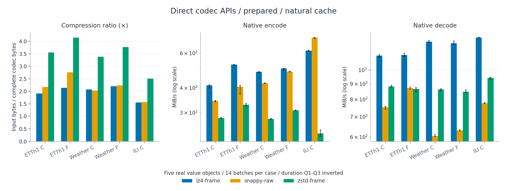

[下载 SVG](figures/fast-codecs-overview.svg)

<a id="averages"></a>

## 平均结果

平均值对每个案例先取正式批次中位数，再对同任务输入求算术平均。真实 values 先对同来源的 C/F 布局平均，再对 ETTh1、weather、ILI 三个来源等权平均；其权重为各ETTh1布局1/6、各weather布局1/6、ILI为1/3。fixture 的C/F平均仅描述布局，不增加独立来源数。这里平均的是各案例的压缩倍数和吞吐量，不是合并文件后的总字节比或总吞吐；平均压缩倍数的倒数也不等于平均存储占比。

每组固定输入集合；某算法缺少任一输入时，平均指标留空（图中N/A），并保留有效／请求数。ALP 在真实 values 仅3/5有效，三个矩阵Sprintz方法在int16仅1/2有效，均不以成功子集替代固定集合平均。平均图不绘制批次IQR或推断区间。P/F分别表示prepared/fresh_request。

### 真实 values：三来源等权平均

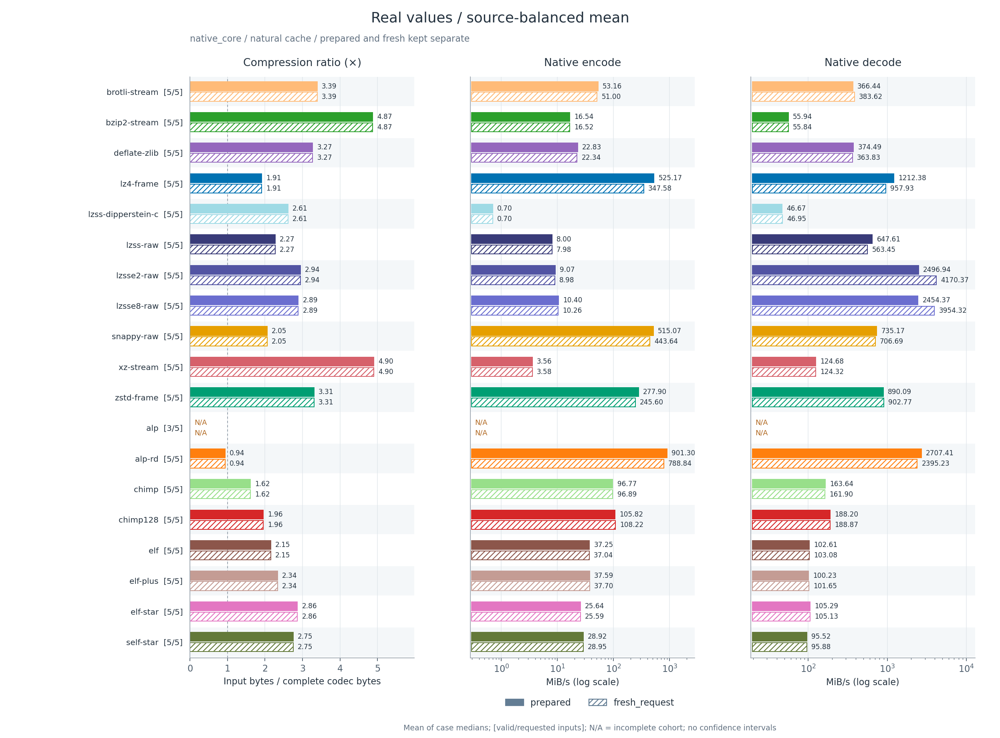

[下载 SVG](figures/mean-real-values.svg)

<details>
<summary>平均数值表</summary>

| codec | 有效／固定输入数 | 平均压缩倍数 P / F | 平均编码 MiB/s P / F | 平均解码 MiB/s P / F |
|---|---:|---:|---:|---:|
| brotli-stream | 5/5 | 3.394 / 3.394 | 53.159 / 51.001 | 366.436 / 383.618 |
| bzip2-stream | 5/5 | 4.874 / 4.874 | 16.541 / 16.519 | 55.936 / 55.843 |
| deflate-zlib | 5/5 | 3.269 / 3.269 | 22.830 / 22.340 | 374.491 / 363.830 |
| lz4-frame | 5/5 | 1.905 / 1.905 | 525.169 / 347.582 | 1212.378 / 957.927 |
| lzss-dipperstein-c | 5/5 | 2.615 / 2.615 | 0.700 / 0.699 | 46.675 / 46.945 |
| lzss-raw | 5/5 | 2.270 / 2.270 | 7.996 / 7.979 | 647.615 / 563.452 |
| lzsse2-raw | 5/5 | 2.941 / 2.941 | 9.070 / 8.983 | 2496.936 / 4170.374 |
| lzsse8-raw | 5/5 | 2.887 / 2.887 | 10.396 / 10.260 | 2454.369 / 3954.320 |
| snappy-raw | 5/5 | 2.055 / 2.055 | 515.065 / 443.637 | 735.173 / 706.694 |
| xz-stream | 5/5 | 4.903 / 4.903 | 3.559 / 3.579 | 124.685 / 124.325 |
| zstd-frame | 5/5 | 3.309 / 3.309 | 277.895 / 245.602 | 890.092 / 902.774 |
| alp | 3/5 | — / — | — / — | — / — |
| alp-rd | 5/5 | 0.939 / 0.939 | 901.300 / 788.836 | 2707.414 / 2395.225 |
| chimp | 5/5 | 1.615 / 1.615 | 96.773 / 96.895 | 163.643 / 161.900 |
| chimp128 | 5/5 | 1.957 / 1.957 | 105.820 / 108.216 | 188.198 / 188.870 |
| elf | 5/5 | 2.155 / 2.155 | 37.250 / 37.041 | 102.606 / 103.079 |
| elf-plus | 5/5 | 2.336 / 2.336 | 37.591 / 37.699 | 100.227 / 101.650 |
| elf-star | 5/5 | 2.863 / 2.863 | 25.643 / 25.594 | 105.291 / 105.128 |
| self-star | 5/5 | 2.751 / 2.751 | 28.921 / 28.947 | 95.518 / 95.884 |

</details>

### float64 fixture：C/F 平均

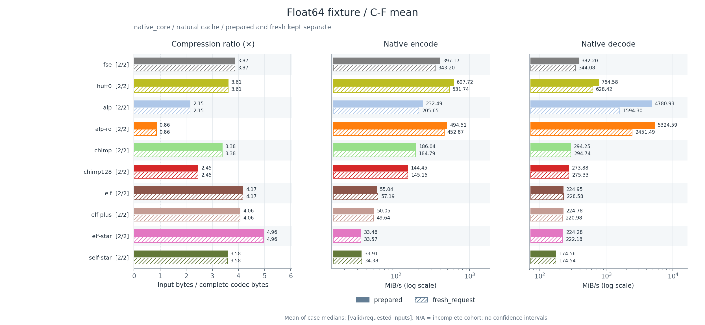

[下载 SVG](figures/mean-fixture-f64-lossless.svg)

<details>
<summary>平均数值表</summary>

| codec | 有效／固定输入数 | 平均压缩倍数 P / F | 平均编码 MiB/s P / F | 平均解码 MiB/s P / F |
|---|---:|---:|---:|---:|
| fse | 2/2 | 3.866 / 3.866 | 397.173 / 343.196 | 382.198 / 344.078 |
| huff0 | 2/2 | 3.606 / 3.606 | 607.722 / 531.741 | 764.581 / 628.423 |
| alp | 2/2 | 2.152 / 2.152 | 232.488 / 205.645 | 4780.932 / 1594.300 |
| alp-rd | 2/2 | 0.864 / 0.864 | 494.511 / 452.870 | 5324.590 / 2451.486 |
| chimp | 2/2 | 3.379 / 3.379 | 186.045 / 184.789 | 294.249 / 294.743 |
| chimp128 | 2/2 | 2.454 / 2.454 | 144.450 / 145.155 | 273.882 / 275.332 |
| elf | 2/2 | 4.172 / 4.172 | 55.038 / 57.185 | 224.947 / 228.584 |
| elf-plus | 2/2 | 4.060 / 4.060 | 50.051 / 49.645 | 224.781 / 220.977 |
| elf-star | 2/2 | 4.960 / 4.960 | 33.458 / 33.568 | 224.282 / 222.180 |
| self-star | 2/2 | 3.576 / 3.576 | 33.910 / 34.377 | 174.564 / 174.541 |

</details>

### float32 fixture：C/F 平均

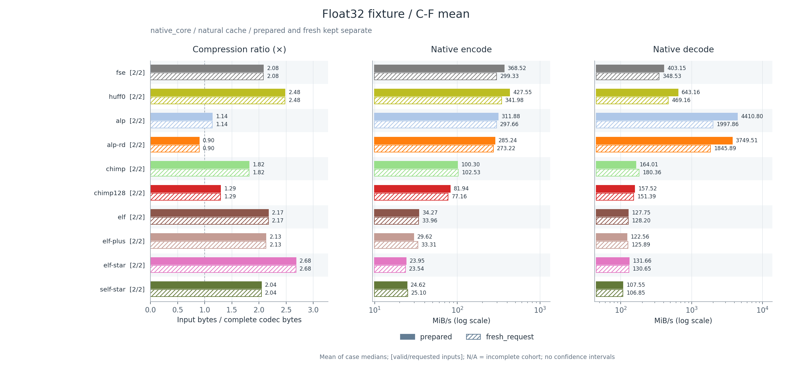

[下载 SVG](figures/mean-fixture-f32-lossless.svg)

<details>
<summary>平均数值表</summary>

| codec | 有效／固定输入数 | 平均压缩倍数 P / F | 平均编码 MiB/s P / F | 平均解码 MiB/s P / F |
|---|---:|---:|---:|---:|
| fse | 2/2 | 2.082 / 2.082 | 368.523 / 299.327 | 403.152 / 348.533 |
| huff0 | 2/2 | 2.481 / 2.481 | 427.554 / 341.983 | 643.157 / 469.156 |
| alp | 2/2 | 1.137 / 1.137 | 311.880 / 297.665 | 4410.802 / 1997.864 |
| alp-rd | 2/2 | 0.899 / 0.899 | 285.244 / 273.224 | 3749.510 / 1845.886 |
| chimp | 2/2 | 1.820 / 1.820 | 100.297 / 102.527 | 164.009 / 180.363 |
| chimp128 | 2/2 | 1.293 / 1.293 | 81.936 / 77.160 | 157.515 / 151.393 |
| elf | 2/2 | 2.172 / 2.172 | 34.268 / 33.957 | 127.746 / 128.199 |
| elf-plus | 2/2 | 2.130 / 2.130 | 29.622 / 33.307 | 122.563 / 125.891 |
| elf-star | 2/2 | 2.684 / 2.684 | 23.950 / 23.541 | 131.661 / 130.654 |
| self-star | 2/2 | 2.045 / 2.045 | 24.620 / 25.104 | 107.547 / 106.853 |

</details>

### int16 fixture：C/F 平均

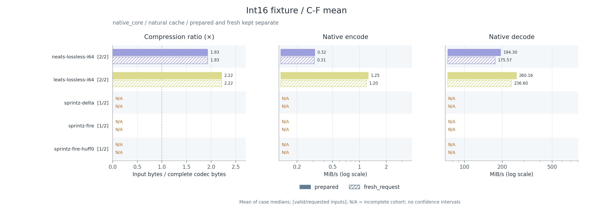

[下载 SVG](figures/mean-fixture-i16-lossless.svg)

<details>
<summary>平均数值表</summary>

| codec | 有效／固定输入数 | 平均压缩倍数 P / F | 平均编码 MiB/s P / F | 平均解码 MiB/s P / F |
|---|---:|---:|---:|---:|
| neats-lossless-i64 | 2/2 | 1.932 / 1.932 | 0.316 / 0.313 | 194.301 / 175.567 |
| leats-lossless-i64 | 2/2 | 2.215 / 2.215 | 1.254 / 1.200 | 260.160 / 236.597 |
| sprintz-delta | 1/2 | — / — | — / — | — / — |
| sprintz-fire | 1/2 | — / — | — / — | — / — |
| sprintz-fire-huff0 | 1/2 | — / — | — / — | — / — |

</details>

### float64 ABS≤0.01：C/F 平均

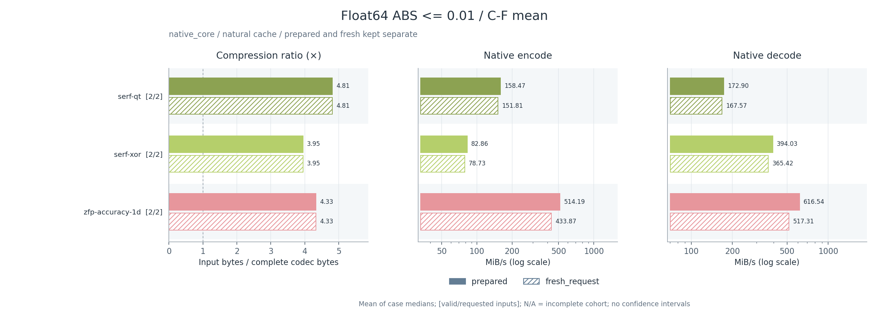

[下载 SVG](figures/mean-fixture-f64-abs.svg)

<details>
<summary>平均数值表</summary>

| codec | 有效／固定输入数 | 平均压缩倍数 P / F | 平均编码 MiB/s P / F | 平均解码 MiB/s P / F |
|---|---:|---:|---:|---:|
| serf-qt | 2/2 | 4.811 / 4.811 | 158.475 / 151.813 | 172.904 / 167.567 |
| serf-xor | 2/2 | 3.950 / 3.950 | 82.858 / 78.727 | 394.025 / 365.424 |
| zfp-accuracy-1d | 2/2 | 4.327 / 4.327 | 514.186 / 433.874 | 616.537 / 517.314 |

</details>

### float32 ABS≤0.01：C/F 平均

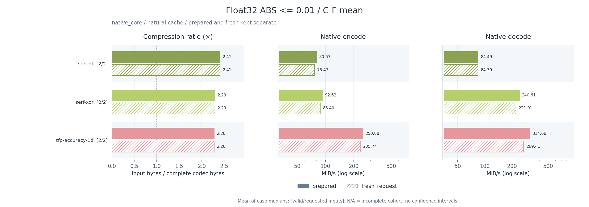

[下载 SVG](figures/mean-fixture-f32-abs.svg)

<details>
<summary>平均数值表</summary>

| codec | 有效／固定输入数 | 平均压缩倍数 P / F | 平均编码 MiB/s P / F | 平均解码 MiB/s P / F |
|---|---:|---:|---:|---:|
| serf-qt | 2/2 | 2.413 / 2.413 | 80.631 / 76.466 | 84.491 / 84.391 |
| serf-xor | 2/2 | 2.294 / 2.294 | 92.623 / 88.398 | 240.615 / 221.012 |
| zfp-accuracy-1d | 2/2 | 2.281 / 2.281 | 250.882 / 235.738 | 314.678 / 269.406 |

</details>

### 真实 T+V：两来源平均

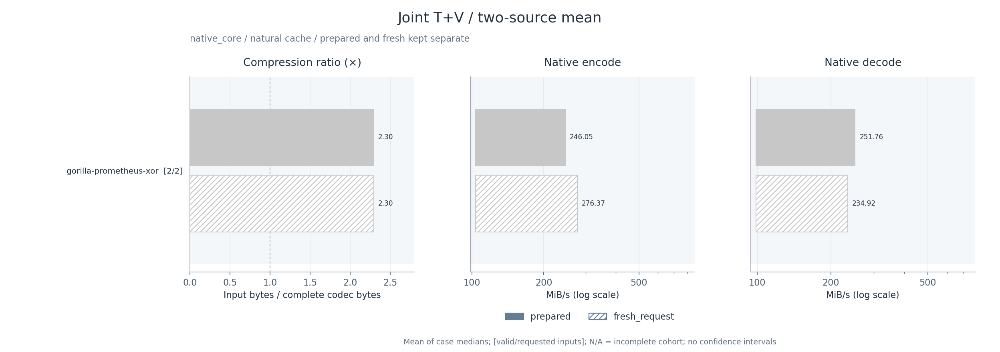

[下载 SVG](figures/mean-real-records.svg)

<details>
<summary>平均数值表</summary>

| codec | 有效／固定输入数 | 平均压缩倍数 P / F | 平均编码 MiB/s P / F | 平均解码 MiB/s P / F |
|---|---:|---:|---:|---:|
| gorilla-prometheus-xor | 2/2 | 2.296 / 2.296 | 246.055 / 276.373 | 251.764 / 234.922 |

</details>

其余组（uint8-c、uint32-c、ili-values-c（empirical_quality）、symbols4-c-n64、symbols4-c）只有一个输入对象／模型路径，不额外制造跨数据集均值；它们的全部数值见对应单独图。DeepZip/DZip 的64/257符号、不同mode和线程profile始终分开。

<a id="datasets"></a>

## 逐数据集结果

每个输入对象独立展示。无损、ABS有损、经验质量及不同线程profile分别成图。图内顺序沿用冻结配置，不按最有利指标重排。所有算法和模型路径均可在下表或能力矩阵定位。

| 输入对象 | 数据类别 | dtype／shape／布局 | 同条件图数 |
|---|---|---|---:|
| [etth1-values-c](#dataset-etth1-values-c) | 真实来源 | <f8 / 8192×7 / C | 1 |
| [etth1-values-f](#dataset-etth1-values-f) | 真实来源 | <f8 / 8192×7 / F | 1 |
| [weather-values-c](#dataset-weather-values-c) | 真实来源 | <f8 / 32768×3 / C | 1 |
| [weather-values-f](#dataset-weather-values-f) | 真实来源 | <f8 / 32768×3 / F | 1 |
| [ili-values-c](#dataset-ili-values-c) | 真实来源 | <f8 / 512 / C | 2 |
| [float64-c](#dataset-float64-c) | 开发 fixture | <f8 / 257×3 / C | 2 |
| [float64-f](#dataset-float64-f) | 开发 fixture | <f8 / 257×3 / F | 2 |
| [float32-c](#dataset-float32-c) | 开发 fixture | <f4 / 257×3 / C | 2 |
| [float32-f](#dataset-float32-f) | 开发 fixture | <f4 / 257×3 / F | 2 |
| [uint8-c](#dataset-uint8-c) | 开发 fixture | \|u1 / 257 / C | 1 |
| [int16-c](#dataset-int16-c) | 开发 fixture | <i2 / 257×2 / C | 1 |
| [int16-f](#dataset-int16-f) | 开发 fixture | <i2 / 257×2 / F | 1 |
| [uint32-c](#dataset-uint32-c) | 开发 fixture | <u4 / 257 / C | 1 |
| [symbols4-c-n64](#dataset-symbols4-c-n64) | 开发 fixture | \|u1 / 64 / C | 2 |
| [etth1-records-c](#dataset-etth1-records-c) | 真实来源 | <f8 / 512 / C | 1 |
| [weather-records-c](#dataset-weather-records-c) | 真实来源 | <f8 / 512 / C | 1 |
| [symbols4-c](#dataset-symbols4-c) | 开发 fixture | \|u1 / 257 / C | 2 |

<a id="dataset-etth1-values-c"></a>

### etth1-values-c

输入：`<f8`、`[8192, 7]`、C布局；有效原始数据 **458,752 bytes**，57,344 values、0 timestamps。

**无损 · values · cpu-single（1线程）**

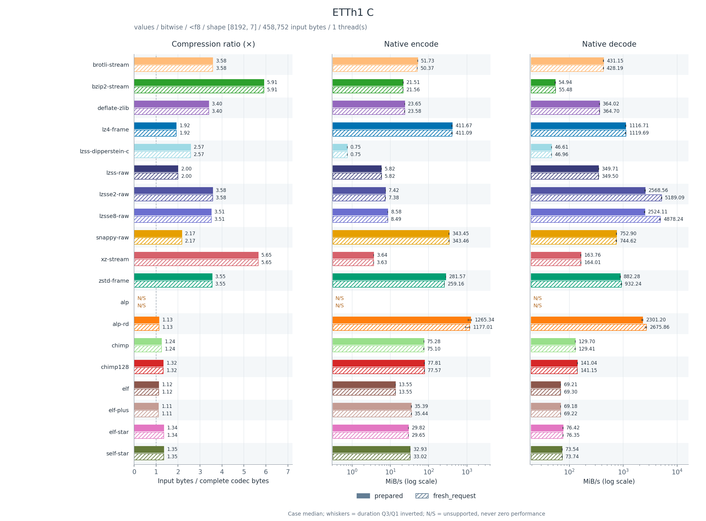

[下载 SVG](figures/etth1-values-c--bitwise--cpu-single.svg)

<details>
<summary>完整数值、质量及拒绝原因</summary>

| codec | 完整输出 bytes | 压缩倍数 | 编码 MiB/s P / F | 解码 MiB/s P / F | P/F有效批次数 |
|---|---:|---:|---:|---:|---:|
| brotli-stream | 128,084 | 3.582 | 51.735 / 50.372 | 431.148 / 428.188 | 14/14 / 14/14 |
| bzip2-stream | 77,591 | 5.912 | 21.510 / 21.559 | 54.943 / 55.476 | 14/14 / 14/14 |
| deflate-zlib | 135,056 | 3.397 | 23.654 / 23.583 | 364.022 / 364.702 | 14/14 / 14/14 |
| lz4-frame | 239,226 | 1.918 | 411.671 / 411.091 | 1116.713 / 1119.686 | 14/14 / 14/14 |
| lzss-dipperstein-c | 178,555 | 2.569 | 0.747 / 0.746 | 46.606 / 46.964 | 14/14 / 14/14 |
| lzss-raw | 229,367 | 2.000 | 5.819 / 5.824 | 349.709 / 349.497 | 14/14 / 14/14 |
| lzsse2-raw | 128,185 | 3.579 | 7.423 / 7.380 | 2568.562 / 5189.094 | 14/14 / 14/14 |
| lzsse8-raw | 130,600 | 3.513 | 8.581 / 8.486 | 2524.107 / 4878.239 | 14/14 / 14/14 |
| snappy-raw | 211,201 | 2.172 | 343.454 / 343.464 | 752.900 / 744.617 | 14/14 / 14/14 |
| xz-stream | 81,148 | 5.653 | 3.640 / 3.630 | 163.762 / 164.015 | 14/14 / 14/14 |
| zstd-frame | 129,265 | 3.549 | 281.571 / 259.159 | 882.277 / 932.240 | 14/14 / 14/14 |
| alp | — | — | — / — | — / — | 0/0 / 0/0 |
| alp-rd | 407,582 | 1.126 | 1265.339 / 1177.013 | 2301.198 / 2675.857 | 14/14 / 14/14 |
| chimp | 369,431 | 1.242 | 75.277 / 75.095 | 129.698 / 129.408 | 14/14 / 14/14 |
| chimp128 | 346,718 | 1.323 | 77.808 / 77.566 | 141.037 / 141.146 | 14/14 / 14/14 |
| elf | 409,376 | 1.121 | 13.545 / 13.550 | 69.208 / 69.305 | 14/14 / 14/14 |
| elf-plus | 413,225 | 1.110 | 35.387 / 35.438 | 69.182 / 69.220 | 14/14 / 14/14 |
| elf-star | 341,130 | 1.345 | 29.816 / 29.649 | 76.415 / 76.352 | 14/14 / 14/14 |
| self-star | 339,284 | 1.352 | 32.935 / 33.019 | 73.543 / 73.735 | 14/14 / 14/14 |

- `alp`：unsupported，rowgroup selects ALP-RD; forced ALP forbids fallback。两个生命周期均保留该拒绝，图中 N/S 不代表零性能。

</details>

<a id="dataset-etth1-values-f"></a>

### etth1-values-f

输入：`<f8`、`[8192, 7]`、F布局；有效原始数据 **458,752 bytes**，57,344 values、0 timestamps。

**无损 · values · cpu-single（1线程）**

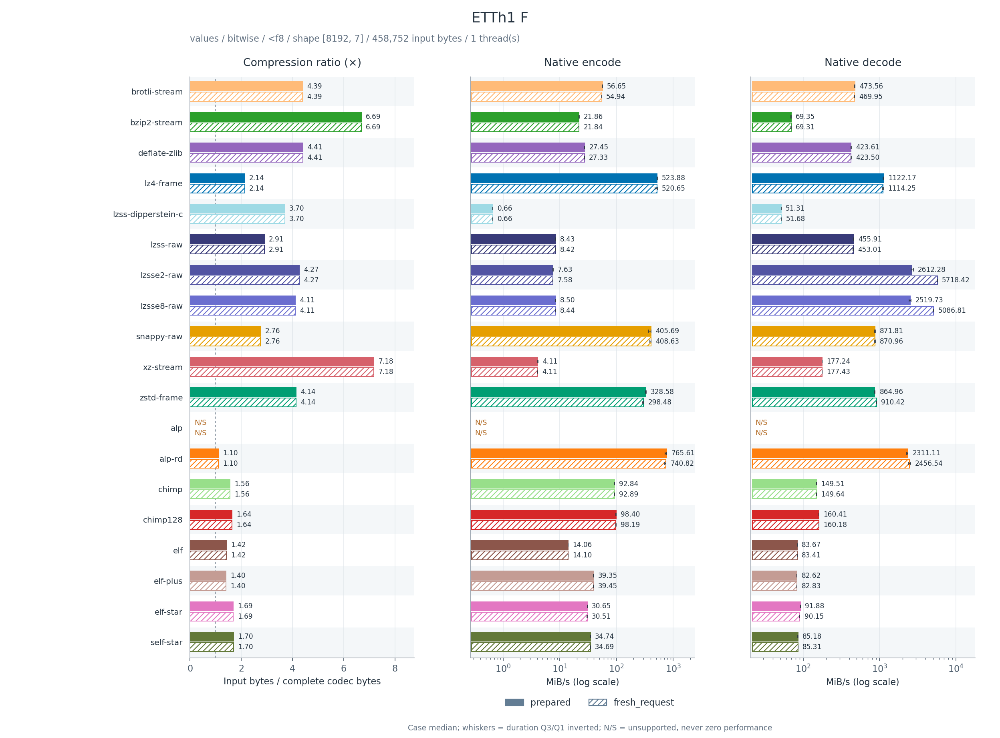

[下载 SVG](figures/etth1-values-f--bitwise--cpu-single.svg)

<details>
<summary>完整数值、质量及拒绝原因</summary>

| codec | 完整输出 bytes | 压缩倍数 | 编码 MiB/s P / F | 解码 MiB/s P / F | P/F有效批次数 |
|---|---:|---:|---:|---:|---:|
| brotli-stream | 104,407 | 4.394 | 56.651 / 54.942 | 473.556 / 469.953 | 14/14 / 14/14 |
| bzip2-stream | 68,529 | 6.694 | 21.862 / 21.843 | 69.348 / 69.310 | 14/14 / 14/14 |
| deflate-zlib | 104,125 | 4.406 | 27.450 / 27.327 | 423.610 / 423.504 | 14/14 / 14/14 |
| lz4-frame | 214,639 | 2.137 | 523.885 / 520.651 | 1122.172 / 1114.254 | 14/14 / 14/14 |
| lzss-dipperstein-c | 123,997 | 3.700 | 0.664 / 0.664 | 51.309 / 51.677 | 14/14 / 14/14 |
| lzss-raw | 157,834 | 2.907 | 8.429 / 8.424 | 455.913 / 453.014 | 14/14 / 14/14 |
| lzsse2-raw | 107,496 | 4.268 | 7.632 / 7.584 | 2612.277 / 5718.417 | 14/14 / 14/14 |
| lzsse8-raw | 111,736 | 4.106 | 8.500 / 8.441 | 2519.733 / 5086.806 | 14/14 / 14/14 |
| snappy-raw | 166,391 | 2.757 | 405.686 / 408.635 | 871.808 / 870.965 | 14/14 / 14/14 |
| xz-stream | 63,912 | 7.178 | 4.111 / 4.108 | 177.241 / 177.427 | 14/14 / 14/14 |
| zstd-frame | 110,688 | 4.145 | 328.578 / 298.482 | 864.958 / 910.418 | 14/14 / 14/14 |
| alp | — | — | — / — | — / — | 0/0 / 0/0 |
| alp-rd | 416,134 | 1.102 | 765.605 / 740.817 | 2311.106 / 2456.538 | 14/14 / 14/14 |
| chimp | 294,544 | 1.557 | 92.837 / 92.888 | 149.507 / 149.638 | 14/14 / 14/14 |
| chimp128 | 280,127 | 1.638 | 98.398 / 98.191 | 160.410 / 160.178 | 14/14 / 14/14 |
| elf | 323,695 | 1.417 | 14.063 / 14.100 | 83.672 / 83.411 | 14/14 / 14/14 |
| elf-plus | 327,109 | 1.402 | 39.351 / 39.451 | 82.617 / 82.826 | 14/14 / 14/14 |
| elf-star | 271,053 | 1.692 | 30.647 / 30.513 | 91.878 / 90.152 | 14/14 / 14/14 |
| self-star | 269,932 | 1.700 | 34.741 / 34.694 | 85.184 / 85.310 | 14/14 / 14/14 |

- `alp`：unsupported，rowgroup selects ALP-RD; forced ALP forbids fallback。两个生命周期均保留该拒绝，图中 N/S 不代表零性能。

</details>

<a id="dataset-weather-values-c"></a>

### weather-values-c

输入：`<f8`、`[32768, 3]`、C布局；有效原始数据 **786,432 bytes**，98,304 values、0 timestamps。

**无损 · values · cpu-single（1线程）**

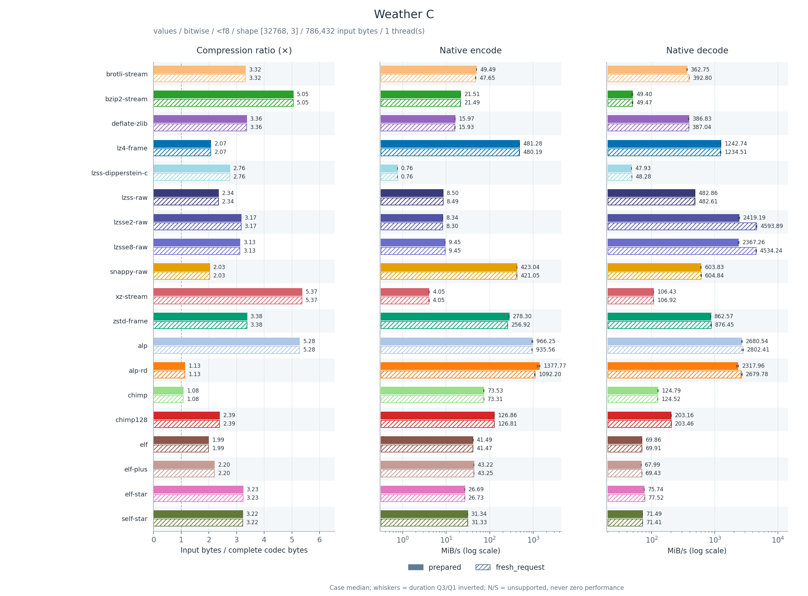

[下载 SVG](figures/weather-values-c--bitwise--cpu-single.svg)

<details>
<summary>完整数值、质量及拒绝原因</summary>

| codec | 完整输出 bytes | 压缩倍数 | 编码 MiB/s P / F | 解码 MiB/s P / F | P/F有效批次数 |
|---|---:|---:|---:|---:|---:|
| brotli-stream | 236,626 | 3.324 | 49.489 / 47.647 | 362.748 / 392.805 | 14/14 / 14/14 |
| bzip2-stream | 155,614 | 5.054 | 21.512 / 21.490 | 49.402 / 49.470 | 14/14 / 14/14 |
| deflate-zlib | 233,802 | 3.364 | 15.967 / 15.931 | 386.833 / 387.044 | 14/14 / 14/14 |
| lz4-frame | 379,331 | 2.073 | 481.276 / 480.193 | 1242.737 / 1234.511 | 14/14 / 14/14 |
| lzss-dipperstein-c | 284,898 | 2.760 | 0.762 / 0.761 | 47.928 / 48.284 | 14/14 / 14/14 |
| lzss-raw | 335,518 | 2.344 | 8.498 / 8.494 | 482.860 / 482.609 | 14/14 / 14/14 |
| lzsse2-raw | 248,466 | 3.165 | 8.337 / 8.302 | 2419.191 / 4593.894 | 14/14 / 14/14 |
| lzsse8-raw | 251,462 | 3.127 | 9.451 / 9.450 | 2367.258 / 4534.243 | 14/14 / 14/14 |
| snappy-raw | 387,723 | 2.028 | 423.042 / 421.054 | 603.834 / 604.843 | 14/14 / 14/14 |
| xz-stream | 146,456 | 5.370 | 4.054 / 4.051 | 106.428 / 106.920 | 14/14 / 14/14 |
| zstd-frame | 232,758 | 3.379 | 278.303 / 256.917 | 862.568 / 876.451 | 14/14 / 14/14 |
| alp | 149,026 | 5.277 | 966.248 / 935.561 | 2680.537 / 2802.412 | 14/14 / 14/14 |
| alp-rd | 697,720 | 1.127 | 1377.774 / 1092.197 | 2317.960 / 2679.777 | 14/14 / 14/14 |
| chimp | 729,771 | 1.078 | 73.525 / 73.308 | 124.794 / 124.521 | 14/14 / 14/14 |
| chimp128 | 329,226 | 2.389 | 126.857 / 126.811 | 203.162 / 203.464 | 14/14 / 14/14 |
| elf | 396,035 | 1.986 | 41.486 / 41.472 | 69.860 / 69.908 | 14/14 / 14/14 |
| elf-plus | 357,470 | 2.200 | 43.218 / 43.254 | 67.987 / 69.427 | 14/14 / 14/14 |
| elf-star | 243,190 | 3.234 | 26.690 / 26.730 | 75.741 / 77.516 | 14/14 / 14/14 |
| self-star | 243,948 | 3.224 | 31.341 / 31.330 | 71.492 / 71.407 | 14/14 / 14/14 |

</details>

<a id="dataset-weather-values-f"></a>

### weather-values-f

输入：`<f8`、`[32768, 3]`、F布局；有效原始数据 **786,432 bytes**，98,304 values、0 timestamps。

**无损 · values · cpu-single（1线程）**

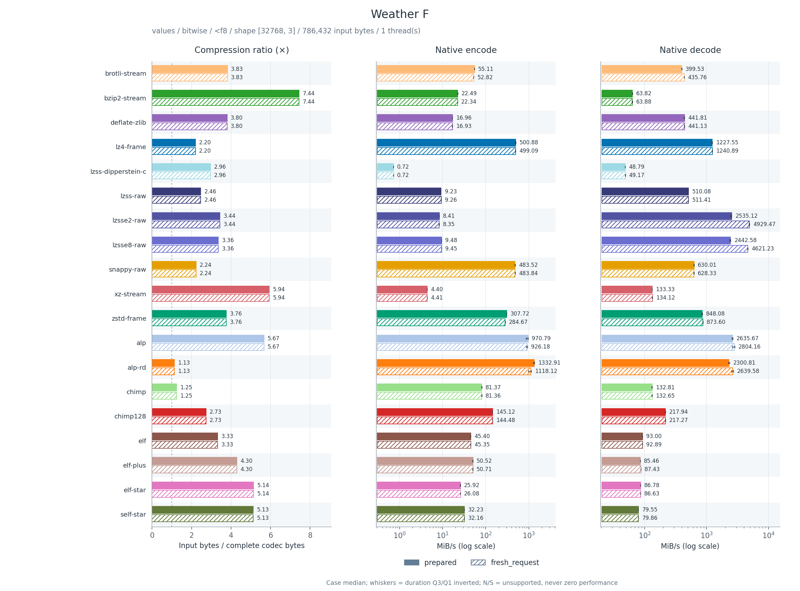

[下载 SVG](figures/weather-values-f--bitwise--cpu-single.svg)

<details>
<summary>完整数值、质量及拒绝原因</summary>

| codec | 完整输出 bytes | 压缩倍数 | 编码 MiB/s P / F | 解码 MiB/s P / F | P/F有效批次数 |
|---|---:|---:|---:|---:|---:|
| brotli-stream | 205,576 | 3.826 | 55.113 / 52.817 | 399.532 / 435.759 | 14/14 / 14/14 |
| bzip2-stream | 105,651 | 7.444 | 22.495 / 22.342 | 63.823 / 63.882 | 14/14 / 14/14 |
| deflate-zlib | 206,764 | 3.804 | 16.961 / 16.934 | 441.814 / 441.134 | 14/14 / 14/14 |
| lz4-frame | 357,798 | 2.198 | 500.881 / 499.094 | 1227.546 / 1240.887 | 14/14 / 14/14 |
| lzss-dipperstein-c | 265,301 | 2.964 | 0.723 / 0.723 | 48.795 / 49.174 | 14/14 / 14/14 |
| lzss-raw | 319,097 | 2.465 | 9.232 / 9.262 | 510.083 / 511.405 | 14/14 / 14/14 |
| lzsse2-raw | 228,579 | 3.441 | 8.410 / 8.348 | 2535.124 / 4929.468 | 14/14 / 14/14 |
| lzsse8-raw | 234,235 | 3.357 | 9.483 / 9.447 | 2442.583 / 4621.225 | 14/14 / 14/14 |
| snappy-raw | 351,641 | 2.236 | 483.523 / 483.840 | 630.009 / 628.331 | 14/14 / 14/14 |
| xz-stream | 132,476 | 5.936 | 4.402 / 4.405 | 133.329 / 134.125 | 14/14 / 14/14 |
| zstd-frame | 208,888 | 3.765 | 307.723 / 284.668 | 848.075 / 873.596 | 14/14 / 14/14 |
| alp | 138,786 | 5.667 | 970.786 / 926.182 | 2635.673 / 2804.156 | 14/14 / 14/14 |
| alp-rd | 694,046 | 1.133 | 1332.911 / 1118.123 | 2300.813 / 2639.578 | 14/14 / 14/14 |
| chimp | 630,974 | 1.246 | 81.367 / 81.359 | 132.806 / 132.653 | 14/14 / 14/14 |
| chimp128 | 287,589 | 2.735 | 145.121 / 144.479 | 217.942 / 217.270 | 14/14 / 14/14 |
| elf | 236,248 | 3.329 | 45.403 / 45.349 | 93.002 / 92.888 | 14/14 / 14/14 |
| elf-plus | 182,825 | 4.302 | 50.522 / 50.708 | 85.457 / 87.428 | 14/14 / 14/14 |
| elf-star | 152,873 | 5.144 | 25.919 / 26.079 | 86.779 / 86.629 | 14/14 / 14/14 |
| self-star | 153,299 | 5.130 | 32.226 / 32.160 | 79.545 / 79.860 | 14/14 / 14/14 |

</details>

<a id="dataset-ili-values-c"></a>

### ili-values-c

输入：`<f8`、`[512]`、C布局；有效原始数据 **4,096 bytes**，512 values、0 timestamps。

**无损 · values · cpu-single（1线程）**

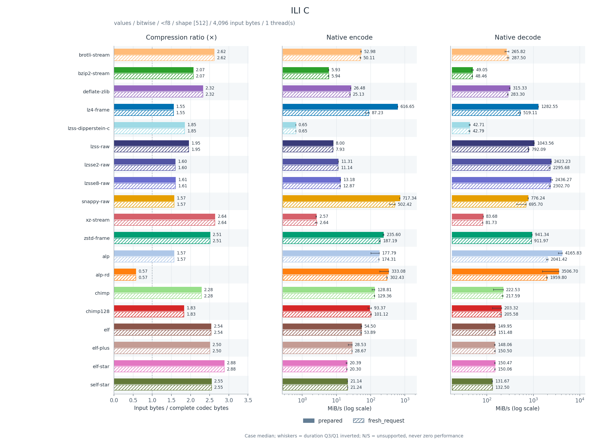

[下载 SVG](figures/ili-values-c--bitwise--cpu-single.svg)

<details>
<summary>完整数值、质量及拒绝原因</summary>

| codec | 完整输出 bytes | 压缩倍数 | 编码 MiB/s P / F | 解码 MiB/s P / F | P/F有效批次数 |
|---|---:|---:|---:|---:|---:|
| brotli-stream | 1,563 | 2.621 | 52.984 / 50.114 | 265.817 / 287.502 | 14/14 / 14/14 |
| bzip2-stream | 1,978 | 2.071 | 5.934 / 5.940 | 49.049 / 48.459 | 14/14 / 14/14 |
| deflate-zlib | 1,764 | 2.322 | 26.475 / 25.134 | 315.333 / 283.299 | 14/14 / 14/14 |
| lz4-frame | 2,637 | 1.553 | 616.651 / 87.231 | 1282.551 / 519.112 | 14/14 / 14/14 |
| lzss-dipperstein-c | 2,218 | 1.847 | 0.652 / 0.650 | 42.705 / 42.786 | 14/14 / 14/14 |
| lzss-raw | 2,097 | 1.953 | 7.998 / 7.933 | 1043.562 / 792.092 | 14/14 / 14/14 |
| lzsse2-raw | 2,563 | 1.598 | 11.310 / 11.142 | 2423.232 / 2295.684 | 14/14 / 14/14 |
| lzsse8-raw | 2,547 | 1.608 | 13.179 / 12.867 | 2436.267 / 2302.704 | 14/14 / 14/14 |
| snappy-raw | 2,614 | 1.567 | 717.344 / 502.416 | 776.243 / 695.704 | 14/14 / 14/14 |
| xz-stream | 1,552 | 2.639 | 2.575 / 2.640 | 83.675 / 81.731 | 14/14 / 14/14 |
| zstd-frame | 1,633 | 2.508 | 235.597 / 187.191 | 941.336 / 911.969 | 14/14 / 14/14 |
| alp | 2,610 | 1.569 | 177.786 / 174.309 | 4165.833 / 2041.416 | 14/14 / 14/14 |
| alp-rd | 7,160 | 0.572 | 333.085 / 302.434 | 3506.705 / 1959.801 | 14/14 / 14/14 |
| chimp | 1,793 | 2.284 | 128.815 / 129.359 | 222.526 / 217.590 | 14/14 / 14/14 |
| chimp128 | 2,241 | 1.828 | 93.370 / 101.125 | 203.319 / 205.583 | 14/14 / 14/14 |
| elf | 1,614 | 2.538 | 54.501 / 53.887 | 149.946 / 151.480 | 14/14 / 14/14 |
| elf-plus | 1,637 | 2.502 | 28.535 / 28.671 | 148.058 / 150.499 | 14/14 / 14/14 |
| elf-star | 1,421 | 2.882 | 20.393 / 20.297 | 150.468 / 150.059 | 14/14 / 14/14 |
| self-star | 1,607 | 2.549 | 21.140 / 21.238 | 131.670 / 132.496 | 14/14 / 14/14 |

</details>

**经验质量（无点误差保证） · values · cpu-single（1线程）**

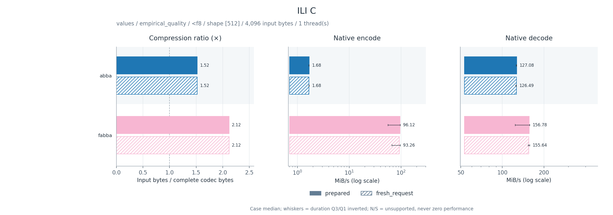

[下载 SVG](figures/ili-values-c--empirical_quality--cpu-single.svg)

<details>
<summary>完整数值、质量及拒绝原因</summary>

| codec | 完整输出 bytes | 压缩倍数 | 编码 MiB/s P / F | 解码 MiB/s P / F | P/F有效批次数 |
|---|---:|---:|---:|---:|---:|
| abba | 2,690 | 1.523 | 1.685 / 1.679 | 127.079 / 126.487 | 14/14 / 14/14 |
| fabba | 1,930 | 2.122 | 96.118 / 93.256 | 156.783 / 155.641 | 14/14 / 14/14 |

| codec | 最大绝对误差（P/F 最坏值） | RMSE（P/F 最坏值） |
|---|---:|---:|
| abba | 5129.801011 | 2329.404280 |
| fabba | 58113.2 | 29344.7 |

</details>

<a id="dataset-float64-c"></a>

### float64-c

输入：`<f8`、`[257, 3]`、C布局；有效原始数据 **6,168 bytes**，771 values、0 timestamps。

**无损 · values · cpu-single（1线程）**

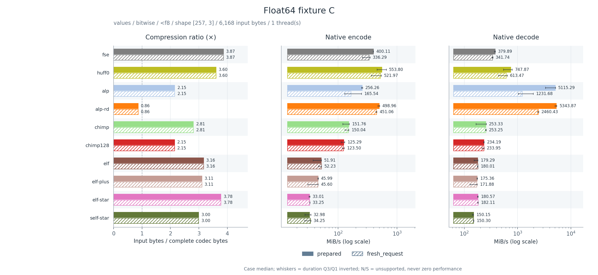

[下载 SVG](figures/float64-c--bitwise--cpu-single.svg)

<details>
<summary>完整数值、质量及拒绝原因</summary>

| codec | 完整输出 bytes | 压缩倍数 | 编码 MiB/s P / F | 解码 MiB/s P / F | P/F有效批次数 |
|---|---:|---:|---:|---:|---:|
| fse | 1,594 | 3.870 | 400.113 / 336.288 | 379.885 / 341.741 | 14/14 / 14/14 |
| huff0 | 1,711 | 3.605 | 553.801 / 521.969 | 747.868 / 613.471 | 14/14 / 14/14 |
| alp | 2,866 | 2.152 | 256.264 / 165.538 | 5115.289 / 1231.678 | 14/14 / 14/14 |
| alp-rd | 7,142 | 0.864 | 498.957 / 451.064 | 5343.868 / 2460.426 | 14/14 / 14/14 |
| chimp | 2,195 | 2.810 | 151.762 / 150.038 | 253.332 / 253.253 | 14/14 / 14/14 |
| chimp128 | 2,870 | 2.149 | 125.294 / 123.501 | 234.189 / 233.945 | 14/14 / 14/14 |
| elf | 1,949 | 3.165 | 51.910 / 52.227 | 179.286 / 180.012 | 14/14 / 14/14 |
| elf-plus | 1,983 | 3.110 | 45.989 / 45.603 | 175.359 / 171.877 | 14/14 / 14/14 |
| elf-star | 1,633 | 3.777 | 33.013 / 33.255 | 180.568 / 182.114 | 14/14 / 14/14 |
| self-star | 2,059 | 2.996 | 32.982 / 34.246 | 150.152 / 150.302 | 14/14 / 14/14 |

</details>

**绝对误差 ≤ 0.01 · values · cpu-single（1线程）**

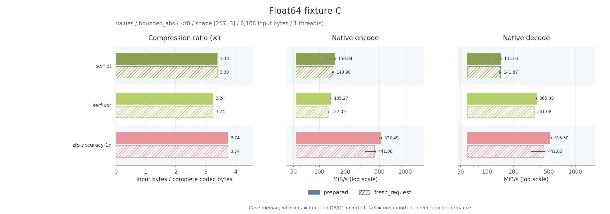

[下载 SVG](figures/float64-c--bounded_abs--cpu-single.svg)

<details>
<summary>完整数值、质量及拒绝原因</summary>

| codec | 完整输出 bytes | 压缩倍数 | 编码 MiB/s P / F | 解码 MiB/s P / F | P/F有效批次数 |
|---|---:|---:|---:|---:|---:|
| serf-qt | 1,825 | 3.380 | 150.839 / 143.977 | 143.631 / 141.871 | 14/14 / 14/14 |
| serf-xor | 1,901 | 3.245 | 135.272 / 127.094 | 365.381 / 341.079 | 14/14 / 14/14 |
| zfp-accuracy-1d | 1,648 | 3.743 | 522.490 / 441.077 | 518.295 / 442.833 | 14/14 / 14/14 |

| codec | 最大绝对误差（P/F 最坏值） | RMSE（P/F 最坏值） |
|---|---:|---:|
| serf-qt | 0.00998 | 0.0047694 |
| serf-xor | 0.0078125 | 0.000512084 |
| zfp-accuracy-1d | 0.000000 | 0.000000 |

</details>

<a id="dataset-float64-f"></a>

### float64-f

输入：`<f8`、`[257, 3]`、F布局；有效原始数据 **6,168 bytes**，771 values、0 timestamps。

**无损 · values · cpu-single（1线程）**

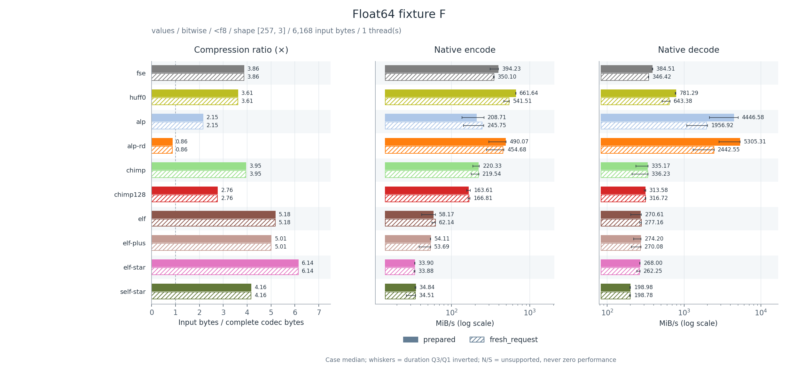

[下载 SVG](figures/float64-f--bitwise--cpu-single.svg)

<details>
<summary>完整数值、质量及拒绝原因</summary>

| codec | 完整输出 bytes | 压缩倍数 | 编码 MiB/s P / F | 解码 MiB/s P / F | P/F有效批次数 |
|---|---:|---:|---:|---:|---:|
| fse | 1,597 | 3.862 | 394.234 / 350.105 | 384.510 / 346.415 | 14/14 / 14/14 |
| huff0 | 1,710 | 3.607 | 661.644 / 541.514 | 781.294 / 643.376 | 14/14 / 14/14 |
| alp | 2,866 | 2.152 | 208.713 / 245.753 | 4446.575 / 1956.922 | 14/14 / 14/14 |
| alp-rd | 7,142 | 0.864 | 490.066 / 454.676 | 5305.311 / 2442.547 | 14/14 / 14/14 |
| chimp | 1,562 | 3.949 | 220.328 / 219.540 | 335.166 / 336.234 | 14/14 / 14/14 |
| chimp128 | 2,236 | 2.758 | 163.607 / 166.808 | 313.575 / 316.718 | 14/14 / 14/14 |
| elf | 1,191 | 5.179 | 58.167 / 62.144 | 270.609 / 277.156 | 14/14 / 14/14 |
| elf-plus | 1,231 | 5.011 | 54.113 / 53.687 | 274.203 / 270.078 | 14/14 / 14/14 |
| elf-star | 1,004 | 6.143 | 33.902 / 33.881 | 267.996 / 262.246 | 14/14 / 14/14 |
| self-star | 1,484 | 4.156 | 34.838 / 34.507 | 198.976 / 198.780 | 14/14 / 14/14 |

</details>

**绝对误差 ≤ 0.01 · values · cpu-single（1线程）**

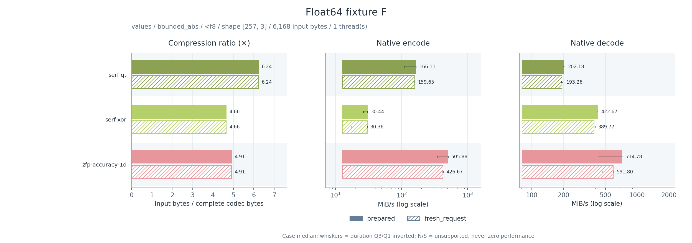

[下载 SVG](figures/float64-f--bounded_abs--cpu-single.svg)

<details>
<summary>完整数值、质量及拒绝原因</summary>

| codec | 完整输出 bytes | 压缩倍数 | 编码 MiB/s P / F | 解码 MiB/s P / F | P/F有效批次数 |
|---|---:|---:|---:|---:|---:|
| serf-qt | 988 | 6.243 | 166.110 / 159.649 | 202.178 / 193.264 | 14/14 / 14/14 |
| serf-xor | 1,325 | 4.655 | 30.443 / 30.361 | 422.669 / 389.768 | 14/14 / 14/14 |
| zfp-accuracy-1d | 1,256 | 4.911 | 505.881 / 426.670 | 714.778 / 591.796 | 14/14 / 14/14 |

| codec | 最大绝对误差（P/F 最坏值） | RMSE（P/F 最坏值） |
|---|---:|---:|
| serf-qt | 0.00998 | 0.0047694 |
| serf-xor | 0.0078125 | 0.000744409 |
| zfp-accuracy-1d | 0.000000 | 0.000000 |

</details>

<a id="dataset-float32-c"></a>

### float32-c

输入：`<f4`、`[257, 3]`、C布局；有效原始数据 **3,084 bytes**，771 values、0 timestamps。

**无损 · values · cpu-single（1线程）**

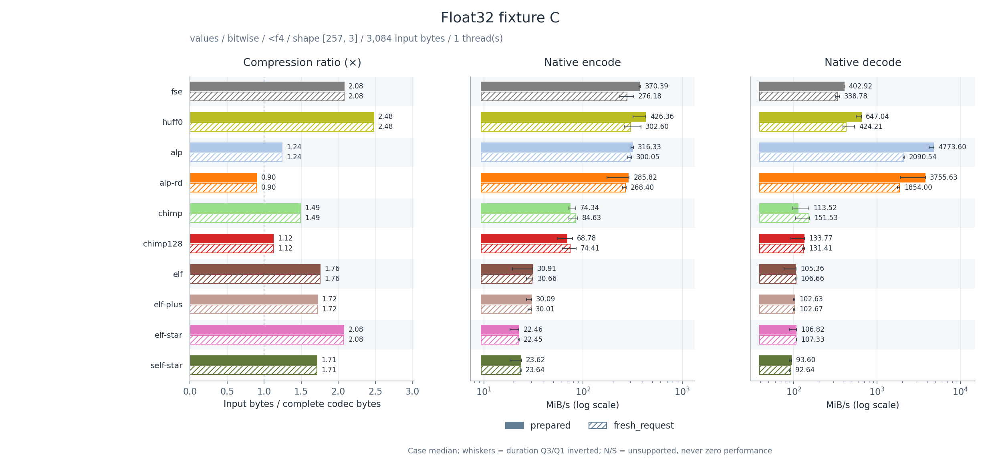

[下载 SVG](figures/float32-c--bitwise--cpu-single.svg)

<details>
<summary>完整数值、质量及拒绝原因</summary>

| codec | 完整输出 bytes | 压缩倍数 | 编码 MiB/s P / F | 解码 MiB/s P / F | P/F有效批次数 |
|---|---:|---:|---:|---:|---:|
| fse | 1,482 | 2.081 | 370.388 / 276.177 | 402.915 / 338.781 | 14/14 / 14/14 |
| huff0 | 1,243 | 2.481 | 426.355 / 302.599 | 647.042 / 424.207 | 14/14 / 14/14 |
| alp | 2,482 | 1.243 | 316.334 / 300.052 | 4773.596 / 2090.542 | 14/14 / 14/14 |
| alp-rd | 3,430 | 0.899 | 285.824 / 268.400 | 3755.635 / 1853.995 | 14/14 / 14/14 |
| chimp | 2,071 | 1.489 | 74.342 / 84.625 | 113.517 / 151.535 | 14/14 / 14/14 |
| chimp128 | 2,746 | 1.123 | 68.778 / 74.407 | 133.771 / 131.406 | 14/14 / 14/14 |
| elf | 1,754 | 1.758 | 30.908 / 30.655 | 105.355 / 106.662 | 14/14 / 14/14 |
| elf-plus | 1,793 | 1.720 | 30.090 / 30.005 | 102.634 / 102.671 | 14/14 / 14/14 |
| elf-star | 1,485 | 2.077 | 22.460 / 22.451 | 106.824 / 107.328 | 14/14 / 14/14 |
| self-star | 1,802 | 1.711 | 23.618 / 23.641 | 93.597 / 92.636 | 14/14 / 14/14 |

</details>

**绝对误差 ≤ 0.01 · values · cpu-single（1线程）**

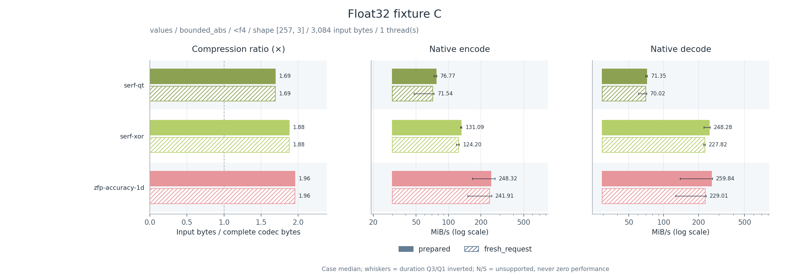

[下载 SVG](figures/float32-c--bounded_abs--cpu-single.svg)

<details>
<summary>完整数值、质量及拒绝原因</summary>

| codec | 完整输出 bytes | 压缩倍数 | 编码 MiB/s P / F | 解码 MiB/s P / F | P/F有效批次数 |
|---|---:|---:|---:|---:|---:|
| serf-qt | 1,823 | 1.692 | 76.771 / 71.542 | 71.354 / 70.016 | 14/14 / 14/14 |
| serf-xor | 1,642 | 1.878 | 131.088 / 124.200 | 248.281 / 227.823 | 14/14 / 14/14 |
| zfp-accuracy-1d | 1,576 | 1.957 | 248.319 / 241.909 | 259.843 / 229.010 | 14/14 / 14/14 |

| codec | 最大绝对误差（P/F 最坏值） | RMSE（P/F 最坏值） |
|---|---:|---:|
| serf-qt | 0.00981736 | 0.00587239 |
| serf-xor | 0.0078125 | 0.000512084 |
| zfp-accuracy-1d | 0.000000 | 0.000000 |

</details>

<a id="dataset-float32-f"></a>

### float32-f

输入：`<f4`、`[257, 3]`、F布局；有效原始数据 **3,084 bytes**，771 values、0 timestamps。

**无损 · values · cpu-single（1线程）**

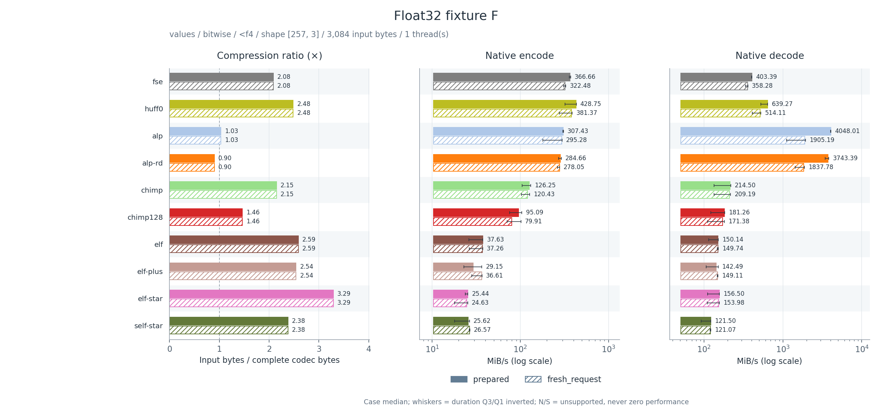

[下载 SVG](figures/float32-f--bitwise--cpu-single.svg)

<details>
<summary>完整数值、质量及拒绝原因</summary>

| codec | 完整输出 bytes | 压缩倍数 | 编码 MiB/s P / F | 解码 MiB/s P / F | P/F有效批次数 |
|---|---:|---:|---:|---:|---:|
| fse | 1,480 | 2.084 | 366.659 / 322.477 | 403.389 / 358.284 | 14/14 / 14/14 |
| huff0 | 1,243 | 2.481 | 428.752 / 381.368 | 639.272 / 514.105 | 14/14 / 14/14 |
| alp | 2,992 | 1.031 | 307.427 / 295.278 | 4048.009 / 1905.186 | 14/14 / 14/14 |
| alp-rd | 3,430 | 0.899 | 284.664 / 278.047 | 3743.386 / 1837.777 | 14/14 / 14/14 |
| chimp | 1,434 | 2.151 | 126.253 / 120.428 | 214.502 / 209.192 | 14/14 / 14/14 |
| chimp128 | 2,108 | 1.463 | 95.095 / 79.913 | 181.259 / 171.379 | 14/14 / 14/14 |
| elf | 1,193 | 2.585 | 37.627 / 37.258 | 150.137 / 149.736 | 14/14 / 14/14 |
| elf-plus | 1,214 | 2.540 | 29.153 / 36.608 | 142.492 / 149.111 | 14/14 / 14/14 |
| elf-star | 937 | 3.291 | 25.439 / 24.631 | 156.498 / 153.981 | 14/14 / 14/14 |
| self-star | 1,297 | 2.378 | 25.622 / 26.567 | 121.498 / 121.069 | 14/14 / 14/14 |

</details>

**绝对误差 ≤ 0.01 · values · cpu-single（1线程）**

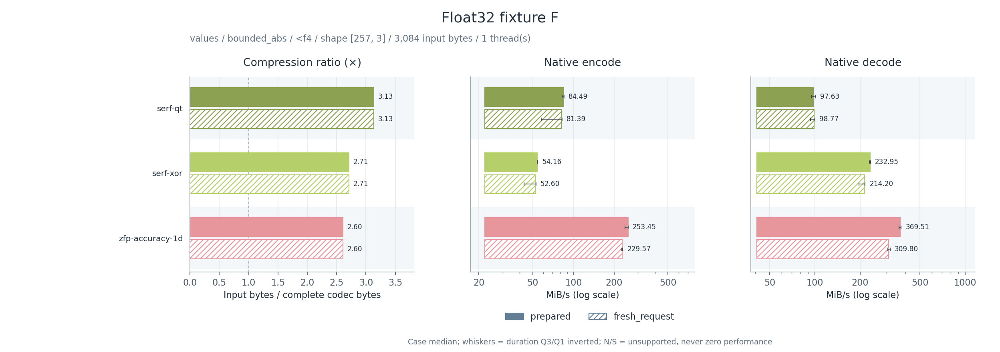

[下载 SVG](figures/float32-f--bounded_abs--cpu-single.svg)

<details>
<summary>完整数值、质量及拒绝原因</summary>

| codec | 完整输出 bytes | 压缩倍数 | 编码 MiB/s P / F | 解码 MiB/s P / F | P/F有效批次数 |
|---|---:|---:|---:|---:|---:|
| serf-qt | 984 | 3.134 | 84.492 / 81.391 | 97.628 / 98.767 | 14/14 / 14/14 |
| serf-xor | 1,138 | 2.710 | 54.157 / 52.597 | 232.949 / 214.201 | 14/14 / 14/14 |
| zfp-accuracy-1d | 1,184 | 2.605 | 253.446 / 229.567 | 369.512 / 309.803 | 14/14 / 14/14 |

| codec | 最大绝对误差（P/F 最坏值） | RMSE（P/F 最坏值） |
|---|---:|---:|
| serf-qt | 0.00987792 | 0.00587353 |
| serf-xor | 0.0078125 | 0.000744409 |
| zfp-accuracy-1d | 0.000000 | 0.000000 |

</details>

<a id="dataset-uint8-c"></a>

### uint8-c

输入：`|u1`、`[257]`、C布局；有效原始数据 **257 bytes**，257 values、0 timestamps。

**无损 · values · cpu-single（1线程）**

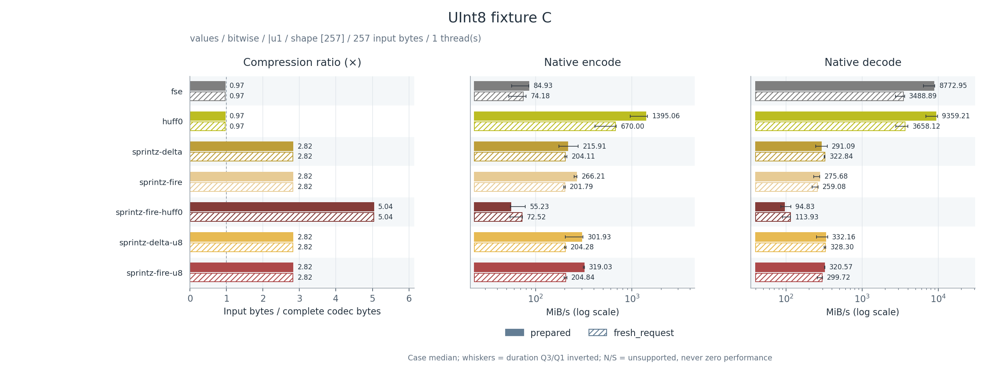

[下载 SVG](figures/uint8-c--bitwise--cpu-single.svg)

<details>
<summary>完整数值、质量及拒绝原因</summary>

| codec | 完整输出 bytes | 压缩倍数 | 编码 MiB/s P / F | 解码 MiB/s P / F | P/F有效批次数 |
|---|---:|---:|---:|---:|---:|
| fse | 266 | 0.966 | 84.927 / 74.177 | 8772.950 / 3488.887 | 14/14 / 14/14 |
| huff0 | 266 | 0.966 | 1395.058 / 670.000 | 9359.210 / 3658.124 | 14/14 / 14/14 |
| sprintz-delta | 91 | 2.824 | 215.906 / 204.107 | 291.086 / 322.838 | 14/14 / 14/14 |
| sprintz-fire | 91 | 2.824 | 266.208 / 201.786 | 275.677 / 259.085 | 14/14 / 14/14 |
| sprintz-fire-huff0 | 51 | 5.039 | 55.231 / 72.518 | 94.828 / 113.934 | 14/14 / 14/14 |
| sprintz-delta-u8 | 91 | 2.824 | 301.933 / 204.277 | 332.162 / 328.297 | 14/14 / 14/14 |
| sprintz-fire-u8 | 91 | 2.824 | 319.029 / 204.843 | 320.568 / 299.718 | 14/14 / 14/14 |

</details>

<a id="dataset-int16-c"></a>

### int16-c

输入：`<i2`、`[257, 2]`、C布局；有效原始数据 **1,028 bytes**，514 values、0 timestamps。

**无损 · values · cpu-single（1线程）**

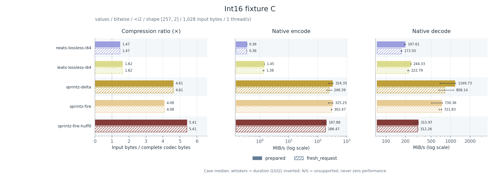

[下载 SVG](figures/int16-c--bitwise--cpu-single.svg)

<details>
<summary>完整数值、质量及拒绝原因</summary>

| codec | 完整输出 bytes | 压缩倍数 | 编码 MiB/s P / F | 解码 MiB/s P / F | P/F有效批次数 |
|---|---:|---:|---:|---:|---:|
| neats-lossless-i64 | 698 | 1.473 | 0.363 / 0.358 | 197.609 / 173.497 | 14/14 / 14/14 |
| leats-lossless-i64 | 634 | 1.621 | 1.455 / 1.375 | 244.327 / 222.791 | 14/14 / 14/14 |
| sprintz-delta | 223 | 4.610 | 324.353 / 248.385 | 1169.727 / 808.142 | 14/14 / 14/14 |
| sprintz-fire | 252 | 4.079 | 325.247 / 302.475 | 730.364 / 721.828 | 14/14 / 14/14 |
| sprintz-fire-huff0 | 190 | 5.411 | 197.879 / 186.468 | 315.970 / 312.259 | 14/14 / 14/14 |

</details>

<a id="dataset-int16-f"></a>

### int16-f

输入：`<i2`、`[257, 2]`、F布局；有效原始数据 **1,028 bytes**，514 values、0 timestamps。

**无损 · values · cpu-single（1线程）**

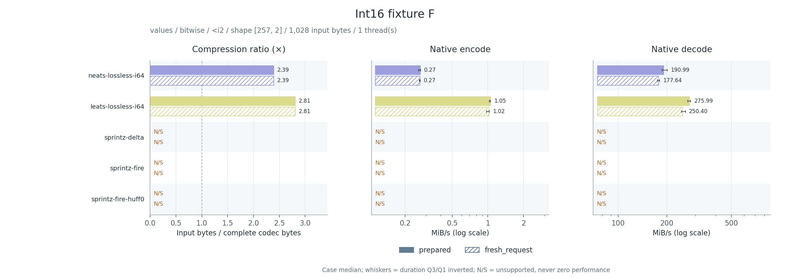

[下载 SVG](figures/int16-f--bitwise--cpu-single.svg)

<details>
<summary>完整数值、质量及拒绝原因</summary>

| codec | 完整输出 bytes | 压缩倍数 | 编码 MiB/s P / F | 解码 MiB/s P / F | P/F有效批次数 |
|---|---:|---:|---:|---:|---:|
| neats-lossless-i64 | 430 | 2.391 | 0.269 / 0.267 | 190.993 / 177.637 | 14/14 / 14/14 |
| leats-lossless-i64 | 366 | 2.809 | 1.052 / 1.024 | 275.993 / 250.404 | 14/14 / 14/14 |
| sprintz-delta | — | — | — / — | — / — | 0/0 / 0/0 |
| sprintz-fire | — | — | — / — | — / — | 0/0 / 0/0 |
| sprintz-fire-huff0 | — | — | — / — | — / — | 0/0 / 0/0 |

- `sprintz-delta`：unsupported，Sprintz requires C uint8/uint16 rank1/2 with 1..128 channels。两个生命周期均保留该拒绝，图中 N/S 不代表零性能。
- `sprintz-fire`：unsupported，Sprintz requires C uint8/uint16 rank1/2 with 1..128 channels。两个生命周期均保留该拒绝，图中 N/S 不代表零性能。
- `sprintz-fire-huff0`：unsupported，Sprintz requires C uint8/uint16 rank1/2 with 1..128 channels。两个生命周期均保留该拒绝，图中 N/S 不代表零性能。

</details>

<a id="dataset-uint32-c"></a>

### uint32-c

输入：`<u4`、`[257]`、C布局；有效原始数据 **1,028 bytes**，257 values、0 timestamps。

**无损 · values · cpu-single（1线程）**

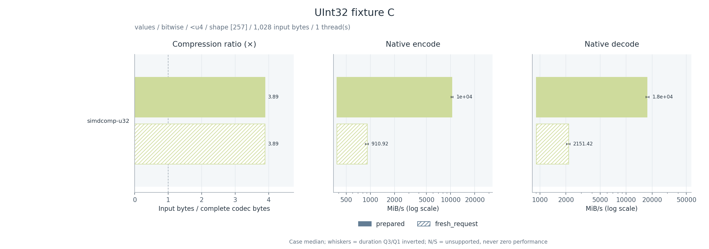

[下载 SVG](figures/uint32-c--bitwise--cpu-single.svg)

<details>
<summary>完整数值、质量及拒绝原因</summary>

| codec | 完整输出 bytes | 压缩倍数 | 编码 MiB/s P / F | 解码 MiB/s P / F | P/F有效批次数 |
|---|---:|---:|---:|---:|---:|
| simdcomp-u32 | 264 | 3.894 | 1.04e+04 / 910.920 | 1.75e+04 / 2151.424 | 14/14 / 14/14 |

</details>

<a id="dataset-symbols4-c-n64"></a>

### symbols4-c-n64

输入：`|u1`、`[64]`、C布局；有效原始数据 **64 bytes**，64 values、0 timestamps。

**无损 · values · cpu-single（1线程）**

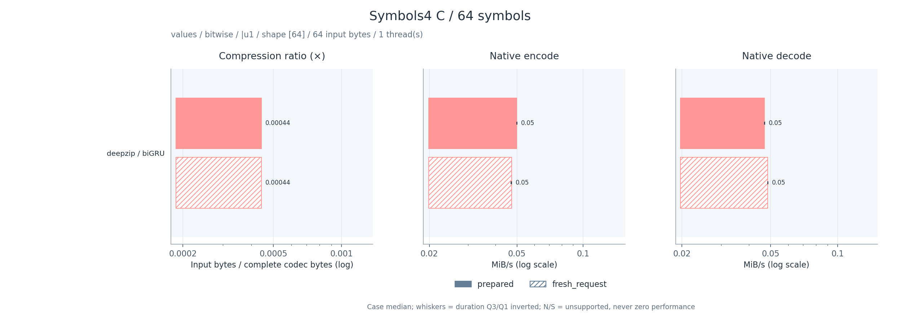

[下载 SVG](figures/symbols4-c-n64--bitwise--cpu-single.svg)

<details>
<summary>完整数值、质量及拒绝原因</summary>

| codec | 完整输出 bytes | 压缩倍数 | 编码 MiB/s P / F | 解码 MiB/s P / F | P/F有效批次数 |
|---|---:|---:|---:|---:|---:|
| deepzip / biGRU | 144,520 | 0.000443 | 0.050 / 0.047 | 0.047 / 0.049 | 14/14 / 14/14 |

- deepzip / biGRU：每次 encode/decode 各 64 个 uniform symbols、0 次 predict、0 次训练批、0 次 Adam 更新、更新后 0 次 predict（源码推导，非动态计数）。

</details>

**无损 · values · cpu-dzip-three（3线程）**

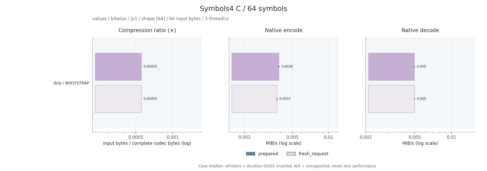

[下载 SVG](figures/symbols4-c-n64--bitwise--cpu-dzip-three.svg)

<details>
<summary>完整数值、质量及拒绝原因</summary>

| codec | 完整输出 bytes | 压缩倍数 | 编码 MiB/s P / F | 解码 MiB/s P / F | P/F有效批次数 |
|---|---:|---:|---:|---:|---:|
| dzip / BOOTSTRAP | 115,401 | 0.000555 | 0.00387 / 0.00372 | 0.00499 / 0.005 | 14/14 / 14/14 |

- dzip / BOOTSTRAP：每次 encode/decode 各 64 个 uniform symbols、0 次 predict、0 次训练批、0 次 Adam 更新、更新后 0 次 predict（源码推导，非动态计数）。

</details>

<a id="dataset-etth1-records-c"></a>

### etth1-records-c

输入：`<f8`、`[512]`、C布局；有效原始数据 **8,192 bytes**，512 values、512 timestamps。

联合 T+V 任务：分母各包含一次原始 T 和 V；压缩输出为完整 EncXOR。它与 V-only 图属于不同任务。

**无损 · records · cpu-single（1线程）**

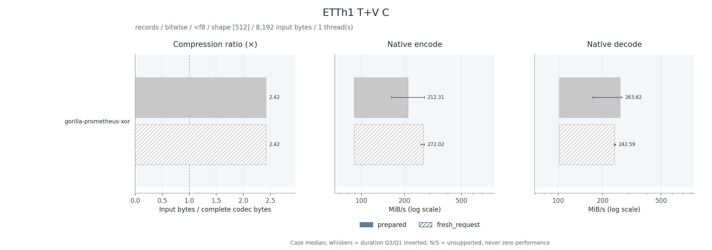

[下载 SVG](figures/etth1-records-c--bitwise--cpu-single.svg)

<details>
<summary>完整数值、质量及拒绝原因</summary>

| codec | 完整输出 bytes | 压缩倍数 | 编码 MiB/s P / F | 解码 MiB/s P / F | P/F有效批次数 |
|---|---:|---:|---:|---:|---:|
| gorilla-prometheus-xor | 3,382 | 2.422 | 212.311 / 272.018 | 263.617 / 242.590 | 14/14 / 14/14 |

</details>

<a id="dataset-weather-records-c"></a>

### weather-records-c

输入：`<f8`、`[512]`、C布局；有效原始数据 **8,192 bytes**，512 values、512 timestamps。

联合 T+V 任务：分母各包含一次原始 T 和 V；压缩输出为完整 EncXOR。它与 V-only 图属于不同任务。

**无损 · records · cpu-single（1线程）**

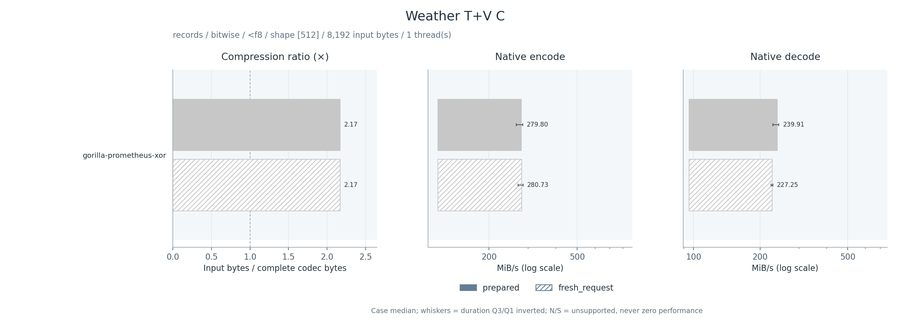

[下载 SVG](figures/weather-records-c--bitwise--cpu-single.svg)

<details>
<summary>完整数值、质量及拒绝原因</summary>

| codec | 完整输出 bytes | 压缩倍数 | 编码 MiB/s P / F | 解码 MiB/s P / F | P/F有效批次数 |
|---|---:|---:|---:|---:|---:|
| gorilla-prometheus-xor | 3,775 | 2.170 | 279.799 / 280.727 | 239.910 / 227.253 | 14/14 / 14/14 |

</details>

<a id="dataset-symbols4-c"></a>

### symbols4-c

输入：`|u1`、`[257]`、C布局；有效原始数据 **257 bytes**，257 values、0 timestamps。

**无损 · values · cpu-single（1线程）**

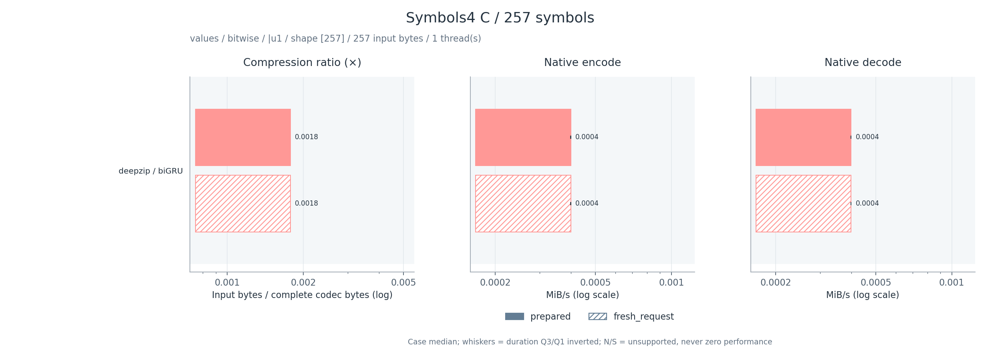

[下载 SVG](figures/symbols4-c--bitwise--cpu-single.svg)

<details>
<summary>完整数值、质量及拒绝原因</summary>

| codec | 完整输出 bytes | 压缩倍数 | 编码 MiB/s P / F | 解码 MiB/s P / F | P/F有效批次数 |
|---|---:|---:|---:|---:|---:|
| deepzip / biGRU | 144,568 | 0.00178 | 0.000399 / 0.000399 | 0.000399 / 0.000399 | 14/14 / 14/14 |

- deepzip / biGRU：每次 encode/decode 各 64 个 uniform symbols、193 次 predict、0 次训练批、0 次 Adam 更新、更新后 0 次 predict（源码推导，非动态计数）。

</details>

**无损 · values · cpu-dzip-three（3线程）**

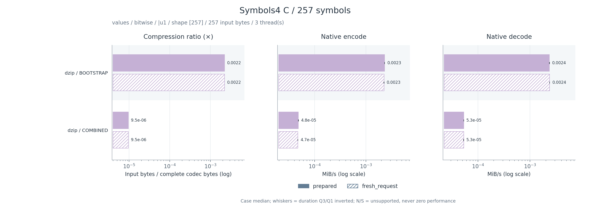

[下载 SVG](figures/symbols4-c--bitwise--cpu-dzip-three.svg)

<details>
<summary>完整数值、质量及拒绝原因</summary>

| codec | 完整输出 bytes | 压缩倍数 | 编码 MiB/s P / F | 解码 MiB/s P / F | P/F有效批次数 |
|---|---:|---:|---:|---:|---:|
| dzip / BOOTSTRAP | 115,449 | 0.00223 | 0.00232 / 0.00225 | 0.00236 / 0.00238 | 14/14 / 14/14 |
| dzip / COMBINED | 27,032,873 | 9.51e-06 | 4.8e-05 / 4.7e-05 | 5.32e-05 / 5.31e-05 | 14/14 / 14/14 |

- dzip / BOOTSTRAP：每次 encode/decode 各 64 个 uniform symbols、193 次 predict、0 次训练批、0 次 Adam 更新、更新后 0 次 predict（源码推导，非动态计数）。
- dzip / COMBINED：每次 encode/decode 各 64 个 uniform symbols、193 次 predict、1 次训练批、1 次 Adam 更新、更新后 65 次 predict（源码推导，非动态计数）。

</details>

<a id="capabilities"></a>

## 当前算法能力支持矩阵

范围为当前接入实现及其约束，不代表上游算法的全部可能能力。浅绿色表示登记支持，深绿色表示本轮实际完成，未请求的能力不推断为不支持。dtype登记支持仍需满足源域、长度、布局、模型alphabet等限制。

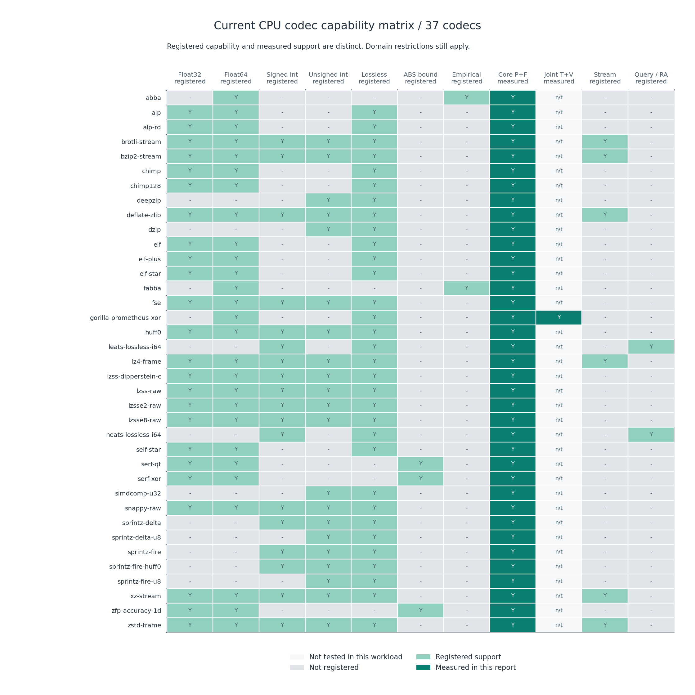

[下载 SVG](figures/capability-matrix.svg)

### 数据类型、运行路径与有效覆盖

rank列来自登记；C/F列仅列本轮通过的布局；P/F覆盖为有效案例数／请求数（包含有损组和神经补充路径）。dtype数字以bit为单位。ISA列先列登记项，再列本轮方法参数；未单列的参数不推断为SCALAR，也不代表动态指令追踪或峰值性能。

| codec | 登记dtype | 登记rank | 实测布局 | 保真模式 | 实测线程 | ISA（登记 → 参数） | P覆盖 / F覆盖 |
|---|---|---|---|---|---|---|---|
| [abba](../../registry/codecs/abba.json) | f64 | 1,2 | C | 经验质量 | 1 | SCALAR → SCALAR | 1/1 / 1/1 |
| [alp](../../registry/codecs/alp.json) | f32, f64 | 1,2 | C,F | 无损 | 1 | SCALAR → SCALAR | 7/9 / 7/9 |
| [alp-rd](../../registry/codecs/alp-rd.json) | f32, f64 | 1,2 | C,F | 无损 | 1 | SCALAR → SCALAR | 9/9 / 9/9 |
| [brotli-stream](../../registry/codecs/brotli-stream.json) | f32, f64, i16, i32, i64, u16, u32, u64, i8, u8 | 1,2,3,4 | C,F | 无损 | 1 | SCALAR → SCALAR | 5/5 / 5/5 |
| [bzip2-stream](../../registry/codecs/bzip2-stream.json) | f32, f64, i16, i32, i64, u16, u32, u64, i8, u8 | 1,2,3,4 | C,F | 无损 | 1 | SCALAR → SCALAR | 5/5 / 5/5 |
| [chimp](../../registry/codecs/chimp.json) | f32, f64 | 1,2 | C,F | 无损 | 1 | SCALAR → SCALAR | 9/9 / 9/9 |
| [chimp128](../../registry/codecs/chimp128.json) | f32, f64 | 1,2 | C,F | 无损 | 1 | SCALAR → SCALAR | 9/9 / 9/9 |
| [deepzip](../../registry/codecs/deepzip.json) | u8 | 1,2 | C | 无损 | 1 | SCALAR → SCALAR | 2/2 / 2/2 |
| [deflate-zlib](../../registry/codecs/deflate-zlib.json) | f32, f64, i16, i32, i64, u16, u32, u64, i8, u8 | 1,2,3,4 | C,F | 无损 | 1 | SCALAR → SCALAR | 5/5 / 5/5 |
| [dzip](../../registry/codecs/dzip.json) | u8 | 1,2 | C | 无损 | 3 | AVX → AVX | 3/3 / 3/3 |
| [elf](../../registry/codecs/elf.json) | f32, f64 | 1,2 | C,F | 无损 | 1 | SCALAR → SCALAR | 9/9 / 9/9 |
| [elf-plus](../../registry/codecs/elf-plus.json) | f32, f64 | 1,2 | C,F | 无损 | 1 | SCALAR → SCALAR | 9/9 / 9/9 |
| [elf-star](../../registry/codecs/elf-star.json) | f32, f64 | 1,2 | C,F | 无损 | 1 | SCALAR → SCALAR | 9/9 / 9/9 |
| [fabba](../../registry/codecs/fabba.json) | f64 | 1,2 | C | 经验质量 | 1 | SCALAR → SCALAR | 1/1 / 1/1 |
| [fse](../../registry/codecs/fse.json) | f32, f64, i16, i32, i64, u16, u32, u64, i8, u8 | 1,2,3,4 | C,F | 无损 | 1 | SCALAR → SCALAR | 5/5 / 5/5 |
| [gorilla-prometheus-xor](../../registry/codecs/gorilla-prometheus-xor.json) | f64 | 1,2 | C | 无损 | 1 | SCALAR → 未单列 | 2/2 / 2/2 |
| [huff0](../../registry/codecs/huff0.json) | f32, f64, i16, i32, i64, u16, u32, u64, i8, u8 | 1,2,3,4 | C,F | 无损 | 1 | SCALAR → SCALAR | 5/5 / 5/5 |
| [leats-lossless-i64](../../registry/codecs/leats-lossless-i64.json) | i16, i32, i64, i8 | 1,2 | C,F | 无损 | 1 | SCALAR → SCALAR | 2/2 / 2/2 |
| [lz4-frame](../../registry/codecs/lz4-frame.json) | f32, f64, i16, i32, i64, u16, u32, u64, i8, u8 | 1,2,3,4 | C,F | 无损 | 1 | SCALAR → SCALAR | 5/5 / 5/5 |
| [lzss-dipperstein-c](../../registry/codecs/lzss-dipperstein-c.json) | f32, f64, i16, i32, i64, u16, u32, u64, i8, u8 | 1,2,3,4 | C,F | 无损 | 1 | SCALAR → SCALAR | 5/5 / 5/5 |
| [lzss-raw](../../registry/codecs/lzss-raw.json) | f32, f64, i16, i32, i64, u16, u32, u64, i8, u8 | 1,2,3,4 | C,F | 无损 | 1 | SCALAR → SCALAR | 5/5 / 5/5 |
| [lzsse2-raw](../../registry/codecs/lzsse2-raw.json) | f32, f64, i16, i32, i64, u16, u32, u64, i8, u8 | 1,2,3,4 | C,F | 无损 | 1 | SSE4_1 → SSE4_1 | 5/5 / 5/5 |
| [lzsse8-raw](../../registry/codecs/lzsse8-raw.json) | f32, f64, i16, i32, i64, u16, u32, u64, i8, u8 | 1,2,3,4 | C,F | 无损 | 1 | SSE4_1 → SSE4_1 | 5/5 / 5/5 |
| [neats-lossless-i64](../../registry/codecs/neats-lossless-i64.json) | i16, i32, i64, i8 | 1,2 | C,F | 无损 | 1 | SCALAR → SCALAR | 2/2 / 2/2 |
| [self-star](../../registry/codecs/self-star.json) | f32, f64 | 1,2 | C,F | 无损 | 1 | SCALAR → SCALAR | 9/9 / 9/9 |
| [serf-qt](../../registry/codecs/serf-qt.json) | f32, f64 | 1,2 | C,F | ABS有损 | 1 | SCALAR → SCALAR | 4/4 / 4/4 |
| [serf-xor](../../registry/codecs/serf-xor.json) | f32, f64 | 1,2 | C,F | ABS有损 | 1 | SCALAR → SCALAR | 4/4 / 4/4 |
| [simdcomp-u32](../../registry/codecs/simdcomp-u32.json) | u32 | 1 | C | 无损 | 1 | SSE4_1,AVX2 → SSE4_1 | 1/1 / 1/1 |
| [snappy-raw](../../registry/codecs/snappy-raw.json) | f32, f64, i16, i32, i64, u16, u32, u64, i8, u8 | 1,2,3,4 | C,F | 无损 | 1 | SCALAR → SCALAR | 5/5 / 5/5 |
| [sprintz-delta](../../registry/codecs/sprintz-delta.json) | i16, u16, i8, u8 | 1,2 | C | 无损 | 1 | AVX2_BMI2_LZCNT → AVX2_BMI2_LZCNT | 2/3 / 2/3 |
| [sprintz-delta-u8](../../registry/codecs/sprintz-delta-u8.json) | u8 | 1 | C | 无损 | 1 | AVX2_BMI2_LZCNT → AVX2_BMI2_LZCNT | 1/1 / 1/1 |
| [sprintz-fire](../../registry/codecs/sprintz-fire.json) | i16, u16, i8, u8 | 1,2 | C | 无损 | 1 | AVX2_BMI2_LZCNT → AVX2_BMI2_LZCNT | 2/3 / 2/3 |
| [sprintz-fire-huff0](../../registry/codecs/sprintz-fire-huff0.json) | i16, u16, i8, u8 | 1,2 | C | 无损 | 1 | AVX2_BMI2_LZCNT → AVX2_BMI2_LZCNT | 2/3 / 2/3 |
| [sprintz-fire-u8](../../registry/codecs/sprintz-fire-u8.json) | u8 | 1 | C | 无损 | 1 | AVX2_BMI2_LZCNT → AVX2_BMI2_LZCNT | 1/1 / 1/1 |
| [xz-stream](../../registry/codecs/xz-stream.json) | f32, f64, i16, i32, i64, u16, u32, u64, i8, u8 | 1,2,3,4 | C,F | 无损 | 1 | SCALAR → SCALAR | 5/5 / 5/5 |
| [zfp-accuracy-1d](../../registry/codecs/zfp-accuracy-1d.json) | f32, f64 | 1,2 | C,F | ABS有损 | 1 | SCALAR → SCALAR | 4/4 / 4/4 |
| [zstd-frame](../../registry/codecs/zstd-frame.json) | f32, f64, i16, i32, i64, u16, u32, u64, i8, u8 | 1,2,3,4 | C,F | 无损 | 1 | SCALAR → SCALAR | 5/5 / 5/5 |

### 功能支持与实现限制

流式／查询／随机访问列为登记能力。当前native批次executor明确不测stream/query/GPU，因此这些勾选不表示本轮已有相应性能结果；NeaTS/LeaTS的query/RA也未在这里实测。除Gorilla联合T/V外，当前native批次要求单一投影组件、identity路由，不接受外部分列／chunk／transform方案。

| codec | 流式（登记） | 查询（登记） | 随机访问（登记） | 当前路径的重要限制 |
|---|---|---|---|---|
| abba | — | — | — | native_core 为 rank1 f64；经验质量，不提供最大点误差承诺 |
| alp | — | — | — | 强制 ALP；ETTh1 两布局选择 ALP-RD 时明确拒绝，不自动替换算法 |
| alp-rd | — | — | — | 强制 ALP-RD，与 ALP 分开计量 |
| brotli-stream | ✓ | — | — | 独立完整流；具体参数、源域和长度上限见登记卡片 |
| bzip2-stream | ✓ | — | — | 独立完整流；具体参数、源域和长度上限见登记卡片 |
| chimp | — | — | — | 独立完整流；具体参数、源域和长度上限见登记卡片 |
| chimp128 | — | — | — | 独立完整流；具体参数、源域和长度上限见登记卡片 |
| deepzip | — | — | — | native_core 为 rank1 u8；固定 biGRU fixture 模型／alphabet；64符号无预测，257符号有预测 |
| deflate-zlib | ✓ | — | — | 独立完整流；具体参数、源域和长度上限见登记卡片 |
| dzip | — | — | — | native_core 为 rank1 u8；caller+2 Eigen workers；BOOTSTRAP／COMBINED 分开，alphabet 受限 |
| elf | — | — | — | 独立完整流；具体参数、源域和长度上限见登记卡片 |
| elf-plus | — | — | — | 独立完整流；具体参数、源域和长度上限见登记卡片 |
| elf-star | — | — | — | 独立完整流；具体参数、源域和长度上限见登记卡片 |
| fabba | — | — | — | native_core 为 rank1 f64；经验质量，不提供最大点误差承诺 |
| fse | — | — | — | 单块 ≤128 KiB；未对本轮大真实对象自动切块 |
| gorilla-prometheus-xor | — | — | — | 本轮 optimized；一组 int64 T[N]+f64 V[N]，N≤65535，无 mask |
| huff0 | — | — | — | 单块 ≤128 KiB；未对本轮大真实对象自动切块 |
| leats-lossless-i64 | — | ✓ | ✓ | signed整数；物理流1–65536值及归一化跨度约束；查询/随机访问仅登记能力 |
| lz4-frame | ✓ | — | — | LZ4 frame、独立64 KiB blocks、内容checksum开；不是lzbench raw block |
| lzss-dipperstein-c | — | — | — | 独立完整流；具体参数、源域和长度上限见登记卡片 |
| lzss-raw | — | — | — | 独立完整流；具体参数、源域和长度上限见登记卡片 |
| lzsse2-raw | — | — | — | 独立完整流；具体参数、源域和长度上限见登记卡片 |
| lzsse8-raw | — | — | — | 独立完整流；具体参数、源域和长度上限见登记卡片 |
| neats-lossless-i64 | — | ✓ | ✓ | signed整数；物理流1–65536值及归一化跨度约束；查询/随机访问仅登记能力 |
| self-star | — | — | — | 独立完整流；具体参数、源域和长度上限见登记卡片 |
| serf-qt | — | — | — | ABS任务；必要异常原始块计入完整输出 |
| serf-xor | — | — | — | ABS任务；必要异常原始块计入完整输出 |
| simdcomp-u32 | — | — | — | rank1 u32；本轮 SSE4.1 LENGTH；注册的 AVX2 不支持 LENGTH |
| snappy-raw | — | — | — | RawCompress/RawUncompress；既有构建显式关闭SSSE3/BMI2等路径 |
| sprintz-delta | — | — | — | direct core 仅 C、rank1/2、1–128通道、8/16位整数；本轮 int16 F 被拒绝 |
| sprintz-delta-u8 | — | — | — | rank1 u8，≤131072值；AVX2/BMI2/LZCNT |
| sprintz-fire | — | — | — | direct core 仅 C、rank1/2、1–128通道、8/16位整数；本轮 int16 F 被拒绝 |
| sprintz-fire-huff0 | — | — | — | 同矩阵 Sprintz；原始输入另限120 KiB及Huff0阶段大小；本轮 int16 F 被拒绝 |
| sprintz-fire-u8 | — | — | — | rank1 u8，≤131072值；AVX2/BMI2/LZCNT |
| xz-stream | ✓ | — | — | 独立完整流；具体参数、源域和长度上限见登记卡片 |
| zfp-accuracy-1d | — | — | — | fixed accuracy；拒绝空输入、非有限值、subnormal和负零；质量逐产物检查 |
| zstd-frame | ✓ | — | — | 本轮 level3、内容checksum开；既有构建禁动态BMI2/ASM；流式能力未在本轮计时 |

CPU矩阵中的37个codec均有native_core的prepared和fresh_request有效案例；其余36个为单线程，本轮DZip使用3线程profile。GPU另有已登记的[cuSZp fixed-1d](../../registry/gpu/cuszp-fixed-1d.json)：CUDA、rank1 C连续f32/f64、ABS任务，输入限制有限normal或正零、量化范围及逐产物质量检查；它未纳入本轮CPU全量native_core结果，故不填入这些平均图。既有GPU结果见[独立报告](../gpu_results/README.md)。

### 本轮数据集上的实际支持

矩阵使用prepared案例，格内为有效／请求数；fresh的状态与之逐项一致。空格表示没有请求。DeepZip/DZip的短流、神经预测和DZip模式按冻结请求分别计数；橙色为明确unsupported，未绘成零吞吐。

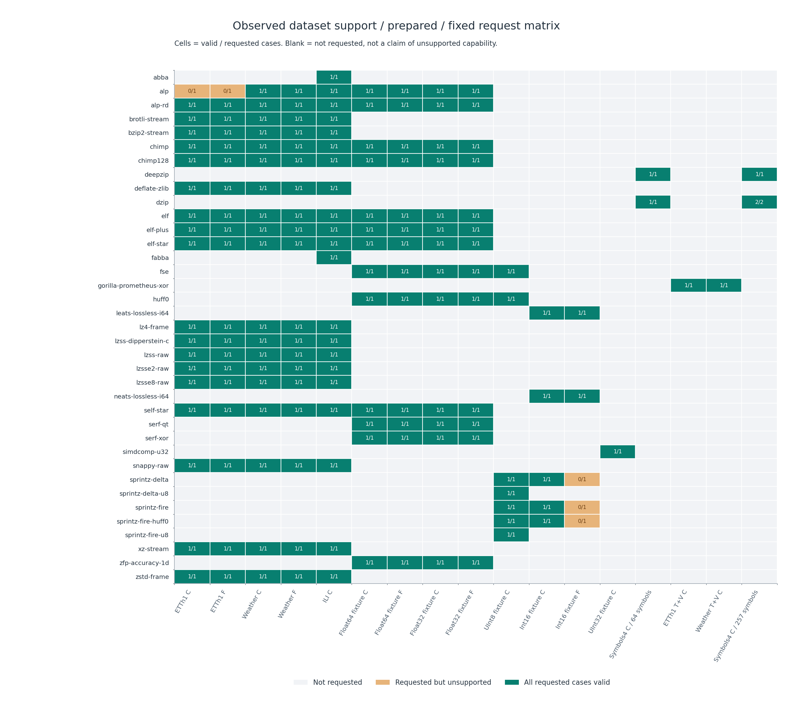

[下载 SVG](figures/dataset-support-matrix.svg)

<a id="methodology"></a>

## 统计口径与复现

- 单案例：每个生命周期2 sessions×7 rounds，14个正式原生批次；批次时间除以内循环次数后汇总。普通／DeepZip为8次测量操作/批，DZip为2次；各批另有2次warmup。内循环不增加独立数据集或独立session数。
- prepared：预建context和调用方buffer；每次必需reset、采样、建模、编码／finalize仍计时。fresh_request另外计创建、配置、bound和调用方分配；保留产物buffer的最终释放在计时外，也不是冷进程启动时间。
- 所有图均为本机、已冻结构建、natural cache的描述结果。保真类型、dtype、线程、模型路径不同的组分别展示，不合并成全算法总排名。ABS/经验质量图必须连同实际误差阅读。
- 本工具核对完整结果文件与全部28个run的manifest/raw/report哈希、CSV与证据中的指标、生命周期配对及输入身份；只读取既有测量。现有raw、原完整结果、历史native_results及其证据索引均未改写。

图像均同时提供PNG/SVG。[可视化数值CSV](visual_cases.csv)、[分组平均CSV](visual_averages.csv)、[绘图数据与源身份](visual_data.json)保存每个图值的案例引用及输入hash。

在项目根目录重新生成本页（不运行codec）：

```bash
MPLCONFIGDIR=/tmp/tsbench-matplotlib python benchmark/tools/visualize_all_core_results.py
```
