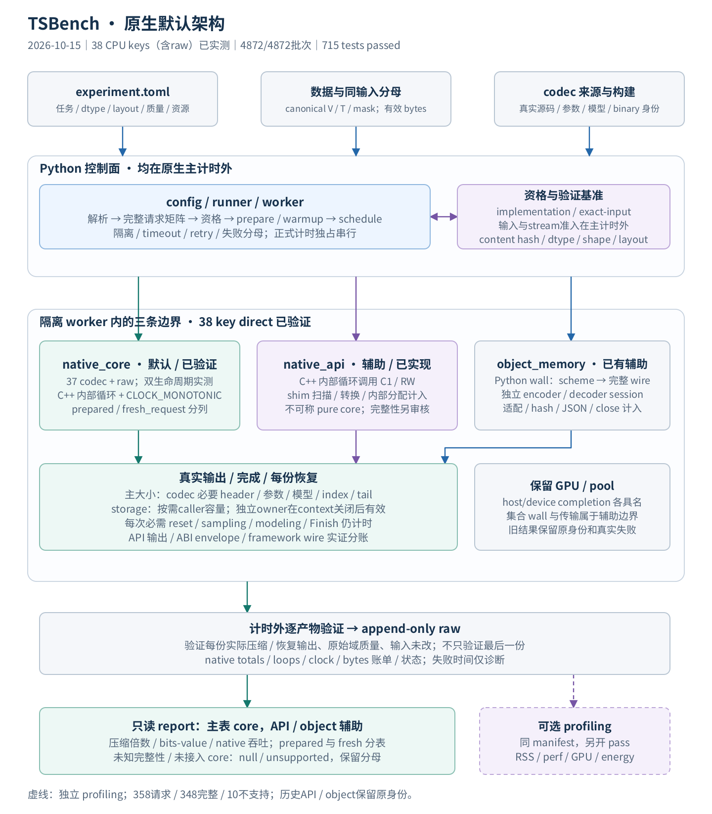
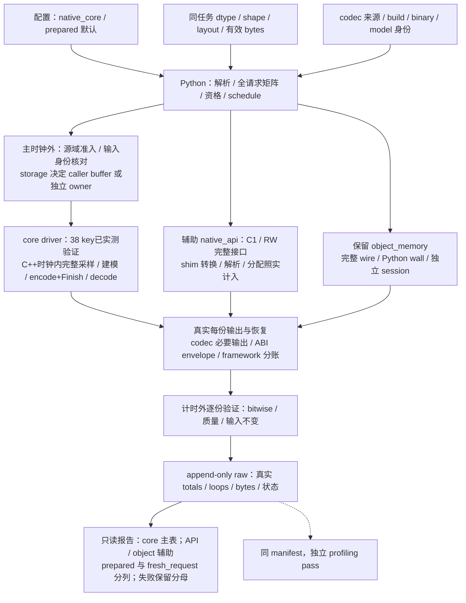
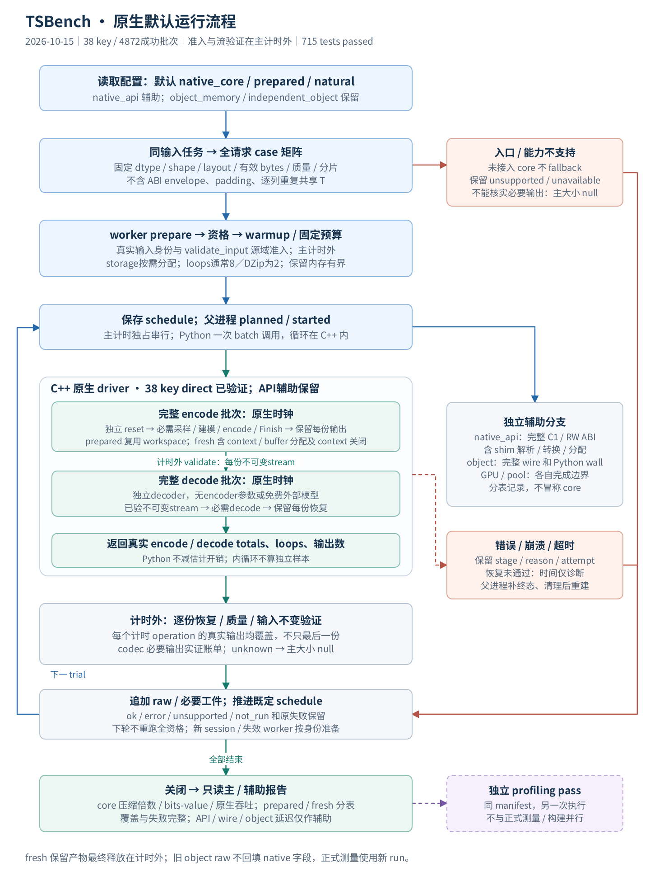
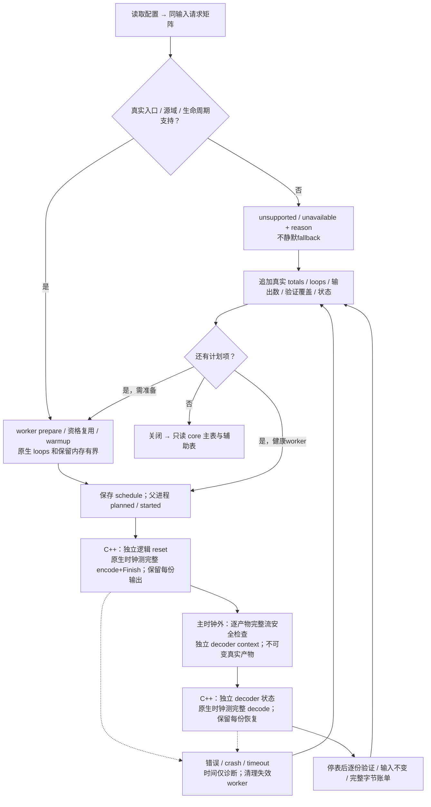
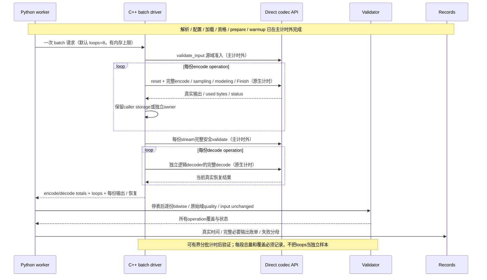

# TSBench 原生默认架构与执行流程

修订日期：2026-10-15。依据[工程实施总计划](../../TimeSeries_Compression_Benchmark_V4.0_工程实施总计划.md)§3–§13及§14.18–§14.20。默认目标为 **`native_core / prepared / natural`**：Python负责数据准备、资格、隔离、调度与记录；C/C++ driver直接调用codec并内部重复计时。**现有37个真实CPU codec加raw-store，共38个key，均已取得prepared与fresh_request的完整直接原生结果。** 28组正式实验共358请求、348 ready、10 unsupported，4872／4872正式批次成功；完整suite为715 passed。统一审计通过的[全量原生结果](../all_core_results/README.md)与[证据索引](../all_core_evidence.json)保存本轮身份。原有API／object、GPU／pool及首阶段六组结果保留各自历史边界。

`native_api`测完整C1／RW接口，shim内部扫描、转换和分配都计入，是辅助原生层；不能冒称纯core。`object_memory / independent_object / natural`显式保留，计完整typed wire及对象延迟。V／T／mask代表值、时间戳和有效性标记；shared T只计一次有效输入，padding／ABI头不能扩大分母。

本轮38个key的统一`tsbench_core_*`入口直接调用各算法，结果可由caller buffer或codec vector持有，绕过C1／RW envelope与额外复制；prepared仅提前准备合法context／固定模型，每次采样、训练与逻辑状态重置仍在encode内。Gorilla支持无mask的UTS联合T/V交错输入，16bytes／行。SVG／PNG与下列Mermaid均已同步本轮实现和实证范围；[开发日志](../development.md)持续记录变更。

正式阶段验证48216对压缩／恢复产物（38472对测量操作、9744对warmup），精确资格另验证3444对；内循环不增加统计样本数。神经补充使用完整257符号：DeepZip／DZip每次编解码各193次预测，COMBINED各含一次训练及65次更新后预测，次数由源码推导，非动态counter；原64符号零预测短流独立保留。Sprintz F布局6请求和强制ALP4请求为明确unsupported，不自动转置或回退。
统一storage两位flag分别声明encode／decode是否使用caller buffer，driver只分配所需caller容量；owned产物在context销毁后仍保持有效，计时外验证后release。附加`validate_input`准入和`validate`完整流安全检查在主计时外进行，允许独立context验证，decode只接收已验证的不可变产物。算法本身必需工作保持计时。原始输入content hash、dtype／shape／layout及真实有效bytes在Python、driver和独立恢复间一致，详细契约见[计划§14.19](../../TimeSeries_Compression_Benchmark_V4.0_工程实施总计划.md)。

## 模块结构



[SVG](architecture.svg)。profiling虚线表示独立pass。38个key在各自合法输入、质量、参数与线程约束下均已完成两个生命周期的直接原生实测；不支持的请求保留，不自动降级API／object。C1／RW辅助为单组件、无外部分块／transform，RW仅rank1；历史完整大小未审定者保留null。



codec完整必要输出包括真实header、参数、模型／字典、索引、exceptions、tail和finalize；框架实验JSON、hash、来源及纯ABI envelope在旁记录。`native_output_bytes`不自动等于`codec_complete_bytes`，只有真实格式区间和依赖审核后才入主表；无法核实时null及原因，禁止估计扣除。独立恢复不能借original／encoder context或免费的输入相关参数。

## 运行流程



[SVG](workflow.svg)。主计时独占串行；构建、数据准备、测试、绘图和profiling均在其外。拒绝case保留请求分母，不伪造正式trial；尚未运行的已计划slot保留not_run。



## 单个原生trial的时间范围

`prepared`在计时外建立合法context／buffer容量，但每次operation必须独立reset逻辑预测、字典和在线状态，reset与输入相关算法准备计入所测操作；不能把ALP采样或模型构建预计算移出。`fresh_request`原生时钟另包含context创建／配置、bound、caller buffer分配、完整操作及context关闭；为逐份验证保留的压缩／恢复buffer最终释放在计时外，不是含全部产物释放的总生命周期延迟。它不含Python进程启动，也不等于cache冷。对象目标继续使用新encoder／decoder session与Python wall。



分母为有效逻辑输入／恢复bytes，不是实际ABI envelope或重复共享T bytes。解码来自本次真实产物，natural cache不保证冷；独立decoder进程仍在exact-input资格路径，正式逻辑decoder不借encoder状态。GPU／pool保持具名完成wall或device-event，不混入CPU core主表。

## 与计划及生成源对应

| 图内容 | 计划依据 |
|---|---|
| typed任务、真实分母、公平条件 | §3 |
| Python控制面、直接core／C1／RW driver | §4 |
| codec必要输出、ABI与wire账单 | §5 |
| 原生循环、prepared／fresh、cache／GPU完成 | §6 |
| 两级资格、隔离worker、schedule、失败 | §7 |
| native默认与显式object配置 | §8 |
| 计时外逐份质量、模型政策 | §9 |
| 主／辅助表、raw与分层统计 | §10 |
| profiling与资源、N0–N5实施 | §11–§13 |

[生成源](render_diagrams.py)仅绘图，不执行codec；Pillow／Noto Sans CJK及rsvg-convert同步生成SVG／PNG：

```bash
python docs/diagrams/render_diagrams.py
rsvg-convert docs/diagrams/architecture.svg -o docs/diagrams/architecture.png
rsvg-convert docs/diagrams/workflow.svg -o docs/diagrams/workflow.png
```

已实现入口与示例见[README](../../README.md)、[native.toml](../../benchmark/examples/native.toml)和[fresh_request示例](../../benchmark/examples/native_fresh.toml)。当前38-key结果见[全量原生报告](../all_core_results/README.md)。

以下保留首阶段历史范围：当时完整测试372项通过，六组run共792请求、181 ready、611 unsupported，2534／2534正式trial成功：core prepared／fresh各280，辅助API无损1582、bounded84、empirical28，对象对照280。2254个native trial的8次正式及2次warmup各份产物均计时外验证，不把loops当独立样本。

该历史core主表覆盖3来源5种真实V表示上的四个入口（含raw参考）；当时36个真实CPU codec的通用API辅助覆盖不等于36个direct core，未核实完整输出大小者保持null。typed API资格与真实core结果分列，fresh／对象对照各自保持生命周期。历史逐run报告、图表、输入窗口、限制和溯源见[首阶段原生报告](../native_results/README.md)与[首阶段证据索引](../native_evidence.json)。
