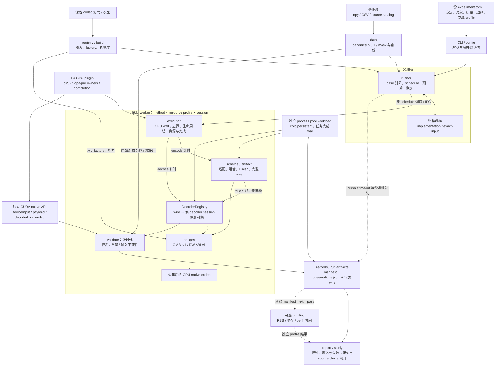
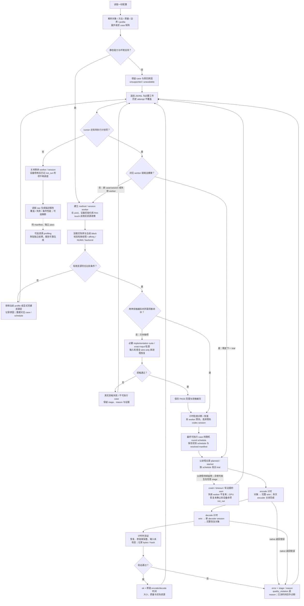
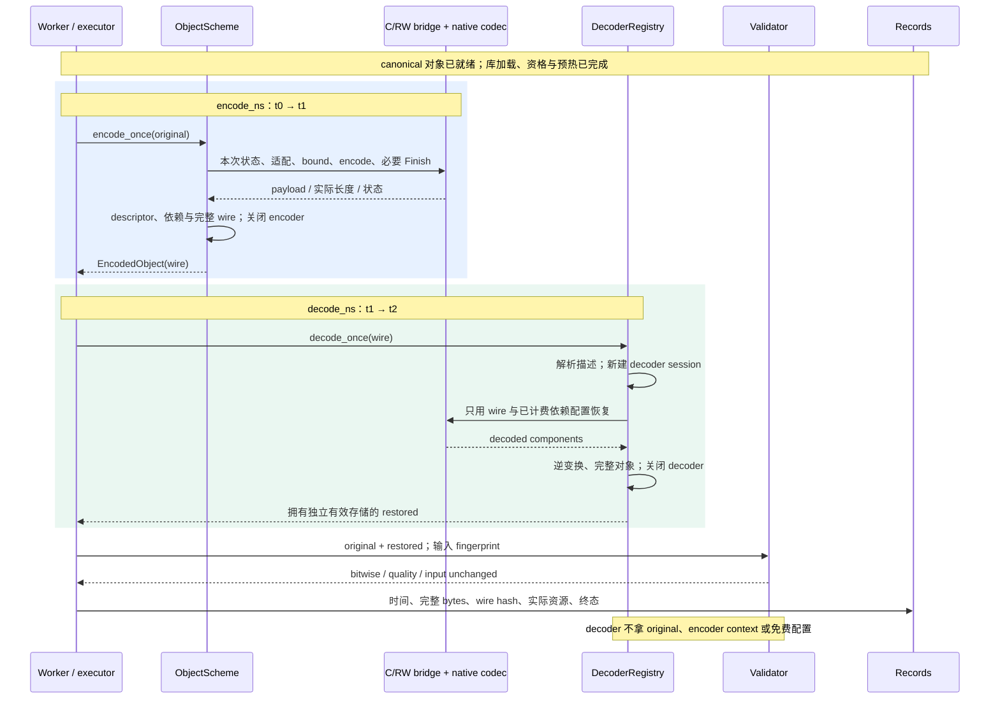

# TSBench V4.0 框架结构与执行流程

绘制日期：2026-10-13。依据：[V4.0 工程实施总计划](../../TimeSeries_Compression_Benchmark_V4.0_工程实施总计划.md) §3–§11。CPU object_memory 主路径已实施；外部进程pool、native边界实验及source-cluster统计为独立工具，复用对象／bridge协议而各存执行身份。cuSZp GPU plugin 已完成 host_to_host 与 device_resident formal 路径；图中的 GPU 节点对应真实执行器，具体分母、质量失败和身份见总计划 §14 及 GPU run。stream/query仍为未声称的设计扩展。

图中 V / T / mask 分别代表数值、时间戳与有效性标记；wire 是包含恢复描述、payload 和必要依赖的序列化产物。实线表示核心关系或流程，虚线标注可选扩展、独立 profiling 或父进程异常补记；每条虚线的具体含义以标签为准。

## 1. 模块结构


[SVG 矢量图](architecture.svg)。三个核心职责是 **bridge 调 codec、scheme 产完整对象、executor 落实计时和完成**。worker 是进程隔离单位，codec session 是每个独立对象的状态生命周期，二者不可混用。



CPU/GPU executor 使用各自真实 API。GPU 插件不能把 device 指针传给现有 host C/RW ABI；上图中的 C/RW bridge 是当前保留资产的路径。CPU 的 ISA／内部线程属于实现和资源因素，不能从 CPU 支持 SIMD 或配置写了线程数推定已经执行该路径。

## 2. 一次实验的运行流程


[SVG 矢量图](workflow.svg)。图展开一个比较 block/session 内的主流程，runner 对完整矩阵重复相应准备和调度。首版同一时刻只有一个主计时任务；不同方法可以有独立待命 worker。



静态支持检查只是提前拒绝显然不支持的 case；实际内容域、资源和动态资格仍在后续确认。不支持 case 不生成虚假的重复 trial；计划可执行后未运行的 trial 保留 not_run。资源不符时不能沿原资源层继续比较；另建层后重新生成相应条件和调度。当前 GPU formal 中 f32 大输入的严格质量违例就是这种 admission failure，成功 case 与失败分母分开报告。

核心重复箭头从“写入 raw”经安全调度回到健康 worker 的“下一 trial”，不回到完整资格套件。case 拒绝只推进其他 case；新 case/session 或失效 worker 需要准备／重建，按内容身份查询资格复用范围。GPU 恢复未确认时结束该设备 session、余项记 not_run，不继续该设备测量。资格命中不能跳过正式编码、独立恢复或逐 trial 验证。retry 增加 attempt，resume 补未完成项，均保留历史失败。

## 3. 单个 CPU trial：数据与计时边界



正式 trial 的新 decoder session 可以位于同一 worker。新 decoder **进程**属于未命中的 exact-input 独立恢复资格检查，不是默认每个 trial 的开销。默认刚生成的 wire 不表示冷 cache，natural 只表示不主动干预缓存。

GPU 扩展保留同一逻辑：先 quiesce，再从 submit 计到 complete；所选边界需要的传输、status、materialize 与独立对象 teardown 均完成后停止 wall timer。device-event 时间作为独立细分指标，不能代替 host_to_host 完成时间。

## 4. 与计划的对应关系

| 图中部分 | V4.0 计划依据 |
|---|---|
| V/T/mask、case 与公平条件 | §3 |
| 独立包、bridge/scheme/executor、两 ABI | §4 |
| wire、依赖和完整大小 | §5 |
| encode/decode、生命周期、GPU completion | §6 |
| 两资格缓存、worker、随机 round、失败恢复 | §7 |
| 一份配置、有效资源与 inspect/build/run | §8 |
| 正确性与质量验证 | §9 |
| JSONL、覆盖与失败、描述／研究统计 | §10 |
| 线程／SIMD／GPU／pool 与独立 profiling | §11 |

最小实现从 raw-store + zstd-frame + lzss-raw 的对象闭环开始（P0），随后补两 ABI／对象能力与可靠重复（P1/P2）。资源扩展按 P4 接入，不成为首轮 CPU 有效测量的前置条件。

两张静态图由 [render_diagrams.py](render_diagrams.py) 生成 SVG，使用 Pillow、Noto Sans CJK 字体与 `rsvg-convert` 生成预览；上面的 Mermaid 是可编辑的逻辑图源。重新生成命令在仓库根目录执行：

```bash
python docs/diagrams/render_diagrams.py
rsvg-convert docs/diagrams/architecture.svg -o docs/diagrams/architecture.png
rsvg-convert docs/diagrams/workflow.svg -o docs/diagrams/workflow.png
```
