# forecasting_transpose 压缩算法可视化报告

生成时间：2026-10-19 11:56:38（Asia/Shanghai，UTC+08:00）。

选自 **8,093 个 CSV、53 个数据家族的 53 个代表文件**；每个代表文件使用全部行、全部数值列。完整 float64 主输入未截断、填补、归一化或额外量化；补充 dtype 任务单独声明。

当前 **42 个 CPU codec**（排除 `lzss-raw`、`lzss-dipperstein-c`；不含 raw-store 基线）；冻结 **5,486 个请求**，已审计 5,486 个，完整有效 3,028 个，正式批次 42,392/42,392 成功。

另有 **1 个 GPU codec（cuSZp）**：已审计 212 个请求，完整有效 100 个。本页合计 **43 个算法、5,698 个请求、3,128 个完整有效案例**；CPU与GPU的计时、存储边界分别声明。

另加 1 个完整文件作为 DeepZip 原生符号域补充，单独展示，不改变 53 个代表文件的平均分母。该补充在正式测量前，按符合 0..3 符号域的 4 个完整文件取下中位选出。

[平均结果](#averages) · [逐数据集结果](#datasets) · [算法覆盖](#coverage) · [GPU结果](#gpu) · [统计口径与复现](#methodology)

[逐案例 CSV](primary.csv) · [审计证据](audit.json) · [冻结选样和配置](../../benchmark/experiments/forecasting-20261018-1614/design.json)

以下CPU图的压缩倍数 = 有效原始 bytes / 完整 codec 输出 bytes；编码、解码按相同原始 bytes 归一化为 MiB/s。完整输出包含 codec 必要参数、模型和结束数据；实验管理 JSON、hash 不计入。实心为 prepared，斜线为空心 fresh_request；吞吐使用对数轴，误差线由批次时长的 Q3/Q1 反算。GPU采用独立对象边界和完整object wire，见GPU章节，不混合比较。1×虚线表示膨胀分界。N/A 表示拒绝、缺失或未完整完成，不能解释为零性能。

GPU 扩展 `cuSZp-fixed-1d`：本轮宿主机测量结果见独立的 [GPU章节](#gpu)，不与CPU native_core结果混合排名。

[GPU 可用性检查](../../benchmark/experiments/forecasting-20261018-1614/gpu_availability.json)

## 通用快速编码器概览

五个预先指定的完整代表文件，prepared、float64、无损；完整算法与 fresh_request 结果见后文。

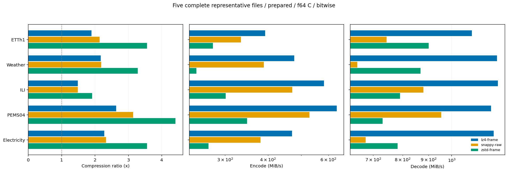

[SVG](figures/fast-codecs-overview.svg)

<a id="averages"></a>

## 平均结果

每个数据家族等权；先取每案例 14 个正式批次时长的中位数，再反算吞吐并对固定家族集合求算术平均。某 codec 缺少任一家族的完整有效结果，则其该组均值为 N/A。不同 dtype、质量任务及线程配置不合并。均值不使用成功子集替代固定集合，也不是合并所有文件后的总吞吐或总字节比。 本轮包含顺序和隔离核心并行两种调度条件；均值描述本次混合调度，不代表统一独占条件下的性能，详见调度记录。

### <f4 · 无损 · values · cpu-single

<details><summary>均值及覆盖分母</summary>

| codec | 有效／固定家族数 P / F | 平均压缩倍数 P / F | 平均编码 MiB/s P / F | 平均解码 MiB/s P / F |
|---|---:|---:|---:|---:|
| chimp32 | 41/53 / 41/53 | — / — | — / — | — / — |
| chimpn32 | 41/53 / 41/53 | — / — | — / — | — / — |

</details>

### <f4 · 经验质量（无最大误差保证） · values · cpu-single

<details><summary>均值及覆盖分母</summary>

| codec | 有效／固定家族数 P / F | 平均压缩倍数 P / F | 平均编码 MiB/s P / F | 平均解码 MiB/s P / F |
|---|---:|---:|---:|---:|
| pmc-mr | 28/53 / 28/53 | — / — | — / — | — / — |
| swing-filter | 28/53 / 28/53 | — / — | — / — | — / — |
| swing-filter-disjoint | 28/53 / 28/53 | — / — | — / — | — / — |
| swing-filter-disjoint-quantized / compatible | 0/53 / 0/53 | — / — | — / — | — / — |
| swing-filter-disjoint-quantized / strict_abs | 24/53 / 24/53 | — / — | — / — | — / — |

</details>

### <f8 · 无损 · records · cpu-single

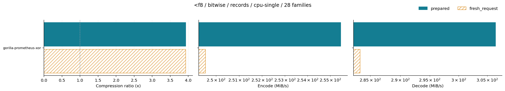

[SVG](figures/mean-02.svg)

<details><summary>均值及覆盖分母</summary>

| codec | 有效／固定家族数 P / F | 平均压缩倍数 P / F | 平均编码 MiB/s P / F | 平均解码 MiB/s P / F |
|---|---:|---:|---:|---:|
| gorilla-prometheus-xor | 28/28 / 28/28 | 3.93 / 3.93 | 255 / 250 | 306 / 283 |

</details>

### <f8 · 无损 · values · cpu-dzip-three

<details><summary>均值及覆盖分母</summary>

| codec | 有效／固定家族数 P / F | 平均压缩倍数 P / F | 平均编码 MiB/s P / F | 平均解码 MiB/s P / F |
|---|---:|---:|---:|---:|
| dzip | 0/53 / 0/53 | — / — | — / — | — / — |

</details>

### <f8 · 无损 · values · cpu-single

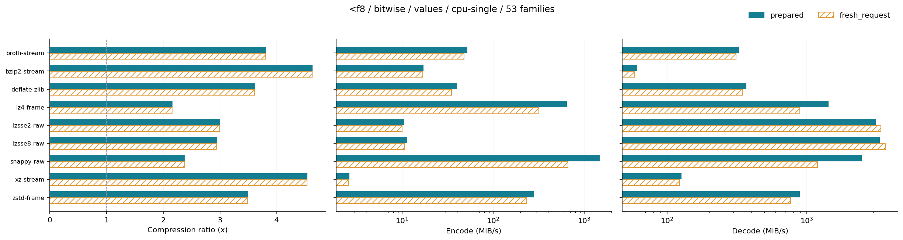

[SVG](figures/mean-04.svg)

<details><summary>均值及覆盖分母</summary>

| codec | 有效／固定家族数 P / F | 平均压缩倍数 P / F | 平均编码 MiB/s P / F | 平均解码 MiB/s P / F |
|---|---:|---:|---:|---:|
| alp | 52/53 / 52/53 | — / — | — / — | — / — |
| alp-rd | 52/53 / 52/53 | — / — | — / — | — / — |
| brotli-stream | 53/53 / 53/53 | 3.81 / 3.81 | 51.7 / 47.7 | 325 / 312 |
| bzip2-stream | 53/53 / 53/53 | 4.63 / 4.63 | 17 / 16.8 | 61 / 58.9 |
| chimp | 41/53 / 41/53 | — / — | — / — | — / — |
| chimp128 | 41/53 / 41/53 | — / — | — / — | — / — |
| chimp128-no-index | 41/53 / 41/53 | — / — | — / — | — / — |
| chimp32 | 0/53 / 0/53 | — / — | — / — | — / — |
| chimpn | 41/53 / 41/53 | — / — | — / — | — / — |
| chimpn32 | 0/53 / 0/53 | — / — | — / — | — / — |
| deepzip | 0/53 / 0/53 | — / — | — / — | — / — |
| deflate-zlib | 53/53 / 53/53 | 3.61 / 3.61 | 39.5 / 34.8 | 368 / 346 |
| elf | 50/53 / 50/53 | — / — | — / — | — / — |
| elf-plus | 50/53 / 50/53 | — / — | — / — | — / — |
| elf-star | 50/53 / 50/53 | — / — | — / — | — / — |
| fse | 28/53 / 28/53 | — / — | — / — | — / — |
| gorilla-prometheus-xor | 0/53 / 0/53 | — / — | — / — | — / — |
| huff0 | 28/53 / 28/53 | — / — | — / — | — / — |
| leats-lossless-i64 | 0/53 / 0/53 | — / — | — / — | — / — |
| lz4-frame | 53/53 / 53/53 | 2.16 / 2.16 | 639 / 317 | 1.43e+03 / 893 |
| lzsse2-raw | 53/53 / 53/53 | 2.99 / 2.99 | 10.4 / 9.96 | 3.11e+03 / 3.41e+03 |
| lzsse8-raw | 53/53 / 53/53 | 2.94 / 2.94 | 11.2 / 10.7 | 3.32e+03 / 3.67e+03 |
| neats-lossless-i64 | 0/53 / 0/53 | — / — | — / — | — / — |
| self-star | 41/53 / 41/53 | — / — | — / — | — / — |
| simdcomp-u32 | 0/53 / 0/53 | — / — | — / — | — / — |
| snappy-raw | 53/53 / 53/53 | 2.37 / 2.37 | 1.46e+03 / 660 | 2.47e+03 / 1.19e+03 |
| sprintz-delta | 0/53 / 0/53 | — / — | — / — | — / — |
| sprintz-delta-huffman | 0/53 / 0/53 | — / — | — / — | — / — |
| sprintz-fire | 0/53 / 0/53 | — / — | — / — | — / — |
| sprintz-fire-huffman | 0/53 / 0/53 | — / — | — / — | — / — |
| xz-stream | 53/53 / 53/53 | 4.54 / 4.54 | 2.62 / 2.58 | 126 / 123 |
| zstd-frame | 53/53 / 53/53 | 3.49 / 3.49 | 278 / 233 | 886 / 770 |

</details>

### <f8 · ABS ≤ 0.01 · values · cpu-single

<details><summary>均值及覆盖分母</summary>

| codec | 有效／固定家族数 P / F | 平均压缩倍数 P / F | 平均编码 MiB/s P / F | 平均解码 MiB/s P / F |
|---|---:|---:|---:|---:|
| serf-qt | 52/53 / 52/53 | — / — | — / — | — / — |
| serf-xor | 52/53 / 52/53 | — / — | — / — | — / — |
| zfp-accuracy-1d | 50/53 / 50/53 | — / — | — / — | — / — |

</details>

### <f8 · 经验质量（无最大误差保证） · values · cpu-single

<details><summary>均值及覆盖分母</summary>

| codec | 有效／固定家族数 P / F | 平均压缩倍数 P / F | 平均编码 MiB/s P / F | 平均解码 MiB/s P / F |
|---|---:|---:|---:|---:|
| abba | 28/53 / 28/53 | — / — | — / — | — / — |
| fabba | 28/53 / 28/53 | — / — | — / — | — / — |
| pmc-mr | 0/53 / 0/53 | — / — | — / — | — / — |
| swing-filter | 0/53 / 0/53 | — / — | — / — | — / — |
| swing-filter-disjoint | 0/53 / 0/53 | — / — | — / — | — / — |
| swing-filter-disjoint-quantized / compatible | 0/53 / 0/53 | — / — | — / — | — / — |

</details>

### <i2 · 无损 · values · cpu-single

<details><summary>均值及覆盖分母</summary>

| codec | 有效／固定家族数 P / F | 平均压缩倍数 P / F | 平均编码 MiB/s P / F | 平均解码 MiB/s P / F |
|---|---:|---:|---:|---:|
| sprintz-delta | 13/15 / 13/15 | — / — | — / — | — / — |
| sprintz-delta-huffman | 13/15 / 13/15 | — / — | — / — | — / — |
| sprintz-fire | 13/15 / 13/15 | — / — | — / — | — / — |
| sprintz-fire-huffman | 13/15 / 13/15 | — / — | — / — | — / — |

</details>

### <i8 · 无损 · values · cpu-single

<details><summary>均值及覆盖分母</summary>

| codec | 有效／固定家族数 P / F | 平均压缩倍数 P / F | 平均编码 MiB/s P / F | 平均解码 MiB/s P / F |
|---|---:|---:|---:|---:|
| leats-lossless-i64 | 13/18 / 13/18 | — / — | — / — | — / — |
| neats-lossless-i64 | 13/18 / 13/18 | — / — | — / — | — / — |

</details>

### <u4 · 无损 · values · cpu-single

<details><summary>均值及覆盖分母</summary>

| codec | 有效／固定家族数 P / F | 平均压缩倍数 P / F | 平均编码 MiB/s P / F | 平均解码 MiB/s P / F |
|---|---:|---:|---:|---:|
| simdcomp-u32 | 13/17 / 13/17 | — / — | — / — | — / — |

</details>

### |u1 · 无损 · values · cpu-dzip-three

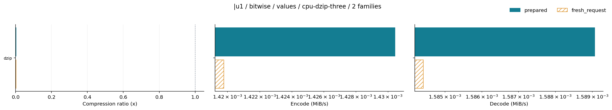

[SVG](figures/mean-10.svg)

<details><summary>均值及覆盖分母</summary>

| codec | 有效／固定家族数 P / F | 平均压缩倍数 P / F | 平均编码 MiB/s P / F | 平均解码 MiB/s P / F |
|---|---:|---:|---:|---:|
| dzip | 2/2 / 2/2 | 0.00218 / 0.00218 | 0.00143 / 0.00142 | 0.00159 / 0.00158 |

</details>

### |u1 · 无损 · values · cpu-single

<details><summary>均值及覆盖分母</summary>

| codec | 有效／固定家族数 P / F | 平均压缩倍数 P / F | 平均编码 MiB/s P / F | 平均解码 MiB/s P / F |
|---|---:|---:|---:|---:|
| deepzip | 0/2 / 0/2 | — / — | — / — | — / — |

</details>

<a id="datasets"></a>

## 逐数据集结果

选样规则：文件名在 `_dataset` 前的前缀作为家族；其余名称去掉末尾 `_数字`。每家族按（完整数值元素数量、文件名）排序后取下中位文件。大写 Weather 与小写 weather 分别保留为不同来源家族。所有选择在正式运行前冻结。

| 家族 | 家族文件数 | 代表文件 | 原始 f64 shape | 有效数值 bytes |
|---|---:|---|---|---:|
| AQShunyi | 1 | [AQShunyi](#dataset-AQShunyi) | [35064, 11] | 3,085,632 |
| AQWan | 1 | [AQWan](#dataset-AQWan) | [35064, 11] | 3,085,632 |
| Covid-19 | 1 | [Covid-19](#dataset-Covid-19) | [1392, 948] | 10,556,928 |
| CzeLan | 1 | [CzeLan](#dataset-CzeLan) | [19934, 11] | 1,754,192 |
| ETTh1 | 1 | [ETTh1](#dataset-ETTh1) | [17420, 7] | 975,520 |
| ETTh2 | 1 | [ETTh2](#dataset-ETTh2) | [17420, 7] | 975,520 |
| ETTm1 | 1 | [ETTm1](#dataset-ETTm1) | [69680, 7] | 3,902,080 |
| ETTm2 | 1 | [ETTm2](#dataset-ETTm2) | [69680, 7] | 3,902,080 |
| Electricity | 1 | [Electricity](#dataset-Electricity) | [26304, 321] | 67,548,672 |
| Exchange | 1 | [Exchange](#dataset-Exchange) | [7588, 8] | 485,632 |
| FRED-MD | 1 | [FRED-MD](#dataset-FRED-MD) | [728, 107] | 623,168 |
| ILI | 1 | [ILI](#dataset-ILI) | [966, 7] | 54,096 |
| METR-LA | 1 | [METR-LA](#dataset-METR-LA) | [34272, 207] | 56,754,432 |
| NASDAQ | 1 | [NASDAQ](#dataset-NASDAQ) | [1245, 5] | 49,800 |
| NN5 | 1 | [NN5](#dataset-NN5) | [791, 111] | 702,408 |
| NYSE | 1 | [NYSE](#dataset-NYSE) | [1244, 5] | 49,760 |
| PEMS-BAY | 1 | [PEMS-BAY](#dataset-PEMS-BAY) | [52116, 325] | 135,501,600 |
| PEMS04 | 1 | [PEMS04](#dataset-PEMS04) | [16992, 307] | 41,732,352 |
| PEMS08 | 1 | [PEMS08](#dataset-PEMS08) | [17856, 170] | 24,284,160 |
| Solar | 1 | [Solar](#dataset-Solar) | [52560, 137] | 57,605,760 |
| Traffic | 1 | [Traffic](#dataset-Traffic) | [17544, 862] | 120,983,424 |
| Weather | 1 | [Weather](#dataset-Weather) | [52696, 21] | 8,852,928 |
| Wike2000 | 1 | [Wike2000](#dataset-Wike2000) | [792, 2000] | 12,672,000 |
| Wind | 1 | [Wind](#dataset-Wind) | [48673, 7] | 2,725,688 |
| ZafNoo | 1 | [ZafNoo](#dataset-ZafNoo) | [19225, 11] | 1,691,800 |
| bitcoin | 18 | [bitcoin_dataset_without_missing_values_9](#dataset-bitcoin_dataset_without_missing_values_9) | [4021] | 32,168 |
| cif_2016 | 26 | [cif_2016_dataset_16](#dataset-cif_2016_dataset_16) | [120] | 960 |
| dominick | 470 | [dominick_dataset_47900](#dataset-dominick_dataset_47900) | [110] | 880 |
| economics | 87 | [economics_22](#dataset-economics_22) | [204] | 1,632 |
| finance | 96 | [finance_66](#dataset-finance_66) | [761] | 6,088 |
| human | 97 | [human_26](#dataset-human_26) | [1464] | 11,712 |
| kdd_cup_2018 | 270 | [kdd_cup_2018_dataset_without_missing_values_3](#dataset-kdd_cup_2018_dataset_without_missing_values_3) | [10898] | 87,184 |
| m1_monthly | 49 | [m1_monthly_dataset_297](#dataset-m1_monthly_dataset_297) | [84] | 672 |
| m1_quarterly | 30 | [m1_quarterly_dataset_91](#dataset-m1_quarterly_dataset_91) | [56] | 448 |
| m1_yearly | 62 | [m1_yearly_dataset_31](#dataset-m1_yearly_dataset_31) | [28] | 224 |
| m3_monthly | 57 | [m3_monthly_dataset_261](#dataset-m3_monthly_dataset_261) | [69] | 552 |
| m3_other | 174 | [m3_other_dataset_66](#dataset-m3_other_dataset_66) | [71] | 568 |
| m3_quarterly | 135 | [m3_quarterly_dataset_416](#dataset-m3_quarterly_dataset_416) | [52] | 416 |
| m3_yearly | 229 | [m3_yearly_dataset_173](#dataset-m3_yearly_dataset_173) | [41] | 328 |
| m4_daily | 585 | [m4_daily_dataset_3070](#dataset-m4_daily_dataset_3070) | [2074] | 16,592 |
| m4_hourly | 414 | [m4_hourly_dataset_207](#dataset-m4_hourly_dataset_207) | [1008] | 8,064 |
| m4_monthly | 1352 | [m4_monthly_dataset_38783](#dataset-m4_monthly_dataset_38783) | [251] | 2,008 |
| m4_quarterly | 1253 | [m4_quarterly_dataset_19867](#dataset-m4_quarterly_dataset_19867) | [103] | 824 |
| m4_weekly | 335 | [m4_weekly_dataset_36](#dataset-m4_weekly_dataset_36) | [947] | 7,576 |
| m4_yearly | 953 | [m4_yearly_dataset_664](#dataset-m4_yearly_dataset_664) | [26] | 208 |
| nature | 98 | [nature_73](#dataset-nature_73) | [695] | 5,560 |
| pedestrian_counts | 22 | [pedestrian_counts_dataset_58](#dataset-pedestrian_counts_dataset_58) | [13872] | 110,976 |
| tourism_monthly | 69 | [tourism_monthly_dataset_189](#dataset-tourism_monthly_dataset_189) | [333] | 2,664 |
| tourism_quarterly | 75 | [tourism_quarterly_dataset_318](#dataset-tourism_quarterly_dataset_318) | [111] | 888 |
| tourism_yearly | 256 | [tourism_yearly_dataset_396](#dataset-tourism_yearly_dataset_396) | [27] | 216 |
| us_births | 1 | [us_births_dataset_1](#dataset-us_births_dataset_1) | [7305] | 58,440 |
| vehicle_trips | 319 | [vehicle_trips_dataset_without_missing_values_254](#dataset-vehicle_trips_dataset_without_missing_values_254) | [122] | 976 |
| weather | 536 | [weather_dataset_39](#dataset-weather_dataset_39) | [9368] | 74,944 |

算法域补充：`vehicle_trips_dataset_without_missing_values_280`，完整 shape `[122]`，原始 f64 数值 bytes 976；仅按原值精确转换为 u8 后测试 DeepZip，不离散化、不重编号。

<a id="dataset-AQShunyi"></a>

### AQShunyi

**<f4 · [35064, 11] · 无损 · values · cpu-single**

运行进程 CPU 亲和性（P / F）：`[(0, 1, 2, 3, 4, 5, 6, 7, 8, 9, 10, 11, 12, 13, 14, 15)]` / `[(0, 1, 2, 3, 4, 5, 6, 7, 8, 9, 10, 11, 12, 13, 14, 15)]`；逐配置创建时间见 CSV，是否处于并行窗口见调度记录。

f64→f32 准备阶段转换的最大绝对差：**5.69661474e-05**；本组 codec 的恢复质量相对转换后的 f32 输入验证。

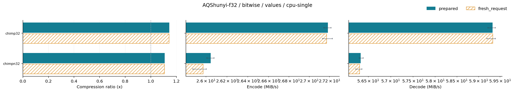

[SVG](figures/AQShunyi-f32--bitwise--cpu-single.svg)

<details><summary>完整数值、有效批次及拒绝原因</summary>

| codec | 完整输出 bytes P / F | 压缩倍数 P / F | 编码 MiB/s P / F | 解码 MiB/s P / F | 有效批次 P / F |
|---|---:|---:|---:|---:|---:|
| chimp32 | 1.35e+06 / 1.35e+06 | 1.14 / 1.14 | 27.2 / 27.2 | 59.3 / 59.3 | 14/14 / 14/14 |
| chimpn32 | 1.39e+06 / 1.39e+06 | 1.11 / 1.11 | 26 / 26 | 56.3 / 56.3 | 14/14 / 14/14 |

</details>

**<f4 · [35064, 11] · 经验质量（无最大误差保证） · values · cpu-single**

运行进程 CPU 亲和性（P / F）：`[(0, 1, 2, 3, 4, 5, 6, 7, 8, 9, 10, 11, 12, 13, 14, 15)]` / `[(0, 1, 2, 3, 4, 5, 6, 7, 8, 9, 10, 11, 12, 13, 14, 15)]`；逐配置创建时间见 CSV，是否处于并行窗口见调度记录。

f64→f32 准备阶段转换的最大绝对差：**5.69661474e-05**；本组 codec 的恢复质量相对转换后的 f32 输入验证。

<details><summary>完整数值、有效批次及拒绝原因</summary>

| codec | 完整输出 bytes P / F | 压缩倍数 P / F | 编码 MiB/s P / F | 解码 MiB/s P / F | 有效批次 P / F |
|---|---:|---:|---:|---:|---:|
| pmc-mr | — / — | — / — | — / — | — / — | 0/0 / 0/0 |
| swing-filter | — / — | — / — | — / — | — / — | 0/0 / 0/0 |
| swing-filter-disjoint | — / — | — / — | — / — | — / — | 0/0 / 0/0 |
| swing-filter-disjoint-quantized / compatible | — / — | — / — | — / — | — / — | 0/0 / 0/0 |
| swing-filter-disjoint-quantized / strict_abs | — / — | — / — | — / — | — / — | 0/0 / 0/0 |

拒绝或未完整完成的请求：

- `pmc-mr` / fresh_request：unsupported，filter native_core requires one column; object/native_api preserve independent columns
- `pmc-mr` / prepared：unsupported，filter native_core requires one column; object/native_api preserve independent columns
- `swing-filter` / fresh_request：unsupported，filter native_core requires one column; object/native_api preserve independent columns
- `swing-filter` / prepared：unsupported，filter native_core requires one column; object/native_api preserve independent columns
- `swing-filter-disjoint` / fresh_request：unsupported，filter native_core requires one column; object/native_api preserve independent columns
- `swing-filter-disjoint` / prepared：unsupported，filter native_core requires one column; object/native_api preserve independent columns
- `swing-filter-disjoint-quantized / compatible` / fresh_request：unsupported，filter native_core requires one column; object/native_api preserve independent columns
- `swing-filter-disjoint-quantized / compatible` / prepared：unsupported，filter native_core requires one column; object/native_api preserve independent columns
- `swing-filter-disjoint-quantized / strict_abs` / fresh_request：unsupported，filter native_core requires one column; object/native_api preserve independent columns
- `swing-filter-disjoint-quantized / strict_abs` / prepared：unsupported，filter native_core requires one column; object/native_api preserve independent columns

</details>

**<f8 · [35064, 11] · 无损 · values · cpu-dzip-three**

运行进程 CPU 亲和性（P / F）：`[(0, 1, 2, 3, 4, 5, 6, 7, 8, 9, 10, 11, 12, 13, 14, 15)]` / `[(0, 1, 2, 3, 4, 5, 6, 7, 8, 9, 10, 11, 12, 13, 14, 15)]`；逐配置创建时间见 CSV，是否处于并行窗口见调度记录。

<details><summary>完整数值、有效批次及拒绝原因</summary>

| codec | 完整输出 bytes P / F | 压缩倍数 P / F | 编码 MiB/s P / F | 解码 MiB/s P / F | 有效批次 P / F |
|---|---:|---:|---:|---:|---:|
| dzip | — / — | — / — | — / — | — / — | 0/0 / 0/0 |

拒绝或未完整完成的请求：

- `dzip` / fresh_request：unsupported，dzip: dtype must be one of ('|u1',)
- `dzip` / prepared：unsupported，dzip: dtype must be one of ('|u1',)

</details>

**<f8 · [35064, 11] · 无损 · values · cpu-single**

运行进程 CPU 亲和性（P / F）：`[(0, 1, 2, 3, 4, 5, 6, 7, 8, 9, 10, 11, 12, 13, 14, 15)]` / `[(0, 1, 2, 3, 4, 5, 6, 7, 8, 9, 10, 11, 12, 13, 14, 15)]`；逐配置创建时间见 CSV，是否处于并行窗口见调度记录。


[SVG](figures/AQShunyi-f64--bitwise--cpu-single.svg)

<details><summary>完整数值、有效批次及拒绝原因</summary>

| codec | 完整输出 bytes P / F | 压缩倍数 P / F | 编码 MiB/s P / F | 解码 MiB/s P / F | 有效批次 P / F |
|---|---:|---:|---:|---:|---:|
| alp | 7.75e+05 / 7.75e+05 | 3.98 / 3.98 | 331 / 330 | 464 / 466 | 14/14 / 14/14 |
| alp-rd | 2.76e+06 / 2.76e+06 | 1.12 / 1.12 | 142 / 142 | 166 / 174 | 14/14 / 14/14 |
| brotli-stream | 6.19e+05 / 6.19e+05 | 4.99 / 4.99 | 52.2 / 51.2 | 401 / 399 | 14/14 / 14/14 |
| bzip2-stream | 3.99e+05 / 3.99e+05 | 7.73 / 7.73 | 27.4 / 27.3 | 59.6 / 60 | 14/14 / 14/14 |
| chimp | 2.06e+06 / 2.06e+06 | 1.5 / 1.5 | 39.8 / 39.7 | 81.3 / 81.3 | 14/14 / 14/14 |
| chimp128 | 1.41e+06 / 1.41e+06 | 2.19 / 2.19 | 47.6 / 47.5 | 108 / 108 | 14/14 / 14/14 |
| chimp128-no-index | 8.75e+05 / 8.75e+05 | 3.53 / 3.53 | 29.4 / 29.4 | 145 / 145 | 14/14 / 14/14 |
| chimp32 | — / — | — / — | — / — | — / — | 0/0 / 0/0 |
| chimpn | 1.41e+06 / 1.41e+06 | 2.19 / 2.19 | 48.1 / 48.2 | 105 / 105 | 14/14 / 14/14 |
| chimpn32 | — / — | — / — | — / — | — / — | 0/0 / 0/0 |
| deepzip | — / — | — / — | — / — | — / — | 0/0 / 0/0 |
| deflate-zlib | 6.66e+05 / 6.66e+05 | 4.63 / 4.63 | 25.5 / 25.4 | 428 / 429 | 14/14 / 14/14 |
| elf | 1.15e+06 / 1.15e+06 | 2.69 / 2.69 | 55.1 / 55 | 113 / 113 | 14/14 / 14/14 |
| elf-plus | 1.16e+06 / 1.16e+06 | 2.67 / 2.67 | 45.7 / 45.6 | 105 / 104 | 14/14 / 14/14 |
| elf-star | 9.81e+05 / 9.81e+05 | 3.14 / 3.14 | 28.5 / 28.5 | 104 / 104 | 14/14 / 14/14 |
| fse | — / — | — / — | — / — | — / — | 0/0 / 0/0 |
| gorilla-prometheus-xor | — / — | — / — | — / — | — / — | 0/0 / 0/0 |
| huff0 | — / — | — / — | — / — | — / — | 0/0 / 0/0 |
| leats-lossless-i64 | — / — | — / — | — / — | — / — | 0/0 / 0/0 |
| lz4-frame | 1.13e+06 / 1.13e+06 | 2.74 / 2.74 | 540 / 542 | 1.27e+03 / 1.27e+03 | 14/14 / 14/14 |
| lzsse2-raw | 6.48e+05 / 6.48e+05 | 4.77 / 4.77 | 5.73 / 5.48 | 2.67e+03 / 5.33e+03 | 14/14 / 14/14 |
| lzsse8-raw | 6.81e+05 / 6.81e+05 | 4.53 / 4.53 | 6.37 / 6.03 | 2.53e+03 / 4.74e+03 | 14/14 / 14/14 |
| neats-lossless-i64 | — / — | — / — | — / — | — / — | 0/0 / 0/0 |
| self-star | 9.73e+05 / 9.73e+05 | 3.17 / 3.17 | 34.7 / 34.8 | 97.8 / 98 | 14/14 / 14/14 |
| simdcomp-u32 | — / — | — / — | — / — | — / — | 0/0 / 0/0 |
| snappy-raw | 1.01e+06 / 1.01e+06 | 3.05 / 3.05 | 435 / 436 | 923 / 925 | 14/14 / 14/14 |
| sprintz-delta | — / — | — / — | — / — | — / — | 0/0 / 0/0 |
| sprintz-delta-huffman | — / — | — / — | — / — | — / — | 0/0 / 0/0 |
| sprintz-fire | — / — | — / — | — / — | — / — | 0/0 / 0/0 |
| sprintz-fire-huffman | — / — | — / — | — / — | — / — | 0/0 / 0/0 |
| xz-stream | 4.03e+05 / 4.03e+05 | 7.66 / 7.66 | 2.49 / 2.49 | 180 / 180 | 14/14 / 14/14 |
| zstd-frame | 7.09e+05 / 7.09e+05 | 4.35 / 4.35 | 354 / 341 | 738 / 734 | 14/14 / 14/14 |

拒绝或未完整完成的请求：

- `chimp32` / fresh_request：unsupported，chimp32: dtype must be one of ('<f4',)
- `chimp32` / prepared：unsupported，chimp32: dtype must be one of ('<f4',)
- `chimpn32` / fresh_request：unsupported，chimpn32: dtype must be one of ('<f4',)
- `chimpn32` / prepared：unsupported，chimpn32: dtype must be one of ('<f4',)
- `deepzip` / fresh_request：unsupported，deepzip: dtype must be one of ('|u1',)
- `deepzip` / prepared：unsupported，deepzip: dtype must be one of ('|u1',)
- `fse` / fresh_request：unsupported，fse: n=35064 exceeds native limits
- `fse` / prepared：unsupported，fse: n=35064 exceeds native limits
- `gorilla-prometheus-xor` / fresh_request：unsupported，Gorilla requires actual paired T/V; values-only and timestamp-only are unsupported
- `gorilla-prometheus-xor` / prepared：unsupported，Gorilla requires actual paired T/V; values-only and timestamp-only are unsupported
- `huff0` / fresh_request：unsupported，huff0: n=35064 exceeds native limits
- `huff0` / prepared：unsupported，huff0: n=35064 exceeds native limits
- `leats-lossless-i64` / fresh_request：unsupported，leats-lossless-i64: dtype must be one of ('|i1', '<i2', '<i4', '<i8')
- `leats-lossless-i64` / prepared：unsupported，leats-lossless-i64: dtype must be one of ('|i1', '<i2', '<i4', '<i8')
- `neats-lossless-i64` / fresh_request：unsupported，neats-lossless-i64: dtype must be one of ('|i1', '<i2', '<i4', '<i8')
- `neats-lossless-i64` / prepared：unsupported，neats-lossless-i64: dtype must be one of ('|i1', '<i2', '<i4', '<i8')
- `simdcomp-u32` / fresh_request：unsupported，simdcomp-u32: dtype must be one of ('<u4',)
- `simdcomp-u32` / prepared：unsupported，simdcomp-u32: dtype must be one of ('<u4',)
- `sprintz-delta` / fresh_request：unsupported，sprintz-delta: dtype must be one of ('|u1', '|i1', '<u2', '<i2')
- `sprintz-delta` / prepared：unsupported，sprintz-delta: dtype must be one of ('|u1', '|i1', '<u2', '<i2')
- `sprintz-delta-huffman` / fresh_request：unsupported，sprintz-delta-huffman: dtype must be one of ('|u1', '|i1', '<u2', '<i2')
- `sprintz-delta-huffman` / prepared：unsupported，sprintz-delta-huffman: dtype must be one of ('|u1', '|i1', '<u2', '<i2')
- `sprintz-fire` / fresh_request：unsupported，sprintz-fire: dtype must be one of ('|u1', '|i1', '<u2', '<i2')
- `sprintz-fire` / prepared：unsupported，sprintz-fire: dtype must be one of ('|u1', '|i1', '<u2', '<i2')
- `sprintz-fire-huffman` / fresh_request：unsupported，sprintz-fire-huffman: dtype must be one of ('|u1', '|i1', '<u2', '<i2')
- `sprintz-fire-huffman` / prepared：unsupported，sprintz-fire-huffman: dtype must be one of ('|u1', '|i1', '<u2', '<i2')

</details>

**<f8 · [35064, 11] · ABS ≤ 0.01 · values · cpu-single**

运行进程 CPU 亲和性（P / F）：`[(0, 1, 2, 3, 4, 5, 6, 7, 8, 9, 10, 11, 12, 13, 14, 15)]` / `[(0, 1, 2, 3, 4, 5, 6, 7, 8, 9, 10, 11, 12, 13, 14, 15)]`；逐配置创建时间见 CSV，是否处于并行窗口见调度记录。


[SVG](figures/AQShunyi-f64--bounded_abs--cpu-single.svg)

<details><summary>完整数值、有效批次及拒绝原因</summary>

| codec | 完整输出 bytes P / F | 压缩倍数 P / F | 编码 MiB/s P / F | 解码 MiB/s P / F | 有效批次 P / F |
|---|---:|---:|---:|---:|---:|
| serf-qt | 1.23e+06 / 1.23e+06 | 2.52 / 2.52 | 140 / 140 | 113 / 115 | 14/14 / 14/14 |
| serf-xor | 1.09e+06 / 1.09e+06 | 2.84 / 2.84 | 134 / 134 | 301 / 321 | 14/14 / 14/14 |
| zfp-accuracy-1d | 1.05e+06 / 1.05e+06 | 2.94 / 2.94 | 367 / 367 | 212 / 213 | 14/14 / 14/14 |

</details>

**<f8 · [35064, 11] · 经验质量（无最大误差保证） · values · cpu-single**

运行进程 CPU 亲和性（P / F）：`[(0, 1, 2, 3, 4, 5, 6, 7, 8, 9, 10, 11, 12, 13, 14, 15)]` / `[(0, 1, 2, 3, 4, 5, 6, 7, 8, 9, 10, 11, 12, 13, 14, 15)]`；逐配置创建时间见 CSV，是否处于并行窗口见调度记录。

<details><summary>完整数值、有效批次及拒绝原因</summary>

| codec | 完整输出 bytes P / F | 压缩倍数 P / F | 编码 MiB/s P / F | 解码 MiB/s P / F | 有效批次 P / F |
|---|---:|---:|---:|---:|---:|
| abba | — / — | — / — | — / — | — / — | 0/0 / 0/0 |
| fabba | — / — | — / — | — / — | — / — | 0/0 / 0/0 |
| pmc-mr | — / — | — / — | — / — | — / — | 0/0 / 0/0 |
| swing-filter | — / — | — / — | — / — | — / — | 0/0 / 0/0 |
| swing-filter-disjoint | — / — | — / — | — / — | — / — | 0/0 / 0/0 |
| swing-filter-disjoint-quantized / compatible | — / — | — / — | — / — | — / — | 0/0 / 0/0 |

拒绝或未完整完成的请求：

- `abba` / fresh_request：unsupported，RW native batches require rank 1 / columns=1; collection framing belongs to object mode
- `abba` / prepared：unsupported，RW native batches require rank 1 / columns=1; collection framing belongs to object mode
- `fabba` / fresh_request：unsupported，RW native batches require rank 1 / columns=1; collection framing belongs to object mode
- `fabba` / prepared：unsupported，RW native batches require rank 1 / columns=1; collection framing belongs to object mode
- `pmc-mr` / fresh_request：unsupported，pmc-mr: dtype must be one of ('<f4',)
- `pmc-mr` / prepared：unsupported，pmc-mr: dtype must be one of ('<f4',)
- `swing-filter` / fresh_request：unsupported，swing-filter: dtype must be one of ('<f4',)
- `swing-filter` / prepared：unsupported，swing-filter: dtype must be one of ('<f4',)
- `swing-filter-disjoint` / fresh_request：unsupported，swing-filter-disjoint: dtype must be one of ('<f4',)
- `swing-filter-disjoint` / prepared：unsupported，swing-filter-disjoint: dtype must be one of ('<f4',)
- `swing-filter-disjoint-quantized / compatible` / fresh_request：unsupported，swing-filter-disjoint-quantized: dtype must be one of ('<f4',)
- `swing-filter-disjoint-quantized / compatible` / prepared：unsupported，swing-filter-disjoint-quantized: dtype must be one of ('<f4',)

</details>

<a id="dataset-AQWan"></a>

### AQWan

**<f4 · [35064, 11] · 无损 · values · cpu-single**

运行进程 CPU 亲和性（P / F）：`[(0, 1, 2, 3, 4, 5, 6, 7, 8, 9, 10, 11, 12, 13, 14, 15)]` / `[(0, 1, 2, 3, 4, 5, 6, 7, 8, 9, 10, 11, 12, 13, 14, 15)]`；逐配置创建时间见 CSV，是否处于并行窗口见调度记录。

f64→f32 准备阶段转换的最大绝对差：**4.8828125e-05**；本组 codec 的恢复质量相对转换后的 f32 输入验证。

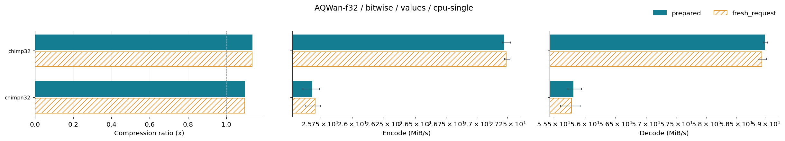

[SVG](figures/AQWan-f32--bitwise--cpu-single.svg)

<details><summary>完整数值、有效批次及拒绝原因</summary>

| codec | 完整输出 bytes P / F | 压缩倍数 P / F | 编码 MiB/s P / F | 解码 MiB/s P / F | 有效批次 P / F |
|---|---:|---:|---:|---:|---:|
| chimp32 | 1.36e+06 / 1.36e+06 | 1.14 / 1.14 | 27.2 / 27.2 | 59 / 58.9 | 14/14 / 14/14 |
| chimpn32 | 1.41e+06 / 1.41e+06 | 1.1 / 1.1 | 25.7 / 25.7 | 55.8 / 55.8 | 14/14 / 14/14 |

</details>

**<f4 · [35064, 11] · 经验质量（无最大误差保证） · values · cpu-single**

运行进程 CPU 亲和性（P / F）：`[(0, 1, 2, 3, 4, 5, 6, 7, 8, 9, 10, 11, 12, 13, 14, 15)]` / `[(0, 1, 2, 3, 4, 5, 6, 7, 8, 9, 10, 11, 12, 13, 14, 15)]`；逐配置创建时间见 CSV，是否处于并行窗口见调度记录。

f64→f32 准备阶段转换的最大绝对差：**4.8828125e-05**；本组 codec 的恢复质量相对转换后的 f32 输入验证。

<details><summary>完整数值、有效批次及拒绝原因</summary>

| codec | 完整输出 bytes P / F | 压缩倍数 P / F | 编码 MiB/s P / F | 解码 MiB/s P / F | 有效批次 P / F |
|---|---:|---:|---:|---:|---:|
| pmc-mr | — / — | — / — | — / — | — / — | 0/0 / 0/0 |
| swing-filter | — / — | — / — | — / — | — / — | 0/0 / 0/0 |
| swing-filter-disjoint | — / — | — / — | — / — | — / — | 0/0 / 0/0 |
| swing-filter-disjoint-quantized / compatible | — / — | — / — | — / — | — / — | 0/0 / 0/0 |
| swing-filter-disjoint-quantized / strict_abs | — / — | — / — | — / — | — / — | 0/0 / 0/0 |

拒绝或未完整完成的请求：

- `pmc-mr` / fresh_request：unsupported，filter native_core requires one column; object/native_api preserve independent columns
- `pmc-mr` / prepared：unsupported，filter native_core requires one column; object/native_api preserve independent columns
- `swing-filter` / fresh_request：unsupported，filter native_core requires one column; object/native_api preserve independent columns
- `swing-filter` / prepared：unsupported，filter native_core requires one column; object/native_api preserve independent columns
- `swing-filter-disjoint` / fresh_request：unsupported，filter native_core requires one column; object/native_api preserve independent columns
- `swing-filter-disjoint` / prepared：unsupported，filter native_core requires one column; object/native_api preserve independent columns
- `swing-filter-disjoint-quantized / compatible` / fresh_request：unsupported，filter native_core requires one column; object/native_api preserve independent columns
- `swing-filter-disjoint-quantized / compatible` / prepared：unsupported，filter native_core requires one column; object/native_api preserve independent columns
- `swing-filter-disjoint-quantized / strict_abs` / fresh_request：unsupported，filter native_core requires one column; object/native_api preserve independent columns
- `swing-filter-disjoint-quantized / strict_abs` / prepared：unsupported，filter native_core requires one column; object/native_api preserve independent columns

</details>

**<f8 · [35064, 11] · 无损 · values · cpu-dzip-three**

运行进程 CPU 亲和性（P / F）：`[(0, 1, 2, 3, 4, 5, 6, 7, 8, 9, 10, 11, 12, 13, 14, 15)]` / `[(0, 1, 2, 3, 4, 5, 6, 7, 8, 9, 10, 11, 12, 13, 14, 15)]`；逐配置创建时间见 CSV，是否处于并行窗口见调度记录。

<details><summary>完整数值、有效批次及拒绝原因</summary>

| codec | 完整输出 bytes P / F | 压缩倍数 P / F | 编码 MiB/s P / F | 解码 MiB/s P / F | 有效批次 P / F |
|---|---:|---:|---:|---:|---:|
| dzip | — / — | — / — | — / — | — / — | 0/0 / 0/0 |

拒绝或未完整完成的请求：

- `dzip` / fresh_request：unsupported，dzip: dtype must be one of ('|u1',)
- `dzip` / prepared：unsupported，dzip: dtype must be one of ('|u1',)

</details>

**<f8 · [35064, 11] · 无损 · values · cpu-single**

运行进程 CPU 亲和性（P / F）：`[(0, 1, 2, 3, 4, 5, 6, 7, 8, 9, 10, 11, 12, 13, 14, 15)]` / `[(0, 1, 2, 3, 4, 5, 6, 7, 8, 9, 10, 11, 12, 13, 14, 15)]`；逐配置创建时间见 CSV，是否处于并行窗口见调度记录。

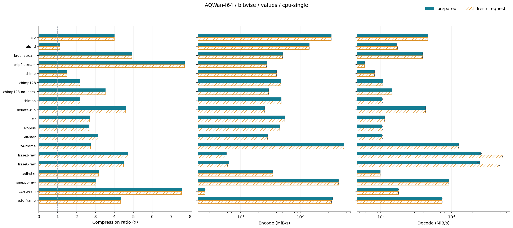

[SVG](figures/AQWan-f64--bitwise--cpu-single.svg)

<details><summary>完整数值、有效批次及拒绝原因</summary>

| codec | 完整输出 bytes P / F | 压缩倍数 P / F | 编码 MiB/s P / F | 解码 MiB/s P / F | 有效批次 P / F |
|---|---:|---:|---:|---:|---:|
| alp | 7.73e+05 / 7.73e+05 | 3.99 / 3.99 | 333 / 332 | 464 / 465 | 14/14 / 14/14 |
| alp-rd | 2.76e+06 / 2.76e+06 | 1.12 / 1.12 | 142 / 142 | 166 / 174 | 14/14 / 14/14 |
| brotli-stream | 6.26e+05 / 6.26e+05 | 4.93 / 4.93 | 51.4 / 50.8 | 391 / 391 | 14/14 / 14/14 |
| bzip2-stream | 4.01e+05 / 4.01e+05 | 7.7 / 7.7 | 27.6 / 27.4 | 59.2 / 58.7 | 14/14 / 14/14 |
| chimp | 2.06e+06 / 2.06e+06 | 1.5 / 1.5 | 40.1 / 40.1 | 81.2 / 81.1 | 14/14 / 14/14 |
| chimp128 | 1.42e+06 / 1.42e+06 | 2.18 / 2.18 | 47.5 / 47.5 | 107 / 107 | 14/14 / 14/14 |
| chimp128-no-index | 8.75e+05 / 8.75e+05 | 3.52 / 3.52 | 29.3 / 29.3 | 145 / 145 | 14/14 / 14/14 |
| chimp32 | — / — | — / — | — / — | — / — | 0/0 / 0/0 |
| chimpn | 1.42e+06 / 1.42e+06 | 2.18 / 2.18 | 48 / 48 | 105 / 105 | 14/14 / 14/14 |
| chimpn32 | — / — | — / — | — / — | — / — | 0/0 / 0/0 |
| deepzip | — / — | — / — | — / — | — / — | 0/0 / 0/0 |
| deflate-zlib | 6.72e+05 / 6.72e+05 | 4.59 / 4.59 | 25.3 / 25.3 | 430 / 429 | 14/14 / 14/14 |
| elf | 1.15e+06 / 1.15e+06 | 2.69 / 2.69 | 55.3 / 55.2 | 114 / 114 | 14/14 / 14/14 |
| elf-plus | 1.16e+06 / 1.16e+06 | 2.67 / 2.67 | 45.5 / 45.5 | 105 / 105 | 14/14 / 14/14 |
| elf-star | 9.86e+05 / 9.86e+05 | 3.13 / 3.13 | 28.5 / 28.5 | 105 / 105 | 14/14 / 14/14 |
| fse | — / — | — / — | — / — | — / — | 0/0 / 0/0 |
| gorilla-prometheus-xor | — / — | — / — | — / — | — / — | 0/0 / 0/0 |
| huff0 | — / — | — / — | — / — | — / — | 0/0 / 0/0 |
| leats-lossless-i64 | — / — | — / — | — / — | — / — | 0/0 / 0/0 |
| lz4-frame | 1.13e+06 / 1.13e+06 | 2.74 / 2.74 | 542 / 541 | 1.27e+03 / 1.27e+03 | 14/14 / 14/14 |
| lzsse2-raw | 6.54e+05 / 6.54e+05 | 4.72 / 4.72 | 5.74 / 5.47 | 2.62e+03 / 5.33e+03 | 14/14 / 14/14 |
| lzsse8-raw | 6.88e+05 / 6.88e+05 | 4.49 / 4.49 | 6.38 / 6.05 | 2.51e+03 / 4.74e+03 | 14/14 / 14/14 |
| neats-lossless-i64 | — / — | — / — | — / — | — / — | 0/0 / 0/0 |
| self-star | 9.79e+05 / 9.79e+05 | 3.15 / 3.15 | 34.7 / 34.6 | 98.4 / 98.1 | 14/14 / 14/14 |
| simdcomp-u32 | — / — | — / — | — / — | — / — | 0/0 / 0/0 |
| snappy-raw | 1.02e+06 / 1.02e+06 | 3.03 / 3.03 | 438 / 437 | 922 / 923 | 14/14 / 14/14 |
| sprintz-delta | — / — | — / — | — / — | — / — | 0/0 / 0/0 |
| sprintz-delta-huffman | — / — | — / — | — / — | — / — | 0/0 / 0/0 |
| sprintz-fire | — / — | — / — | — / — | — / — | 0/0 / 0/0 |
| sprintz-fire-huffman | — / — | — / — | — / — | — / — | 0/0 / 0/0 |
| xz-stream | 4.09e+05 / 4.09e+05 | 7.55 / 7.55 | 2.52 / 2.51 | 178 / 178 | 14/14 / 14/14 |
| zstd-frame | 7.15e+05 / 7.15e+05 | 4.31 / 4.31 | 350 / 339 | 740 / 739 | 14/14 / 14/14 |

拒绝或未完整完成的请求：

- `chimp32` / fresh_request：unsupported，chimp32: dtype must be one of ('<f4',)
- `chimp32` / prepared：unsupported，chimp32: dtype must be one of ('<f4',)
- `chimpn32` / fresh_request：unsupported，chimpn32: dtype must be one of ('<f4',)
- `chimpn32` / prepared：unsupported，chimpn32: dtype must be one of ('<f4',)
- `deepzip` / fresh_request：unsupported，deepzip: dtype must be one of ('|u1',)
- `deepzip` / prepared：unsupported，deepzip: dtype must be one of ('|u1',)
- `fse` / fresh_request：unsupported，fse: n=35064 exceeds native limits
- `fse` / prepared：unsupported，fse: n=35064 exceeds native limits
- `gorilla-prometheus-xor` / fresh_request：unsupported，Gorilla requires actual paired T/V; values-only and timestamp-only are unsupported
- `gorilla-prometheus-xor` / prepared：unsupported，Gorilla requires actual paired T/V; values-only and timestamp-only are unsupported
- `huff0` / fresh_request：unsupported，huff0: n=35064 exceeds native limits
- `huff0` / prepared：unsupported，huff0: n=35064 exceeds native limits
- `leats-lossless-i64` / fresh_request：unsupported，leats-lossless-i64: dtype must be one of ('|i1', '<i2', '<i4', '<i8')
- `leats-lossless-i64` / prepared：unsupported，leats-lossless-i64: dtype must be one of ('|i1', '<i2', '<i4', '<i8')
- `neats-lossless-i64` / fresh_request：unsupported，neats-lossless-i64: dtype must be one of ('|i1', '<i2', '<i4', '<i8')
- `neats-lossless-i64` / prepared：unsupported，neats-lossless-i64: dtype must be one of ('|i1', '<i2', '<i4', '<i8')
- `simdcomp-u32` / fresh_request：unsupported，simdcomp-u32: dtype must be one of ('<u4',)
- `simdcomp-u32` / prepared：unsupported，simdcomp-u32: dtype must be one of ('<u4',)
- `sprintz-delta` / fresh_request：unsupported，sprintz-delta: dtype must be one of ('|u1', '|i1', '<u2', '<i2')
- `sprintz-delta` / prepared：unsupported，sprintz-delta: dtype must be one of ('|u1', '|i1', '<u2', '<i2')
- `sprintz-delta-huffman` / fresh_request：unsupported，sprintz-delta-huffman: dtype must be one of ('|u1', '|i1', '<u2', '<i2')
- `sprintz-delta-huffman` / prepared：unsupported，sprintz-delta-huffman: dtype must be one of ('|u1', '|i1', '<u2', '<i2')
- `sprintz-fire` / fresh_request：unsupported，sprintz-fire: dtype must be one of ('|u1', '|i1', '<u2', '<i2')
- `sprintz-fire` / prepared：unsupported，sprintz-fire: dtype must be one of ('|u1', '|i1', '<u2', '<i2')
- `sprintz-fire-huffman` / fresh_request：unsupported，sprintz-fire-huffman: dtype must be one of ('|u1', '|i1', '<u2', '<i2')
- `sprintz-fire-huffman` / prepared：unsupported，sprintz-fire-huffman: dtype must be one of ('|u1', '|i1', '<u2', '<i2')

</details>

**<f8 · [35064, 11] · ABS ≤ 0.01 · values · cpu-single**

运行进程 CPU 亲和性（P / F）：`[(0, 1, 2, 3, 4, 5, 6, 7, 8, 9, 10, 11, 12, 13, 14, 15)]` / `[(0, 1, 2, 3, 4, 5, 6, 7, 8, 9, 10, 11, 12, 13, 14, 15)]`；逐配置创建时间见 CSV，是否处于并行窗口见调度记录。

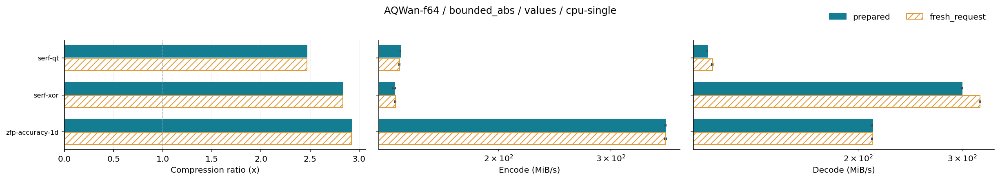

[SVG](figures/AQWan-f64--bounded_abs--cpu-single.svg)

<details><summary>完整数值、有效批次及拒绝原因</summary>

| codec | 完整输出 bytes P / F | 压缩倍数 P / F | 编码 MiB/s P / F | 解码 MiB/s P / F | 有效批次 P / F |
|---|---:|---:|---:|---:|---:|
| serf-qt | 1.25e+06 / 1.25e+06 | 2.47 / 2.47 | 140 / 140 | 111 / 114 | 14/14 / 14/14 |
| serf-xor | 1.09e+06 / 1.09e+06 | 2.83 / 2.83 | 137 / 138 | 300 / 322 | 14/14 / 14/14 |
| zfp-accuracy-1d | 1.06e+06 / 1.06e+06 | 2.92 / 2.92 | 365 / 366 | 212 / 211 | 14/14 / 14/14 |

</details>

**<f8 · [35064, 11] · 经验质量（无最大误差保证） · values · cpu-single**

运行进程 CPU 亲和性（P / F）：`[(0, 1, 2, 3, 4, 5, 6, 7, 8, 9, 10, 11, 12, 13, 14, 15)]` / `[(0, 1, 2, 3, 4, 5, 6, 7, 8, 9, 10, 11, 12, 13, 14, 15)]`；逐配置创建时间见 CSV，是否处于并行窗口见调度记录。

<details><summary>完整数值、有效批次及拒绝原因</summary>

| codec | 完整输出 bytes P / F | 压缩倍数 P / F | 编码 MiB/s P / F | 解码 MiB/s P / F | 有效批次 P / F |
|---|---:|---:|---:|---:|---:|
| abba | — / — | — / — | — / — | — / — | 0/0 / 0/0 |
| fabba | — / — | — / — | — / — | — / — | 0/0 / 0/0 |
| pmc-mr | — / — | — / — | — / — | — / — | 0/0 / 0/0 |
| swing-filter | — / — | — / — | — / — | — / — | 0/0 / 0/0 |
| swing-filter-disjoint | — / — | — / — | — / — | — / — | 0/0 / 0/0 |
| swing-filter-disjoint-quantized / compatible | — / — | — / — | — / — | — / — | 0/0 / 0/0 |

拒绝或未完整完成的请求：

- `abba` / fresh_request：unsupported，RW native batches require rank 1 / columns=1; collection framing belongs to object mode
- `abba` / prepared：unsupported，RW native batches require rank 1 / columns=1; collection framing belongs to object mode
- `fabba` / fresh_request：unsupported，RW native batches require rank 1 / columns=1; collection framing belongs to object mode
- `fabba` / prepared：unsupported，RW native batches require rank 1 / columns=1; collection framing belongs to object mode
- `pmc-mr` / fresh_request：unsupported，pmc-mr: dtype must be one of ('<f4',)
- `pmc-mr` / prepared：unsupported，pmc-mr: dtype must be one of ('<f4',)
- `swing-filter` / fresh_request：unsupported，swing-filter: dtype must be one of ('<f4',)
- `swing-filter` / prepared：unsupported，swing-filter: dtype must be one of ('<f4',)
- `swing-filter-disjoint` / fresh_request：unsupported，swing-filter-disjoint: dtype must be one of ('<f4',)
- `swing-filter-disjoint` / prepared：unsupported，swing-filter-disjoint: dtype must be one of ('<f4',)
- `swing-filter-disjoint-quantized / compatible` / fresh_request：unsupported，swing-filter-disjoint-quantized: dtype must be one of ('<f4',)
- `swing-filter-disjoint-quantized / compatible` / prepared：unsupported，swing-filter-disjoint-quantized: dtype must be one of ('<f4',)

</details>

<a id="dataset-Covid-19"></a>

### Covid-19

**<f4 · [1392, 948] · 无损 · values · cpu-single**

运行进程 CPU 亲和性（P / F）：`[(0, 1, 2, 3, 4, 5, 6, 7, 8, 9, 10, 11, 12, 13, 14, 15)]` / `[(0, 1, 2, 3, 4, 5, 6, 7, 8, 9, 10, 11, 12, 13, 14, 15)]`；逐配置创建时间见 CSV，是否处于并行窗口见调度记录。

f64→f32 准备阶段转换的最大绝对差：**4**；本组 codec 的恢复质量相对转换后的 f32 输入验证。

<details><summary>完整数值、有效批次及拒绝原因</summary>

| codec | 完整输出 bytes P / F | 压缩倍数 P / F | 编码 MiB/s P / F | 解码 MiB/s P / F | 有效批次 P / F |
|---|---:|---:|---:|---:|---:|
| chimp32 | — / — | — / — | — / — | — / — | 0/0 / 0/0 |
| chimpn32 | — / — | — / — | — / — | — / — | 0/0 / 0/0 |

拒绝或未完整完成的请求：

- `chimp32` / fresh_request：unsupported，chimp32: element limit exceeded
- `chimp32` / prepared：unsupported，chimp32: element limit exceeded
- `chimpn32` / fresh_request：unsupported，chimpn32: element limit exceeded
- `chimpn32` / prepared：unsupported，chimpn32: element limit exceeded

</details>

**<f4 · [1392, 948] · 经验质量（无最大误差保证） · values · cpu-single**

运行进程 CPU 亲和性（P / F）：`[(0, 1, 2, 3, 4, 5, 6, 7, 8, 9, 10, 11, 12, 13, 14, 15)]` / `[(0, 1, 2, 3, 4, 5, 6, 7, 8, 9, 10, 11, 12, 13, 14, 15)]`；逐配置创建时间见 CSV，是否处于并行窗口见调度记录。

f64→f32 准备阶段转换的最大绝对差：**4**；本组 codec 的恢复质量相对转换后的 f32 输入验证。

<details><summary>完整数值、有效批次及拒绝原因</summary>

| codec | 完整输出 bytes P / F | 压缩倍数 P / F | 编码 MiB/s P / F | 解码 MiB/s P / F | 有效批次 P / F |
|---|---:|---:|---:|---:|---:|
| pmc-mr | — / — | — / — | — / — | — / — | 0/0 / 0/0 |
| swing-filter | — / — | — / — | — / — | — / — | 0/0 / 0/0 |
| swing-filter-disjoint | — / — | — / — | — / — | — / — | 0/0 / 0/0 |
| swing-filter-disjoint-quantized / compatible | — / — | — / — | — / — | — / — | 0/0 / 0/0 |
| swing-filter-disjoint-quantized / strict_abs | — / — | — / — | — / — | — / — | 0/0 / 0/0 |

拒绝或未完整完成的请求：

- `pmc-mr` / fresh_request：unsupported，pmc-mr: element limit exceeded
- `pmc-mr` / prepared：unsupported，pmc-mr: element limit exceeded
- `swing-filter` / fresh_request：unsupported，swing-filter: element limit exceeded
- `swing-filter` / prepared：unsupported，swing-filter: element limit exceeded
- `swing-filter-disjoint` / fresh_request：unsupported，swing-filter-disjoint: element limit exceeded
- `swing-filter-disjoint` / prepared：unsupported，swing-filter-disjoint: element limit exceeded
- `swing-filter-disjoint-quantized / compatible` / fresh_request：unsupported，swing-filter-disjoint-quantized: element limit exceeded
- `swing-filter-disjoint-quantized / compatible` / prepared：unsupported，swing-filter-disjoint-quantized: element limit exceeded
- `swing-filter-disjoint-quantized / strict_abs` / fresh_request：unsupported，swing-filter-disjoint-quantized: element limit exceeded
- `swing-filter-disjoint-quantized / strict_abs` / prepared：unsupported，swing-filter-disjoint-quantized: element limit exceeded

</details>

**<f8 · [1392, 948] · 无损 · values · cpu-dzip-three**

运行进程 CPU 亲和性（P / F）：`[(0, 1, 2, 3, 4, 5, 6, 7, 8, 9, 10, 11, 12, 13, 14, 15)]` / `[(0, 1, 2, 3, 4, 5, 6, 7, 8, 9, 10, 11, 12, 13, 14, 15)]`；逐配置创建时间见 CSV，是否处于并行窗口见调度记录。

<details><summary>完整数值、有效批次及拒绝原因</summary>

| codec | 完整输出 bytes P / F | 压缩倍数 P / F | 编码 MiB/s P / F | 解码 MiB/s P / F | 有效批次 P / F |
|---|---:|---:|---:|---:|---:|
| dzip | — / — | — / — | — / — | — / — | 0/0 / 0/0 |

拒绝或未完整完成的请求：

- `dzip` / fresh_request：unsupported，dzip: dtype must be one of ('|u1',)
- `dzip` / prepared：unsupported，dzip: dtype must be one of ('|u1',)

</details>

**<f8 · [1392, 948] · 无损 · values · cpu-single**

运行进程 CPU 亲和性（P / F）：`[(0, 1, 2, 3, 4, 5, 6, 7, 8, 9, 10, 11, 12, 13, 14, 15)]` / `[(0, 1, 2, 3, 4, 5, 6, 7, 8, 9, 10, 11, 12, 13, 14, 15)]`；逐配置创建时间见 CSV，是否处于并行窗口见调度记录。

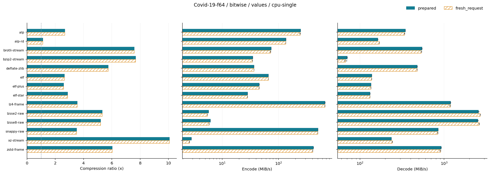

[SVG](figures/Covid-19-f64--bitwise--cpu-single.svg)

<details><summary>完整数值、有效批次及拒绝原因</summary>

| codec | 完整输出 bytes P / F | 压缩倍数 P / F | 编码 MiB/s P / F | 解码 MiB/s P / F | 有效批次 P / F |
|---|---:|---:|---:|---:|---:|
| alp | 3.95e+06 / 3.95e+06 | 2.67 / 2.67 | 247 / 243 | 347 / 339 | 14/14 / 14/14 |
| alp-rd | 9.5e+06 / 9.5e+06 | 1.11 / 1.11 | 136 / 135 | 163 / 170 | 14/14 / 14/14 |
| brotli-stream | 1.39e+06 / 1.39e+06 | 7.58 / 7.58 | 74.1 / 72.3 | 547 / 535 | 14/14 / 14/14 |
| bzip2-stream | 1.37e+06 / 1.37e+06 | 7.68 / 7.68 | 34.9 / 34.6 | 70.6 / 67.4 | 14/14 / 14/14 |
| chimp | — / — | — / — | — / — | — / — | 0/0 / 0/0 |
| chimp128 | — / — | — / — | — / — | — / — | 0/0 / 0/0 |
| chimp128-no-index | — / — | — / — | — / — | — / — | 0/0 / 0/0 |
| chimp32 | — / — | — / — | — / — | — / — | 0/0 / 0/0 |
| chimpn | — / — | — / — | — / — | — / — | 0/0 / 0/0 |
| chimpn32 | — / — | — / — | — / — | — / — | 0/0 / 0/0 |
| deepzip | — / — | — / — | — / — | — / — | 0/0 / 0/0 |
| deflate-zlib | 1.84e+06 / 1.84e+06 | 5.74 / 5.74 | 36.7 / 36.7 | 478 / 479 | 14/14 / 14/14 |
| elf | 3.99e+06 / 3.99e+06 | 2.65 / 2.65 | 66.1 / 66 | 138 / 138 | 14/14 / 14/14 |
| elf-plus | 4.08e+06 / 4.08e+06 | 2.59 / 2.59 | 45.6 / 45.4 | 135 / 135 | 14/14 / 14/14 |
| elf-star | 3.67e+06 / 3.67e+06 | 2.87 / 2.87 | 28.3 / 28.2 | 132 / 132 | 14/14 / 14/14 |
| fse | — / — | — / — | — / — | — / — | 0/0 / 0/0 |
| gorilla-prometheus-xor | — / — | — / — | — / — | — / — | 0/0 / 0/0 |
| huff0 | — / — | — / — | — / — | — / — | 0/0 / 0/0 |
| leats-lossless-i64 | — / — | — / — | — / — | — / — | 0/0 / 0/0 |
| lz4-frame | 2.98e+06 / 2.98e+06 | 3.55 / 3.55 | 668 / 668 | 1.2e+03 / 1.19e+03 | 14/14 / 14/14 |
| lzsse2-raw | 1.99e+06 / 1.99e+06 | 5.32 / 5.32 | 5.74 / 5.47 | 2.56e+03 / 2.69e+03 | 14/14 / 14/14 |
| lzsse8-raw | 2.03e+06 / 2.03e+06 | 5.2 / 5.2 | 6.2 / 5.88 | 2.53e+03 / 2.62e+03 | 14/14 / 14/14 |
| neats-lossless-i64 | — / — | — / — | — / — | — / — | 0/0 / 0/0 |
| self-star | — / — | — / — | — / — | — / — | 0/0 / 0/0 |
| simdcomp-u32 | — / — | — / — | — / — | — / — | 0/0 / 0/0 |
| snappy-raw | 3.01e+06 / 3.01e+06 | 3.51 / 3.51 | 501 / 500 | 851 / 841 | 14/14 / 14/14 |
| sprintz-delta | — / — | — / — | — / — | — / — | 0/0 / 0/0 |
| sprintz-delta-huffman | — / — | — / — | — / — | — / — | 0/0 / 0/0 |
| sprintz-fire | — / — | — / — | — / — | — / — | 0/0 / 0/0 |
| sprintz-fire-huffman | — / — | — / — | — / — | — / — | 0/0 / 0/0 |
| xz-stream | 1.05e+06 / 1.05e+06 | 10.1 / 10.1 | 2.84 / 2.64 | 237 / 242 | 14/14 / 14/14 |
| zstd-frame | 1.75e+06 / 1.75e+06 | 6.02 / 6.02 | 418 / 405 | 927 / 904 | 14/14 / 14/14 |

拒绝或未完整完成的请求：

- `chimp` / fresh_request：unsupported，chimp: element limit exceeded
- `chimp` / prepared：unsupported，chimp: element limit exceeded
- `chimp128` / fresh_request：unsupported，chimp128: element limit exceeded
- `chimp128` / prepared：unsupported，chimp128: element limit exceeded
- `chimp128-no-index` / fresh_request：unsupported，chimp128-no-index: element limit exceeded
- `chimp128-no-index` / prepared：unsupported，chimp128-no-index: element limit exceeded
- `chimp32` / fresh_request：unsupported，chimp32: dtype must be one of ('<f4',)
- `chimp32` / prepared：unsupported，chimp32: dtype must be one of ('<f4',)
- `chimpn` / fresh_request：unsupported，chimpn: element limit exceeded
- `chimpn` / prepared：unsupported，chimpn: element limit exceeded
- `chimpn32` / fresh_request：unsupported，chimpn32: dtype must be one of ('<f4',)
- `chimpn32` / prepared：unsupported，chimpn32: dtype must be one of ('<f4',)
- `deepzip` / fresh_request：unsupported，deepzip: dtype must be one of ('|u1',)
- `deepzip` / prepared：unsupported，deepzip: dtype must be one of ('|u1',)
- `fse` / fresh_request：unsupported，fse: m=948 exceeds native limits
- `fse` / prepared：unsupported，fse: m=948 exceeds native limits
- `gorilla-prometheus-xor` / fresh_request：unsupported，Gorilla requires actual paired T/V; values-only and timestamp-only are unsupported
- `gorilla-prometheus-xor` / prepared：unsupported，Gorilla requires actual paired T/V; values-only and timestamp-only are unsupported
- `huff0` / fresh_request：unsupported，huff0: m=948 exceeds native limits
- `huff0` / prepared：unsupported，huff0: m=948 exceeds native limits
- `leats-lossless-i64` / fresh_request：unsupported，leats-lossless-i64: dtype must be one of ('|i1', '<i2', '<i4', '<i8')
- `leats-lossless-i64` / prepared：unsupported，leats-lossless-i64: dtype must be one of ('|i1', '<i2', '<i4', '<i8')
- `neats-lossless-i64` / fresh_request：unsupported，neats-lossless-i64: dtype must be one of ('|i1', '<i2', '<i4', '<i8')
- `neats-lossless-i64` / prepared：unsupported，neats-lossless-i64: dtype must be one of ('|i1', '<i2', '<i4', '<i8')
- `self-star` / fresh_request：unsupported，SElfStar intrinsic session limits exceeded 
- `self-star` / prepared：unsupported，SElfStar intrinsic session limits exceeded 
- `simdcomp-u32` / fresh_request：unsupported，simdcomp-u32: dtype must be one of ('<u4',)
- `simdcomp-u32` / prepared：unsupported，simdcomp-u32: dtype must be one of ('<u4',)
- `sprintz-delta` / fresh_request：unsupported，sprintz-delta: dtype must be one of ('|u1', '|i1', '<u2', '<i2')
- `sprintz-delta` / prepared：unsupported，sprintz-delta: dtype must be one of ('|u1', '|i1', '<u2', '<i2')
- `sprintz-delta-huffman` / fresh_request：unsupported，sprintz-delta-huffman: dtype must be one of ('|u1', '|i1', '<u2', '<i2')
- `sprintz-delta-huffman` / prepared：unsupported，sprintz-delta-huffman: dtype must be one of ('|u1', '|i1', '<u2', '<i2')
- `sprintz-fire` / fresh_request：unsupported，sprintz-fire: dtype must be one of ('|u1', '|i1', '<u2', '<i2')
- `sprintz-fire` / prepared：unsupported，sprintz-fire: dtype must be one of ('|u1', '|i1', '<u2', '<i2')
- `sprintz-fire-huffman` / fresh_request：unsupported，sprintz-fire-huffman: dtype must be one of ('|u1', '|i1', '<u2', '<i2')
- `sprintz-fire-huffman` / prepared：unsupported，sprintz-fire-huffman: dtype must be one of ('|u1', '|i1', '<u2', '<i2')

</details>

**<f8 · [1392, 948] · ABS ≤ 0.01 · values · cpu-single**

运行进程 CPU 亲和性（P / F）：`[(0, 1, 2, 3, 4, 5, 6, 7, 8, 9, 10, 11, 12, 13, 14, 15)]` / `[(0, 1, 2, 3, 4, 5, 6, 7, 8, 9, 10, 11, 12, 13, 14, 15)]`；逐配置创建时间见 CSV，是否处于并行窗口见调度记录。

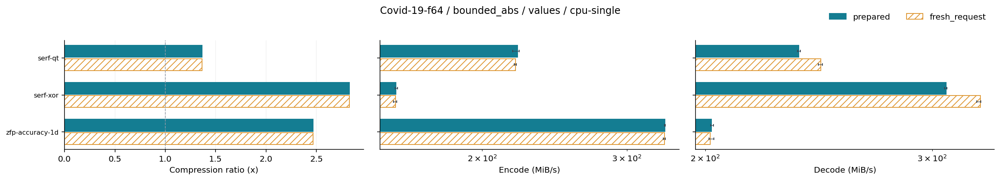

[SVG](figures/Covid-19-f64--bounded_abs--cpu-single.svg)

<details><summary>完整数值、有效批次及拒绝原因</summary>

| codec | 完整输出 bytes P / F | 压缩倍数 P / F | 编码 MiB/s P / F | 解码 MiB/s P / F | 有效批次 P / F |
|---|---:|---:|---:|---:|---:|
| serf-qt | 7.74e+06 / 7.74e+06 | 1.36 / 1.36 | 221 / 220 | 236 / 246 | 14/14 / 14/14 |
| serf-xor | 3.73e+06 / 3.73e+06 | 2.83 / 2.83 | 157 / 157 | 308 / 327 | 14/14 / 14/14 |
| zfp-accuracy-1d | 4.28e+06 / 4.28e+06 | 2.47 / 2.47 | 334 / 333 | 202 / 202 | 14/14 / 14/14 |

</details>

**<f8 · [1392, 948] · 经验质量（无最大误差保证） · values · cpu-single**

运行进程 CPU 亲和性（P / F）：`[(0, 1, 2, 3, 4, 5, 6, 7, 8, 9, 10, 11, 12, 13, 14, 15)]` / `[(0, 1, 2, 3, 4, 5, 6, 7, 8, 9, 10, 11, 12, 13, 14, 15)]`；逐配置创建时间见 CSV，是否处于并行窗口见调度记录。

<details><summary>完整数值、有效批次及拒绝原因</summary>

| codec | 完整输出 bytes P / F | 压缩倍数 P / F | 编码 MiB/s P / F | 解码 MiB/s P / F | 有效批次 P / F |
|---|---:|---:|---:|---:|---:|
| abba | — / — | — / — | — / — | — / — | 0/0 / 0/0 |
| fabba | — / — | — / — | — / — | — / — | 0/0 / 0/0 |
| pmc-mr | — / — | — / — | — / — | — / — | 0/0 / 0/0 |
| swing-filter | — / — | — / — | — / — | — / — | 0/0 / 0/0 |
| swing-filter-disjoint | — / — | — / — | — / — | — / — | 0/0 / 0/0 |
| swing-filter-disjoint-quantized / compatible | — / — | — / — | — / — | — / — | 0/0 / 0/0 |

拒绝或未完整完成的请求：

- `abba` / fresh_request：unsupported，RW native batches require rank 1 / columns=1; collection framing belongs to object mode
- `abba` / prepared：unsupported，RW native batches require rank 1 / columns=1; collection framing belongs to object mode
- `fabba` / fresh_request：unsupported，RW native batches require rank 1 / columns=1; collection framing belongs to object mode
- `fabba` / prepared：unsupported，RW native batches require rank 1 / columns=1; collection framing belongs to object mode
- `pmc-mr` / fresh_request：unsupported，pmc-mr: dtype must be one of ('<f4',)
- `pmc-mr` / prepared：unsupported，pmc-mr: dtype must be one of ('<f4',)
- `swing-filter` / fresh_request：unsupported，swing-filter: dtype must be one of ('<f4',)
- `swing-filter` / prepared：unsupported，swing-filter: dtype must be one of ('<f4',)
- `swing-filter-disjoint` / fresh_request：unsupported，swing-filter-disjoint: dtype must be one of ('<f4',)
- `swing-filter-disjoint` / prepared：unsupported，swing-filter-disjoint: dtype must be one of ('<f4',)
- `swing-filter-disjoint-quantized / compatible` / fresh_request：unsupported，swing-filter-disjoint-quantized: dtype must be one of ('<f4',)
- `swing-filter-disjoint-quantized / compatible` / prepared：unsupported，swing-filter-disjoint-quantized: dtype must be one of ('<f4',)

</details>

**<i8 · [1392, 948] · 无损 · values · cpu-single**

运行进程 CPU 亲和性（P / F）：`[(0, 1, 2, 3, 4, 5, 6, 7, 8, 9, 10, 11, 12, 13, 14, 15)]` / `[(0, 1, 2, 3, 4, 5, 6, 7, 8, 9, 10, 11, 12, 13, 14, 15)]`；逐配置创建时间见 CSV，是否处于并行窗口见调度记录。

<details><summary>完整数值、有效批次及拒绝原因</summary>

| codec | 完整输出 bytes P / F | 压缩倍数 P / F | 编码 MiB/s P / F | 解码 MiB/s P / F | 有效批次 P / F |
|---|---:|---:|---:|---:|---:|
| leats-lossless-i64 | — / — | — / — | — / — | — / — | 0/0 / 0/0 |
| neats-lossless-i64 | — / — | — / — | — / — | — / — | 0/0 / 0/0 |

拒绝或未完整完成的请求：

- `leats-lossless-i64` / fresh_request：unsupported，leats-lossless-i64: m=948 exceeds native limits
- `leats-lossless-i64` / prepared：unsupported，leats-lossless-i64: m=948 exceeds native limits
- `neats-lossless-i64` / fresh_request：unsupported，neats-lossless-i64: m=948 exceeds native limits
- `neats-lossless-i64` / prepared：unsupported，neats-lossless-i64: m=948 exceeds native limits

</details>

<a id="dataset-CzeLan"></a>

### CzeLan

**<f4 · [19934, 11] · 无损 · values · cpu-single**

运行进程 CPU 亲和性（P / F）：`[(0, 1, 2, 3, 4, 5, 6, 7, 8, 9, 10, 11, 12, 13, 14, 15)]` / `[(0, 1, 2, 3, 4, 5, 6, 7, 8, 9, 10, 11, 12, 13, 14, 15)]`；逐配置创建时间见 CSV，是否处于并行窗口见调度记录。

f64→f32 准备阶段转换的最大绝对差：**0.00048828125**；本组 codec 的恢复质量相对转换后的 f32 输入验证。

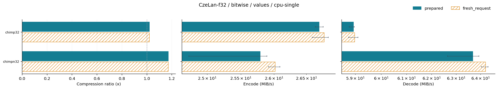

[SVG](figures/CzeLan-f32--bitwise--cpu-single.svg)

<details><summary>完整数值、有效批次及拒绝原因</summary>

| codec | 完整输出 bytes P / F | 压缩倍数 P / F | 编码 MiB/s P / F | 解码 MiB/s P / F | 有效批次 P / F |
|---|---:|---:|---:|---:|---:|
| chimp32 | 8.59e+05 / 8.59e+05 | 1.02 / 1.02 | 26.7 / 26.8 | 58.9 / 59 | 14/14 / 14/14 |
| chimpn32 | 7.49e+05 / 7.49e+05 | 1.17 / 1.17 | 25.8 / 26 | 63.7 / 64.2 | 14/14 / 14/14 |

</details>

**<f4 · [19934, 11] · 经验质量（无最大误差保证） · values · cpu-single**

运行进程 CPU 亲和性（P / F）：`[(0, 1, 2, 3, 4, 5, 6, 7, 8, 9, 10, 11, 12, 13, 14, 15)]` / `[(0, 1, 2, 3, 4, 5, 6, 7, 8, 9, 10, 11, 12, 13, 14, 15)]`；逐配置创建时间见 CSV，是否处于并行窗口见调度记录。

f64→f32 准备阶段转换的最大绝对差：**0.00048828125**；本组 codec 的恢复质量相对转换后的 f32 输入验证。

<details><summary>完整数值、有效批次及拒绝原因</summary>

| codec | 完整输出 bytes P / F | 压缩倍数 P / F | 编码 MiB/s P / F | 解码 MiB/s P / F | 有效批次 P / F |
|---|---:|---:|---:|---:|---:|
| pmc-mr | — / — | — / — | — / — | — / — | 0/0 / 0/0 |
| swing-filter | — / — | — / — | — / — | — / — | 0/0 / 0/0 |
| swing-filter-disjoint | — / — | — / — | — / — | — / — | 0/0 / 0/0 |
| swing-filter-disjoint-quantized / compatible | — / — | — / — | — / — | — / — | 0/0 / 0/0 |
| swing-filter-disjoint-quantized / strict_abs | — / — | — / — | — / — | — / — | 0/0 / 0/0 |

拒绝或未完整完成的请求：

- `pmc-mr` / fresh_request：unsupported，filter native_core requires one column; object/native_api preserve independent columns
- `pmc-mr` / prepared：unsupported，filter native_core requires one column; object/native_api preserve independent columns
- `swing-filter` / fresh_request：unsupported，filter native_core requires one column; object/native_api preserve independent columns
- `swing-filter` / prepared：unsupported，filter native_core requires one column; object/native_api preserve independent columns
- `swing-filter-disjoint` / fresh_request：unsupported，filter native_core requires one column; object/native_api preserve independent columns
- `swing-filter-disjoint` / prepared：unsupported，filter native_core requires one column; object/native_api preserve independent columns
- `swing-filter-disjoint-quantized / compatible` / fresh_request：unsupported，filter native_core requires one column; object/native_api preserve independent columns
- `swing-filter-disjoint-quantized / compatible` / prepared：unsupported，filter native_core requires one column; object/native_api preserve independent columns
- `swing-filter-disjoint-quantized / strict_abs` / fresh_request：unsupported，filter native_core requires one column; object/native_api preserve independent columns
- `swing-filter-disjoint-quantized / strict_abs` / prepared：unsupported，filter native_core requires one column; object/native_api preserve independent columns

</details>

**<f8 · [19934, 11] · 无损 · values · cpu-dzip-three**

运行进程 CPU 亲和性（P / F）：`[(0, 1, 2, 3, 4, 5, 6, 7, 8, 9, 10, 11, 12, 13, 14, 15)]` / `[(0, 1, 2, 3, 4, 5, 6, 7, 8, 9, 10, 11, 12, 13, 14, 15)]`；逐配置创建时间见 CSV，是否处于并行窗口见调度记录。

<details><summary>完整数值、有效批次及拒绝原因</summary>

| codec | 完整输出 bytes P / F | 压缩倍数 P / F | 编码 MiB/s P / F | 解码 MiB/s P / F | 有效批次 P / F |
|---|---:|---:|---:|---:|---:|
| dzip | — / — | — / — | — / — | — / — | 0/0 / 0/0 |

拒绝或未完整完成的请求：

- `dzip` / fresh_request：unsupported，dzip: dtype must be one of ('|u1',)
- `dzip` / prepared：unsupported，dzip: dtype must be one of ('|u1',)

</details>

**<f8 · [19934, 11] · 无损 · values · cpu-single**

运行进程 CPU 亲和性（P / F）：`[(0, 1, 2, 3, 4, 5, 6, 7, 8, 9, 10, 11, 12, 13, 14, 15)]` / `[(0, 1, 2, 3, 4, 5, 6, 7, 8, 9, 10, 11, 12, 13, 14, 15)]`；逐配置创建时间见 CSV，是否处于并行窗口见调度记录。

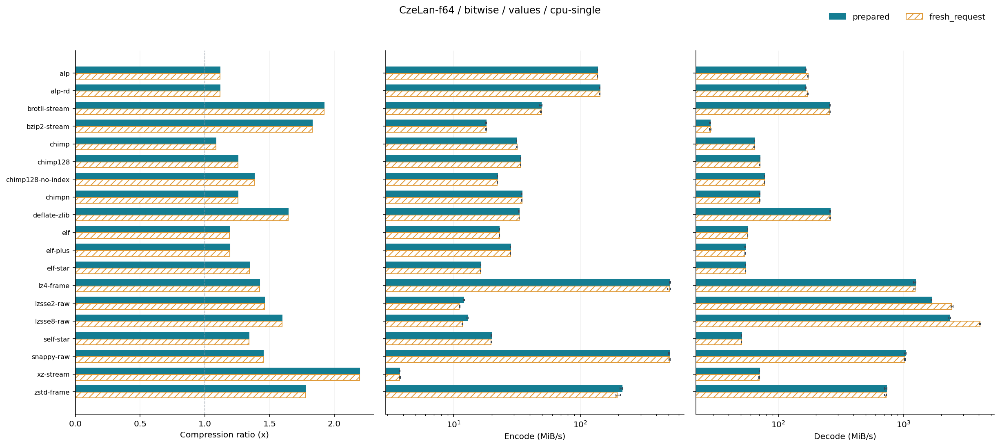

[SVG](figures/CzeLan-f64--bitwise--cpu-single.svg)

<details><summary>完整数值、有效批次及拒绝原因</summary>

| codec | 完整输出 bytes P / F | 压缩倍数 P / F | 编码 MiB/s P / F | 解码 MiB/s P / F | 有效批次 P / F |
|---|---:|---:|---:|---:|---:|
| alp | 1.57e+06 / 1.57e+06 | 1.12 / 1.12 | 137 / 137 | 166 / 172 | 14/14 / 14/14 |
| alp-rd | 1.57e+06 / 1.57e+06 | 1.12 / 1.12 | 143 / 143 | 166 / 171 | 14/14 / 14/14 |
| brotli-stream | 9.13e+05 / 9.13e+05 | 1.92 / 1.92 | 49.3 / 49.2 | 258 / 258 | 14/14 / 14/14 |
| bzip2-stream | 9.59e+05 / 9.59e+05 | 1.83 / 1.83 | 18 / 18 | 28.4 / 28.6 | 14/14 / 14/14 |
| chimp | 1.61e+06 / 1.61e+06 | 1.09 / 1.09 | 31.4 / 31.7 | 64 / 64.1 | 14/14 / 14/14 |
| chimp128 | 1.4e+06 / 1.4e+06 | 1.26 / 1.26 | 33.9 / 33.8 | 71.3 / 71.1 | 14/14 / 14/14 |
| chimp128-no-index | 1.27e+06 / 1.27e+06 | 1.38 / 1.38 | 22.2 / 22.1 | 77.5 / 77.4 | 14/14 / 14/14 |
| chimp32 | — / — | — / — | — / — | — / — | 0/0 / 0/0 |
| chimpn | 1.4e+06 / 1.4e+06 | 1.26 / 1.26 | 34.7 / 34.7 | 71.1 / 70.9 | 14/14 / 14/14 |
| chimpn32 | — / — | — / — | — / — | — / — | 0/0 / 0/0 |
| deepzip | — / — | — / — | — / — | — / — | 0/0 / 0/0 |
| deflate-zlib | 1.07e+06 / 1.07e+06 | 1.65 / 1.65 | 33 / 33 | 260 / 260 | 14/14 / 14/14 |
| elf | 1.48e+06 / 1.48e+06 | 1.19 / 1.19 | 23 / 23 | 56.9 / 56.9 | 14/14 / 14/14 |
| elf-plus | 1.47e+06 / 1.47e+06 | 1.19 / 1.19 | 28.2 / 28.2 | 54.2 / 54.1 | 14/14 / 14/14 |
| elf-star | 1.31e+06 / 1.31e+06 | 1.34 / 1.34 | 16.4 / 16.3 | 54.6 / 54.5 | 14/14 / 14/14 |
| fse | — / — | — / — | — / — | — / — | 0/0 / 0/0 |
| gorilla-prometheus-xor | — / — | — / — | — / — | — / — | 0/0 / 0/0 |
| huff0 | — / — | — / — | — / — | — / — | 0/0 / 0/0 |
| leats-lossless-i64 | — / — | — / — | — / — | — / — | 0/0 / 0/0 |
| lz4-frame | 1.23e+06 / 1.23e+06 | 1.42 / 1.42 | 510 / 508 | 1.24e+03 / 1.24e+03 | 14/14 / 14/14 |
| lzsse2-raw | 1.2e+06 / 1.2e+06 | 1.46 / 1.46 | 12 / 11.1 | 1.67e+03 / 2.43e+03 | 14/14 / 14/14 |
| lzsse8-raw | 1.1e+06 / 1.1e+06 | 1.6 / 1.6 | 13 / 11.8 | 2.36e+03 / 4.11e+03 | 14/14 / 14/14 |
| neats-lossless-i64 | — / — | — / — | — / — | — / — | 0/0 / 0/0 |
| self-star | 1.31e+06 / 1.31e+06 | 1.34 / 1.34 | 19.8 / 19.8 | 50.8 / 50.7 | 14/14 / 14/14 |
| simdcomp-u32 | — / — | — / — | — / — | — / — | 0/0 / 0/0 |
| snappy-raw | 1.21e+06 / 1.21e+06 | 1.45 / 1.45 | 507 / 511 | 1.03e+03 / 1.03e+03 | 14/14 / 14/14 |
| sprintz-delta | — / — | — / — | — / — | — / — | 0/0 / 0/0 |
| sprintz-delta-huffman | — / — | — / — | — / — | — / — | 0/0 / 0/0 |
| sprintz-fire | — / — | — / — | — / — | — / — | 0/0 / 0/0 |
| sprintz-fire-huffman | — / — | — / — | — / — | — / — | 0/0 / 0/0 |
| xz-stream | 7.99e+05 / 7.99e+05 | 2.2 / 2.2 | 3.76 / 3.76 | 70.9 / 70.4 | 14/14 / 14/14 |
| zstd-frame | 9.87e+05 / 9.87e+05 | 1.78 / 1.78 | 213 / 195 | 731 / 728 | 14/14 / 14/14 |

拒绝或未完整完成的请求：

- `chimp32` / fresh_request：unsupported，chimp32: dtype must be one of ('<f4',)
- `chimp32` / prepared：unsupported，chimp32: dtype must be one of ('<f4',)
- `chimpn32` / fresh_request：unsupported，chimpn32: dtype must be one of ('<f4',)
- `chimpn32` / prepared：unsupported，chimpn32: dtype must be one of ('<f4',)
- `deepzip` / fresh_request：unsupported，deepzip: dtype must be one of ('|u1',)
- `deepzip` / prepared：unsupported，deepzip: dtype must be one of ('|u1',)
- `fse` / fresh_request：unsupported，fse: n=19934 exceeds native limits
- `fse` / prepared：unsupported，fse: n=19934 exceeds native limits
- `gorilla-prometheus-xor` / fresh_request：unsupported，Gorilla requires actual paired T/V; values-only and timestamp-only are unsupported
- `gorilla-prometheus-xor` / prepared：unsupported，Gorilla requires actual paired T/V; values-only and timestamp-only are unsupported
- `huff0` / fresh_request：unsupported，huff0: n=19934 exceeds native limits
- `huff0` / prepared：unsupported，huff0: n=19934 exceeds native limits
- `leats-lossless-i64` / fresh_request：unsupported，leats-lossless-i64: dtype must be one of ('|i1', '<i2', '<i4', '<i8')
- `leats-lossless-i64` / prepared：unsupported，leats-lossless-i64: dtype must be one of ('|i1', '<i2', '<i4', '<i8')
- `neats-lossless-i64` / fresh_request：unsupported，neats-lossless-i64: dtype must be one of ('|i1', '<i2', '<i4', '<i8')
- `neats-lossless-i64` / prepared：unsupported，neats-lossless-i64: dtype must be one of ('|i1', '<i2', '<i4', '<i8')
- `simdcomp-u32` / fresh_request：unsupported，simdcomp-u32: dtype must be one of ('<u4',)
- `simdcomp-u32` / prepared：unsupported，simdcomp-u32: dtype must be one of ('<u4',)
- `sprintz-delta` / fresh_request：unsupported，sprintz-delta: dtype must be one of ('|u1', '|i1', '<u2', '<i2')
- `sprintz-delta` / prepared：unsupported，sprintz-delta: dtype must be one of ('|u1', '|i1', '<u2', '<i2')
- `sprintz-delta-huffman` / fresh_request：unsupported，sprintz-delta-huffman: dtype must be one of ('|u1', '|i1', '<u2', '<i2')
- `sprintz-delta-huffman` / prepared：unsupported，sprintz-delta-huffman: dtype must be one of ('|u1', '|i1', '<u2', '<i2')
- `sprintz-fire` / fresh_request：unsupported，sprintz-fire: dtype must be one of ('|u1', '|i1', '<u2', '<i2')
- `sprintz-fire` / prepared：unsupported，sprintz-fire: dtype must be one of ('|u1', '|i1', '<u2', '<i2')
- `sprintz-fire-huffman` / fresh_request：unsupported，sprintz-fire-huffman: dtype must be one of ('|u1', '|i1', '<u2', '<i2')
- `sprintz-fire-huffman` / prepared：unsupported，sprintz-fire-huffman: dtype must be one of ('|u1', '|i1', '<u2', '<i2')

</details>

**<f8 · [19934, 11] · ABS ≤ 0.01 · values · cpu-single**

运行进程 CPU 亲和性（P / F）：`[(0, 1, 2, 3, 4, 5, 6, 7, 8, 9, 10, 11, 12, 13, 14, 15)]` / `[(0, 1, 2, 3, 4, 5, 6, 7, 8, 9, 10, 11, 12, 13, 14, 15)]`；逐配置创建时间见 CSV，是否处于并行窗口见调度记录。

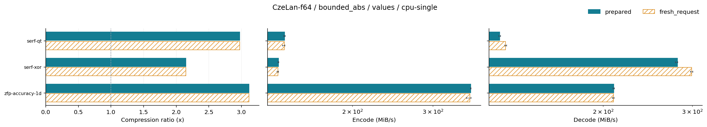

[SVG](figures/CzeLan-f64--bounded_abs--cpu-single.svg)

<details><summary>完整数值、有效批次及拒绝原因</summary>

| codec | 完整输出 bytes P / F | 压缩倍数 P / F | 编码 MiB/s P / F | 解码 MiB/s P / F | 有效批次 P / F |
|---|---:|---:|---:|---:|---:|
| serf-qt | 5.9e+05 / 5.9e+05 | 2.97 / 2.97 | 142 / 142 | 125 / 128 | 14/14 / 14/14 |
| serf-xor | 8.17e+05 / 8.17e+05 | 2.15 / 2.15 | 138 / 137 | 280 / 299 | 14/14 / 14/14 |
| zfp-accuracy-1d | 5.63e+05 / 5.63e+05 | 3.12 / 3.12 | 363 / 362 | 210 / 210 | 14/14 / 14/14 |

</details>

**<f8 · [19934, 11] · 经验质量（无最大误差保证） · values · cpu-single**

运行进程 CPU 亲和性（P / F）：`[(0, 1, 2, 3, 4, 5, 6, 7, 8, 9, 10, 11, 12, 13, 14, 15)]` / `[(0, 1, 2, 3, 4, 5, 6, 7, 8, 9, 10, 11, 12, 13, 14, 15)]`；逐配置创建时间见 CSV，是否处于并行窗口见调度记录。

<details><summary>完整数值、有效批次及拒绝原因</summary>

| codec | 完整输出 bytes P / F | 压缩倍数 P / F | 编码 MiB/s P / F | 解码 MiB/s P / F | 有效批次 P / F |
|---|---:|---:|---:|---:|---:|
| abba | — / — | — / — | — / — | — / — | 0/0 / 0/0 |
| fabba | — / — | — / — | — / — | — / — | 0/0 / 0/0 |
| pmc-mr | — / — | — / — | — / — | — / — | 0/0 / 0/0 |
| swing-filter | — / — | — / — | — / — | — / — | 0/0 / 0/0 |
| swing-filter-disjoint | — / — | — / — | — / — | — / — | 0/0 / 0/0 |
| swing-filter-disjoint-quantized / compatible | — / — | — / — | — / — | — / — | 0/0 / 0/0 |

拒绝或未完整完成的请求：

- `abba` / fresh_request：unsupported，RW native batches require rank 1 / columns=1; collection framing belongs to object mode
- `abba` / prepared：unsupported，RW native batches require rank 1 / columns=1; collection framing belongs to object mode
- `fabba` / fresh_request：unsupported，RW native batches require rank 1 / columns=1; collection framing belongs to object mode
- `fabba` / prepared：unsupported，RW native batches require rank 1 / columns=1; collection framing belongs to object mode
- `pmc-mr` / fresh_request：unsupported，pmc-mr: dtype must be one of ('<f4',)
- `pmc-mr` / prepared：unsupported，pmc-mr: dtype must be one of ('<f4',)
- `swing-filter` / fresh_request：unsupported，swing-filter: dtype must be one of ('<f4',)
- `swing-filter` / prepared：unsupported，swing-filter: dtype must be one of ('<f4',)
- `swing-filter-disjoint` / fresh_request：unsupported，swing-filter-disjoint: dtype must be one of ('<f4',)
- `swing-filter-disjoint` / prepared：unsupported，swing-filter-disjoint: dtype must be one of ('<f4',)
- `swing-filter-disjoint-quantized / compatible` / fresh_request：unsupported，swing-filter-disjoint-quantized: dtype must be one of ('<f4',)
- `swing-filter-disjoint-quantized / compatible` / prepared：unsupported，swing-filter-disjoint-quantized: dtype must be one of ('<f4',)

</details>

<a id="dataset-ETTh1"></a>

### ETTh1

**<f4 · [17420, 7] · 无损 · values · cpu-single**

运行进程 CPU 亲和性（P / F）：`[(0, 1, 2, 3, 4, 5, 6, 7, 8, 9, 10, 11, 12, 13, 14, 15)]` / `[(0, 1, 2, 3, 4, 5, 6, 7, 8, 9, 10, 11, 12, 13, 14, 15)]`；逐配置创建时间见 CSV，是否处于并行窗口见调度记录。

f64→f32 准备阶段转换的最大绝对差：**1.0658141e-14**；本组 codec 的恢复质量相对转换后的 f32 输入验证。

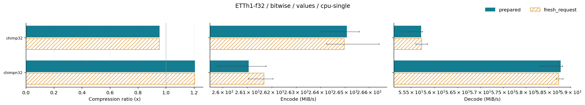

[SVG](figures/ETTh1-f32--bitwise--cpu-single.svg)

<details><summary>完整数值、有效批次及拒绝原因</summary>

| codec | 完整输出 bytes P / F | 压缩倍数 P / F | 编码 MiB/s P / F | 解码 MiB/s P / F | 有效批次 P / F |
|---|---:|---:|---:|---:|---:|
| chimp32 | 5.12e+05 / 5.12e+05 | 0.952 / 0.952 | 26.5 / 26.5 | 55.7 / 55.7 | 14/14 / 14/14 |
| chimpn32 | 4.05e+05 / 4.05e+05 | 1.2 / 1.2 | 26.1 / 26.2 | 58.8 / 58.7 | 14/14 / 14/14 |

</details>

**<f4 · [17420, 7] · 经验质量（无最大误差保证） · values · cpu-single**

运行进程 CPU 亲和性（P / F）：`[(0, 1, 2, 3, 4, 5, 6, 7, 8, 9, 10, 11, 12, 13, 14, 15)]` / `[(0, 1, 2, 3, 4, 5, 6, 7, 8, 9, 10, 11, 12, 13, 14, 15)]`；逐配置创建时间见 CSV，是否处于并行窗口见调度记录。

f64→f32 准备阶段转换的最大绝对差：**1.0658141e-14**；本组 codec 的恢复质量相对转换后的 f32 输入验证。

<details><summary>完整数值、有效批次及拒绝原因</summary>

| codec | 完整输出 bytes P / F | 压缩倍数 P / F | 编码 MiB/s P / F | 解码 MiB/s P / F | 有效批次 P / F |
|---|---:|---:|---:|---:|---:|
| pmc-mr | — / — | — / — | — / — | — / — | 0/0 / 0/0 |
| swing-filter | — / — | — / — | — / — | — / — | 0/0 / 0/0 |
| swing-filter-disjoint | — / — | — / — | — / — | — / — | 0/0 / 0/0 |
| swing-filter-disjoint-quantized / compatible | — / — | — / — | — / — | — / — | 0/0 / 0/0 |
| swing-filter-disjoint-quantized / strict_abs | — / — | — / — | — / — | — / — | 0/0 / 0/0 |

拒绝或未完整完成的请求：

- `pmc-mr` / fresh_request：unsupported，filter native_core requires one column; object/native_api preserve independent columns
- `pmc-mr` / prepared：unsupported，filter native_core requires one column; object/native_api preserve independent columns
- `swing-filter` / fresh_request：unsupported，filter native_core requires one column; object/native_api preserve independent columns
- `swing-filter` / prepared：unsupported，filter native_core requires one column; object/native_api preserve independent columns
- `swing-filter-disjoint` / fresh_request：unsupported，filter native_core requires one column; object/native_api preserve independent columns
- `swing-filter-disjoint` / prepared：unsupported，filter native_core requires one column; object/native_api preserve independent columns
- `swing-filter-disjoint-quantized / compatible` / fresh_request：unsupported，filter native_core requires one column; object/native_api preserve independent columns
- `swing-filter-disjoint-quantized / compatible` / prepared：unsupported，filter native_core requires one column; object/native_api preserve independent columns
- `swing-filter-disjoint-quantized / strict_abs` / fresh_request：unsupported，filter native_core requires one column; object/native_api preserve independent columns
- `swing-filter-disjoint-quantized / strict_abs` / prepared：unsupported，filter native_core requires one column; object/native_api preserve independent columns

</details>

**<f8 · [17420, 7] · 无损 · values · cpu-dzip-three**

运行进程 CPU 亲和性（P / F）：`[(0, 1, 2, 3, 4, 5, 6, 7, 8, 9, 10, 11, 12, 13, 14, 15)]` / `[(0, 1, 2, 3, 4, 5, 6, 7, 8, 9, 10, 11, 12, 13, 14, 15)]`；逐配置创建时间见 CSV，是否处于并行窗口见调度记录。

<details><summary>完整数值、有效批次及拒绝原因</summary>

| codec | 完整输出 bytes P / F | 压缩倍数 P / F | 编码 MiB/s P / F | 解码 MiB/s P / F | 有效批次 P / F |
|---|---:|---:|---:|---:|---:|
| dzip | — / — | — / — | — / — | — / — | 0/0 / 0/0 |

拒绝或未完整完成的请求：

- `dzip` / fresh_request：unsupported，dzip: dtype must be one of ('|u1',)
- `dzip` / prepared：unsupported，dzip: dtype must be one of ('|u1',)

</details>

**<f8 · [17420, 7] · 无损 · values · cpu-single**

运行进程 CPU 亲和性（P / F）：`[(0, 1, 2, 3, 4, 5, 6, 7, 8, 9, 10, 11, 12, 13, 14, 15)]` / `[(0, 1, 2, 3, 4, 5, 6, 7, 8, 9, 10, 11, 12, 13, 14, 15)]`；逐配置创建时间见 CSV，是否处于并行窗口见调度记录。

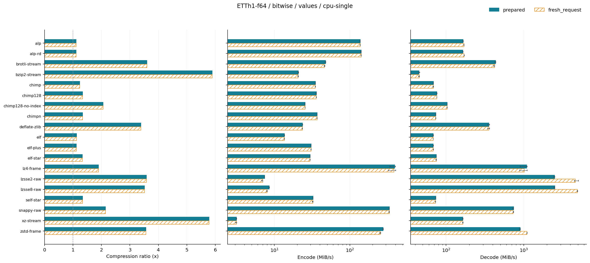

[SVG](figures/ETTh1-f64--bitwise--cpu-single.svg)

<details><summary>完整数值、有效批次及拒绝原因</summary>

| codec | 完整输出 bytes P / F | 压缩倍数 P / F | 编码 MiB/s P / F | 解码 MiB/s P / F | 有效批次 P / F |
|---|---:|---:|---:|---:|---:|
| alp | 8.77e+05 / 8.77e+05 | 1.11 / 1.11 | 137 / 137 | 166 / 170 | 14/14 / 14/14 |
| alp-rd | 8.77e+05 / 8.77e+05 | 1.11 / 1.11 | 141 / 141 | 165 / 171 | 14/14 / 14/14 |
| brotli-stream | 2.71e+05 / 2.71e+05 | 3.6 / 3.6 | 47.5 / 46 | 434 / 421 | 14/14 / 14/14 |
| bzip2-stream | 1.66e+05 / 1.66e+05 | 5.89 / 5.89 | 20.7 / 20.6 | 44.9 / 45.2 | 14/14 / 14/14 |
| chimp | 7.91e+05 / 7.91e+05 | 1.23 / 1.23 | 34.9 / 34.8 | 68.5 / 68.6 | 14/14 / 14/14 |
| chimp128 | 7.28e+05 / 7.28e+05 | 1.34 / 1.34 | 35.9 / 35.9 | 76.1 / 76.1 | 14/14 / 14/14 |
| chimp128-no-index | 4.74e+05 / 4.74e+05 | 2.06 / 2.06 | 25.5 / 25.5 | 103 / 103 | 14/14 / 14/14 |
| chimp32 | — / — | — / — | — / — | — / — | 0/0 / 0/0 |
| chimpn | 7.28e+05 / 7.28e+05 | 1.34 / 1.34 | 36.8 / 36.7 | 73.6 / 73.5 | 14/14 / 14/14 |
| chimpn32 | — / — | — / — | — / — | — / — | 0/0 / 0/0 |
| deepzip | — / — | — / — | — / — | — / — | 0/0 / 0/0 |
| deflate-zlib | 2.88e+05 / 2.88e+05 | 3.39 / 3.39 | 23.6 / 23.5 | 357 / 356 | 14/14 / 14/14 |
| elf | 8.66e+05 / 8.66e+05 | 1.13 / 1.13 | 13.6 / 13.6 | 68.5 / 68.4 | 14/14 / 14/14 |
| elf-plus | 8.73e+05 / 8.73e+05 | 1.12 / 1.12 | 30.7 / 30.6 | 68.5 / 68.4 | 14/14 / 14/14 |
| elf-star | 7.34e+05 / 7.34e+05 | 1.33 / 1.33 | 29.7 / 29.7 | 74.9 / 74.9 | 14/14 / 14/14 |
| fse | — / — | — / — | — / — | — / — | 0/0 / 0/0 |
| gorilla-prometheus-xor | — / — | — / — | — / — | — / — | 0/0 / 0/0 |
| huff0 | — / — | — / — | — / — | — / — | 0/0 / 0/0 |
| leats-lossless-i64 | — / — | — / — | — / — | — / — | 0/0 / 0/0 |
| lz4-frame | 5.16e+05 / 5.16e+05 | 1.89 / 1.89 | 393 / 383 | 1.1e+03 / 1.02e+03 | 14/14 / 14/14 |
| lzsse2-raw | 2.73e+05 / 2.73e+05 | 3.58 / 3.58 | 7.41 / 6.98 | 2.5e+03 / 4.65e+03 | 14/14 / 14/14 |
| lzsse8-raw | 2.78e+05 / 2.78e+05 | 3.51 / 3.51 | 8.53 / 8.01 | 2.52e+03 / 4.93e+03 | 14/14 / 14/14 |
| neats-lossless-i64 | — / — | — / — | — / — | — / — | 0/0 / 0/0 |
| self-star | 7.3e+05 / 7.3e+05 | 1.34 / 1.34 | 32.5 / 32.4 | 73.6 / 73 | 14/14 / 14/14 |
| simdcomp-u32 | — / — | — / — | — / — | — / — | 0/0 / 0/0 |
| snappy-raw | 4.56e+05 / 4.56e+05 | 2.14 / 2.14 | 334 / 333 | 744 / 735 | 14/14 / 14/14 |
| sprintz-delta | — / — | — / — | — / — | — / — | 0/0 / 0/0 |
| sprintz-delta-huffman | — / — | — / — | — / — | — / — | 0/0 / 0/0 |
| sprintz-fire | — / — | — / — | — / — | — / — | 0/0 / 0/0 |
| sprintz-fire-huffman | — / — | — / — | — / — | — / — | 0/0 / 0/0 |
| xz-stream | 1.69e+05 / 1.69e+05 | 5.78 / 5.78 | 3.13 / 3.15 | 165 / 165 | 14/14 / 14/14 |
| zstd-frame | 2.74e+05 / 2.74e+05 | 3.56 / 3.56 | 276 / 253 | 901 / 1.1e+03 | 14/14 / 14/14 |

拒绝或未完整完成的请求：

- `chimp32` / fresh_request：unsupported，chimp32: dtype must be one of ('<f4',)
- `chimp32` / prepared：unsupported，chimp32: dtype must be one of ('<f4',)
- `chimpn32` / fresh_request：unsupported，chimpn32: dtype must be one of ('<f4',)
- `chimpn32` / prepared：unsupported，chimpn32: dtype must be one of ('<f4',)
- `deepzip` / fresh_request：unsupported，deepzip: dtype must be one of ('|u1',)
- `deepzip` / prepared：unsupported，deepzip: dtype must be one of ('|u1',)
- `fse` / fresh_request：unsupported，fse: n=17420 exceeds native limits
- `fse` / prepared：unsupported，fse: n=17420 exceeds native limits
- `gorilla-prometheus-xor` / fresh_request：unsupported，Gorilla requires actual paired T/V; values-only and timestamp-only are unsupported
- `gorilla-prometheus-xor` / prepared：unsupported，Gorilla requires actual paired T/V; values-only and timestamp-only are unsupported
- `huff0` / fresh_request：unsupported，huff0: n=17420 exceeds native limits
- `huff0` / prepared：unsupported，huff0: n=17420 exceeds native limits
- `leats-lossless-i64` / fresh_request：unsupported，leats-lossless-i64: dtype must be one of ('|i1', '<i2', '<i4', '<i8')
- `leats-lossless-i64` / prepared：unsupported，leats-lossless-i64: dtype must be one of ('|i1', '<i2', '<i4', '<i8')
- `neats-lossless-i64` / fresh_request：unsupported，neats-lossless-i64: dtype must be one of ('|i1', '<i2', '<i4', '<i8')
- `neats-lossless-i64` / prepared：unsupported，neats-lossless-i64: dtype must be one of ('|i1', '<i2', '<i4', '<i8')
- `simdcomp-u32` / fresh_request：unsupported，simdcomp-u32: dtype must be one of ('<u4',)
- `simdcomp-u32` / prepared：unsupported，simdcomp-u32: dtype must be one of ('<u4',)
- `sprintz-delta` / fresh_request：unsupported，sprintz-delta: dtype must be one of ('|u1', '|i1', '<u2', '<i2')
- `sprintz-delta` / prepared：unsupported，sprintz-delta: dtype must be one of ('|u1', '|i1', '<u2', '<i2')
- `sprintz-delta-huffman` / fresh_request：unsupported，sprintz-delta-huffman: dtype must be one of ('|u1', '|i1', '<u2', '<i2')
- `sprintz-delta-huffman` / prepared：unsupported，sprintz-delta-huffman: dtype must be one of ('|u1', '|i1', '<u2', '<i2')
- `sprintz-fire` / fresh_request：unsupported，sprintz-fire: dtype must be one of ('|u1', '|i1', '<u2', '<i2')
- `sprintz-fire` / prepared：unsupported，sprintz-fire: dtype must be one of ('|u1', '|i1', '<u2', '<i2')
- `sprintz-fire-huffman` / fresh_request：unsupported，sprintz-fire-huffman: dtype must be one of ('|u1', '|i1', '<u2', '<i2')
- `sprintz-fire-huffman` / prepared：unsupported，sprintz-fire-huffman: dtype must be one of ('|u1', '|i1', '<u2', '<i2')

</details>

**<f8 · [17420, 7] · ABS ≤ 0.01 · values · cpu-single**

运行进程 CPU 亲和性（P / F）：`[(0, 1, 2, 3, 4, 5, 6, 7, 8, 9, 10, 11, 12, 13, 14, 15)]` / `[(0, 1, 2, 3, 4, 5, 6, 7, 8, 9, 10, 11, 12, 13, 14, 15)]`；逐配置创建时间见 CSV，是否处于并行窗口见调度记录。

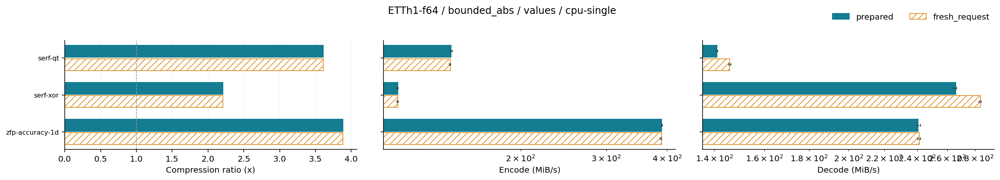

[SVG](figures/ETTh1-f64--bounded_abs--cpu-single.svg)

<details><summary>完整数值、有效批次及拒绝原因</summary>

| codec | 完整输出 bytes P / F | 压缩倍数 P / F | 编码 MiB/s P / F | 解码 MiB/s P / F | 有效批次 P / F |
|---|---:|---:|---:|---:|---:|
| serf-qt | 2.71e+05 / 2.71e+05 | 3.61 / 3.61 | 144 / 143 | 141 / 146 | 14/14 / 14/14 |
| serf-xor | 4.42e+05 / 4.42e+05 | 2.21 / 2.21 | 112 / 112 | 266 / 284 | 14/14 / 14/14 |
| zfp-accuracy-1d | 2.51e+05 / 2.51e+05 | 3.88 / 3.88 | 390 / 390 | 241 / 241 | 14/14 / 14/14 |

</details>

**<f8 · [17420, 7] · 经验质量（无最大误差保证） · values · cpu-single**

运行进程 CPU 亲和性（P / F）：`[(0, 1, 2, 3, 4, 5, 6, 7, 8, 9, 10, 11, 12, 13, 14, 15)]` / `[(0, 1, 2, 3, 4, 5, 6, 7, 8, 9, 10, 11, 12, 13, 14, 15)]`；逐配置创建时间见 CSV，是否处于并行窗口见调度记录。

<details><summary>完整数值、有效批次及拒绝原因</summary>

| codec | 完整输出 bytes P / F | 压缩倍数 P / F | 编码 MiB/s P / F | 解码 MiB/s P / F | 有效批次 P / F |
|---|---:|---:|---:|---:|---:|
| abba | — / — | — / — | — / — | — / — | 0/0 / 0/0 |
| fabba | — / — | — / — | — / — | — / — | 0/0 / 0/0 |
| pmc-mr | — / — | — / — | — / — | — / — | 0/0 / 0/0 |
| swing-filter | — / — | — / — | — / — | — / — | 0/0 / 0/0 |
| swing-filter-disjoint | — / — | — / — | — / — | — / — | 0/0 / 0/0 |
| swing-filter-disjoint-quantized / compatible | — / — | — / — | — / — | — / — | 0/0 / 0/0 |

拒绝或未完整完成的请求：

- `abba` / fresh_request：unsupported，RW native batches require rank 1 / columns=1; collection framing belongs to object mode
- `abba` / prepared：unsupported，RW native batches require rank 1 / columns=1; collection framing belongs to object mode
- `fabba` / fresh_request：unsupported，RW native batches require rank 1 / columns=1; collection framing belongs to object mode
- `fabba` / prepared：unsupported，RW native batches require rank 1 / columns=1; collection framing belongs to object mode
- `pmc-mr` / fresh_request：unsupported，pmc-mr: dtype must be one of ('<f4',)
- `pmc-mr` / prepared：unsupported，pmc-mr: dtype must be one of ('<f4',)
- `swing-filter` / fresh_request：unsupported，swing-filter: dtype must be one of ('<f4',)
- `swing-filter` / prepared：unsupported，swing-filter: dtype must be one of ('<f4',)
- `swing-filter-disjoint` / fresh_request：unsupported，swing-filter-disjoint: dtype must be one of ('<f4',)
- `swing-filter-disjoint` / prepared：unsupported，swing-filter-disjoint: dtype must be one of ('<f4',)
- `swing-filter-disjoint-quantized / compatible` / fresh_request：unsupported，swing-filter-disjoint-quantized: dtype must be one of ('<f4',)
- `swing-filter-disjoint-quantized / compatible` / prepared：unsupported，swing-filter-disjoint-quantized: dtype must be one of ('<f4',)

</details>

<a id="dataset-ETTh2"></a>

### ETTh2

**<f4 · [17420, 7] · 无损 · values · cpu-single**

运行进程 CPU 亲和性（P / F）：`[(0, 1, 2, 3, 4, 5, 6, 7, 8, 9, 10, 11, 12, 13, 14, 15)]` / `[(0, 1, 2, 3, 4, 5, 6, 7, 8, 9, 10, 11, 12, 13, 14, 15)]`；逐配置创建时间见 CSV，是否处于并行窗口见调度记录。

f64→f32 准备阶段转换的最大绝对差：**1.42108547e-14**；本组 codec 的恢复质量相对转换后的 f32 输入验证。

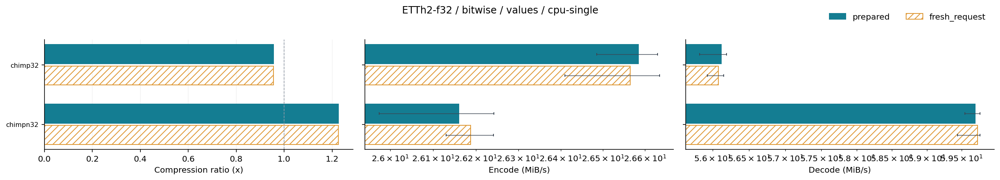

[SVG](figures/ETTh2-f32--bitwise--cpu-single.svg)

<details><summary>完整数值、有效批次及拒绝原因</summary>

| codec | 完整输出 bytes P / F | 压缩倍数 P / F | 编码 MiB/s P / F | 解码 MiB/s P / F | 有效批次 P / F |
|---|---:|---:|---:|---:|---:|
| chimp32 | 5.11e+05 / 5.11e+05 | 0.954 / 0.954 | 26.6 / 26.6 | 56.1 / 56.1 | 14/14 / 14/14 |
| chimpn32 | 3.98e+05 / 3.98e+05 | 1.23 / 1.23 | 26.2 / 26.2 | 59.7 / 59.7 | 14/14 / 14/14 |

</details>

**<f4 · [17420, 7] · 经验质量（无最大误差保证） · values · cpu-single**

运行进程 CPU 亲和性（P / F）：`[(0, 1, 2, 3, 4, 5, 6, 7, 8, 9, 10, 11, 12, 13, 14, 15)]` / `[(0, 1, 2, 3, 4, 5, 6, 7, 8, 9, 10, 11, 12, 13, 14, 15)]`；逐配置创建时间见 CSV，是否处于并行窗口见调度记录。

f64→f32 准备阶段转换的最大绝对差：**1.42108547e-14**；本组 codec 的恢复质量相对转换后的 f32 输入验证。

<details><summary>完整数值、有效批次及拒绝原因</summary>

| codec | 完整输出 bytes P / F | 压缩倍数 P / F | 编码 MiB/s P / F | 解码 MiB/s P / F | 有效批次 P / F |
|---|---:|---:|---:|---:|---:|
| pmc-mr | — / — | — / — | — / — | — / — | 0/0 / 0/0 |
| swing-filter | — / — | — / — | — / — | — / — | 0/0 / 0/0 |
| swing-filter-disjoint | — / — | — / — | — / — | — / — | 0/0 / 0/0 |
| swing-filter-disjoint-quantized / compatible | — / — | — / — | — / — | — / — | 0/0 / 0/0 |
| swing-filter-disjoint-quantized / strict_abs | — / — | — / — | — / — | — / — | 0/0 / 0/0 |

拒绝或未完整完成的请求：

- `pmc-mr` / fresh_request：unsupported，filter native_core requires one column; object/native_api preserve independent columns
- `pmc-mr` / prepared：unsupported，filter native_core requires one column; object/native_api preserve independent columns
- `swing-filter` / fresh_request：unsupported，filter native_core requires one column; object/native_api preserve independent columns
- `swing-filter` / prepared：unsupported，filter native_core requires one column; object/native_api preserve independent columns
- `swing-filter-disjoint` / fresh_request：unsupported，filter native_core requires one column; object/native_api preserve independent columns
- `swing-filter-disjoint` / prepared：unsupported，filter native_core requires one column; object/native_api preserve independent columns
- `swing-filter-disjoint-quantized / compatible` / fresh_request：unsupported，filter native_core requires one column; object/native_api preserve independent columns
- `swing-filter-disjoint-quantized / compatible` / prepared：unsupported，filter native_core requires one column; object/native_api preserve independent columns
- `swing-filter-disjoint-quantized / strict_abs` / fresh_request：unsupported，filter native_core requires one column; object/native_api preserve independent columns
- `swing-filter-disjoint-quantized / strict_abs` / prepared：unsupported，filter native_core requires one column; object/native_api preserve independent columns

</details>

**<f8 · [17420, 7] · 无损 · values · cpu-dzip-three**

运行进程 CPU 亲和性（P / F）：`[(0, 1, 2, 3, 4, 5, 6, 7, 8, 9, 10, 11, 12, 13, 14, 15)]` / `[(0, 1, 2, 3, 4, 5, 6, 7, 8, 9, 10, 11, 12, 13, 14, 15)]`；逐配置创建时间见 CSV，是否处于并行窗口见调度记录。

<details><summary>完整数值、有效批次及拒绝原因</summary>

| codec | 完整输出 bytes P / F | 压缩倍数 P / F | 编码 MiB/s P / F | 解码 MiB/s P / F | 有效批次 P / F |
|---|---:|---:|---:|---:|---:|
| dzip | — / — | — / — | — / — | — / — | 0/0 / 0/0 |

拒绝或未完整完成的请求：

- `dzip` / fresh_request：unsupported，dzip: dtype must be one of ('|u1',)
- `dzip` / prepared：unsupported，dzip: dtype must be one of ('|u1',)

</details>

**<f8 · [17420, 7] · 无损 · values · cpu-single**

运行进程 CPU 亲和性（P / F）：`[(0, 1, 2, 3, 4, 5, 6, 7, 8, 9, 10, 11, 12, 13, 14, 15)]` / `[(0, 1, 2, 3, 4, 5, 6, 7, 8, 9, 10, 11, 12, 13, 14, 15)]`；逐配置创建时间见 CSV，是否处于并行窗口见调度记录。

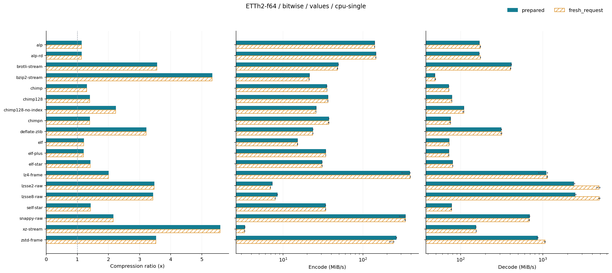

[SVG](figures/ETTh2-f64--bitwise--cpu-single.svg)

<details><summary>完整数值、有效批次及拒绝原因</summary>

| codec | 完整输出 bytes P / F | 压缩倍数 P / F | 编码 MiB/s P / F | 解码 MiB/s P / F | 有效批次 P / F |
|---|---:|---:|---:|---:|---:|
| alp | 8.6e+05 / 8.6e+05 | 1.13 / 1.13 | 140 / 140 | 169 / 174 | 14/14 / 14/14 |
| alp-rd | 8.6e+05 / 8.6e+05 | 1.13 / 1.13 | 146 / 145 | 168 / 174 | 14/14 / 14/14 |
| brotli-stream | 2.74e+05 / 2.74e+05 | 3.56 / 3.56 | 49.2 / 48.2 | 414 / 405 | 14/14 / 14/14 |
| bzip2-stream | 1.83e+05 / 1.83e+05 | 5.33 / 5.33 | 21.4 / 21.2 | 48.5 / 49 | 14/14 / 14/14 |
| chimp | 7.5e+05 / 7.5e+05 | 1.3 / 1.3 | 35.3 / 35.5 | 71.6 / 71.9 | 14/14 / 14/14 |
| chimp128 | 7e+05 / 7e+05 | 1.39 / 1.39 | 36.6 / 36.5 | 78.3 / 78.3 | 14/14 / 14/14 |
| chimp128-no-index | 4.37e+05 / 4.37e+05 | 2.23 / 2.23 | 26 / 25.9 | 109 / 109 | 14/14 / 14/14 |
| chimp32 | — / — | — / — | — / — | — / — | 0/0 / 0/0 |
| chimpn | 7e+05 / 7e+05 | 1.39 / 1.39 | 37.4 / 37.4 | 75.7 / 75.6 | 14/14 / 14/14 |
| chimpn32 | — / — | — / — | — / — | — / — | 0/0 / 0/0 |
| deepzip | — / — | — / — | — / — | — / — | 0/0 / 0/0 |
| deflate-zlib | 3.04e+05 / 3.04e+05 | 3.21 / 3.21 | 23.6 / 23.6 | 311 / 315 | 14/14 / 14/14 |
| elf | 8.12e+05 / 8.12e+05 | 1.2 / 1.2 | 15.2 / 15.2 | 72.6 / 72.6 | 14/14 / 14/14 |
| elf-plus | 8.16e+05 / 8.16e+05 | 1.2 / 1.2 | 34.2 / 34.3 | 71.8 / 72 | 14/14 / 14/14 |
| elf-star | 6.92e+05 / 6.92e+05 | 1.41 / 1.41 | 30.8 / 30.8 | 80 / 80.2 | 14/14 / 14/14 |
| fse | — / — | — / — | — / — | — / — | 0/0 / 0/0 |
| gorilla-prometheus-xor | — / — | — / — | — / — | — / — | 0/0 / 0/0 |
| huff0 | — / — | — / — | — / — | — / — | 0/0 / 0/0 |
| leats-lossless-i64 | — / — | — / — | — / — | — / — | 0/0 / 0/0 |
| lz4-frame | 4.87e+05 / 4.87e+05 | 2 / 2 | 387 / 392 | 1.1e+03 / 1.14e+03 | 14/14 / 14/14 |
| lzsse2-raw | 2.81e+05 / 2.81e+05 | 3.47 / 3.47 | 7.3 / 6.95 | 2.39e+03 / 4.84e+03 | 14/14 / 14/14 |
| lzsse8-raw | 2.84e+05 / 2.84e+05 | 3.43 / 3.43 | 8.47 / 7.97 | 2.47e+03 / 4.89e+03 | 14/14 / 14/14 |
| neats-lossless-i64 | — / — | — / — | — / — | — / — | 0/0 / 0/0 |
| self-star | 6.87e+05 / 6.87e+05 | 1.42 / 1.42 | 34.1 / 34.1 | 77.6 / 77.5 | 14/14 / 14/14 |
| simdcomp-u32 | — / — | — / — | — / — | — / — | 0/0 / 0/0 |
| snappy-raw | 4.53e+05 / 4.53e+05 | 2.15 / 2.15 | 340 / 340 | 693 / 683 | 14/14 / 14/14 |
| sprintz-delta | — / — | — / — | — / — | — / — | 0/0 / 0/0 |
| sprintz-delta-huffman | — / — | — / — | — / — | — / — | 0/0 / 0/0 |
| sprintz-fire | — / — | — / — | — / — | — / — | 0/0 / 0/0 |
| sprintz-fire-huffman | — / — | — / — | — / — | — / — | 0/0 / 0/0 |
| xz-stream | 1.74e+05 / 1.74e+05 | 5.59 / 5.59 | 3.3 / 3.3 | 154 / 155 | 14/14 / 14/14 |
| zstd-frame | 2.77e+05 / 2.77e+05 | 3.52 / 3.52 | 262 / 240 | 867 / 1.07e+03 | 14/14 / 14/14 |

拒绝或未完整完成的请求：

- `chimp32` / fresh_request：unsupported，chimp32: dtype must be one of ('<f4',)
- `chimp32` / prepared：unsupported，chimp32: dtype must be one of ('<f4',)
- `chimpn32` / fresh_request：unsupported，chimpn32: dtype must be one of ('<f4',)
- `chimpn32` / prepared：unsupported，chimpn32: dtype must be one of ('<f4',)
- `deepzip` / fresh_request：unsupported，deepzip: dtype must be one of ('|u1',)
- `deepzip` / prepared：unsupported，deepzip: dtype must be one of ('|u1',)
- `fse` / fresh_request：unsupported，fse: n=17420 exceeds native limits
- `fse` / prepared：unsupported，fse: n=17420 exceeds native limits
- `gorilla-prometheus-xor` / fresh_request：unsupported，Gorilla requires actual paired T/V; values-only and timestamp-only are unsupported
- `gorilla-prometheus-xor` / prepared：unsupported，Gorilla requires actual paired T/V; values-only and timestamp-only are unsupported
- `huff0` / fresh_request：unsupported，huff0: n=17420 exceeds native limits
- `huff0` / prepared：unsupported，huff0: n=17420 exceeds native limits
- `leats-lossless-i64` / fresh_request：unsupported，leats-lossless-i64: dtype must be one of ('|i1', '<i2', '<i4', '<i8')
- `leats-lossless-i64` / prepared：unsupported，leats-lossless-i64: dtype must be one of ('|i1', '<i2', '<i4', '<i8')
- `neats-lossless-i64` / fresh_request：unsupported，neats-lossless-i64: dtype must be one of ('|i1', '<i2', '<i4', '<i8')
- `neats-lossless-i64` / prepared：unsupported，neats-lossless-i64: dtype must be one of ('|i1', '<i2', '<i4', '<i8')
- `simdcomp-u32` / fresh_request：unsupported，simdcomp-u32: dtype must be one of ('<u4',)
- `simdcomp-u32` / prepared：unsupported，simdcomp-u32: dtype must be one of ('<u4',)
- `sprintz-delta` / fresh_request：unsupported，sprintz-delta: dtype must be one of ('|u1', '|i1', '<u2', '<i2')
- `sprintz-delta` / prepared：unsupported，sprintz-delta: dtype must be one of ('|u1', '|i1', '<u2', '<i2')
- `sprintz-delta-huffman` / fresh_request：unsupported，sprintz-delta-huffman: dtype must be one of ('|u1', '|i1', '<u2', '<i2')
- `sprintz-delta-huffman` / prepared：unsupported，sprintz-delta-huffman: dtype must be one of ('|u1', '|i1', '<u2', '<i2')
- `sprintz-fire` / fresh_request：unsupported，sprintz-fire: dtype must be one of ('|u1', '|i1', '<u2', '<i2')
- `sprintz-fire` / prepared：unsupported，sprintz-fire: dtype must be one of ('|u1', '|i1', '<u2', '<i2')
- `sprintz-fire-huffman` / fresh_request：unsupported，sprintz-fire-huffman: dtype must be one of ('|u1', '|i1', '<u2', '<i2')
- `sprintz-fire-huffman` / prepared：unsupported，sprintz-fire-huffman: dtype must be one of ('|u1', '|i1', '<u2', '<i2')

</details>

**<f8 · [17420, 7] · ABS ≤ 0.01 · values · cpu-single**

运行进程 CPU 亲和性（P / F）：`[(0, 1, 2, 3, 4, 5, 6, 7, 8, 9, 10, 11, 12, 13, 14, 15)]` / `[(0, 1, 2, 3, 4, 5, 6, 7, 8, 9, 10, 11, 12, 13, 14, 15)]`；逐配置创建时间见 CSV，是否处于并行窗口见调度记录。

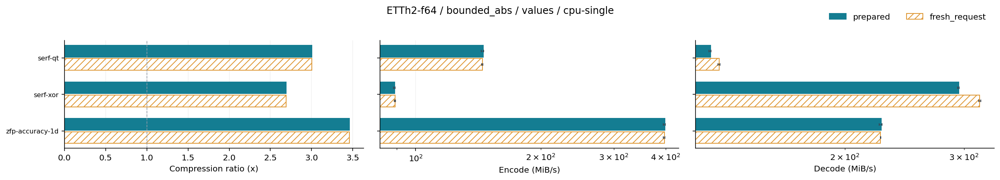

[SVG](figures/ETTh2-f64--bounded_abs--cpu-single.svg)

<details><summary>完整数值、有效批次及拒绝原因</summary>

| codec | 完整输出 bytes P / F | 压缩倍数 P / F | 编码 MiB/s P / F | 解码 MiB/s P / F | 有效批次 P / F |
|---|---:|---:|---:|---:|---:|
| serf-qt | 3.25e+05 / 3.25e+05 | 3.01 / 3.01 | 145 / 145 | 127 / 130 | 14/14 / 14/14 |
| serf-xor | 3.62e+05 / 3.62e+05 | 2.69 / 2.69 | 89.1 / 89.1 | 294 / 316 | 14/14 / 14/14 |
| zfp-accuracy-1d | 2.82e+05 / 2.82e+05 | 3.46 / 3.46 | 398 / 397 | 226 / 226 | 14/14 / 14/14 |

</details>

**<f8 · [17420, 7] · 经验质量（无最大误差保证） · values · cpu-single**

运行进程 CPU 亲和性（P / F）：`[(0, 1, 2, 3, 4, 5, 6, 7, 8, 9, 10, 11, 12, 13, 14, 15)]` / `[(0, 1, 2, 3, 4, 5, 6, 7, 8, 9, 10, 11, 12, 13, 14, 15)]`；逐配置创建时间见 CSV，是否处于并行窗口见调度记录。

<details><summary>完整数值、有效批次及拒绝原因</summary>

| codec | 完整输出 bytes P / F | 压缩倍数 P / F | 编码 MiB/s P / F | 解码 MiB/s P / F | 有效批次 P / F |
|---|---:|---:|---:|---:|---:|
| abba | — / — | — / — | — / — | — / — | 0/0 / 0/0 |
| fabba | — / — | — / — | — / — | — / — | 0/0 / 0/0 |
| pmc-mr | — / — | — / — | — / — | — / — | 0/0 / 0/0 |
| swing-filter | — / — | — / — | — / — | — / — | 0/0 / 0/0 |
| swing-filter-disjoint | — / — | — / — | — / — | — / — | 0/0 / 0/0 |
| swing-filter-disjoint-quantized / compatible | — / — | — / — | — / — | — / — | 0/0 / 0/0 |

拒绝或未完整完成的请求：

- `abba` / fresh_request：unsupported，RW native batches require rank 1 / columns=1; collection framing belongs to object mode
- `abba` / prepared：unsupported，RW native batches require rank 1 / columns=1; collection framing belongs to object mode
- `fabba` / fresh_request：unsupported，RW native batches require rank 1 / columns=1; collection framing belongs to object mode
- `fabba` / prepared：unsupported，RW native batches require rank 1 / columns=1; collection framing belongs to object mode
- `pmc-mr` / fresh_request：unsupported，pmc-mr: dtype must be one of ('<f4',)
- `pmc-mr` / prepared：unsupported，pmc-mr: dtype must be one of ('<f4',)
- `swing-filter` / fresh_request：unsupported，swing-filter: dtype must be one of ('<f4',)
- `swing-filter` / prepared：unsupported，swing-filter: dtype must be one of ('<f4',)
- `swing-filter-disjoint` / fresh_request：unsupported，swing-filter-disjoint: dtype must be one of ('<f4',)
- `swing-filter-disjoint` / prepared：unsupported，swing-filter-disjoint: dtype must be one of ('<f4',)
- `swing-filter-disjoint-quantized / compatible` / fresh_request：unsupported，swing-filter-disjoint-quantized: dtype must be one of ('<f4',)
- `swing-filter-disjoint-quantized / compatible` / prepared：unsupported，swing-filter-disjoint-quantized: dtype must be one of ('<f4',)

</details>

<a id="dataset-ETTm1"></a>

### ETTm1

**<f4 · [69680, 7] · 无损 · values · cpu-single**

运行进程 CPU 亲和性（P / F）：`[(0, 1, 2, 3, 4, 5, 6, 7, 8, 9, 10, 11, 12, 13, 14, 15)]` / `[(0, 1, 2, 3, 4, 5, 6, 7, 8, 9, 10, 11, 12, 13, 14, 15)]`；逐配置创建时间见 CSV，是否处于并行窗口见调度记录。

f64→f32 准备阶段转换的最大绝对差：**1.0658141e-14**；本组 codec 的恢复质量相对转换后的 f32 输入验证。

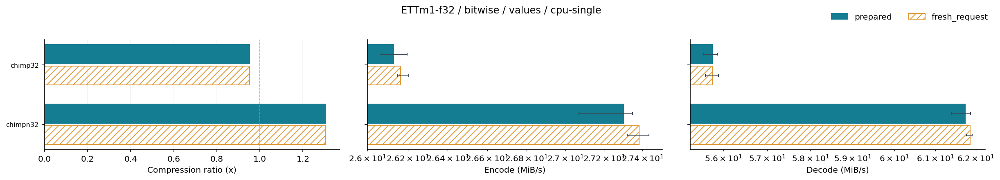

[SVG](figures/ETTm1-f32--bitwise--cpu-single.svg)

<details><summary>完整数值、有效批次及拒绝原因</summary>

| codec | 完整输出 bytes P / F | 压缩倍数 P / F | 编码 MiB/s P / F | 解码 MiB/s P / F | 有效批次 P / F |
|---|---:|---:|---:|---:|---:|
| chimp32 | 2.05e+06 / 2.05e+06 | 0.952 / 0.952 | 26.1 / 26.2 | 55.8 / 55.8 | 14/14 / 14/14 |
| chimpn32 | 1.49e+06 / 1.49e+06 | 1.31 / 1.31 | 27.3 / 27.4 | 61.7 / 61.9 | 14/14 / 14/14 |

</details>

**<f4 · [69680, 7] · 经验质量（无最大误差保证） · values · cpu-single**

运行进程 CPU 亲和性（P / F）：`[(0, 1, 2, 3, 4, 5, 6, 7, 8, 9, 10, 11, 12, 13, 14, 15)]` / `[(0, 1, 2, 3, 4, 5, 6, 7, 8, 9, 10, 11, 12, 13, 14, 15)]`；逐配置创建时间见 CSV，是否处于并行窗口见调度记录。

f64→f32 准备阶段转换的最大绝对差：**1.0658141e-14**；本组 codec 的恢复质量相对转换后的 f32 输入验证。

<details><summary>完整数值、有效批次及拒绝原因</summary>

| codec | 完整输出 bytes P / F | 压缩倍数 P / F | 编码 MiB/s P / F | 解码 MiB/s P / F | 有效批次 P / F |
|---|---:|---:|---:|---:|---:|
| pmc-mr | — / — | — / — | — / — | — / — | 0/0 / 0/0 |
| swing-filter | — / — | — / — | — / — | — / — | 0/0 / 0/0 |
| swing-filter-disjoint | — / — | — / — | — / — | — / — | 0/0 / 0/0 |
| swing-filter-disjoint-quantized / compatible | — / — | — / — | — / — | — / — | 0/0 / 0/0 |
| swing-filter-disjoint-quantized / strict_abs | — / — | — / — | — / — | — / — | 0/0 / 0/0 |

拒绝或未完整完成的请求：

- `pmc-mr` / fresh_request：unsupported，filter native_core requires one column; object/native_api preserve independent columns
- `pmc-mr` / prepared：unsupported，filter native_core requires one column; object/native_api preserve independent columns
- `swing-filter` / fresh_request：unsupported，filter native_core requires one column; object/native_api preserve independent columns
- `swing-filter` / prepared：unsupported，filter native_core requires one column; object/native_api preserve independent columns
- `swing-filter-disjoint` / fresh_request：unsupported，filter native_core requires one column; object/native_api preserve independent columns
- `swing-filter-disjoint` / prepared：unsupported，filter native_core requires one column; object/native_api preserve independent columns
- `swing-filter-disjoint-quantized / compatible` / fresh_request：unsupported，filter native_core requires one column; object/native_api preserve independent columns
- `swing-filter-disjoint-quantized / compatible` / prepared：unsupported，filter native_core requires one column; object/native_api preserve independent columns
- `swing-filter-disjoint-quantized / strict_abs` / fresh_request：unsupported，filter native_core requires one column; object/native_api preserve independent columns
- `swing-filter-disjoint-quantized / strict_abs` / prepared：unsupported，filter native_core requires one column; object/native_api preserve independent columns

</details>

**<f8 · [69680, 7] · 无损 · values · cpu-dzip-three**

运行进程 CPU 亲和性（P / F）：`[(0, 1, 2, 3, 4, 5, 6, 7, 8, 9, 10, 11, 12, 13, 14, 15)]` / `[(0, 1, 2, 3, 4, 5, 6, 7, 8, 9, 10, 11, 12, 13, 14, 15)]`；逐配置创建时间见 CSV，是否处于并行窗口见调度记录。

<details><summary>完整数值、有效批次及拒绝原因</summary>

| codec | 完整输出 bytes P / F | 压缩倍数 P / F | 编码 MiB/s P / F | 解码 MiB/s P / F | 有效批次 P / F |
|---|---:|---:|---:|---:|---:|
| dzip | — / — | — / — | — / — | — / — | 0/0 / 0/0 |

拒绝或未完整完成的请求：

- `dzip` / fresh_request：unsupported，dzip: dtype must be one of ('|u1',)
- `dzip` / prepared：unsupported，dzip: dtype must be one of ('|u1',)

</details>

**<f8 · [69680, 7] · 无损 · values · cpu-single**

运行进程 CPU 亲和性（P / F）：`[(0, 1, 2, 3, 4, 5, 6, 7, 8, 9, 10, 11, 12, 13, 14, 15)]` / `[(0, 1, 2, 3, 4, 5, 6, 7, 8, 9, 10, 11, 12, 13, 14, 15)]`；逐配置创建时间见 CSV，是否处于并行窗口见调度记录。


[SVG](figures/ETTm1-f64--bitwise--cpu-single.svg)

<details><summary>完整数值、有效批次及拒绝原因</summary>

| codec | 完整输出 bytes P / F | 压缩倍数 P / F | 编码 MiB/s P / F | 解码 MiB/s P / F | 有效批次 P / F |
|---|---:|---:|---:|---:|---:|
| alp | 3.48e+06 / 3.48e+06 | 1.12 / 1.12 | 137 / 137 | 165 / 171 | 14/14 / 14/14 |
| alp-rd | 3.48e+06 / 3.48e+06 | 1.12 / 1.12 | 141 / 141 | 165 / 171 | 14/14 / 14/14 |
| brotli-stream | 9.84e+05 / 9.84e+05 | 3.97 / 3.97 | 46.7 / 46.4 | 479 / 478 | 14/14 / 14/14 |
| bzip2-stream | 6.1e+05 / 6.1e+05 | 6.4 / 6.4 | 20.3 / 20.4 | 47.4 / 48.3 | 14/14 / 14/14 |
| chimp | 3.16e+06 / 3.16e+06 | 1.23 / 1.23 | 34.1 / 34.1 | 68.7 / 68.5 | 14/14 / 14/14 |
| chimp128 | 2.89e+06 / 2.89e+06 | 1.35 / 1.35 | 35.5 / 35.5 | 76.7 / 76.6 | 14/14 / 14/14 |
| chimp128-no-index | 1.7e+06 / 1.7e+06 | 2.29 / 2.29 | 26.4 / 26.4 | 111 / 111 | 14/14 / 14/14 |
| chimp32 | — / — | — / — | — / — | — / — | 0/0 / 0/0 |
| chimpn | 2.89e+06 / 2.89e+06 | 1.35 / 1.35 | 36.5 / 36.4 | 74 / 74.1 | 14/14 / 14/14 |
| chimpn32 | — / — | — / — | — / — | — / — | 0/0 / 0/0 |
| deepzip | — / — | — / — | — / — | — / — | 0/0 / 0/0 |
| deflate-zlib | 1.09e+06 / 1.09e+06 | 3.57 / 3.57 | 24.7 / 24.7 | 372 / 373 | 14/14 / 14/14 |
| elf | 3.46e+06 / 3.46e+06 | 1.13 / 1.13 | 13.5 / 13.6 | 67.9 / 67.8 | 14/14 / 14/14 |
| elf-plus | 3.49e+06 / 3.49e+06 | 1.12 / 1.12 | 31.1 / 31.1 | 67.9 / 67.9 | 14/14 / 14/14 |
| elf-star | 2.93e+06 / 2.93e+06 | 1.33 / 1.33 | 29.9 / 30 | 75 / 75.1 | 14/14 / 14/14 |
| fse | — / — | — / — | — / — | — / — | 0/0 / 0/0 |
| gorilla-prometheus-xor | — / — | — / — | — / — | — / — | 0/0 / 0/0 |
| huff0 | — / — | — / — | — / — | — / — | 0/0 / 0/0 |
| leats-lossless-i64 | — / — | — / — | — / — | — / — | 0/0 / 0/0 |
| lz4-frame | 1.99e+06 / 1.99e+06 | 1.96 / 1.96 | 420 / 417 | 1.12e+03 / 1.13e+03 | 14/14 / 14/14 |
| lzsse2-raw | 1.03e+06 / 1.03e+06 | 3.78 / 3.78 | 7.34 / 6.88 | 2.6e+03 / 4.76e+03 | 14/14 / 14/14 |
| lzsse8-raw | 1.06e+06 / 1.06e+06 | 3.68 / 3.68 | 8.39 / 7.73 | 2.5e+03 / 4.59e+03 | 14/14 / 14/14 |
| neats-lossless-i64 | — / — | — / — | — / — | — / — | 0/0 / 0/0 |
| self-star | 2.91e+06 / 2.91e+06 | 1.34 / 1.34 | 32.3 / 32.4 | 71.5 / 71.8 | 14/14 / 14/14 |
| simdcomp-u32 | — / — | — / — | — / — | — / — | 0/0 / 0/0 |
| snappy-raw | 1.74e+06 / 1.74e+06 | 2.25 / 2.25 | 345 / 345 | 769 / 770 | 14/14 / 14/14 |
| sprintz-delta | — / — | — / — | — / — | — / — | 0/0 / 0/0 |
| sprintz-delta-huffman | — / — | — / — | — / — | — / — | 0/0 / 0/0 |
| sprintz-fire | — / — | — / — | — / — | — / — | 0/0 / 0/0 |
| sprintz-fire-huffman | — / — | — / — | — / — | — / — | 0/0 / 0/0 |
| xz-stream | 6.04e+05 / 6.04e+05 | 6.46 / 6.46 | 2.59 / 2.57 | 190 / 191 | 14/14 / 14/14 |
| zstd-frame | 1.04e+06 / 1.04e+06 | 3.75 / 3.75 | 287 / 274 | 902 / 895 | 14/14 / 14/14 |

拒绝或未完整完成的请求：

- `chimp32` / fresh_request：unsupported，chimp32: dtype must be one of ('<f4',)
- `chimp32` / prepared：unsupported，chimp32: dtype must be one of ('<f4',)
- `chimpn32` / fresh_request：unsupported，chimpn32: dtype must be one of ('<f4',)
- `chimpn32` / prepared：unsupported，chimpn32: dtype must be one of ('<f4',)
- `deepzip` / fresh_request：unsupported，deepzip: dtype must be one of ('|u1',)
- `deepzip` / prepared：unsupported，deepzip: dtype must be one of ('|u1',)
- `fse` / fresh_request：unsupported，fse: n=69680 exceeds native limits
- `fse` / prepared：unsupported，fse: n=69680 exceeds native limits
- `gorilla-prometheus-xor` / fresh_request：unsupported，Gorilla requires actual paired T/V; values-only and timestamp-only are unsupported
- `gorilla-prometheus-xor` / prepared：unsupported，Gorilla requires actual paired T/V; values-only and timestamp-only are unsupported
- `huff0` / fresh_request：unsupported，huff0: n=69680 exceeds native limits
- `huff0` / prepared：unsupported，huff0: n=69680 exceeds native limits
- `leats-lossless-i64` / fresh_request：unsupported，leats-lossless-i64: dtype must be one of ('|i1', '<i2', '<i4', '<i8')
- `leats-lossless-i64` / prepared：unsupported，leats-lossless-i64: dtype must be one of ('|i1', '<i2', '<i4', '<i8')
- `neats-lossless-i64` / fresh_request：unsupported，neats-lossless-i64: dtype must be one of ('|i1', '<i2', '<i4', '<i8')
- `neats-lossless-i64` / prepared：unsupported，neats-lossless-i64: dtype must be one of ('|i1', '<i2', '<i4', '<i8')
- `simdcomp-u32` / fresh_request：unsupported，simdcomp-u32: dtype must be one of ('<u4',)
- `simdcomp-u32` / prepared：unsupported，simdcomp-u32: dtype must be one of ('<u4',)
- `sprintz-delta` / fresh_request：unsupported，sprintz-delta: dtype must be one of ('|u1', '|i1', '<u2', '<i2')
- `sprintz-delta` / prepared：unsupported，sprintz-delta: dtype must be one of ('|u1', '|i1', '<u2', '<i2')
- `sprintz-delta-huffman` / fresh_request：unsupported，sprintz-delta-huffman: dtype must be one of ('|u1', '|i1', '<u2', '<i2')
- `sprintz-delta-huffman` / prepared：unsupported，sprintz-delta-huffman: dtype must be one of ('|u1', '|i1', '<u2', '<i2')
- `sprintz-fire` / fresh_request：unsupported，sprintz-fire: dtype must be one of ('|u1', '|i1', '<u2', '<i2')
- `sprintz-fire` / prepared：unsupported，sprintz-fire: dtype must be one of ('|u1', '|i1', '<u2', '<i2')
- `sprintz-fire-huffman` / fresh_request：unsupported，sprintz-fire-huffman: dtype must be one of ('|u1', '|i1', '<u2', '<i2')
- `sprintz-fire-huffman` / prepared：unsupported，sprintz-fire-huffman: dtype must be one of ('|u1', '|i1', '<u2', '<i2')

</details>

**<f8 · [69680, 7] · ABS ≤ 0.01 · values · cpu-single**

运行进程 CPU 亲和性（P / F）：`[(0, 1, 2, 3, 4, 5, 6, 7, 8, 9, 10, 11, 12, 13, 14, 15)]` / `[(0, 1, 2, 3, 4, 5, 6, 7, 8, 9, 10, 11, 12, 13, 14, 15)]`；逐配置创建时间见 CSV，是否处于并行窗口见调度记录。


[SVG](figures/ETTm1-f64--bounded_abs--cpu-single.svg)

<details><summary>完整数值、有效批次及拒绝原因</summary>

| codec | 完整输出 bytes P / F | 压缩倍数 P / F | 编码 MiB/s P / F | 解码 MiB/s P / F | 有效批次 P / F |
|---|---:|---:|---:|---:|---:|
| serf-qt | 1.08e+06 / 1.08e+06 | 3.61 / 3.61 | 144 / 144 | 141 / 145 | 14/14 / 14/14 |
| serf-xor | 1.76e+06 / 1.76e+06 | 2.21 / 2.21 | 112 / 112 | 267 / 283 | 14/14 / 14/14 |
| zfp-accuracy-1d | 1.01e+06 / 1.01e+06 | 3.88 / 3.88 | 405 / 404 | 242 / 244 | 14/14 / 14/14 |

</details>

**<f8 · [69680, 7] · 经验质量（无最大误差保证） · values · cpu-single**

运行进程 CPU 亲和性（P / F）：`[(0, 1, 2, 3, 4, 5, 6, 7, 8, 9, 10, 11, 12, 13, 14, 15)]` / `[(0, 1, 2, 3, 4, 5, 6, 7, 8, 9, 10, 11, 12, 13, 14, 15)]`；逐配置创建时间见 CSV，是否处于并行窗口见调度记录。

<details><summary>完整数值、有效批次及拒绝原因</summary>

| codec | 完整输出 bytes P / F | 压缩倍数 P / F | 编码 MiB/s P / F | 解码 MiB/s P / F | 有效批次 P / F |
|---|---:|---:|---:|---:|---:|
| abba | — / — | — / — | — / — | — / — | 0/0 / 0/0 |
| fabba | — / — | — / — | — / — | — / — | 0/0 / 0/0 |
| pmc-mr | — / — | — / — | — / — | — / — | 0/0 / 0/0 |
| swing-filter | — / — | — / — | — / — | — / — | 0/0 / 0/0 |
| swing-filter-disjoint | — / — | — / — | — / — | — / — | 0/0 / 0/0 |
| swing-filter-disjoint-quantized / compatible | — / — | — / — | — / — | — / — | 0/0 / 0/0 |

拒绝或未完整完成的请求：

- `abba` / fresh_request：unsupported，RW native batches require rank 1 / columns=1; collection framing belongs to object mode
- `abba` / prepared：unsupported，RW native batches require rank 1 / columns=1; collection framing belongs to object mode
- `fabba` / fresh_request：unsupported，RW native batches require rank 1 / columns=1; collection framing belongs to object mode
- `fabba` / prepared：unsupported，RW native batches require rank 1 / columns=1; collection framing belongs to object mode
- `pmc-mr` / fresh_request：unsupported，pmc-mr: dtype must be one of ('<f4',)
- `pmc-mr` / prepared：unsupported，pmc-mr: dtype must be one of ('<f4',)
- `swing-filter` / fresh_request：unsupported，swing-filter: dtype must be one of ('<f4',)
- `swing-filter` / prepared：unsupported，swing-filter: dtype must be one of ('<f4',)
- `swing-filter-disjoint` / fresh_request：unsupported，swing-filter-disjoint: dtype must be one of ('<f4',)
- `swing-filter-disjoint` / prepared：unsupported，swing-filter-disjoint: dtype must be one of ('<f4',)
- `swing-filter-disjoint-quantized / compatible` / fresh_request：unsupported，swing-filter-disjoint-quantized: dtype must be one of ('<f4',)
- `swing-filter-disjoint-quantized / compatible` / prepared：unsupported，swing-filter-disjoint-quantized: dtype must be one of ('<f4',)

</details>

<a id="dataset-ETTm2"></a>

### ETTm2

**<f4 · [69680, 7] · 无损 · values · cpu-single**

运行进程 CPU 亲和性（P / F）：`[(0, 1, 2, 3, 4, 5, 6, 7, 8, 9, 10, 11, 12, 13, 14, 15)]` / `[(0, 1, 2, 3, 4, 5, 6, 7, 8, 9, 10, 11, 12, 13, 14, 15)]`；逐配置创建时间见 CSV，是否处于并行窗口见调度记录。

f64→f32 准备阶段转换的最大绝对差：**1.42108547e-14**；本组 codec 的恢复质量相对转换后的 f32 输入验证。

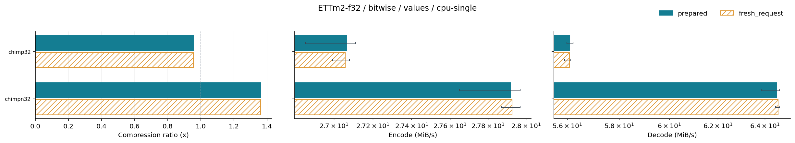

[SVG](figures/ETTm2-f32--bitwise--cpu-single.svg)

<details><summary>完整数值、有效批次及拒绝原因</summary>

| codec | 完整输出 bytes P / F | 压缩倍数 P / F | 编码 MiB/s P / F | 解码 MiB/s P / F | 有效批次 P / F |
|---|---:|---:|---:|---:|---:|
| chimp32 | 2.04e+06 / 2.04e+06 | 0.954 / 0.954 | 27.1 / 27.1 | 56.1 / 56.1 | 14/14 / 14/14 |
| chimpn32 | 1.43e+06 / 1.43e+06 | 1.36 / 1.36 | 27.9 / 27.9 | 64.5 / 64.6 | 14/14 / 14/14 |

</details>

**<f4 · [69680, 7] · 经验质量（无最大误差保证） · values · cpu-single**

运行进程 CPU 亲和性（P / F）：`[(0, 1, 2, 3, 4, 5, 6, 7, 8, 9, 10, 11, 12, 13, 14, 15)]` / `[(0, 1, 2, 3, 4, 5, 6, 7, 8, 9, 10, 11, 12, 13, 14, 15)]`；逐配置创建时间见 CSV，是否处于并行窗口见调度记录。

f64→f32 准备阶段转换的最大绝对差：**1.42108547e-14**；本组 codec 的恢复质量相对转换后的 f32 输入验证。

<details><summary>完整数值、有效批次及拒绝原因</summary>

| codec | 完整输出 bytes P / F | 压缩倍数 P / F | 编码 MiB/s P / F | 解码 MiB/s P / F | 有效批次 P / F |
|---|---:|---:|---:|---:|---:|
| pmc-mr | — / — | — / — | — / — | — / — | 0/0 / 0/0 |
| swing-filter | — / — | — / — | — / — | — / — | 0/0 / 0/0 |
| swing-filter-disjoint | — / — | — / — | — / — | — / — | 0/0 / 0/0 |
| swing-filter-disjoint-quantized / compatible | — / — | — / — | — / — | — / — | 0/0 / 0/0 |
| swing-filter-disjoint-quantized / strict_abs | — / — | — / — | — / — | — / — | 0/0 / 0/0 |

拒绝或未完整完成的请求：

- `pmc-mr` / fresh_request：unsupported，filter native_core requires one column; object/native_api preserve independent columns
- `pmc-mr` / prepared：unsupported，filter native_core requires one column; object/native_api preserve independent columns
- `swing-filter` / fresh_request：unsupported，filter native_core requires one column; object/native_api preserve independent columns
- `swing-filter` / prepared：unsupported，filter native_core requires one column; object/native_api preserve independent columns
- `swing-filter-disjoint` / fresh_request：unsupported，filter native_core requires one column; object/native_api preserve independent columns
- `swing-filter-disjoint` / prepared：unsupported，filter native_core requires one column; object/native_api preserve independent columns
- `swing-filter-disjoint-quantized / compatible` / fresh_request：unsupported，filter native_core requires one column; object/native_api preserve independent columns
- `swing-filter-disjoint-quantized / compatible` / prepared：unsupported，filter native_core requires one column; object/native_api preserve independent columns
- `swing-filter-disjoint-quantized / strict_abs` / fresh_request：unsupported，filter native_core requires one column; object/native_api preserve independent columns
- `swing-filter-disjoint-quantized / strict_abs` / prepared：unsupported，filter native_core requires one column; object/native_api preserve independent columns

</details>

**<f8 · [69680, 7] · 无损 · values · cpu-dzip-three**

运行进程 CPU 亲和性（P / F）：`[(0, 1, 2, 3, 4, 5, 6, 7, 8, 9, 10, 11, 12, 13, 14, 15)]` / `[(0, 1, 2, 3, 4, 5, 6, 7, 8, 9, 10, 11, 12, 13, 14, 15)]`；逐配置创建时间见 CSV，是否处于并行窗口见调度记录。

<details><summary>完整数值、有效批次及拒绝原因</summary>

| codec | 完整输出 bytes P / F | 压缩倍数 P / F | 编码 MiB/s P / F | 解码 MiB/s P / F | 有效批次 P / F |
|---|---:|---:|---:|---:|---:|
| dzip | — / — | — / — | — / — | — / — | 0/0 / 0/0 |

拒绝或未完整完成的请求：

- `dzip` / fresh_request：unsupported，dzip: dtype must be one of ('|u1',)
- `dzip` / prepared：unsupported，dzip: dtype must be one of ('|u1',)

</details>

**<f8 · [69680, 7] · 无损 · values · cpu-single**

运行进程 CPU 亲和性（P / F）：`[(0, 1, 2, 3, 4, 5, 6, 7, 8, 9, 10, 11, 12, 13, 14, 15)]` / `[(0, 1, 2, 3, 4, 5, 6, 7, 8, 9, 10, 11, 12, 13, 14, 15)]`；逐配置创建时间见 CSV，是否处于并行窗口见调度记录。


[SVG](figures/ETTm2-f64--bitwise--cpu-single.svg)

<details><summary>完整数值、有效批次及拒绝原因</summary>

| codec | 完整输出 bytes P / F | 压缩倍数 P / F | 编码 MiB/s P / F | 解码 MiB/s P / F | 有效批次 P / F |
|---|---:|---:|---:|---:|---:|
| alp | 3.4e+06 / 3.4e+06 | 1.15 / 1.15 | 140 / 139 | 169 / 176 | 14/14 / 14/14 |
| alp-rd | 3.4e+06 / 3.4e+06 | 1.15 / 1.15 | 146 / 145 | 169 / 176 | 14/14 / 14/14 |
| brotli-stream | 9.4e+05 / 9.4e+05 | 4.15 / 4.15 | 49.6 / 50.2 | 477 / 481 | 14/14 / 14/14 |
| bzip2-stream | 6.44e+05 / 6.44e+05 | 6.06 / 6.06 | 21.2 / 21.2 | 54.1 / 54.4 | 14/14 / 14/14 |
| chimp | 3e+06 / 3e+06 | 1.3 / 1.3 | 36.4 / 36.5 | 71.9 / 72.1 | 14/14 / 14/14 |
| chimp128 | 2.76e+06 / 2.76e+06 | 1.41 / 1.41 | 36.8 / 36.9 | 79.2 / 79.3 | 14/14 / 14/14 |
| chimp128-no-index | 1.54e+06 / 1.54e+06 | 2.53 / 2.53 | 27.1 / 27 | 119 / 119 | 14/14 / 14/14 |
| chimp32 | — / — | — / — | — / — | — / — | 0/0 / 0/0 |
| chimpn | 2.76e+06 / 2.76e+06 | 1.41 / 1.41 | 37.7 / 37.8 | 76.6 / 76.7 | 14/14 / 14/14 |
| chimpn32 | — / — | — / — | — / — | — / — | 0/0 / 0/0 |
| deepzip | — / — | — / — | — / — | — / — | 0/0 / 0/0 |
| deflate-zlib | 1.08e+06 / 1.08e+06 | 3.63 / 3.63 | 26.8 / 26.7 | 339 / 337 | 14/14 / 14/14 |
| elf | 3.25e+06 / 3.25e+06 | 1.2 / 1.2 | 15.3 / 15.2 | 73.3 / 73.3 | 14/14 / 14/14 |
| elf-plus | 3.26e+06 / 3.26e+06 | 1.2 / 1.2 | 35.2 / 35.2 | 72.5 / 72.5 | 14/14 / 14/14 |
| elf-star | 2.77e+06 / 2.77e+06 | 1.41 / 1.41 | 30.8 / 30.9 | 80.1 / 80.1 | 14/14 / 14/14 |
| fse | — / — | — / — | — / — | — / — | 0/0 / 0/0 |
| gorilla-prometheus-xor | — / — | — / — | — / — | — / — | 0/0 / 0/0 |
| huff0 | — / — | — / — | — / — | — / — | 0/0 / 0/0 |
| leats-lossless-i64 | — / — | — / — | — / — | — / — | 0/0 / 0/0 |
| lz4-frame | 1.79e+06 / 1.79e+06 | 2.19 / 2.19 | 421 / 421 | 1.16e+03 / 1.16e+03 | 14/14 / 14/14 |
| lzsse2-raw | 1.02e+06 / 1.02e+06 | 3.82 / 3.82 | 7.32 / 6.86 | 2.59e+03 / 4.95e+03 | 14/14 / 14/14 |
| lzsse8-raw | 1.04e+06 / 1.04e+06 | 3.75 / 3.75 | 8.29 / 7.65 | 2.54e+03 / 4.63e+03 | 14/14 / 14/14 |
| neats-lossless-i64 | — / — | — / — | — / — | — / — | 0/0 / 0/0 |
| self-star | 2.75e+06 / 2.75e+06 | 1.42 / 1.42 | 33.8 / 33.9 | 76 / 75.9 | 14/14 / 14/14 |
| simdcomp-u32 | — / — | — / — | — / — | — / — | 0/0 / 0/0 |
| snappy-raw | 1.64e+06 / 1.64e+06 | 2.38 / 2.38 | 368 / 366 | 767 / 760 | 14/14 / 14/14 |
| sprintz-delta | — / — | — / — | — / — | — / — | 0/0 / 0/0 |
| sprintz-delta-huffman | — / — | — / — | — / — | — / — | 0/0 / 0/0 |
| sprintz-fire | — / — | — / — | — / — | — / — | 0/0 / 0/0 |
| sprintz-fire-huffman | — / — | — / — | — / — | — / — | 0/0 / 0/0 |
| xz-stream | 5.83e+05 / 5.83e+05 | 6.7 / 6.7 | 2.82 / 2.81 | 175 / 176 | 14/14 / 14/14 |
| zstd-frame | 9.83e+05 / 9.83e+05 | 3.97 / 3.97 | 285 / 276 | 902 / 911 | 14/14 / 14/14 |

拒绝或未完整完成的请求：

- `chimp32` / fresh_request：unsupported，chimp32: dtype must be one of ('<f4',)
- `chimp32` / prepared：unsupported，chimp32: dtype must be one of ('<f4',)
- `chimpn32` / fresh_request：unsupported，chimpn32: dtype must be one of ('<f4',)
- `chimpn32` / prepared：unsupported，chimpn32: dtype must be one of ('<f4',)
- `deepzip` / fresh_request：unsupported，deepzip: dtype must be one of ('|u1',)
- `deepzip` / prepared：unsupported，deepzip: dtype must be one of ('|u1',)
- `fse` / fresh_request：unsupported，fse: n=69680 exceeds native limits
- `fse` / prepared：unsupported，fse: n=69680 exceeds native limits
- `gorilla-prometheus-xor` / fresh_request：unsupported，Gorilla requires actual paired T/V; values-only and timestamp-only are unsupported
- `gorilla-prometheus-xor` / prepared：unsupported，Gorilla requires actual paired T/V; values-only and timestamp-only are unsupported
- `huff0` / fresh_request：unsupported，huff0: n=69680 exceeds native limits
- `huff0` / prepared：unsupported，huff0: n=69680 exceeds native limits
- `leats-lossless-i64` / fresh_request：unsupported，leats-lossless-i64: dtype must be one of ('|i1', '<i2', '<i4', '<i8')
- `leats-lossless-i64` / prepared：unsupported，leats-lossless-i64: dtype must be one of ('|i1', '<i2', '<i4', '<i8')
- `neats-lossless-i64` / fresh_request：unsupported，neats-lossless-i64: dtype must be one of ('|i1', '<i2', '<i4', '<i8')
- `neats-lossless-i64` / prepared：unsupported，neats-lossless-i64: dtype must be one of ('|i1', '<i2', '<i4', '<i8')
- `simdcomp-u32` / fresh_request：unsupported，simdcomp-u32: dtype must be one of ('<u4',)
- `simdcomp-u32` / prepared：unsupported，simdcomp-u32: dtype must be one of ('<u4',)
- `sprintz-delta` / fresh_request：unsupported，sprintz-delta: dtype must be one of ('|u1', '|i1', '<u2', '<i2')
- `sprintz-delta` / prepared：unsupported，sprintz-delta: dtype must be one of ('|u1', '|i1', '<u2', '<i2')
- `sprintz-delta-huffman` / fresh_request：unsupported，sprintz-delta-huffman: dtype must be one of ('|u1', '|i1', '<u2', '<i2')
- `sprintz-delta-huffman` / prepared：unsupported，sprintz-delta-huffman: dtype must be one of ('|u1', '|i1', '<u2', '<i2')
- `sprintz-fire` / fresh_request：unsupported，sprintz-fire: dtype must be one of ('|u1', '|i1', '<u2', '<i2')
- `sprintz-fire` / prepared：unsupported，sprintz-fire: dtype must be one of ('|u1', '|i1', '<u2', '<i2')
- `sprintz-fire-huffman` / fresh_request：unsupported，sprintz-fire-huffman: dtype must be one of ('|u1', '|i1', '<u2', '<i2')
- `sprintz-fire-huffman` / prepared：unsupported，sprintz-fire-huffman: dtype must be one of ('|u1', '|i1', '<u2', '<i2')

</details>

**<f8 · [69680, 7] · ABS ≤ 0.01 · values · cpu-single**

运行进程 CPU 亲和性（P / F）：`[(0, 1, 2, 3, 4, 5, 6, 7, 8, 9, 10, 11, 12, 13, 14, 15)]` / `[(0, 1, 2, 3, 4, 5, 6, 7, 8, 9, 10, 11, 12, 13, 14, 15)]`；逐配置创建时间见 CSV，是否处于并行窗口见调度记录。

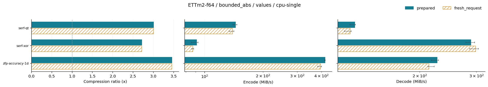

[SVG](figures/ETTm2-f64--bounded_abs--cpu-single.svg)

<details><summary>完整数值、有效批次及拒绝原因</summary>

| codec | 完整输出 bytes P / F | 压缩倍数 P / F | 编码 MiB/s P / F | 解码 MiB/s P / F | 有效批次 P / F |
|---|---:|---:|---:|---:|---:|
| serf-qt | 1.3e+06 / 1.3e+06 | 3.01 / 3.01 | 144 / 139 | 126 / 122 | 14/14 / 14/14 |
| serf-xor | 1.44e+06 / 1.44e+06 | 2.71 / 2.71 | 91.1 / 87 | 288 / 298 | 14/14 / 14/14 |
| zfp-accuracy-1d | 1.13e+06 / 1.13e+06 | 3.46 / 3.46 | 417 / 396 | 227 / 214 | 14/14 / 14/14 |

</details>

**<f8 · [69680, 7] · 经验质量（无最大误差保证） · values · cpu-single**

运行进程 CPU 亲和性（P / F）：`[(0, 1, 2, 3, 4, 5, 6, 7, 8, 9, 10, 11, 12, 13, 14, 15)]` / `[(0, 1, 2, 3, 4, 5, 6, 7, 8, 9, 10, 11, 12, 13, 14, 15)]`；逐配置创建时间见 CSV，是否处于并行窗口见调度记录。

<details><summary>完整数值、有效批次及拒绝原因</summary>

| codec | 完整输出 bytes P / F | 压缩倍数 P / F | 编码 MiB/s P / F | 解码 MiB/s P / F | 有效批次 P / F |
|---|---:|---:|---:|---:|---:|
| abba | — / — | — / — | — / — | — / — | 0/0 / 0/0 |
| fabba | — / — | — / — | — / — | — / — | 0/0 / 0/0 |
| pmc-mr | — / — | — / — | — / — | — / — | 0/0 / 0/0 |
| swing-filter | — / — | — / — | — / — | — / — | 0/0 / 0/0 |
| swing-filter-disjoint | — / — | — / — | — / — | — / — | 0/0 / 0/0 |
| swing-filter-disjoint-quantized / compatible | — / — | — / — | — / — | — / — | 0/0 / 0/0 |

拒绝或未完整完成的请求：

- `abba` / fresh_request：unsupported，RW native batches require rank 1 / columns=1; collection framing belongs to object mode
- `abba` / prepared：unsupported，RW native batches require rank 1 / columns=1; collection framing belongs to object mode
- `fabba` / fresh_request：unsupported，RW native batches require rank 1 / columns=1; collection framing belongs to object mode
- `fabba` / prepared：unsupported，RW native batches require rank 1 / columns=1; collection framing belongs to object mode
- `pmc-mr` / fresh_request：unsupported，pmc-mr: dtype must be one of ('<f4',)
- `pmc-mr` / prepared：unsupported，pmc-mr: dtype must be one of ('<f4',)
- `swing-filter` / fresh_request：unsupported，swing-filter: dtype must be one of ('<f4',)
- `swing-filter` / prepared：unsupported，swing-filter: dtype must be one of ('<f4',)
- `swing-filter-disjoint` / fresh_request：unsupported，swing-filter-disjoint: dtype must be one of ('<f4',)
- `swing-filter-disjoint` / prepared：unsupported，swing-filter-disjoint: dtype must be one of ('<f4',)
- `swing-filter-disjoint-quantized / compatible` / fresh_request：unsupported，swing-filter-disjoint-quantized: dtype must be one of ('<f4',)
- `swing-filter-disjoint-quantized / compatible` / prepared：unsupported，swing-filter-disjoint-quantized: dtype must be one of ('<f4',)

</details>

<a id="dataset-Electricity"></a>

### Electricity

**<f4 · [26304, 321] · 无损 · values · cpu-single**

运行进程 CPU 亲和性（P / F）：`[(0, 1, 2, 3, 4, 5, 6, 7, 8, 9, 10, 11, 12, 13, 14, 15)]` / `[(0, 1, 2, 3, 4, 5, 6, 7, 8, 9, 10, 11, 12, 13, 14, 15)]`；逐配置创建时间见 CSV，是否处于并行窗口见调度记录。

f64→f32 准备阶段转换的最大绝对差：**0**；本组 codec 的恢复质量相对转换后的 f32 输入验证。

<details><summary>完整数值、有效批次及拒绝原因</summary>

| codec | 完整输出 bytes P / F | 压缩倍数 P / F | 编码 MiB/s P / F | 解码 MiB/s P / F | 有效批次 P / F |
|---|---:|---:|---:|---:|---:|
| chimp32 | — / — | — / — | — / — | — / — | 0/0 / 0/0 |
| chimpn32 | — / — | — / — | — / — | — / — | 0/0 / 0/0 |

拒绝或未完整完成的请求：

- `chimp32` / fresh_request：unsupported，chimp32: element limit exceeded
- `chimp32` / prepared：unsupported，chimp32: element limit exceeded
- `chimpn32` / fresh_request：unsupported，chimpn32: element limit exceeded
- `chimpn32` / prepared：unsupported，chimpn32: element limit exceeded

</details>

**<f4 · [26304, 321] · 经验质量（无最大误差保证） · values · cpu-single**

运行进程 CPU 亲和性（P / F）：`[(0, 1, 2, 3, 4, 5, 6, 7, 8, 9, 10, 11, 12, 13, 14, 15)]` / `[(0, 1, 2, 3, 4, 5, 6, 7, 8, 9, 10, 11, 12, 13, 14, 15)]`；逐配置创建时间见 CSV，是否处于并行窗口见调度记录。

f64→f32 准备阶段转换的最大绝对差：**0**；本组 codec 的恢复质量相对转换后的 f32 输入验证。

<details><summary>完整数值、有效批次及拒绝原因</summary>

| codec | 完整输出 bytes P / F | 压缩倍数 P / F | 编码 MiB/s P / F | 解码 MiB/s P / F | 有效批次 P / F |
|---|---:|---:|---:|---:|---:|
| pmc-mr | — / — | — / — | — / — | — / — | 0/0 / 0/0 |
| swing-filter | — / — | — / — | — / — | — / — | 0/0 / 0/0 |
| swing-filter-disjoint | — / — | — / — | — / — | — / — | 0/0 / 0/0 |
| swing-filter-disjoint-quantized / compatible | — / — | — / — | — / — | — / — | 0/0 / 0/0 |
| swing-filter-disjoint-quantized / strict_abs | — / — | — / — | — / — | — / — | 0/0 / 0/0 |

拒绝或未完整完成的请求：

- `pmc-mr` / fresh_request：unsupported，pmc-mr: element limit exceeded
- `pmc-mr` / prepared：unsupported，pmc-mr: element limit exceeded
- `swing-filter` / fresh_request：unsupported，swing-filter: element limit exceeded
- `swing-filter` / prepared：unsupported，swing-filter: element limit exceeded
- `swing-filter-disjoint` / fresh_request：unsupported，swing-filter-disjoint: element limit exceeded
- `swing-filter-disjoint` / prepared：unsupported，swing-filter-disjoint: element limit exceeded
- `swing-filter-disjoint-quantized / compatible` / fresh_request：unsupported，swing-filter-disjoint-quantized: element limit exceeded
- `swing-filter-disjoint-quantized / compatible` / prepared：unsupported，swing-filter-disjoint-quantized: element limit exceeded
- `swing-filter-disjoint-quantized / strict_abs` / fresh_request：unsupported，swing-filter-disjoint-quantized: element limit exceeded
- `swing-filter-disjoint-quantized / strict_abs` / prepared：unsupported，swing-filter-disjoint-quantized: element limit exceeded

</details>

**<f8 · [26304, 321] · 无损 · values · cpu-dzip-three**

运行进程 CPU 亲和性（P / F）：`[(0, 1, 2, 3, 4, 5, 6, 7, 8, 9, 10, 11, 12, 13, 14, 15)]` / `[(0, 1, 2, 3, 4, 5, 6, 7, 8, 9, 10, 11, 12, 13, 14, 15)]`；逐配置创建时间见 CSV，是否处于并行窗口见调度记录。

<details><summary>完整数值、有效批次及拒绝原因</summary>

| codec | 完整输出 bytes P / F | 压缩倍数 P / F | 编码 MiB/s P / F | 解码 MiB/s P / F | 有效批次 P / F |
|---|---:|---:|---:|---:|---:|
| dzip | — / — | — / — | — / — | — / — | 0/0 / 0/0 |

拒绝或未完整完成的请求：

- `dzip` / fresh_request：unsupported，dzip: dtype must be one of ('|u1',)
- `dzip` / prepared：unsupported，dzip: dtype must be one of ('|u1',)

</details>

**<f8 · [26304, 321] · 无损 · values · cpu-single**

运行进程 CPU 亲和性（P / F）：`[(0, 1, 2, 3, 4, 5, 6, 7, 8, 9, 10, 11, 12, 13, 14, 15)]` / `[(0, 1, 2, 3, 4, 5, 6, 7, 8, 9, 10, 11, 12, 13, 14, 15)]`；逐配置创建时间见 CSV，是否处于并行窗口见调度记录。

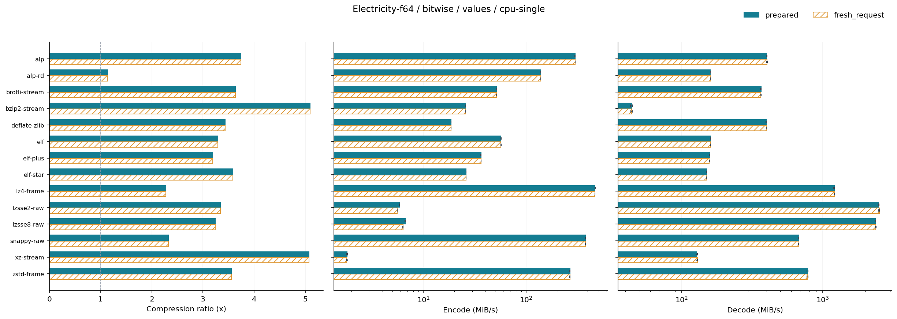

[SVG](figures/Electricity-f64--bitwise--cpu-single.svg)

<details><summary>完整数值、有效批次及拒绝原因</summary>

| codec | 完整输出 bytes P / F | 压缩倍数 P / F | 编码 MiB/s P / F | 解码 MiB/s P / F | 有效批次 P / F |
|---|---:|---:|---:|---:|---:|
| alp | 1.81e+07 / 1.81e+07 | 3.74 / 3.74 | 301 / 302 | 402 / 404 | 14/14 / 14/14 |
| alp-rd | 5.95e+07 / 5.95e+07 | 1.14 / 1.14 | 140 / 140 | 160 / 160 | 14/14 / 14/14 |
| brotli-stream | 1.86e+07 / 1.86e+07 | 3.63 / 3.63 | 51.7 / 51.6 | 366 / 366 | 14/14 / 14/14 |
| bzip2-stream | 1.33e+07 / 1.33e+07 | 5.09 / 5.09 | 25.8 / 25.7 | 44.5 / 44.4 | 14/14 / 14/14 |
| chimp | — / — | — / — | — / — | — / — | 0/0 / 0/0 |
| chimp128 | — / — | — / — | — / — | — / — | 0/0 / 0/0 |
| chimp128-no-index | — / — | — / — | — / — | — / — | 0/0 / 0/0 |
| chimp32 | — / — | — / — | — / — | — / — | 0/0 / 0/0 |
| chimpn | — / — | — / — | — / — | — / — | 0/0 / 0/0 |
| chimpn32 | — / — | — / — | — / — | — / — | 0/0 / 0/0 |
| deepzip | — / — | — / — | — / — | — / — | 0/0 / 0/0 |
| deflate-zlib | 1.97e+07 / 1.97e+07 | 3.43 / 3.43 | 18.6 / 18.6 | 398 / 399 | 14/14 / 14/14 |
| elf | 2.05e+07 / 2.05e+07 | 3.29 / 3.29 | 57.1 / 57.1 | 161 / 161 | 14/14 / 14/14 |
| elf-plus | 2.12e+07 / 2.12e+07 | 3.19 / 3.19 | 36.5 / 36.5 | 158 / 157 | 14/14 / 14/14 |
| elf-star | 1.88e+07 / 1.88e+07 | 3.58 / 3.58 | 26.1 / 26.1 | 150 / 150 | 14/14 / 14/14 |
| fse | — / — | — / — | — / — | — / — | 0/0 / 0/0 |
| gorilla-prometheus-xor | — / — | — / — | — / — | — / — | 0/0 / 0/0 |
| huff0 | — / — | — / — | — / — | — / — | 0/0 / 0/0 |
| leats-lossless-i64 | — / — | — / — | — / — | — / — | 0/0 / 0/0 |
| lz4-frame | 2.97e+07 / 2.97e+07 | 2.28 / 2.28 | 470 / 471 | 1.21e+03 / 1.21e+03 | 14/14 / 14/14 |
| lzsse2-raw | 2.02e+07 / 2.02e+07 | 3.34 / 3.34 | 5.84 / 5.58 | 2.49e+03 / 2.52e+03 | 14/14 / 14/14 |
| lzsse8-raw | 2.09e+07 / 2.09e+07 | 3.24 / 3.24 | 6.67 / 6.35 | 2.37e+03 / 2.38e+03 | 14/14 / 14/14 |
| neats-lossless-i64 | — / — | — / — | — / — | — / — | 0/0 / 0/0 |
| self-star | — / — | — / — | — / — | — / — | 0/0 / 0/0 |
| simdcomp-u32 | — / — | — / — | — / — | — / — | 0/0 / 0/0 |
| snappy-raw | 2.9e+07 / 2.9e+07 | 2.33 / 2.33 | 381 / 380 | 677 / 678 | 14/14 / 14/14 |
| sprintz-delta | — / — | — / — | — / — | — / — | 0/0 / 0/0 |
| sprintz-delta-huffman | — / — | — / — | — / — | — / — | 0/0 / 0/0 |
| sprintz-fire | — / — | — / — | — / — | — / — | 0/0 / 0/0 |
| sprintz-fire-huffman | — / — | — / — | — / — | — / — | 0/0 / 0/0 |
| xz-stream | 1.33e+07 / 1.33e+07 | 5.07 / 5.07 | 1.8 / 1.79 | 129 / 129 | 14/14 / 14/14 |
| zstd-frame | 1.9e+07 / 1.9e+07 | 3.56 / 3.56 | 268 / 268 | 782 / 784 | 14/14 / 14/14 |

拒绝或未完整完成的请求：

- `chimp` / fresh_request：unsupported，chimp: element limit exceeded
- `chimp` / prepared：unsupported，chimp: element limit exceeded
- `chimp128` / fresh_request：unsupported，chimp128: element limit exceeded
- `chimp128` / prepared：unsupported，chimp128: element limit exceeded
- `chimp128-no-index` / fresh_request：unsupported，chimp128-no-index: element limit exceeded
- `chimp128-no-index` / prepared：unsupported，chimp128-no-index: element limit exceeded
- `chimp32` / fresh_request：unsupported，chimp32: dtype must be one of ('<f4',)
- `chimp32` / prepared：unsupported，chimp32: dtype must be one of ('<f4',)
- `chimpn` / fresh_request：unsupported，chimpn: element limit exceeded
- `chimpn` / prepared：unsupported，chimpn: element limit exceeded
- `chimpn32` / fresh_request：unsupported，chimpn32: dtype must be one of ('<f4',)
- `chimpn32` / prepared：unsupported，chimpn32: dtype must be one of ('<f4',)
- `deepzip` / fresh_request：unsupported，deepzip: dtype must be one of ('|u1',)
- `deepzip` / prepared：unsupported，deepzip: dtype must be one of ('|u1',)
- `fse` / fresh_request：unsupported，fse: n=26304 exceeds native limits
- `fse` / prepared：unsupported，fse: n=26304 exceeds native limits
- `gorilla-prometheus-xor` / fresh_request：unsupported，Gorilla requires actual paired T/V; values-only and timestamp-only are unsupported
- `gorilla-prometheus-xor` / prepared：unsupported，Gorilla requires actual paired T/V; values-only and timestamp-only are unsupported
- `huff0` / fresh_request：unsupported，huff0: n=26304 exceeds native limits
- `huff0` / prepared：unsupported，huff0: n=26304 exceeds native limits
- `leats-lossless-i64` / fresh_request：unsupported，leats-lossless-i64: dtype must be one of ('|i1', '<i2', '<i4', '<i8')
- `leats-lossless-i64` / prepared：unsupported，leats-lossless-i64: dtype must be one of ('|i1', '<i2', '<i4', '<i8')
- `neats-lossless-i64` / fresh_request：unsupported，neats-lossless-i64: dtype must be one of ('|i1', '<i2', '<i4', '<i8')
- `neats-lossless-i64` / prepared：unsupported，neats-lossless-i64: dtype must be one of ('|i1', '<i2', '<i4', '<i8')
- `self-star` / fresh_request：unsupported，SElfStar intrinsic session limits exceeded 
- `self-star` / prepared：unsupported，SElfStar intrinsic session limits exceeded 
- `simdcomp-u32` / fresh_request：unsupported，simdcomp-u32: dtype must be one of ('<u4',)
- `simdcomp-u32` / prepared：unsupported，simdcomp-u32: dtype must be one of ('<u4',)
- `sprintz-delta` / fresh_request：unsupported，sprintz-delta: dtype must be one of ('|u1', '|i1', '<u2', '<i2')
- `sprintz-delta` / prepared：unsupported，sprintz-delta: dtype must be one of ('|u1', '|i1', '<u2', '<i2')
- `sprintz-delta-huffman` / fresh_request：unsupported，sprintz-delta-huffman: dtype must be one of ('|u1', '|i1', '<u2', '<i2')
- `sprintz-delta-huffman` / prepared：unsupported，sprintz-delta-huffman: dtype must be one of ('|u1', '|i1', '<u2', '<i2')
- `sprintz-fire` / fresh_request：unsupported，sprintz-fire: dtype must be one of ('|u1', '|i1', '<u2', '<i2')
- `sprintz-fire` / prepared：unsupported，sprintz-fire: dtype must be one of ('|u1', '|i1', '<u2', '<i2')
- `sprintz-fire-huffman` / fresh_request：unsupported，sprintz-fire-huffman: dtype must be one of ('|u1', '|i1', '<u2', '<i2')
- `sprintz-fire-huffman` / prepared：unsupported，sprintz-fire-huffman: dtype must be one of ('|u1', '|i1', '<u2', '<i2')

</details>

**<f8 · [26304, 321] · ABS ≤ 0.01 · values · cpu-single**

运行进程 CPU 亲和性（P / F）：`[(0, 1, 2, 3, 4, 5, 6, 7, 8, 9, 10, 11, 12, 13, 14, 15)]` / `[(0, 1, 2, 3, 4, 5, 6, 7, 8, 9, 10, 11, 12, 13, 14, 15)]`；逐配置创建时间见 CSV，是否处于并行窗口见调度记录。

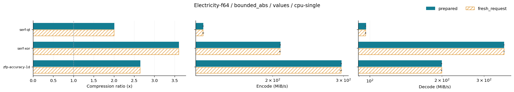

[SVG](figures/Electricity-f64--bounded_abs--cpu-single.svg)

<details><summary>完整数值、有效批次及拒绝原因</summary>

| codec | 完整输出 bytes P / F | 压缩倍数 P / F | 编码 MiB/s P / F | 解码 MiB/s P / F | 有效批次 P / F |
|---|---:|---:|---:|---:|---:|
| serf-qt | 3.37e+07 / 3.37e+07 | 2 / 2 | 134 / 134 | 96.2 / 96.1 | 14/14 / 14/14 |
| serf-xor | 1.88e+07 / 1.88e+07 | 3.6 / 3.6 | 209 / 209 | 364 / 364 | 14/14 / 14/14 |
| zfp-accuracy-1d | 2.55e+07 / 2.55e+07 | 2.65 / 2.65 | 297 / 296 | 199 / 200 | 14/14 / 14/14 |

</details>

**<f8 · [26304, 321] · 经验质量（无最大误差保证） · values · cpu-single**

运行进程 CPU 亲和性（P / F）：`[(0, 1, 2, 3, 4, 5, 6, 7, 8, 9, 10, 11, 12, 13, 14, 15)]` / `[(0, 1, 2, 3, 4, 5, 6, 7, 8, 9, 10, 11, 12, 13, 14, 15)]`；逐配置创建时间见 CSV，是否处于并行窗口见调度记录。

<details><summary>完整数值、有效批次及拒绝原因</summary>

| codec | 完整输出 bytes P / F | 压缩倍数 P / F | 编码 MiB/s P / F | 解码 MiB/s P / F | 有效批次 P / F |
|---|---:|---:|---:|---:|---:|
| abba | — / — | — / — | — / — | — / — | 0/0 / 0/0 |
| fabba | — / — | — / — | — / — | — / — | 0/0 / 0/0 |
| pmc-mr | — / — | — / — | — / — | — / — | 0/0 / 0/0 |
| swing-filter | — / — | — / — | — / — | — / — | 0/0 / 0/0 |
| swing-filter-disjoint | — / — | — / — | — / — | — / — | 0/0 / 0/0 |
| swing-filter-disjoint-quantized / compatible | — / — | — / — | — / — | — / — | 0/0 / 0/0 |

拒绝或未完整完成的请求：

- `abba` / fresh_request：unsupported，RW native batches require rank 1 / columns=1; collection framing belongs to object mode
- `abba` / prepared：unsupported，RW native batches require rank 1 / columns=1; collection framing belongs to object mode
- `fabba` / fresh_request：unsupported，RW native batches require rank 1 / columns=1; collection framing belongs to object mode
- `fabba` / prepared：unsupported，RW native batches require rank 1 / columns=1; collection framing belongs to object mode
- `pmc-mr` / fresh_request：unsupported，pmc-mr: dtype must be one of ('<f4',)
- `pmc-mr` / prepared：unsupported，pmc-mr: dtype must be one of ('<f4',)
- `swing-filter` / fresh_request：unsupported，swing-filter: dtype must be one of ('<f4',)
- `swing-filter` / prepared：unsupported，swing-filter: dtype must be one of ('<f4',)
- `swing-filter-disjoint` / fresh_request：unsupported，swing-filter-disjoint: dtype must be one of ('<f4',)
- `swing-filter-disjoint` / prepared：unsupported，swing-filter-disjoint: dtype must be one of ('<f4',)
- `swing-filter-disjoint-quantized / compatible` / fresh_request：unsupported，swing-filter-disjoint-quantized: dtype must be one of ('<f4',)
- `swing-filter-disjoint-quantized / compatible` / prepared：unsupported，swing-filter-disjoint-quantized: dtype must be one of ('<f4',)

</details>

**<i8 · [26304, 321] · 无损 · values · cpu-single**

运行进程 CPU 亲和性（P / F）：`[(0, 1, 2, 3, 4, 5, 6, 7, 8, 9, 10, 11, 12, 13, 14, 15)]` / `[(0, 1, 2, 3, 4, 5, 6, 7, 8, 9, 10, 11, 12, 13, 14, 15)]`；逐配置创建时间见 CSV，是否处于并行窗口见调度记录。

<details><summary>完整数值、有效批次及拒绝原因</summary>

| codec | 完整输出 bytes P / F | 压缩倍数 P / F | 编码 MiB/s P / F | 解码 MiB/s P / F | 有效批次 P / F |
|---|---:|---:|---:|---:|---:|
| leats-lossless-i64 | — / — | — / — | — / — | — / — | 0/0 / 0/0 |
| neats-lossless-i64 | — / — | — / — | — / — | — / — | 0/0 / 0/0 |

拒绝或未完整完成的请求：

- `leats-lossless-i64` / fresh_request：unsupported，leats-lossless-i64: m=321 exceeds native limits
- `leats-lossless-i64` / prepared：unsupported，leats-lossless-i64: m=321 exceeds native limits
- `neats-lossless-i64` / fresh_request：unsupported，neats-lossless-i64: m=321 exceeds native limits
- `neats-lossless-i64` / prepared：unsupported，neats-lossless-i64: m=321 exceeds native limits

</details>

**<u4 · [26304, 321] · 无损 · values · cpu-single**

运行进程 CPU 亲和性（P / F）：`[(0, 1, 2, 3, 4, 5, 6, 7, 8, 9, 10, 11, 12, 13, 14, 15)]` / `[(0, 1, 2, 3, 4, 5, 6, 7, 8, 9, 10, 11, 12, 13, 14, 15)]`；逐配置创建时间见 CSV，是否处于并行窗口见调度记录。

<details><summary>完整数值、有效批次及拒绝原因</summary>

| codec | 完整输出 bytes P / F | 压缩倍数 P / F | 编码 MiB/s P / F | 解码 MiB/s P / F | 有效批次 P / F |
|---|---:|---:|---:|---:|---:|
| simdcomp-u32 | — / — | — / — | — / — | — / — | 0/0 / 0/0 |

拒绝或未完整完成的请求：

- `simdcomp-u32` / fresh_request：unsupported，simdcomp-u32: rank must be one of (1,)
- `simdcomp-u32` / prepared：unsupported，simdcomp-u32: rank must be one of (1,)

</details>

<a id="dataset-Exchange"></a>

### Exchange

**<f4 · [7588, 8] · 无损 · values · cpu-single**

运行进程 CPU 亲和性（P / F）：`[(0, 1, 2, 3, 4, 5, 6, 7, 8, 9, 10, 11, 12, 13, 14, 15)]` / `[(0, 1, 2, 3, 4, 5, 6, 7, 8, 9, 10, 11, 12, 13, 14, 15)]`；逐配置创建时间见 CSV，是否处于并行窗口见调度记录。

f64→f32 准备阶段转换的最大绝对差：**1.18255615e-07**；本组 codec 的恢复质量相对转换后的 f32 输入验证。

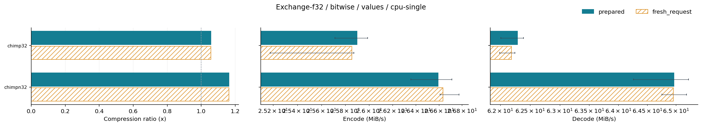

[SVG](figures/Exchange-f32--bitwise--cpu-single.svg)

<details><summary>完整数值、有效批次及拒绝原因</summary>

| codec | 完整输出 bytes P / F | 压缩倍数 P / F | 编码 MiB/s P / F | 解码 MiB/s P / F | 有效批次 P / F |
|---|---:|---:|---:|---:|---:|
| chimp32 | 2.3e+05 / 2.3e+05 | 1.06 / 1.06 | 25.9 / 25.9 | 62.3 / 62.2 | 14/14 / 14/14 |
| chimpn32 | 2.09e+05 / 2.09e+05 | 1.16 / 1.16 | 26.6 / 26.6 | 65 / 65 | 14/14 / 14/14 |

</details>

**<f4 · [7588, 8] · 经验质量（无最大误差保证） · values · cpu-single**

运行进程 CPU 亲和性（P / F）：`[(0, 1, 2, 3, 4, 5, 6, 7, 8, 9, 10, 11, 12, 13, 14, 15)]` / `[(0, 1, 2, 3, 4, 5, 6, 7, 8, 9, 10, 11, 12, 13, 14, 15)]`；逐配置创建时间见 CSV，是否处于并行窗口见调度记录。

f64→f32 准备阶段转换的最大绝对差：**1.18255615e-07**；本组 codec 的恢复质量相对转换后的 f32 输入验证。

<details><summary>完整数值、有效批次及拒绝原因</summary>

| codec | 完整输出 bytes P / F | 压缩倍数 P / F | 编码 MiB/s P / F | 解码 MiB/s P / F | 有效批次 P / F |
|---|---:|---:|---:|---:|---:|
| pmc-mr | — / — | — / — | — / — | — / — | 0/0 / 0/0 |
| swing-filter | — / — | — / — | — / — | — / — | 0/0 / 0/0 |
| swing-filter-disjoint | — / — | — / — | — / — | — / — | 0/0 / 0/0 |
| swing-filter-disjoint-quantized / compatible | — / — | — / — | — / — | — / — | 0/0 / 0/0 |
| swing-filter-disjoint-quantized / strict_abs | — / — | — / — | — / — | — / — | 0/0 / 0/0 |

拒绝或未完整完成的请求：

- `pmc-mr` / fresh_request：unsupported，filter native_core requires one column; object/native_api preserve independent columns
- `pmc-mr` / prepared：unsupported，filter native_core requires one column; object/native_api preserve independent columns
- `swing-filter` / fresh_request：unsupported，filter native_core requires one column; object/native_api preserve independent columns
- `swing-filter` / prepared：unsupported，filter native_core requires one column; object/native_api preserve independent columns
- `swing-filter-disjoint` / fresh_request：unsupported，filter native_core requires one column; object/native_api preserve independent columns
- `swing-filter-disjoint` / prepared：unsupported，filter native_core requires one column; object/native_api preserve independent columns
- `swing-filter-disjoint-quantized / compatible` / fresh_request：unsupported，filter native_core requires one column; object/native_api preserve independent columns
- `swing-filter-disjoint-quantized / compatible` / prepared：unsupported，filter native_core requires one column; object/native_api preserve independent columns
- `swing-filter-disjoint-quantized / strict_abs` / fresh_request：unsupported，filter native_core requires one column; object/native_api preserve independent columns
- `swing-filter-disjoint-quantized / strict_abs` / prepared：unsupported，filter native_core requires one column; object/native_api preserve independent columns

</details>

**<f8 · [7588, 8] · 无损 · values · cpu-dzip-three**

运行进程 CPU 亲和性（P / F）：`[(0, 1, 2, 3, 4, 5, 6, 7, 8, 9, 10, 11, 12, 13, 14, 15)]` / `[(0, 1, 2, 3, 4, 5, 6, 7, 8, 9, 10, 11, 12, 13, 14, 15)]`；逐配置创建时间见 CSV，是否处于并行窗口见调度记录。

<details><summary>完整数值、有效批次及拒绝原因</summary>

| codec | 完整输出 bytes P / F | 压缩倍数 P / F | 编码 MiB/s P / F | 解码 MiB/s P / F | 有效批次 P / F |
|---|---:|---:|---:|---:|---:|
| dzip | — / — | — / — | — / — | — / — | 0/0 / 0/0 |

拒绝或未完整完成的请求：

- `dzip` / fresh_request：unsupported，dzip: dtype must be one of ('|u1',)
- `dzip` / prepared：unsupported，dzip: dtype must be one of ('|u1',)

</details>

**<f8 · [7588, 8] · 无损 · values · cpu-single**

运行进程 CPU 亲和性（P / F）：`[(0, 1, 2, 3, 4, 5, 6, 7, 8, 9, 10, 11, 12, 13, 14, 15)]` / `[(0, 1, 2, 3, 4, 5, 6, 7, 8, 9, 10, 11, 12, 13, 14, 15)]`；逐配置创建时间见 CSV，是否处于并行窗口见调度记录。

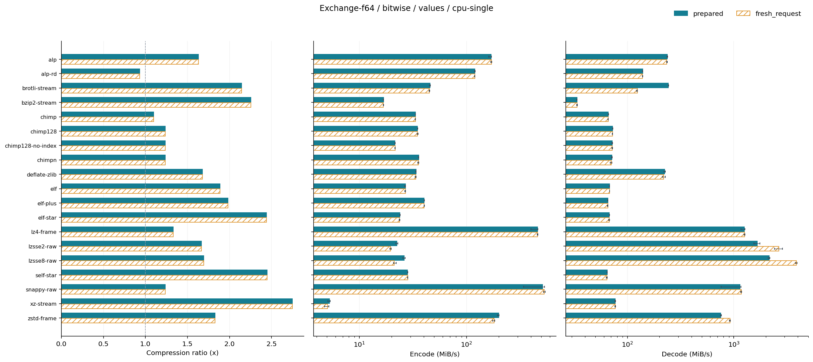

[SVG](figures/Exchange-f64--bitwise--cpu-single.svg)

<details><summary>完整数值、有效批次及拒绝原因</summary>

| codec | 完整输出 bytes P / F | 压缩倍数 P / F | 编码 MiB/s P / F | 解码 MiB/s P / F | 有效批次 P / F |
|---|---:|---:|---:|---:|---:|
| alp | 2.98e+05 / 2.98e+05 | 1.63 / 1.63 | 170 / 171 | 237 / 234 | 14/14 / 14/14 |
| alp-rd | 5.21e+05 / 5.21e+05 | 0.932 / 0.932 | 120 / 120 | 139 / 139 | 14/14 / 14/14 |
| brotli-stream | 2.27e+05 / 2.27e+05 | 2.14 / 2.14 | 45.8 / 45.1 | 243 / 124 | 14/14 / 14/14 |
| bzip2-stream | 2.15e+05 / 2.15e+05 | 2.25 / 2.25 | 16.9 / 16.8 | 33.6 / 33.6 | 14/14 / 14/14 |
| chimp | 4.42e+05 / 4.42e+05 | 1.1 / 1.1 | 33.5 / 33.4 | 66.2 / 65.9 | 14/14 / 14/14 |
| chimp128 | 3.93e+05 / 3.93e+05 | 1.24 / 1.24 | 35 / 35 | 72.6 / 72.5 | 14/14 / 14/14 |
| chimp128-no-index | 3.93e+05 / 3.93e+05 | 1.24 / 1.24 | 21.6 / 21.6 | 72 / 71.8 | 14/14 / 14/14 |
| chimp32 | — / — | — / — | — / — | — / — | 0/0 / 0/0 |
| chimpn | 3.93e+05 / 3.93e+05 | 1.24 / 1.24 | 35.8 / 35.7 | 71.5 / 70.6 | 14/14 / 14/14 |
| chimpn32 | — / — | — / — | — / — | — / — | 0/0 / 0/0 |
| deepzip | — / — | — / — | — / — | — / — | 0/0 / 0/0 |
| deflate-zlib | 2.9e+05 / 2.9e+05 | 1.68 / 1.68 | 33.9 / 33.7 | 225 / 220 | 14/14 / 14/14 |
| elf | 2.58e+05 / 2.58e+05 | 1.89 / 1.89 | 26.9 / 27 | 67.8 / 67.9 | 14/14 / 14/14 |
| elf-plus | 2.45e+05 / 2.45e+05 | 1.98 / 1.98 | 40.4 / 40.4 | 65.4 / 65.4 | 14/14 / 14/14 |
| elf-star | 1.99e+05 / 1.99e+05 | 2.44 / 2.44 | 24 / 23.8 | 67.6 / 67.5 | 14/14 / 14/14 |
| fse | — / — | — / — | — / — | — / — | 0/0 / 0/0 |
| gorilla-prometheus-xor | — / — | — / — | — / — | — / — | 0/0 / 0/0 |
| huff0 | — / — | — / — | — / — | — / — | 0/0 / 0/0 |
| leats-lossless-i64 | — / — | — / — | — / — | — / — | 0/0 / 0/0 |
| lz4-frame | 3.65e+05 / 3.65e+05 | 1.33 / 1.33 | 460 / 461 | 1.25e+03 / 1.26e+03 | 14/14 / 14/14 |
| lzsse2-raw | 2.92e+05 / 2.92e+05 | 1.66 / 1.66 | 22.4 / 19.6 | 1.66e+03 / 2.65e+03 | 14/14 / 14/14 |
| lzsse8-raw | 2.87e+05 / 2.87e+05 | 1.69 / 1.69 | 26.2 / 21.2 | 2.16e+03 / 3.89e+03 | 14/14 / 14/14 |
| neats-lossless-i64 | — / — | — / — | — / — | — / — | 0/0 / 0/0 |
| self-star | 1.98e+05 / 1.98e+05 | 2.45 / 2.45 | 28.3 / 28.4 | 64.5 / 64.3 | 14/14 / 14/14 |
| simdcomp-u32 | — / — | — / — | — / — | — / — | 0/0 / 0/0 |
| snappy-raw | 3.93e+05 / 3.93e+05 | 1.24 / 1.24 | 514 / 533 | 1.14e+03 / 1.17e+03 | 14/14 / 14/14 |
| sprintz-delta | — / — | — / — | — / — | — / — | 0/0 / 0/0 |
| sprintz-delta-huffman | — / — | — / — | — / — | — / — | 0/0 / 0/0 |
| sprintz-fire | — / — | — / — | — / — | — / — | 0/0 / 0/0 |
| sprintz-fire-huffman | — / — | — / — | — / — | — / — | 0/0 / 0/0 |
| xz-stream | 1.77e+05 / 1.77e+05 | 2.75 / 2.75 | 5.28 / 5.05 | 76.8 / 77.1 | 14/14 / 14/14 |
| zstd-frame | 2.66e+05 / 2.66e+05 | 1.83 / 1.83 | 200 / 181 | 755 / 919 | 14/14 / 14/14 |

拒绝或未完整完成的请求：

- `chimp32` / fresh_request：unsupported，chimp32: dtype must be one of ('<f4',)
- `chimp32` / prepared：unsupported，chimp32: dtype must be one of ('<f4',)
- `chimpn32` / fresh_request：unsupported，chimpn32: dtype must be one of ('<f4',)
- `chimpn32` / prepared：unsupported，chimpn32: dtype must be one of ('<f4',)
- `deepzip` / fresh_request：unsupported，deepzip: dtype must be one of ('|u1',)
- `deepzip` / prepared：unsupported，deepzip: dtype must be one of ('|u1',)
- `fse` / fresh_request：unsupported，fse: native byte limit exceeded
- `fse` / prepared：unsupported，fse: native byte limit exceeded
- `gorilla-prometheus-xor` / fresh_request：unsupported，Gorilla requires actual paired T/V; values-only and timestamp-only are unsupported
- `gorilla-prometheus-xor` / prepared：unsupported，Gorilla requires actual paired T/V; values-only and timestamp-only are unsupported
- `huff0` / fresh_request：unsupported，huff0: native byte limit exceeded
- `huff0` / prepared：unsupported，huff0: native byte limit exceeded
- `leats-lossless-i64` / fresh_request：unsupported，leats-lossless-i64: dtype must be one of ('|i1', '<i2', '<i4', '<i8')
- `leats-lossless-i64` / prepared：unsupported，leats-lossless-i64: dtype must be one of ('|i1', '<i2', '<i4', '<i8')
- `neats-lossless-i64` / fresh_request：unsupported，neats-lossless-i64: dtype must be one of ('|i1', '<i2', '<i4', '<i8')
- `neats-lossless-i64` / prepared：unsupported，neats-lossless-i64: dtype must be one of ('|i1', '<i2', '<i4', '<i8')
- `simdcomp-u32` / fresh_request：unsupported，simdcomp-u32: dtype must be one of ('<u4',)
- `simdcomp-u32` / prepared：unsupported，simdcomp-u32: dtype must be one of ('<u4',)
- `sprintz-delta` / fresh_request：unsupported，sprintz-delta: dtype must be one of ('|u1', '|i1', '<u2', '<i2')
- `sprintz-delta` / prepared：unsupported，sprintz-delta: dtype must be one of ('|u1', '|i1', '<u2', '<i2')
- `sprintz-delta-huffman` / fresh_request：unsupported，sprintz-delta-huffman: dtype must be one of ('|u1', '|i1', '<u2', '<i2')
- `sprintz-delta-huffman` / prepared：unsupported，sprintz-delta-huffman: dtype must be one of ('|u1', '|i1', '<u2', '<i2')
- `sprintz-fire` / fresh_request：unsupported，sprintz-fire: dtype must be one of ('|u1', '|i1', '<u2', '<i2')
- `sprintz-fire` / prepared：unsupported，sprintz-fire: dtype must be one of ('|u1', '|i1', '<u2', '<i2')
- `sprintz-fire-huffman` / fresh_request：unsupported，sprintz-fire-huffman: dtype must be one of ('|u1', '|i1', '<u2', '<i2')
- `sprintz-fire-huffman` / prepared：unsupported，sprintz-fire-huffman: dtype must be one of ('|u1', '|i1', '<u2', '<i2')

</details>

**<f8 · [7588, 8] · ABS ≤ 0.01 · values · cpu-single**

运行进程 CPU 亲和性（P / F）：`[(0, 1, 2, 3, 4, 5, 6, 7, 8, 9, 10, 11, 12, 13, 14, 15)]` / `[(0, 1, 2, 3, 4, 5, 6, 7, 8, 9, 10, 11, 12, 13, 14, 15)]`；逐配置创建时间见 CSV，是否处于并行窗口见调度记录。

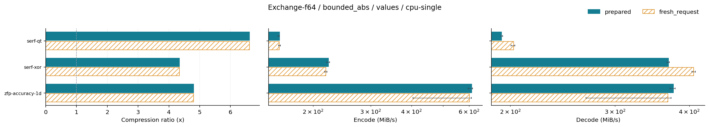

[SVG](figures/Exchange-f64--bounded_abs--cpu-single.svg)

<details><summary>完整数值、有效批次及拒绝原因</summary>

| codec | 完整输出 bytes P / F | 压缩倍数 P / F | 编码 MiB/s P / F | 解码 MiB/s P / F | 有效批次 P / F |
|---|---:|---:|---:|---:|---:|
| serf-qt | 7.34e+04 / 7.34e+04 | 6.62 / 6.62 | 158 / 158 | 193 / 203 | 14/14 / 14/14 |
| serf-xor | 1.12e+05 / 1.12e+05 | 4.35 / 4.35 | 223 / 219 | 369 / 407 | 14/14 / 14/14 |
| zfp-accuracy-1d | 1.01e+05 / 1.01e+05 | 4.81 / 4.81 | 611 / 602 | 376 / 368 | 14/14 / 14/14 |

</details>

**<f8 · [7588, 8] · 经验质量（无最大误差保证） · values · cpu-single**

运行进程 CPU 亲和性（P / F）：`[(0, 1, 2, 3, 4, 5, 6, 7, 8, 9, 10, 11, 12, 13, 14, 15)]` / `[(0, 1, 2, 3, 4, 5, 6, 7, 8, 9, 10, 11, 12, 13, 14, 15)]`；逐配置创建时间见 CSV，是否处于并行窗口见调度记录。

<details><summary>完整数值、有效批次及拒绝原因</summary>

| codec | 完整输出 bytes P / F | 压缩倍数 P / F | 编码 MiB/s P / F | 解码 MiB/s P / F | 有效批次 P / F |
|---|---:|---:|---:|---:|---:|
| abba | — / — | — / — | — / — | — / — | 0/0 / 0/0 |
| fabba | — / — | — / — | — / — | — / — | 0/0 / 0/0 |
| pmc-mr | — / — | — / — | — / — | — / — | 0/0 / 0/0 |
| swing-filter | — / — | — / — | — / — | — / — | 0/0 / 0/0 |
| swing-filter-disjoint | — / — | — / — | — / — | — / — | 0/0 / 0/0 |
| swing-filter-disjoint-quantized / compatible | — / — | — / — | — / — | — / — | 0/0 / 0/0 |

拒绝或未完整完成的请求：

- `abba` / fresh_request：unsupported，RW native batches require rank 1 / columns=1; collection framing belongs to object mode
- `abba` / prepared：unsupported，RW native batches require rank 1 / columns=1; collection framing belongs to object mode
- `fabba` / fresh_request：unsupported，RW native batches require rank 1 / columns=1; collection framing belongs to object mode
- `fabba` / prepared：unsupported，RW native batches require rank 1 / columns=1; collection framing belongs to object mode
- `pmc-mr` / fresh_request：unsupported，pmc-mr: dtype must be one of ('<f4',)
- `pmc-mr` / prepared：unsupported，pmc-mr: dtype must be one of ('<f4',)
- `swing-filter` / fresh_request：unsupported，swing-filter: dtype must be one of ('<f4',)
- `swing-filter` / prepared：unsupported，swing-filter: dtype must be one of ('<f4',)
- `swing-filter-disjoint` / fresh_request：unsupported，swing-filter-disjoint: dtype must be one of ('<f4',)
- `swing-filter-disjoint` / prepared：unsupported，swing-filter-disjoint: dtype must be one of ('<f4',)
- `swing-filter-disjoint-quantized / compatible` / fresh_request：unsupported，swing-filter-disjoint-quantized: dtype must be one of ('<f4',)
- `swing-filter-disjoint-quantized / compatible` / prepared：unsupported，swing-filter-disjoint-quantized: dtype must be one of ('<f4',)

</details>

<a id="dataset-FRED-MD"></a>

### FRED-MD

**<f4 · [728, 107] · 无损 · values · cpu-single**

运行进程 CPU 亲和性（P / F）：`[(0, 1, 2, 3, 4, 5, 6, 7, 8, 9, 10, 11, 12, 13, 14, 15)]` / `[(0, 1, 2, 3, 4, 5, 6, 7, 8, 9, 10, 11, 12, 13, 14, 15)]`；逐配置创建时间见 CSV，是否处于并行窗口见调度记录。

f64→f32 准备阶段转换的最大绝对差：**0.015**；本组 codec 的恢复质量相对转换后的 f32 输入验证。

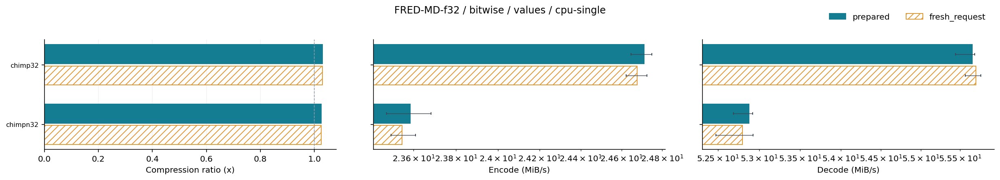

[SVG](figures/FRED-MD-f32--bitwise--cpu-single.svg)

<details><summary>完整数值、有效批次及拒绝原因</summary>

| codec | 完整输出 bytes P / F | 压缩倍数 P / F | 编码 MiB/s P / F | 解码 MiB/s P / F | 有效批次 P / F |
|---|---:|---:|---:|---:|---:|
| chimp32 | 3.03e+05 / 3.03e+05 | 1.03 / 1.03 | 24.7 / 24.7 | 55.7 / 55.7 | 14/14 / 14/14 |
| chimpn32 | 3.04e+05 / 3.04e+05 | 1.03 / 1.03 | 23.6 / 23.5 | 52.9 / 52.8 | 14/14 / 14/14 |

</details>

**<f4 · [728, 107] · 经验质量（无最大误差保证） · values · cpu-single**

运行进程 CPU 亲和性（P / F）：`[(0, 1, 2, 3, 4, 5, 6, 7, 8, 9, 10, 11, 12, 13, 14, 15)]` / `[(0, 1, 2, 3, 4, 5, 6, 7, 8, 9, 10, 11, 12, 13, 14, 15)]`；逐配置创建时间见 CSV，是否处于并行窗口见调度记录。

f64→f32 准备阶段转换的最大绝对差：**0.015**；本组 codec 的恢复质量相对转换后的 f32 输入验证。

<details><summary>完整数值、有效批次及拒绝原因</summary>

| codec | 完整输出 bytes P / F | 压缩倍数 P / F | 编码 MiB/s P / F | 解码 MiB/s P / F | 有效批次 P / F |
|---|---:|---:|---:|---:|---:|
| pmc-mr | — / — | — / — | — / — | — / — | 0/0 / 0/0 |
| swing-filter | — / — | — / — | — / — | — / — | 0/0 / 0/0 |
| swing-filter-disjoint | — / — | — / — | — / — | — / — | 0/0 / 0/0 |
| swing-filter-disjoint-quantized / compatible | — / — | — / — | — / — | — / — | 0/0 / 0/0 |
| swing-filter-disjoint-quantized / strict_abs | — / — | — / — | — / — | — / — | 0/0 / 0/0 |

拒绝或未完整完成的请求：

- `pmc-mr` / fresh_request：unsupported，filter native_core requires one column; object/native_api preserve independent columns
- `pmc-mr` / prepared：unsupported，filter native_core requires one column; object/native_api preserve independent columns
- `swing-filter` / fresh_request：unsupported，filter native_core requires one column; object/native_api preserve independent columns
- `swing-filter` / prepared：unsupported，filter native_core requires one column; object/native_api preserve independent columns
- `swing-filter-disjoint` / fresh_request：unsupported，filter native_core requires one column; object/native_api preserve independent columns
- `swing-filter-disjoint` / prepared：unsupported，filter native_core requires one column; object/native_api preserve independent columns
- `swing-filter-disjoint-quantized / compatible` / fresh_request：unsupported，filter native_core requires one column; object/native_api preserve independent columns
- `swing-filter-disjoint-quantized / compatible` / prepared：unsupported，filter native_core requires one column; object/native_api preserve independent columns
- `swing-filter-disjoint-quantized / strict_abs` / fresh_request：unsupported，filter native_core requires one column; object/native_api preserve independent columns
- `swing-filter-disjoint-quantized / strict_abs` / prepared：unsupported，filter native_core requires one column; object/native_api preserve independent columns

</details>

**<f8 · [728, 107] · 无损 · values · cpu-dzip-three**

运行进程 CPU 亲和性（P / F）：`[(0, 1, 2, 3, 4, 5, 6, 7, 8, 9, 10, 11, 12, 13, 14, 15)]` / `[(0, 1, 2, 3, 4, 5, 6, 7, 8, 9, 10, 11, 12, 13, 14, 15)]`；逐配置创建时间见 CSV，是否处于并行窗口见调度记录。

<details><summary>完整数值、有效批次及拒绝原因</summary>

| codec | 完整输出 bytes P / F | 压缩倍数 P / F | 编码 MiB/s P / F | 解码 MiB/s P / F | 有效批次 P / F |
|---|---:|---:|---:|---:|---:|
| dzip | — / — | — / — | — / — | — / — | 0/0 / 0/0 |

拒绝或未完整完成的请求：

- `dzip` / fresh_request：unsupported，dzip: dtype must be one of ('|u1',)
- `dzip` / prepared：unsupported，dzip: dtype must be one of ('|u1',)

</details>

**<f8 · [728, 107] · 无损 · values · cpu-single**

运行进程 CPU 亲和性（P / F）：`[(0, 1, 2, 3, 4, 5, 6, 7, 8, 9, 10, 11, 12, 13, 14, 15)]` / `[(0, 1, 2, 3, 4, 5, 6, 7, 8, 9, 10, 11, 12, 13, 14, 15)]`；逐配置创建时间见 CSV，是否处于并行窗口见调度记录。

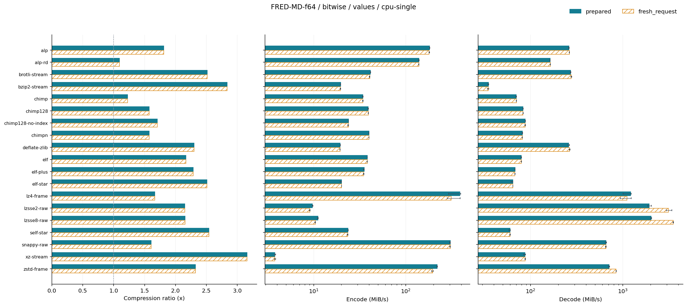

[SVG](figures/FRED-MD-f64--bitwise--cpu-single.svg)

<details><summary>完整数值、有效批次及拒绝原因</summary>

| codec | 完整输出 bytes P / F | 压缩倍数 P / F | 编码 MiB/s P / F | 解码 MiB/s P / F | 有效批次 P / F |
|---|---:|---:|---:|---:|---:|
| alp | 3.44e+05 / 3.44e+05 | 1.81 / 1.81 | 181 / 179 | 261 / 264 | 14/14 / 14/14 |
| alp-rd | 5.7e+05 / 5.7e+05 | 1.09 / 1.09 | 138 / 138 | 163 / 164 | 14/14 / 14/14 |
| brotli-stream | 2.48e+05 / 2.48e+05 | 2.51 / 2.51 | 41.4 / 40.6 | 271 / 276 | 14/14 / 14/14 |
| bzip2-stream | 2.2e+05 / 2.2e+05 | 2.83 / 2.83 | 19.6 / 19.5 | 35 / 34.8 | 14/14 / 14/14 |
| chimp | 5.08e+05 / 5.08e+05 | 1.23 / 1.23 | 34.2 / 34.3 | 70 / 70.3 | 14/14 / 14/14 |
| chimp128 | 3.95e+05 / 3.95e+05 | 1.58 / 1.58 | 39 / 39.3 | 82.8 / 82.9 | 14/14 / 14/14 |
| chimp128-no-index | 3.65e+05 / 3.65e+05 | 1.71 / 1.71 | 23.9 / 23.8 | 87.6 / 87.3 | 14/14 / 14/14 |
| chimp32 | — / — | — / — | — / — | — / — | 0/0 / 0/0 |
| chimpn | 3.95e+05 / 3.95e+05 | 1.58 / 1.58 | 39.8 / 39.8 | 81.7 / 81.5 | 14/14 / 14/14 |
| chimpn32 | — / — | — / — | — / — | — / — | 0/0 / 0/0 |
| deepzip | — / — | — / — | — / — | — / — | 0/0 / 0/0 |
| deflate-zlib | 2.71e+05 / 2.71e+05 | 2.3 / 2.3 | 19.4 / 19.3 | 258 / 264 | 14/14 / 14/14 |
| elf | 2.88e+05 / 2.88e+05 | 2.17 / 2.17 | 38.3 / 38.2 | 79.4 / 79.5 | 14/14 / 14/14 |
| elf-plus | 2.73e+05 / 2.73e+05 | 2.28 / 2.28 | 35.3 / 35 | 68.1 / 67.6 | 14/14 / 14/14 |
| elf-star | 2.48e+05 / 2.48e+05 | 2.51 / 2.51 | 20.1 / 20.1 | 64.3 / 64.3 | 14/14 / 14/14 |
| fse | — / — | — / — | — / — | — / — | 0/0 / 0/0 |
| gorilla-prometheus-xor | — / — | — / — | — / — | — / — | 0/0 / 0/0 |
| huff0 | — / — | — / — | — / — | — / — | 0/0 / 0/0 |
| leats-lossless-i64 | — / — | — / — | — / — | — / — | 0/0 / 0/0 |
| lz4-frame | 3.74e+05 / 3.74e+05 | 1.67 / 1.67 | 388 / 311 | 1.21e+03 / 1.11e+03 | 14/14 / 14/14 |
| lzsse2-raw | 2.9e+05 / 2.9e+05 | 2.15 / 2.15 | 9.72 / 9.07 | 1.93e+03 / 3.11e+03 | 14/14 / 14/14 |
| lzsse8-raw | 2.89e+05 / 2.89e+05 | 2.15 / 2.15 | 11.2 / 10.4 | 2.03e+03 / 3.52e+03 | 14/14 / 14/14 |
| neats-lossless-i64 | — / — | — / — | — / — | — / — | 0/0 / 0/0 |
| self-star | 2.45e+05 / 2.45e+05 | 2.54 / 2.54 | 23.6 / 23.4 | 60.2 / 60.2 | 14/14 / 14/14 |
| simdcomp-u32 | — / — | — / — | — / — | — / — | 0/0 / 0/0 |
| snappy-raw | 3.87e+05 / 3.87e+05 | 1.61 / 1.61 | 304 / 304 | 655 / 655 | 14/14 / 14/14 |
| sprintz-delta | — / — | — / — | — / — | — / — | 0/0 / 0/0 |
| sprintz-delta-huffman | — / — | — / — | — / — | — / — | 0/0 / 0/0 |
| sprintz-fire | — / — | — / — | — / — | — / — | 0/0 / 0/0 |
| sprintz-fire-huffman | — / — | — / — | — / — | — / — | 0/0 / 0/0 |
| xz-stream | 1.97e+05 / 1.97e+05 | 3.16 / 3.16 | 3.79 / 3.79 | 86.9 / 87.6 | 14/14 / 14/14 |
| zstd-frame | 2.68e+05 / 2.68e+05 | 2.33 / 2.33 | 219 / 196 | 711 / 846 | 14/14 / 14/14 |

拒绝或未完整完成的请求：

- `chimp32` / fresh_request：unsupported，chimp32: dtype must be one of ('<f4',)
- `chimp32` / prepared：unsupported，chimp32: dtype must be one of ('<f4',)
- `chimpn32` / fresh_request：unsupported，chimpn32: dtype must be one of ('<f4',)
- `chimpn32` / prepared：unsupported，chimpn32: dtype must be one of ('<f4',)
- `deepzip` / fresh_request：unsupported，deepzip: dtype must be one of ('|u1',)
- `deepzip` / prepared：unsupported，deepzip: dtype must be one of ('|u1',)
- `fse` / fresh_request：unsupported，fse: m=107 exceeds native limits
- `fse` / prepared：unsupported，fse: m=107 exceeds native limits
- `gorilla-prometheus-xor` / fresh_request：unsupported，Gorilla requires actual paired T/V; values-only and timestamp-only are unsupported
- `gorilla-prometheus-xor` / prepared：unsupported，Gorilla requires actual paired T/V; values-only and timestamp-only are unsupported
- `huff0` / fresh_request：unsupported，huff0: m=107 exceeds native limits
- `huff0` / prepared：unsupported，huff0: m=107 exceeds native limits
- `leats-lossless-i64` / fresh_request：unsupported，leats-lossless-i64: dtype must be one of ('|i1', '<i2', '<i4', '<i8')
- `leats-lossless-i64` / prepared：unsupported，leats-lossless-i64: dtype must be one of ('|i1', '<i2', '<i4', '<i8')
- `neats-lossless-i64` / fresh_request：unsupported，neats-lossless-i64: dtype must be one of ('|i1', '<i2', '<i4', '<i8')
- `neats-lossless-i64` / prepared：unsupported，neats-lossless-i64: dtype must be one of ('|i1', '<i2', '<i4', '<i8')
- `simdcomp-u32` / fresh_request：unsupported，simdcomp-u32: dtype must be one of ('<u4',)
- `simdcomp-u32` / prepared：unsupported，simdcomp-u32: dtype must be one of ('<u4',)
- `sprintz-delta` / fresh_request：unsupported，sprintz-delta: dtype must be one of ('|u1', '|i1', '<u2', '<i2')
- `sprintz-delta` / prepared：unsupported，sprintz-delta: dtype must be one of ('|u1', '|i1', '<u2', '<i2')
- `sprintz-delta-huffman` / fresh_request：unsupported，sprintz-delta-huffman: dtype must be one of ('|u1', '|i1', '<u2', '<i2')
- `sprintz-delta-huffman` / prepared：unsupported，sprintz-delta-huffman: dtype must be one of ('|u1', '|i1', '<u2', '<i2')
- `sprintz-fire` / fresh_request：unsupported，sprintz-fire: dtype must be one of ('|u1', '|i1', '<u2', '<i2')
- `sprintz-fire` / prepared：unsupported，sprintz-fire: dtype must be one of ('|u1', '|i1', '<u2', '<i2')
- `sprintz-fire-huffman` / fresh_request：unsupported，sprintz-fire-huffman: dtype must be one of ('|u1', '|i1', '<u2', '<i2')
- `sprintz-fire-huffman` / prepared：unsupported，sprintz-fire-huffman: dtype must be one of ('|u1', '|i1', '<u2', '<i2')

</details>

**<f8 · [728, 107] · ABS ≤ 0.01 · values · cpu-single**

运行进程 CPU 亲和性（P / F）：`[(0, 1, 2, 3, 4, 5, 6, 7, 8, 9, 10, 11, 12, 13, 14, 15)]` / `[(0, 1, 2, 3, 4, 5, 6, 7, 8, 9, 10, 11, 12, 13, 14, 15)]`；逐配置创建时间见 CSV，是否处于并行窗口见调度记录。

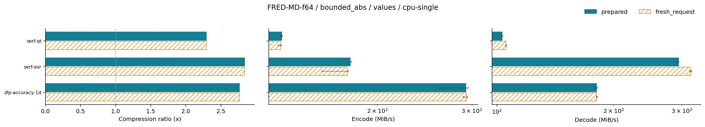

[SVG](figures/FRED-MD-f64--bounded_abs--cpu-single.svg)

<details><summary>完整数值、有效批次及拒绝原因</summary>

| codec | 完整输出 bytes P / F | 压缩倍数 P / F | 编码 MiB/s P / F | 解码 MiB/s P / F | 有效批次 P / F |
|---|---:|---:|---:|---:|---:|
| serf-qt | 2.72e+05 / 2.72e+05 | 2.29 / 2.29 | 133 / 132 | 103 / 106 | 14/14 / 14/14 |
| serf-xor | 2.2e+05 / 2.2e+05 | 2.84 / 2.84 | 178 / 176 | 294 / 317 | 14/14 / 14/14 |
| zfp-accuracy-1d | 2.25e+05 / 2.25e+05 | 2.77 / 2.77 | 292 / 293 | 181 / 181 | 14/14 / 14/14 |

</details>

**<f8 · [728, 107] · 经验质量（无最大误差保证） · values · cpu-single**

运行进程 CPU 亲和性（P / F）：`[(0, 1, 2, 3, 4, 5, 6, 7, 8, 9, 10, 11, 12, 13, 14, 15)]` / `[(0, 1, 2, 3, 4, 5, 6, 7, 8, 9, 10, 11, 12, 13, 14, 15)]`；逐配置创建时间见 CSV，是否处于并行窗口见调度记录。

<details><summary>完整数值、有效批次及拒绝原因</summary>

| codec | 完整输出 bytes P / F | 压缩倍数 P / F | 编码 MiB/s P / F | 解码 MiB/s P / F | 有效批次 P / F |
|---|---:|---:|---:|---:|---:|
| abba | — / — | — / — | — / — | — / — | 0/0 / 0/0 |
| fabba | — / — | — / — | — / — | — / — | 0/0 / 0/0 |
| pmc-mr | — / — | — / — | — / — | — / — | 0/0 / 0/0 |
| swing-filter | — / — | — / — | — / — | — / — | 0/0 / 0/0 |
| swing-filter-disjoint | — / — | — / — | — / — | — / — | 0/0 / 0/0 |
| swing-filter-disjoint-quantized / compatible | — / — | — / — | — / — | — / — | 0/0 / 0/0 |

拒绝或未完整完成的请求：

- `abba` / fresh_request：unsupported，RW native batches require rank 1 / columns=1; collection framing belongs to object mode
- `abba` / prepared：unsupported，RW native batches require rank 1 / columns=1; collection framing belongs to object mode
- `fabba` / fresh_request：unsupported，RW native batches require rank 1 / columns=1; collection framing belongs to object mode
- `fabba` / prepared：unsupported，RW native batches require rank 1 / columns=1; collection framing belongs to object mode
- `pmc-mr` / fresh_request：unsupported，pmc-mr: dtype must be one of ('<f4',)
- `pmc-mr` / prepared：unsupported，pmc-mr: dtype must be one of ('<f4',)
- `swing-filter` / fresh_request：unsupported，swing-filter: dtype must be one of ('<f4',)
- `swing-filter` / prepared：unsupported，swing-filter: dtype must be one of ('<f4',)
- `swing-filter-disjoint` / fresh_request：unsupported，swing-filter-disjoint: dtype must be one of ('<f4',)
- `swing-filter-disjoint` / prepared：unsupported，swing-filter-disjoint: dtype must be one of ('<f4',)
- `swing-filter-disjoint-quantized / compatible` / fresh_request：unsupported，swing-filter-disjoint-quantized: dtype must be one of ('<f4',)
- `swing-filter-disjoint-quantized / compatible` / prepared：unsupported，swing-filter-disjoint-quantized: dtype must be one of ('<f4',)

</details>

<a id="dataset-ILI"></a>

### ILI

**<f4 · [966, 7] · 无损 · values · cpu-single**

运行进程 CPU 亲和性（P / F）：`[(0, 1, 2, 3, 4, 5, 6, 7, 8, 9, 10, 11, 12, 13, 14, 15)]` / `[(0, 1, 2, 3, 4, 5, 6, 7, 8, 9, 10, 11, 12, 13, 14, 15)]`；逐配置创建时间见 CSV，是否处于并行窗口见调度记录。

f64→f32 准备阶段转换的最大绝对差：**2.3727417e-07**；本组 codec 的恢复质量相对转换后的 f32 输入验证。

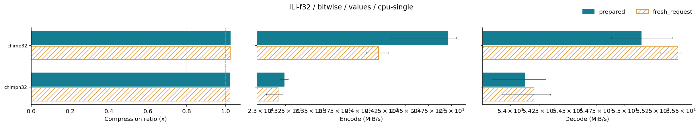

[SVG](figures/ILI-f32--bitwise--cpu-single.svg)

<details><summary>完整数值、有效批次及拒绝原因</summary>

| codec | 完整输出 bytes P / F | 压缩倍数 P / F | 编码 MiB/s P / F | 解码 MiB/s P / F | 有效批次 P / F |
|---|---:|---:|---:|---:|---:|
| chimp32 | 2.64e+04 / 2.64e+04 | 1.02 / 1.02 | 25 / 24.2 | 55.1 / 55.5 | 14/14 / 14/14 |
| chimpn32 | 2.64e+04 / 2.64e+04 | 1.02 / 1.02 | 23.2 / 23.2 | 54.1 / 54.2 | 14/14 / 14/14 |

</details>

**<f4 · [966, 7] · 经验质量（无最大误差保证） · values · cpu-single**

运行进程 CPU 亲和性（P / F）：`[(0, 1, 2, 3, 4, 5, 6, 7, 8, 9, 10, 11, 12, 13, 14, 15)]` / `[(0, 1, 2, 3, 4, 5, 6, 7, 8, 9, 10, 11, 12, 13, 14, 15)]`；逐配置创建时间见 CSV，是否处于并行窗口见调度记录。

f64→f32 准备阶段转换的最大绝对差：**2.3727417e-07**；本组 codec 的恢复质量相对转换后的 f32 输入验证。

<details><summary>完整数值、有效批次及拒绝原因</summary>

| codec | 完整输出 bytes P / F | 压缩倍数 P / F | 编码 MiB/s P / F | 解码 MiB/s P / F | 有效批次 P / F |
|---|---:|---:|---:|---:|---:|
| pmc-mr | — / — | — / — | — / — | — / — | 0/0 / 0/0 |
| swing-filter | — / — | — / — | — / — | — / — | 0/0 / 0/0 |
| swing-filter-disjoint | — / — | — / — | — / — | — / — | 0/0 / 0/0 |
| swing-filter-disjoint-quantized / compatible | — / — | — / — | — / — | — / — | 0/0 / 0/0 |
| swing-filter-disjoint-quantized / strict_abs | — / — | — / — | — / — | — / — | 0/0 / 0/0 |

拒绝或未完整完成的请求：

- `pmc-mr` / fresh_request：unsupported，filter native_core requires one column; object/native_api preserve independent columns
- `pmc-mr` / prepared：unsupported，filter native_core requires one column; object/native_api preserve independent columns
- `swing-filter` / fresh_request：unsupported，filter native_core requires one column; object/native_api preserve independent columns
- `swing-filter` / prepared：unsupported，filter native_core requires one column; object/native_api preserve independent columns
- `swing-filter-disjoint` / fresh_request：unsupported，filter native_core requires one column; object/native_api preserve independent columns
- `swing-filter-disjoint` / prepared：unsupported，filter native_core requires one column; object/native_api preserve independent columns
- `swing-filter-disjoint-quantized / compatible` / fresh_request：unsupported，filter native_core requires one column; object/native_api preserve independent columns
- `swing-filter-disjoint-quantized / compatible` / prepared：unsupported，filter native_core requires one column; object/native_api preserve independent columns
- `swing-filter-disjoint-quantized / strict_abs` / fresh_request：unsupported，filter native_core requires one column; object/native_api preserve independent columns
- `swing-filter-disjoint-quantized / strict_abs` / prepared：unsupported，filter native_core requires one column; object/native_api preserve independent columns

</details>

**<f8 · [966, 7] · 无损 · values · cpu-dzip-three**

运行进程 CPU 亲和性（P / F）：`[(0, 1, 2, 3, 4, 5, 6, 7, 8, 9, 10, 11, 12, 13, 14, 15)]` / `[(0, 1, 2, 3, 4, 5, 6, 7, 8, 9, 10, 11, 12, 13, 14, 15)]`；逐配置创建时间见 CSV，是否处于并行窗口见调度记录。

<details><summary>完整数值、有效批次及拒绝原因</summary>

| codec | 完整输出 bytes P / F | 压缩倍数 P / F | 编码 MiB/s P / F | 解码 MiB/s P / F | 有效批次 P / F |
|---|---:|---:|---:|---:|---:|
| dzip | — / — | — / — | — / — | — / — | 0/0 / 0/0 |

拒绝或未完整完成的请求：

- `dzip` / fresh_request：unsupported，dzip: dtype must be one of ('|u1',)
- `dzip` / prepared：unsupported，dzip: dtype must be one of ('|u1',)

</details>

**<f8 · [966, 7] · 无损 · values · cpu-single**

运行进程 CPU 亲和性（P / F）：`[(0, 1, 2, 3, 4, 5, 6, 7, 8, 9, 10, 11, 12, 13, 14, 15)]` / `[(0, 1, 2, 3, 4, 5, 6, 7, 8, 9, 10, 11, 12, 13, 14, 15)]`；逐配置创建时间见 CSV，是否处于并行窗口见调度记录。

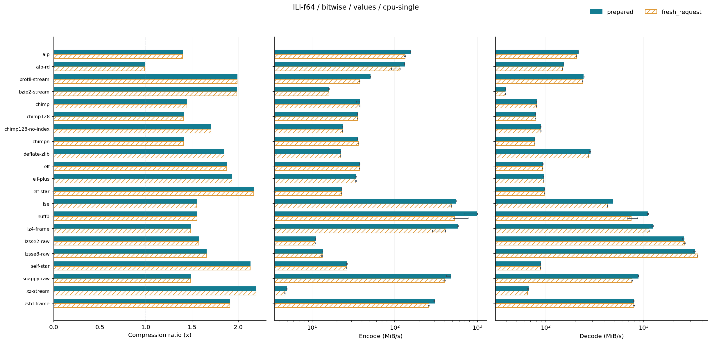

[SVG](figures/ILI-f64--bitwise--cpu-single.svg)

<details><summary>完整数值、有效批次及拒绝原因</summary>

| codec | 完整输出 bytes P / F | 压缩倍数 P / F | 编码 MiB/s P / F | 解码 MiB/s P / F | 有效批次 P / F |
|---|---:|---:|---:|---:|---:|
| alp | 3.88e+04 / 3.88e+04 | 1.39 / 1.39 | 156 / 133 | 215 / 207 | 14/14 / 14/14 |
| alp-rd | 5.51e+04 / 5.51e+04 | 0.982 / 0.982 | 132 / 116 | 154 / 149 | 14/14 / 14/14 |
| brotli-stream | 2.72e+04 / 2.72e+04 | 1.99 / 1.99 | 50.7 / 37.9 | 242 / 240 | 14/14 / 14/14 |
| bzip2-stream | 2.73e+04 / 2.73e+04 | 1.98 / 1.98 | 16.1 / 16.1 | 38.8 / 38.6 | 14/14 / 14/14 |
| chimp | 3.74e+04 / 3.74e+04 | 1.44 / 1.44 | 37.6 / 38 | 81 / 80.8 | 14/14 / 14/14 |
| chimp128 | 3.85e+04 / 3.85e+04 | 1.41 / 1.41 | 35.6 / 35.4 | 79.3 / 79.4 | 14/14 / 14/14 |
| chimp128-no-index | 3.17e+04 / 3.17e+04 | 1.71 / 1.71 | 23.5 / 23.5 | 89.2 / 89.4 | 14/14 / 14/14 |
| chimp32 | — / — | — / — | — / — | — / — | 0/0 / 0/0 |
| chimpn | 3.85e+04 / 3.85e+04 | 1.41 / 1.41 | 36.1 / 36.2 | 77.6 / 77.6 | 14/14 / 14/14 |
| chimpn32 | — / — | — / — | — / — | — / — | 0/0 / 0/0 |
| deepzip | — / — | — / — | — / — | — / — | 0/0 / 0/0 |
| deflate-zlib | 2.93e+04 / 2.93e+04 | 1.85 / 1.85 | 22.1 / 21.9 | 284 / 274 | 14/14 / 14/14 |
| elf | 2.88e+04 / 2.88e+04 | 1.88 / 1.88 | 37.9 / 37.9 | 93.6 / 92.9 | 14/14 / 14/14 |
| elf-plus | 2.8e+04 / 2.8e+04 | 1.93 / 1.93 | 34.1 / 34.1 | 95.4 / 95.8 | 14/14 / 14/14 |
| elf-star | 2.5e+04 / 2.5e+04 | 2.17 / 2.17 | 22.8 / 22.7 | 97.2 / 97.3 | 14/14 / 14/14 |
| fse | 3.49e+04 / 3.49e+04 | 1.55 / 1.55 | 552 / 483 | 485 / 429 | 14/14 / 14/14 |
| gorilla-prometheus-xor | — / — | — / — | — / — | — / — | 0/0 / 0/0 |
| huff0 | 3.48e+04 / 3.48e+04 | 1.55 / 1.55 | 989 / 528 | 1.11e+03 / 746 | 14/14 / 14/14 |
| leats-lossless-i64 | — / — | — / — | — / — | — / — | 0/0 / 0/0 |
| lz4-frame | 3.64e+04 / 3.64e+04 | 1.48 / 1.48 | 582 / 409 | 1.23e+03 / 1.13e+03 | 14/14 / 14/14 |
| lzsse2-raw | 3.44e+04 / 3.44e+04 | 1.57 / 1.57 | 11.1 / 10.9 | 2.55e+03 / 2.63e+03 | 14/14 / 14/14 |
| lzsse8-raw | 3.27e+04 / 3.27e+04 | 1.66 / 1.66 | 13.5 / 13.3 | 3.31e+03 / 3.57e+03 | 14/14 / 14/14 |
| neats-lossless-i64 | — / — | — / — | — / — | — / — | 0/0 / 0/0 |
| self-star | 2.54e+04 / 2.54e+04 | 2.13 / 2.13 | 26.5 / 26.5 | 89 / 88.8 | 14/14 / 14/14 |
| simdcomp-u32 | — / — | — / — | — / — | — / — | 0/0 / 0/0 |
| snappy-raw | 3.65e+04 / 3.65e+04 | 1.48 / 1.48 | 471 / 398 | 879 / 761 | 14/14 / 14/14 |
| sprintz-delta | — / — | — / — | — / — | — / — | 0/0 / 0/0 |
| sprintz-delta-huffman | — / — | — / — | — / — | — / — | 0/0 / 0/0 |
| sprintz-fire | — / — | — / — | — / — | — / — | 0/0 / 0/0 |
| sprintz-fire-huffman | — / — | — / — | — / — | — / — | 0/0 / 0/0 |
| xz-stream | 2.47e+04 / 2.47e+04 | 2.19 / 2.19 | 4.95 / 4.74 | 66.6 / 65.1 | 14/14 / 14/14 |
| zstd-frame | 2.83e+04 / 2.83e+04 | 1.91 / 1.91 | 301 / 259 | 791 / 793 | 14/14 / 14/14 |

拒绝或未完整完成的请求：

- `chimp32` / fresh_request：unsupported，chimp32: dtype must be one of ('<f4',)
- `chimp32` / prepared：unsupported，chimp32: dtype must be one of ('<f4',)
- `chimpn32` / fresh_request：unsupported，chimpn32: dtype must be one of ('<f4',)
- `chimpn32` / prepared：unsupported，chimpn32: dtype must be one of ('<f4',)
- `deepzip` / fresh_request：unsupported，deepzip: dtype must be one of ('|u1',)
- `deepzip` / prepared：unsupported，deepzip: dtype must be one of ('|u1',)
- `gorilla-prometheus-xor` / fresh_request：unsupported，Gorilla requires actual paired T/V; values-only and timestamp-only are unsupported
- `gorilla-prometheus-xor` / prepared：unsupported，Gorilla requires actual paired T/V; values-only and timestamp-only are unsupported
- `leats-lossless-i64` / fresh_request：unsupported，leats-lossless-i64: dtype must be one of ('|i1', '<i2', '<i4', '<i8')
- `leats-lossless-i64` / prepared：unsupported，leats-lossless-i64: dtype must be one of ('|i1', '<i2', '<i4', '<i8')
- `neats-lossless-i64` / fresh_request：unsupported，neats-lossless-i64: dtype must be one of ('|i1', '<i2', '<i4', '<i8')
- `neats-lossless-i64` / prepared：unsupported，neats-lossless-i64: dtype must be one of ('|i1', '<i2', '<i4', '<i8')
- `simdcomp-u32` / fresh_request：unsupported，simdcomp-u32: dtype must be one of ('<u4',)
- `simdcomp-u32` / prepared：unsupported，simdcomp-u32: dtype must be one of ('<u4',)
- `sprintz-delta` / fresh_request：unsupported，sprintz-delta: dtype must be one of ('|u1', '|i1', '<u2', '<i2')
- `sprintz-delta` / prepared：unsupported，sprintz-delta: dtype must be one of ('|u1', '|i1', '<u2', '<i2')
- `sprintz-delta-huffman` / fresh_request：unsupported，sprintz-delta-huffman: dtype must be one of ('|u1', '|i1', '<u2', '<i2')
- `sprintz-delta-huffman` / prepared：unsupported，sprintz-delta-huffman: dtype must be one of ('|u1', '|i1', '<u2', '<i2')
- `sprintz-fire` / fresh_request：unsupported，sprintz-fire: dtype must be one of ('|u1', '|i1', '<u2', '<i2')
- `sprintz-fire` / prepared：unsupported，sprintz-fire: dtype must be one of ('|u1', '|i1', '<u2', '<i2')
- `sprintz-fire-huffman` / fresh_request：unsupported，sprintz-fire-huffman: dtype must be one of ('|u1', '|i1', '<u2', '<i2')
- `sprintz-fire-huffman` / prepared：unsupported，sprintz-fire-huffman: dtype must be one of ('|u1', '|i1', '<u2', '<i2')

</details>

**<f8 · [966, 7] · ABS ≤ 0.01 · values · cpu-single**

运行进程 CPU 亲和性（P / F）：`[(0, 1, 2, 3, 4, 5, 6, 7, 8, 9, 10, 11, 12, 13, 14, 15)]` / `[(0, 1, 2, 3, 4, 5, 6, 7, 8, 9, 10, 11, 12, 13, 14, 15)]`；逐配置创建时间见 CSV，是否处于并行窗口见调度记录。

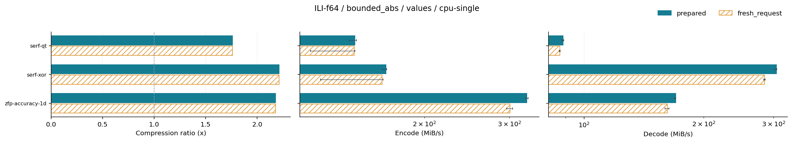

[SVG](figures/ILI-f64--bounded_abs--cpu-single.svg)

<details><summary>完整数值、有效批次及拒绝原因</summary>

| codec | 完整输出 bytes P / F | 压缩倍数 P / F | 编码 MiB/s P / F | 解码 MiB/s P / F | 有效批次 P / F |
|---|---:|---:|---:|---:|---:|
| serf-qt | 3.07e+04 / 3.07e+04 | 1.76 / 1.76 | 144 / 143 | 88.6 / 86.9 | 14/14 / 14/14 |
| serf-xor | 2.45e+04 / 2.45e+04 | 2.21 / 2.21 | 166 / 163 | 305 / 284 | 14/14 / 14/14 |
| zfp-accuracy-1d | 2.48e+04 / 2.48e+04 | 2.18 / 2.18 | 326 / 301 | 170 / 162 | 14/14 / 14/14 |

</details>

**<f8 · [966, 7] · 经验质量（无最大误差保证） · values · cpu-single**

运行进程 CPU 亲和性（P / F）：`[(0, 1, 2, 3, 4, 5, 6, 7, 8, 9, 10, 11, 12, 13, 14, 15)]` / `[(0, 1, 2, 3, 4, 5, 6, 7, 8, 9, 10, 11, 12, 13, 14, 15)]`；逐配置创建时间见 CSV，是否处于并行窗口见调度记录。

<details><summary>完整数值、有效批次及拒绝原因</summary>

| codec | 完整输出 bytes P / F | 压缩倍数 P / F | 编码 MiB/s P / F | 解码 MiB/s P / F | 有效批次 P / F |
|---|---:|---:|---:|---:|---:|
| abba | — / — | — / — | — / — | — / — | 0/0 / 0/0 |
| fabba | — / — | — / — | — / — | — / — | 0/0 / 0/0 |
| pmc-mr | — / — | — / — | — / — | — / — | 0/0 / 0/0 |
| swing-filter | — / — | — / — | — / — | — / — | 0/0 / 0/0 |
| swing-filter-disjoint | — / — | — / — | — / — | — / — | 0/0 / 0/0 |
| swing-filter-disjoint-quantized / compatible | — / — | — / — | — / — | — / — | 0/0 / 0/0 |

拒绝或未完整完成的请求：

- `abba` / fresh_request：unsupported，RW native batches require rank 1 / columns=1; collection framing belongs to object mode
- `abba` / prepared：unsupported，RW native batches require rank 1 / columns=1; collection framing belongs to object mode
- `fabba` / fresh_request：unsupported，RW native batches require rank 1 / columns=1; collection framing belongs to object mode
- `fabba` / prepared：unsupported，RW native batches require rank 1 / columns=1; collection framing belongs to object mode
- `pmc-mr` / fresh_request：unsupported，pmc-mr: dtype must be one of ('<f4',)
- `pmc-mr` / prepared：unsupported，pmc-mr: dtype must be one of ('<f4',)
- `swing-filter` / fresh_request：unsupported，swing-filter: dtype must be one of ('<f4',)
- `swing-filter` / prepared：unsupported，swing-filter: dtype must be one of ('<f4',)
- `swing-filter-disjoint` / fresh_request：unsupported，swing-filter-disjoint: dtype must be one of ('<f4',)
- `swing-filter-disjoint` / prepared：unsupported，swing-filter-disjoint: dtype must be one of ('<f4',)
- `swing-filter-disjoint-quantized / compatible` / fresh_request：unsupported，swing-filter-disjoint-quantized: dtype must be one of ('<f4',)
- `swing-filter-disjoint-quantized / compatible` / prepared：unsupported，swing-filter-disjoint-quantized: dtype must be one of ('<f4',)

</details>

<a id="dataset-METR-LA"></a>

### METR-LA

**<f4 · [34272, 207] · 无损 · values · cpu-single**

运行进程 CPU 亲和性（P / F）：`[(0, 1, 2, 3, 4, 5, 6, 7, 8, 9, 10, 11, 14, 15)]` / `[(0, 1, 2, 3, 4, 5, 6, 7, 8, 9, 10, 11, 14, 15)]`；逐配置创建时间见 CSV，是否处于并行窗口见调度记录。

f64→f32 准备阶段转换的最大绝对差：**3.39084201e-06**；本组 codec 的恢复质量相对转换后的 f32 输入验证。

<details><summary>完整数值、有效批次及拒绝原因</summary>

| codec | 完整输出 bytes P / F | 压缩倍数 P / F | 编码 MiB/s P / F | 解码 MiB/s P / F | 有效批次 P / F |
|---|---:|---:|---:|---:|---:|
| chimp32 | — / — | — / — | — / — | — / — | 0/0 / 0/0 |
| chimpn32 | — / — | — / — | — / — | — / — | 0/0 / 0/0 |

拒绝或未完整完成的请求：

- `chimp32` / fresh_request：unsupported，chimp32: element limit exceeded
- `chimp32` / prepared：unsupported，chimp32: element limit exceeded
- `chimpn32` / fresh_request：unsupported，chimpn32: element limit exceeded
- `chimpn32` / prepared：unsupported，chimpn32: element limit exceeded

</details>

**<f4 · [34272, 207] · 经验质量（无最大误差保证） · values · cpu-single**

运行进程 CPU 亲和性（P / F）：`[(0, 1, 2, 3, 4, 5, 6, 7, 8, 9, 10, 11, 12, 13, 14, 15), (0, 1, 2, 3, 4, 5, 6, 7, 8, 9, 10, 11, 14, 15)]` / `[(0, 1, 2, 3, 4, 5, 6, 7, 8, 9, 10, 11, 12, 13, 14, 15), (0, 1, 2, 3, 4, 5, 6, 7, 8, 9, 10, 11, 14, 15)]`；逐配置创建时间见 CSV，是否处于并行窗口见调度记录。

f64→f32 准备阶段转换的最大绝对差：**3.39084201e-06**；本组 codec 的恢复质量相对转换后的 f32 输入验证。

<details><summary>完整数值、有效批次及拒绝原因</summary>

| codec | 完整输出 bytes P / F | 压缩倍数 P / F | 编码 MiB/s P / F | 解码 MiB/s P / F | 有效批次 P / F |
|---|---:|---:|---:|---:|---:|
| pmc-mr | — / — | — / — | — / — | — / — | 0/0 / 0/0 |
| swing-filter | — / — | — / — | — / — | — / — | 0/0 / 0/0 |
| swing-filter-disjoint | — / — | — / — | — / — | — / — | 0/0 / 0/0 |
| swing-filter-disjoint-quantized / compatible | — / — | — / — | — / — | — / — | 0/0 / 0/0 |
| swing-filter-disjoint-quantized / strict_abs | — / — | — / — | — / — | — / — | 0/0 / 0/0 |

拒绝或未完整完成的请求：

- `pmc-mr` / fresh_request：unsupported，pmc-mr: element limit exceeded
- `pmc-mr` / prepared：unsupported，pmc-mr: element limit exceeded
- `swing-filter` / fresh_request：unsupported，swing-filter: element limit exceeded
- `swing-filter` / prepared：unsupported，swing-filter: element limit exceeded
- `swing-filter-disjoint` / fresh_request：unsupported，swing-filter-disjoint: element limit exceeded
- `swing-filter-disjoint` / prepared：unsupported，swing-filter-disjoint: element limit exceeded
- `swing-filter-disjoint-quantized / compatible` / fresh_request：unsupported，swing-filter-disjoint-quantized: element limit exceeded
- `swing-filter-disjoint-quantized / compatible` / prepared：unsupported，swing-filter-disjoint-quantized: element limit exceeded
- `swing-filter-disjoint-quantized / strict_abs` / fresh_request：unsupported，swing-filter-disjoint-quantized: element limit exceeded
- `swing-filter-disjoint-quantized / strict_abs` / prepared：unsupported，swing-filter-disjoint-quantized: element limit exceeded

</details>

**<f8 · [34272, 207] · 无损 · values · cpu-dzip-three**

运行进程 CPU 亲和性（P / F）：`[(0, 1, 2, 3, 4, 5, 6, 7, 8, 9, 10, 11, 12, 13, 14, 15)]` / `[(0, 1, 2, 3, 4, 5, 6, 7, 8, 9, 10, 11, 12, 13, 14, 15)]`；逐配置创建时间见 CSV，是否处于并行窗口见调度记录。

<details><summary>完整数值、有效批次及拒绝原因</summary>

| codec | 完整输出 bytes P / F | 压缩倍数 P / F | 编码 MiB/s P / F | 解码 MiB/s P / F | 有效批次 P / F |
|---|---:|---:|---:|---:|---:|
| dzip | — / — | — / — | — / — | — / — | 0/0 / 0/0 |

拒绝或未完整完成的请求：

- `dzip` / fresh_request：unsupported，dzip: dtype must be one of ('|u1',)
- `dzip` / prepared：unsupported，dzip: dtype must be one of ('|u1',)

</details>

**<f8 · [34272, 207] · 无损 · values · cpu-single**

运行进程 CPU 亲和性（P / F）：`[(0, 1, 2, 3, 4, 5, 6, 7, 8, 9, 10, 11, 12, 13, 14, 15)]` / `[(0, 1, 2, 3, 4, 5, 6, 7, 8, 9, 10, 11, 12, 13, 14, 15)]`；逐配置创建时间见 CSV，是否处于并行窗口见调度记录。

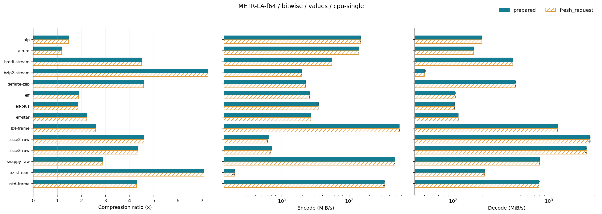

[SVG](figures/METR-LA-f64--bitwise--cpu-single.svg)

<details><summary>完整数值、有效批次及拒绝原因</summary>

| codec | 完整输出 bytes P / F | 压缩倍数 P / F | 编码 MiB/s P / F | 解码 MiB/s P / F | 有效批次 P / F |
|---|---:|---:|---:|---:|---:|
| alp | 3.86e+07 / 3.86e+07 | 1.47 / 1.47 | 149 / 149 | 200 / 200 | 14/14 / 14/14 |
| alp-rd | 4.81e+07 / 4.81e+07 | 1.18 / 1.18 | 140 / 140 | 165 / 165 | 14/14 / 14/14 |
| brotli-stream | 1.26e+07 / 1.26e+07 | 4.49 / 4.49 | 55.6 / 55.5 | 421 / 418 | 14/14 / 14/14 |
| bzip2-stream | 7.82e+06 / 7.82e+06 | 7.26 / 7.26 | 19.9 / 19.7 | 50.9 / 50.1 | 14/14 / 14/14 |
| chimp | — / — | — / — | — / — | — / — | 0/0 / 0/0 |
| chimp128 | — / — | — / — | — / — | — / — | 0/0 / 0/0 |
| chimp128-no-index | — / — | — / — | — / — | — / — | 0/0 / 0/0 |
| chimp32 | — / — | — / — | — / — | — / — | 0/0 / 0/0 |
| chimpn | — / — | — / — | — / — | — / — | 0/0 / 0/0 |
| chimpn32 | — / — | — / — | — / — | — / — | 0/0 / 0/0 |
| deepzip | — / — | — / — | — / — | — / — | 0/0 / 0/0 |
| deflate-zlib | 1.24e+07 / 1.24e+07 | 4.58 / 4.58 | 22.6 / 22.6 | 446 / 445 | 14/14 / 14/14 |
| elf | 3.01e+07 / 3.01e+07 | 1.88 / 1.88 | 25.5 / 25.5 | 105 / 105 | 14/14 / 14/14 |
| elf-plus | 3.05e+07 / 3.05e+07 | 1.86 / 1.86 | 34.8 / 34.7 | 104 / 104 | 14/14 / 14/14 |
| elf-star | 2.55e+07 / 2.55e+07 | 2.22 / 2.22 | 27.1 / 27.1 | 113 / 113 | 14/14 / 14/14 |
| fse | — / — | — / — | — / — | — / — | 0/0 / 0/0 |
| gorilla-prometheus-xor | — / — | — / — | — / — | — / — | 0/0 / 0/0 |
| huff0 | — / — | — / — | — / — | — / — | 0/0 / 0/0 |
| leats-lossless-i64 | — / — | — / — | — / — | — / — | 0/0 / 0/0 |
| lz4-frame | 2.19e+07 / 2.19e+07 | 2.59 / 2.59 | 561 / 559 | 1.23e+03 / 1.22e+03 | 14/14 / 14/14 |
| lzsse2-raw | 1.24e+07 / 1.24e+07 | 4.59 / 4.59 | 6.41 / 6.11 | 2.66e+03 / 2.66e+03 | 14/14 / 14/14 |
| lzsse8-raw | 1.31e+07 / 1.31e+07 | 4.34 / 4.34 | 7.1 / 6.72 | 2.45e+03 / 2.48e+03 | 14/14 / 14/14 |
| neats-lossless-i64 | — / — | — / — | — / — | — / — | 0/0 / 0/0 |
| self-star | — / — | — / — | — / — | — / — | 0/0 / 0/0 |
| simdcomp-u32 | — / — | — / — | — / — | — / — | 0/0 / 0/0 |
| snappy-raw | 1.97e+07 / 1.97e+07 | 2.89 / 2.89 | 482 / 481 | 803 / 797 | 14/14 / 14/14 |
| sprintz-delta | — / — | — / — | — / — | — / — | 0/0 / 0/0 |
| sprintz-delta-huffman | — / — | — / — | — / — | — / — | 0/0 / 0/0 |
| sprintz-fire | — / — | — / — | — / — | — / — | 0/0 / 0/0 |
| sprintz-fire-huffman | — / — | — / — | — / — | — / — | 0/0 / 0/0 |
| xz-stream | 8.01e+06 / 8.01e+06 | 7.09 / 7.09 | 1.97 / 1.98 | 214 / 212 | 14/14 / 14/14 |
| zstd-frame | 1.32e+07 / 1.32e+07 | 4.29 / 4.29 | 336 / 334 | 790 / 782 | 14/14 / 14/14 |

拒绝或未完整完成的请求：

- `chimp` / fresh_request：unsupported，chimp: element limit exceeded
- `chimp` / prepared：unsupported，chimp: element limit exceeded
- `chimp128` / fresh_request：unsupported，chimp128: element limit exceeded
- `chimp128` / prepared：unsupported，chimp128: element limit exceeded
- `chimp128-no-index` / fresh_request：unsupported，chimp128-no-index: element limit exceeded
- `chimp128-no-index` / prepared：unsupported，chimp128-no-index: element limit exceeded
- `chimp32` / fresh_request：unsupported，chimp32: dtype must be one of ('<f4',)
- `chimp32` / prepared：unsupported，chimp32: dtype must be one of ('<f4',)
- `chimpn` / fresh_request：unsupported，chimpn: element limit exceeded
- `chimpn` / prepared：unsupported，chimpn: element limit exceeded
- `chimpn32` / fresh_request：unsupported，chimpn32: dtype must be one of ('<f4',)
- `chimpn32` / prepared：unsupported，chimpn32: dtype must be one of ('<f4',)
- `deepzip` / fresh_request：unsupported，deepzip: dtype must be one of ('|u1',)
- `deepzip` / prepared：unsupported，deepzip: dtype must be one of ('|u1',)
- `fse` / fresh_request：unsupported，fse: n=34272 exceeds native limits
- `fse` / prepared：unsupported，fse: n=34272 exceeds native limits
- `gorilla-prometheus-xor` / fresh_request：unsupported，Gorilla requires actual paired T/V; values-only and timestamp-only are unsupported
- `gorilla-prometheus-xor` / prepared：unsupported，Gorilla requires actual paired T/V; values-only and timestamp-only are unsupported
- `huff0` / fresh_request：unsupported，huff0: n=34272 exceeds native limits
- `huff0` / prepared：unsupported，huff0: n=34272 exceeds native limits
- `leats-lossless-i64` / fresh_request：unsupported，leats-lossless-i64: dtype must be one of ('|i1', '<i2', '<i4', '<i8')
- `leats-lossless-i64` / prepared：unsupported，leats-lossless-i64: dtype must be one of ('|i1', '<i2', '<i4', '<i8')
- `neats-lossless-i64` / fresh_request：unsupported，neats-lossless-i64: dtype must be one of ('|i1', '<i2', '<i4', '<i8')
- `neats-lossless-i64` / prepared：unsupported，neats-lossless-i64: dtype must be one of ('|i1', '<i2', '<i4', '<i8')
- `self-star` / fresh_request：unsupported，SElfStar intrinsic session limits exceeded 
- `self-star` / prepared：unsupported，SElfStar intrinsic session limits exceeded 
- `simdcomp-u32` / fresh_request：unsupported，simdcomp-u32: dtype must be one of ('<u4',)
- `simdcomp-u32` / prepared：unsupported，simdcomp-u32: dtype must be one of ('<u4',)
- `sprintz-delta` / fresh_request：unsupported，sprintz-delta: dtype must be one of ('|u1', '|i1', '<u2', '<i2')
- `sprintz-delta` / prepared：unsupported，sprintz-delta: dtype must be one of ('|u1', '|i1', '<u2', '<i2')
- `sprintz-delta-huffman` / fresh_request：unsupported，sprintz-delta-huffman: dtype must be one of ('|u1', '|i1', '<u2', '<i2')
- `sprintz-delta-huffman` / prepared：unsupported，sprintz-delta-huffman: dtype must be one of ('|u1', '|i1', '<u2', '<i2')
- `sprintz-fire` / fresh_request：unsupported，sprintz-fire: dtype must be one of ('|u1', '|i1', '<u2', '<i2')
- `sprintz-fire` / prepared：unsupported，sprintz-fire: dtype must be one of ('|u1', '|i1', '<u2', '<i2')
- `sprintz-fire-huffman` / fresh_request：unsupported，sprintz-fire-huffman: dtype must be one of ('|u1', '|i1', '<u2', '<i2')
- `sprintz-fire-huffman` / prepared：unsupported，sprintz-fire-huffman: dtype must be one of ('|u1', '|i1', '<u2', '<i2')

</details>

**<f8 · [34272, 207] · ABS ≤ 0.01 · values · cpu-single**

运行进程 CPU 亲和性（P / F）：`[(0, 1, 2, 3, 4, 5, 6, 7, 8, 9, 10, 11, 12, 13, 14, 15)]` / `[(0, 1, 2, 3, 4, 5, 6, 7, 8, 9, 10, 11, 12, 13, 14, 15)]`；逐配置创建时间见 CSV，是否处于并行窗口见调度记录。

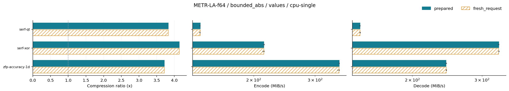

[SVG](figures/METR-LA-f64--bounded_abs--cpu-single.svg)

<details><summary>完整数值、有效批次及拒绝原因</summary>

| codec | 完整输出 bytes P / F | 压缩倍数 P / F | 编码 MiB/s P / F | 解码 MiB/s P / F | 有效批次 P / F |
|---|---:|---:|---:|---:|---:|
| serf-qt | 1.48e+07 / 1.48e+07 | 3.83 / 3.83 | 140 / 140 | 148 / 148 | 14/14 / 14/14 |
| serf-xor | 1.37e+07 / 1.37e+07 | 4.14 / 4.14 | 214 / 214 | 331 / 331 | 14/14 / 14/14 |
| zfp-accuracy-1d | 1.53e+07 / 1.53e+07 | 3.71 / 3.71 | 352 / 352 | 244 / 244 | 14/14 / 14/14 |

</details>

**<f8 · [34272, 207] · 经验质量（无最大误差保证） · values · cpu-single**

运行进程 CPU 亲和性（P / F）：`[(0, 1, 2, 3, 4, 5, 6, 7, 8, 9, 10, 11, 14, 15)]` / `[(0, 1, 2, 3, 4, 5, 6, 7, 8, 9, 10, 11, 14, 15)]`；逐配置创建时间见 CSV，是否处于并行窗口见调度记录。

<details><summary>完整数值、有效批次及拒绝原因</summary>

| codec | 完整输出 bytes P / F | 压缩倍数 P / F | 编码 MiB/s P / F | 解码 MiB/s P / F | 有效批次 P / F |
|---|---:|---:|---:|---:|---:|
| abba | — / — | — / — | — / — | — / — | 0/0 / 0/0 |
| fabba | — / — | — / — | — / — | — / — | 0/0 / 0/0 |
| pmc-mr | — / — | — / — | — / — | — / — | 0/0 / 0/0 |
| swing-filter | — / — | — / — | — / — | — / — | 0/0 / 0/0 |
| swing-filter-disjoint | — / — | — / — | — / — | — / — | 0/0 / 0/0 |
| swing-filter-disjoint-quantized / compatible | — / — | — / — | — / — | — / — | 0/0 / 0/0 |

拒绝或未完整完成的请求：

- `abba` / fresh_request：unsupported，RW native batches require rank 1 / columns=1; collection framing belongs to object mode
- `abba` / prepared：unsupported，RW native batches require rank 1 / columns=1; collection framing belongs to object mode
- `fabba` / fresh_request：unsupported，RW native batches require rank 1 / columns=1; collection framing belongs to object mode
- `fabba` / prepared：unsupported，RW native batches require rank 1 / columns=1; collection framing belongs to object mode
- `pmc-mr` / fresh_request：unsupported，pmc-mr: dtype must be one of ('<f4',)
- `pmc-mr` / prepared：unsupported，pmc-mr: dtype must be one of ('<f4',)
- `swing-filter` / fresh_request：unsupported，swing-filter: dtype must be one of ('<f4',)
- `swing-filter` / prepared：unsupported，swing-filter: dtype must be one of ('<f4',)
- `swing-filter-disjoint` / fresh_request：unsupported，swing-filter-disjoint: dtype must be one of ('<f4',)
- `swing-filter-disjoint` / prepared：unsupported，swing-filter-disjoint: dtype must be one of ('<f4',)
- `swing-filter-disjoint-quantized / compatible` / fresh_request：unsupported，swing-filter-disjoint-quantized: dtype must be one of ('<f4',)
- `swing-filter-disjoint-quantized / compatible` / prepared：unsupported，swing-filter-disjoint-quantized: dtype must be one of ('<f4',)

</details>

<a id="dataset-NASDAQ"></a>

### NASDAQ

**<f4 · [1245, 5] · 无损 · values · cpu-single**

运行进程 CPU 亲和性（P / F）：`[(0, 1, 2, 3, 4, 5, 6, 7, 8, 9, 10, 11, 12, 13, 14, 15)]` / `[(0, 1, 2, 3, 4, 5, 6, 7, 8, 9, 10, 11, 12, 13, 14, 15)]`；逐配置创建时间见 CSV，是否处于并行窗口见调度记录。

f64→f32 准备阶段转换的最大绝对差：**2.9800415e-08**；本组 codec 的恢复质量相对转换后的 f32 输入验证。

<details><summary>完整数值、有效批次及拒绝原因</summary>

| codec | 完整输出 bytes P / F | 压缩倍数 P / F | 编码 MiB/s P / F | 解码 MiB/s P / F | 有效批次 P / F |
|---|---:|---:|---:|---:|---:|
| chimp32 | — / — | — / — | — / — | — / — | 0/0 / 0/0 |
| chimpn32 | — / — | — / — | — / — | — / — | 0/0 / 0/0 |

拒绝或未完整完成的请求：

- `chimp32` / fresh_request：unsupported，canonical positive NaN is the Chimp EOF sentinel 
- `chimp32` / prepared：unsupported，canonical positive NaN is the Chimp EOF sentinel 
- `chimpn32` / fresh_request：unsupported，canonical positive NaN is the Chimp EOF sentinel 
- `chimpn32` / prepared：unsupported，canonical positive NaN is the Chimp EOF sentinel 

</details>

**<f4 · [1245, 5] · 经验质量（无最大误差保证） · values · cpu-single**

运行进程 CPU 亲和性（P / F）：`[(0, 1, 2, 3, 4, 5, 6, 7, 8, 9, 10, 11, 12, 13, 14, 15)]` / `[(0, 1, 2, 3, 4, 5, 6, 7, 8, 9, 10, 11, 12, 13, 14, 15)]`；逐配置创建时间见 CSV，是否处于并行窗口见调度记录。

f64→f32 准备阶段转换的最大绝对差：**2.9800415e-08**；本组 codec 的恢复质量相对转换后的 f32 输入验证。

<details><summary>完整数值、有效批次及拒绝原因</summary>

| codec | 完整输出 bytes P / F | 压缩倍数 P / F | 编码 MiB/s P / F | 解码 MiB/s P / F | 有效批次 P / F |
|---|---:|---:|---:|---:|---:|
| pmc-mr | — / — | — / — | — / — | — / — | 0/0 / 0/0 |
| swing-filter | — / — | — / — | — / — | — / — | 0/0 / 0/0 |
| swing-filter-disjoint | — / — | — / — | — / — | — / — | 0/0 / 0/0 |
| swing-filter-disjoint-quantized / compatible | — / — | — / — | — / — | — / — | 0/0 / 0/0 |
| swing-filter-disjoint-quantized / strict_abs | — / — | — / — | — / — | — / — | 0/0 / 0/0 |

拒绝或未完整完成的请求：

- `pmc-mr` / fresh_request：unsupported，filter native_core requires one column; object/native_api preserve independent columns
- `pmc-mr` / prepared：unsupported，filter native_core requires one column; object/native_api preserve independent columns
- `swing-filter` / fresh_request：unsupported，filter native_core requires one column; object/native_api preserve independent columns
- `swing-filter` / prepared：unsupported，filter native_core requires one column; object/native_api preserve independent columns
- `swing-filter-disjoint` / fresh_request：unsupported，filter native_core requires one column; object/native_api preserve independent columns
- `swing-filter-disjoint` / prepared：unsupported，filter native_core requires one column; object/native_api preserve independent columns
- `swing-filter-disjoint-quantized / compatible` / fresh_request：unsupported，filter native_core requires one column; object/native_api preserve independent columns
- `swing-filter-disjoint-quantized / compatible` / prepared：unsupported，filter native_core requires one column; object/native_api preserve independent columns
- `swing-filter-disjoint-quantized / strict_abs` / fresh_request：unsupported，filter native_core requires one column; object/native_api preserve independent columns
- `swing-filter-disjoint-quantized / strict_abs` / prepared：unsupported，filter native_core requires one column; object/native_api preserve independent columns

</details>

**<f8 · [1245, 5] · 无损 · values · cpu-dzip-three**

运行进程 CPU 亲和性（P / F）：`[(0, 1, 2, 3, 4, 5, 6, 7, 8, 9, 10, 11, 12, 13, 14, 15)]` / `[(0, 1, 2, 3, 4, 5, 6, 7, 8, 9, 10, 11, 12, 13, 14, 15)]`；逐配置创建时间见 CSV，是否处于并行窗口见调度记录。

<details><summary>完整数值、有效批次及拒绝原因</summary>

| codec | 完整输出 bytes P / F | 压缩倍数 P / F | 编码 MiB/s P / F | 解码 MiB/s P / F | 有效批次 P / F |
|---|---:|---:|---:|---:|---:|
| dzip | — / — | — / — | — / — | — / — | 0/0 / 0/0 |

拒绝或未完整完成的请求：

- `dzip` / fresh_request：unsupported，dzip: dtype must be one of ('|u1',)
- `dzip` / prepared：unsupported，dzip: dtype must be one of ('|u1',)

</details>

**<f8 · [1245, 5] · 无损 · values · cpu-single**

运行进程 CPU 亲和性（P / F）：`[(0, 1, 2, 3, 4, 5, 6, 7, 8, 9, 10, 11, 12, 13, 14, 15)]` / `[(0, 1, 2, 3, 4, 5, 6, 7, 8, 9, 10, 11, 12, 13, 14, 15)]`；逐配置创建时间见 CSV，是否处于并行窗口见调度记录。

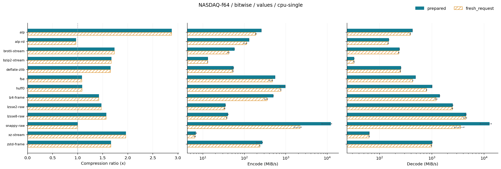

[SVG](figures/NASDAQ-f64--bitwise--cpu-single.svg)

<details><summary>完整数值、有效批次及拒绝原因</summary>

| codec | 完整输出 bytes P / F | 压缩倍数 P / F | 编码 MiB/s P / F | 解码 MiB/s P / F | 有效批次 P / F |
|---|---:|---:|---:|---:|---:|
| alp | 1.73e+04 / 1.73e+04 | 2.88 / 2.88 | 259 / 190 | 425 / 388 | 14/14 / 14/14 |
| alp-rd | 5.16e+04 / 5.16e+04 | 0.964 / 0.964 | 131 / 113 | 150 / 146 | 14/14 / 14/14 |
| brotli-stream | 2.87e+04 / 2.87e+04 | 1.73 / 1.73 | 57.4 / 42.5 | 240 / 233 | 14/14 / 14/14 |
| bzip2-stream | 2.98e+04 / 2.98e+04 | 1.67 / 1.67 | 13.1 / 13.1 | 32.5 / 32.3 | 14/14 / 14/14 |
| chimp | — / — | — / — | — / — | — / — | 0/0 / 0/0 |
| chimp128 | — / — | — / — | — / — | — / — | 0/0 / 0/0 |
| chimp128-no-index | — / — | — / — | — / — | — / — | 0/0 / 0/0 |
| chimp32 | — / — | — / — | — / — | — / — | 0/0 / 0/0 |
| chimpn | — / — | — / — | — / — | — / — | 0/0 / 0/0 |
| chimpn32 | — / — | — / — | — / — | — / — | 0/0 / 0/0 |
| deepzip | — / — | — / — | — / — | — / — | 0/0 / 0/0 |
| deflate-zlib | 3.01e+04 / 3.01e+04 | 1.65 / 1.65 | 54.2 / 53.5 | 256 / 252 | 14/14 / 14/14 |
| elf | — / — | — / — | — / — | — / — | 0/0 / 0/0 |
| elf-plus | — / — | — / — | — / — | — / — | 0/0 / 0/0 |
| elf-star | — / — | — / — | — / — | — / — | 0/0 / 0/0 |
| fse | 4.59e+04 / 4.59e+04 | 1.08 / 1.08 | 551 / 473 | 488 / 430 | 14/14 / 14/14 |
| gorilla-prometheus-xor | — / — | — / — | — / — | — / — | 0/0 / 0/0 |
| huff0 | 4.59e+04 / 4.59e+04 | 1.08 / 1.08 | 968 / 765 | 1.01e+03 / 795 | 14/14 / 14/14 |
| leats-lossless-i64 | — / — | — / — | — / — | — / — | 0/0 / 0/0 |
| lz4-frame | 3.5e+04 / 3.5e+04 | 1.42 / 1.42 | 500 / 355 | 1.41e+03 / 1.21e+03 | 14/14 / 14/14 |
| lzsse2-raw | 3.39e+04 / 3.39e+04 | 1.47 / 1.47 | 35.1 / 33.6 | 2.5e+03 / 2.47e+03 | 14/14 / 14/14 |
| lzsse8-raw | 3.18e+04 / 3.18e+04 | 1.57 / 1.57 | 40.2 / 38 | 4.51e+03 / 4.47e+03 | 14/14 / 14/14 |
| neats-lossless-i64 | — / — | — / — | — / — | — / — | 0/0 / 0/0 |
| self-star | — / — | — / — | — / — | — / — | 0/0 / 0/0 |
| simdcomp-u32 | — / — | — / — | — / — | — / — | 0/0 / 0/0 |
| snappy-raw | 4.98e+04 / 4.98e+04 | 1 / 1 | 1.21e+04 / 2.21e+03 | 1.27e+04 / 3.55e+03 | 14/14 / 14/14 |
| sprintz-delta | — / — | — / — | — / — | — / — | 0/0 / 0/0 |
| sprintz-delta-huffman | — / — | — / — | — / — | — / — | 0/0 / 0/0 |
| sprintz-fire | — / — | — / — | — / — | — / — | 0/0 / 0/0 |
| sprintz-fire-huffman | — / — | — / — | — / — | — / — | 0/0 / 0/0 |
| xz-stream | 2.54e+04 / 2.54e+04 | 1.96 / 1.96 | 6.73 / 6.44 | 63.5 / 63.3 | 14/14 / 14/14 |
| zstd-frame | 3e+04 / 3e+04 | 1.66 / 1.66 | 270 / 237 | 1.02e+03 / 991 | 14/14 / 14/14 |

拒绝或未完整完成的请求：

- `chimp` / fresh_request：unsupported，canonical positive NaN is the Chimp EOF sentinel 
- `chimp` / prepared：unsupported，canonical positive NaN is the Chimp EOF sentinel 
- `chimp128` / fresh_request：unsupported，canonical positive NaN is the Chimp EOF sentinel 
- `chimp128` / prepared：unsupported，canonical positive NaN is the Chimp EOF sentinel 
- `chimp128-no-index` / fresh_request：unsupported，canonical positive NaN is the Chimp EOF sentinel 
- `chimp128-no-index` / prepared：unsupported，canonical positive NaN is the Chimp EOF sentinel 
- `chimp32` / fresh_request：unsupported，chimp32: dtype must be one of ('<f4',)
- `chimp32` / prepared：unsupported，chimp32: dtype must be one of ('<f4',)
- `chimpn` / fresh_request：unsupported，canonical positive NaN is the Chimp EOF sentinel 
- `chimpn` / prepared：unsupported，canonical positive NaN is the Chimp EOF sentinel 
- `chimpn32` / fresh_request：unsupported，chimpn32: dtype must be one of ('<f4',)
- `chimpn32` / prepared：unsupported，chimpn32: dtype must be one of ('<f4',)
- `deepzip` / fresh_request：unsupported，deepzip: dtype must be one of ('|u1',)
- `deepzip` / prepared：unsupported，deepzip: dtype must be one of ('|u1',)
- `elf` / fresh_request：unsupported，NaN is the source END marker 
- `elf` / prepared：unsupported，NaN is the source END marker 
- `elf-plus` / fresh_request：unsupported，NaN is the source END marker 
- `elf-plus` / prepared：unsupported，NaN is the source END marker 
- `elf-star` / fresh_request：unsupported，NaN is END, outside lossless domain 
- `elf-star` / prepared：unsupported，NaN is END, outside lossless domain 
- `gorilla-prometheus-xor` / fresh_request：unsupported，Gorilla requires actual paired T/V; values-only and timestamp-only are unsupported
- `gorilla-prometheus-xor` / prepared：unsupported，Gorilla requires actual paired T/V; values-only and timestamp-only are unsupported
- `leats-lossless-i64` / fresh_request：unsupported，leats-lossless-i64: dtype must be one of ('|i1', '<i2', '<i4', '<i8')
- `leats-lossless-i64` / prepared：unsupported，leats-lossless-i64: dtype must be one of ('|i1', '<i2', '<i4', '<i8')
- `neats-lossless-i64` / fresh_request：unsupported，neats-lossless-i64: dtype must be one of ('|i1', '<i2', '<i4', '<i8')
- `neats-lossless-i64` / prepared：unsupported，neats-lossless-i64: dtype must be one of ('|i1', '<i2', '<i4', '<i8')
- `self-star` / fresh_request：unsupported，NaN outside source lossless domain 
- `self-star` / prepared：unsupported，NaN outside source lossless domain 
- `simdcomp-u32` / fresh_request：unsupported，simdcomp-u32: dtype must be one of ('<u4',)
- `simdcomp-u32` / prepared：unsupported，simdcomp-u32: dtype must be one of ('<u4',)
- `sprintz-delta` / fresh_request：unsupported，sprintz-delta: dtype must be one of ('|u1', '|i1', '<u2', '<i2')
- `sprintz-delta` / prepared：unsupported，sprintz-delta: dtype must be one of ('|u1', '|i1', '<u2', '<i2')
- `sprintz-delta-huffman` / fresh_request：unsupported，sprintz-delta-huffman: dtype must be one of ('|u1', '|i1', '<u2', '<i2')
- `sprintz-delta-huffman` / prepared：unsupported，sprintz-delta-huffman: dtype must be one of ('|u1', '|i1', '<u2', '<i2')
- `sprintz-fire` / fresh_request：unsupported，sprintz-fire: dtype must be one of ('|u1', '|i1', '<u2', '<i2')
- `sprintz-fire` / prepared：unsupported，sprintz-fire: dtype must be one of ('|u1', '|i1', '<u2', '<i2')
- `sprintz-fire-huffman` / fresh_request：unsupported，sprintz-fire-huffman: dtype must be one of ('|u1', '|i1', '<u2', '<i2')
- `sprintz-fire-huffman` / prepared：unsupported，sprintz-fire-huffman: dtype must be one of ('|u1', '|i1', '<u2', '<i2')

</details>

**<f8 · [1245, 5] · ABS ≤ 0.01 · values · cpu-single**

运行进程 CPU 亲和性（P / F）：`[(0, 1, 2, 3, 4, 5, 6, 7, 8, 9, 10, 11, 12, 13, 14, 15)]` / `[(0, 1, 2, 3, 4, 5, 6, 7, 8, 9, 10, 11, 12, 13, 14, 15)]`；逐配置创建时间见 CSV，是否处于并行窗口见调度记录。

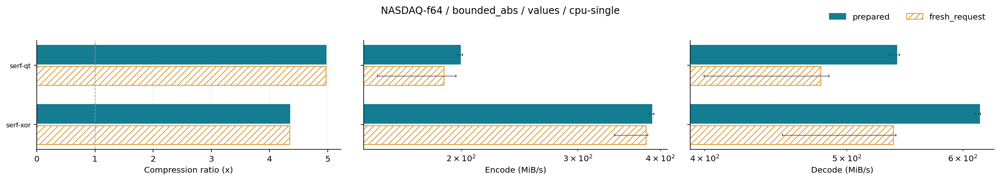

[SVG](figures/NASDAQ-f64--bounded_abs--cpu-single.svg)

<details><summary>完整数值、有效批次及拒绝原因</summary>

| codec | 完整输出 bytes P / F | 压缩倍数 P / F | 编码 MiB/s P / F | 解码 MiB/s P / F | 有效批次 P / F |
|---|---:|---:|---:|---:|---:|
| serf-qt | 1e+04 / 1e+04 | 4.97 / 4.97 | 200 / 188 | 541 / 480 | 14/14 / 14/14 |
| serf-xor | 1.15e+04 / 1.15e+04 | 4.35 / 4.35 | 388 / 381 | 616 / 538 | 14/14 / 14/14 |
| zfp-accuracy-1d | — / — | — / — | — / — | — / — | 0/0 / 0/0 |

拒绝或未完整完成的请求：

- `zfp-accuracy-1d` / fresh_request：unsupported，ZFP fixed accuracy excludes nonfinite, subnormal and negative zero inputs 
- `zfp-accuracy-1d` / prepared：unsupported，ZFP fixed accuracy excludes nonfinite, subnormal and negative zero inputs 

</details>

**<f8 · [1245, 5] · 经验质量（无最大误差保证） · values · cpu-single**

运行进程 CPU 亲和性（P / F）：`[(0, 1, 2, 3, 4, 5, 6, 7, 8, 9, 10, 11, 12, 13, 14, 15)]` / `[(0, 1, 2, 3, 4, 5, 6, 7, 8, 9, 10, 11, 12, 13, 14, 15)]`；逐配置创建时间见 CSV，是否处于并行窗口见调度记录。

<details><summary>完整数值、有效批次及拒绝原因</summary>

| codec | 完整输出 bytes P / F | 压缩倍数 P / F | 编码 MiB/s P / F | 解码 MiB/s P / F | 有效批次 P / F |
|---|---:|---:|---:|---:|---:|
| abba | — / — | — / — | — / — | — / — | 0/0 / 0/0 |
| fabba | — / — | — / — | — / — | — / — | 0/0 / 0/0 |
| pmc-mr | — / — | — / — | — / — | — / — | 0/0 / 0/0 |
| swing-filter | — / — | — / — | — / — | — / — | 0/0 / 0/0 |
| swing-filter-disjoint | — / — | — / — | — / — | — / — | 0/0 / 0/0 |
| swing-filter-disjoint-quantized / compatible | — / — | — / — | — / — | — / — | 0/0 / 0/0 |

拒绝或未完整完成的请求：

- `abba` / fresh_request：unsupported，abba: FINITE_INPUT_REQUIRED
- `abba` / prepared：unsupported，abba: FINITE_INPUT_REQUIRED
- `fabba` / fresh_request：unsupported，fabba: FINITE_INPUT_REQUIRED
- `fabba` / prepared：unsupported，fabba: FINITE_INPUT_REQUIRED
- `pmc-mr` / fresh_request：unsupported，pmc-mr: dtype must be one of ('<f4',)
- `pmc-mr` / prepared：unsupported，pmc-mr: dtype must be one of ('<f4',)
- `swing-filter` / fresh_request：unsupported，swing-filter: dtype must be one of ('<f4',)
- `swing-filter` / prepared：unsupported，swing-filter: dtype must be one of ('<f4',)
- `swing-filter-disjoint` / fresh_request：unsupported，swing-filter-disjoint: dtype must be one of ('<f4',)
- `swing-filter-disjoint` / prepared：unsupported，swing-filter-disjoint: dtype must be one of ('<f4',)
- `swing-filter-disjoint-quantized / compatible` / fresh_request：unsupported，swing-filter-disjoint-quantized: dtype must be one of ('<f4',)
- `swing-filter-disjoint-quantized / compatible` / prepared：unsupported，swing-filter-disjoint-quantized: dtype must be one of ('<f4',)

</details>

<a id="dataset-NN5"></a>

### NN5

**<f4 · [791, 111] · 无损 · values · cpu-single**

运行进程 CPU 亲和性（P / F）：`[(0, 1, 2, 3, 4, 5, 6, 7, 8, 9, 10, 11, 14, 15)]` / `[(0, 1, 2, 3, 4, 5, 6, 7, 8, 9, 10, 11, 14, 15)]`；逐配置创建时间见 CSV，是否处于并行窗口见调度记录。

f64→f32 准备阶段转换的最大绝对差：**3.80867728e-06**；本组 codec 的恢复质量相对转换后的 f32 输入验证。

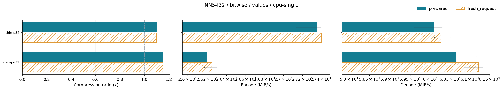

[SVG](figures/NN5-f32--bitwise--cpu-single.svg)

<details><summary>完整数值、有效批次及拒绝原因</summary>

| codec | 完整输出 bytes P / F | 压缩倍数 P / F | 编码 MiB/s P / F | 解码 MiB/s P / F | 有效批次 P / F |
|---|---:|---:|---:|---:|---:|
| chimp32 | 3.19e+05 / 3.19e+05 | 1.1 / 1.1 | 27.4 / 27.4 | 60.1 / 60.3 | 14/14 / 14/14 |
| chimpn32 | 3.05e+05 / 3.05e+05 | 1.15 / 1.15 | 26.2 / 26.2 | 60.7 / 61.2 | 14/14 / 14/14 |

</details>

**<f4 · [791, 111] · 经验质量（无最大误差保证） · values · cpu-single**

运行进程 CPU 亲和性（P / F）：`[(0, 1, 2, 3, 4, 5, 6, 7, 8, 9, 10, 11, 12, 13, 14, 15), (0, 1, 2, 3, 4, 5, 6, 7, 8, 9, 10, 11, 14, 15)]` / `[(0, 1, 2, 3, 4, 5, 6, 7, 8, 9, 10, 11, 12, 13, 14, 15), (0, 1, 2, 3, 4, 5, 6, 7, 8, 9, 10, 11, 14, 15)]`；逐配置创建时间见 CSV，是否处于并行窗口见调度记录。

f64→f32 准备阶段转换的最大绝对差：**3.80867728e-06**；本组 codec 的恢复质量相对转换后的 f32 输入验证。

<details><summary>完整数值、有效批次及拒绝原因</summary>

| codec | 完整输出 bytes P / F | 压缩倍数 P / F | 编码 MiB/s P / F | 解码 MiB/s P / F | 有效批次 P / F |
|---|---:|---:|---:|---:|---:|
| pmc-mr | — / — | — / — | — / — | — / — | 0/0 / 0/0 |
| swing-filter | — / — | — / — | — / — | — / — | 0/0 / 0/0 |
| swing-filter-disjoint | — / — | — / — | — / — | — / — | 0/0 / 0/0 |
| swing-filter-disjoint-quantized / compatible | — / — | — / — | — / — | — / — | 0/0 / 0/0 |
| swing-filter-disjoint-quantized / strict_abs | — / — | — / — | — / — | — / — | 0/0 / 0/0 |

拒绝或未完整完成的请求：

- `pmc-mr` / fresh_request：unsupported，filter native_core requires one column; object/native_api preserve independent columns
- `pmc-mr` / prepared：unsupported，filter native_core requires one column; object/native_api preserve independent columns
- `swing-filter` / fresh_request：unsupported，filter native_core requires one column; object/native_api preserve independent columns
- `swing-filter` / prepared：unsupported，filter native_core requires one column; object/native_api preserve independent columns
- `swing-filter-disjoint` / fresh_request：unsupported，filter native_core requires one column; object/native_api preserve independent columns
- `swing-filter-disjoint` / prepared：unsupported，filter native_core requires one column; object/native_api preserve independent columns
- `swing-filter-disjoint-quantized / compatible` / fresh_request：unsupported，filter native_core requires one column; object/native_api preserve independent columns
- `swing-filter-disjoint-quantized / compatible` / prepared：unsupported，filter native_core requires one column; object/native_api preserve independent columns
- `swing-filter-disjoint-quantized / strict_abs` / fresh_request：unsupported，filter native_core requires one column; object/native_api preserve independent columns
- `swing-filter-disjoint-quantized / strict_abs` / prepared：unsupported，filter native_core requires one column; object/native_api preserve independent columns

</details>

**<f8 · [791, 111] · 无损 · values · cpu-dzip-three**

运行进程 CPU 亲和性（P / F）：`[(0, 1, 2, 3, 4, 5, 6, 7, 8, 9, 10, 11, 14, 15)]` / `[(0, 1, 2, 3, 4, 5, 6, 7, 8, 9, 10, 11, 14, 15)]`；逐配置创建时间见 CSV，是否处于并行窗口见调度记录。

<details><summary>完整数值、有效批次及拒绝原因</summary>

| codec | 完整输出 bytes P / F | 压缩倍数 P / F | 编码 MiB/s P / F | 解码 MiB/s P / F | 有效批次 P / F |
|---|---:|---:|---:|---:|---:|
| dzip | — / — | — / — | — / — | — / — | 0/0 / 0/0 |

拒绝或未完整完成的请求：

- `dzip` / fresh_request：unsupported，dzip: dtype must be one of ('|u1',)
- `dzip` / prepared：unsupported，dzip: dtype must be one of ('|u1',)

</details>

**<f8 · [791, 111] · 无损 · values · cpu-single**

运行进程 CPU 亲和性（P / F）：`[(0, 1, 2, 3, 4, 5, 6, 7, 8, 9, 10, 11, 14, 15)]` / `[(0, 1, 2, 3, 4, 5, 6, 7, 8, 9, 10, 11, 14, 15)]`；逐配置创建时间见 CSV，是否处于并行窗口见调度记录。

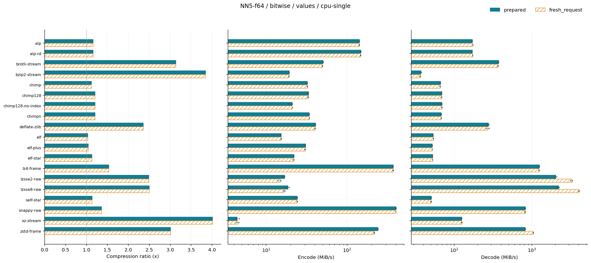

[SVG](figures/NN5-f64--bitwise--cpu-single.svg)

<details><summary>完整数值、有效批次及拒绝原因</summary>

| codec | 完整输出 bytes P / F | 压缩倍数 P / F | 编码 MiB/s P / F | 解码 MiB/s P / F | 有效批次 P / F |
|---|---:|---:|---:|---:|---:|
| alp | 6.06e+05 / 6.06e+05 | 1.16 / 1.16 | 142 / 142 | 171 / 174 | 14/14 / 14/14 |
| alp-rd | 6.06e+05 / 6.06e+05 | 1.16 / 1.16 | 148 / 147 | 171 / 174 | 14/14 / 14/14 |
| brotli-stream | 2.24e+05 / 2.24e+05 | 3.13 / 3.13 | 50.5 / 49.4 | 374 / 365 | 14/14 / 14/14 |
| bzip2-stream | 1.83e+05 / 1.83e+05 | 3.84 / 3.84 | 19.3 / 19.2 | 37.2 / 36.8 | 14/14 / 14/14 |
| chimp | 6.29e+05 / 6.29e+05 | 1.12 / 1.12 | 32.2 / 32.4 | 66.6 / 66.5 | 14/14 / 14/14 |
| chimp128 | 5.84e+05 / 5.84e+05 | 1.2 / 1.2 | 33.3 / 33.3 | 69.4 / 69.1 | 14/14 / 14/14 |
| chimp128-no-index | 5.84e+05 / 5.84e+05 | 1.2 / 1.2 | 21 / 21 | 69.7 / 69.5 | 14/14 / 14/14 |
| chimp32 | — / — | — / — | — / — | — / — | 0/0 / 0/0 |
| chimpn | 5.84e+05 / 5.84e+05 | 1.2 / 1.2 | 34.1 / 34.3 | 68 / 68.4 | 14/14 / 14/14 |
| chimpn32 | — / — | — / — | — / — | — / — | 0/0 / 0/0 |
| deepzip | — / — | — / — | — / — | — / — | 0/0 / 0/0 |
| deflate-zlib | 2.98e+05 / 2.98e+05 | 2.36 / 2.36 | 40.8 / 40.4 | 278 / 273 | 14/14 / 14/14 |
| elf | 6.82e+05 / 6.82e+05 | 1.03 / 1.03 | 15.3 / 15.3 | 53.8 / 54.2 | 14/14 / 14/14 |
| elf-plus | 6.73e+05 / 6.73e+05 | 1.04 / 1.04 | 30.7 / 30.4 | 52.2 / 52.2 | 14/14 / 14/14 |
| elf-star | 6.23e+05 / 6.23e+05 | 1.13 / 1.13 | 22 / 22 | 52.9 / 52.8 | 14/14 / 14/14 |
| fse | — / — | — / — | — / — | — / — | 0/0 / 0/0 |
| gorilla-prometheus-xor | — / — | — / — | — / — | — / — | 0/0 / 0/0 |
| huff0 | — / — | — / — | — / — | — / — | 0/0 / 0/0 |
| leats-lossless-i64 | — / — | — / — | — / — | — / — | 0/0 / 0/0 |
| lz4-frame | 4.58e+05 / 4.58e+05 | 1.53 / 1.53 | 370 / 369 | 1.25e+03 / 1.23e+03 | 14/14 / 14/14 |
| lzsse2-raw | 2.82e+05 / 2.82e+05 | 2.49 / 2.49 | 16.9 / 15 | 2.03e+03 / 3.28e+03 | 14/14 / 14/14 |
| lzsse8-raw | 2.81e+05 / 2.81e+05 | 2.5 / 2.5 | 18.6 / 16.7 | 2.22e+03 / 4.07e+03 | 14/14 / 14/14 |
| neats-lossless-i64 | — / — | — / — | — / — | — / — | 0/0 / 0/0 |
| self-star | 6.2e+05 / 6.2e+05 | 1.13 / 1.13 | 24.3 / 24.1 | 50.7 / 50.8 | 14/14 / 14/14 |
| simdcomp-u32 | — / — | — / — | — / — | — / — | 0/0 / 0/0 |
| snappy-raw | 5.17e+05 / 5.17e+05 | 1.36 / 1.36 | 401 / 400 | 829 / 821 | 14/14 / 14/14 |
| sprintz-delta | — / — | — / — | — / — | — / — | 0/0 / 0/0 |
| sprintz-delta-huffman | — / — | — / — | — / — | — / — | 0/0 / 0/0 |
| sprintz-fire | — / — | — / — | — / — | — / — | 0/0 / 0/0 |
| sprintz-fire-huffman | — / — | — / — | — / — | — / — | 0/0 / 0/0 |
| xz-stream | 1.75e+05 / 1.75e+05 | 4.01 / 4.01 | 4.39 / 4.46 | 125 / 126 | 14/14 / 14/14 |
| zstd-frame | 2.33e+05 / 2.33e+05 | 3.01 / 3.01 | 240 / 217 | 823 / 1.05e+03 | 14/14 / 14/14 |

拒绝或未完整完成的请求：

- `chimp32` / fresh_request：unsupported，chimp32: dtype must be one of ('<f4',)
- `chimp32` / prepared：unsupported，chimp32: dtype must be one of ('<f4',)
- `chimpn32` / fresh_request：unsupported，chimpn32: dtype must be one of ('<f4',)
- `chimpn32` / prepared：unsupported，chimpn32: dtype must be one of ('<f4',)
- `deepzip` / fresh_request：unsupported，deepzip: dtype must be one of ('|u1',)
- `deepzip` / prepared：unsupported，deepzip: dtype must be one of ('|u1',)
- `fse` / fresh_request：unsupported，fse: m=111 exceeds native limits
- `fse` / prepared：unsupported，fse: m=111 exceeds native limits
- `gorilla-prometheus-xor` / fresh_request：unsupported，Gorilla requires actual paired T/V; values-only and timestamp-only are unsupported
- `gorilla-prometheus-xor` / prepared：unsupported，Gorilla requires actual paired T/V; values-only and timestamp-only are unsupported
- `huff0` / fresh_request：unsupported，huff0: m=111 exceeds native limits
- `huff0` / prepared：unsupported，huff0: m=111 exceeds native limits
- `leats-lossless-i64` / fresh_request：unsupported，leats-lossless-i64: dtype must be one of ('|i1', '<i2', '<i4', '<i8')
- `leats-lossless-i64` / prepared：unsupported，leats-lossless-i64: dtype must be one of ('|i1', '<i2', '<i4', '<i8')
- `neats-lossless-i64` / fresh_request：unsupported，neats-lossless-i64: dtype must be one of ('|i1', '<i2', '<i4', '<i8')
- `neats-lossless-i64` / prepared：unsupported，neats-lossless-i64: dtype must be one of ('|i1', '<i2', '<i4', '<i8')
- `simdcomp-u32` / fresh_request：unsupported，simdcomp-u32: dtype must be one of ('<u4',)
- `simdcomp-u32` / prepared：unsupported，simdcomp-u32: dtype must be one of ('<u4',)
- `sprintz-delta` / fresh_request：unsupported，sprintz-delta: dtype must be one of ('|u1', '|i1', '<u2', '<i2')
- `sprintz-delta` / prepared：unsupported，sprintz-delta: dtype must be one of ('|u1', '|i1', '<u2', '<i2')
- `sprintz-delta-huffman` / fresh_request：unsupported，sprintz-delta-huffman: dtype must be one of ('|u1', '|i1', '<u2', '<i2')
- `sprintz-delta-huffman` / prepared：unsupported，sprintz-delta-huffman: dtype must be one of ('|u1', '|i1', '<u2', '<i2')
- `sprintz-fire` / fresh_request：unsupported，sprintz-fire: dtype must be one of ('|u1', '|i1', '<u2', '<i2')
- `sprintz-fire` / prepared：unsupported，sprintz-fire: dtype must be one of ('|u1', '|i1', '<u2', '<i2')
- `sprintz-fire-huffman` / fresh_request：unsupported，sprintz-fire-huffman: dtype must be one of ('|u1', '|i1', '<u2', '<i2')
- `sprintz-fire-huffman` / prepared：unsupported，sprintz-fire-huffman: dtype must be one of ('|u1', '|i1', '<u2', '<i2')

</details>

**<f8 · [791, 111] · ABS ≤ 0.01 · values · cpu-single**

运行进程 CPU 亲和性（P / F）：`[(0, 1, 2, 3, 4, 5, 6, 7, 8, 9, 10, 11, 14, 15)]` / `[(0, 1, 2, 3, 4, 5, 6, 7, 8, 9, 10, 11, 14, 15)]`；逐配置创建时间见 CSV，是否处于并行窗口见调度记录。

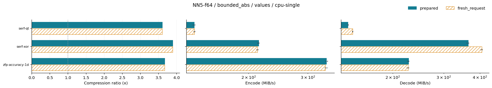

[SVG](figures/NN5-f64--bounded_abs--cpu-single.svg)

<details><summary>完整数值、有效批次及拒绝原因</summary>

| codec | 完整输出 bytes P / F | 压缩倍数 P / F | 编码 MiB/s P / F | 解码 MiB/s P / F | 有效批次 P / F |
|---|---:|---:|---:|---:|---:|
| serf-qt | 1.95e+05 / 1.95e+05 | 3.61 / 3.61 | 138 / 138 | 140 / 145 | 14/14 / 14/14 |
| serf-xor | 1.8e+05 / 1.8e+05 | 3.89 / 3.89 | 215 / 213 | 365 / 407 | 14/14 / 14/14 |
| zfp-accuracy-1d | 1.91e+05 / 1.91e+05 | 3.67 / 3.67 | 341 / 338 | 227 / 226 | 14/14 / 14/14 |

</details>

**<f8 · [791, 111] · 经验质量（无最大误差保证） · values · cpu-single**

运行进程 CPU 亲和性（P / F）：`[(0, 1, 2, 3, 4, 5, 6, 7, 8, 9, 10, 11, 14, 15)]` / `[(0, 1, 2, 3, 4, 5, 6, 7, 8, 9, 10, 11, 14, 15)]`；逐配置创建时间见 CSV，是否处于并行窗口见调度记录。

<details><summary>完整数值、有效批次及拒绝原因</summary>

| codec | 完整输出 bytes P / F | 压缩倍数 P / F | 编码 MiB/s P / F | 解码 MiB/s P / F | 有效批次 P / F |
|---|---:|---:|---:|---:|---:|
| abba | — / — | — / — | — / — | — / — | 0/0 / 0/0 |
| fabba | — / — | — / — | — / — | — / — | 0/0 / 0/0 |
| pmc-mr | — / — | — / — | — / — | — / — | 0/0 / 0/0 |
| swing-filter | — / — | — / — | — / — | — / — | 0/0 / 0/0 |
| swing-filter-disjoint | — / — | — / — | — / — | — / — | 0/0 / 0/0 |
| swing-filter-disjoint-quantized / compatible | — / — | — / — | — / — | — / — | 0/0 / 0/0 |

拒绝或未完整完成的请求：

- `abba` / fresh_request：unsupported，RW native batches require rank 1 / columns=1; collection framing belongs to object mode
- `abba` / prepared：unsupported，RW native batches require rank 1 / columns=1; collection framing belongs to object mode
- `fabba` / fresh_request：unsupported，RW native batches require rank 1 / columns=1; collection framing belongs to object mode
- `fabba` / prepared：unsupported，RW native batches require rank 1 / columns=1; collection framing belongs to object mode
- `pmc-mr` / fresh_request：unsupported，pmc-mr: dtype must be one of ('<f4',)
- `pmc-mr` / prepared：unsupported，pmc-mr: dtype must be one of ('<f4',)
- `swing-filter` / fresh_request：unsupported，swing-filter: dtype must be one of ('<f4',)
- `swing-filter` / prepared：unsupported，swing-filter: dtype must be one of ('<f4',)
- `swing-filter-disjoint` / fresh_request：unsupported，swing-filter-disjoint: dtype must be one of ('<f4',)
- `swing-filter-disjoint` / prepared：unsupported，swing-filter-disjoint: dtype must be one of ('<f4',)
- `swing-filter-disjoint-quantized / compatible` / fresh_request：unsupported，swing-filter-disjoint-quantized: dtype must be one of ('<f4',)
- `swing-filter-disjoint-quantized / compatible` / prepared：unsupported，swing-filter-disjoint-quantized: dtype must be one of ('<f4',)

</details>

<a id="dataset-NYSE"></a>

### NYSE

**<f4 · [1244, 5] · 无损 · values · cpu-single**

运行进程 CPU 亲和性（P / F）：`[(0, 1, 2, 3, 4, 5, 6, 7, 8, 9, 10, 11, 12, 13, 14, 15)]` / `[(0, 1, 2, 3, 4, 5, 6, 7, 8, 9, 10, 11, 12, 13, 14, 15)]`；逐配置创建时间见 CSV，是否处于并行窗口见调度记录。

f64→f32 准备阶段转换的最大绝对差：**2.97775269e-08**；本组 codec 的恢复质量相对转换后的 f32 输入验证。

<details><summary>完整数值、有效批次及拒绝原因</summary>

| codec | 完整输出 bytes P / F | 压缩倍数 P / F | 编码 MiB/s P / F | 解码 MiB/s P / F | 有效批次 P / F |
|---|---:|---:|---:|---:|---:|
| chimp32 | — / — | — / — | — / — | — / — | 0/0 / 0/0 |
| chimpn32 | — / — | — / — | — / — | — / — | 0/0 / 0/0 |

拒绝或未完整完成的请求：

- `chimp32` / fresh_request：unsupported，canonical positive NaN is the Chimp EOF sentinel 
- `chimp32` / prepared：unsupported，canonical positive NaN is the Chimp EOF sentinel 
- `chimpn32` / fresh_request：unsupported，canonical positive NaN is the Chimp EOF sentinel 
- `chimpn32` / prepared：unsupported，canonical positive NaN is the Chimp EOF sentinel 

</details>

**<f4 · [1244, 5] · 经验质量（无最大误差保证） · values · cpu-single**

运行进程 CPU 亲和性（P / F）：`[(0, 1, 2, 3, 4, 5, 6, 7, 8, 9, 10, 11, 12, 13, 14, 15)]` / `[(0, 1, 2, 3, 4, 5, 6, 7, 8, 9, 10, 11, 12, 13, 14, 15)]`；逐配置创建时间见 CSV，是否处于并行窗口见调度记录。

f64→f32 准备阶段转换的最大绝对差：**2.97775269e-08**；本组 codec 的恢复质量相对转换后的 f32 输入验证。

<details><summary>完整数值、有效批次及拒绝原因</summary>

| codec | 完整输出 bytes P / F | 压缩倍数 P / F | 编码 MiB/s P / F | 解码 MiB/s P / F | 有效批次 P / F |
|---|---:|---:|---:|---:|---:|
| pmc-mr | — / — | — / — | — / — | — / — | 0/0 / 0/0 |
| swing-filter | — / — | — / — | — / — | — / — | 0/0 / 0/0 |
| swing-filter-disjoint | — / — | — / — | — / — | — / — | 0/0 / 0/0 |
| swing-filter-disjoint-quantized / compatible | — / — | — / — | — / — | — / — | 0/0 / 0/0 |
| swing-filter-disjoint-quantized / strict_abs | — / — | — / — | — / — | — / — | 0/0 / 0/0 |

拒绝或未完整完成的请求：

- `pmc-mr` / fresh_request：unsupported，filter native_core requires one column; object/native_api preserve independent columns
- `pmc-mr` / prepared：unsupported，filter native_core requires one column; object/native_api preserve independent columns
- `swing-filter` / fresh_request：unsupported，filter native_core requires one column; object/native_api preserve independent columns
- `swing-filter` / prepared：unsupported，filter native_core requires one column; object/native_api preserve independent columns
- `swing-filter-disjoint` / fresh_request：unsupported，filter native_core requires one column; object/native_api preserve independent columns
- `swing-filter-disjoint` / prepared：unsupported，filter native_core requires one column; object/native_api preserve independent columns
- `swing-filter-disjoint-quantized / compatible` / fresh_request：unsupported，filter native_core requires one column; object/native_api preserve independent columns
- `swing-filter-disjoint-quantized / compatible` / prepared：unsupported，filter native_core requires one column; object/native_api preserve independent columns
- `swing-filter-disjoint-quantized / strict_abs` / fresh_request：unsupported，filter native_core requires one column; object/native_api preserve independent columns
- `swing-filter-disjoint-quantized / strict_abs` / prepared：unsupported，filter native_core requires one column; object/native_api preserve independent columns

</details>

**<f8 · [1244, 5] · 无损 · values · cpu-dzip-three**

运行进程 CPU 亲和性（P / F）：`[(0, 1, 2, 3, 4, 5, 6, 7, 8, 9, 10, 11, 12, 13, 14, 15)]` / `[(0, 1, 2, 3, 4, 5, 6, 7, 8, 9, 10, 11, 12, 13, 14, 15)]`；逐配置创建时间见 CSV，是否处于并行窗口见调度记录。

<details><summary>完整数值、有效批次及拒绝原因</summary>

| codec | 完整输出 bytes P / F | 压缩倍数 P / F | 编码 MiB/s P / F | 解码 MiB/s P / F | 有效批次 P / F |
|---|---:|---:|---:|---:|---:|
| dzip | — / — | — / — | — / — | — / — | 0/0 / 0/0 |

拒绝或未完整完成的请求：

- `dzip` / fresh_request：unsupported，dzip: dtype must be one of ('|u1',)
- `dzip` / prepared：unsupported，dzip: dtype must be one of ('|u1',)

</details>

**<f8 · [1244, 5] · 无损 · values · cpu-single**

运行进程 CPU 亲和性（P / F）：`[(0, 1, 2, 3, 4, 5, 6, 7, 8, 9, 10, 11, 12, 13, 14, 15)]` / `[(0, 1, 2, 3, 4, 5, 6, 7, 8, 9, 10, 11, 12, 13, 14, 15)]`；逐配置创建时间见 CSV，是否处于并行窗口见调度记录。

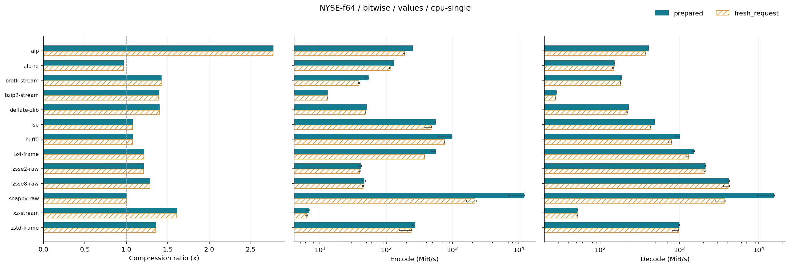

[SVG](figures/NYSE-f64--bitwise--cpu-single.svg)

<details><summary>完整数值、有效批次及拒绝原因</summary>

| codec | 完整输出 bytes P / F | 压缩倍数 P / F | 编码 MiB/s P / F | 解码 MiB/s P / F | 有效批次 P / F |
|---|---:|---:|---:|---:|---:|
| alp | 1.8e+04 / 1.8e+04 | 2.77 / 2.77 | 251 / 188 | 410 / 376 | 14/14 / 14/14 |
| alp-rd | 5.15e+04 / 5.15e+04 | 0.967 / 0.967 | 130 / 114 | 152 / 146 | 14/14 / 14/14 |
| brotli-stream | 3.51e+04 / 3.51e+04 | 1.42 / 1.42 | 53.6 / 38.9 | 185 / 180 | 14/14 / 14/14 |
| bzip2-stream | 3.58e+04 / 3.58e+04 | 1.39 / 1.39 | 12.9 / 12.8 | 28.1 / 27.5 | 14/14 / 14/14 |
| chimp | — / — | — / — | — / — | — / — | 0/0 / 0/0 |
| chimp128 | — / — | — / — | — / — | — / — | 0/0 / 0/0 |
| chimp128-no-index | — / — | — / — | — / — | — / — | 0/0 / 0/0 |
| chimp32 | — / — | — / — | — / — | — / — | 0/0 / 0/0 |
| chimpn | — / — | — / — | — / — | — / — | 0/0 / 0/0 |
| chimpn32 | — / — | — / — | — / — | — / — | 0/0 / 0/0 |
| deepzip | — / — | — / — | — / — | — / — | 0/0 / 0/0 |
| deflate-zlib | 3.56e+04 / 3.56e+04 | 1.4 / 1.4 | 50 / 48.7 | 228 / 221 | 14/14 / 14/14 |
| elf | — / — | — / — | — / — | — / — | 0/0 / 0/0 |
| elf-plus | — / — | — / — | — / — | — / — | 0/0 / 0/0 |
| elf-star | — / — | — / — | — / — | — / — | 0/0 / 0/0 |
| fse | 4.63e+04 / 4.63e+04 | 1.07 / 1.07 | 549 / 477 | 487 / 433 | 14/14 / 14/14 |
| gorilla-prometheus-xor | — / — | — / — | — / — | — / — | 0/0 / 0/0 |
| huff0 | 4.62e+04 / 4.62e+04 | 1.08 / 1.08 | 976 / 763 | 1.01e+03 / 794 | 14/14 / 14/14 |
| leats-lossless-i64 | — / — | — / — | — / — | — / — | 0/0 / 0/0 |
| lz4-frame | 4.11e+04 / 4.11e+04 | 1.21 / 1.21 | 555 / 378 | 1.51e+03 / 1.3e+03 | 14/14 / 14/14 |
| lzsse2-raw | 4.12e+04 / 4.12e+04 | 1.21 / 1.21 | 41.1 / 39.4 | 2.11e+03 / 2.08e+03 | 14/14 / 14/14 |
| lzsse8-raw | 3.87e+04 / 3.87e+04 | 1.28 / 1.28 | 46.5 / 44.9 | 4.16e+03 / 4.09e+03 | 14/14 / 14/14 |
| neats-lossless-i64 | — / — | — / — | — / — | — / — | 0/0 / 0/0 |
| self-star | — / — | — / — | — / — | — / — | 0/0 / 0/0 |
| simdcomp-u32 | — / — | — / — | — / — | — / — | 0/0 / 0/0 |
| snappy-raw | 4.98e+04 / 4.98e+04 | 1 / 1 | 1.19e+04 / 2.19e+03 | 1.54e+04 / 3.66e+03 | 14/14 / 14/14 |
| sprintz-delta | — / — | — / — | — / — | — / — | 0/0 / 0/0 |
| sprintz-delta-huffman | — / — | — / — | — / — | — / — | 0/0 / 0/0 |
| sprintz-fire | — / — | — / — | — / — | — / — | 0/0 / 0/0 |
| sprintz-fire-huffman | — / — | — / — | — / — | — / — | 0/0 / 0/0 |
| xz-stream | 3.1e+04 / 3.1e+04 | 1.61 / 1.61 | 6.83 / 6.21 | 51.7 / 51.7 | 14/14 / 14/14 |
| zstd-frame | 3.67e+04 / 3.67e+04 | 1.36 / 1.36 | 269 / 237 | 990 / 976 | 14/14 / 14/14 |

拒绝或未完整完成的请求：

- `chimp` / fresh_request：unsupported，canonical positive NaN is the Chimp EOF sentinel 
- `chimp` / prepared：unsupported，canonical positive NaN is the Chimp EOF sentinel 
- `chimp128` / fresh_request：unsupported，canonical positive NaN is the Chimp EOF sentinel 
- `chimp128` / prepared：unsupported，canonical positive NaN is the Chimp EOF sentinel 
- `chimp128-no-index` / fresh_request：unsupported，canonical positive NaN is the Chimp EOF sentinel 
- `chimp128-no-index` / prepared：unsupported，canonical positive NaN is the Chimp EOF sentinel 
- `chimp32` / fresh_request：unsupported，chimp32: dtype must be one of ('<f4',)
- `chimp32` / prepared：unsupported，chimp32: dtype must be one of ('<f4',)
- `chimpn` / fresh_request：unsupported，canonical positive NaN is the Chimp EOF sentinel 
- `chimpn` / prepared：unsupported，canonical positive NaN is the Chimp EOF sentinel 
- `chimpn32` / fresh_request：unsupported，chimpn32: dtype must be one of ('<f4',)
- `chimpn32` / prepared：unsupported，chimpn32: dtype must be one of ('<f4',)
- `deepzip` / fresh_request：unsupported，deepzip: dtype must be one of ('|u1',)
- `deepzip` / prepared：unsupported，deepzip: dtype must be one of ('|u1',)
- `elf` / fresh_request：unsupported，NaN is the source END marker 
- `elf` / prepared：unsupported，NaN is the source END marker 
- `elf-plus` / fresh_request：unsupported，NaN is the source END marker 
- `elf-plus` / prepared：unsupported，NaN is the source END marker 
- `elf-star` / fresh_request：unsupported，NaN is END, outside lossless domain 
- `elf-star` / prepared：unsupported，NaN is END, outside lossless domain 
- `gorilla-prometheus-xor` / fresh_request：unsupported，Gorilla requires actual paired T/V; values-only and timestamp-only are unsupported
- `gorilla-prometheus-xor` / prepared：unsupported，Gorilla requires actual paired T/V; values-only and timestamp-only are unsupported
- `leats-lossless-i64` / fresh_request：unsupported，leats-lossless-i64: dtype must be one of ('|i1', '<i2', '<i4', '<i8')
- `leats-lossless-i64` / prepared：unsupported，leats-lossless-i64: dtype must be one of ('|i1', '<i2', '<i4', '<i8')
- `neats-lossless-i64` / fresh_request：unsupported，neats-lossless-i64: dtype must be one of ('|i1', '<i2', '<i4', '<i8')
- `neats-lossless-i64` / prepared：unsupported，neats-lossless-i64: dtype must be one of ('|i1', '<i2', '<i4', '<i8')
- `self-star` / fresh_request：unsupported，NaN outside source lossless domain 
- `self-star` / prepared：unsupported，NaN outside source lossless domain 
- `simdcomp-u32` / fresh_request：unsupported，simdcomp-u32: dtype must be one of ('<u4',)
- `simdcomp-u32` / prepared：unsupported，simdcomp-u32: dtype must be one of ('<u4',)
- `sprintz-delta` / fresh_request：unsupported，sprintz-delta: dtype must be one of ('|u1', '|i1', '<u2', '<i2')
- `sprintz-delta` / prepared：unsupported，sprintz-delta: dtype must be one of ('|u1', '|i1', '<u2', '<i2')
- `sprintz-delta-huffman` / fresh_request：unsupported，sprintz-delta-huffman: dtype must be one of ('|u1', '|i1', '<u2', '<i2')
- `sprintz-delta-huffman` / prepared：unsupported，sprintz-delta-huffman: dtype must be one of ('|u1', '|i1', '<u2', '<i2')
- `sprintz-fire` / fresh_request：unsupported，sprintz-fire: dtype must be one of ('|u1', '|i1', '<u2', '<i2')
- `sprintz-fire` / prepared：unsupported，sprintz-fire: dtype must be one of ('|u1', '|i1', '<u2', '<i2')
- `sprintz-fire-huffman` / fresh_request：unsupported，sprintz-fire-huffman: dtype must be one of ('|u1', '|i1', '<u2', '<i2')
- `sprintz-fire-huffman` / prepared：unsupported，sprintz-fire-huffman: dtype must be one of ('|u1', '|i1', '<u2', '<i2')

</details>

**<f8 · [1244, 5] · ABS ≤ 0.01 · values · cpu-single**

运行进程 CPU 亲和性（P / F）：`[(0, 1, 2, 3, 4, 5, 6, 7, 8, 9, 10, 11, 12, 13, 14, 15)]` / `[(0, 1, 2, 3, 4, 5, 6, 7, 8, 9, 10, 11, 12, 13, 14, 15)]`；逐配置创建时间见 CSV，是否处于并行窗口见调度记录。

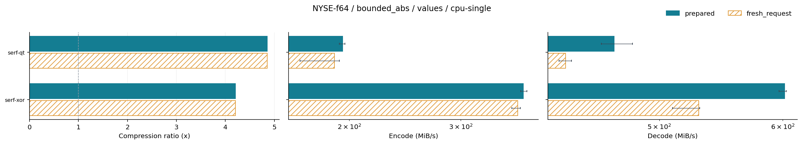

[SVG](figures/NYSE-f64--bounded_abs--cpu-single.svg)

<details><summary>完整数值、有效批次及拒绝原因</summary>

| codec | 完整输出 bytes P / F | 压缩倍数 P / F | 编码 MiB/s P / F | 解码 MiB/s P / F | 有效批次 P / F |
|---|---:|---:|---:|---:|---:|
| serf-qt | 1.02e+04 / 1.02e+04 | 4.86 / 4.86 | 195 / 190 | 468 / 435 | 14/14 / 14/14 |
| serf-xor | 1.18e+04 / 1.18e+04 | 4.2 / 4.2 | 376 / 369 | 602 / 530 | 14/14 / 14/14 |
| zfp-accuracy-1d | — / — | — / — | — / — | — / — | 0/0 / 0/0 |

拒绝或未完整完成的请求：

- `zfp-accuracy-1d` / fresh_request：unsupported，ZFP fixed accuracy excludes nonfinite, subnormal and negative zero inputs 
- `zfp-accuracy-1d` / prepared：unsupported，ZFP fixed accuracy excludes nonfinite, subnormal and negative zero inputs 

</details>

**<f8 · [1244, 5] · 经验质量（无最大误差保证） · values · cpu-single**

运行进程 CPU 亲和性（P / F）：`[(0, 1, 2, 3, 4, 5, 6, 7, 8, 9, 10, 11, 12, 13, 14, 15)]` / `[(0, 1, 2, 3, 4, 5, 6, 7, 8, 9, 10, 11, 12, 13, 14, 15)]`；逐配置创建时间见 CSV，是否处于并行窗口见调度记录。

<details><summary>完整数值、有效批次及拒绝原因</summary>

| codec | 完整输出 bytes P / F | 压缩倍数 P / F | 编码 MiB/s P / F | 解码 MiB/s P / F | 有效批次 P / F |
|---|---:|---:|---:|---:|---:|
| abba | — / — | — / — | — / — | — / — | 0/0 / 0/0 |
| fabba | — / — | — / — | — / — | — / — | 0/0 / 0/0 |
| pmc-mr | — / — | — / — | — / — | — / — | 0/0 / 0/0 |
| swing-filter | — / — | — / — | — / — | — / — | 0/0 / 0/0 |
| swing-filter-disjoint | — / — | — / — | — / — | — / — | 0/0 / 0/0 |
| swing-filter-disjoint-quantized / compatible | — / — | — / — | — / — | — / — | 0/0 / 0/0 |

拒绝或未完整完成的请求：

- `abba` / fresh_request：unsupported，abba: FINITE_INPUT_REQUIRED
- `abba` / prepared：unsupported，abba: FINITE_INPUT_REQUIRED
- `fabba` / fresh_request：unsupported，fabba: FINITE_INPUT_REQUIRED
- `fabba` / prepared：unsupported，fabba: FINITE_INPUT_REQUIRED
- `pmc-mr` / fresh_request：unsupported，pmc-mr: dtype must be one of ('<f4',)
- `pmc-mr` / prepared：unsupported，pmc-mr: dtype must be one of ('<f4',)
- `swing-filter` / fresh_request：unsupported，swing-filter: dtype must be one of ('<f4',)
- `swing-filter` / prepared：unsupported，swing-filter: dtype must be one of ('<f4',)
- `swing-filter-disjoint` / fresh_request：unsupported，swing-filter-disjoint: dtype must be one of ('<f4',)
- `swing-filter-disjoint` / prepared：unsupported，swing-filter-disjoint: dtype must be one of ('<f4',)
- `swing-filter-disjoint-quantized / compatible` / fresh_request：unsupported，swing-filter-disjoint-quantized: dtype must be one of ('<f4',)
- `swing-filter-disjoint-quantized / compatible` / prepared：unsupported，swing-filter-disjoint-quantized: dtype must be one of ('<f4',)

</details>

<a id="dataset-PEMS-BAY"></a>

### PEMS-BAY

**<f4 · [52116, 325] · 无损 · values · cpu-single**

运行进程 CPU 亲和性（P / F）：`[(0, 1, 2, 3, 4, 5, 6, 7, 8, 9, 10, 11, 12, 13, 14, 15)]` / `[(0, 1, 2, 3, 4, 5, 6, 7, 8, 9, 10, 11, 12, 13, 14, 15)]`；逐配置创建时间见 CSV，是否处于并行窗口见调度记录。

f64→f32 准备阶段转换的最大绝对差：**3.05175782e-06**；本组 codec 的恢复质量相对转换后的 f32 输入验证。

<details><summary>完整数值、有效批次及拒绝原因</summary>

| codec | 完整输出 bytes P / F | 压缩倍数 P / F | 编码 MiB/s P / F | 解码 MiB/s P / F | 有效批次 P / F |
|---|---:|---:|---:|---:|---:|
| chimp32 | — / — | — / — | — / — | — / — | 0/0 / 0/0 |
| chimpn32 | — / — | — / — | — / — | — / — | 0/0 / 0/0 |

拒绝或未完整完成的请求：

- `chimp32` / fresh_request：unsupported，chimp32: element limit exceeded
- `chimp32` / prepared：unsupported，chimp32: element limit exceeded
- `chimpn32` / fresh_request：unsupported，chimpn32: element limit exceeded
- `chimpn32` / prepared：unsupported，chimpn32: element limit exceeded

</details>

**<f4 · [52116, 325] · 经验质量（无最大误差保证） · values · cpu-single**

运行进程 CPU 亲和性（P / F）：`[(0, 1, 2, 3, 4, 5, 6, 7, 8, 9, 10, 11, 12, 13, 14, 15)]` / `[(0, 1, 2, 3, 4, 5, 6, 7, 8, 9, 10, 11, 12, 13, 14, 15)]`；逐配置创建时间见 CSV，是否处于并行窗口见调度记录。

f64→f32 准备阶段转换的最大绝对差：**3.05175782e-06**；本组 codec 的恢复质量相对转换后的 f32 输入验证。

<details><summary>完整数值、有效批次及拒绝原因</summary>

| codec | 完整输出 bytes P / F | 压缩倍数 P / F | 编码 MiB/s P / F | 解码 MiB/s P / F | 有效批次 P / F |
|---|---:|---:|---:|---:|---:|
| pmc-mr | — / — | — / — | — / — | — / — | 0/0 / 0/0 |
| swing-filter | — / — | — / — | — / — | — / — | 0/0 / 0/0 |
| swing-filter-disjoint | — / — | — / — | — / — | — / — | 0/0 / 0/0 |
| swing-filter-disjoint-quantized / compatible | — / — | — / — | — / — | — / — | 0/0 / 0/0 |
| swing-filter-disjoint-quantized / strict_abs | — / — | — / — | — / — | — / — | 0/0 / 0/0 |

拒绝或未完整完成的请求：

- `pmc-mr` / fresh_request：unsupported，pmc-mr: element limit exceeded
- `pmc-mr` / prepared：unsupported，pmc-mr: element limit exceeded
- `swing-filter` / fresh_request：unsupported，swing-filter: element limit exceeded
- `swing-filter` / prepared：unsupported，swing-filter: element limit exceeded
- `swing-filter-disjoint` / fresh_request：unsupported，swing-filter-disjoint: element limit exceeded
- `swing-filter-disjoint` / prepared：unsupported，swing-filter-disjoint: element limit exceeded
- `swing-filter-disjoint-quantized / compatible` / fresh_request：unsupported，swing-filter-disjoint-quantized: element limit exceeded
- `swing-filter-disjoint-quantized / compatible` / prepared：unsupported，swing-filter-disjoint-quantized: element limit exceeded
- `swing-filter-disjoint-quantized / strict_abs` / fresh_request：unsupported，swing-filter-disjoint-quantized: element limit exceeded
- `swing-filter-disjoint-quantized / strict_abs` / prepared：unsupported，swing-filter-disjoint-quantized: element limit exceeded

</details>

**<f8 · [52116, 325] · 无损 · values · cpu-dzip-three**

运行进程 CPU 亲和性（P / F）：`[(0, 1, 2, 3, 4, 5, 6, 7, 8, 9, 10, 11, 12, 13, 14, 15)]` / `[(0, 1, 2, 3, 4, 5, 6, 7, 8, 9, 10, 11, 12, 13, 14, 15)]`；逐配置创建时间见 CSV，是否处于并行窗口见调度记录。

<details><summary>完整数值、有效批次及拒绝原因</summary>

| codec | 完整输出 bytes P / F | 压缩倍数 P / F | 编码 MiB/s P / F | 解码 MiB/s P / F | 有效批次 P / F |
|---|---:|---:|---:|---:|---:|
| dzip | — / — | — / — | — / — | — / — | 0/0 / 0/0 |

拒绝或未完整完成的请求：

- `dzip` / fresh_request：unsupported，dzip: dtype must be one of ('|u1',)
- `dzip` / prepared：unsupported，dzip: dtype must be one of ('|u1',)

</details>

**<f8 · [52116, 325] · 无损 · values · cpu-single**

运行进程 CPU 亲和性（P / F）：`[(0, 1, 2, 3, 4, 5, 6, 7, 8, 9, 10, 11, 14, 15)]` / `[(0, 1, 2, 3, 4, 5, 6, 7, 8, 9, 10, 11, 12, 13, 14, 15)]`；逐配置创建时间见 CSV，是否处于并行窗口见调度记录。

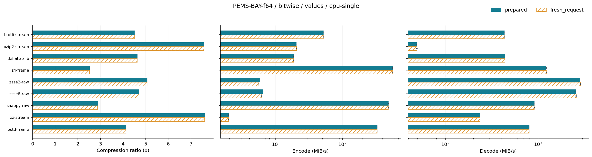

[SVG](figures/PEMS-BAY-f64--bitwise--cpu-single.svg)

<details><summary>完整数值、有效批次及拒绝原因</summary>

| codec | 完整输出 bytes P / F | 压缩倍数 P / F | 编码 MiB/s P / F | 解码 MiB/s P / F | 有效批次 P / F |
|---|---:|---:|---:|---:|---:|
| alp | — / — | — / — | — / — | — / — | 0/0 / 0/0 |
| alp-rd | — / — | — / — | — / — | — / — | 0/0 / 0/0 |
| brotli-stream | 3.01e+07 / 3.01e+07 | 4.5 / 4.5 | 51.6 / 51.6 | 431 / 431 | 14/14 / 14/14 |
| bzip2-stream | 1.79e+07 / 1.79e+07 | 7.58 / 7.58 | 20.3 / 20.4 | 49 / 49.6 | 14/14 / 14/14 |
| chimp | — / — | — / — | — / — | — / — | 0/0 / 0/0 |
| chimp128 | — / — | — / — | — / — | — / — | 0/0 / 0/0 |
| chimp128-no-index | — / — | — / — | — / — | — / — | 0/0 / 0/0 |
| chimp32 | — / — | — / — | — / — | — / — | 0/0 / 0/0 |
| chimpn | — / — | — / — | — / — | — / — | 0/0 / 0/0 |
| chimpn32 | — / — | — / — | — / — | — / — | 0/0 / 0/0 |
| deepzip | — / — | — / — | — / — | — / — | 0/0 / 0/0 |
| deflate-zlib | 2.93e+07 / 2.93e+07 | 4.63 / 4.63 | 18.4 / 18.4 | 440 / 440 | 14/14 / 14/14 |
| elf | — / — | — / — | — / — | — / — | 0/0 / 0/0 |
| elf-plus | — / — | — / — | — / — | — / — | 0/0 / 0/0 |
| elf-star | — / — | — / — | — / — | — / — | 0/0 / 0/0 |
| fse | — / — | — / — | — / — | — / — | 0/0 / 0/0 |
| gorilla-prometheus-xor | — / — | — / — | — / — | — / — | 0/0 / 0/0 |
| huff0 | — / — | — / — | — / — | — / — | 0/0 / 0/0 |
| leats-lossless-i64 | — / — | — / — | — / — | — / — | 0/0 / 0/0 |
| lz4-frame | 5.39e+07 / 5.39e+07 | 2.52 / 2.52 | 574 / 574 | 1.22e+03 / 1.23e+03 | 14/14 / 14/14 |
| lzsse2-raw | 2.68e+07 / 2.68e+07 | 5.07 / 5.07 | 5.77 / 5.54 | 2.81e+03 / 2.86e+03 | 14/14 / 14/14 |
| lzsse8-raw | 2.88e+07 / 2.88e+07 | 4.71 / 4.71 | 6.44 / 6.14 | 2.53e+03 / 2.58e+03 | 14/14 / 14/14 |
| neats-lossless-i64 | — / — | — / — | — / — | — / — | 0/0 / 0/0 |
| self-star | — / — | — / — | — / — | — / — | 0/0 / 0/0 |
| simdcomp-u32 | — / — | — / — | — / — | — / — | 0/0 / 0/0 |
| snappy-raw | 4.71e+07 / 4.71e+07 | 2.88 / 2.88 | 494 / 494 | 908 / 909 | 14/14 / 14/14 |
| sprintz-delta | — / — | — / — | — / — | — / — | 0/0 / 0/0 |
| sprintz-delta-huffman | — / — | — / — | — / — | — / — | 0/0 / 0/0 |
| sprintz-fire | — / — | — / — | — / — | — / — | 0/0 / 0/0 |
| sprintz-fire-huffman | — / — | — / — | — / — | — / — | 0/0 / 0/0 |
| xz-stream | 1.78e+07 / 1.78e+07 | 7.61 / 7.61 | 1.95 / 1.95 | 236 / 237 | 14/14 / 14/14 |
| zstd-frame | 3.27e+07 / 3.27e+07 | 4.14 / 4.14 | 334 / 335 | 799 / 801 | 14/14 / 14/14 |

拒绝或未完整完成的请求：

- `alp` / fresh_request：unsupported，alp: element limit exceeded
- `alp` / prepared：unsupported，alp: element limit exceeded
- `alp-rd` / fresh_request：unsupported，alp-rd: element limit exceeded
- `alp-rd` / prepared：unsupported，alp-rd: element limit exceeded
- `chimp` / fresh_request：unsupported，chimp: element limit exceeded
- `chimp` / prepared：unsupported，chimp: element limit exceeded
- `chimp128` / fresh_request：unsupported，chimp128: element limit exceeded
- `chimp128` / prepared：unsupported，chimp128: element limit exceeded
- `chimp128-no-index` / fresh_request：unsupported，chimp128-no-index: element limit exceeded
- `chimp128-no-index` / prepared：unsupported，chimp128-no-index: element limit exceeded
- `chimp32` / fresh_request：unsupported，chimp32: dtype must be one of ('<f4',)
- `chimp32` / prepared：unsupported，chimp32: dtype must be one of ('<f4',)
- `chimpn` / fresh_request：unsupported，chimpn: element limit exceeded
- `chimpn` / prepared：unsupported，chimpn: element limit exceeded
- `chimpn32` / fresh_request：unsupported，chimpn32: dtype must be one of ('<f4',)
- `chimpn32` / prepared：unsupported，chimpn32: dtype must be one of ('<f4',)
- `deepzip` / fresh_request：unsupported，deepzip: dtype must be one of ('|u1',)
- `deepzip` / prepared：unsupported，deepzip: dtype must be one of ('|u1',)
- `elf` / fresh_request：unsupported，elf: element limit exceeded
- `elf` / prepared：unsupported，elf: element limit exceeded
- `elf-plus` / fresh_request：unsupported，elf-plus: element limit exceeded
- `elf-plus` / prepared：unsupported，elf-plus: element limit exceeded
- `elf-star` / fresh_request：unsupported，elf-star: element limit exceeded
- `elf-star` / prepared：unsupported，elf-star: element limit exceeded
- `fse` / fresh_request：unsupported，fse: n=52116 exceeds native limits
- `fse` / prepared：unsupported，fse: n=52116 exceeds native limits
- `gorilla-prometheus-xor` / fresh_request：unsupported，Gorilla requires actual paired T/V; values-only and timestamp-only are unsupported
- `gorilla-prometheus-xor` / prepared：unsupported，Gorilla requires actual paired T/V; values-only and timestamp-only are unsupported
- `huff0` / fresh_request：unsupported，huff0: n=52116 exceeds native limits
- `huff0` / prepared：unsupported，huff0: n=52116 exceeds native limits
- `leats-lossless-i64` / fresh_request：unsupported，leats-lossless-i64: dtype must be one of ('|i1', '<i2', '<i4', '<i8')
- `leats-lossless-i64` / prepared：unsupported，leats-lossless-i64: dtype must be one of ('|i1', '<i2', '<i4', '<i8')
- `neats-lossless-i64` / fresh_request：unsupported，neats-lossless-i64: dtype must be one of ('|i1', '<i2', '<i4', '<i8')
- `neats-lossless-i64` / prepared：unsupported，neats-lossless-i64: dtype must be one of ('|i1', '<i2', '<i4', '<i8')
- `self-star` / fresh_request：unsupported，self-star: element limit exceeded
- `self-star` / prepared：unsupported，self-star: element limit exceeded
- `simdcomp-u32` / fresh_request：unsupported，simdcomp-u32: dtype must be one of ('<u4',)
- `simdcomp-u32` / prepared：unsupported，simdcomp-u32: dtype must be one of ('<u4',)
- `sprintz-delta` / fresh_request：unsupported，sprintz-delta: dtype must be one of ('|u1', '|i1', '<u2', '<i2')
- `sprintz-delta` / prepared：unsupported，sprintz-delta: dtype must be one of ('|u1', '|i1', '<u2', '<i2')
- `sprintz-delta-huffman` / fresh_request：unsupported，sprintz-delta-huffman: dtype must be one of ('|u1', '|i1', '<u2', '<i2')
- `sprintz-delta-huffman` / prepared：unsupported，sprintz-delta-huffman: dtype must be one of ('|u1', '|i1', '<u2', '<i2')
- `sprintz-fire` / fresh_request：unsupported，sprintz-fire: dtype must be one of ('|u1', '|i1', '<u2', '<i2')
- `sprintz-fire` / prepared：unsupported，sprintz-fire: dtype must be one of ('|u1', '|i1', '<u2', '<i2')
- `sprintz-fire-huffman` / fresh_request：unsupported，sprintz-fire-huffman: dtype must be one of ('|u1', '|i1', '<u2', '<i2')
- `sprintz-fire-huffman` / prepared：unsupported，sprintz-fire-huffman: dtype must be one of ('|u1', '|i1', '<u2', '<i2')

</details>

**<f8 · [52116, 325] · ABS ≤ 0.01 · values · cpu-single**

运行进程 CPU 亲和性（P / F）：`[(0, 1, 2, 3, 4, 5, 6, 7, 8, 9, 10, 11, 12, 13, 14, 15)]` / `[(0, 1, 2, 3, 4, 5, 6, 7, 8, 9, 10, 11, 12, 13, 14, 15)]`；逐配置创建时间见 CSV，是否处于并行窗口见调度记录。

<details><summary>完整数值、有效批次及拒绝原因</summary>

| codec | 完整输出 bytes P / F | 压缩倍数 P / F | 编码 MiB/s P / F | 解码 MiB/s P / F | 有效批次 P / F |
|---|---:|---:|---:|---:|---:|
| serf-qt | — / — | — / — | — / — | — / — | 0/0 / 0/0 |
| serf-xor | — / — | — / — | — / — | — / — | 0/0 / 0/0 |
| zfp-accuracy-1d | — / — | — / — | — / — | — / — | 0/0 / 0/0 |

拒绝或未完整完成的请求：

- `serf-qt` / fresh_request：unsupported，serf-qt: native byte limit exceeded
- `serf-qt` / prepared：unsupported，serf-qt: native byte limit exceeded
- `serf-xor` / fresh_request：unsupported，serf-xor: native byte limit exceeded
- `serf-xor` / prepared：unsupported，serf-xor: native byte limit exceeded
- `zfp-accuracy-1d` / fresh_request：unsupported，zfp-accuracy-1d: native byte limit exceeded
- `zfp-accuracy-1d` / prepared：unsupported，zfp-accuracy-1d: native byte limit exceeded

</details>

**<f8 · [52116, 325] · 经验质量（无最大误差保证） · values · cpu-single**

运行进程 CPU 亲和性（P / F）：`[(0, 1, 2, 3, 4, 5, 6, 7, 8, 9, 10, 11, 12, 13, 14, 15)]` / `[(0, 1, 2, 3, 4, 5, 6, 7, 8, 9, 10, 11, 12, 13, 14, 15)]`；逐配置创建时间见 CSV，是否处于并行窗口见调度记录。

<details><summary>完整数值、有效批次及拒绝原因</summary>

| codec | 完整输出 bytes P / F | 压缩倍数 P / F | 编码 MiB/s P / F | 解码 MiB/s P / F | 有效批次 P / F |
|---|---:|---:|---:|---:|---:|
| abba | — / — | — / — | — / — | — / — | 0/0 / 0/0 |
| fabba | — / — | — / — | — / — | — / — | 0/0 / 0/0 |
| pmc-mr | — / — | — / — | — / — | — / — | 0/0 / 0/0 |
| swing-filter | — / — | — / — | — / — | — / — | 0/0 / 0/0 |
| swing-filter-disjoint | — / — | — / — | — / — | — / — | 0/0 / 0/0 |
| swing-filter-disjoint-quantized / compatible | — / — | — / — | — / — | — / — | 0/0 / 0/0 |

拒绝或未完整完成的请求：

- `abba` / fresh_request：unsupported，abba: element limit exceeded
- `abba` / prepared：unsupported，abba: element limit exceeded
- `fabba` / fresh_request：unsupported，fabba: element limit exceeded
- `fabba` / prepared：unsupported，fabba: element limit exceeded
- `pmc-mr` / fresh_request：unsupported，pmc-mr: dtype must be one of ('<f4',)
- `pmc-mr` / prepared：unsupported，pmc-mr: dtype must be one of ('<f4',)
- `swing-filter` / fresh_request：unsupported，swing-filter: dtype must be one of ('<f4',)
- `swing-filter` / prepared：unsupported，swing-filter: dtype must be one of ('<f4',)
- `swing-filter-disjoint` / fresh_request：unsupported，swing-filter-disjoint: dtype must be one of ('<f4',)
- `swing-filter-disjoint` / prepared：unsupported，swing-filter-disjoint: dtype must be one of ('<f4',)
- `swing-filter-disjoint-quantized / compatible` / fresh_request：unsupported，swing-filter-disjoint-quantized: dtype must be one of ('<f4',)
- `swing-filter-disjoint-quantized / compatible` / prepared：unsupported，swing-filter-disjoint-quantized: dtype must be one of ('<f4',)

</details>

<a id="dataset-PEMS04"></a>

### PEMS04

**<f4 · [16992, 307] · 无损 · values · cpu-single**

运行进程 CPU 亲和性（P / F）：`[(0, 1, 2, 3, 4, 5, 6, 7, 8, 9, 10, 11, 12, 13, 14, 15)]` / `[(0, 1, 2, 3, 4, 5, 6, 7, 8, 9, 10, 11, 12, 13, 14, 15)]`；逐配置创建时间见 CSV，是否处于并行窗口见调度记录。

f64→f32 准备阶段转换的最大绝对差：**0**；本组 codec 的恢复质量相对转换后的 f32 输入验证。

<details><summary>完整数值、有效批次及拒绝原因</summary>

| codec | 完整输出 bytes P / F | 压缩倍数 P / F | 编码 MiB/s P / F | 解码 MiB/s P / F | 有效批次 P / F |
|---|---:|---:|---:|---:|---:|
| chimp32 | — / — | — / — | — / — | — / — | 0/0 / 0/0 |
| chimpn32 | — / — | — / — | — / — | — / — | 0/0 / 0/0 |

拒绝或未完整完成的请求：

- `chimp32` / fresh_request：unsupported，chimp32: element limit exceeded
- `chimp32` / prepared：unsupported，chimp32: element limit exceeded
- `chimpn32` / fresh_request：unsupported，chimpn32: element limit exceeded
- `chimpn32` / prepared：unsupported，chimpn32: element limit exceeded

</details>

**<f4 · [16992, 307] · 经验质量（无最大误差保证） · values · cpu-single**

运行进程 CPU 亲和性（P / F）：`[(0, 1, 2, 3, 4, 5, 6, 7, 8, 9, 10, 11, 12, 13, 14, 15)]` / `[(0, 1, 2, 3, 4, 5, 6, 7, 8, 9, 10, 11, 12, 13, 14, 15)]`；逐配置创建时间见 CSV，是否处于并行窗口见调度记录。

f64→f32 准备阶段转换的最大绝对差：**0**；本组 codec 的恢复质量相对转换后的 f32 输入验证。

<details><summary>完整数值、有效批次及拒绝原因</summary>

| codec | 完整输出 bytes P / F | 压缩倍数 P / F | 编码 MiB/s P / F | 解码 MiB/s P / F | 有效批次 P / F |
|---|---:|---:|---:|---:|---:|
| pmc-mr | — / — | — / — | — / — | — / — | 0/0 / 0/0 |
| swing-filter | — / — | — / — | — / — | — / — | 0/0 / 0/0 |
| swing-filter-disjoint | — / — | — / — | — / — | — / — | 0/0 / 0/0 |
| swing-filter-disjoint-quantized / compatible | — / — | — / — | — / — | — / — | 0/0 / 0/0 |
| swing-filter-disjoint-quantized / strict_abs | — / — | — / — | — / — | — / — | 0/0 / 0/0 |

拒绝或未完整完成的请求：

- `pmc-mr` / fresh_request：unsupported，pmc-mr: element limit exceeded
- `pmc-mr` / prepared：unsupported，pmc-mr: element limit exceeded
- `swing-filter` / fresh_request：unsupported，swing-filter: element limit exceeded
- `swing-filter` / prepared：unsupported，swing-filter: element limit exceeded
- `swing-filter-disjoint` / fresh_request：unsupported，swing-filter-disjoint: element limit exceeded
- `swing-filter-disjoint` / prepared：unsupported，swing-filter-disjoint: element limit exceeded
- `swing-filter-disjoint-quantized / compatible` / fresh_request：unsupported，swing-filter-disjoint-quantized: element limit exceeded
- `swing-filter-disjoint-quantized / compatible` / prepared：unsupported，swing-filter-disjoint-quantized: element limit exceeded
- `swing-filter-disjoint-quantized / strict_abs` / fresh_request：unsupported，swing-filter-disjoint-quantized: element limit exceeded
- `swing-filter-disjoint-quantized / strict_abs` / prepared：unsupported，swing-filter-disjoint-quantized: element limit exceeded

</details>

**<f8 · [16992, 307] · 无损 · values · cpu-dzip-three**

运行进程 CPU 亲和性（P / F）：`[(0, 1, 2, 3, 4, 5, 6, 7, 8, 9, 10, 11, 12, 13, 14, 15)]` / `[(0, 1, 2, 3, 4, 5, 6, 7, 8, 9, 10, 11, 12, 13, 14, 15)]`；逐配置创建时间见 CSV，是否处于并行窗口见调度记录。

<details><summary>完整数值、有效批次及拒绝原因</summary>

| codec | 完整输出 bytes P / F | 压缩倍数 P / F | 编码 MiB/s P / F | 解码 MiB/s P / F | 有效批次 P / F |
|---|---:|---:|---:|---:|---:|
| dzip | — / — | — / — | — / — | — / — | 0/0 / 0/0 |

拒绝或未完整完成的请求：

- `dzip` / fresh_request：unsupported，dzip: dtype must be one of ('|u1',)
- `dzip` / prepared：unsupported，dzip: dtype must be one of ('|u1',)

</details>

**<f8 · [16992, 307] · 无损 · values · cpu-single**

运行进程 CPU 亲和性（P / F）：`[(0, 1, 2, 3, 4, 5, 6, 7, 8, 9, 10, 11, 12, 13, 14, 15)]` / `[(0, 1, 2, 3, 4, 5, 6, 7, 8, 9, 10, 11, 12, 13, 14, 15)]`；逐配置创建时间见 CSV，是否处于并行窗口见调度记录。

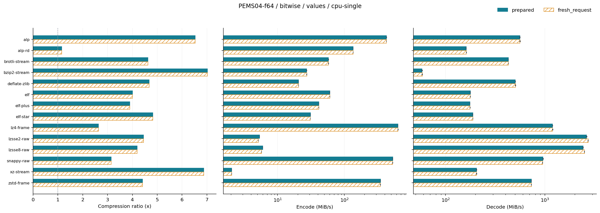

[SVG](figures/PEMS04-f64--bitwise--cpu-single.svg)

<details><summary>完整数值、有效批次及拒绝原因</summary>

| codec | 完整输出 bytes P / F | 压缩倍数 P / F | 编码 MiB/s P / F | 解码 MiB/s P / F | 有效批次 P / F |
|---|---:|---:|---:|---:|---:|
| alp | 6.39e+06 / 6.39e+06 | 6.53 / 6.53 | 427 / 426 | 559 / 559 | 14/14 / 14/14 |
| alp-rd | 3.63e+07 / 3.63e+07 | 1.15 / 1.15 | 135 / 135 | 162 / 162 | 14/14 / 14/14 |
| brotli-stream | 9.02e+06 / 9.02e+06 | 4.63 / 4.63 | 57.9 / 57.8 | 429 / 430 | 14/14 / 14/14 |
| bzip2-stream | 5.94e+06 / 5.94e+06 | 7.02 / 7.02 | 27.3 / 27.4 | 57.9 / 58.5 | 14/14 / 14/14 |
| chimp | — / — | — / — | — / — | — / — | 0/0 / 0/0 |
| chimp128 | — / — | — / — | — / — | — / — | 0/0 / 0/0 |
| chimp128-no-index | — / — | — / — | — / — | — / — | 0/0 / 0/0 |
| chimp32 | — / — | — / — | — / — | — / — | 0/0 / 0/0 |
| chimpn | — / — | — / — | — / — | — / — | 0/0 / 0/0 |
| chimpn32 | — / — | — / — | — / — | — / — | 0/0 / 0/0 |
| deepzip | — / — | — / — | — / — | — / — | 0/0 / 0/0 |
| deflate-zlib | 8.93e+06 / 8.93e+06 | 4.67 / 4.67 | 20.6 / 20.6 | 503 / 506 | 14/14 / 14/14 |
| elf | 1.04e+07 / 1.04e+07 | 4.01 / 4.01 | 60.5 / 60.5 | 178 / 178 | 14/14 / 14/14 |
| elf-plus | 1.07e+07 / 1.07e+07 | 3.89 / 3.89 | 41.5 / 41.5 | 176 / 176 | 14/14 / 14/14 |
| elf-star | 8.65e+06 / 8.65e+06 | 4.83 / 4.83 | 31 / 30.9 | 188 / 188 | 14/14 / 14/14 |
| fse | — / — | — / — | — / — | — / — | 0/0 / 0/0 |
| gorilla-prometheus-xor | — / — | — / — | — / — | — / — | 0/0 / 0/0 |
| huff0 | — / — | — / — | — / — | — / — | 0/0 / 0/0 |
| leats-lossless-i64 | — / — | — / — | — / — | — / — | 0/0 / 0/0 |
| lz4-frame | 1.59e+07 / 1.59e+07 | 2.63 / 2.63 | 635 / 634 | 1.2e+03 / 1.19e+03 | 14/14 / 14/14 |
| lzsse2-raw | 9.38e+06 / 9.38e+06 | 4.45 / 4.45 | 5.39 / 5.18 | 2.62e+03 / 2.73e+03 | 14/14 / 14/14 |
| lzsse8-raw | 9.95e+06 / 9.95e+06 | 4.2 / 4.2 | 6.02 / 5.74 | 2.42e+03 / 2.51e+03 | 14/14 / 14/14 |
| neats-lossless-i64 | — / — | — / — | — / — | — / — | 0/0 / 0/0 |
| self-star | — / — | — / — | — / — | — / — | 0/0 / 0/0 |
| simdcomp-u32 | — / — | — / — | — / — | — / — | 0/0 / 0/0 |
| snappy-raw | 1.33e+07 / 1.33e+07 | 3.14 / 3.14 | 528 / 528 | 953 / 950 | 14/14 / 14/14 |
| sprintz-delta | — / — | — / — | — / — | — / — | 0/0 / 0/0 |
| sprintz-delta-huffman | — / — | — / — | — / — | — / — | 0/0 / 0/0 |
| sprintz-fire | — / — | — / — | — / — | — / — | 0/0 / 0/0 |
| sprintz-fire-huffman | — / — | — / — | — / — | — / — | 0/0 / 0/0 |
| xz-stream | 6.07e+06 / 6.07e+06 | 6.87 / 6.87 | 2.05 / 2.06 | 205 / 205 | 14/14 / 14/14 |
| zstd-frame | 9.46e+06 / 9.46e+06 | 4.41 / 4.41 | 348 / 346 | 730 / 732 | 14/14 / 14/14 |

拒绝或未完整完成的请求：

- `chimp` / fresh_request：unsupported，chimp: element limit exceeded
- `chimp` / prepared：unsupported，chimp: element limit exceeded
- `chimp128` / fresh_request：unsupported，chimp128: element limit exceeded
- `chimp128` / prepared：unsupported，chimp128: element limit exceeded
- `chimp128-no-index` / fresh_request：unsupported，chimp128-no-index: element limit exceeded
- `chimp128-no-index` / prepared：unsupported，chimp128-no-index: element limit exceeded
- `chimp32` / fresh_request：unsupported，chimp32: dtype must be one of ('<f4',)
- `chimp32` / prepared：unsupported，chimp32: dtype must be one of ('<f4',)
- `chimpn` / fresh_request：unsupported，chimpn: element limit exceeded
- `chimpn` / prepared：unsupported，chimpn: element limit exceeded
- `chimpn32` / fresh_request：unsupported，chimpn32: dtype must be one of ('<f4',)
- `chimpn32` / prepared：unsupported，chimpn32: dtype must be one of ('<f4',)
- `deepzip` / fresh_request：unsupported，deepzip: dtype must be one of ('|u1',)
- `deepzip` / prepared：unsupported，deepzip: dtype must be one of ('|u1',)
- `fse` / fresh_request：unsupported，fse: n=16992 exceeds native limits
- `fse` / prepared：unsupported，fse: n=16992 exceeds native limits
- `gorilla-prometheus-xor` / fresh_request：unsupported，Gorilla requires actual paired T/V; values-only and timestamp-only are unsupported
- `gorilla-prometheus-xor` / prepared：unsupported，Gorilla requires actual paired T/V; values-only and timestamp-only are unsupported
- `huff0` / fresh_request：unsupported，huff0: n=16992 exceeds native limits
- `huff0` / prepared：unsupported，huff0: n=16992 exceeds native limits
- `leats-lossless-i64` / fresh_request：unsupported，leats-lossless-i64: dtype must be one of ('|i1', '<i2', '<i4', '<i8')
- `leats-lossless-i64` / prepared：unsupported，leats-lossless-i64: dtype must be one of ('|i1', '<i2', '<i4', '<i8')
- `neats-lossless-i64` / fresh_request：unsupported，neats-lossless-i64: dtype must be one of ('|i1', '<i2', '<i4', '<i8')
- `neats-lossless-i64` / prepared：unsupported，neats-lossless-i64: dtype must be one of ('|i1', '<i2', '<i4', '<i8')
- `self-star` / fresh_request：unsupported，SElfStar intrinsic session limits exceeded 
- `self-star` / prepared：unsupported，SElfStar intrinsic session limits exceeded 
- `simdcomp-u32` / fresh_request：unsupported，simdcomp-u32: dtype must be one of ('<u4',)
- `simdcomp-u32` / prepared：unsupported，simdcomp-u32: dtype must be one of ('<u4',)
- `sprintz-delta` / fresh_request：unsupported，sprintz-delta: dtype must be one of ('|u1', '|i1', '<u2', '<i2')
- `sprintz-delta` / prepared：unsupported，sprintz-delta: dtype must be one of ('|u1', '|i1', '<u2', '<i2')
- `sprintz-delta-huffman` / fresh_request：unsupported，sprintz-delta-huffman: dtype must be one of ('|u1', '|i1', '<u2', '<i2')
- `sprintz-delta-huffman` / prepared：unsupported，sprintz-delta-huffman: dtype must be one of ('|u1', '|i1', '<u2', '<i2')
- `sprintz-fire` / fresh_request：unsupported，sprintz-fire: dtype must be one of ('|u1', '|i1', '<u2', '<i2')
- `sprintz-fire` / prepared：unsupported，sprintz-fire: dtype must be one of ('|u1', '|i1', '<u2', '<i2')
- `sprintz-fire-huffman` / fresh_request：unsupported，sprintz-fire-huffman: dtype must be one of ('|u1', '|i1', '<u2', '<i2')
- `sprintz-fire-huffman` / prepared：unsupported，sprintz-fire-huffman: dtype must be one of ('|u1', '|i1', '<u2', '<i2')

</details>

**<f8 · [16992, 307] · ABS ≤ 0.01 · values · cpu-single**

运行进程 CPU 亲和性（P / F）：`[(0, 1, 2, 3, 4, 5, 6, 7, 8, 9, 10, 11, 12, 13, 14, 15)]` / `[(0, 1, 2, 3, 4, 5, 6, 7, 8, 9, 10, 11, 12, 13, 14, 15)]`；逐配置创建时间见 CSV，是否处于并行窗口见调度记录。

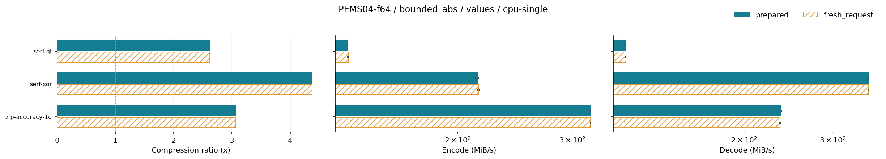

[SVG](figures/PEMS04-f64--bounded_abs--cpu-single.svg)

<details><summary>完整数值、有效批次及拒绝原因</summary>

| codec | 完整输出 bytes P / F | 压缩倍数 P / F | 编码 MiB/s P / F | 解码 MiB/s P / F | 有效批次 P / F |
|---|---:|---:|---:|---:|---:|
| serf-qt | 1.59e+07 / 1.59e+07 | 2.62 / 2.62 | 136 / 136 | 117 / 117 | 14/14 / 14/14 |
| serf-xor | 9.54e+06 / 9.54e+06 | 4.38 / 4.38 | 215 / 215 | 353 / 353 | 14/14 / 14/14 |
| zfp-accuracy-1d | 1.36e+07 / 1.36e+07 | 3.07 / 3.07 | 320 / 320 | 236 / 236 | 14/14 / 14/14 |

</details>

**<f8 · [16992, 307] · 经验质量（无最大误差保证） · values · cpu-single**

运行进程 CPU 亲和性（P / F）：`[(0, 1, 2, 3, 4, 5, 6, 7, 8, 9, 10, 11, 12, 13, 14, 15)]` / `[(0, 1, 2, 3, 4, 5, 6, 7, 8, 9, 10, 11, 12, 13, 14, 15)]`；逐配置创建时间见 CSV，是否处于并行窗口见调度记录。

<details><summary>完整数值、有效批次及拒绝原因</summary>

| codec | 完整输出 bytes P / F | 压缩倍数 P / F | 编码 MiB/s P / F | 解码 MiB/s P / F | 有效批次 P / F |
|---|---:|---:|---:|---:|---:|
| abba | — / — | — / — | — / — | — / — | 0/0 / 0/0 |
| fabba | — / — | — / — | — / — | — / — | 0/0 / 0/0 |
| pmc-mr | — / — | — / — | — / — | — / — | 0/0 / 0/0 |
| swing-filter | — / — | — / — | — / — | — / — | 0/0 / 0/0 |
| swing-filter-disjoint | — / — | — / — | — / — | — / — | 0/0 / 0/0 |
| swing-filter-disjoint-quantized / compatible | — / — | — / — | — / — | — / — | 0/0 / 0/0 |

拒绝或未完整完成的请求：

- `abba` / fresh_request：unsupported，RW native batches require rank 1 / columns=1; collection framing belongs to object mode
- `abba` / prepared：unsupported，RW native batches require rank 1 / columns=1; collection framing belongs to object mode
- `fabba` / fresh_request：unsupported，RW native batches require rank 1 / columns=1; collection framing belongs to object mode
- `fabba` / prepared：unsupported，RW native batches require rank 1 / columns=1; collection framing belongs to object mode
- `pmc-mr` / fresh_request：unsupported，pmc-mr: dtype must be one of ('<f4',)
- `pmc-mr` / prepared：unsupported，pmc-mr: dtype must be one of ('<f4',)
- `swing-filter` / fresh_request：unsupported，swing-filter: dtype must be one of ('<f4',)
- `swing-filter` / prepared：unsupported，swing-filter: dtype must be one of ('<f4',)
- `swing-filter-disjoint` / fresh_request：unsupported，swing-filter-disjoint: dtype must be one of ('<f4',)
- `swing-filter-disjoint` / prepared：unsupported，swing-filter-disjoint: dtype must be one of ('<f4',)
- `swing-filter-disjoint-quantized / compatible` / fresh_request：unsupported，swing-filter-disjoint-quantized: dtype must be one of ('<f4',)
- `swing-filter-disjoint-quantized / compatible` / prepared：unsupported，swing-filter-disjoint-quantized: dtype must be one of ('<f4',)

</details>

**<i2 · [16992, 307] · 无损 · values · cpu-single**

运行进程 CPU 亲和性（P / F）：`[(0, 1, 2, 3, 4, 5, 6, 7, 8, 9, 10, 11, 12, 13, 14, 15)]` / `[(0, 1, 2, 3, 4, 5, 6, 7, 8, 9, 10, 11, 12, 13, 14, 15)]`；逐配置创建时间见 CSV，是否处于并行窗口见调度记录。

<details><summary>完整数值、有效批次及拒绝原因</summary>

| codec | 完整输出 bytes P / F | 压缩倍数 P / F | 编码 MiB/s P / F | 解码 MiB/s P / F | 有效批次 P / F |
|---|---:|---:|---:|---:|---:|
| sprintz-delta | — / — | — / — | — / — | — / — | 0/0 / 0/0 |
| sprintz-delta-huffman | — / — | — / — | — / — | — / — | 0/0 / 0/0 |
| sprintz-fire | — / — | — / — | — / — | — / — | 0/0 / 0/0 |
| sprintz-fire-huffman | — / — | — / — | — / — | — / — | 0/0 / 0/0 |

拒绝或未完整完成的请求：

- `sprintz-delta` / fresh_request：unsupported，sprintz-delta: m=307 exceeds native limits
- `sprintz-delta` / prepared：unsupported，sprintz-delta: m=307 exceeds native limits
- `sprintz-delta-huffman` / fresh_request：unsupported，sprintz-delta-huffman: m=307 exceeds native limits
- `sprintz-delta-huffman` / prepared：unsupported，sprintz-delta-huffman: m=307 exceeds native limits
- `sprintz-fire` / fresh_request：unsupported，sprintz-fire: m=307 exceeds native limits
- `sprintz-fire` / prepared：unsupported，sprintz-fire: m=307 exceeds native limits
- `sprintz-fire-huffman` / fresh_request：unsupported，sprintz-fire-huffman: m=307 exceeds native limits
- `sprintz-fire-huffman` / prepared：unsupported，sprintz-fire-huffman: m=307 exceeds native limits

</details>

**<i8 · [16992, 307] · 无损 · values · cpu-single**

运行进程 CPU 亲和性（P / F）：`[(0, 1, 2, 3, 4, 5, 6, 7, 8, 9, 10, 11, 12, 13, 14, 15)]` / `[(0, 1, 2, 3, 4, 5, 6, 7, 8, 9, 10, 11, 12, 13, 14, 15)]`；逐配置创建时间见 CSV，是否处于并行窗口见调度记录。

<details><summary>完整数值、有效批次及拒绝原因</summary>

| codec | 完整输出 bytes P / F | 压缩倍数 P / F | 编码 MiB/s P / F | 解码 MiB/s P / F | 有效批次 P / F |
|---|---:|---:|---:|---:|---:|
| leats-lossless-i64 | — / — | — / — | — / — | — / — | 0/0 / 0/0 |
| neats-lossless-i64 | — / — | — / — | — / — | — / — | 0/0 / 0/0 |

拒绝或未完整完成的请求：

- `leats-lossless-i64` / fresh_request：unsupported，leats-lossless-i64: m=307 exceeds native limits
- `leats-lossless-i64` / prepared：unsupported，leats-lossless-i64: m=307 exceeds native limits
- `neats-lossless-i64` / fresh_request：unsupported，neats-lossless-i64: m=307 exceeds native limits
- `neats-lossless-i64` / prepared：unsupported，neats-lossless-i64: m=307 exceeds native limits

</details>

**<u4 · [16992, 307] · 无损 · values · cpu-single**

运行进程 CPU 亲和性（P / F）：`[(0, 1, 2, 3, 4, 5, 6, 7, 8, 9, 10, 11, 12, 13, 14, 15)]` / `[(0, 1, 2, 3, 4, 5, 6, 7, 8, 9, 10, 11, 12, 13, 14, 15)]`；逐配置创建时间见 CSV，是否处于并行窗口见调度记录。

<details><summary>完整数值、有效批次及拒绝原因</summary>

| codec | 完整输出 bytes P / F | 压缩倍数 P / F | 编码 MiB/s P / F | 解码 MiB/s P / F | 有效批次 P / F |
|---|---:|---:|---:|---:|---:|
| simdcomp-u32 | — / — | — / — | — / — | — / — | 0/0 / 0/0 |

拒绝或未完整完成的请求：

- `simdcomp-u32` / fresh_request：unsupported，simdcomp-u32: rank must be one of (1,)
- `simdcomp-u32` / prepared：unsupported，simdcomp-u32: rank must be one of (1,)

</details>

<a id="dataset-PEMS08"></a>

### PEMS08

**<f4 · [17856, 170] · 无损 · values · cpu-single**

运行进程 CPU 亲和性（P / F）：`[(0, 1, 2, 3, 4, 5, 6, 7, 8, 9, 10, 11, 12, 13, 14, 15)]` / `[(0, 1, 2, 3, 4, 5, 6, 7, 8, 9, 10, 11, 12, 13, 14, 15)]`；逐配置创建时间见 CSV，是否处于并行窗口见调度记录。

f64→f32 准备阶段转换的最大绝对差：**0**；本组 codec 的恢复质量相对转换后的 f32 输入验证。

<details><summary>完整数值、有效批次及拒绝原因</summary>

| codec | 完整输出 bytes P / F | 压缩倍数 P / F | 编码 MiB/s P / F | 解码 MiB/s P / F | 有效批次 P / F |
|---|---:|---:|---:|---:|---:|
| chimp32 | — / — | — / — | — / — | — / — | 0/0 / 0/0 |
| chimpn32 | — / — | — / — | — / — | — / — | 0/0 / 0/0 |

拒绝或未完整完成的请求：

- `chimp32` / fresh_request：unsupported，chimp32: element limit exceeded
- `chimp32` / prepared：unsupported，chimp32: element limit exceeded
- `chimpn32` / fresh_request：unsupported，chimpn32: element limit exceeded
- `chimpn32` / prepared：unsupported，chimpn32: element limit exceeded

</details>

**<f4 · [17856, 170] · 经验质量（无最大误差保证） · values · cpu-single**

运行进程 CPU 亲和性（P / F）：`[(0, 1, 2, 3, 4, 5, 6, 7, 8, 9, 10, 11, 12, 13, 14, 15)]` / `[(0, 1, 2, 3, 4, 5, 6, 7, 8, 9, 10, 11, 12, 13, 14, 15)]`；逐配置创建时间见 CSV，是否处于并行窗口见调度记录。

f64→f32 准备阶段转换的最大绝对差：**0**；本组 codec 的恢复质量相对转换后的 f32 输入验证。

<details><summary>完整数值、有效批次及拒绝原因</summary>

| codec | 完整输出 bytes P / F | 压缩倍数 P / F | 编码 MiB/s P / F | 解码 MiB/s P / F | 有效批次 P / F |
|---|---:|---:|---:|---:|---:|
| pmc-mr | — / — | — / — | — / — | — / — | 0/0 / 0/0 |
| swing-filter | — / — | — / — | — / — | — / — | 0/0 / 0/0 |
| swing-filter-disjoint | — / — | — / — | — / — | — / — | 0/0 / 0/0 |
| swing-filter-disjoint-quantized / compatible | — / — | — / — | — / — | — / — | 0/0 / 0/0 |
| swing-filter-disjoint-quantized / strict_abs | — / — | — / — | — / — | — / — | 0/0 / 0/0 |

拒绝或未完整完成的请求：

- `pmc-mr` / fresh_request：unsupported，pmc-mr: element limit exceeded
- `pmc-mr` / prepared：unsupported，pmc-mr: element limit exceeded
- `swing-filter` / fresh_request：unsupported，swing-filter: element limit exceeded
- `swing-filter` / prepared：unsupported，swing-filter: element limit exceeded
- `swing-filter-disjoint` / fresh_request：unsupported，swing-filter-disjoint: element limit exceeded
- `swing-filter-disjoint` / prepared：unsupported，swing-filter-disjoint: element limit exceeded
- `swing-filter-disjoint-quantized / compatible` / fresh_request：unsupported，swing-filter-disjoint-quantized: element limit exceeded
- `swing-filter-disjoint-quantized / compatible` / prepared：unsupported，swing-filter-disjoint-quantized: element limit exceeded
- `swing-filter-disjoint-quantized / strict_abs` / fresh_request：unsupported，swing-filter-disjoint-quantized: element limit exceeded
- `swing-filter-disjoint-quantized / strict_abs` / prepared：unsupported，swing-filter-disjoint-quantized: element limit exceeded

</details>

**<f8 · [17856, 170] · 无损 · values · cpu-dzip-three**

运行进程 CPU 亲和性（P / F）：`[(0, 1, 2, 3, 4, 5, 6, 7, 8, 9, 10, 11, 12, 13, 14, 15)]` / `[(0, 1, 2, 3, 4, 5, 6, 7, 8, 9, 10, 11, 12, 13, 14, 15)]`；逐配置创建时间见 CSV，是否处于并行窗口见调度记录。

<details><summary>完整数值、有效批次及拒绝原因</summary>

| codec | 完整输出 bytes P / F | 压缩倍数 P / F | 编码 MiB/s P / F | 解码 MiB/s P / F | 有效批次 P / F |
|---|---:|---:|---:|---:|---:|
| dzip | — / — | — / — | — / — | — / — | 0/0 / 0/0 |

拒绝或未完整完成的请求：

- `dzip` / fresh_request：unsupported，dzip: dtype must be one of ('|u1',)
- `dzip` / prepared：unsupported，dzip: dtype must be one of ('|u1',)

</details>

**<f8 · [17856, 170] · 无损 · values · cpu-single**

运行进程 CPU 亲和性（P / F）：`[(0, 1, 2, 3, 4, 5, 6, 7, 8, 9, 10, 11, 12, 13, 14, 15)]` / `[(0, 1, 2, 3, 4, 5, 6, 7, 8, 9, 10, 11, 12, 13, 14, 15)]`；逐配置创建时间见 CSV，是否处于并行窗口见调度记录。

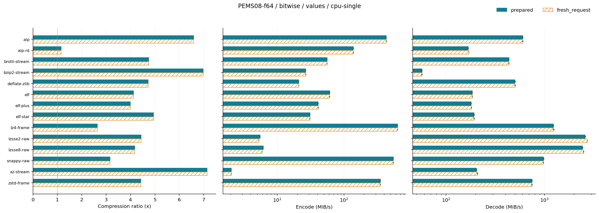

[SVG](figures/PEMS08-f64--bitwise--cpu-single.svg)

<details><summary>完整数值、有效批次及拒绝原因</summary>

| codec | 完整输出 bytes P / F | 压缩倍数 P / F | 编码 MiB/s P / F | 解码 MiB/s P / F | 有效批次 P / F |
|---|---:|---:|---:|---:|---:|
| alp | 3.69e+06 / 3.69e+06 | 6.59 / 6.59 | 431 / 431 | 603 / 604 | 14/14 / 14/14 |
| alp-rd | 2.11e+07 / 2.11e+07 | 1.15 / 1.15 | 138 / 138 | 169 / 171 | 14/14 / 14/14 |
| brotli-stream | 5.12e+06 / 5.12e+06 | 4.74 / 4.74 | 55.9 / 55.9 | 437 / 436 | 14/14 / 14/14 |
| bzip2-stream | 3.48e+06 / 3.48e+06 | 6.98 / 6.98 | 26.6 / 26.7 | 56.9 / 57.1 | 14/14 / 14/14 |
| chimp | — / — | — / — | — / — | — / — | 0/0 / 0/0 |
| chimp128 | — / — | — / — | — / — | — / — | 0/0 / 0/0 |
| chimp128-no-index | — / — | — / — | — / — | — / — | 0/0 / 0/0 |
| chimp32 | — / — | — / — | — / — | — / — | 0/0 / 0/0 |
| chimpn | — / — | — / — | — / — | — / — | 0/0 / 0/0 |
| chimpn32 | — / — | — / — | — / — | — / — | 0/0 / 0/0 |
| deepzip | — / — | — / — | — / — | — / — | 0/0 / 0/0 |
| deflate-zlib | 5.14e+06 / 5.14e+06 | 4.73 / 4.73 | 21 / 21 | 503 / 504 | 14/14 / 14/14 |
| elf | 5.89e+06 / 5.89e+06 | 4.13 / 4.13 | 61.1 / 61.1 | 185 / 185 | 14/14 / 14/14 |
| elf-plus | 6.08e+06 / 6.08e+06 | 4 / 4 | 41.1 / 41.1 | 180 / 181 | 14/14 / 14/14 |
| elf-star | 4.91e+06 / 4.91e+06 | 4.94 / 4.94 | 30.9 / 30.8 | 193 / 193 | 14/14 / 14/14 |
| fse | — / — | — / — | — / — | — / — | 0/0 / 0/0 |
| gorilla-prometheus-xor | — / — | — / — | — / — | — / — | 0/0 / 0/0 |
| huff0 | — / — | — / — | — / — | — / — | 0/0 / 0/0 |
| leats-lossless-i64 | — / — | — / — | — / — | — / — | 0/0 / 0/0 |
| lz4-frame | 9.22e+06 / 9.22e+06 | 2.63 / 2.63 | 632 / 631 | 1.23e+03 / 1.25e+03 | 14/14 / 14/14 |
| lzsse2-raw | 5.48e+06 / 5.48e+06 | 4.43 / 4.43 | 5.54 / 5.32 | 2.59e+03 / 2.73e+03 | 14/14 / 14/14 |
| lzsse8-raw | 5.81e+06 / 5.81e+06 | 4.18 / 4.18 | 6.2 / 5.91 | 2.43e+03 / 2.5e+03 | 14/14 / 14/14 |
| neats-lossless-i64 | — / — | — / — | — / — | — / — | 0/0 / 0/0 |
| self-star | — / — | — / — | — / — | — / — | 0/0 / 0/0 |
| simdcomp-u32 | — / — | — / — | — / — | — / — | 0/0 / 0/0 |
| snappy-raw | 7.68e+06 / 7.68e+06 | 3.16 / 3.16 | 549 / 547 | 982 / 977 | 14/14 / 14/14 |
| sprintz-delta | — / — | — / — | — / — | — / — | 0/0 / 0/0 |
| sprintz-delta-huffman | — / — | — / — | — / — | — / — | 0/0 / 0/0 |
| sprintz-fire | — / — | — / — | — / — | — / — | 0/0 / 0/0 |
| sprintz-fire-huffman | — / — | — / — | — / — | — / — | 0/0 / 0/0 |
| xz-stream | 3.4e+06 / 3.4e+06 | 7.14 / 7.14 | 2.04 / 2.05 | 205 / 209 | 14/14 / 14/14 |
| zstd-frame | 5.5e+06 / 5.5e+06 | 4.42 / 4.42 | 351 / 350 | 749 / 749 | 14/14 / 14/14 |

拒绝或未完整完成的请求：

- `chimp` / fresh_request：unsupported，chimp: element limit exceeded
- `chimp` / prepared：unsupported，chimp: element limit exceeded
- `chimp128` / fresh_request：unsupported，chimp128: element limit exceeded
- `chimp128` / prepared：unsupported，chimp128: element limit exceeded
- `chimp128-no-index` / fresh_request：unsupported，chimp128-no-index: element limit exceeded
- `chimp128-no-index` / prepared：unsupported，chimp128-no-index: element limit exceeded
- `chimp32` / fresh_request：unsupported，chimp32: dtype must be one of ('<f4',)
- `chimp32` / prepared：unsupported，chimp32: dtype must be one of ('<f4',)
- `chimpn` / fresh_request：unsupported，chimpn: element limit exceeded
- `chimpn` / prepared：unsupported，chimpn: element limit exceeded
- `chimpn32` / fresh_request：unsupported，chimpn32: dtype must be one of ('<f4',)
- `chimpn32` / prepared：unsupported，chimpn32: dtype must be one of ('<f4',)
- `deepzip` / fresh_request：unsupported，deepzip: dtype must be one of ('|u1',)
- `deepzip` / prepared：unsupported，deepzip: dtype must be one of ('|u1',)
- `fse` / fresh_request：unsupported，fse: n=17856 exceeds native limits
- `fse` / prepared：unsupported，fse: n=17856 exceeds native limits
- `gorilla-prometheus-xor` / fresh_request：unsupported，Gorilla requires actual paired T/V; values-only and timestamp-only are unsupported
- `gorilla-prometheus-xor` / prepared：unsupported，Gorilla requires actual paired T/V; values-only and timestamp-only are unsupported
- `huff0` / fresh_request：unsupported，huff0: n=17856 exceeds native limits
- `huff0` / prepared：unsupported，huff0: n=17856 exceeds native limits
- `leats-lossless-i64` / fresh_request：unsupported，leats-lossless-i64: dtype must be one of ('|i1', '<i2', '<i4', '<i8')
- `leats-lossless-i64` / prepared：unsupported，leats-lossless-i64: dtype must be one of ('|i1', '<i2', '<i4', '<i8')
- `neats-lossless-i64` / fresh_request：unsupported，neats-lossless-i64: dtype must be one of ('|i1', '<i2', '<i4', '<i8')
- `neats-lossless-i64` / prepared：unsupported，neats-lossless-i64: dtype must be one of ('|i1', '<i2', '<i4', '<i8')
- `self-star` / fresh_request：unsupported，SElfStar intrinsic session limits exceeded 
- `self-star` / prepared：unsupported，SElfStar intrinsic session limits exceeded 
- `simdcomp-u32` / fresh_request：unsupported，simdcomp-u32: dtype must be one of ('<u4',)
- `simdcomp-u32` / prepared：unsupported，simdcomp-u32: dtype must be one of ('<u4',)
- `sprintz-delta` / fresh_request：unsupported，sprintz-delta: dtype must be one of ('|u1', '|i1', '<u2', '<i2')
- `sprintz-delta` / prepared：unsupported，sprintz-delta: dtype must be one of ('|u1', '|i1', '<u2', '<i2')
- `sprintz-delta-huffman` / fresh_request：unsupported，sprintz-delta-huffman: dtype must be one of ('|u1', '|i1', '<u2', '<i2')
- `sprintz-delta-huffman` / prepared：unsupported，sprintz-delta-huffman: dtype must be one of ('|u1', '|i1', '<u2', '<i2')
- `sprintz-fire` / fresh_request：unsupported，sprintz-fire: dtype must be one of ('|u1', '|i1', '<u2', '<i2')
- `sprintz-fire` / prepared：unsupported，sprintz-fire: dtype must be one of ('|u1', '|i1', '<u2', '<i2')
- `sprintz-fire-huffman` / fresh_request：unsupported，sprintz-fire-huffman: dtype must be one of ('|u1', '|i1', '<u2', '<i2')
- `sprintz-fire-huffman` / prepared：unsupported，sprintz-fire-huffman: dtype must be one of ('|u1', '|i1', '<u2', '<i2')

</details>

**<f8 · [17856, 170] · ABS ≤ 0.01 · values · cpu-single**

运行进程 CPU 亲和性（P / F）：`[(0, 1, 2, 3, 4, 5, 6, 7, 8, 9, 10, 11, 12, 13, 14, 15)]` / `[(0, 1, 2, 3, 4, 5, 6, 7, 8, 9, 10, 11, 12, 13, 14, 15)]`；逐配置创建时间见 CSV，是否处于并行窗口见调度记录。

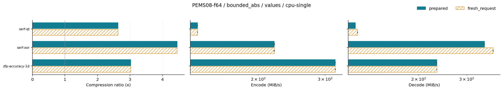

[SVG](figures/PEMS08-f64--bounded_abs--cpu-single.svg)

<details><summary>完整数值、有效批次及拒绝原因</summary>

| codec | 完整输出 bytes P / F | 压缩倍数 P / F | 编码 MiB/s P / F | 解码 MiB/s P / F | 有效批次 P / F |
|---|---:|---:|---:|---:|---:|
| serf-qt | 9.22e+06 / 9.22e+06 | 2.63 / 2.63 | 139 / 139 | 117 / 120 | 14/14 / 14/14 |
| serf-xor | 5.46e+06 / 5.46e+06 | 4.45 / 4.45 | 221 / 221 | 349 / 376 | 14/14 / 14/14 |
| zfp-accuracy-1d | 8.03e+06 / 8.03e+06 | 3.02 / 3.02 | 319 / 319 | 233 / 233 | 14/14 / 14/14 |

</details>

**<f8 · [17856, 170] · 经验质量（无最大误差保证） · values · cpu-single**

运行进程 CPU 亲和性（P / F）：`[(0, 1, 2, 3, 4, 5, 6, 7, 8, 9, 10, 11, 12, 13, 14, 15)]` / `[(0, 1, 2, 3, 4, 5, 6, 7, 8, 9, 10, 11, 12, 13, 14, 15)]`；逐配置创建时间见 CSV，是否处于并行窗口见调度记录。

<details><summary>完整数值、有效批次及拒绝原因</summary>

| codec | 完整输出 bytes P / F | 压缩倍数 P / F | 编码 MiB/s P / F | 解码 MiB/s P / F | 有效批次 P / F |
|---|---:|---:|---:|---:|---:|
| abba | — / — | — / — | — / — | — / — | 0/0 / 0/0 |
| fabba | — / — | — / — | — / — | — / — | 0/0 / 0/0 |
| pmc-mr | — / — | — / — | — / — | — / — | 0/0 / 0/0 |
| swing-filter | — / — | — / — | — / — | — / — | 0/0 / 0/0 |
| swing-filter-disjoint | — / — | — / — | — / — | — / — | 0/0 / 0/0 |
| swing-filter-disjoint-quantized / compatible | — / — | — / — | — / — | — / — | 0/0 / 0/0 |

拒绝或未完整完成的请求：

- `abba` / fresh_request：unsupported，RW native batches require rank 1 / columns=1; collection framing belongs to object mode
- `abba` / prepared：unsupported，RW native batches require rank 1 / columns=1; collection framing belongs to object mode
- `fabba` / fresh_request：unsupported，RW native batches require rank 1 / columns=1; collection framing belongs to object mode
- `fabba` / prepared：unsupported，RW native batches require rank 1 / columns=1; collection framing belongs to object mode
- `pmc-mr` / fresh_request：unsupported，pmc-mr: dtype must be one of ('<f4',)
- `pmc-mr` / prepared：unsupported，pmc-mr: dtype must be one of ('<f4',)
- `swing-filter` / fresh_request：unsupported，swing-filter: dtype must be one of ('<f4',)
- `swing-filter` / prepared：unsupported，swing-filter: dtype must be one of ('<f4',)
- `swing-filter-disjoint` / fresh_request：unsupported，swing-filter-disjoint: dtype must be one of ('<f4',)
- `swing-filter-disjoint` / prepared：unsupported，swing-filter-disjoint: dtype must be one of ('<f4',)
- `swing-filter-disjoint-quantized / compatible` / fresh_request：unsupported，swing-filter-disjoint-quantized: dtype must be one of ('<f4',)
- `swing-filter-disjoint-quantized / compatible` / prepared：unsupported，swing-filter-disjoint-quantized: dtype must be one of ('<f4',)

</details>

**<i2 · [17856, 170] · 无损 · values · cpu-single**

运行进程 CPU 亲和性（P / F）：`[(0, 1, 2, 3, 4, 5, 6, 7, 8, 9, 10, 11, 12, 13, 14, 15)]` / `[(0, 1, 2, 3, 4, 5, 6, 7, 8, 9, 10, 11, 12, 13, 14, 15)]`；逐配置创建时间见 CSV，是否处于并行窗口见调度记录。

<details><summary>完整数值、有效批次及拒绝原因</summary>

| codec | 完整输出 bytes P / F | 压缩倍数 P / F | 编码 MiB/s P / F | 解码 MiB/s P / F | 有效批次 P / F |
|---|---:|---:|---:|---:|---:|
| sprintz-delta | — / — | — / — | — / — | — / — | 0/0 / 0/0 |
| sprintz-delta-huffman | — / — | — / — | — / — | — / — | 0/0 / 0/0 |
| sprintz-fire | — / — | — / — | — / — | — / — | 0/0 / 0/0 |
| sprintz-fire-huffman | — / — | — / — | — / — | — / — | 0/0 / 0/0 |

拒绝或未完整完成的请求：

- `sprintz-delta` / fresh_request：unsupported，sprintz-delta: m=170 exceeds native limits
- `sprintz-delta` / prepared：unsupported，sprintz-delta: m=170 exceeds native limits
- `sprintz-delta-huffman` / fresh_request：unsupported，sprintz-delta-huffman: m=170 exceeds native limits
- `sprintz-delta-huffman` / prepared：unsupported，sprintz-delta-huffman: m=170 exceeds native limits
- `sprintz-fire` / fresh_request：unsupported，sprintz-fire: m=170 exceeds native limits
- `sprintz-fire` / prepared：unsupported，sprintz-fire: m=170 exceeds native limits
- `sprintz-fire-huffman` / fresh_request：unsupported，sprintz-fire-huffman: m=170 exceeds native limits
- `sprintz-fire-huffman` / prepared：unsupported，sprintz-fire-huffman: m=170 exceeds native limits

</details>

**<i8 · [17856, 170] · 无损 · values · cpu-single**

运行进程 CPU 亲和性（P / F）：`[(0, 1, 2, 3, 4, 5, 6, 7, 8, 9, 10, 11, 12, 13, 14, 15)]` / `[(0, 1, 2, 3, 4, 5, 6, 7, 8, 9, 10, 11, 12, 13, 14, 15)]`；逐配置创建时间见 CSV，是否处于并行窗口见调度记录。

<details><summary>完整数值、有效批次及拒绝原因</summary>

| codec | 完整输出 bytes P / F | 压缩倍数 P / F | 编码 MiB/s P / F | 解码 MiB/s P / F | 有效批次 P / F |
|---|---:|---:|---:|---:|---:|
| leats-lossless-i64 | — / — | — / — | — / — | — / — | 0/0 / 0/0 |
| neats-lossless-i64 | — / — | — / — | — / — | — / — | 0/0 / 0/0 |

拒绝或未完整完成的请求：

- `leats-lossless-i64` / fresh_request：unsupported，leats-lossless-i64: m=170 exceeds native limits
- `leats-lossless-i64` / prepared：unsupported，leats-lossless-i64: m=170 exceeds native limits
- `neats-lossless-i64` / fresh_request：unsupported，neats-lossless-i64: m=170 exceeds native limits
- `neats-lossless-i64` / prepared：unsupported，neats-lossless-i64: m=170 exceeds native limits

</details>

**<u4 · [17856, 170] · 无损 · values · cpu-single**

运行进程 CPU 亲和性（P / F）：`[(0, 1, 2, 3, 4, 5, 6, 7, 8, 9, 10, 11, 12, 13, 14, 15)]` / `[(0, 1, 2, 3, 4, 5, 6, 7, 8, 9, 10, 11, 12, 13, 14, 15)]`；逐配置创建时间见 CSV，是否处于并行窗口见调度记录。

<details><summary>完整数值、有效批次及拒绝原因</summary>

| codec | 完整输出 bytes P / F | 压缩倍数 P / F | 编码 MiB/s P / F | 解码 MiB/s P / F | 有效批次 P / F |
|---|---:|---:|---:|---:|---:|
| simdcomp-u32 | — / — | — / — | — / — | — / — | 0/0 / 0/0 |

拒绝或未完整完成的请求：

- `simdcomp-u32` / fresh_request：unsupported，simdcomp-u32: rank must be one of (1,)
- `simdcomp-u32` / prepared：unsupported，simdcomp-u32: rank must be one of (1,)

</details>

<a id="dataset-Solar"></a>

### Solar

**<f4 · [52560, 137] · 无损 · values · cpu-single**

运行进程 CPU 亲和性（P / F）：`[(0, 1, 2, 3, 4, 5, 6, 7, 8, 9, 10, 11, 12, 13, 14, 15)]` / `[(0, 1, 2, 3, 4, 5, 6, 7, 8, 9, 10, 11, 12, 13, 14, 15)]`；逐配置创建时间见 CSV，是否处于并行窗口见调度记录。

f64→f32 准备阶段转换的最大绝对差：**3.05175782e-06**；本组 codec 的恢复质量相对转换后的 f32 输入验证。

<details><summary>完整数值、有效批次及拒绝原因</summary>

| codec | 完整输出 bytes P / F | 压缩倍数 P / F | 编码 MiB/s P / F | 解码 MiB/s P / F | 有效批次 P / F |
|---|---:|---:|---:|---:|---:|
| chimp32 | — / — | — / — | — / — | — / — | 0/0 / 0/0 |
| chimpn32 | — / — | — / — | — / — | — / — | 0/0 / 0/0 |

拒绝或未完整完成的请求：

- `chimp32` / fresh_request：unsupported，chimp32: element limit exceeded
- `chimp32` / prepared：unsupported，chimp32: element limit exceeded
- `chimpn32` / fresh_request：unsupported，chimpn32: element limit exceeded
- `chimpn32` / prepared：unsupported，chimpn32: element limit exceeded

</details>

**<f4 · [52560, 137] · 经验质量（无最大误差保证） · values · cpu-single**

运行进程 CPU 亲和性（P / F）：`[(0, 1, 2, 3, 4, 5, 6, 7, 8, 9, 10, 11, 12, 13, 14, 15)]` / `[(0, 1, 2, 3, 4, 5, 6, 7, 8, 9, 10, 11, 12, 13, 14, 15)]`；逐配置创建时间见 CSV，是否处于并行窗口见调度记录。

f64→f32 准备阶段转换的最大绝对差：**3.05175782e-06**；本组 codec 的恢复质量相对转换后的 f32 输入验证。

<details><summary>完整数值、有效批次及拒绝原因</summary>

| codec | 完整输出 bytes P / F | 压缩倍数 P / F | 编码 MiB/s P / F | 解码 MiB/s P / F | 有效批次 P / F |
|---|---:|---:|---:|---:|---:|
| pmc-mr | — / — | — / — | — / — | — / — | 0/0 / 0/0 |
| swing-filter | — / — | — / — | — / — | — / — | 0/0 / 0/0 |
| swing-filter-disjoint | — / — | — / — | — / — | — / — | 0/0 / 0/0 |
| swing-filter-disjoint-quantized / compatible | — / — | — / — | — / — | — / — | 0/0 / 0/0 |
| swing-filter-disjoint-quantized / strict_abs | — / — | — / — | — / — | — / — | 0/0 / 0/0 |

拒绝或未完整完成的请求：

- `pmc-mr` / fresh_request：unsupported，pmc-mr: element limit exceeded
- `pmc-mr` / prepared：unsupported，pmc-mr: element limit exceeded
- `swing-filter` / fresh_request：unsupported，swing-filter: element limit exceeded
- `swing-filter` / prepared：unsupported，swing-filter: element limit exceeded
- `swing-filter-disjoint` / fresh_request：unsupported，swing-filter-disjoint: element limit exceeded
- `swing-filter-disjoint` / prepared：unsupported，swing-filter-disjoint: element limit exceeded
- `swing-filter-disjoint-quantized / compatible` / fresh_request：unsupported，swing-filter-disjoint-quantized: element limit exceeded
- `swing-filter-disjoint-quantized / compatible` / prepared：unsupported，swing-filter-disjoint-quantized: element limit exceeded
- `swing-filter-disjoint-quantized / strict_abs` / fresh_request：unsupported，swing-filter-disjoint-quantized: element limit exceeded
- `swing-filter-disjoint-quantized / strict_abs` / prepared：unsupported，swing-filter-disjoint-quantized: element limit exceeded

</details>

**<f8 · [52560, 137] · 无损 · values · cpu-dzip-three**

运行进程 CPU 亲和性（P / F）：`[(0, 1, 2, 3, 4, 5, 6, 7, 8, 9, 10, 11, 12, 13, 14, 15)]` / `[(0, 1, 2, 3, 4, 5, 6, 7, 8, 9, 10, 11, 12, 13, 14, 15)]`；逐配置创建时间见 CSV，是否处于并行窗口见调度记录。

<details><summary>完整数值、有效批次及拒绝原因</summary>

| codec | 完整输出 bytes P / F | 压缩倍数 P / F | 编码 MiB/s P / F | 解码 MiB/s P / F | 有效批次 P / F |
|---|---:|---:|---:|---:|---:|
| dzip | — / — | — / — | — / — | — / — | 0/0 / 0/0 |

拒绝或未完整完成的请求：

- `dzip` / fresh_request：unsupported，dzip: dtype must be one of ('|u1',)
- `dzip` / prepared：unsupported，dzip: dtype must be one of ('|u1',)

</details>

**<f8 · [52560, 137] · 无损 · values · cpu-single**

运行进程 CPU 亲和性（P / F）：`[(0, 1, 2, 3, 4, 5, 6, 7, 8, 9, 10, 11, 12, 13, 14, 15)]` / `[(0, 1, 2, 3, 4, 5, 6, 7, 8, 9, 10, 11, 12, 13, 14, 15)]`；逐配置创建时间见 CSV，是否处于并行窗口见调度记录。

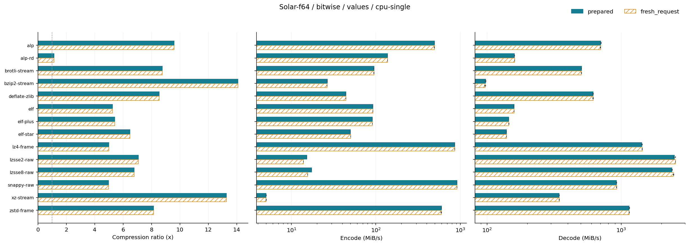

[SVG](figures/Solar-f64--bitwise--cpu-single.svg)

<details><summary>完整数值、有效批次及拒绝原因</summary>

| codec | 完整输出 bytes P / F | 压缩倍数 P / F | 编码 MiB/s P / F | 解码 MiB/s P / F | 有效批次 P / F |
|---|---:|---:|---:|---:|---:|
| alp | 6e+06 / 6e+06 | 9.6 / 9.6 | 495 / 495 | 705 / 703 | 14/14 / 14/14 |
| alp-rd | 5.06e+07 / 5.06e+07 | 1.14 / 1.14 | 138 / 138 | 160 / 161 | 14/14 / 14/14 |
| brotli-stream | 6.58e+06 / 6.58e+06 | 8.75 / 8.75 | 95 / 95 | 506 / 505 | 14/14 / 14/14 |
| bzip2-stream | 4.09e+06 / 4.09e+06 | 14.1 / 14.1 | 26.6 / 26.4 | 97.5 / 96.5 | 14/14 / 14/14 |
| chimp | — / — | — / — | — / — | — / — | 0/0 / 0/0 |
| chimp128 | — / — | — / — | — / — | — / — | 0/0 / 0/0 |
| chimp128-no-index | — / — | — / — | — / — | — / — | 0/0 / 0/0 |
| chimp32 | — / — | — / — | — / — | — / — | 0/0 / 0/0 |
| chimpn | — / — | — / — | — / — | — / — | 0/0 / 0/0 |
| chimpn32 | — / — | — / — | — / — | — / — | 0/0 / 0/0 |
| deepzip | — / — | — / — | — / — | — / — | 0/0 / 0/0 |
| deflate-zlib | 6.74e+06 / 6.74e+06 | 8.55 / 8.55 | 44.2 / 44.2 | 618 / 618 | 14/14 / 14/14 |
| elf | 1.1e+07 / 1.1e+07 | 5.25 / 5.25 | 92.3 / 92.2 | 159 / 159 | 14/14 / 14/14 |
| elf-plus | 1.07e+07 / 1.07e+07 | 5.4 / 5.4 | 91.1 / 91.1 | 145 / 145 | 14/14 / 14/14 |
| elf-star | 8.89e+06 / 8.89e+06 | 6.48 / 6.48 | 50.1 / 50.3 | 139 / 140 | 14/14 / 14/14 |
| fse | — / — | — / — | — / — | — / — | 0/0 / 0/0 |
| gorilla-prometheus-xor | — / — | — / — | — / — | — / — | 0/0 / 0/0 |
| huff0 | — / — | — / — | — / — | — / — | 0/0 / 0/0 |
| leats-lossless-i64 | — / — | — / — | — / — | — / — | 0/0 / 0/0 |
| lz4-frame | 1.16e+07 / 1.16e+07 | 4.99 / 4.99 | 862 / 862 | 1.42e+03 / 1.43e+03 | 14/14 / 14/14 |
| lzsse2-raw | 8.15e+06 / 8.15e+06 | 7.07 / 7.07 | 15.2 / 13.9 | 2.49e+03 / 2.54e+03 | 14/14 / 14/14 |
| lzsse8-raw | 8.51e+06 / 8.51e+06 | 6.77 / 6.77 | 17.3 / 15.5 | 2.38e+03 / 2.45e+03 | 14/14 / 14/14 |
| neats-lossless-i64 | — / — | — / — | — / — | — / — | 0/0 / 0/0 |
| self-star | — / — | — / — | — / — | — / — | 0/0 / 0/0 |
| simdcomp-u32 | — / — | — / — | — / — | — / — | 0/0 / 0/0 |
| snappy-raw | 1.16e+07 / 1.16e+07 | 4.98 / 4.98 | 914 / 916 | 924 / 926 | 14/14 / 14/14 |
| sprintz-delta | — / — | — / — | — / — | — / — | 0/0 / 0/0 |
| sprintz-delta-huffman | — / — | — / — | — / — | — / — | 0/0 / 0/0 |
| sprintz-fire | — / — | — / — | — / — | — / — | 0/0 / 0/0 |
| sprintz-fire-huffman | — / — | — / — | — / — | — / — | 0/0 / 0/0 |
| xz-stream | 4.34e+06 / 4.34e+06 | 13.3 / 13.3 | 5.02 / 5.02 | 345 / 345 | 14/14 / 14/14 |
| zstd-frame | 7.07e+06 / 7.07e+06 | 8.15 / 8.15 | 599 / 596 | 1.15e+03 / 1.15e+03 | 14/14 / 14/14 |

拒绝或未完整完成的请求：

- `chimp` / fresh_request：unsupported，chimp: element limit exceeded
- `chimp` / prepared：unsupported，chimp: element limit exceeded
- `chimp128` / fresh_request：unsupported，chimp128: element limit exceeded
- `chimp128` / prepared：unsupported，chimp128: element limit exceeded
- `chimp128-no-index` / fresh_request：unsupported，chimp128-no-index: element limit exceeded
- `chimp128-no-index` / prepared：unsupported，chimp128-no-index: element limit exceeded
- `chimp32` / fresh_request：unsupported，chimp32: dtype must be one of ('<f4',)
- `chimp32` / prepared：unsupported，chimp32: dtype must be one of ('<f4',)
- `chimpn` / fresh_request：unsupported，chimpn: element limit exceeded
- `chimpn` / prepared：unsupported，chimpn: element limit exceeded
- `chimpn32` / fresh_request：unsupported，chimpn32: dtype must be one of ('<f4',)
- `chimpn32` / prepared：unsupported，chimpn32: dtype must be one of ('<f4',)
- `deepzip` / fresh_request：unsupported，deepzip: dtype must be one of ('|u1',)
- `deepzip` / prepared：unsupported，deepzip: dtype must be one of ('|u1',)
- `fse` / fresh_request：unsupported，fse: n=52560 exceeds native limits
- `fse` / prepared：unsupported，fse: n=52560 exceeds native limits
- `gorilla-prometheus-xor` / fresh_request：unsupported，Gorilla requires actual paired T/V; values-only and timestamp-only are unsupported
- `gorilla-prometheus-xor` / prepared：unsupported，Gorilla requires actual paired T/V; values-only and timestamp-only are unsupported
- `huff0` / fresh_request：unsupported，huff0: n=52560 exceeds native limits
- `huff0` / prepared：unsupported，huff0: n=52560 exceeds native limits
- `leats-lossless-i64` / fresh_request：unsupported，leats-lossless-i64: dtype must be one of ('|i1', '<i2', '<i4', '<i8')
- `leats-lossless-i64` / prepared：unsupported，leats-lossless-i64: dtype must be one of ('|i1', '<i2', '<i4', '<i8')
- `neats-lossless-i64` / fresh_request：unsupported，neats-lossless-i64: dtype must be one of ('|i1', '<i2', '<i4', '<i8')
- `neats-lossless-i64` / prepared：unsupported，neats-lossless-i64: dtype must be one of ('|i1', '<i2', '<i4', '<i8')
- `self-star` / fresh_request：unsupported，SElfStar intrinsic session limits exceeded 
- `self-star` / prepared：unsupported，SElfStar intrinsic session limits exceeded 
- `simdcomp-u32` / fresh_request：unsupported，simdcomp-u32: dtype must be one of ('<u4',)
- `simdcomp-u32` / prepared：unsupported，simdcomp-u32: dtype must be one of ('<u4',)
- `sprintz-delta` / fresh_request：unsupported，sprintz-delta: dtype must be one of ('|u1', '|i1', '<u2', '<i2')
- `sprintz-delta` / prepared：unsupported，sprintz-delta: dtype must be one of ('|u1', '|i1', '<u2', '<i2')
- `sprintz-delta-huffman` / fresh_request：unsupported，sprintz-delta-huffman: dtype must be one of ('|u1', '|i1', '<u2', '<i2')
- `sprintz-delta-huffman` / prepared：unsupported，sprintz-delta-huffman: dtype must be one of ('|u1', '|i1', '<u2', '<i2')
- `sprintz-fire` / fresh_request：unsupported，sprintz-fire: dtype must be one of ('|u1', '|i1', '<u2', '<i2')
- `sprintz-fire` / prepared：unsupported，sprintz-fire: dtype must be one of ('|u1', '|i1', '<u2', '<i2')
- `sprintz-fire-huffman` / fresh_request：unsupported，sprintz-fire-huffman: dtype must be one of ('|u1', '|i1', '<u2', '<i2')
- `sprintz-fire-huffman` / prepared：unsupported，sprintz-fire-huffman: dtype must be one of ('|u1', '|i1', '<u2', '<i2')

</details>

**<f8 · [52560, 137] · ABS ≤ 0.01 · values · cpu-single**

运行进程 CPU 亲和性（P / F）：`[(0, 1, 2, 3, 4, 5, 6, 7, 8, 9, 10, 11, 12, 13, 14, 15)]` / `[(0, 1, 2, 3, 4, 5, 6, 7, 8, 9, 10, 11, 12, 13, 14, 15)]`；逐配置创建时间见 CSV，是否处于并行窗口见调度记录。

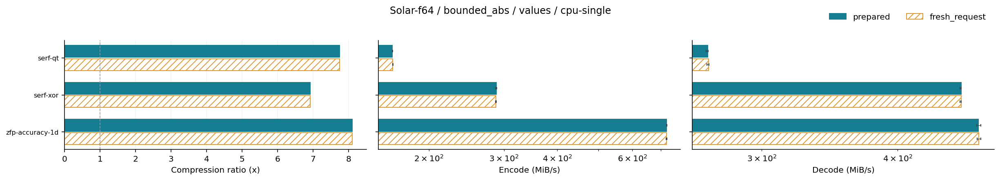

[SVG](figures/Solar-f64--bounded_abs--cpu-single.svg)

<details><summary>完整数值、有效批次及拒绝原因</summary>

| codec | 完整输出 bytes P / F | 压缩倍数 P / F | 编码 MiB/s P / F | 解码 MiB/s P / F | 有效批次 P / F |
|---|---:|---:|---:|---:|---:|
| serf-qt | 7.44e+06 / 7.44e+06 | 7.75 / 7.75 | 164 / 165 | 268 / 268 | 14/14 / 14/14 |
| serf-xor | 8.32e+06 / 8.32e+06 | 6.92 / 6.92 | 288 / 287 | 458 / 458 | 14/14 / 14/14 |
| zfp-accuracy-1d | 7.11e+06 / 7.11e+06 | 8.1 / 8.1 | 722 / 722 | 474 / 475 | 14/14 / 14/14 |

</details>

**<f8 · [52560, 137] · 经验质量（无最大误差保证） · values · cpu-single**

运行进程 CPU 亲和性（P / F）：`[(0, 1, 2, 3, 4, 5, 6, 7, 8, 9, 10, 11, 12, 13, 14, 15)]` / `[(0, 1, 2, 3, 4, 5, 6, 7, 8, 9, 10, 11, 12, 13, 14, 15)]`；逐配置创建时间见 CSV，是否处于并行窗口见调度记录。

<details><summary>完整数值、有效批次及拒绝原因</summary>

| codec | 完整输出 bytes P / F | 压缩倍数 P / F | 编码 MiB/s P / F | 解码 MiB/s P / F | 有效批次 P / F |
|---|---:|---:|---:|---:|---:|
| abba | — / — | — / — | — / — | — / — | 0/0 / 0/0 |
| fabba | — / — | — / — | — / — | — / — | 0/0 / 0/0 |
| pmc-mr | — / — | — / — | — / — | — / — | 0/0 / 0/0 |
| swing-filter | — / — | — / — | — / — | — / — | 0/0 / 0/0 |
| swing-filter-disjoint | — / — | — / — | — / — | — / — | 0/0 / 0/0 |
| swing-filter-disjoint-quantized / compatible | — / — | — / — | — / — | — / — | 0/0 / 0/0 |

拒绝或未完整完成的请求：

- `abba` / fresh_request：unsupported，RW native batches require rank 1 / columns=1; collection framing belongs to object mode
- `abba` / prepared：unsupported，RW native batches require rank 1 / columns=1; collection framing belongs to object mode
- `fabba` / fresh_request：unsupported，RW native batches require rank 1 / columns=1; collection framing belongs to object mode
- `fabba` / prepared：unsupported，RW native batches require rank 1 / columns=1; collection framing belongs to object mode
- `pmc-mr` / fresh_request：unsupported，pmc-mr: dtype must be one of ('<f4',)
- `pmc-mr` / prepared：unsupported，pmc-mr: dtype must be one of ('<f4',)
- `swing-filter` / fresh_request：unsupported，swing-filter: dtype must be one of ('<f4',)
- `swing-filter` / prepared：unsupported，swing-filter: dtype must be one of ('<f4',)
- `swing-filter-disjoint` / fresh_request：unsupported，swing-filter-disjoint: dtype must be one of ('<f4',)
- `swing-filter-disjoint` / prepared：unsupported，swing-filter-disjoint: dtype must be one of ('<f4',)
- `swing-filter-disjoint-quantized / compatible` / fresh_request：unsupported，swing-filter-disjoint-quantized: dtype must be one of ('<f4',)
- `swing-filter-disjoint-quantized / compatible` / prepared：unsupported，swing-filter-disjoint-quantized: dtype must be one of ('<f4',)

</details>

<a id="dataset-Traffic"></a>

### Traffic

**<f4 · [17544, 862] · 无损 · values · cpu-single**

运行进程 CPU 亲和性（P / F）：`[(0, 1, 2, 3, 4, 5, 6, 7, 8, 9, 10, 11, 12, 13, 14, 15)]` / `[(0, 1, 2, 3, 4, 5, 6, 7, 8, 9, 10, 11, 12, 13, 14, 15)]`；逐配置创建时间见 CSV，是否处于并行窗口见调度记录。

f64→f32 准备阶段转换的最大绝对差：**2.97546386e-08**；本组 codec 的恢复质量相对转换后的 f32 输入验证。

<details><summary>完整数值、有效批次及拒绝原因</summary>

| codec | 完整输出 bytes P / F | 压缩倍数 P / F | 编码 MiB/s P / F | 解码 MiB/s P / F | 有效批次 P / F |
|---|---:|---:|---:|---:|---:|
| chimp32 | — / — | — / — | — / — | — / — | 0/0 / 0/0 |
| chimpn32 | — / — | — / — | — / — | — / — | 0/0 / 0/0 |

拒绝或未完整完成的请求：

- `chimp32` / fresh_request：unsupported，chimp32: element limit exceeded
- `chimp32` / prepared：unsupported，chimp32: element limit exceeded
- `chimpn32` / fresh_request：unsupported，chimpn32: element limit exceeded
- `chimpn32` / prepared：unsupported，chimpn32: element limit exceeded

</details>

**<f4 · [17544, 862] · 经验质量（无最大误差保证） · values · cpu-single**

运行进程 CPU 亲和性（P / F）：`[(0, 1, 2, 3, 4, 5, 6, 7, 8, 9, 10, 11, 12, 13, 14, 15)]` / `[(0, 1, 2, 3, 4, 5, 6, 7, 8, 9, 10, 11, 12, 13, 14, 15)]`；逐配置创建时间见 CSV，是否处于并行窗口见调度记录。

f64→f32 准备阶段转换的最大绝对差：**2.97546386e-08**；本组 codec 的恢复质量相对转换后的 f32 输入验证。

<details><summary>完整数值、有效批次及拒绝原因</summary>

| codec | 完整输出 bytes P / F | 压缩倍数 P / F | 编码 MiB/s P / F | 解码 MiB/s P / F | 有效批次 P / F |
|---|---:|---:|---:|---:|---:|
| pmc-mr | — / — | — / — | — / — | — / — | 0/0 / 0/0 |
| swing-filter | — / — | — / — | — / — | — / — | 0/0 / 0/0 |
| swing-filter-disjoint | — / — | — / — | — / — | — / — | 0/0 / 0/0 |
| swing-filter-disjoint-quantized / compatible | — / — | — / — | — / — | — / — | 0/0 / 0/0 |
| swing-filter-disjoint-quantized / strict_abs | — / — | — / — | — / — | — / — | 0/0 / 0/0 |

拒绝或未完整完成的请求：

- `pmc-mr` / fresh_request：unsupported，pmc-mr: element limit exceeded
- `pmc-mr` / prepared：unsupported，pmc-mr: element limit exceeded
- `swing-filter` / fresh_request：unsupported，swing-filter: element limit exceeded
- `swing-filter` / prepared：unsupported，swing-filter: element limit exceeded
- `swing-filter-disjoint` / fresh_request：unsupported，swing-filter-disjoint: element limit exceeded
- `swing-filter-disjoint` / prepared：unsupported，swing-filter-disjoint: element limit exceeded
- `swing-filter-disjoint-quantized / compatible` / fresh_request：unsupported，swing-filter-disjoint-quantized: element limit exceeded
- `swing-filter-disjoint-quantized / compatible` / prepared：unsupported，swing-filter-disjoint-quantized: element limit exceeded
- `swing-filter-disjoint-quantized / strict_abs` / fresh_request：unsupported，swing-filter-disjoint-quantized: element limit exceeded
- `swing-filter-disjoint-quantized / strict_abs` / prepared：unsupported，swing-filter-disjoint-quantized: element limit exceeded

</details>

**<f8 · [17544, 862] · 无损 · values · cpu-dzip-three**

运行进程 CPU 亲和性（P / F）：`[(0, 1, 2, 3, 4, 5, 6, 7, 8, 9, 10, 11, 12, 13, 14, 15)]` / `[(0, 1, 2, 3, 4, 5, 6, 7, 8, 9, 10, 11, 12, 13, 14, 15)]`；逐配置创建时间见 CSV，是否处于并行窗口见调度记录。

<details><summary>完整数值、有效批次及拒绝原因</summary>

| codec | 完整输出 bytes P / F | 压缩倍数 P / F | 编码 MiB/s P / F | 解码 MiB/s P / F | 有效批次 P / F |
|---|---:|---:|---:|---:|---:|
| dzip | — / — | — / — | — / — | — / — | 0/0 / 0/0 |

拒绝或未完整完成的请求：

- `dzip` / fresh_request：unsupported，dzip: dtype must be one of ('|u1',)
- `dzip` / prepared：unsupported，dzip: dtype must be one of ('|u1',)

</details>

**<f8 · [17544, 862] · 无损 · values · cpu-single**

运行进程 CPU 亲和性（P / F）：`[(0, 1, 2, 3, 4, 5, 6, 7, 8, 9, 10, 11, 12, 13, 14, 15)]` / `[(0, 1, 2, 3, 4, 5, 6, 7, 8, 9, 10, 11, 12, 13, 14, 15)]`；逐配置创建时间见 CSV，是否处于并行窗口见调度记录。

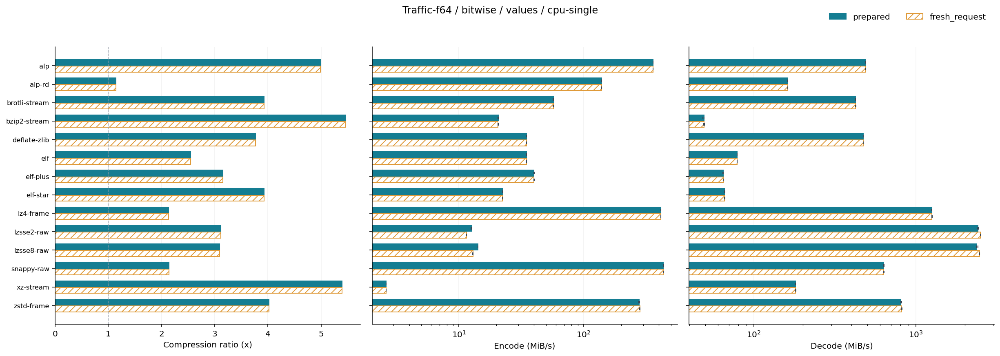

[SVG](figures/Traffic-f64--bitwise--cpu-single.svg)

<details><summary>完整数值、有效批次及拒绝原因</summary>

| codec | 完整输出 bytes P / F | 压缩倍数 P / F | 编码 MiB/s P / F | 解码 MiB/s P / F | 有效批次 P / F |
|---|---:|---:|---:|---:|---:|
| alp | 2.43e+07 / 2.43e+07 | 4.98 / 4.98 | 359 / 360 | 489 / 490 | 14/14 / 14/14 |
| alp-rd | 1.06e+08 / 1.06e+08 | 1.14 / 1.14 | 139 / 139 | 161 / 162 | 14/14 / 14/14 |
| brotli-stream | 3.08e+07 / 3.08e+07 | 3.93 / 3.93 | 57.2 / 57.2 | 424 / 425 | 14/14 / 14/14 |
| bzip2-stream | 2.21e+07 / 2.21e+07 | 5.46 / 5.46 | 20.7 / 20.6 | 49.2 / 49.1 | 14/14 / 14/14 |
| chimp | — / — | — / — | — / — | — / — | 0/0 / 0/0 |
| chimp128 | — / — | — / — | — / — | — / — | 0/0 / 0/0 |
| chimp128-no-index | — / — | — / — | — / — | — / — | 0/0 / 0/0 |
| chimp32 | — / — | — / — | — / — | — / — | 0/0 / 0/0 |
| chimpn | — / — | — / — | — / — | — / — | 0/0 / 0/0 |
| chimpn32 | — / — | — / — | — / — | — / — | 0/0 / 0/0 |
| deepzip | — / — | — / — | — / — | — / — | 0/0 / 0/0 |
| deflate-zlib | 3.22e+07 / 3.22e+07 | 3.76 / 3.76 | 34.9 / 34.9 | 472 / 474 | 14/14 / 14/14 |
| elf | 4.74e+07 / 4.74e+07 | 2.55 / 2.55 | 34.7 / 34.8 | 78.7 / 78.7 | 14/14 / 14/14 |
| elf-plus | 3.83e+07 / 3.83e+07 | 3.16 / 3.16 | 40 / 40 | 64.5 / 64.6 | 14/14 / 14/14 |
| elf-star | 3.08e+07 / 3.08e+07 | 3.93 / 3.93 | 22.3 / 22.4 | 65.9 / 65.9 | 14/14 / 14/14 |
| fse | — / — | — / — | — / — | — / — | 0/0 / 0/0 |
| gorilla-prometheus-xor | — / — | — / — | — / — | — / — | 0/0 / 0/0 |
| huff0 | — / — | — / — | — / — | — / — | 0/0 / 0/0 |
| leats-lossless-i64 | — / — | — / — | — / — | — / — | 0/0 / 0/0 |
| lz4-frame | 5.68e+07 / 5.68e+07 | 2.13 / 2.13 | 415 / 415 | 1.25e+03 / 1.25e+03 | 14/14 / 14/14 |
| lzsse2-raw | 3.88e+07 / 3.88e+07 | 3.12 / 3.12 | 12.6 / 11.5 | 2.42e+03 / 2.5e+03 | 14/14 / 14/14 |
| lzsse8-raw | 3.91e+07 / 3.91e+07 | 3.09 / 3.09 | 14.2 / 13 | 2.37e+03 / 2.47e+03 | 14/14 / 14/14 |
| neats-lossless-i64 | — / — | — / — | — / — | — / — | 0/0 / 0/0 |
| self-star | — / — | — / — | — / — | — / — | 0/0 / 0/0 |
| simdcomp-u32 | — / — | — / — | — / — | — / — | 0/0 / 0/0 |
| snappy-raw | 5.66e+07 / 5.66e+07 | 2.14 / 2.14 | 435 / 435 | 633 / 634 | 14/14 / 14/14 |
| sprintz-delta | — / — | — / — | — / — | — / — | 0/0 / 0/0 |
| sprintz-delta-huffman | — / — | — / — | — / — | — / — | 0/0 / 0/0 |
| sprintz-fire | — / — | — / — | — / — | — / — | 0/0 / 0/0 |
| sprintz-fire-huffman | — / — | — / — | — / — | — / — | 0/0 / 0/0 |
| xz-stream | 2.24e+07 / 2.24e+07 | 5.39 / 5.39 | 2.61 / 2.61 | 181 / 181 | 14/14 / 14/14 |
| zstd-frame | 3.01e+07 / 3.01e+07 | 4.02 / 4.02 | 279 / 282 | 809 / 816 | 14/14 / 14/14 |

拒绝或未完整完成的请求：

- `chimp` / fresh_request：unsupported，chimp: element limit exceeded
- `chimp` / prepared：unsupported，chimp: element limit exceeded
- `chimp128` / fresh_request：unsupported，chimp128: element limit exceeded
- `chimp128` / prepared：unsupported，chimp128: element limit exceeded
- `chimp128-no-index` / fresh_request：unsupported，chimp128-no-index: element limit exceeded
- `chimp128-no-index` / prepared：unsupported，chimp128-no-index: element limit exceeded
- `chimp32` / fresh_request：unsupported，chimp32: dtype must be one of ('<f4',)
- `chimp32` / prepared：unsupported，chimp32: dtype must be one of ('<f4',)
- `chimpn` / fresh_request：unsupported，chimpn: element limit exceeded
- `chimpn` / prepared：unsupported，chimpn: element limit exceeded
- `chimpn32` / fresh_request：unsupported，chimpn32: dtype must be one of ('<f4',)
- `chimpn32` / prepared：unsupported，chimpn32: dtype must be one of ('<f4',)
- `deepzip` / fresh_request：unsupported，deepzip: dtype must be one of ('|u1',)
- `deepzip` / prepared：unsupported，deepzip: dtype must be one of ('|u1',)
- `fse` / fresh_request：unsupported，fse: n=17544 exceeds native limits
- `fse` / prepared：unsupported，fse: n=17544 exceeds native limits
- `gorilla-prometheus-xor` / fresh_request：unsupported，Gorilla requires actual paired T/V; values-only and timestamp-only are unsupported
- `gorilla-prometheus-xor` / prepared：unsupported，Gorilla requires actual paired T/V; values-only and timestamp-only are unsupported
- `huff0` / fresh_request：unsupported，huff0: n=17544 exceeds native limits
- `huff0` / prepared：unsupported，huff0: n=17544 exceeds native limits
- `leats-lossless-i64` / fresh_request：unsupported，leats-lossless-i64: dtype must be one of ('|i1', '<i2', '<i4', '<i8')
- `leats-lossless-i64` / prepared：unsupported，leats-lossless-i64: dtype must be one of ('|i1', '<i2', '<i4', '<i8')
- `neats-lossless-i64` / fresh_request：unsupported，neats-lossless-i64: dtype must be one of ('|i1', '<i2', '<i4', '<i8')
- `neats-lossless-i64` / prepared：unsupported，neats-lossless-i64: dtype must be one of ('|i1', '<i2', '<i4', '<i8')
- `self-star` / fresh_request：unsupported，SElfStar intrinsic session limits exceeded 
- `self-star` / prepared：unsupported，SElfStar intrinsic session limits exceeded 
- `simdcomp-u32` / fresh_request：unsupported，simdcomp-u32: dtype must be one of ('<u4',)
- `simdcomp-u32` / prepared：unsupported，simdcomp-u32: dtype must be one of ('<u4',)
- `sprintz-delta` / fresh_request：unsupported，sprintz-delta: dtype must be one of ('|u1', '|i1', '<u2', '<i2')
- `sprintz-delta` / prepared：unsupported，sprintz-delta: dtype must be one of ('|u1', '|i1', '<u2', '<i2')
- `sprintz-delta-huffman` / fresh_request：unsupported，sprintz-delta-huffman: dtype must be one of ('|u1', '|i1', '<u2', '<i2')
- `sprintz-delta-huffman` / prepared：unsupported，sprintz-delta-huffman: dtype must be one of ('|u1', '|i1', '<u2', '<i2')
- `sprintz-fire` / fresh_request：unsupported，sprintz-fire: dtype must be one of ('|u1', '|i1', '<u2', '<i2')
- `sprintz-fire` / prepared：unsupported，sprintz-fire: dtype must be one of ('|u1', '|i1', '<u2', '<i2')
- `sprintz-fire-huffman` / fresh_request：unsupported，sprintz-fire-huffman: dtype must be one of ('|u1', '|i1', '<u2', '<i2')
- `sprintz-fire-huffman` / prepared：unsupported，sprintz-fire-huffman: dtype must be one of ('|u1', '|i1', '<u2', '<i2')

</details>

**<f8 · [17544, 862] · ABS ≤ 0.01 · values · cpu-single**

运行进程 CPU 亲和性（P / F）：`[(0, 1, 2, 3, 4, 5, 6, 7, 8, 9, 10, 11, 12, 13, 14, 15)]` / `[(0, 1, 2, 3, 4, 5, 6, 7, 8, 9, 10, 11, 12, 13, 14, 15)]`；逐配置创建时间见 CSV，是否处于并行窗口见调度记录。


[SVG](figures/Traffic-f64--bounded_abs--cpu-single.svg)

<details><summary>完整数值、有效批次及拒绝原因</summary>

| codec | 完整输出 bytes P / F | 压缩倍数 P / F | 编码 MiB/s P / F | 解码 MiB/s P / F | 有效批次 P / F |
|---|---:|---:|---:|---:|---:|
| serf-qt | 6.85e+06 / 6.85e+06 | 17.7 / 17.7 | 143 / 142 | 339 / 339 | 14/14 / 14/14 |
| serf-xor | 1.82e+07 / 1.82e+07 | 6.64 / 6.64 | 251 / 251 | 414 / 414 | 14/14 / 14/14 |
| zfp-accuracy-1d | 1.71e+07 / 1.71e+07 | 7.09 / 7.09 | 473 / 473 | 398 / 398 | 14/14 / 14/14 |

</details>

**<f8 · [17544, 862] · 经验质量（无最大误差保证） · values · cpu-single**

运行进程 CPU 亲和性（P / F）：`[(0, 1, 2, 3, 4, 5, 6, 7, 8, 9, 10, 11, 12, 13, 14, 15)]` / `[(0, 1, 2, 3, 4, 5, 6, 7, 8, 9, 10, 11, 12, 13, 14, 15)]`；逐配置创建时间见 CSV，是否处于并行窗口见调度记录。

<details><summary>完整数值、有效批次及拒绝原因</summary>

| codec | 完整输出 bytes P / F | 压缩倍数 P / F | 编码 MiB/s P / F | 解码 MiB/s P / F | 有效批次 P / F |
|---|---:|---:|---:|---:|---:|
| abba | — / — | — / — | — / — | — / — | 0/0 / 0/0 |
| fabba | — / — | — / — | — / — | — / — | 0/0 / 0/0 |
| pmc-mr | — / — | — / — | — / — | — / — | 0/0 / 0/0 |
| swing-filter | — / — | — / — | — / — | — / — | 0/0 / 0/0 |
| swing-filter-disjoint | — / — | — / — | — / — | — / — | 0/0 / 0/0 |
| swing-filter-disjoint-quantized / compatible | — / — | — / — | — / — | — / — | 0/0 / 0/0 |

拒绝或未完整完成的请求：

- `abba` / fresh_request：unsupported，RW native batches require rank 1 / columns=1; collection framing belongs to object mode
- `abba` / prepared：unsupported，RW native batches require rank 1 / columns=1; collection framing belongs to object mode
- `fabba` / fresh_request：unsupported，RW native batches require rank 1 / columns=1; collection framing belongs to object mode
- `fabba` / prepared：unsupported，RW native batches require rank 1 / columns=1; collection framing belongs to object mode
- `pmc-mr` / fresh_request：unsupported，pmc-mr: dtype must be one of ('<f4',)
- `pmc-mr` / prepared：unsupported，pmc-mr: dtype must be one of ('<f4',)
- `swing-filter` / fresh_request：unsupported，swing-filter: dtype must be one of ('<f4',)
- `swing-filter` / prepared：unsupported，swing-filter: dtype must be one of ('<f4',)
- `swing-filter-disjoint` / fresh_request：unsupported，swing-filter-disjoint: dtype must be one of ('<f4',)
- `swing-filter-disjoint` / prepared：unsupported，swing-filter-disjoint: dtype must be one of ('<f4',)
- `swing-filter-disjoint-quantized / compatible` / fresh_request：unsupported，swing-filter-disjoint-quantized: dtype must be one of ('<f4',)
- `swing-filter-disjoint-quantized / compatible` / prepared：unsupported，swing-filter-disjoint-quantized: dtype must be one of ('<f4',)

</details>

<a id="dataset-Weather"></a>

### Weather

**<f4 · [52696, 21] · 无损 · values · cpu-single**

运行进程 CPU 亲和性（P / F）：`[(0, 1, 2, 3, 4, 5, 6, 7, 8, 9, 10, 11, 12, 13, 14, 15)]` / `[(0, 1, 2, 3, 4, 5, 6, 7, 8, 9, 10, 11, 12, 13, 14, 15)]`；逐配置创建时间见 CSV，是否处于并行窗口见调度记录。

f64→f32 准备阶段转换的最大绝对差：**0.0001171875**；本组 codec 的恢复质量相对转换后的 f32 输入验证。

<details><summary>完整数值、有效批次及拒绝原因</summary>

| codec | 完整输出 bytes P / F | 压缩倍数 P / F | 编码 MiB/s P / F | 解码 MiB/s P / F | 有效批次 P / F |
|---|---:|---:|---:|---:|---:|
| chimp32 | — / — | — / — | — / — | — / — | 0/0 / 0/0 |
| chimpn32 | — / — | — / — | — / — | — / — | 0/0 / 0/0 |

拒绝或未完整完成的请求：

- `chimp32` / fresh_request：unsupported，chimp32: element limit exceeded
- `chimp32` / prepared：unsupported，chimp32: element limit exceeded
- `chimpn32` / fresh_request：unsupported，chimpn32: element limit exceeded
- `chimpn32` / prepared：unsupported，chimpn32: element limit exceeded

</details>

**<f4 · [52696, 21] · 经验质量（无最大误差保证） · values · cpu-single**

运行进程 CPU 亲和性（P / F）：`[(0, 1, 2, 3, 4, 5, 6, 7, 8, 9, 10, 11, 12, 13, 14, 15)]` / `[(0, 1, 2, 3, 4, 5, 6, 7, 8, 9, 10, 11, 12, 13, 14, 15)]`；逐配置创建时间见 CSV，是否处于并行窗口见调度记录。

f64→f32 准备阶段转换的最大绝对差：**0.0001171875**；本组 codec 的恢复质量相对转换后的 f32 输入验证。

<details><summary>完整数值、有效批次及拒绝原因</summary>

| codec | 完整输出 bytes P / F | 压缩倍数 P / F | 编码 MiB/s P / F | 解码 MiB/s P / F | 有效批次 P / F |
|---|---:|---:|---:|---:|---:|
| pmc-mr | — / — | — / — | — / — | — / — | 0/0 / 0/0 |
| swing-filter | — / — | — / — | — / — | — / — | 0/0 / 0/0 |
| swing-filter-disjoint | — / — | — / — | — / — | — / — | 0/0 / 0/0 |
| swing-filter-disjoint-quantized / compatible | — / — | — / — | — / — | — / — | 0/0 / 0/0 |
| swing-filter-disjoint-quantized / strict_abs | — / — | — / — | — / — | — / — | 0/0 / 0/0 |

拒绝或未完整完成的请求：

- `pmc-mr` / fresh_request：unsupported，pmc-mr: element limit exceeded
- `pmc-mr` / prepared：unsupported，pmc-mr: element limit exceeded
- `swing-filter` / fresh_request：unsupported，swing-filter: element limit exceeded
- `swing-filter` / prepared：unsupported，swing-filter: element limit exceeded
- `swing-filter-disjoint` / fresh_request：unsupported，swing-filter-disjoint: element limit exceeded
- `swing-filter-disjoint` / prepared：unsupported，swing-filter-disjoint: element limit exceeded
- `swing-filter-disjoint-quantized / compatible` / fresh_request：unsupported，swing-filter-disjoint-quantized: element limit exceeded
- `swing-filter-disjoint-quantized / compatible` / prepared：unsupported，swing-filter-disjoint-quantized: element limit exceeded
- `swing-filter-disjoint-quantized / strict_abs` / fresh_request：unsupported，swing-filter-disjoint-quantized: element limit exceeded
- `swing-filter-disjoint-quantized / strict_abs` / prepared：unsupported，swing-filter-disjoint-quantized: element limit exceeded

</details>

**<f8 · [52696, 21] · 无损 · values · cpu-dzip-three**

运行进程 CPU 亲和性（P / F）：`[(0, 1, 2, 3, 4, 5, 6, 7, 8, 9, 10, 11, 12, 13, 14, 15)]` / `[(0, 1, 2, 3, 4, 5, 6, 7, 8, 9, 10, 11, 12, 13, 14, 15)]`；逐配置创建时间见 CSV，是否处于并行窗口见调度记录。

<details><summary>完整数值、有效批次及拒绝原因</summary>

| codec | 完整输出 bytes P / F | 压缩倍数 P / F | 编码 MiB/s P / F | 解码 MiB/s P / F | 有效批次 P / F |
|---|---:|---:|---:|---:|---:|
| dzip | — / — | — / — | — / — | — / — | 0/0 / 0/0 |

拒绝或未完整完成的请求：

- `dzip` / fresh_request：unsupported，dzip: dtype must be one of ('|u1',)
- `dzip` / prepared：unsupported，dzip: dtype must be one of ('|u1',)

</details>

**<f8 · [52696, 21] · 无损 · values · cpu-single**

运行进程 CPU 亲和性（P / F）：`[(0, 1, 2, 3, 4, 5, 6, 7, 8, 9, 10, 11, 12, 13, 14, 15)]` / `[(0, 1, 2, 3, 4, 5, 6, 7, 8, 9, 10, 11, 12, 13, 14, 15)]`；逐配置创建时间见 CSV，是否处于并行窗口见调度记录。


[SVG](figures/Weather-f64--bitwise--cpu-single.svg)

<details><summary>完整数值、有效批次及拒绝原因</summary>

| codec | 完整输出 bytes P / F | 压缩倍数 P / F | 编码 MiB/s P / F | 解码 MiB/s P / F | 有效批次 P / F |
|---|---:|---:|---:|---:|---:|
| alp | 2.42e+06 / 2.42e+06 | 3.66 / 3.66 | 305 / 304 | 440 / 441 | 14/14 / 14/14 |
| alp-rd | 7.83e+06 / 7.83e+06 | 1.13 / 1.13 | 141 / 141 | 167 / 173 | 14/14 / 14/14 |
| brotli-stream | 2.63e+06 / 2.63e+06 | 3.37 / 3.37 | 44.7 / 43.9 | 371 / 405 | 14/14 / 14/14 |
| bzip2-stream | 1.76e+06 / 1.76e+06 | 5.02 / 5.02 | 22 / 21.9 | 47.1 / 47.1 | 14/14 / 14/14 |
| chimp | — / — | — / — | — / — | — / — | 0/0 / 0/0 |
| chimp128 | — / — | — / — | — / — | — / — | 0/0 / 0/0 |
| chimp128-no-index | — / — | — / — | — / — | — / — | 0/0 / 0/0 |
| chimp32 | — / — | — / — | — / — | — / — | 0/0 / 0/0 |
| chimpn | — / — | — / — | — / — | — / — | 0/0 / 0/0 |
| chimpn32 | — / — | — / — | — / — | — / — | 0/0 / 0/0 |
| deepzip | — / — | — / — | — / — | — / — | 0/0 / 0/0 |
| deflate-zlib | 2.67e+06 / 2.67e+06 | 3.32 / 3.32 | 16.4 / 16.4 | 344 / 344 | 14/14 / 14/14 |
| elf | 4.06e+06 / 4.06e+06 | 2.18 / 2.18 | 46 / 46 | 77.7 / 77.7 | 14/14 / 14/14 |
| elf-plus | 3.94e+06 / 3.94e+06 | 2.24 / 2.24 | 42.4 / 42.3 | 68.4 / 68.7 | 14/14 / 14/14 |
| elf-star | 3.4e+06 / 3.4e+06 | 2.6 / 2.6 | 24.4 / 24.4 | 67.2 / 67.3 | 14/14 / 14/14 |
| fse | — / — | — / — | — / — | — / — | 0/0 / 0/0 |
| gorilla-prometheus-xor | — / — | — / — | — / — | — / — | 0/0 / 0/0 |
| huff0 | — / — | — / — | — / — | — / — | 0/0 / 0/0 |
| leats-lossless-i64 | — / — | — / — | — / — | — / — | 0/0 / 0/0 |
| lz4-frame | 4.08e+06 / 4.08e+06 | 2.17 / 2.17 | 477 / 478 | 1.23e+03 / 1.22e+03 | 14/14 / 14/14 |
| lzsse2-raw | 2.78e+06 / 2.78e+06 | 3.18 / 3.18 | 7.51 / 7.11 | 2.32e+03 / 2.46e+03 | 14/14 / 14/14 |
| lzsse8-raw | 2.82e+06 / 2.82e+06 | 3.14 / 3.14 | 8.53 / 8.03 | 2.28e+03 / 2.39e+03 | 14/14 / 14/14 |
| neats-lossless-i64 | — / — | — / — | — / — | — / — | 0/0 / 0/0 |
| self-star | — / — | — / — | — / — | — / — | 0/0 / 0/0 |
| simdcomp-u32 | — / — | — / — | — / — | — / — | 0/0 / 0/0 |
| snappy-raw | 4.06e+06 / 4.06e+06 | 2.18 / 2.18 | 389 / 389 | 651 / 653 | 14/14 / 14/14 |
| sprintz-delta | — / — | — / — | — / — | — / — | 0/0 / 0/0 |
| sprintz-delta-huffman | — / — | — / — | — / — | — / — | 0/0 / 0/0 |
| sprintz-fire | — / — | — / — | — / — | — / — | 0/0 / 0/0 |
| sprintz-fire-huffman | — / — | — / — | — / — | — / — | 0/0 / 0/0 |
| xz-stream | 1.8e+06 / 1.8e+06 | 4.91 / 4.91 | 2.58 / 2.59 | 148 / 152 | 14/14 / 14/14 |
| zstd-frame | 2.7e+06 / 2.7e+06 | 3.28 / 3.28 | 247 / 245 | 868 / 863 | 14/14 / 14/14 |

拒绝或未完整完成的请求：

- `chimp` / fresh_request：unsupported，chimp: element limit exceeded
- `chimp` / prepared：unsupported，chimp: element limit exceeded
- `chimp128` / fresh_request：unsupported，chimp128: element limit exceeded
- `chimp128` / prepared：unsupported，chimp128: element limit exceeded
- `chimp128-no-index` / fresh_request：unsupported，chimp128-no-index: element limit exceeded
- `chimp128-no-index` / prepared：unsupported，chimp128-no-index: element limit exceeded
- `chimp32` / fresh_request：unsupported，chimp32: dtype must be one of ('<f4',)
- `chimp32` / prepared：unsupported，chimp32: dtype must be one of ('<f4',)
- `chimpn` / fresh_request：unsupported，chimpn: element limit exceeded
- `chimpn` / prepared：unsupported，chimpn: element limit exceeded
- `chimpn32` / fresh_request：unsupported，chimpn32: dtype must be one of ('<f4',)
- `chimpn32` / prepared：unsupported，chimpn32: dtype must be one of ('<f4',)
- `deepzip` / fresh_request：unsupported，deepzip: dtype must be one of ('|u1',)
- `deepzip` / prepared：unsupported，deepzip: dtype must be one of ('|u1',)
- `fse` / fresh_request：unsupported，fse: n=52696 exceeds native limits
- `fse` / prepared：unsupported，fse: n=52696 exceeds native limits
- `gorilla-prometheus-xor` / fresh_request：unsupported，Gorilla requires actual paired T/V; values-only and timestamp-only are unsupported
- `gorilla-prometheus-xor` / prepared：unsupported，Gorilla requires actual paired T/V; values-only and timestamp-only are unsupported
- `huff0` / fresh_request：unsupported，huff0: n=52696 exceeds native limits
- `huff0` / prepared：unsupported，huff0: n=52696 exceeds native limits
- `leats-lossless-i64` / fresh_request：unsupported，leats-lossless-i64: dtype must be one of ('|i1', '<i2', '<i4', '<i8')
- `leats-lossless-i64` / prepared：unsupported，leats-lossless-i64: dtype must be one of ('|i1', '<i2', '<i4', '<i8')
- `neats-lossless-i64` / fresh_request：unsupported，neats-lossless-i64: dtype must be one of ('|i1', '<i2', '<i4', '<i8')
- `neats-lossless-i64` / prepared：unsupported，neats-lossless-i64: dtype must be one of ('|i1', '<i2', '<i4', '<i8')
- `self-star` / fresh_request：unsupported，SElfStar intrinsic session limits exceeded 
- `self-star` / prepared：unsupported，SElfStar intrinsic session limits exceeded 
- `simdcomp-u32` / fresh_request：unsupported，simdcomp-u32: dtype must be one of ('<u4',)
- `simdcomp-u32` / prepared：unsupported，simdcomp-u32: dtype must be one of ('<u4',)
- `sprintz-delta` / fresh_request：unsupported，sprintz-delta: dtype must be one of ('|u1', '|i1', '<u2', '<i2')
- `sprintz-delta` / prepared：unsupported，sprintz-delta: dtype must be one of ('|u1', '|i1', '<u2', '<i2')
- `sprintz-delta-huffman` / fresh_request：unsupported，sprintz-delta-huffman: dtype must be one of ('|u1', '|i1', '<u2', '<i2')
- `sprintz-delta-huffman` / prepared：unsupported，sprintz-delta-huffman: dtype must be one of ('|u1', '|i1', '<u2', '<i2')
- `sprintz-fire` / fresh_request：unsupported，sprintz-fire: dtype must be one of ('|u1', '|i1', '<u2', '<i2')
- `sprintz-fire` / prepared：unsupported，sprintz-fire: dtype must be one of ('|u1', '|i1', '<u2', '<i2')
- `sprintz-fire-huffman` / fresh_request：unsupported，sprintz-fire-huffman: dtype must be one of ('|u1', '|i1', '<u2', '<i2')
- `sprintz-fire-huffman` / prepared：unsupported，sprintz-fire-huffman: dtype must be one of ('|u1', '|i1', '<u2', '<i2')

</details>

**<f8 · [52696, 21] · ABS ≤ 0.01 · values · cpu-single**

运行进程 CPU 亲和性（P / F）：`[(0, 1, 2, 3, 4, 5, 6, 7, 8, 9, 10, 11, 12, 13, 14, 15)]` / `[(0, 1, 2, 3, 4, 5, 6, 7, 8, 9, 10, 11, 12, 13, 14, 15)]`；逐配置创建时间见 CSV，是否处于并行窗口见调度记录。


[SVG](figures/Weather-f64--bounded_abs--cpu-single.svg)

<details><summary>完整数值、有效批次及拒绝原因</summary>

| codec | 完整输出 bytes P / F | 压缩倍数 P / F | 编码 MiB/s P / F | 解码 MiB/s P / F | 有效批次 P / F |
|---|---:|---:|---:|---:|---:|
| serf-qt | 3.42e+06 / 3.42e+06 | 2.59 / 2.59 | 142 / 143 | 116 / 118 | 14/14 / 14/14 |
| serf-xor | 3.56e+06 / 3.56e+06 | 2.49 / 2.49 | 154 / 154 | 290 / 308 | 14/14 / 14/14 |
| zfp-accuracy-1d | 2.99e+06 / 2.99e+06 | 2.96 / 2.96 | 375 / 375 | 201 / 202 | 14/14 / 14/14 |

</details>

**<f8 · [52696, 21] · 经验质量（无最大误差保证） · values · cpu-single**

运行进程 CPU 亲和性（P / F）：`[(0, 1, 2, 3, 4, 5, 6, 7, 8, 9, 10, 11, 12, 13, 14, 15)]` / `[(0, 1, 2, 3, 4, 5, 6, 7, 8, 9, 10, 11, 12, 13, 14, 15)]`；逐配置创建时间见 CSV，是否处于并行窗口见调度记录。

<details><summary>完整数值、有效批次及拒绝原因</summary>

| codec | 完整输出 bytes P / F | 压缩倍数 P / F | 编码 MiB/s P / F | 解码 MiB/s P / F | 有效批次 P / F |
|---|---:|---:|---:|---:|---:|
| abba | — / — | — / — | — / — | — / — | 0/0 / 0/0 |
| fabba | — / — | — / — | — / — | — / — | 0/0 / 0/0 |
| pmc-mr | — / — | — / — | — / — | — / — | 0/0 / 0/0 |
| swing-filter | — / — | — / — | — / — | — / — | 0/0 / 0/0 |
| swing-filter-disjoint | — / — | — / — | — / — | — / — | 0/0 / 0/0 |
| swing-filter-disjoint-quantized / compatible | — / — | — / — | — / — | — / — | 0/0 / 0/0 |

拒绝或未完整完成的请求：

- `abba` / fresh_request：unsupported，RW native batches require rank 1 / columns=1; collection framing belongs to object mode
- `abba` / prepared：unsupported，RW native batches require rank 1 / columns=1; collection framing belongs to object mode
- `fabba` / fresh_request：unsupported，RW native batches require rank 1 / columns=1; collection framing belongs to object mode
- `fabba` / prepared：unsupported，RW native batches require rank 1 / columns=1; collection framing belongs to object mode
- `pmc-mr` / fresh_request：unsupported，pmc-mr: dtype must be one of ('<f4',)
- `pmc-mr` / prepared：unsupported，pmc-mr: dtype must be one of ('<f4',)
- `swing-filter` / fresh_request：unsupported，swing-filter: dtype must be one of ('<f4',)
- `swing-filter` / prepared：unsupported，swing-filter: dtype must be one of ('<f4',)
- `swing-filter-disjoint` / fresh_request：unsupported，swing-filter-disjoint: dtype must be one of ('<f4',)
- `swing-filter-disjoint` / prepared：unsupported，swing-filter-disjoint: dtype must be one of ('<f4',)
- `swing-filter-disjoint-quantized / compatible` / fresh_request：unsupported，swing-filter-disjoint-quantized: dtype must be one of ('<f4',)
- `swing-filter-disjoint-quantized / compatible` / prepared：unsupported，swing-filter-disjoint-quantized: dtype must be one of ('<f4',)

</details>

<a id="dataset-Wike2000"></a>

### Wike2000

**<f4 · [792, 2000] · 无损 · values · cpu-single**

运行进程 CPU 亲和性（P / F）：`[(0, 1, 2, 3, 4, 5, 6, 7, 8, 9, 10, 11, 12, 13, 14, 15)]` / `[(0, 1, 2, 3, 4, 5, 6, 7, 8, 9, 10, 11, 12, 13, 14, 15)]`；逐配置创建时间见 CSV，是否处于并行窗口见调度记录。

f64→f32 准备阶段转换的最大绝对差：**0**；本组 codec 的恢复质量相对转换后的 f32 输入验证。

<details><summary>完整数值、有效批次及拒绝原因</summary>

| codec | 完整输出 bytes P / F | 压缩倍数 P / F | 编码 MiB/s P / F | 解码 MiB/s P / F | 有效批次 P / F |
|---|---:|---:|---:|---:|---:|
| chimp32 | — / — | — / — | — / — | — / — | 0/0 / 0/0 |
| chimpn32 | — / — | — / — | — / — | — / — | 0/0 / 0/0 |

拒绝或未完整完成的请求：

- `chimp32` / fresh_request：unsupported，chimp32: element limit exceeded
- `chimp32` / prepared：unsupported，chimp32: element limit exceeded
- `chimpn32` / fresh_request：unsupported，chimpn32: element limit exceeded
- `chimpn32` / prepared：unsupported，chimpn32: element limit exceeded

</details>

**<f4 · [792, 2000] · 经验质量（无最大误差保证） · values · cpu-single**

运行进程 CPU 亲和性（P / F）：`[(0, 1, 2, 3, 4, 5, 6, 7, 8, 9, 10, 11, 12, 13, 14, 15)]` / `[(0, 1, 2, 3, 4, 5, 6, 7, 8, 9, 10, 11, 12, 13, 14, 15)]`；逐配置创建时间见 CSV，是否处于并行窗口见调度记录。

f64→f32 准备阶段转换的最大绝对差：**0**；本组 codec 的恢复质量相对转换后的 f32 输入验证。

<details><summary>完整数值、有效批次及拒绝原因</summary>

| codec | 完整输出 bytes P / F | 压缩倍数 P / F | 编码 MiB/s P / F | 解码 MiB/s P / F | 有效批次 P / F |
|---|---:|---:|---:|---:|---:|
| pmc-mr | — / — | — / — | — / — | — / — | 0/0 / 0/0 |
| swing-filter | — / — | — / — | — / — | — / — | 0/0 / 0/0 |
| swing-filter-disjoint | — / — | — / — | — / — | — / — | 0/0 / 0/0 |
| swing-filter-disjoint-quantized / compatible | — / — | — / — | — / — | — / — | 0/0 / 0/0 |
| swing-filter-disjoint-quantized / strict_abs | — / — | — / — | — / — | — / — | 0/0 / 0/0 |

拒绝或未完整完成的请求：

- `pmc-mr` / fresh_request：unsupported，pmc-mr: element limit exceeded
- `pmc-mr` / prepared：unsupported，pmc-mr: element limit exceeded
- `swing-filter` / fresh_request：unsupported，swing-filter: element limit exceeded
- `swing-filter` / prepared：unsupported，swing-filter: element limit exceeded
- `swing-filter-disjoint` / fresh_request：unsupported，swing-filter-disjoint: element limit exceeded
- `swing-filter-disjoint` / prepared：unsupported，swing-filter-disjoint: element limit exceeded
- `swing-filter-disjoint-quantized / compatible` / fresh_request：unsupported，swing-filter-disjoint-quantized: element limit exceeded
- `swing-filter-disjoint-quantized / compatible` / prepared：unsupported，swing-filter-disjoint-quantized: element limit exceeded
- `swing-filter-disjoint-quantized / strict_abs` / fresh_request：unsupported，swing-filter-disjoint-quantized: element limit exceeded
- `swing-filter-disjoint-quantized / strict_abs` / prepared：unsupported，swing-filter-disjoint-quantized: element limit exceeded

</details>

**<f8 · [792, 2000] · 无损 · values · cpu-dzip-three**

运行进程 CPU 亲和性（P / F）：`[(0, 1, 2, 3, 4, 5, 6, 7, 8, 9, 10, 11, 12, 13, 14, 15)]` / `[(0, 1, 2, 3, 4, 5, 6, 7, 8, 9, 10, 11, 12, 13, 14, 15)]`；逐配置创建时间见 CSV，是否处于并行窗口见调度记录。

<details><summary>完整数值、有效批次及拒绝原因</summary>

| codec | 完整输出 bytes P / F | 压缩倍数 P / F | 编码 MiB/s P / F | 解码 MiB/s P / F | 有效批次 P / F |
|---|---:|---:|---:|---:|---:|
| dzip | — / — | — / — | — / — | — / — | 0/0 / 0/0 |

拒绝或未完整完成的请求：

- `dzip` / fresh_request：unsupported，dzip: dtype must be one of ('|u1',)
- `dzip` / prepared：unsupported，dzip: dtype must be one of ('|u1',)

</details>

**<f8 · [792, 2000] · 无损 · values · cpu-single**

运行进程 CPU 亲和性（P / F）：`[(0, 1, 2, 3, 4, 5, 6, 7, 8, 9, 10, 11, 12, 13, 14, 15)]` / `[(0, 1, 2, 3, 4, 5, 6, 7, 8, 9, 10, 11, 12, 13, 14, 15)]`；逐配置创建时间见 CSV，是否处于并行窗口见调度记录。


[SVG](figures/Wike2000-f64--bitwise--cpu-single.svg)

<details><summary>完整数值、有效批次及拒绝原因</summary>

| codec | 完整输出 bytes P / F | 压缩倍数 P / F | 编码 MiB/s P / F | 解码 MiB/s P / F | 有效批次 P / F |
|---|---:|---:|---:|---:|---:|
| alp | 3.31e+06 / 3.31e+06 | 3.83 / 3.83 | 318 / 319 | 447 / 446 | 14/14 / 14/14 |
| alp-rd | 1.1e+07 / 1.1e+07 | 1.15 / 1.15 | 145 / 145 | 169 / 176 | 14/14 / 14/14 |
| brotli-stream | 3.78e+06 / 3.78e+06 | 3.35 / 3.35 | 47.4 / 47.3 | 366 / 380 | 14/14 / 14/14 |
| bzip2-stream | 2.75e+06 / 2.75e+06 | 4.61 / 4.61 | 24.1 / 24.1 | 45 / 45 | 14/14 / 14/14 |
| chimp | — / — | — / — | — / — | — / — | 0/0 / 0/0 |
| chimp128 | — / — | — / — | — / — | — / — | 0/0 / 0/0 |
| chimp128-no-index | — / — | — / — | — / — | — / — | 0/0 / 0/0 |
| chimp32 | — / — | — / — | — / — | — / — | 0/0 / 0/0 |
| chimpn | — / — | — / — | — / — | — / — | 0/0 / 0/0 |
| chimpn32 | — / — | — / — | — / — | — / — | 0/0 / 0/0 |
| deepzip | — / — | — / — | — / — | — / — | 0/0 / 0/0 |
| deflate-zlib | 3.99e+06 / 3.99e+06 | 3.18 / 3.18 | 17.3 / 17.3 | 368 / 369 | 14/14 / 14/14 |
| elf | 4.09e+06 / 4.09e+06 | 3.1 / 3.1 | 56.3 / 56.4 | 155 / 156 | 14/14 / 14/14 |
| elf-plus | 4.19e+06 / 4.19e+06 | 3.03 / 3.03 | 36.2 / 36.2 | 154 / 154 | 14/14 / 14/14 |
| elf-star | 3.55e+06 / 3.55e+06 | 3.57 / 3.57 | 27.5 / 27.5 | 169 / 168 | 14/14 / 14/14 |
| fse | — / — | — / — | — / — | — / — | 0/0 / 0/0 |
| gorilla-prometheus-xor | — / — | — / — | — / — | — / — | 0/0 / 0/0 |
| huff0 | — / — | — / — | — / — | — / — | 0/0 / 0/0 |
| leats-lossless-i64 | — / — | — / — | — / — | — / — | 0/0 / 0/0 |
| lz4-frame | 5.92e+06 / 5.92e+06 | 2.14 / 2.14 | 487 / 486 | 1.25e+03 / 1.25e+03 | 14/14 / 14/14 |
| lzsse2-raw | 4.12e+06 / 4.12e+06 | 3.08 / 3.08 | 6.25 / 5.96 | 2.36e+03 / 2.47e+03 | 14/14 / 14/14 |
| lzsse8-raw | 4.2e+06 / 4.2e+06 | 3.01 / 3.01 | 7.34 / 6.93 | 2.32e+03 / 2.39e+03 | 14/14 / 14/14 |
| neats-lossless-i64 | — / — | — / — | — / — | — / — | 0/0 / 0/0 |
| self-star | — / — | — / — | — / — | — / — | 0/0 / 0/0 |
| simdcomp-u32 | — / — | — / — | — / — | — / — | 0/0 / 0/0 |
| snappy-raw | 5.84e+06 / 5.84e+06 | 2.17 / 2.17 | 411 / 410 | 618 / 620 | 14/14 / 14/14 |
| sprintz-delta | — / — | — / — | — / — | — / — | 0/0 / 0/0 |
| sprintz-delta-huffman | — / — | — / — | — / — | — / — | 0/0 / 0/0 |
| sprintz-fire | — / — | — / — | — / — | — / — | 0/0 / 0/0 |
| sprintz-fire-huffman | — / — | — / — | — / — | — / — | 0/0 / 0/0 |
| xz-stream | 2.87e+06 / 2.87e+06 | 4.41 / 4.41 | 2.31 / 2.31 | 123 / 126 | 14/14 / 14/14 |
| zstd-frame | 3.75e+06 / 3.75e+06 | 3.38 / 3.38 | 250 / 248 | 814 / 813 | 14/14 / 14/14 |

拒绝或未完整完成的请求：

- `chimp` / fresh_request：unsupported，chimp: element limit exceeded
- `chimp` / prepared：unsupported，chimp: element limit exceeded
- `chimp128` / fresh_request：unsupported，chimp128: element limit exceeded
- `chimp128` / prepared：unsupported，chimp128: element limit exceeded
- `chimp128-no-index` / fresh_request：unsupported，chimp128-no-index: element limit exceeded
- `chimp128-no-index` / prepared：unsupported，chimp128-no-index: element limit exceeded
- `chimp32` / fresh_request：unsupported，chimp32: dtype must be one of ('<f4',)
- `chimp32` / prepared：unsupported，chimp32: dtype must be one of ('<f4',)
- `chimpn` / fresh_request：unsupported，chimpn: element limit exceeded
- `chimpn` / prepared：unsupported，chimpn: element limit exceeded
- `chimpn32` / fresh_request：unsupported，chimpn32: dtype must be one of ('<f4',)
- `chimpn32` / prepared：unsupported，chimpn32: dtype must be one of ('<f4',)
- `deepzip` / fresh_request：unsupported，deepzip: dtype must be one of ('|u1',)
- `deepzip` / prepared：unsupported，deepzip: dtype must be one of ('|u1',)
- `fse` / fresh_request：unsupported，fse: m=2000 exceeds native limits
- `fse` / prepared：unsupported，fse: m=2000 exceeds native limits
- `gorilla-prometheus-xor` / fresh_request：unsupported，Gorilla requires actual paired T/V; values-only and timestamp-only are unsupported
- `gorilla-prometheus-xor` / prepared：unsupported，Gorilla requires actual paired T/V; values-only and timestamp-only are unsupported
- `huff0` / fresh_request：unsupported，huff0: m=2000 exceeds native limits
- `huff0` / prepared：unsupported，huff0: m=2000 exceeds native limits
- `leats-lossless-i64` / fresh_request：unsupported，leats-lossless-i64: dtype must be one of ('|i1', '<i2', '<i4', '<i8')
- `leats-lossless-i64` / prepared：unsupported，leats-lossless-i64: dtype must be one of ('|i1', '<i2', '<i4', '<i8')
- `neats-lossless-i64` / fresh_request：unsupported，neats-lossless-i64: dtype must be one of ('|i1', '<i2', '<i4', '<i8')
- `neats-lossless-i64` / prepared：unsupported，neats-lossless-i64: dtype must be one of ('|i1', '<i2', '<i4', '<i8')
- `self-star` / fresh_request：unsupported，SElfStar intrinsic session limits exceeded 
- `self-star` / prepared：unsupported，SElfStar intrinsic session limits exceeded 
- `simdcomp-u32` / fresh_request：unsupported，simdcomp-u32: dtype must be one of ('<u4',)
- `simdcomp-u32` / prepared：unsupported，simdcomp-u32: dtype must be one of ('<u4',)
- `sprintz-delta` / fresh_request：unsupported，sprintz-delta: dtype must be one of ('|u1', '|i1', '<u2', '<i2')
- `sprintz-delta` / prepared：unsupported，sprintz-delta: dtype must be one of ('|u1', '|i1', '<u2', '<i2')
- `sprintz-delta-huffman` / fresh_request：unsupported，sprintz-delta-huffman: dtype must be one of ('|u1', '|i1', '<u2', '<i2')
- `sprintz-delta-huffman` / prepared：unsupported，sprintz-delta-huffman: dtype must be one of ('|u1', '|i1', '<u2', '<i2')
- `sprintz-fire` / fresh_request：unsupported，sprintz-fire: dtype must be one of ('|u1', '|i1', '<u2', '<i2')
- `sprintz-fire` / prepared：unsupported，sprintz-fire: dtype must be one of ('|u1', '|i1', '<u2', '<i2')
- `sprintz-fire-huffman` / fresh_request：unsupported，sprintz-fire-huffman: dtype must be one of ('|u1', '|i1', '<u2', '<i2')
- `sprintz-fire-huffman` / prepared：unsupported，sprintz-fire-huffman: dtype must be one of ('|u1', '|i1', '<u2', '<i2')

</details>

**<f8 · [792, 2000] · ABS ≤ 0.01 · values · cpu-single**

运行进程 CPU 亲和性（P / F）：`[(0, 1, 2, 3, 4, 5, 6, 7, 8, 9, 10, 11, 12, 13, 14, 15)]` / `[(0, 1, 2, 3, 4, 5, 6, 7, 8, 9, 10, 11, 12, 13, 14, 15)]`；逐配置创建时间见 CSV，是否处于并行窗口见调度记录。


[SVG](figures/Wike2000-f64--bounded_abs--cpu-single.svg)

<details><summary>完整数值、有效批次及拒绝原因</summary>

| codec | 完整输出 bytes P / F | 压缩倍数 P / F | 编码 MiB/s P / F | 解码 MiB/s P / F | 有效批次 P / F |
|---|---:|---:|---:|---:|---:|
| serf-qt | 6.79e+06 / 6.79e+06 | 1.87 / 1.87 | 134 / 134 | 91.5 / 91.5 | 14/14 / 14/14 |
| serf-xor | 3.63e+06 / 3.63e+06 | 3.49 / 3.49 | 225 / 224 | 375 / 402 | 14/14 / 14/14 |
| zfp-accuracy-1d | 5.04e+06 / 5.04e+06 | 2.51 / 2.51 | 294 / 295 | 190 / 190 | 14/14 / 14/14 |

</details>

**<f8 · [792, 2000] · 经验质量（无最大误差保证） · values · cpu-single**

运行进程 CPU 亲和性（P / F）：`[(0, 1, 2, 3, 4, 5, 6, 7, 8, 9, 10, 11, 12, 13, 14, 15)]` / `[(0, 1, 2, 3, 4, 5, 6, 7, 8, 9, 10, 11, 12, 13, 14, 15)]`；逐配置创建时间见 CSV，是否处于并行窗口见调度记录。

<details><summary>完整数值、有效批次及拒绝原因</summary>

| codec | 完整输出 bytes P / F | 压缩倍数 P / F | 编码 MiB/s P / F | 解码 MiB/s P / F | 有效批次 P / F |
|---|---:|---:|---:|---:|---:|
| abba | — / — | — / — | — / — | — / — | 0/0 / 0/0 |
| fabba | — / — | — / — | — / — | — / — | 0/0 / 0/0 |
| pmc-mr | — / — | — / — | — / — | — / — | 0/0 / 0/0 |
| swing-filter | — / — | — / — | — / — | — / — | 0/0 / 0/0 |
| swing-filter-disjoint | — / — | — / — | — / — | — / — | 0/0 / 0/0 |
| swing-filter-disjoint-quantized / compatible | — / — | — / — | — / — | — / — | 0/0 / 0/0 |

拒绝或未完整完成的请求：

- `abba` / fresh_request：unsupported，RW native batches require rank 1 / columns=1; collection framing belongs to object mode
- `abba` / prepared：unsupported，RW native batches require rank 1 / columns=1; collection framing belongs to object mode
- `fabba` / fresh_request：unsupported，RW native batches require rank 1 / columns=1; collection framing belongs to object mode
- `fabba` / prepared：unsupported，RW native batches require rank 1 / columns=1; collection framing belongs to object mode
- `pmc-mr` / fresh_request：unsupported，pmc-mr: dtype must be one of ('<f4',)
- `pmc-mr` / prepared：unsupported，pmc-mr: dtype must be one of ('<f4',)
- `swing-filter` / fresh_request：unsupported，swing-filter: dtype must be one of ('<f4',)
- `swing-filter` / prepared：unsupported，swing-filter: dtype must be one of ('<f4',)
- `swing-filter-disjoint` / fresh_request：unsupported，swing-filter-disjoint: dtype must be one of ('<f4',)
- `swing-filter-disjoint` / prepared：unsupported，swing-filter-disjoint: dtype must be one of ('<f4',)
- `swing-filter-disjoint-quantized / compatible` / fresh_request：unsupported，swing-filter-disjoint-quantized: dtype must be one of ('<f4',)
- `swing-filter-disjoint-quantized / compatible` / prepared：unsupported，swing-filter-disjoint-quantized: dtype must be one of ('<f4',)

</details>

**<i8 · [792, 2000] · 无损 · values · cpu-single**

运行进程 CPU 亲和性（P / F）：`[(0, 1, 2, 3, 4, 5, 6, 7, 8, 9, 10, 11, 12, 13, 14, 15)]` / `[(0, 1, 2, 3, 4, 5, 6, 7, 8, 9, 10, 11, 12, 13, 14, 15)]`；逐配置创建时间见 CSV，是否处于并行窗口见调度记录。

<details><summary>完整数值、有效批次及拒绝原因</summary>

| codec | 完整输出 bytes P / F | 压缩倍数 P / F | 编码 MiB/s P / F | 解码 MiB/s P / F | 有效批次 P / F |
|---|---:|---:|---:|---:|---:|
| leats-lossless-i64 | — / — | — / — | — / — | — / — | 0/0 / 0/0 |
| neats-lossless-i64 | — / — | — / — | — / — | — / — | 0/0 / 0/0 |

拒绝或未完整完成的请求：

- `leats-lossless-i64` / fresh_request：unsupported，leats-lossless-i64: m=2000 exceeds native limits
- `leats-lossless-i64` / prepared：unsupported，leats-lossless-i64: m=2000 exceeds native limits
- `neats-lossless-i64` / fresh_request：unsupported，neats-lossless-i64: m=2000 exceeds native limits
- `neats-lossless-i64` / prepared：unsupported，neats-lossless-i64: m=2000 exceeds native limits

</details>

**<u4 · [792, 2000] · 无损 · values · cpu-single**

运行进程 CPU 亲和性（P / F）：`[(0, 1, 2, 3, 4, 5, 6, 7, 8, 9, 10, 11, 12, 13, 14, 15)]` / `[(0, 1, 2, 3, 4, 5, 6, 7, 8, 9, 10, 11, 12, 13, 14, 15)]`；逐配置创建时间见 CSV，是否处于并行窗口见调度记录。

<details><summary>完整数值、有效批次及拒绝原因</summary>

| codec | 完整输出 bytes P / F | 压缩倍数 P / F | 编码 MiB/s P / F | 解码 MiB/s P / F | 有效批次 P / F |
|---|---:|---:|---:|---:|---:|
| simdcomp-u32 | — / — | — / — | — / — | — / — | 0/0 / 0/0 |

拒绝或未完整完成的请求：

- `simdcomp-u32` / fresh_request：unsupported，simdcomp-u32: rank must be one of (1,)
- `simdcomp-u32` / prepared：unsupported，simdcomp-u32: rank must be one of (1,)

</details>

<a id="dataset-Wind"></a>

### Wind

**<f4 · [48673, 7] · 无损 · values · cpu-single**

运行进程 CPU 亲和性（P / F）：`[(12,)]` / `[(12,)]`；逐配置创建时间见 CSV，是否处于并行窗口见调度记录。

f64→f32 准备阶段转换的最大绝对差：**3.78417968e-06**；本组 codec 的恢复质量相对转换后的 f32 输入验证。


[SVG](figures/Wind-f32--bitwise--cpu-single.svg)

<details><summary>完整数值、有效批次及拒绝原因</summary>

| codec | 完整输出 bytes P / F | 压缩倍数 P / F | 编码 MiB/s P / F | 解码 MiB/s P / F | 有效批次 P / F |
|---|---:|---:|---:|---:|---:|
| chimp32 | 1.38e+06 / 1.38e+06 | 0.989 / 0.989 | 15.7 / 15.7 | 41.2 / 41.1 | 14/14 / 14/14 |
| chimpn32 | 1.26e+06 / 1.26e+06 | 1.08 / 1.08 | 15.9 / 16 | 40.5 / 40.6 | 14/14 / 14/14 |

</details>

**<f4 · [48673, 7] · 经验质量（无最大误差保证） · values · cpu-single**

运行进程 CPU 亲和性（P / F）：`[(0, 1, 2, 3, 4, 5, 6, 7, 8, 9, 10, 11, 12, 13, 14, 15), (12,)]` / `[(0, 1, 2, 3, 4, 5, 6, 7, 8, 9, 10, 11, 12, 13, 14, 15), (12,)]`；逐配置创建时间见 CSV，是否处于并行窗口见调度记录。

f64→f32 准备阶段转换的最大绝对差：**3.78417968e-06**；本组 codec 的恢复质量相对转换后的 f32 输入验证。

<details><summary>完整数值、有效批次及拒绝原因</summary>

| codec | 完整输出 bytes P / F | 压缩倍数 P / F | 编码 MiB/s P / F | 解码 MiB/s P / F | 有效批次 P / F |
|---|---:|---:|---:|---:|---:|
| pmc-mr | — / — | — / — | — / — | — / — | 0/0 / 0/0 |
| swing-filter | — / — | — / — | — / — | — / — | 0/0 / 0/0 |
| swing-filter-disjoint | — / — | — / — | — / — | — / — | 0/0 / 0/0 |
| swing-filter-disjoint-quantized / compatible | — / — | — / — | — / — | — / — | 0/0 / 0/0 |
| swing-filter-disjoint-quantized / strict_abs | — / — | — / — | — / — | — / — | 0/0 / 0/0 |

拒绝或未完整完成的请求：

- `pmc-mr` / fresh_request：unsupported，filter native_core requires one column; object/native_api preserve independent columns
- `pmc-mr` / prepared：unsupported，filter native_core requires one column; object/native_api preserve independent columns
- `swing-filter` / fresh_request：unsupported，filter native_core requires one column; object/native_api preserve independent columns
- `swing-filter` / prepared：unsupported，filter native_core requires one column; object/native_api preserve independent columns
- `swing-filter-disjoint` / fresh_request：unsupported，filter native_core requires one column; object/native_api preserve independent columns
- `swing-filter-disjoint` / prepared：unsupported，filter native_core requires one column; object/native_api preserve independent columns
- `swing-filter-disjoint-quantized / compatible` / fresh_request：unsupported，filter native_core requires one column; object/native_api preserve independent columns
- `swing-filter-disjoint-quantized / compatible` / prepared：unsupported，filter native_core requires one column; object/native_api preserve independent columns
- `swing-filter-disjoint-quantized / strict_abs` / fresh_request：unsupported，filter native_core requires one column; object/native_api preserve independent columns
- `swing-filter-disjoint-quantized / strict_abs` / prepared：unsupported，filter native_core requires one column; object/native_api preserve independent columns

</details>

**<f8 · [48673, 7] · 无损 · values · cpu-dzip-three**

运行进程 CPU 亲和性（P / F）：`[(12,)]` / `[(12,)]`；逐配置创建时间见 CSV，是否处于并行窗口见调度记录。

<details><summary>完整数值、有效批次及拒绝原因</summary>

| codec | 完整输出 bytes P / F | 压缩倍数 P / F | 编码 MiB/s P / F | 解码 MiB/s P / F | 有效批次 P / F |
|---|---:|---:|---:|---:|---:|
| dzip | — / — | — / — | — / — | — / — | 0/0 / 0/0 |

拒绝或未完整完成的请求：

- `dzip` / fresh_request：unsupported，dzip: dtype must be one of ('|u1',)
- `dzip` / prepared：unsupported，dzip: dtype must be one of ('|u1',)

</details>

**<f8 · [48673, 7] · 无损 · values · cpu-single**

运行进程 CPU 亲和性（P / F）：`[(12,)]` / `[(12,)]`；逐配置创建时间见 CSV，是否处于并行窗口见调度记录。


[SVG](figures/Wind-f64--bitwise--cpu-single.svg)

<details><summary>完整数值、有效批次及拒绝原因</summary>

| codec | 完整输出 bytes P / F | 压缩倍数 P / F | 编码 MiB/s P / F | 解码 MiB/s P / F | 有效批次 P / F |
|---|---:|---:|---:|---:|---:|
| alp | 8.62e+05 / 8.62e+05 | 3.16 / 3.16 | 194 / 194 | 306 / 307 | 14/14 / 14/14 |
| alp-rd | 2.43e+06 / 2.43e+06 | 1.12 / 1.12 | 102 / 106 | 133 / 140 | 14/14 / 14/14 |
| brotli-stream | 5.92e+05 / 5.92e+05 | 4.61 / 4.61 | 29.8 / 30.7 | 269 / 272 | 14/14 / 14/14 |
| bzip2-stream | 4.07e+05 / 4.07e+05 | 6.69 / 6.69 | 16.5 / 16.5 | 37.2 / 38 | 14/14 / 14/14 |
| chimp | 2.17e+06 / 2.17e+06 | 1.26 / 1.26 | 21.6 / 21.6 | 53.2 / 53.3 | 14/14 / 14/14 |
| chimp128 | 1.33e+06 / 1.33e+06 | 2.05 / 2.05 | 27.9 / 28.1 | 70 / 72.3 | 14/14 / 14/14 |
| chimp128-no-index | 9.2e+05 / 9.2e+05 | 2.96 / 2.96 | 16.5 / 16.6 | 92.9 / 89.8 | 14/14 / 14/14 |
| chimp32 | — / — | — / — | — / — | — / — | 0/0 / 0/0 |
| chimpn | 1.33e+06 / 1.33e+06 | 2.05 / 2.05 | 28 / 28.1 | 72.9 / 67.6 | 14/14 / 14/14 |
| chimpn32 | — / — | — / — | — / — | — / — | 0/0 / 0/0 |
| deepzip | — / — | — / — | — / — | — / — | 0/0 / 0/0 |
| deflate-zlib | 6.33e+05 / 6.33e+05 | 4.3 / 4.3 | 18.3 / 18.4 | 274 / 276 | 14/14 / 14/14 |
| elf | 1.05e+06 / 1.05e+06 | 2.59 / 2.59 | 32.1 / 32.3 | 69.8 / 69.7 | 14/14 / 14/14 |
| elf-plus | 1.05e+06 / 1.05e+06 | 2.6 / 2.6 | 28.6 / 28.8 | 66.4 / 66.9 | 14/14 / 14/14 |
| elf-star | 8.57e+05 / 8.57e+05 | 3.18 / 3.18 | 18.9 / 19.1 | 64.4 / 65.2 | 14/14 / 14/14 |
| fse | — / — | — / — | — / — | — / — | 0/0 / 0/0 |
| gorilla-prometheus-xor | — / — | — / — | — / — | — / — | 0/0 / 0/0 |
| huff0 | — / — | — / — | — / — | — / — | 0/0 / 0/0 |
| leats-lossless-i64 | — / — | — / — | — / — | — / — | 0/0 / 0/0 |
| lz4-frame | 1.05e+06 / 1.05e+06 | 2.59 / 2.59 | 392 / 394 | 949 / 959 | 14/14 / 14/14 |
| lzsse2-raw | 6.67e+05 / 6.67e+05 | 4.08 / 4.08 | 5.1 / 4.85 | 1.68e+03 / 3.32e+03 | 14/14 / 14/14 |
| lzsse8-raw | 6.93e+05 / 6.93e+05 | 3.93 / 3.93 | 5.44 / 5.18 | 1.58e+03 / 3.02e+03 | 14/14 / 14/14 |
| neats-lossless-i64 | — / — | — / — | — / — | — / — | 0/0 / 0/0 |
| self-star | 8.52e+05 / 8.52e+05 | 3.2 / 3.2 | 21.5 / 21.7 | 62 / 62.2 | 14/14 / 14/14 |
| simdcomp-u32 | — / — | — / — | — / — | — / — | 0/0 / 0/0 |
| snappy-raw | 1e+06 / 1e+06 | 2.73 / 2.73 | 287 / 290 | 508 / 510 | 14/14 / 14/14 |
| sprintz-delta | — / — | — / — | — / — | — / — | 0/0 / 0/0 |
| sprintz-delta-huffman | — / — | — / — | — / — | — / — | 0/0 / 0/0 |
| sprintz-fire | — / — | — / — | — / — | — / — | 0/0 / 0/0 |
| sprintz-fire-huffman | — / — | — / — | — / — | — / — | 0/0 / 0/0 |
| xz-stream | 4.01e+05 / 4.01e+05 | 6.79 / 6.79 | 1.89 / 1.93 | 118 / 118 | 14/14 / 14/14 |
| zstd-frame | 6.97e+05 / 6.97e+05 | 3.91 / 3.91 | 188 / 187 | 473 / 479 | 14/14 / 14/14 |

拒绝或未完整完成的请求：

- `chimp32` / fresh_request：unsupported，chimp32: dtype must be one of ('<f4',)
- `chimp32` / prepared：unsupported，chimp32: dtype must be one of ('<f4',)
- `chimpn32` / fresh_request：unsupported，chimpn32: dtype must be one of ('<f4',)
- `chimpn32` / prepared：unsupported，chimpn32: dtype must be one of ('<f4',)
- `deepzip` / fresh_request：unsupported，deepzip: dtype must be one of ('|u1',)
- `deepzip` / prepared：unsupported，deepzip: dtype must be one of ('|u1',)
- `fse` / fresh_request：unsupported，fse: n=48673 exceeds native limits
- `fse` / prepared：unsupported，fse: n=48673 exceeds native limits
- `gorilla-prometheus-xor` / fresh_request：unsupported，Gorilla requires actual paired T/V; values-only and timestamp-only are unsupported
- `gorilla-prometheus-xor` / prepared：unsupported，Gorilla requires actual paired T/V; values-only and timestamp-only are unsupported
- `huff0` / fresh_request：unsupported，huff0: n=48673 exceeds native limits
- `huff0` / prepared：unsupported，huff0: n=48673 exceeds native limits
- `leats-lossless-i64` / fresh_request：unsupported，leats-lossless-i64: dtype must be one of ('|i1', '<i2', '<i4', '<i8')
- `leats-lossless-i64` / prepared：unsupported，leats-lossless-i64: dtype must be one of ('|i1', '<i2', '<i4', '<i8')
- `neats-lossless-i64` / fresh_request：unsupported，neats-lossless-i64: dtype must be one of ('|i1', '<i2', '<i4', '<i8')
- `neats-lossless-i64` / prepared：unsupported，neats-lossless-i64: dtype must be one of ('|i1', '<i2', '<i4', '<i8')
- `simdcomp-u32` / fresh_request：unsupported，simdcomp-u32: dtype must be one of ('<u4',)
- `simdcomp-u32` / prepared：unsupported，simdcomp-u32: dtype must be one of ('<u4',)
- `sprintz-delta` / fresh_request：unsupported，sprintz-delta: dtype must be one of ('|u1', '|i1', '<u2', '<i2')
- `sprintz-delta` / prepared：unsupported，sprintz-delta: dtype must be one of ('|u1', '|i1', '<u2', '<i2')
- `sprintz-delta-huffman` / fresh_request：unsupported，sprintz-delta-huffman: dtype must be one of ('|u1', '|i1', '<u2', '<i2')
- `sprintz-delta-huffman` / prepared：unsupported，sprintz-delta-huffman: dtype must be one of ('|u1', '|i1', '<u2', '<i2')
- `sprintz-fire` / fresh_request：unsupported，sprintz-fire: dtype must be one of ('|u1', '|i1', '<u2', '<i2')
- `sprintz-fire` / prepared：unsupported，sprintz-fire: dtype must be one of ('|u1', '|i1', '<u2', '<i2')
- `sprintz-fire-huffman` / fresh_request：unsupported，sprintz-fire-huffman: dtype must be one of ('|u1', '|i1', '<u2', '<i2')
- `sprintz-fire-huffman` / prepared：unsupported，sprintz-fire-huffman: dtype must be one of ('|u1', '|i1', '<u2', '<i2')

</details>

**<f8 · [48673, 7] · ABS ≤ 0.01 · values · cpu-single**

运行进程 CPU 亲和性（P / F）：`[(12,)]` / `[(12,)]`；逐配置创建时间见 CSV，是否处于并行窗口见调度记录。


[SVG](figures/Wind-f64--bounded_abs--cpu-single.svg)

<details><summary>完整数值、有效批次及拒绝原因</summary>

| codec | 完整输出 bytes P / F | 压缩倍数 P / F | 编码 MiB/s P / F | 解码 MiB/s P / F | 有效批次 P / F |
|---|---:|---:|---:|---:|---:|
| serf-qt | 1.12e+06 / 1.12e+06 | 2.43 / 2.43 | 90.3 / 90 | 82.4 / 82.5 | 14/14 / 14/14 |
| serf-xor | 8.22e+05 / 8.22e+05 | 3.31 / 3.31 | 122 / 122 | 268 / 293 | 14/14 / 14/14 |
| zfp-accuracy-1d | 9.22e+05 / 9.22e+05 | 2.96 / 2.96 | 278 / 278 | 163 / 163 | 14/14 / 14/14 |

</details>

**<f8 · [48673, 7] · 经验质量（无最大误差保证） · values · cpu-single**

运行进程 CPU 亲和性（P / F）：`[(12,)]` / `[(12,)]`；逐配置创建时间见 CSV，是否处于并行窗口见调度记录。

<details><summary>完整数值、有效批次及拒绝原因</summary>

| codec | 完整输出 bytes P / F | 压缩倍数 P / F | 编码 MiB/s P / F | 解码 MiB/s P / F | 有效批次 P / F |
|---|---:|---:|---:|---:|---:|
| abba | — / — | — / — | — / — | — / — | 0/0 / 0/0 |
| fabba | — / — | — / — | — / — | — / — | 0/0 / 0/0 |
| pmc-mr | — / — | — / — | — / — | — / — | 0/0 / 0/0 |
| swing-filter | — / — | — / — | — / — | — / — | 0/0 / 0/0 |
| swing-filter-disjoint | — / — | — / — | — / — | — / — | 0/0 / 0/0 |
| swing-filter-disjoint-quantized / compatible | — / — | — / — | — / — | — / — | 0/0 / 0/0 |

拒绝或未完整完成的请求：

- `abba` / fresh_request：unsupported，RW native batches require rank 1 / columns=1; collection framing belongs to object mode
- `abba` / prepared：unsupported，RW native batches require rank 1 / columns=1; collection framing belongs to object mode
- `fabba` / fresh_request：unsupported，RW native batches require rank 1 / columns=1; collection framing belongs to object mode
- `fabba` / prepared：unsupported，RW native batches require rank 1 / columns=1; collection framing belongs to object mode
- `pmc-mr` / fresh_request：unsupported，pmc-mr: dtype must be one of ('<f4',)
- `pmc-mr` / prepared：unsupported，pmc-mr: dtype must be one of ('<f4',)
- `swing-filter` / fresh_request：unsupported，swing-filter: dtype must be one of ('<f4',)
- `swing-filter` / prepared：unsupported，swing-filter: dtype must be one of ('<f4',)
- `swing-filter-disjoint` / fresh_request：unsupported，swing-filter-disjoint: dtype must be one of ('<f4',)
- `swing-filter-disjoint` / prepared：unsupported，swing-filter-disjoint: dtype must be one of ('<f4',)
- `swing-filter-disjoint-quantized / compatible` / fresh_request：unsupported，swing-filter-disjoint-quantized: dtype must be one of ('<f4',)
- `swing-filter-disjoint-quantized / compatible` / prepared：unsupported，swing-filter-disjoint-quantized: dtype must be one of ('<f4',)

</details>

<a id="dataset-ZafNoo"></a>

### ZafNoo

**<f4 · [19225, 11] · 无损 · values · cpu-single**

运行进程 CPU 亲和性（P / F）：`[(13,)]` / `[(13,)]`；逐配置创建时间见 CSV，是否处于并行窗口见调度记录。

f64→f32 准备阶段转换的最大绝对差：**0.00047416346**；本组 codec 的恢复质量相对转换后的 f32 输入验证。


[SVG](figures/ZafNoo-f32--bitwise--cpu-single.svg)

<details><summary>完整数值、有效批次及拒绝原因</summary>

| codec | 完整输出 bytes P / F | 压缩倍数 P / F | 编码 MiB/s P / F | 解码 MiB/s P / F | 有效批次 P / F |
|---|---:|---:|---:|---:|---:|
| chimp32 | 8.3e+05 / 8.3e+05 | 1.02 / 1.02 | 16.9 / 17 | 44 / 44 | 14/14 / 14/14 |
| chimpn32 | 6.93e+05 / 6.93e+05 | 1.22 / 1.22 | 16.5 / 16.7 | 46.4 / 46.5 | 14/14 / 14/14 |

</details>

**<f4 · [19225, 11] · 经验质量（无最大误差保证） · values · cpu-single**

运行进程 CPU 亲和性（P / F）：`[(0, 1, 2, 3, 4, 5, 6, 7, 8, 9, 10, 11, 12, 13, 14, 15), (13,)]` / `[(0, 1, 2, 3, 4, 5, 6, 7, 8, 9, 10, 11, 12, 13, 14, 15), (13,)]`；逐配置创建时间见 CSV，是否处于并行窗口见调度记录。

f64→f32 准备阶段转换的最大绝对差：**0.00047416346**；本组 codec 的恢复质量相对转换后的 f32 输入验证。

<details><summary>完整数值、有效批次及拒绝原因</summary>

| codec | 完整输出 bytes P / F | 压缩倍数 P / F | 编码 MiB/s P / F | 解码 MiB/s P / F | 有效批次 P / F |
|---|---:|---:|---:|---:|---:|
| pmc-mr | — / — | — / — | — / — | — / — | 0/0 / 0/0 |
| swing-filter | — / — | — / — | — / — | — / — | 0/0 / 0/0 |
| swing-filter-disjoint | — / — | — / — | — / — | — / — | 0/0 / 0/0 |
| swing-filter-disjoint-quantized / compatible | — / — | — / — | — / — | — / — | 0/0 / 0/0 |
| swing-filter-disjoint-quantized / strict_abs | — / — | — / — | — / — | — / — | 0/0 / 0/0 |

拒绝或未完整完成的请求：

- `pmc-mr` / fresh_request：unsupported，filter native_core requires one column; object/native_api preserve independent columns
- `pmc-mr` / prepared：unsupported，filter native_core requires one column; object/native_api preserve independent columns
- `swing-filter` / fresh_request：unsupported，filter native_core requires one column; object/native_api preserve independent columns
- `swing-filter` / prepared：unsupported，filter native_core requires one column; object/native_api preserve independent columns
- `swing-filter-disjoint` / fresh_request：unsupported，filter native_core requires one column; object/native_api preserve independent columns
- `swing-filter-disjoint` / prepared：unsupported，filter native_core requires one column; object/native_api preserve independent columns
- `swing-filter-disjoint-quantized / compatible` / fresh_request：unsupported，filter native_core requires one column; object/native_api preserve independent columns
- `swing-filter-disjoint-quantized / compatible` / prepared：unsupported，filter native_core requires one column; object/native_api preserve independent columns
- `swing-filter-disjoint-quantized / strict_abs` / fresh_request：unsupported，filter native_core requires one column; object/native_api preserve independent columns
- `swing-filter-disjoint-quantized / strict_abs` / prepared：unsupported，filter native_core requires one column; object/native_api preserve independent columns

</details>

**<f8 · [19225, 11] · 无损 · values · cpu-dzip-three**

运行进程 CPU 亲和性（P / F）：`[(13,)]` / `[(13,)]`；逐配置创建时间见 CSV，是否处于并行窗口见调度记录。

<details><summary>完整数值、有效批次及拒绝原因</summary>

| codec | 完整输出 bytes P / F | 压缩倍数 P / F | 编码 MiB/s P / F | 解码 MiB/s P / F | 有效批次 P / F |
|---|---:|---:|---:|---:|---:|
| dzip | — / — | — / — | — / — | — / — | 0/0 / 0/0 |

拒绝或未完整完成的请求：

- `dzip` / fresh_request：unsupported，dzip: dtype must be one of ('|u1',)
- `dzip` / prepared：unsupported，dzip: dtype must be one of ('|u1',)

</details>

**<f8 · [19225, 11] · 无损 · values · cpu-single**

运行进程 CPU 亲和性（P / F）：`[(13,)]` / `[(13,)]`；逐配置创建时间见 CSV，是否处于并行窗口见调度记录。


[SVG](figures/ZafNoo-f64--bitwise--cpu-single.svg)

<details><summary>完整数值、有效批次及拒绝原因</summary>

| codec | 完整输出 bytes P / F | 压缩倍数 P / F | 编码 MiB/s P / F | 解码 MiB/s P / F | 有效批次 P / F |
|---|---:|---:|---:|---:|---:|
| alp | 1.2e+06 / 1.2e+06 | 1.41 / 1.41 | 110 / 105 | 165 / 171 | 14/14 / 14/14 |
| alp-rd | 1.52e+06 / 1.52e+06 | 1.12 / 1.12 | 111 / 111 | 134 / 136 | 14/14 / 14/14 |
| brotli-stream | 7.01e+05 / 7.01e+05 | 2.41 / 2.41 | 29.1 / 29.5 | 195 / 198 | 14/14 / 14/14 |
| bzip2-stream | 6.39e+05 / 6.39e+05 | 2.65 / 2.65 | 13.3 / 13.1 | 25 / 25.3 | 14/14 / 14/14 |
| chimp | 1.57e+06 / 1.57e+06 | 1.08 / 1.08 | 20.3 / 20.3 | 45.8 / 45.7 | 14/14 / 14/14 |
| chimp128 | 1.09e+06 / 1.09e+06 | 1.56 / 1.56 | 23.8 / 24 | 59.7 / 57.8 | 14/14 / 14/14 |
| chimp128-no-index | 1.06e+06 / 1.06e+06 | 1.59 / 1.59 | 13.8 / 13.7 | 62.6 / 62.6 | 14/14 / 14/14 |
| chimp32 | — / — | — / — | — / — | — / — | 0/0 / 0/0 |
| chimpn | 1.09e+06 / 1.09e+06 | 1.56 / 1.56 | 23.8 / 23.8 | 59.9 / 59.7 | 14/14 / 14/14 |
| chimpn32 | — / — | — / — | — / — | — / — | 0/0 / 0/0 |
| deepzip | — / — | — / — | — / — | — / — | 0/0 / 0/0 |
| deflate-zlib | 7.62e+05 / 7.62e+05 | 2.22 / 2.22 | 18.3 / 18.3 | 240 / 241 | 14/14 / 14/14 |
| elf | 1.39e+06 / 1.39e+06 | 1.21 / 1.21 | 18.2 / 18.3 | 43.7 / 43.8 | 14/14 / 14/14 |
| elf-plus | 1.38e+06 / 1.38e+06 | 1.23 / 1.23 | 18.9 / 18.9 | 40.9 / 41 | 14/14 / 14/14 |
| elf-star | 1.15e+06 / 1.15e+06 | 1.48 / 1.48 | 13.1 / 13 | 42.6 / 42.5 | 14/14 / 14/14 |
| fse | — / — | — / — | — / — | — / — | 0/0 / 0/0 |
| gorilla-prometheus-xor | — / — | — / — | — / — | — / — | 0/0 / 0/0 |
| huff0 | — / — | — / — | — / — | — / — | 0/0 / 0/0 |
| leats-lossless-i64 | — / — | — / — | — / — | — / — | 0/0 / 0/0 |
| lz4-frame | 9.66e+05 / 9.66e+05 | 1.75 / 1.75 | 338 / 340 | 914 / 928 | 14/14 / 14/14 |
| lzsse2-raw | 8.28e+05 / 8.28e+05 | 2.04 / 2.04 | 6.72 / 6.3 | 1.28e+03 / 2.13e+03 | 14/14 / 14/14 |
| lzsse8-raw | 7.75e+05 / 7.75e+05 | 2.18 / 2.18 | 7.04 / 6.49 | 1.52e+03 / 2.85e+03 | 14/14 / 14/14 |
| neats-lossless-i64 | — / — | — / — | — / — | — / — | 0/0 / 0/0 |
| self-star | 1.14e+06 / 1.14e+06 | 1.49 / 1.49 | 14.2 / 14.3 | 41.2 / 41.7 | 14/14 / 14/14 |
| simdcomp-u32 | — / — | — / — | — / — | — / — | 0/0 / 0/0 |
| snappy-raw | 9.51e+05 / 9.51e+05 | 1.78 / 1.78 | 267 / 269 | 527 / 532 | 14/14 / 14/14 |
| sprintz-delta | — / — | — / — | — / — | — / — | 0/0 / 0/0 |
| sprintz-delta-huffman | — / — | — / — | — / — | — / — | 0/0 / 0/0 |
| sprintz-fire | — / — | — / — | — / — | — / — | 0/0 / 0/0 |
| sprintz-fire-huffman | — / — | — / — | — / — | — / — | 0/0 / 0/0 |
| xz-stream | 5.82e+05 / 5.82e+05 | 2.91 / 2.91 | 2.43 / 2.53 | 69.7 / 69.5 | 14/14 / 14/14 |
| zstd-frame | 7.33e+05 / 7.33e+05 | 2.31 / 2.31 | 149 / 146 | 528 / 526 | 14/14 / 14/14 |

拒绝或未完整完成的请求：

- `chimp32` / fresh_request：unsupported，chimp32: dtype must be one of ('<f4',)
- `chimp32` / prepared：unsupported，chimp32: dtype must be one of ('<f4',)
- `chimpn32` / fresh_request：unsupported，chimpn32: dtype must be one of ('<f4',)
- `chimpn32` / prepared：unsupported，chimpn32: dtype must be one of ('<f4',)
- `deepzip` / fresh_request：unsupported，deepzip: dtype must be one of ('|u1',)
- `deepzip` / prepared：unsupported，deepzip: dtype must be one of ('|u1',)
- `fse` / fresh_request：unsupported，fse: n=19225 exceeds native limits
- `fse` / prepared：unsupported，fse: n=19225 exceeds native limits
- `gorilla-prometheus-xor` / fresh_request：unsupported，Gorilla requires actual paired T/V; values-only and timestamp-only are unsupported
- `gorilla-prometheus-xor` / prepared：unsupported，Gorilla requires actual paired T/V; values-only and timestamp-only are unsupported
- `huff0` / fresh_request：unsupported，huff0: n=19225 exceeds native limits
- `huff0` / prepared：unsupported，huff0: n=19225 exceeds native limits
- `leats-lossless-i64` / fresh_request：unsupported，leats-lossless-i64: dtype must be one of ('|i1', '<i2', '<i4', '<i8')
- `leats-lossless-i64` / prepared：unsupported，leats-lossless-i64: dtype must be one of ('|i1', '<i2', '<i4', '<i8')
- `neats-lossless-i64` / fresh_request：unsupported，neats-lossless-i64: dtype must be one of ('|i1', '<i2', '<i4', '<i8')
- `neats-lossless-i64` / prepared：unsupported，neats-lossless-i64: dtype must be one of ('|i1', '<i2', '<i4', '<i8')
- `simdcomp-u32` / fresh_request：unsupported，simdcomp-u32: dtype must be one of ('<u4',)
- `simdcomp-u32` / prepared：unsupported，simdcomp-u32: dtype must be one of ('<u4',)
- `sprintz-delta` / fresh_request：unsupported，sprintz-delta: dtype must be one of ('|u1', '|i1', '<u2', '<i2')
- `sprintz-delta` / prepared：unsupported，sprintz-delta: dtype must be one of ('|u1', '|i1', '<u2', '<i2')
- `sprintz-delta-huffman` / fresh_request：unsupported，sprintz-delta-huffman: dtype must be one of ('|u1', '|i1', '<u2', '<i2')
- `sprintz-delta-huffman` / prepared：unsupported，sprintz-delta-huffman: dtype must be one of ('|u1', '|i1', '<u2', '<i2')
- `sprintz-fire` / fresh_request：unsupported，sprintz-fire: dtype must be one of ('|u1', '|i1', '<u2', '<i2')
- `sprintz-fire` / prepared：unsupported，sprintz-fire: dtype must be one of ('|u1', '|i1', '<u2', '<i2')
- `sprintz-fire-huffman` / fresh_request：unsupported，sprintz-fire-huffman: dtype must be one of ('|u1', '|i1', '<u2', '<i2')
- `sprintz-fire-huffman` / prepared：unsupported，sprintz-fire-huffman: dtype must be one of ('|u1', '|i1', '<u2', '<i2')

</details>

**<f8 · [19225, 11] · ABS ≤ 0.01 · values · cpu-single**

运行进程 CPU 亲和性（P / F）：`[(13,)]` / `[(13,)]`；逐配置创建时间见 CSV，是否处于并行窗口见调度记录。


[SVG](figures/ZafNoo-f64--bounded_abs--cpu-single.svg)

<details><summary>完整数值、有效批次及拒绝原因</summary>

| codec | 完整输出 bytes P / F | 压缩倍数 P / F | 编码 MiB/s P / F | 解码 MiB/s P / F | 有效批次 P / F |
|---|---:|---:|---:|---:|---:|
| serf-qt | 5.17e+05 / 5.17e+05 | 3.27 / 3.27 | 94.2 / 94.4 | 102 / 103 | 14/14 / 14/14 |
| serf-xor | 7.76e+05 / 7.76e+05 | 2.18 / 2.18 | 61.8 / 62 | 198 / 218 | 14/14 / 14/14 |
| zfp-accuracy-1d | 5.08e+05 / 5.08e+05 | 3.33 / 3.33 | 263 / 264 | 171 / 172 | 14/14 / 14/14 |

</details>

**<f8 · [19225, 11] · 经验质量（无最大误差保证） · values · cpu-single**

运行进程 CPU 亲和性（P / F）：`[(13,)]` / `[(13,)]`；逐配置创建时间见 CSV，是否处于并行窗口见调度记录。

<details><summary>完整数值、有效批次及拒绝原因</summary>

| codec | 完整输出 bytes P / F | 压缩倍数 P / F | 编码 MiB/s P / F | 解码 MiB/s P / F | 有效批次 P / F |
|---|---:|---:|---:|---:|---:|
| abba | — / — | — / — | — / — | — / — | 0/0 / 0/0 |
| fabba | — / — | — / — | — / — | — / — | 0/0 / 0/0 |
| pmc-mr | — / — | — / — | — / — | — / — | 0/0 / 0/0 |
| swing-filter | — / — | — / — | — / — | — / — | 0/0 / 0/0 |
| swing-filter-disjoint | — / — | — / — | — / — | — / — | 0/0 / 0/0 |
| swing-filter-disjoint-quantized / compatible | — / — | — / — | — / — | — / — | 0/0 / 0/0 |

拒绝或未完整完成的请求：

- `abba` / fresh_request：unsupported，RW native batches require rank 1 / columns=1; collection framing belongs to object mode
- `abba` / prepared：unsupported，RW native batches require rank 1 / columns=1; collection framing belongs to object mode
- `fabba` / fresh_request：unsupported，RW native batches require rank 1 / columns=1; collection framing belongs to object mode
- `fabba` / prepared：unsupported，RW native batches require rank 1 / columns=1; collection framing belongs to object mode
- `pmc-mr` / fresh_request：unsupported，pmc-mr: dtype must be one of ('<f4',)
- `pmc-mr` / prepared：unsupported，pmc-mr: dtype must be one of ('<f4',)
- `swing-filter` / fresh_request：unsupported，swing-filter: dtype must be one of ('<f4',)
- `swing-filter` / prepared：unsupported，swing-filter: dtype must be one of ('<f4',)
- `swing-filter-disjoint` / fresh_request：unsupported，swing-filter-disjoint: dtype must be one of ('<f4',)
- `swing-filter-disjoint` / prepared：unsupported，swing-filter-disjoint: dtype must be one of ('<f4',)
- `swing-filter-disjoint-quantized / compatible` / fresh_request：unsupported，swing-filter-disjoint-quantized: dtype must be one of ('<f4',)
- `swing-filter-disjoint-quantized / compatible` / prepared：unsupported，swing-filter-disjoint-quantized: dtype must be one of ('<f4',)

</details>

<a id="dataset-bitcoin_dataset_without_missing_values_9"></a>

### bitcoin_dataset_without_missing_values_9

**<f4 · [4021] · 无损 · values · cpu-single**

运行进程 CPU 亲和性（P / F）：`[(0, 1, 2, 3, 4, 5, 6, 7, 8, 9, 10, 11, 12, 13, 14, 15)]` / `[(0, 1, 2, 3, 4, 5, 6, 7, 8, 9, 10, 11, 12, 13, 14, 15)]`；逐配置创建时间见 CSV，是否处于并行窗口见调度记录。

f64→f32 准备阶段转换的最大绝对差：**1.83105469e-06**；本组 codec 的恢复质量相对转换后的 f32 输入验证。


[SVG](figures/bitcoin_dataset_without_missing_values_9-f32--bitwise--cpu-single.svg)

<details><summary>完整数值、有效批次及拒绝原因</summary>

| codec | 完整输出 bytes P / F | 压缩倍数 P / F | 编码 MiB/s P / F | 解码 MiB/s P / F | 有效批次 P / F |
|---|---:|---:|---:|---:|---:|
| chimp32 | 1.38e+04 / 1.38e+04 | 1.17 / 1.17 | 28.7 / 27.6 | 63.1 / 63.3 | 14/14 / 14/14 |
| chimpn32 | 1.24e+04 / 1.24e+04 | 1.29 / 1.29 | 26.6 / 26.2 | 62.7 / 62.1 | 14/14 / 14/14 |

</details>

**<f4 · [4021] · 经验质量（无最大误差保证） · values · cpu-single**

运行进程 CPU 亲和性（P / F）：`[(0, 1, 2, 3, 4, 5, 6, 7, 8, 9, 10, 11, 12, 13, 14, 15)]` / `[(0, 1, 2, 3, 4, 5, 6, 7, 8, 9, 10, 11, 12, 13, 14, 15)]`；逐配置创建时间见 CSV，是否处于并行窗口见调度记录。

f64→f32 准备阶段转换的最大绝对差：**1.83105469e-06**；本组 codec 的恢复质量相对转换后的 f32 输入验证。


[SVG](figures/bitcoin_dataset_without_missing_values_9-f32--empirical_quality--cpu-single.svg)

<details><summary>完整数值、有效批次及拒绝原因</summary>

| codec | 完整输出 bytes P / F | 压缩倍数 P / F | 编码 MiB/s P / F | 解码 MiB/s P / F | 有效批次 P / F |
|---|---:|---:|---:|---:|---:|
| pmc-mr | 1.24e+05 / 1.24e+05 | 0.129 / 0.129 | 11.5 / 11.5 | 12.2 / 12.2 | 14/14 / 14/14 |
| swing-filter | 1.04e+05 / 1.04e+05 | 0.155 / 0.155 | 13.3 / 13.2 | 14.4 / 14.4 | 14/14 / 14/14 |
| swing-filter-disjoint | 6.62e+04 / 6.62e+04 | 0.243 / 0.243 | 20 / 20 | 22.2 / 22.3 | 14/14 / 14/14 |
| swing-filter-disjoint-quantized / compatible | — / — | — / — | — / — | — / — | 0/0 / 0/0 |
| swing-filter-disjoint-quantized / strict_abs | — / — | — / — | — / — | — / — | 0/0 / 0/0 |

拒绝或未完整完成的请求：

- `swing-filter-disjoint-quantized / compatible` / fresh_request：error，implementation boundary fixture did not recover
- `swing-filter-disjoint-quantized / compatible` / prepared：error，implementation boundary fixture did not recover
- `swing-filter-disjoint-quantized / strict_abs` / fresh_request：unsupported，source variant fails requested absolute error bound 
- `swing-filter-disjoint-quantized / strict_abs` / prepared：unsupported，source variant fails requested absolute error bound 

</details>

**<f8 · [4021] · 无损 · values · cpu-dzip-three**

运行进程 CPU 亲和性（P / F）：`[(0, 1, 2, 3, 4, 5, 6, 7, 8, 9, 10, 11, 12, 13, 14, 15)]` / `[(0, 1, 2, 3, 4, 5, 6, 7, 8, 9, 10, 11, 12, 13, 14, 15)]`；逐配置创建时间见 CSV，是否处于并行窗口见调度记录。

<details><summary>完整数值、有效批次及拒绝原因</summary>

| codec | 完整输出 bytes P / F | 压缩倍数 P / F | 编码 MiB/s P / F | 解码 MiB/s P / F | 有效批次 P / F |
|---|---:|---:|---:|---:|---:|
| dzip | — / — | — / — | — / — | — / — | 0/0 / 0/0 |

拒绝或未完整完成的请求：

- `dzip` / fresh_request：unsupported，dzip: dtype must be one of ('|u1',)
- `dzip` / prepared：unsupported，dzip: dtype must be one of ('|u1',)

</details>

**<f8 · [4021] · 无损 · values · cpu-single**

运行进程 CPU 亲和性（P / F）：`[(0, 1, 2, 3, 4, 5, 6, 7, 8, 9, 10, 11, 12, 13, 14, 15)]` / `[(0, 1, 2, 3, 4, 5, 6, 7, 8, 9, 10, 11, 12, 13, 14, 15)]`；逐配置创建时间见 CSV，是否处于并行窗口见调度记录。


[SVG](figures/bitcoin_dataset_without_missing_values_9-f64--bitwise--cpu-single.svg)

<details><summary>完整数值、有效批次及拒绝原因</summary>

| codec | 完整输出 bytes P / F | 压缩倍数 P / F | 编码 MiB/s P / F | 解码 MiB/s P / F | 有效批次 P / F |
|---|---:|---:|---:|---:|---:|
| alp | 1.2e+04 / 1.2e+04 | 2.68 / 2.68 | 235 / 179 | 386 / 360 | 14/14 / 14/14 |
| alp-rd | 3.15e+04 / 3.15e+04 | 1.02 / 1.02 | 133 / 117 | 155 / 153 | 14/14 / 14/14 |
| brotli-stream | 1.23e+04 / 1.23e+04 | 2.61 / 2.61 | 50.9 / 48.1 | 309 / 309 | 14/14 / 14/14 |
| bzip2-stream | 1.2e+04 / 1.2e+04 | 2.67 / 2.67 | 13.7 / 13.6 | 47.7 / 47.7 | 14/14 / 14/14 |
| chimp | 2.79e+04 / 2.79e+04 | 1.15 / 1.15 | 34.1 / 33.5 | 67.6 / 67.7 | 14/14 / 14/14 |
| chimp128 | 1.9e+04 / 1.9e+04 | 1.69 / 1.69 | 39 / 39.1 | 88.3 / 88.3 | 14/14 / 14/14 |
| chimp128-no-index | 1.89e+04 / 1.89e+04 | 1.71 / 1.71 | 23.6 / 23.6 | 87.8 / 87.6 | 14/14 / 14/14 |
| chimp32 | — / — | — / — | — / — | — / — | 0/0 / 0/0 |
| chimpn | 1.9e+04 / 1.9e+04 | 1.69 / 1.69 | 39.4 / 39 | 85.4 / 86.2 | 14/14 / 14/14 |
| chimpn32 | — / — | — / — | — / — | — / — | 0/0 / 0/0 |
| deepzip | — / — | — / — | — / — | — / — | 0/0 / 0/0 |
| deflate-zlib | 1.29e+04 / 1.29e+04 | 2.49 / 2.49 | 37.8 / 37 | 336 / 334 | 14/14 / 14/14 |
| elf | 1.13e+04 / 1.13e+04 | 2.85 / 2.85 | 35.7 / 35.4 | 84.8 / 84.8 | 14/14 / 14/14 |
| elf-plus | 9.47e+03 / 9.47e+03 | 3.4 / 3.4 | 47.5 / 47.6 | 79.6 / 79.6 | 14/14 / 14/14 |
| elf-star | 8.22e+03 / 8.22e+03 | 3.91 / 3.91 | 24.9 / 25 | 79 / 79.2 | 14/14 / 14/14 |
| fse | 2.98e+04 / 2.98e+04 | 1.08 / 1.08 | 539 / 393 | 472 / 423 | 14/14 / 14/14 |
| gorilla-prometheus-xor | — / — | — / — | — / — | — / — | 0/0 / 0/0 |
| huff0 | 2.97e+04 / 2.97e+04 | 1.08 / 1.08 | 967 / 552 | 966 / 672 | 14/14 / 14/14 |
| leats-lossless-i64 | — / — | — / — | — / — | — / — | 0/0 / 0/0 |
| lz4-frame | 1.77e+04 / 1.77e+04 | 1.82 / 1.82 | 544 / 330 | 1.26e+03 / 1.06e+03 | 14/14 / 14/14 |
| lzsse2-raw | 1.62e+04 / 1.62e+04 | 1.99 / 1.99 | 18.3 / 17.9 | 2.76e+03 / 2.77e+03 | 14/14 / 14/14 |
| lzsse8-raw | 1.58e+04 / 1.58e+04 | 2.03 / 2.03 | 21.3 / 20.6 | 3.28e+03 / 3.32e+03 | 14/14 / 14/14 |
| neats-lossless-i64 | — / — | — / — | — / — | — / — | 0/0 / 0/0 |
| self-star | 1.09e+04 / 1.09e+04 | 2.95 / 2.95 | 28.6 / 28.6 | 68.2 / 68.3 | 14/14 / 14/14 |
| simdcomp-u32 | — / — | — / — | — / — | — / — | 0/0 / 0/0 |
| snappy-raw | 1.79e+04 / 1.79e+04 | 1.8 / 1.8 | 639 / 505 | 787 / 678 | 14/14 / 14/14 |
| sprintz-delta | — / — | — / — | — / — | — / — | 0/0 / 0/0 |
| sprintz-delta-huffman | — / — | — / — | — / — | — / — | 0/0 / 0/0 |
| sprintz-fire | — / — | — / — | — / — | — / — | 0/0 / 0/0 |
| sprintz-fire-huffman | — / — | — / — | — / — | — / — | 0/0 / 0/0 |
| xz-stream | 1.02e+04 / 1.02e+04 | 3.16 / 3.16 | 6.28 / 5.98 | 83.5 / 83.3 | 14/14 / 14/14 |
| zstd-frame | 1.36e+04 / 1.36e+04 | 2.36 / 2.36 | 277 / 231 | 897 / 922 | 14/14 / 14/14 |

拒绝或未完整完成的请求：

- `chimp32` / fresh_request：unsupported，chimp32: dtype must be one of ('<f4',)
- `chimp32` / prepared：unsupported，chimp32: dtype must be one of ('<f4',)
- `chimpn32` / fresh_request：unsupported，chimpn32: dtype must be one of ('<f4',)
- `chimpn32` / prepared：unsupported，chimpn32: dtype must be one of ('<f4',)
- `deepzip` / fresh_request：unsupported，deepzip: dtype must be one of ('|u1',)
- `deepzip` / prepared：unsupported，deepzip: dtype must be one of ('|u1',)
- `gorilla-prometheus-xor` / fresh_request：unsupported，Gorilla requires actual paired T/V; values-only and timestamp-only are unsupported
- `gorilla-prometheus-xor` / prepared：unsupported，Gorilla requires actual paired T/V; values-only and timestamp-only are unsupported
- `leats-lossless-i64` / fresh_request：unsupported，leats-lossless-i64: dtype must be one of ('|i1', '<i2', '<i4', '<i8')
- `leats-lossless-i64` / prepared：unsupported，leats-lossless-i64: dtype must be one of ('|i1', '<i2', '<i4', '<i8')
- `neats-lossless-i64` / fresh_request：unsupported，neats-lossless-i64: dtype must be one of ('|i1', '<i2', '<i4', '<i8')
- `neats-lossless-i64` / prepared：unsupported，neats-lossless-i64: dtype must be one of ('|i1', '<i2', '<i4', '<i8')
- `simdcomp-u32` / fresh_request：unsupported，simdcomp-u32: dtype must be one of ('<u4',)
- `simdcomp-u32` / prepared：unsupported，simdcomp-u32: dtype must be one of ('<u4',)
- `sprintz-delta` / fresh_request：unsupported，sprintz-delta: dtype must be one of ('|u1', '|i1', '<u2', '<i2')
- `sprintz-delta` / prepared：unsupported，sprintz-delta: dtype must be one of ('|u1', '|i1', '<u2', '<i2')
- `sprintz-delta-huffman` / fresh_request：unsupported，sprintz-delta-huffman: dtype must be one of ('|u1', '|i1', '<u2', '<i2')
- `sprintz-delta-huffman` / prepared：unsupported，sprintz-delta-huffman: dtype must be one of ('|u1', '|i1', '<u2', '<i2')
- `sprintz-fire` / fresh_request：unsupported，sprintz-fire: dtype must be one of ('|u1', '|i1', '<u2', '<i2')
- `sprintz-fire` / prepared：unsupported，sprintz-fire: dtype must be one of ('|u1', '|i1', '<u2', '<i2')
- `sprintz-fire-huffman` / fresh_request：unsupported，sprintz-fire-huffman: dtype must be one of ('|u1', '|i1', '<u2', '<i2')
- `sprintz-fire-huffman` / prepared：unsupported，sprintz-fire-huffman: dtype must be one of ('|u1', '|i1', '<u2', '<i2')

</details>

**<f8 · [4021] · ABS ≤ 0.01 · values · cpu-single**

运行进程 CPU 亲和性（P / F）：`[(0, 1, 2, 3, 4, 5, 6, 7, 8, 9, 10, 11, 12, 13, 14, 15)]` / `[(0, 1, 2, 3, 4, 5, 6, 7, 8, 9, 10, 11, 12, 13, 14, 15)]`；逐配置创建时间见 CSV，是否处于并行窗口见调度记录。


[SVG](figures/bitcoin_dataset_without_missing_values_9-f64--bounded_abs--cpu-single.svg)

<details><summary>完整数值、有效批次及拒绝原因</summary>

| codec | 完整输出 bytes P / F | 压缩倍数 P / F | 编码 MiB/s P / F | 解码 MiB/s P / F | 有效批次 P / F |
|---|---:|---:|---:|---:|---:|
| serf-qt | 4.26e+03 / 4.26e+03 | 7.56 / 7.56 | 156 / 152 | 215 / 205 | 14/14 / 14/14 |
| serf-xor | 6.07e+03 / 6.07e+03 | 5.3 / 5.3 | 257 / 249 | 425 / 385 | 14/14 / 14/14 |
| zfp-accuracy-1d | 6.38e+03 / 6.38e+03 | 5.04 / 5.04 | 449 / 387 | 356 / 326 | 14/14 / 14/14 |

</details>

**<f8 · [4021] · 经验质量（无最大误差保证） · values · cpu-single**

运行进程 CPU 亲和性（P / F）：`[(0, 1, 2, 3, 4, 5, 6, 7, 8, 9, 10, 11, 12, 13, 14, 15)]` / `[(0, 1, 2, 3, 4, 5, 6, 7, 8, 9, 10, 11, 12, 13, 14, 15)]`；逐配置创建时间见 CSV，是否处于并行窗口见调度记录。


[SVG](figures/bitcoin_dataset_without_missing_values_9-f64--empirical_quality--cpu-single.svg)

<details><summary>完整数值、有效批次及拒绝原因</summary>

| codec | 完整输出 bytes P / F | 压缩倍数 P / F | 编码 MiB/s P / F | 解码 MiB/s P / F | 有效批次 P / F |
|---|---:|---:|---:|---:|---:|
| abba | 5.82e+03 / 5.82e+03 | 5.53 / 5.53 | 3.03 / 3.01 | 331 / 330 | 14/14 / 14/14 |
| fabba | 4.67e+03 / 4.67e+03 | 6.89 / 6.89 | 99.9 / 97.1 | 406 / 403 | 14/14 / 14/14 |
| pmc-mr | — / — | — / — | — / — | — / — | 0/0 / 0/0 |
| swing-filter | — / — | — / — | — / — | — / — | 0/0 / 0/0 |
| swing-filter-disjoint | — / — | — / — | — / — | — / — | 0/0 / 0/0 |
| swing-filter-disjoint-quantized / compatible | — / — | — / — | — / — | — / — | 0/0 / 0/0 |

拒绝或未完整完成的请求：

- `pmc-mr` / fresh_request：unsupported，pmc-mr: dtype must be one of ('<f4',)
- `pmc-mr` / prepared：unsupported，pmc-mr: dtype must be one of ('<f4',)
- `swing-filter` / fresh_request：unsupported，swing-filter: dtype must be one of ('<f4',)
- `swing-filter` / prepared：unsupported，swing-filter: dtype must be one of ('<f4',)
- `swing-filter-disjoint` / fresh_request：unsupported，swing-filter-disjoint: dtype must be one of ('<f4',)
- `swing-filter-disjoint` / prepared：unsupported，swing-filter-disjoint: dtype must be one of ('<f4',)
- `swing-filter-disjoint-quantized / compatible` / fresh_request：unsupported，swing-filter-disjoint-quantized: dtype must be one of ('<f4',)
- `swing-filter-disjoint-quantized / compatible` / prepared：unsupported，swing-filter-disjoint-quantized: dtype must be one of ('<f4',)

</details>

**<f8 · [4021] · 无损 · records · cpu-single**

运行进程 CPU 亲和性（P / F）：`[(0, 1, 2, 3, 4, 5, 6, 7, 8, 9, 10, 11, 12, 13, 14, 15)]` / `[(0, 1, 2, 3, 4, 5, 6, 7, 8, 9, 10, 11, 12, 13, 14, 15)]`；逐配置创建时间见 CSV，是否处于并行窗口见调度记录。


[SVG](figures/bitcoin_dataset_without_missing_values_9-records--bitwise--cpu-single.svg)

<details><summary>完整数值、有效批次及拒绝原因</summary>

| codec | 完整输出 bytes P / F | 压缩倍数 P / F | 编码 MiB/s P / F | 解码 MiB/s P / F | 有效批次 P / F |
|---|---:|---:|---:|---:|---:|
| gorilla-prometheus-xor | 3.22e+04 / 3.22e+04 | 2 / 2 | 261 / 261 | 227 / 219 | 14/14 / 14/14 |

</details>

<a id="dataset-cif_2016_dataset_16"></a>

### cif_2016_dataset_16

**<f4 · [120] · 无损 · values · cpu-single**

运行进程 CPU 亲和性（P / F）：`[(0, 1, 2, 3, 4, 5, 6, 7, 8, 9, 10, 11, 12, 13, 14, 15)]` / `[(0, 1, 2, 3, 4, 5, 6, 7, 8, 9, 10, 11, 12, 13, 14, 15)]`；逐配置创建时间见 CSV，是否处于并行窗口见调度记录。

f64→f32 准备阶段转换的最大绝对差：**0.00010583707**；本组 codec 的恢复质量相对转换后的 f32 输入验证。


[SVG](figures/cif_2016_dataset_16-f32--bitwise--cpu-single.svg)

<details><summary>完整数值、有效批次及拒绝原因</summary>

| codec | 完整输出 bytes P / F | 压缩倍数 P / F | 编码 MiB/s P / F | 解码 MiB/s P / F | 有效批次 P / F |
|---|---:|---:|---:|---:|---:|
| chimp32 | 439 / 439 | 1.09 / 1.09 | 44.6 / 39.3 | 60.9 / 59.6 | 14/14 / 14/14 |
| chimpn32 | 439 / 439 | 1.09 / 1.09 | 40.4 / 34.2 | 63.8 / 61.2 | 14/14 / 14/14 |

</details>

**<f4 · [120] · 经验质量（无最大误差保证） · values · cpu-single**

运行进程 CPU 亲和性（P / F）：`[(0, 1, 2, 3, 4, 5, 6, 7, 8, 9, 10, 11, 12, 13, 14, 15)]` / `[(0, 1, 2, 3, 4, 5, 6, 7, 8, 9, 10, 11, 12, 13, 14, 15)]`；逐配置创建时间见 CSV，是否处于并行窗口见调度记录。

f64→f32 准备阶段转换的最大绝对差：**0.00010583707**；本组 codec 的恢复质量相对转换后的 f32 输入验证。


[SVG](figures/cif_2016_dataset_16-f32--empirical_quality--cpu-single.svg)

<details><summary>完整数值、有效批次及拒绝原因</summary>

| codec | 完整输出 bytes P / F | 压缩倍数 P / F | 编码 MiB/s P / F | 解码 MiB/s P / F | 有效批次 P / F |
|---|---:|---:|---:|---:|---:|
| pmc-mr | 6.28e+03 / 6.28e+03 | 0.0765 / 0.0765 | 7.19 / 7.14 | 8.2 / 8.2 | 14/14 / 14/14 |
| swing-filter | 6.22e+03 / 6.22e+03 | 0.0771 / 0.0771 | 7.15 / 7.07 | 8.31 / 8.27 | 14/14 / 14/14 |
| swing-filter-disjoint | 3.16e+03 / 3.16e+03 | 0.152 / 0.152 | 13.5 / 12.8 | 15.8 / 15.5 | 14/14 / 14/14 |
| swing-filter-disjoint-quantized / compatible | — / — | — / — | — / — | — / — | 0/0 / 0/0 |
| swing-filter-disjoint-quantized / strict_abs | 3.16e+03 / 3.16e+03 | 0.152 / 0.152 | 13.7 / 13 | 14.7 / 15 | 14/14 / 14/14 |

拒绝或未完整完成的请求：

- `swing-filter-disjoint-quantized / compatible` / fresh_request：error，implementation boundary fixture did not recover
- `swing-filter-disjoint-quantized / compatible` / prepared：error，implementation boundary fixture did not recover

</details>

**<f8 · [120] · 无损 · values · cpu-dzip-three**

运行进程 CPU 亲和性（P / F）：`[(0, 1, 2, 3, 4, 5, 6, 7, 8, 9, 10, 11, 12, 13, 14, 15)]` / `[(0, 1, 2, 3, 4, 5, 6, 7, 8, 9, 10, 11, 12, 13, 14, 15)]`；逐配置创建时间见 CSV，是否处于并行窗口见调度记录。

<details><summary>完整数值、有效批次及拒绝原因</summary>

| codec | 完整输出 bytes P / F | 压缩倍数 P / F | 编码 MiB/s P / F | 解码 MiB/s P / F | 有效批次 P / F |
|---|---:|---:|---:|---:|---:|
| dzip | — / — | — / — | — / — | — / — | 0/0 / 0/0 |

拒绝或未完整完成的请求：

- `dzip` / fresh_request：unsupported，dzip: dtype must be one of ('|u1',)
- `dzip` / prepared：unsupported，dzip: dtype must be one of ('|u1',)

</details>

**<f8 · [120] · 无损 · values · cpu-single**

运行进程 CPU 亲和性（P / F）：`[(0, 1, 2, 3, 4, 5, 6, 7, 8, 9, 10, 11, 12, 13, 14, 15)]` / `[(0, 1, 2, 3, 4, 5, 6, 7, 8, 9, 10, 11, 12, 13, 14, 15)]`；逐配置创建时间见 CSV，是否处于并行窗口见调度记录。


[SVG](figures/cif_2016_dataset_16-f64--bitwise--cpu-single.svg)

<details><summary>完整数值、有效批次及拒绝原因</summary>

| codec | 完整输出 bytes P / F | 压缩倍数 P / F | 编码 MiB/s P / F | 解码 MiB/s P / F | 有效批次 P / F |
|---|---:|---:|---:|---:|---:|
| alp | 1.28e+03 / 1.28e+03 | 0.75 / 0.75 | 23.8 / 18.7 | 106 / 109 | 14/14 / 14/14 |
| alp-rd | 6.94e+03 / 6.94e+03 | 0.138 / 0.138 | 17.8 / 14.8 | 21.8 / 21.8 | 14/14 / 14/14 |
| brotli-stream | 916 / 916 | 1.05 / 1.05 | 61.2 / 53.1 | 190 / 167 | 14/14 / 14/14 |
| bzip2-stream | 1.18e+03 / 1.18e+03 | 0.815 / 0.815 | 3.14 / 3.1 | 28.4 / 27.5 | 14/14 / 14/14 |
| chimp | 870 / 870 | 1.1 / 1.1 | 46.3 / 44.9 | 66.9 / 66.1 | 14/14 / 14/14 |
| chimp128 | 870 / 870 | 1.1 / 1.1 | 41 / 37.5 | 66.4 / 65.8 | 14/14 / 14/14 |
| chimp128-no-index | 865 / 865 | 1.11 / 1.11 | 23.7 / 23.2 | 66.6 / 64.9 | 14/14 / 14/14 |
| chimp32 | — / — | — / — | — / — | — / — | 0/0 / 0/0 |
| chimpn | 870 / 870 | 1.1 / 1.1 | 41.2 / 37.1 | 64.5 / 62.3 | 14/14 / 14/14 |
| chimpn32 | — / — | — / — | — / — | — / — | 0/0 / 0/0 |
| deepzip | — / — | — / — | — / — | — / — | 0/0 / 0/0 |
| deflate-zlib | 962 / 962 | 0.998 / 0.998 | 40.2 / 33.3 | 143 / 134 | 14/14 / 14/14 |
| elf | 928 / 928 | 1.03 / 1.03 | 17.8 / 17.6 | 49.3 / 49.6 | 14/14 / 14/14 |
| elf-plus | 849 / 849 | 1.13 / 1.13 | 29.1 / 29.5 | 39.5 / 39.1 | 14/14 / 14/14 |
| elf-star | 825 / 825 | 1.16 / 1.16 | 13.7 / 13.6 | 37.8 / 37.1 | 14/14 / 14/14 |
| fse | 969 / 969 | 0.991 / 0.991 | 214 / 194 | 2.38e+04 / 2.82e+03 | 14/14 / 14/14 |
| gorilla-prometheus-xor | — / — | — / — | — / — | — / — | 0/0 / 0/0 |
| huff0 | 947 / 947 | 1.01 / 1.01 | 163 / 159 | 402 / 354 | 14/14 / 14/14 |
| leats-lossless-i64 | — / — | — / — | — / — | — / — | 0/0 / 0/0 |
| lz4-frame | 987 / 987 | 0.973 / 0.973 | 1.28e+03 / 24 | 2.92e+03 / 504 | 14/14 / 14/14 |
| lzsse2-raw | 968 / 968 | 0.992 / 0.992 | 7.49 / 7.32 | 9.09e+03 / 7.15e+03 | 14/14 / 14/14 |
| lzsse8-raw | 968 / 968 | 0.992 / 0.992 | 7.25 / 7.43 | 8.44e+03 / 7.4e+03 | 14/14 / 14/14 |
| neats-lossless-i64 | — / — | — / — | — / — | — / — | 0/0 / 0/0 |
| self-star | 910 / 910 | 1.05 / 1.05 | 13.6 / 13.5 | 34 / 34.3 | 14/14 / 14/14 |
| simdcomp-u32 | — / — | — / — | — / — | — / — | 0/0 / 0/0 |
| snappy-raw | 965 / 965 | 0.995 / 0.995 | 4.01e+03 / 1.24e+03 | 1.39e+04 / 3.43e+03 | 14/14 / 14/14 |
| sprintz-delta | — / — | — / — | — / — | — / — | 0/0 / 0/0 |
| sprintz-delta-huffman | — / — | — / — | — / — | — / — | 0/0 / 0/0 |
| sprintz-fire | — / — | — / — | — / — | — / — | 0/0 / 0/0 |
| sprintz-fire-huffman | — / — | — / — | — / — | — / — | 0/0 / 0/0 |
| xz-stream | 964 / 964 | 0.996 / 0.996 | 0.8 / 0.801 | 39.6 / 37.4 | 14/14 / 14/14 |
| zstd-frame | 974 / 974 | 0.986 / 0.986 | 188 / 143 | 7.21e+03 / 2.6e+03 | 14/14 / 14/14 |

拒绝或未完整完成的请求：

- `chimp32` / fresh_request：unsupported，chimp32: dtype must be one of ('<f4',)
- `chimp32` / prepared：unsupported，chimp32: dtype must be one of ('<f4',)
- `chimpn32` / fresh_request：unsupported，chimpn32: dtype must be one of ('<f4',)
- `chimpn32` / prepared：unsupported，chimpn32: dtype must be one of ('<f4',)
- `deepzip` / fresh_request：unsupported，deepzip: dtype must be one of ('|u1',)
- `deepzip` / prepared：unsupported，deepzip: dtype must be one of ('|u1',)
- `gorilla-prometheus-xor` / fresh_request：unsupported，Gorilla requires actual paired T/V; values-only and timestamp-only are unsupported
- `gorilla-prometheus-xor` / prepared：unsupported，Gorilla requires actual paired T/V; values-only and timestamp-only are unsupported
- `leats-lossless-i64` / fresh_request：unsupported，leats-lossless-i64: dtype must be one of ('|i1', '<i2', '<i4', '<i8')
- `leats-lossless-i64` / prepared：unsupported，leats-lossless-i64: dtype must be one of ('|i1', '<i2', '<i4', '<i8')
- `neats-lossless-i64` / fresh_request：unsupported，neats-lossless-i64: dtype must be one of ('|i1', '<i2', '<i4', '<i8')
- `neats-lossless-i64` / prepared：unsupported，neats-lossless-i64: dtype must be one of ('|i1', '<i2', '<i4', '<i8')
- `simdcomp-u32` / fresh_request：unsupported，simdcomp-u32: dtype must be one of ('<u4',)
- `simdcomp-u32` / prepared：unsupported，simdcomp-u32: dtype must be one of ('<u4',)
- `sprintz-delta` / fresh_request：unsupported，sprintz-delta: dtype must be one of ('|u1', '|i1', '<u2', '<i2')
- `sprintz-delta` / prepared：unsupported，sprintz-delta: dtype must be one of ('|u1', '|i1', '<u2', '<i2')
- `sprintz-delta-huffman` / fresh_request：unsupported，sprintz-delta-huffman: dtype must be one of ('|u1', '|i1', '<u2', '<i2')
- `sprintz-delta-huffman` / prepared：unsupported，sprintz-delta-huffman: dtype must be one of ('|u1', '|i1', '<u2', '<i2')
- `sprintz-fire` / fresh_request：unsupported，sprintz-fire: dtype must be one of ('|u1', '|i1', '<u2', '<i2')
- `sprintz-fire` / prepared：unsupported，sprintz-fire: dtype must be one of ('|u1', '|i1', '<u2', '<i2')
- `sprintz-fire-huffman` / fresh_request：unsupported，sprintz-fire-huffman: dtype must be one of ('|u1', '|i1', '<u2', '<i2')
- `sprintz-fire-huffman` / prepared：unsupported，sprintz-fire-huffman: dtype must be one of ('|u1', '|i1', '<u2', '<i2')

</details>

**<f8 · [120] · ABS ≤ 0.01 · values · cpu-single**

运行进程 CPU 亲和性（P / F）：`[(0, 1, 2, 3, 4, 5, 6, 7, 8, 9, 10, 11, 12, 13, 14, 15)]` / `[(0, 1, 2, 3, 4, 5, 6, 7, 8, 9, 10, 11, 12, 13, 14, 15)]`；逐配置创建时间见 CSV，是否处于并行窗口见调度记录。


[SVG](figures/cif_2016_dataset_16-f64--bounded_abs--cpu-single.svg)

<details><summary>完整数值、有效批次及拒绝原因</summary>

| codec | 完整输出 bytes P / F | 压缩倍数 P / F | 编码 MiB/s P / F | 解码 MiB/s P / F | 有效批次 P / F |
|---|---:|---:|---:|---:|---:|
| serf-qt | 494 / 494 | 1.94 / 1.94 | 141 / 116 | 110 / 102 | 14/14 / 14/14 |
| serf-xor | 361 / 361 | 2.66 / 2.66 | 241 / 177 | 385 / 380 | 14/14 / 14/14 |
| zfp-accuracy-1d | 360 / 360 | 2.67 / 2.67 | 391 / 326 | 391 / 346 | 14/14 / 14/14 |

</details>

**<f8 · [120] · 经验质量（无最大误差保证） · values · cpu-single**

运行进程 CPU 亲和性（P / F）：`[(0, 1, 2, 3, 4, 5, 6, 7, 8, 9, 10, 11, 12, 13, 14, 15)]` / `[(0, 1, 2, 3, 4, 5, 6, 7, 8, 9, 10, 11, 12, 13, 14, 15)]`；逐配置创建时间见 CSV，是否处于并行窗口见调度记录。


[SVG](figures/cif_2016_dataset_16-f64--empirical_quality--cpu-single.svg)

<details><summary>完整数值、有效批次及拒绝原因</summary>

| codec | 完整输出 bytes P / F | 压缩倍数 P / F | 编码 MiB/s P / F | 解码 MiB/s P / F | 有效批次 P / F |
|---|---:|---:|---:|---:|---:|
| abba | 1.35e+03 / 1.35e+03 | 0.713 / 0.713 | 3.2 / 3.11 | 67 / 66.5 | 14/14 / 14/14 |
| fabba | 794 / 794 | 1.21 / 1.21 | 55.4 / 69.4 | 95.6 / 100 | 14/14 / 14/14 |
| pmc-mr | — / — | — / — | — / — | — / — | 0/0 / 0/0 |
| swing-filter | — / — | — / — | — / — | — / — | 0/0 / 0/0 |
| swing-filter-disjoint | — / — | — / — | — / — | — / — | 0/0 / 0/0 |
| swing-filter-disjoint-quantized / compatible | — / — | — / — | — / — | — / — | 0/0 / 0/0 |

拒绝或未完整完成的请求：

- `pmc-mr` / fresh_request：unsupported，pmc-mr: dtype must be one of ('<f4',)
- `pmc-mr` / prepared：unsupported，pmc-mr: dtype must be one of ('<f4',)
- `swing-filter` / fresh_request：unsupported，swing-filter: dtype must be one of ('<f4',)
- `swing-filter` / prepared：unsupported，swing-filter: dtype must be one of ('<f4',)
- `swing-filter-disjoint` / fresh_request：unsupported，swing-filter-disjoint: dtype must be one of ('<f4',)
- `swing-filter-disjoint` / prepared：unsupported，swing-filter-disjoint: dtype must be one of ('<f4',)
- `swing-filter-disjoint-quantized / compatible` / fresh_request：unsupported，swing-filter-disjoint-quantized: dtype must be one of ('<f4',)
- `swing-filter-disjoint-quantized / compatible` / prepared：unsupported，swing-filter-disjoint-quantized: dtype must be one of ('<f4',)

</details>

**<f8 · [120] · 无损 · records · cpu-single**

运行进程 CPU 亲和性（P / F）：`[(0, 1, 2, 3, 4, 5, 6, 7, 8, 9, 10, 11, 12, 13, 14, 15)]` / `[(0, 1, 2, 3, 4, 5, 6, 7, 8, 9, 10, 11, 12, 13, 14, 15)]`；逐配置创建时间见 CSV，是否处于并行窗口见调度记录。


[SVG](figures/cif_2016_dataset_16-records--bitwise--cpu-single.svg)

<details><summary>完整数值、有效批次及拒绝原因</summary>

| codec | 完整输出 bytes P / F | 压缩倍数 P / F | 编码 MiB/s P / F | 解码 MiB/s P / F | 有效批次 P / F |
|---|---:|---:|---:|---:|---:|
| gorilla-prometheus-xor | 853 / 853 | 2.25 / 2.25 | 290 / 298 | 258 / 228 | 14/14 / 14/14 |

</details>

<a id="dataset-dominick_dataset_47900"></a>

### dominick_dataset_47900

**<f4 · [110] · 无损 · values · cpu-single**

运行进程 CPU 亲和性（P / F）：`[(0, 1, 2, 3, 4, 5, 6, 7, 8, 9, 10, 11, 12, 13, 14, 15)]` / `[(0, 1, 2, 3, 4, 5, 6, 7, 8, 9, 10, 11, 12, 13, 14, 15)]`；逐配置创建时间见 CSV，是否处于并行窗口见调度记录。

f64→f32 准备阶段转换的最大绝对差：**1.83105469e-06**；本组 codec 的恢复质量相对转换后的 f32 输入验证。


[SVG](figures/dominick_dataset_47900-f32--bitwise--cpu-single.svg)

<details><summary>完整数值、有效批次及拒绝原因</summary>

| codec | 完整输出 bytes P / F | 压缩倍数 P / F | 编码 MiB/s P / F | 解码 MiB/s P / F | 有效批次 P / F |
|---|---:|---:|---:|---:|---:|
| chimp32 | 157 / 157 | 2.8 / 2.8 | 68.3 / 71.1 | 106 / 114 | 14/14 / 14/14 |
| chimpn32 | 181 / 181 | 2.43 / 2.43 | 45.6 / 53.2 | 101 / 112 | 14/14 / 14/14 |

</details>

**<f4 · [110] · 经验质量（无最大误差保证） · values · cpu-single**

运行进程 CPU 亲和性（P / F）：`[(0, 1, 2, 3, 4, 5, 6, 7, 8, 9, 10, 11, 12, 13, 14, 15)]` / `[(0, 1, 2, 3, 4, 5, 6, 7, 8, 9, 10, 11, 12, 13, 14, 15)]`；逐配置创建时间见 CSV，是否处于并行窗口见调度记录。

f64→f32 准备阶段转换的最大绝对差：**1.83105469e-06**；本组 codec 的恢复质量相对转换后的 f32 输入验证。


[SVG](figures/dominick_dataset_47900-f32--empirical_quality--cpu-single.svg)

<details><summary>完整数值、有效批次及拒绝原因</summary>

| codec | 完整输出 bytes P / F | 压缩倍数 P / F | 编码 MiB/s P / F | 解码 MiB/s P / F | 有效批次 P / F |
|---|---:|---:|---:|---:|---:|
| pmc-mr | 1.18e+03 / 1.18e+03 | 0.373 / 0.373 | 24.6 / 28.1 | 27.5 / 35.3 | 14/14 / 14/14 |
| swing-filter | 1.6e+03 / 1.6e+03 | 0.276 / 0.276 | 22.3 / 21.7 | 26.3 / 25.6 | 14/14 / 14/14 |
| swing-filter-disjoint | 972 / 972 | 0.453 / 0.453 | 34.6 / 31.8 | 42.7 / 41.3 | 14/14 / 14/14 |
| swing-filter-disjoint-quantized / compatible | — / — | — / — | — / — | — / — | 0/0 / 0/0 |
| swing-filter-disjoint-quantized / strict_abs | 972 / 972 | 0.453 / 0.453 | 30.9 / 28.2 | 40.9 / 40.7 | 14/14 / 14/14 |

拒绝或未完整完成的请求：

- `swing-filter-disjoint-quantized / compatible` / fresh_request：error，implementation boundary fixture did not recover
- `swing-filter-disjoint-quantized / compatible` / prepared：error，implementation boundary fixture did not recover

</details>

**<f8 · [110] · 无损 · values · cpu-dzip-three**

运行进程 CPU 亲和性（P / F）：`[(0, 1, 2, 3, 4, 5, 6, 7, 8, 9, 10, 11, 12, 13, 14, 15)]` / `[(0, 1, 2, 3, 4, 5, 6, 7, 8, 9, 10, 11, 12, 13, 14, 15)]`；逐配置创建时间见 CSV，是否处于并行窗口见调度记录。

<details><summary>完整数值、有效批次及拒绝原因</summary>

| codec | 完整输出 bytes P / F | 压缩倍数 P / F | 编码 MiB/s P / F | 解码 MiB/s P / F | 有效批次 P / F |
|---|---:|---:|---:|---:|---:|
| dzip | — / — | — / — | — / — | — / — | 0/0 / 0/0 |

拒绝或未完整完成的请求：

- `dzip` / fresh_request：unsupported，dzip: dtype must be one of ('|u1',)
- `dzip` / prepared：unsupported，dzip: dtype must be one of ('|u1',)

</details>

**<f8 · [110] · 无损 · values · cpu-single**

运行进程 CPU 亲和性（P / F）：`[(0, 1, 2, 3, 4, 5, 6, 7, 8, 9, 10, 11, 12, 13, 14, 15)]` / `[(0, 1, 2, 3, 4, 5, 6, 7, 8, 9, 10, 11, 12, 13, 14, 15)]`；逐配置创建时间见 CSV，是否处于并行窗口见调度记录。


[SVG](figures/dominick_dataset_47900-f64--bitwise--cpu-single.svg)

<details><summary>完整数值、有效批次及拒绝原因</summary>

| codec | 完整输出 bytes P / F | 压缩倍数 P / F | 编码 MiB/s P / F | 解码 MiB/s P / F | 有效批次 P / F |
|---|---:|---:|---:|---:|---:|
| alp | 220 / 220 | 4 / 4 | 26.3 / 19.4 | 425 / 386 | 14/14 / 14/14 |
| alp-rd | 6.41e+03 / 6.41e+03 | 0.137 / 0.137 | 17.7 / 14.8 | 21.2 / 21.4 | 14/14 / 14/14 |
| brotli-stream | 94 / 94 | 9.36 / 9.36 | 75 / 37.5 | 308 / 206 | 14/14 / 14/14 |
| bzip2-stream | 125 / 125 | 7.04 / 7.04 | 41.8 / 38.6 | 162 / 144 | 14/14 / 14/14 |
| chimp | 245 / 245 | 3.59 / 3.59 | 112 / 109 | 165 / 165 | 14/14 / 14/14 |
| chimp128 | 200 / 200 | 4.4 / 4.4 | 66.9 / 90.6 | 162 / 197 | 14/14 / 14/14 |
| chimp128-no-index | 200 / 200 | 4.4 / 4.4 | 39.5 / 37.6 | 201 / 193 | 14/14 / 14/14 |
| chimp32 | — / — | — / — | — / — | — / — | 0/0 / 0/0 |
| chimpn | 200 / 200 | 4.4 / 4.4 | 78.3 / 70.7 | 204 / 199 | 14/14 / 14/14 |
| chimpn32 | — / — | — / — | — / — | — / — | 0/0 / 0/0 |
| deepzip | — / — | — / — | — / — | — / — | 0/0 / 0/0 |
| deflate-zlib | 72 / 72 | 12.2 / 12.2 | 129 / 83 | 710 / 604 | 14/14 / 14/14 |
| elf | 159 / 159 | 5.53 / 5.53 | 210 / 192 | 260 / 264 | 14/14 / 14/14 |
| elf-plus | 153 / 153 | 5.75 / 5.75 | 226 / 202 | 257 / 249 | 14/14 / 14/14 |
| elf-star | 159 / 159 | 5.53 / 5.53 | 37.7 / 38.1 | 194 / 194 | 14/14 / 14/14 |
| fse | 177 / 177 | 4.97 / 4.97 | 178 / 166 | 248 / 228 | 14/14 / 14/14 |
| gorilla-prometheus-xor | — / — | — / — | — / — | — / — | 0/0 / 0/0 |
| huff0 | 215 / 215 | 4.09 / 4.09 | 184 / 174 | 266 / 241 | 14/14 / 14/14 |
| leats-lossless-i64 | — / — | — / — | — / — | — / — | 0/0 / 0/0 |
| lz4-frame | 133 / 133 | 6.62 / 6.62 | 1.51e+03 / 22.7 | 2.13e+03 / 524 | 14/14 / 14/14 |
| lzsse2-raw | 158 / 158 | 5.57 / 5.57 | 4.77 / 4.68 | 3.12e+03 / 2.52e+03 | 14/14 / 14/14 |
| lzsse8-raw | 158 / 158 | 5.57 / 5.57 | 4.73 / 4.66 | 3.14e+03 / 3.09e+03 | 14/14 / 14/14 |
| neats-lossless-i64 | — / — | — / — | — / — | — / — | 0/0 / 0/0 |
| self-star | 160 / 160 | 5.5 / 5.5 | 38.3 / 37.8 | 162 / 159 | 14/14 / 14/14 |
| simdcomp-u32 | — / — | — / — | — / — | — / — | 0/0 / 0/0 |
| snappy-raw | 110 / 110 | 8 / 8 | 2.44e+03 / 1.28e+03 | 1.9e+03 / 1.47e+03 | 14/14 / 14/14 |
| sprintz-delta | — / — | — / — | — / — | — / — | 0/0 / 0/0 |
| sprintz-delta-huffman | — / — | — / — | — / — | — / — | 0/0 / 0/0 |
| sprintz-fire | — / — | — / — | — / — | — / — | 0/0 / 0/0 |
| sprintz-fire-huffman | — / — | — / — | — / — | — / — | 0/0 / 0/0 |
| xz-stream | 132 / 132 | 6.67 / 6.67 | 0.679 / 0.667 | 181 / 147 | 14/14 / 14/14 |
| zstd-frame | 96 / 96 | 9.17 / 9.17 | 604 / 291 | 1.99e+03 / 1.59e+03 | 14/14 / 14/14 |

拒绝或未完整完成的请求：

- `chimp32` / fresh_request：unsupported，chimp32: dtype must be one of ('<f4',)
- `chimp32` / prepared：unsupported，chimp32: dtype must be one of ('<f4',)
- `chimpn32` / fresh_request：unsupported，chimpn32: dtype must be one of ('<f4',)
- `chimpn32` / prepared：unsupported，chimpn32: dtype must be one of ('<f4',)
- `deepzip` / fresh_request：unsupported，deepzip: dtype must be one of ('|u1',)
- `deepzip` / prepared：unsupported，deepzip: dtype must be one of ('|u1',)
- `gorilla-prometheus-xor` / fresh_request：unsupported，Gorilla requires actual paired T/V; values-only and timestamp-only are unsupported
- `gorilla-prometheus-xor` / prepared：unsupported，Gorilla requires actual paired T/V; values-only and timestamp-only are unsupported
- `leats-lossless-i64` / fresh_request：unsupported，leats-lossless-i64: dtype must be one of ('|i1', '<i2', '<i4', '<i8')
- `leats-lossless-i64` / prepared：unsupported，leats-lossless-i64: dtype must be one of ('|i1', '<i2', '<i4', '<i8')
- `neats-lossless-i64` / fresh_request：unsupported，neats-lossless-i64: dtype must be one of ('|i1', '<i2', '<i4', '<i8')
- `neats-lossless-i64` / prepared：unsupported，neats-lossless-i64: dtype must be one of ('|i1', '<i2', '<i4', '<i8')
- `simdcomp-u32` / fresh_request：unsupported，simdcomp-u32: dtype must be one of ('<u4',)
- `simdcomp-u32` / prepared：unsupported，simdcomp-u32: dtype must be one of ('<u4',)
- `sprintz-delta` / fresh_request：unsupported，sprintz-delta: dtype must be one of ('|u1', '|i1', '<u2', '<i2')
- `sprintz-delta` / prepared：unsupported，sprintz-delta: dtype must be one of ('|u1', '|i1', '<u2', '<i2')
- `sprintz-delta-huffman` / fresh_request：unsupported，sprintz-delta-huffman: dtype must be one of ('|u1', '|i1', '<u2', '<i2')
- `sprintz-delta-huffman` / prepared：unsupported，sprintz-delta-huffman: dtype must be one of ('|u1', '|i1', '<u2', '<i2')
- `sprintz-fire` / fresh_request：unsupported，sprintz-fire: dtype must be one of ('|u1', '|i1', '<u2', '<i2')
- `sprintz-fire` / prepared：unsupported，sprintz-fire: dtype must be one of ('|u1', '|i1', '<u2', '<i2')
- `sprintz-fire-huffman` / fresh_request：unsupported，sprintz-fire-huffman: dtype must be one of ('|u1', '|i1', '<u2', '<i2')
- `sprintz-fire-huffman` / prepared：unsupported，sprintz-fire-huffman: dtype must be one of ('|u1', '|i1', '<u2', '<i2')

</details>

**<f8 · [110] · ABS ≤ 0.01 · values · cpu-single**

运行进程 CPU 亲和性（P / F）：`[(0, 1, 2, 3, 4, 5, 6, 7, 8, 9, 10, 11, 12, 13, 14, 15)]` / `[(0, 1, 2, 3, 4, 5, 6, 7, 8, 9, 10, 11, 12, 13, 14, 15)]`；逐配置创建时间见 CSV，是否处于并行窗口见调度记录。


[SVG](figures/dominick_dataset_47900-f64--bounded_abs--cpu-single.svg)

<details><summary>完整数值、有效批次及拒绝原因</summary>

| codec | 完整输出 bytes P / F | 压缩倍数 P / F | 编码 MiB/s P / F | 解码 MiB/s P / F | 有效批次 P / F |
|---|---:|---:|---:|---:|---:|
| serf-qt | 158 / 158 | 5.57 / 5.57 | 188 / 147 | 388 / 359 | 14/14 / 14/14 |
| serf-xor | 179 / 179 | 4.92 / 4.92 | 304 / 211 | 505 / 494 | 14/14 / 14/14 |
| zfp-accuracy-1d | 104 / 104 | 8.46 / 8.46 | 863 / 762 | 796 / 762 | 14/14 / 14/14 |

</details>

**<f8 · [110] · 经验质量（无最大误差保证） · values · cpu-single**

运行进程 CPU 亲和性（P / F）：`[(0, 1, 2, 3, 4, 5, 6, 7, 8, 9, 10, 11, 12, 13, 14, 15)]` / `[(0, 1, 2, 3, 4, 5, 6, 7, 8, 9, 10, 11, 12, 13, 14, 15)]`；逐配置创建时间见 CSV，是否处于并行窗口见调度记录。


[SVG](figures/dominick_dataset_47900-f64--empirical_quality--cpu-single.svg)

<details><summary>完整数值、有效批次及拒绝原因</summary>

| codec | 完整输出 bytes P / F | 压缩倍数 P / F | 编码 MiB/s P / F | 解码 MiB/s P / F | 有效批次 P / F |
|---|---:|---:|---:|---:|---:|
| abba | 192 / 192 | 4.58 / 4.58 | 89.2 / 70.7 | 312 / 310 | 14/14 / 14/14 |
| fabba | 312 / 312 | 2.82 / 2.82 | 147 / 125 | 241 / 225 | 14/14 / 14/14 |
| pmc-mr | — / — | — / — | — / — | — / — | 0/0 / 0/0 |
| swing-filter | — / — | — / — | — / — | — / — | 0/0 / 0/0 |
| swing-filter-disjoint | — / — | — / — | — / — | — / — | 0/0 / 0/0 |
| swing-filter-disjoint-quantized / compatible | — / — | — / — | — / — | — / — | 0/0 / 0/0 |

拒绝或未完整完成的请求：

- `pmc-mr` / fresh_request：unsupported，pmc-mr: dtype must be one of ('<f4',)
- `pmc-mr` / prepared：unsupported，pmc-mr: dtype must be one of ('<f4',)
- `swing-filter` / fresh_request：unsupported，swing-filter: dtype must be one of ('<f4',)
- `swing-filter` / prepared：unsupported，swing-filter: dtype must be one of ('<f4',)
- `swing-filter-disjoint` / fresh_request：unsupported，swing-filter-disjoint: dtype must be one of ('<f4',)
- `swing-filter-disjoint` / prepared：unsupported，swing-filter-disjoint: dtype must be one of ('<f4',)
- `swing-filter-disjoint-quantized / compatible` / fresh_request：unsupported，swing-filter-disjoint-quantized: dtype must be one of ('<f4',)
- `swing-filter-disjoint-quantized / compatible` / prepared：unsupported，swing-filter-disjoint-quantized: dtype must be one of ('<f4',)

</details>

**<f8 · [110] · 无损 · records · cpu-single**

运行进程 CPU 亲和性（P / F）：`[(0, 1, 2, 3, 4, 5, 6, 7, 8, 9, 10, 11, 12, 13, 14, 15)]` / `[(0, 1, 2, 3, 4, 5, 6, 7, 8, 9, 10, 11, 12, 13, 14, 15)]`；逐配置创建时间见 CSV，是否处于并行窗口见调度记录。


[SVG](figures/dominick_dataset_47900-records--bitwise--cpu-single.svg)

<details><summary>完整数值、有效批次及拒绝原因</summary>

| codec | 完整输出 bytes P / F | 压缩倍数 P / F | 编码 MiB/s P / F | 解码 MiB/s P / F | 有效批次 P / F |
|---|---:|---:|---:|---:|---:|
| gorilla-prometheus-xor | 209 / 209 | 8.42 / 8.42 | 526 / 399 | 616 / 441 | 14/14 / 14/14 |

</details>

<a id="dataset-economics_22"></a>

### economics_22

**<f4 · [204] · 无损 · values · cpu-single**

运行进程 CPU 亲和性（P / F）：`[(0, 1, 2, 3, 4, 5, 6, 7, 8, 9, 10, 11, 12, 13, 14, 15)]` / `[(0, 1, 2, 3, 4, 5, 6, 7, 8, 9, 10, 11, 12, 13, 14, 15)]`；逐配置创建时间见 CSV，是否处于并行窗口见调度记录。

f64→f32 准备阶段转换的最大绝对差：**1.87462157e-06**；本组 codec 的恢复质量相对转换后的 f32 输入验证。


[SVG](figures/economics_22-f32--bitwise--cpu-single.svg)

<details><summary>完整数值、有效批次及拒绝原因</summary>

| codec | 完整输出 bytes P / F | 压缩倍数 P / F | 编码 MiB/s P / F | 解码 MiB/s P / F | 有效批次 P / F |
|---|---:|---:|---:|---:|---:|
| chimp32 | 726 / 726 | 1.12 / 1.12 | 43 / 40.6 | 62.7 / 61.3 | 14/14 / 14/14 |
| chimpn32 | 727 / 727 | 1.12 / 1.12 | 38.7 / 36.2 | 62.3 / 61.9 | 14/14 / 14/14 |

</details>

**<f4 · [204] · 经验质量（无最大误差保证） · values · cpu-single**

运行进程 CPU 亲和性（P / F）：`[(0, 1, 2, 3, 4, 5, 6, 7, 8, 9, 10, 11, 12, 13, 14, 15)]` / `[(0, 1, 2, 3, 4, 5, 6, 7, 8, 9, 10, 11, 12, 13, 14, 15)]`；逐配置创建时间见 CSV，是否处于并行窗口见调度记录。

f64→f32 准备阶段转换的最大绝对差：**1.87462157e-06**；本组 codec 的恢复质量相对转换后的 f32 输入验证。


[SVG](figures/economics_22-f32--empirical_quality--cpu-single.svg)

<details><summary>完整数值、有效批次及拒绝原因</summary>

| codec | 完整输出 bytes P / F | 压缩倍数 P / F | 编码 MiB/s P / F | 解码 MiB/s P / F | 有效批次 P / F |
|---|---:|---:|---:|---:|---:|
| pmc-mr | 1.02e+04 / 1.02e+04 | 0.0798 / 0.0798 | 7.7 / 7.64 | 8.6 / 8.6 | 14/14 / 14/14 |
| swing-filter | 9.66e+03 / 9.66e+03 | 0.0845 / 0.0845 | 7.93 / 7.84 | 9.1 / 9.09 | 14/14 / 14/14 |
| swing-filter-disjoint | 5.24e+03 / 5.24e+03 | 0.156 / 0.156 | 14.4 / 14.2 | 16.2 / 16.2 | 14/14 / 14/14 |
| swing-filter-disjoint-quantized / compatible | — / — | — / — | — / — | — / — | 0/0 / 0/0 |
| swing-filter-disjoint-quantized / strict_abs | 5.03e+03 / 5.03e+03 | 0.162 / 0.162 | 14.7 / 14.3 | 16.5 / 16.4 | 14/14 / 14/14 |

拒绝或未完整完成的请求：

- `swing-filter-disjoint-quantized / compatible` / fresh_request：error，implementation boundary fixture did not recover
- `swing-filter-disjoint-quantized / compatible` / prepared：error，implementation boundary fixture did not recover

</details>

**<f8 · [204] · 无损 · values · cpu-dzip-three**

运行进程 CPU 亲和性（P / F）：`[(0, 1, 2, 3, 4, 5, 6, 7, 8, 9, 10, 11, 12, 13, 14, 15)]` / `[(0, 1, 2, 3, 4, 5, 6, 7, 8, 9, 10, 11, 12, 13, 14, 15)]`；逐配置创建时间见 CSV，是否处于并行窗口见调度记录。

<details><summary>完整数值、有效批次及拒绝原因</summary>

| codec | 完整输出 bytes P / F | 压缩倍数 P / F | 编码 MiB/s P / F | 解码 MiB/s P / F | 有效批次 P / F |
|---|---:|---:|---:|---:|---:|
| dzip | — / — | — / — | — / — | — / — | 0/0 / 0/0 |

拒绝或未完整完成的请求：

- `dzip` / fresh_request：unsupported，dzip: dtype must be one of ('|u1',)
- `dzip` / prepared：unsupported，dzip: dtype must be one of ('|u1',)

</details>

**<f8 · [204] · 无损 · values · cpu-single**

运行进程 CPU 亲和性（P / F）：`[(0, 1, 2, 3, 4, 5, 6, 7, 8, 9, 10, 11, 12, 13, 14, 15)]` / `[(0, 1, 2, 3, 4, 5, 6, 7, 8, 9, 10, 11, 12, 13, 14, 15)]`；逐配置创建时间见 CSV，是否处于并行窗口见调度记录。


[SVG](figures/economics_22-f64--bitwise--cpu-single.svg)

<details><summary>完整数值、有效批次及拒绝原因</summary>

| codec | 完整输出 bytes P / F | 压缩倍数 P / F | 编码 MiB/s P / F | 解码 MiB/s P / F | 有效批次 P / F |
|---|---:|---:|---:|---:|---:|
| alp | 2.12e+03 / 2.12e+03 | 0.77 / 0.77 | 36.1 / 28.8 | 115 / 115 | 14/14 / 14/14 |
| alp-rd | 7.27e+03 / 7.27e+03 | 0.224 / 0.224 | 29.6 / 24.4 | 35.1 / 34.8 | 14/14 / 14/14 |
| brotli-stream | 1.56e+03 / 1.56e+03 | 1.05 / 1.05 | 75.8 / 67.7 | 226 / 220 | 14/14 / 14/14 |
| bzip2-stream | 1.99e+03 / 1.99e+03 | 0.821 / 0.821 | 3.31 / 3.31 | 24.5 / 24.3 | 14/14 / 14/14 |
| chimp | 1.45e+03 / 1.45e+03 | 1.12 / 1.12 | 41.9 / 40.4 | 66.2 / 64.2 | 14/14 / 14/14 |
| chimp128 | 1.45e+03 / 1.45e+03 | 1.12 / 1.12 | 37.7 / 36.4 | 67.8 / 61.8 | 14/14 / 14/14 |
| chimp128-no-index | 1.45e+03 / 1.45e+03 | 1.12 / 1.12 | 22.4 / 22 | 65.8 / 64.7 | 14/14 / 14/14 |
| chimp32 | — / — | — / — | — / — | — / — | 0/0 / 0/0 |
| chimpn | 1.45e+03 / 1.45e+03 | 1.12 / 1.12 | 39.7 / 37.2 | 64.8 / 63.3 | 14/14 / 14/14 |
| chimpn32 | — / — | — / — | — / — | — / — | 0/0 / 0/0 |
| deepzip | — / — | — / — | — / — | — / — | 0/0 / 0/0 |
| deflate-zlib | 1.59e+03 / 1.59e+03 | 1.03 / 1.03 | 52.3 / 47 | 167 / 160 | 14/14 / 14/14 |
| elf | 1.56e+03 / 1.56e+03 | 1.05 / 1.05 | 15.7 / 15.6 | 59.3 / 59 | 14/14 / 14/14 |
| elf-plus | 1.53e+03 / 1.53e+03 | 1.06 / 1.06 | 32.3 / 29.7 | 55.6 / 55.2 | 14/14 / 14/14 |
| elf-star | 1.45e+03 / 1.45e+03 | 1.13 / 1.13 | 19 / 19 | 55.3 / 55.8 | 14/14 / 14/14 |
| fse | 1.64e+03 / 1.64e+03 | 0.995 / 0.995 | 251 / 276 | 2.1e+04 / 2.36e+03 | 14/14 / 14/14 |
| gorilla-prometheus-xor | — / — | — / — | — / — | — / — | 0/0 / 0/0 |
| huff0 | 1.58e+03 / 1.58e+03 | 1.04 / 1.04 | 215 / 204 | 527 / 446 | 14/14 / 14/14 |
| leats-lossless-i64 | — / — | — / — | — / — | — / — | 0/0 / 0/0 |
| lz4-frame | 1.66e+03 / 1.66e+03 | 0.984 / 0.984 | 1.52e+03 / 41.1 | 3.09e+03 / 599 | 14/14 / 14/14 |
| lzsse2-raw | 1.64e+03 / 1.64e+03 | 0.995 / 0.995 | 12 / 11.9 | 1.38e+04 / 8.93e+03 | 14/14 / 14/14 |
| lzsse8-raw | 1.64e+03 / 1.64e+03 | 0.995 / 0.995 | 12.1 / 11.7 | 1.13e+04 / 9.32e+03 | 14/14 / 14/14 |
| neats-lossless-i64 | — / — | — / — | — / — | — / — | 0/0 / 0/0 |
| self-star | 1.51e+03 / 1.51e+03 | 1.08 / 1.08 | 18.9 / 18.9 | 51.9 / 51.8 | 14/14 / 14/14 |
| simdcomp-u32 | — / — | — / — | — / — | — / — | 0/0 / 0/0 |
| snappy-raw | 1.64e+03 / 1.64e+03 | 0.997 / 0.997 | 6.29e+03 / 1.71e+03 | 2.12e+04 / 6.93e+03 | 14/14 / 14/14 |
| sprintz-delta | — / — | — / — | — / — | — / — | 0/0 / 0/0 |
| sprintz-delta-huffman | — / — | — / — | — / — | — / — | 0/0 / 0/0 |
| sprintz-fire | — / — | — / — | — / — | — / — | 0/0 / 0/0 |
| sprintz-fire-huffman | — / — | — / — | — / — | — / — | 0/0 / 0/0 |
| xz-stream | 1.58e+03 / 1.58e+03 | 1.03 / 1.03 | 1.34 / 1.3 | 42.5 / 40.8 | 14/14 / 14/14 |
| zstd-frame | 1.59e+03 / 1.59e+03 | 1.03 / 1.03 | 267 / 204 | 575 / 506 | 14/14 / 14/14 |

拒绝或未完整完成的请求：

- `chimp32` / fresh_request：unsupported，chimp32: dtype must be one of ('<f4',)
- `chimp32` / prepared：unsupported，chimp32: dtype must be one of ('<f4',)
- `chimpn32` / fresh_request：unsupported，chimpn32: dtype must be one of ('<f4',)
- `chimpn32` / prepared：unsupported，chimpn32: dtype must be one of ('<f4',)
- `deepzip` / fresh_request：unsupported，deepzip: dtype must be one of ('|u1',)
- `deepzip` / prepared：unsupported，deepzip: dtype must be one of ('|u1',)
- `gorilla-prometheus-xor` / fresh_request：unsupported，Gorilla requires actual paired T/V; values-only and timestamp-only are unsupported
- `gorilla-prometheus-xor` / prepared：unsupported，Gorilla requires actual paired T/V; values-only and timestamp-only are unsupported
- `leats-lossless-i64` / fresh_request：unsupported，leats-lossless-i64: dtype must be one of ('|i1', '<i2', '<i4', '<i8')
- `leats-lossless-i64` / prepared：unsupported，leats-lossless-i64: dtype must be one of ('|i1', '<i2', '<i4', '<i8')
- `neats-lossless-i64` / fresh_request：unsupported，neats-lossless-i64: dtype must be one of ('|i1', '<i2', '<i4', '<i8')
- `neats-lossless-i64` / prepared：unsupported，neats-lossless-i64: dtype must be one of ('|i1', '<i2', '<i4', '<i8')
- `simdcomp-u32` / fresh_request：unsupported，simdcomp-u32: dtype must be one of ('<u4',)
- `simdcomp-u32` / prepared：unsupported，simdcomp-u32: dtype must be one of ('<u4',)
- `sprintz-delta` / fresh_request：unsupported，sprintz-delta: dtype must be one of ('|u1', '|i1', '<u2', '<i2')
- `sprintz-delta` / prepared：unsupported，sprintz-delta: dtype must be one of ('|u1', '|i1', '<u2', '<i2')
- `sprintz-delta-huffman` / fresh_request：unsupported，sprintz-delta-huffman: dtype must be one of ('|u1', '|i1', '<u2', '<i2')
- `sprintz-delta-huffman` / prepared：unsupported，sprintz-delta-huffman: dtype must be one of ('|u1', '|i1', '<u2', '<i2')
- `sprintz-fire` / fresh_request：unsupported，sprintz-fire: dtype must be one of ('|u1', '|i1', '<u2', '<i2')
- `sprintz-fire` / prepared：unsupported，sprintz-fire: dtype must be one of ('|u1', '|i1', '<u2', '<i2')
- `sprintz-fire-huffman` / fresh_request：unsupported，sprintz-fire-huffman: dtype must be one of ('|u1', '|i1', '<u2', '<i2')
- `sprintz-fire-huffman` / prepared：unsupported，sprintz-fire-huffman: dtype must be one of ('|u1', '|i1', '<u2', '<i2')

</details>

**<f8 · [204] · ABS ≤ 0.01 · values · cpu-single**

运行进程 CPU 亲和性（P / F）：`[(0, 1, 2, 3, 4, 5, 6, 7, 8, 9, 10, 11, 12, 13, 14, 15)]` / `[(0, 1, 2, 3, 4, 5, 6, 7, 8, 9, 10, 11, 12, 13, 14, 15)]`；逐配置创建时间见 CSV，是否处于并行窗口见调度记录。


[SVG](figures/economics_22-f64--bounded_abs--cpu-single.svg)

<details><summary>完整数值、有效批次及拒绝原因</summary>

| codec | 完整输出 bytes P / F | 压缩倍数 P / F | 编码 MiB/s P / F | 解码 MiB/s P / F | 有效批次 P / F |
|---|---:|---:|---:|---:|---:|
| serf-qt | 442 / 442 | 3.69 / 3.69 | 150 / 134 | 162 / 158 | 14/14 / 14/14 |
| serf-xor | 428 / 428 | 3.81 / 3.81 | 274 / 221 | 390 / 390 | 14/14 / 14/14 |
| zfp-accuracy-1d | 448 / 448 | 3.64 / 3.64 | 487 / 385 | 503 / 428 | 14/14 / 14/14 |

</details>

**<f8 · [204] · 经验质量（无最大误差保证） · values · cpu-single**

运行进程 CPU 亲和性（P / F）：`[(0, 1, 2, 3, 4, 5, 6, 7, 8, 9, 10, 11, 12, 13, 14, 15)]` / `[(0, 1, 2, 3, 4, 5, 6, 7, 8, 9, 10, 11, 12, 13, 14, 15)]`；逐配置创建时间见 CSV，是否处于并行窗口见调度记录。


[SVG](figures/economics_22-f64--empirical_quality--cpu-single.svg)

<details><summary>完整数值、有效批次及拒绝原因</summary>

| codec | 完整输出 bytes P / F | 压缩倍数 P / F | 编码 MiB/s P / F | 解码 MiB/s P / F | 有效批次 P / F |
|---|---:|---:|---:|---:|---:|
| abba | 1.37e+03 / 1.37e+03 | 1.19 / 1.19 | 2.68 / 2.6 | 100 / 99.7 | 14/14 / 14/14 |
| fabba | 1.21e+03 / 1.21e+03 | 1.35 / 1.35 | 78 / 78.6 | 104 / 116 | 14/14 / 14/14 |
| pmc-mr | — / — | — / — | — / — | — / — | 0/0 / 0/0 |
| swing-filter | — / — | — / — | — / — | — / — | 0/0 / 0/0 |
| swing-filter-disjoint | — / — | — / — | — / — | — / — | 0/0 / 0/0 |
| swing-filter-disjoint-quantized / compatible | — / — | — / — | — / — | — / — | 0/0 / 0/0 |

拒绝或未完整完成的请求：

- `pmc-mr` / fresh_request：unsupported，pmc-mr: dtype must be one of ('<f4',)
- `pmc-mr` / prepared：unsupported，pmc-mr: dtype must be one of ('<f4',)
- `swing-filter` / fresh_request：unsupported，swing-filter: dtype must be one of ('<f4',)
- `swing-filter` / prepared：unsupported，swing-filter: dtype must be one of ('<f4',)
- `swing-filter-disjoint` / fresh_request：unsupported，swing-filter-disjoint: dtype must be one of ('<f4',)
- `swing-filter-disjoint` / prepared：unsupported，swing-filter-disjoint: dtype must be one of ('<f4',)
- `swing-filter-disjoint-quantized / compatible` / fresh_request：unsupported，swing-filter-disjoint-quantized: dtype must be one of ('<f4',)
- `swing-filter-disjoint-quantized / compatible` / prepared：unsupported，swing-filter-disjoint-quantized: dtype must be one of ('<f4',)

</details>

**<f8 · [204] · 无损 · records · cpu-single**

运行进程 CPU 亲和性（P / F）：`[(0, 1, 2, 3, 4, 5, 6, 7, 8, 9, 10, 11, 12, 13, 14, 15)]` / `[(0, 1, 2, 3, 4, 5, 6, 7, 8, 9, 10, 11, 12, 13, 14, 15)]`；逐配置创建时间见 CSV，是否处于并行窗口见调度记录。


[SVG](figures/economics_22-records--bitwise--cpu-single.svg)

<details><summary>完整数值、有效批次及拒绝原因</summary>

| codec | 完整输出 bytes P / F | 压缩倍数 P / F | 编码 MiB/s P / F | 解码 MiB/s P / F | 有效批次 P / F |
|---|---:|---:|---:|---:|---:|
| gorilla-prometheus-xor | 1.48e+03 / 1.48e+03 | 2.21 / 2.21 | 301 / 279 | 244 / 229 | 14/14 / 14/14 |

</details>

<a id="dataset-finance_66"></a>

### finance_66

**<f4 · [761] · 无损 · values · cpu-single**

运行进程 CPU 亲和性（P / F）：`[(0, 1, 2, 3, 4, 5, 6, 7, 8, 9, 10, 11, 12, 13, 14, 15)]` / `[(0, 1, 2, 3, 4, 5, 6, 7, 8, 9, 10, 11, 12, 13, 14, 15)]`；逐配置创建时间见 CSV，是否处于并行窗口见调度记录。

f64→f32 准备阶段转换的最大绝对差：**1.78492442e-06**；本组 codec 的恢复质量相对转换后的 f32 输入验证。


[SVG](figures/finance_66-f32--bitwise--cpu-single.svg)

<details><summary>完整数值、有效批次及拒绝原因</summary>

| codec | 完整输出 bytes P / F | 压缩倍数 P / F | 编码 MiB/s P / F | 解码 MiB/s P / F | 有效批次 P / F |
|---|---:|---:|---:|---:|---:|
| chimp32 | 2.16e+03 / 2.16e+03 | 1.41 / 1.41 | 36.1 / 35.6 | 72.6 / 72.8 | 14/14 / 14/14 |
| chimpn32 | 1.92e+03 / 1.92e+03 | 1.58 / 1.58 | 33.2 / 32.9 | 83.1 / 81.9 | 14/14 / 14/14 |

</details>

**<f4 · [761] · 经验质量（无最大误差保证） · values · cpu-single**

运行进程 CPU 亲和性（P / F）：`[(0, 1, 2, 3, 4, 5, 6, 7, 8, 9, 10, 11, 12, 13, 14, 15)]` / `[(0, 1, 2, 3, 4, 5, 6, 7, 8, 9, 10, 11, 12, 13, 14, 15)]`；逐配置创建时间见 CSV，是否处于并行窗口见调度记录。

f64→f32 准备阶段转换的最大绝对差：**1.78492442e-06**；本组 codec 的恢复质量相对转换后的 f32 输入验证。


[SVG](figures/finance_66-f32--empirical_quality--cpu-single.svg)

<details><summary>完整数值、有效批次及拒绝原因</summary>

| codec | 完整输出 bytes P / F | 压缩倍数 P / F | 编码 MiB/s P / F | 解码 MiB/s P / F | 有效批次 P / F |
|---|---:|---:|---:|---:|---:|
| pmc-mr | 2.46e+04 / 2.46e+04 | 0.124 / 0.124 | 11.8 / 11.7 | 13.3 / 13.2 | 14/14 / 14/14 |
| swing-filter | 1.82e+04 / 1.82e+04 | 0.167 / 0.167 | 15.2 / 15.1 | 17.6 / 17.6 | 14/14 / 14/14 |
| swing-filter-disjoint | 1.29e+04 / 1.29e+04 | 0.236 / 0.236 | 21.4 / 21.2 | 24.3 / 24.3 | 14/14 / 14/14 |
| swing-filter-disjoint-quantized / compatible | — / — | — / — | — / — | — / — | 0/0 / 0/0 |
| swing-filter-disjoint-quantized / strict_abs | 1.13e+04 / 1.13e+04 | 0.269 / 0.269 | 23.3 / 23.1 | 26.1 / 26.1 | 14/14 / 14/14 |

拒绝或未完整完成的请求：

- `swing-filter-disjoint-quantized / compatible` / fresh_request：error，implementation boundary fixture did not recover
- `swing-filter-disjoint-quantized / compatible` / prepared：error，implementation boundary fixture did not recover

</details>

**<f8 · [761] · 无损 · values · cpu-dzip-three**

运行进程 CPU 亲和性（P / F）：`[(0, 1, 2, 3, 4, 5, 6, 7, 8, 9, 10, 11, 12, 13, 14, 15)]` / `[(0, 1, 2, 3, 4, 5, 6, 7, 8, 9, 10, 11, 12, 13, 14, 15)]`；逐配置创建时间见 CSV，是否处于并行窗口见调度记录。

<details><summary>完整数值、有效批次及拒绝原因</summary>

| codec | 完整输出 bytes P / F | 压缩倍数 P / F | 编码 MiB/s P / F | 解码 MiB/s P / F | 有效批次 P / F |
|---|---:|---:|---:|---:|---:|
| dzip | — / — | — / — | — / — | — / — | 0/0 / 0/0 |

拒绝或未完整完成的请求：

- `dzip` / fresh_request：unsupported，dzip: dtype must be one of ('|u1',)
- `dzip` / prepared：unsupported，dzip: dtype must be one of ('|u1',)

</details>

**<f8 · [761] · 无损 · values · cpu-single**

运行进程 CPU 亲和性（P / F）：`[(0, 1, 2, 3, 4, 5, 6, 7, 8, 9, 10, 11, 12, 13, 14, 15)]` / `[(0, 1, 2, 3, 4, 5, 6, 7, 8, 9, 10, 11, 12, 13, 14, 15)]`；逐配置创建时间见 CSV，是否处于并行窗口见调度记录。


[SVG](figures/finance_66-f64--bitwise--cpu-single.svg)

<details><summary>完整数值、有效批次及拒绝原因</summary>

| codec | 完整输出 bytes P / F | 压缩倍数 P / F | 编码 MiB/s P / F | 解码 MiB/s P / F | 有效批次 P / F |
|---|---:|---:|---:|---:|---:|
| alp | 6.99e+03 / 6.99e+03 | 0.871 / 0.871 | 74.9 / 66.4 | 137 / 133 | 14/14 / 14/14 |
| alp-rd | 6.99e+03 / 6.99e+03 | 0.871 / 0.871 | 109 / 90.3 | 136 / 132 | 14/14 / 14/14 |
| brotli-stream | 3.91e+03 / 3.91e+03 | 1.56 / 1.56 | 64.1 / 58.7 | 275 / 272 | 14/14 / 14/14 |
| bzip2-stream | 4.86e+03 / 4.86e+03 | 1.25 / 1.25 | 5.49 / 5.47 | 26.6 / 26.4 | 14/14 / 14/14 |
| chimp | 4.71e+03 / 4.71e+03 | 1.29 / 1.29 | 37.5 / 37.6 | 73.4 / 73.1 | 14/14 / 14/14 |
| chimp128 | 3.86e+03 / 3.86e+03 | 1.58 / 1.58 | 39.6 / 39.2 | 88.5 / 88.3 | 14/14 / 14/14 |
| chimp128-no-index | 3.86e+03 / 3.86e+03 | 1.58 / 1.58 | 24.1 / 23.4 | 86.1 / 84.9 | 14/14 / 14/14 |
| chimp32 | — / — | — / — | — / — | — / — | 0/0 / 0/0 |
| chimpn | 3.86e+03 / 3.86e+03 | 1.58 / 1.58 | 40.3 / 40.7 | 86.7 / 86.5 | 14/14 / 14/14 |
| chimpn32 | — / — | — / — | — / — | — / — | 0/0 / 0/0 |
| deepzip | — / — | — / — | — / — | — / — | 0/0 / 0/0 |
| deflate-zlib | 4.03e+03 / 4.03e+03 | 1.51 / 1.51 | 80 / 77 | 265 / 249 | 14/14 / 14/14 |
| elf | 5.11e+03 / 5.11e+03 | 1.19 / 1.19 | 16.1 / 16.1 | 63.2 / 63.2 | 14/14 / 14/14 |
| elf-plus | 4.98e+03 / 4.98e+03 | 1.22 / 1.22 | 31.5 / 33.3 | 59.5 / 59.7 | 14/14 / 14/14 |
| elf-star | 4.66e+03 / 4.66e+03 | 1.31 / 1.31 | 22 / 22.3 | 59.2 / 59.3 | 14/14 / 14/14 |
| fse | 5.85e+03 / 5.85e+03 | 1.04 / 1.04 | 454 / 390 | 437 / 382 | 14/14 / 14/14 |
| gorilla-prometheus-xor | — / — | — / — | — / — | — / — | 0/0 / 0/0 |
| huff0 | 5.68e+03 / 5.68e+03 | 1.07 / 1.07 | 534 / 461 | 793 / 655 | 14/14 / 14/14 |
| leats-lossless-i64 | — / — | — / — | — / — | — / — | 0/0 / 0/0 |
| lz4-frame | 4.47e+03 / 4.47e+03 | 1.36 / 1.36 | 723 / 129 | 2.31e+03 / 759 | 14/14 / 14/14 |
| lzsse2-raw | 5.18e+03 / 5.18e+03 | 1.17 / 1.17 | 25.9 / 26.2 | 1.59e+03 / 1.55e+03 | 14/14 / 14/14 |
| lzsse8-raw | 4.53e+03 / 4.53e+03 | 1.34 / 1.34 | 26.5 / 25.4 | 4.22e+03 / 4.14e+03 | 14/14 / 14/14 |
| neats-lossless-i64 | — / — | — / — | — / — | — / — | 0/0 / 0/0 |
| self-star | 4.92e+03 / 4.92e+03 | 1.24 / 1.24 | 23 / 22.9 | 56.3 / 56.3 | 14/14 / 14/14 |
| simdcomp-u32 | — / — | — / — | — / — | — / — | 0/0 / 0/0 |
| snappy-raw | 4.66e+03 / 4.66e+03 | 1.31 / 1.31 | 1.48e+03 / 945 | 2.85e+03 / 2.08e+03 | 14/14 / 14/14 |
| sprintz-delta | — / — | — / — | — / — | — / — | 0/0 / 0/0 |
| sprintz-delta-huffman | — / — | — / — | — / — | — / — | 0/0 / 0/0 |
| sprintz-fire | — / — | — / — | — / — | — / — | 0/0 / 0/0 |
| sprintz-fire-huffman | — / — | — / — | — / — | — / — | 0/0 / 0/0 |
| xz-stream | 3.82e+03 / 3.82e+03 | 1.59 / 1.59 | 3.98 / 3.8 | 61.8 / 61.3 | 14/14 / 14/14 |
| zstd-frame | 4.01e+03 / 4.01e+03 | 1.52 / 1.52 | 268 / 208 | 806 / 782 | 14/14 / 14/14 |

拒绝或未完整完成的请求：

- `chimp32` / fresh_request：unsupported，chimp32: dtype must be one of ('<f4',)
- `chimp32` / prepared：unsupported，chimp32: dtype must be one of ('<f4',)
- `chimpn32` / fresh_request：unsupported，chimpn32: dtype must be one of ('<f4',)
- `chimpn32` / prepared：unsupported，chimpn32: dtype must be one of ('<f4',)
- `deepzip` / fresh_request：unsupported，deepzip: dtype must be one of ('|u1',)
- `deepzip` / prepared：unsupported，deepzip: dtype must be one of ('|u1',)
- `gorilla-prometheus-xor` / fresh_request：unsupported，Gorilla requires actual paired T/V; values-only and timestamp-only are unsupported
- `gorilla-prometheus-xor` / prepared：unsupported，Gorilla requires actual paired T/V; values-only and timestamp-only are unsupported
- `leats-lossless-i64` / fresh_request：unsupported，leats-lossless-i64: dtype must be one of ('|i1', '<i2', '<i4', '<i8')
- `leats-lossless-i64` / prepared：unsupported，leats-lossless-i64: dtype must be one of ('|i1', '<i2', '<i4', '<i8')
- `neats-lossless-i64` / fresh_request：unsupported，neats-lossless-i64: dtype must be one of ('|i1', '<i2', '<i4', '<i8')
- `neats-lossless-i64` / prepared：unsupported，neats-lossless-i64: dtype must be one of ('|i1', '<i2', '<i4', '<i8')
- `simdcomp-u32` / fresh_request：unsupported，simdcomp-u32: dtype must be one of ('<u4',)
- `simdcomp-u32` / prepared：unsupported，simdcomp-u32: dtype must be one of ('<u4',)
- `sprintz-delta` / fresh_request：unsupported，sprintz-delta: dtype must be one of ('|u1', '|i1', '<u2', '<i2')
- `sprintz-delta` / prepared：unsupported，sprintz-delta: dtype must be one of ('|u1', '|i1', '<u2', '<i2')
- `sprintz-delta-huffman` / fresh_request：unsupported，sprintz-delta-huffman: dtype must be one of ('|u1', '|i1', '<u2', '<i2')
- `sprintz-delta-huffman` / prepared：unsupported，sprintz-delta-huffman: dtype must be one of ('|u1', '|i1', '<u2', '<i2')
- `sprintz-fire` / fresh_request：unsupported，sprintz-fire: dtype must be one of ('|u1', '|i1', '<u2', '<i2')
- `sprintz-fire` / prepared：unsupported，sprintz-fire: dtype must be one of ('|u1', '|i1', '<u2', '<i2')
- `sprintz-fire-huffman` / fresh_request：unsupported，sprintz-fire-huffman: dtype must be one of ('|u1', '|i1', '<u2', '<i2')
- `sprintz-fire-huffman` / prepared：unsupported，sprintz-fire-huffman: dtype must be one of ('|u1', '|i1', '<u2', '<i2')

</details>

**<f8 · [761] · ABS ≤ 0.01 · values · cpu-single**

运行进程 CPU 亲和性（P / F）：`[(0, 1, 2, 3, 4, 5, 6, 7, 8, 9, 10, 11, 12, 13, 14, 15)]` / `[(0, 1, 2, 3, 4, 5, 6, 7, 8, 9, 10, 11, 12, 13, 14, 15)]`；逐配置创建时间见 CSV，是否处于并行窗口见调度记录。


[SVG](figures/finance_66-f64--bounded_abs--cpu-single.svg)

<details><summary>完整数值、有效批次及拒绝原因</summary>

| codec | 完整输出 bytes P / F | 压缩倍数 P / F | 编码 MiB/s P / F | 解码 MiB/s P / F | 有效批次 P / F |
|---|---:|---:|---:|---:|---:|
| serf-qt | 847 / 847 | 7.19 / 7.19 | 168 / 158 | 207 / 198 | 14/14 / 14/14 |
| serf-xor | 1.07e+03 / 1.07e+03 | 5.68 / 5.68 | 333 / 303 | 434 / 401 | 14/14 / 14/14 |
| zfp-accuracy-1d | 1.43e+03 / 1.43e+03 | 4.25 / 4.25 | 427 / 364 | 505 / 423 | 14/14 / 14/14 |

</details>

**<f8 · [761] · 经验质量（无最大误差保证） · values · cpu-single**

运行进程 CPU 亲和性（P / F）：`[(0, 1, 2, 3, 4, 5, 6, 7, 8, 9, 10, 11, 12, 13, 14, 15)]` / `[(0, 1, 2, 3, 4, 5, 6, 7, 8, 9, 10, 11, 12, 13, 14, 15)]`；逐配置创建时间见 CSV，是否处于并行窗口见调度记录。


[SVG](figures/finance_66-f64--empirical_quality--cpu-single.svg)

<details><summary>完整数值、有效批次及拒绝原因</summary>

| codec | 完整输出 bytes P / F | 压缩倍数 P / F | 编码 MiB/s P / F | 解码 MiB/s P / F | 有效批次 P / F |
|---|---:|---:|---:|---:|---:|
| abba | 1.8e+03 / 1.8e+03 | 3.37 / 3.37 | 3.75 / 3.79 | 251 / 251 | 14/14 / 14/14 |
| fabba | 2.14e+03 / 2.14e+03 | 2.84 / 2.84 | 161 / 157 | 243 / 243 | 14/14 / 14/14 |
| pmc-mr | — / — | — / — | — / — | — / — | 0/0 / 0/0 |
| swing-filter | — / — | — / — | — / — | — / — | 0/0 / 0/0 |
| swing-filter-disjoint | — / — | — / — | — / — | — / — | 0/0 / 0/0 |
| swing-filter-disjoint-quantized / compatible | — / — | — / — | — / — | — / — | 0/0 / 0/0 |

拒绝或未完整完成的请求：

- `pmc-mr` / fresh_request：unsupported，pmc-mr: dtype must be one of ('<f4',)
- `pmc-mr` / prepared：unsupported，pmc-mr: dtype must be one of ('<f4',)
- `swing-filter` / fresh_request：unsupported，swing-filter: dtype must be one of ('<f4',)
- `swing-filter` / prepared：unsupported，swing-filter: dtype must be one of ('<f4',)
- `swing-filter-disjoint` / fresh_request：unsupported，swing-filter-disjoint: dtype must be one of ('<f4',)
- `swing-filter-disjoint` / prepared：unsupported，swing-filter-disjoint: dtype must be one of ('<f4',)
- `swing-filter-disjoint-quantized / compatible` / fresh_request：unsupported，swing-filter-disjoint-quantized: dtype must be one of ('<f4',)
- `swing-filter-disjoint-quantized / compatible` / prepared：unsupported，swing-filter-disjoint-quantized: dtype must be one of ('<f4',)

</details>

**<f8 · [761] · 无损 · records · cpu-single**

运行进程 CPU 亲和性（P / F）：`[(0, 1, 2, 3, 4, 5, 6, 7, 8, 9, 10, 11, 12, 13, 14, 15)]` / `[(0, 1, 2, 3, 4, 5, 6, 7, 8, 9, 10, 11, 12, 13, 14, 15)]`；逐配置创建时间见 CSV，是否处于并行窗口见调度记录。


[SVG](figures/finance_66-records--bitwise--cpu-single.svg)

<details><summary>完整数值、有效批次及拒绝原因</summary>

| codec | 完整输出 bytes P / F | 压缩倍数 P / F | 编码 MiB/s P / F | 解码 MiB/s P / F | 有效批次 P / F |
|---|---:|---:|---:|---:|---:|
| gorilla-prometheus-xor | 5.04e+03 / 5.04e+03 | 2.41 / 2.41 | 297 / 288 | 260 / 243 | 14/14 / 14/14 |

</details>

<a id="dataset-human_26"></a>

### human_26

**<f4 · [1464] · 无损 · values · cpu-single**

运行进程 CPU 亲和性（P / F）：`[(0, 1, 2, 3, 4, 5, 6, 7, 8, 9, 10, 11, 12, 13, 14, 15)]` / `[(0, 1, 2, 3, 4, 5, 6, 7, 8, 9, 10, 11, 12, 13, 14, 15)]`；逐配置创建时间见 CSV，是否处于并行窗口见调度记录。

f64→f32 准备阶段转换的最大绝对差：**3.13515075e-05**；本组 codec 的恢复质量相对转换后的 f32 输入验证。


[SVG](figures/human_26-f32--bitwise--cpu-single.svg)

<details><summary>完整数值、有效批次及拒绝原因</summary>

| codec | 完整输出 bytes P / F | 压缩倍数 P / F | 编码 MiB/s P / F | 解码 MiB/s P / F | 有效批次 P / F |
|---|---:|---:|---:|---:|---:|
| chimp32 | 5.47e+03 / 5.47e+03 | 1.07 / 1.07 | 28.2 / 28 | 57.3 / 57 | 14/14 / 14/14 |
| chimpn32 | 4.54e+03 / 4.54e+03 | 1.29 / 1.29 | 29.4 / 26.9 | 68 / 66.8 | 14/14 / 14/14 |

</details>

**<f4 · [1464] · 经验质量（无最大误差保证） · values · cpu-single**

运行进程 CPU 亲和性（P / F）：`[(0, 1, 2, 3, 4, 5, 6, 7, 8, 9, 10, 11, 12, 13, 14, 15)]` / `[(0, 1, 2, 3, 4, 5, 6, 7, 8, 9, 10, 11, 12, 13, 14, 15)]`；逐配置创建时间见 CSV，是否处于并行窗口见调度记录。

f64→f32 准备阶段转换的最大绝对差：**3.13515075e-05**；本组 codec 的恢复质量相对转换后的 f32 输入验证。


[SVG](figures/human_26-f32--empirical_quality--cpu-single.svg)

<details><summary>完整数值、有效批次及拒绝原因</summary>

| codec | 完整输出 bytes P / F | 压缩倍数 P / F | 编码 MiB/s P / F | 解码 MiB/s P / F | 有效批次 P / F |
|---|---:|---:|---:|---:|---:|
| pmc-mr | 7.39e+04 / 7.39e+04 | 0.0793 / 0.0793 | 7.26 / 7.22 | 8.25 / 7.83 | 14/14 / 14/14 |
| swing-filter | 7.54e+04 / 7.54e+04 | 0.0777 / 0.0777 | 6.96 / 6.95 | 7.61 / 8 | 14/14 / 14/14 |
| swing-filter-disjoint | 3.79e+04 / 3.79e+04 | 0.154 / 0.154 | 14.6 / 14.6 | 16.4 / 16.4 | 14/14 / 14/14 |
| swing-filter-disjoint-quantized / compatible | — / — | — / — | — / — | — / — | 0/0 / 0/0 |
| swing-filter-disjoint-quantized / strict_abs | 3.79e+04 / 3.79e+04 | 0.154 / 0.154 | 14.5 / 14.4 | 15.7 / 15.7 | 14/14 / 14/14 |

拒绝或未完整完成的请求：

- `swing-filter-disjoint-quantized / compatible` / fresh_request：error，implementation boundary fixture did not recover
- `swing-filter-disjoint-quantized / compatible` / prepared：error，implementation boundary fixture did not recover

</details>

**<f8 · [1464] · 无损 · values · cpu-dzip-three**

运行进程 CPU 亲和性（P / F）：`[(0, 1, 2, 3, 4, 5, 6, 7, 8, 9, 10, 11, 12, 13, 14, 15)]` / `[(0, 1, 2, 3, 4, 5, 6, 7, 8, 9, 10, 11, 12, 13, 14, 15)]`；逐配置创建时间见 CSV，是否处于并行窗口见调度记录。

<details><summary>完整数值、有效批次及拒绝原因</summary>

| codec | 完整输出 bytes P / F | 压缩倍数 P / F | 编码 MiB/s P / F | 解码 MiB/s P / F | 有效批次 P / F |
|---|---:|---:|---:|---:|---:|
| dzip | — / — | — / — | — / — | — / — | 0/0 / 0/0 |

拒绝或未完整完成的请求：

- `dzip` / fresh_request：unsupported，dzip: dtype must be one of ('|u1',)
- `dzip` / prepared：unsupported，dzip: dtype must be one of ('|u1',)

</details>

**<f8 · [1464] · 无损 · values · cpu-single**

运行进程 CPU 亲和性（P / F）：`[(0, 1, 2, 3, 4, 5, 6, 7, 8, 9, 10, 11, 12, 13, 14, 15)]` / `[(0, 1, 2, 3, 4, 5, 6, 7, 8, 9, 10, 11, 12, 13, 14, 15)]`；逐配置创建时间见 CSV，是否处于并行窗口见调度记录。


[SVG](figures/human_26-f64--bitwise--cpu-single.svg)

<details><summary>完整数值、有效批次及拒绝原因</summary>

| codec | 完整输出 bytes P / F | 压缩倍数 P / F | 编码 MiB/s P / F | 解码 MiB/s P / F | 有效批次 P / F |
|---|---:|---:|---:|---:|---:|
| alp | 1.76e+04 / 1.76e+04 | 0.667 / 0.667 | 78.6 / 67.2 | 105 / 103 | 14/14 / 14/14 |
| alp-rd | 1.76e+04 / 1.76e+04 | 0.667 / 0.667 | 90.5 / 75.9 | 105 / 102 | 14/14 / 14/14 |
| brotli-stream | 5.75e+03 / 5.75e+03 | 2.04 / 2.04 | 72 / 66 | 353 / 329 | 14/14 / 14/14 |
| bzip2-stream | 6.84e+03 / 6.84e+03 | 1.71 / 1.71 | 7.65 / 7.59 | 34.2 / 33.8 | 14/14 / 14/14 |
| chimp | 1.03e+04 / 1.03e+04 | 1.14 / 1.14 | 34.6 / 33.9 | 66.8 / 66.3 | 14/14 / 14/14 |
| chimp128 | 8.08e+03 / 8.08e+03 | 1.45 / 1.45 | 37.7 / 37.1 | 82.6 / 81.2 | 14/14 / 14/14 |
| chimp128-no-index | 8.08e+03 / 8.08e+03 | 1.45 / 1.45 | 22.9 / 22.6 | 80.3 / 80.3 | 14/14 / 14/14 |
| chimp32 | — / — | — / — | — / — | — / — | 0/0 / 0/0 |
| chimpn | 8.08e+03 / 8.08e+03 | 1.45 / 1.45 | 38.1 / 37.7 | 80.6 / 80.3 | 14/14 / 14/14 |
| chimpn32 | — / — | — / — | — / — | — / — | 0/0 / 0/0 |
| deepzip | — / — | — / — | — / — | — / — | 0/0 / 0/0 |
| deflate-zlib | 5.96e+03 / 5.96e+03 | 1.97 / 1.97 | 94.3 / 86 | 342 / 324 | 14/14 / 14/14 |
| elf | 1.11e+04 / 1.11e+04 | 1.06 / 1.06 | 16.3 / 16.3 | 60 / 60.1 | 14/14 / 14/14 |
| elf-plus | 1.11e+04 / 1.11e+04 | 1.06 / 1.06 | 29.1 / 29 | 56.3 / 56.1 | 14/14 / 14/14 |
| elf-star | 1.04e+04 / 1.04e+04 | 1.13 / 1.13 | 21.4 / 21.6 | 56.6 / 56.8 | 14/14 / 14/14 |
| fse | 1.11e+04 / 1.11e+04 | 1.06 / 1.06 | 473 / 417 | 450 / 389 | 14/14 / 14/14 |
| gorilla-prometheus-xor | — / — | — / — | — / — | — / — | 0/0 / 0/0 |
| huff0 | 1.09e+04 / 1.09e+04 | 1.08 / 1.08 | 746 / 599 | 905 / 688 | 14/14 / 14/14 |
| leats-lossless-i64 | — / — | — / — | — / — | — / — | 0/0 / 0/0 |
| lz4-frame | 6.96e+03 / 6.96e+03 | 1.68 / 1.68 | 694 / 213 | 1.71e+03 / 904 | 14/14 / 14/14 |
| lzsse2-raw | 7.31e+03 / 7.31e+03 | 1.6 / 1.6 | 27.8 / 27.2 | 2.78e+03 / 2.65e+03 | 14/14 / 14/14 |
| lzsse8-raw | 6.53e+03 / 6.53e+03 | 1.79 / 1.79 | 27.6 / 26.6 | 5.64e+03 / 4.67e+03 | 14/14 / 14/14 |
| neats-lossless-i64 | — / — | — / — | — / — | — / — | 0/0 / 0/0 |
| self-star | 1.05e+04 / 1.05e+04 | 1.11 / 1.11 | 23.9 / 23.7 | 54.7 / 54.8 | 14/14 / 14/14 |
| simdcomp-u32 | — / — | — / — | — / — | — / — | 0/0 / 0/0 |
| snappy-raw | 6.79e+03 / 6.79e+03 | 1.72 / 1.72 | 946 / 705 | 1.49e+03 / 1.21e+03 | 14/14 / 14/14 |
| sprintz-delta | — / — | — / — | — / — | — / — | 0/0 / 0/0 |
| sprintz-delta-huffman | — / — | — / — | — / — | — / — | 0/0 / 0/0 |
| sprintz-fire | — / — | — / — | — / — | — / — | 0/0 / 0/0 |
| sprintz-fire-huffman | — / — | — / — | — / — | — / — | 0/0 / 0/0 |
| xz-stream | 5.41e+03 / 5.41e+03 | 2.17 / 2.17 | 5.31 / 5.14 | 79.6 / 78.8 | 14/14 / 14/14 |
| zstd-frame | 5.82e+03 / 5.82e+03 | 2.01 / 2.01 | 274 / 232 | 908 / 891 | 14/14 / 14/14 |

拒绝或未完整完成的请求：

- `chimp32` / fresh_request：unsupported，chimp32: dtype must be one of ('<f4',)
- `chimp32` / prepared：unsupported，chimp32: dtype must be one of ('<f4',)
- `chimpn32` / fresh_request：unsupported，chimpn32: dtype must be one of ('<f4',)
- `chimpn32` / prepared：unsupported，chimpn32: dtype must be one of ('<f4',)
- `deepzip` / fresh_request：unsupported，deepzip: dtype must be one of ('|u1',)
- `deepzip` / prepared：unsupported，deepzip: dtype must be one of ('|u1',)
- `gorilla-prometheus-xor` / fresh_request：unsupported，Gorilla requires actual paired T/V; values-only and timestamp-only are unsupported
- `gorilla-prometheus-xor` / prepared：unsupported，Gorilla requires actual paired T/V; values-only and timestamp-only are unsupported
- `leats-lossless-i64` / fresh_request：unsupported，leats-lossless-i64: dtype must be one of ('|i1', '<i2', '<i4', '<i8')
- `leats-lossless-i64` / prepared：unsupported，leats-lossless-i64: dtype must be one of ('|i1', '<i2', '<i4', '<i8')
- `neats-lossless-i64` / fresh_request：unsupported，neats-lossless-i64: dtype must be one of ('|i1', '<i2', '<i4', '<i8')
- `neats-lossless-i64` / prepared：unsupported，neats-lossless-i64: dtype must be one of ('|i1', '<i2', '<i4', '<i8')
- `simdcomp-u32` / fresh_request：unsupported，simdcomp-u32: dtype must be one of ('<u4',)
- `simdcomp-u32` / prepared：unsupported，simdcomp-u32: dtype must be one of ('<u4',)
- `sprintz-delta` / fresh_request：unsupported，sprintz-delta: dtype must be one of ('|u1', '|i1', '<u2', '<i2')
- `sprintz-delta` / prepared：unsupported，sprintz-delta: dtype must be one of ('|u1', '|i1', '<u2', '<i2')
- `sprintz-delta-huffman` / fresh_request：unsupported，sprintz-delta-huffman: dtype must be one of ('|u1', '|i1', '<u2', '<i2')
- `sprintz-delta-huffman` / prepared：unsupported，sprintz-delta-huffman: dtype must be one of ('|u1', '|i1', '<u2', '<i2')
- `sprintz-fire` / fresh_request：unsupported，sprintz-fire: dtype must be one of ('|u1', '|i1', '<u2', '<i2')
- `sprintz-fire` / prepared：unsupported，sprintz-fire: dtype must be one of ('|u1', '|i1', '<u2', '<i2')
- `sprintz-fire-huffman` / fresh_request：unsupported，sprintz-fire-huffman: dtype must be one of ('|u1', '|i1', '<u2', '<i2')
- `sprintz-fire-huffman` / prepared：unsupported，sprintz-fire-huffman: dtype must be one of ('|u1', '|i1', '<u2', '<i2')

</details>

**<f8 · [1464] · ABS ≤ 0.01 · values · cpu-single**

运行进程 CPU 亲和性（P / F）：`[(0, 1, 2, 3, 4, 5, 6, 7, 8, 9, 10, 11, 12, 13, 14, 15)]` / `[(0, 1, 2, 3, 4, 5, 6, 7, 8, 9, 10, 11, 12, 13, 14, 15)]`；逐配置创建时间见 CSV，是否处于并行窗口见调度记录。


[SVG](figures/human_26-f64--bounded_abs--cpu-single.svg)

<details><summary>完整数值、有效批次及拒绝原因</summary>

| codec | 完整输出 bytes P / F | 压缩倍数 P / F | 编码 MiB/s P / F | 解码 MiB/s P / F | 有效批次 P / F |
|---|---:|---:|---:|---:|---:|
| serf-qt | 4.53e+03 / 4.53e+03 | 2.58 / 2.58 | 146 / 143 | 119 / 117 | 14/14 / 14/14 |
| serf-xor | 3.8e+03 / 3.8e+03 | 3.08 / 3.08 | 281 / 272 | 367 / 336 | 14/14 / 14/14 |
| zfp-accuracy-1d | 3.87e+03 / 3.87e+03 | 3.02 / 3.02 | 401 / 353 | 274 / 255 | 14/14 / 14/14 |

</details>

**<f8 · [1464] · 经验质量（无最大误差保证） · values · cpu-single**

运行进程 CPU 亲和性（P / F）：`[(0, 1, 2, 3, 4, 5, 6, 7, 8, 9, 10, 11, 12, 13, 14, 15)]` / `[(0, 1, 2, 3, 4, 5, 6, 7, 8, 9, 10, 11, 12, 13, 14, 15)]`；逐配置创建时间见 CSV，是否处于并行窗口见调度记录。


[SVG](figures/human_26-f64--empirical_quality--cpu-single.svg)

<details><summary>完整数值、有效批次及拒绝原因</summary>

| codec | 完整输出 bytes P / F | 压缩倍数 P / F | 编码 MiB/s P / F | 解码 MiB/s P / F | 有效批次 P / F |
|---|---:|---:|---:|---:|---:|
| abba | 4.57e+03 / 4.57e+03 | 2.57 / 2.57 | 1.65 / 1.64 | 178 / 178 | 14/14 / 14/14 |
| fabba | 3.87e+03 / 3.87e+03 | 3.03 / 3.03 | 81.1 / 78.9 | 198 / 198 | 14/14 / 14/14 |
| pmc-mr | — / — | — / — | — / — | — / — | 0/0 / 0/0 |
| swing-filter | — / — | — / — | — / — | — / — | 0/0 / 0/0 |
| swing-filter-disjoint | — / — | — / — | — / — | — / — | 0/0 / 0/0 |
| swing-filter-disjoint-quantized / compatible | — / — | — / — | — / — | — / — | 0/0 / 0/0 |

拒绝或未完整完成的请求：

- `pmc-mr` / fresh_request：unsupported，pmc-mr: dtype must be one of ('<f4',)
- `pmc-mr` / prepared：unsupported，pmc-mr: dtype must be one of ('<f4',)
- `swing-filter` / fresh_request：unsupported，swing-filter: dtype must be one of ('<f4',)
- `swing-filter` / prepared：unsupported，swing-filter: dtype must be one of ('<f4',)
- `swing-filter-disjoint` / fresh_request：unsupported，swing-filter-disjoint: dtype must be one of ('<f4',)
- `swing-filter-disjoint` / prepared：unsupported，swing-filter-disjoint: dtype must be one of ('<f4',)
- `swing-filter-disjoint-quantized / compatible` / fresh_request：unsupported，swing-filter-disjoint-quantized: dtype must be one of ('<f4',)
- `swing-filter-disjoint-quantized / compatible` / prepared：unsupported，swing-filter-disjoint-quantized: dtype must be one of ('<f4',)

</details>

**<f8 · [1464] · 无损 · records · cpu-single**

运行进程 CPU 亲和性（P / F）：`[(0, 1, 2, 3, 4, 5, 6, 7, 8, 9, 10, 11, 12, 13, 14, 15)]` / `[(0, 1, 2, 3, 4, 5, 6, 7, 8, 9, 10, 11, 12, 13, 14, 15)]`；逐配置创建时间见 CSV，是否处于并行窗口见调度记录。


[SVG](figures/human_26-records--bitwise--cpu-single.svg)

<details><summary>完整数值、有效批次及拒绝原因</summary>

| codec | 完整输出 bytes P / F | 压缩倍数 P / F | 编码 MiB/s P / F | 解码 MiB/s P / F | 有效批次 P / F |
|---|---:|---:|---:|---:|---:|
| gorilla-prometheus-xor | 1.05e+04 / 1.05e+04 | 2.23 / 2.23 | 279 / 276 | 253 / 236 | 14/14 / 14/14 |

</details>

<a id="dataset-kdd_cup_2018_dataset_without_missing_values_3"></a>

### kdd_cup_2018_dataset_without_missing_values_3

**<f4 · [10898] · 无损 · values · cpu-single**

运行进程 CPU 亲和性（P / F）：`[(0, 1, 2, 3, 4, 5, 6, 7, 8, 9, 10, 11, 12, 13, 14, 15)]` / `[(0, 1, 2, 3, 4, 5, 6, 7, 8, 9, 10, 11, 12, 13, 14, 15)]`；逐配置创建时间见 CSV，是否处于并行窗口见调度记录。

f64→f32 准备阶段转换的最大绝对差：**0**；本组 codec 的恢复质量相对转换后的 f32 输入验证。


[SVG](figures/kdd_cup_2018_dataset_without_missing_values_3-f32--bitwise--cpu-single.svg)

<details><summary>完整数值、有效批次及拒绝原因</summary>

| codec | 完整输出 bytes P / F | 压缩倍数 P / F | 编码 MiB/s P / F | 解码 MiB/s P / F | 有效批次 P / F |
|---|---:|---:|---:|---:|---:|
| chimp32 | 1.88e+04 / 1.88e+04 | 2.32 / 2.32 | 38 / 37.8 | 93.2 / 92.9 | 14/14 / 14/14 |
| chimpn32 | 2.83e+04 / 2.83e+04 | 1.54 / 1.54 | 29 / 28.9 | 71.1 / 70.9 | 14/14 / 14/14 |

</details>

**<f4 · [10898] · 经验质量（无最大误差保证） · values · cpu-single**

运行进程 CPU 亲和性（P / F）：`[(0, 1, 2, 3, 4, 5, 6, 7, 8, 9, 10, 11, 12, 13, 14, 15)]` / `[(0, 1, 2, 3, 4, 5, 6, 7, 8, 9, 10, 11, 12, 13, 14, 15)]`；逐配置创建时间见 CSV，是否处于并行窗口见调度记录。

f64→f32 准备阶段转换的最大绝对差：**0**；本组 codec 的恢复质量相对转换后的 f32 输入验证。


[SVG](figures/kdd_cup_2018_dataset_without_missing_values_3-f32--empirical_quality--cpu-single.svg)

<details><summary>完整数值、有效批次及拒绝原因</summary>

| codec | 完整输出 bytes P / F | 压缩倍数 P / F | 编码 MiB/s P / F | 解码 MiB/s P / F | 有效批次 P / F |
|---|---:|---:|---:|---:|---:|
| pmc-mr | 4.78e+05 / 4.78e+05 | 0.0912 / 0.0912 | 8.06 / 8.04 | 8.43 / 8.43 | 14/14 / 14/14 |
| swing-filter | 5e+05 / 5e+05 | 0.0872 / 0.0872 | 7.5 / 7.5 | 8.06 / 8.1 | 14/14 / 14/14 |
| swing-filter-disjoint | 2.58e+05 / 2.58e+05 | 0.169 / 0.169 | 14.3 / 14.4 | 15.3 / 15.3 | 14/14 / 14/14 |
| swing-filter-disjoint-quantized / compatible | — / — | — / — | — / — | — / — | 0/0 / 0/0 |
| swing-filter-disjoint-quantized / strict_abs | 2.58e+05 / 2.58e+05 | 0.169 / 0.169 | 13.9 / 13.9 | 15.5 / 15.4 | 14/14 / 14/14 |

拒绝或未完整完成的请求：

- `swing-filter-disjoint-quantized / compatible` / fresh_request：error，implementation boundary fixture did not recover
- `swing-filter-disjoint-quantized / compatible` / prepared：error，implementation boundary fixture did not recover

</details>

**<f8 · [10898] · 无损 · values · cpu-dzip-three**

运行进程 CPU 亲和性（P / F）：`[(0, 1, 2, 3, 4, 5, 6, 7, 8, 9, 10, 11, 12, 13, 14, 15)]` / `[(0, 1, 2, 3, 4, 5, 6, 7, 8, 9, 10, 11, 12, 13, 14, 15)]`；逐配置创建时间见 CSV，是否处于并行窗口见调度记录。

<details><summary>完整数值、有效批次及拒绝原因</summary>

| codec | 完整输出 bytes P / F | 压缩倍数 P / F | 编码 MiB/s P / F | 解码 MiB/s P / F | 有效批次 P / F |
|---|---:|---:|---:|---:|---:|
| dzip | — / — | — / — | — / — | — / — | 0/0 / 0/0 |

拒绝或未完整完成的请求：

- `dzip` / fresh_request：unsupported，dzip: dtype must be one of ('|u1',)
- `dzip` / prepared：unsupported，dzip: dtype must be one of ('|u1',)

</details>

**<f8 · [10898] · 无损 · values · cpu-single**

运行进程 CPU 亲和性（P / F）：`[(0, 1, 2, 3, 4, 5, 6, 7, 8, 9, 10, 11, 12, 13, 14, 15)]` / `[(0, 1, 2, 3, 4, 5, 6, 7, 8, 9, 10, 11, 12, 13, 14, 15)]`；逐配置创建时间见 CSV，是否处于并行窗口见调度记录。


[SVG](figures/kdd_cup_2018_dataset_without_missing_values_3-f64--bitwise--cpu-single.svg)

<details><summary>完整数值、有效批次及拒绝原因</summary>

| codec | 完整输出 bytes P / F | 压缩倍数 P / F | 编码 MiB/s P / F | 解码 MiB/s P / F | 有效批次 P / F |
|---|---:|---:|---:|---:|---:|
| alp | 1.12e+04 / 1.12e+04 | 7.75 / 7.75 | 483 / 302 | 964 / 818 | 14/14 / 14/14 |
| alp-rd | 7.91e+04 / 7.91e+04 | 1.1 / 1.1 | 144 / 129 | 172 / 166 | 14/14 / 14/14 |
| brotli-stream | 1.35e+04 / 1.35e+04 | 6.43 / 6.43 | 71.4 / 66.3 | 596 / 552 | 14/14 / 14/14 |
| bzip2-stream | 8.03e+03 / 8.03e+03 | 10.9 / 10.9 | 19.8 / 19.6 | 111 / 109 | 14/14 / 14/14 |
| chimp | 1.93e+04 / 1.93e+04 | 4.51 / 4.51 | 72.3 / 71.7 | 170 / 170 | 14/14 / 14/14 |
| chimp128 | 2.89e+04 / 2.89e+04 | 3.02 / 3.02 | 54.3 / 55.7 | 133 / 133 | 14/14 / 14/14 |
| chimp128-no-index | 1.81e+04 / 1.81e+04 | 4.83 / 4.83 | 31.6 / 31.4 | 187 / 187 | 14/14 / 14/14 |
| chimp32 | — / — | — / — | — / — | — / — | 0/0 / 0/0 |
| chimpn | 2.89e+04 / 2.89e+04 | 3.02 / 3.02 | 56.6 / 54.9 | 132 / 132 | 14/14 / 14/14 |
| chimpn32 | — / — | — / — | — / — | — / — | 0/0 / 0/0 |
| deepzip | — / — | — / — | — / — | — / — | 0/0 / 0/0 |
| deflate-zlib | 1.32e+04 / 1.32e+04 | 6.58 / 6.58 | 32.9 / 32.7 | 700 / 607 | 14/14 / 14/14 |
| elf | 1.5e+04 / 1.5e+04 | 5.81 / 5.81 | 67.1 / 66.8 | 248 / 246 | 14/14 / 14/14 |
| elf-plus | 1.58e+04 / 1.58e+04 | 5.54 / 5.54 | 48.1 / 48 | 238 / 238 | 14/14 / 14/14 |
| elf-star | 1.28e+04 / 1.28e+04 | 6.83 / 6.83 | 34.1 / 33.9 | 230 / 230 | 14/14 / 14/14 |
| fse | — / — | — / — | — / — | — / — | 0/0 / 0/0 |
| gorilla-prometheus-xor | — / — | — / — | — / — | — / — | 0/0 / 0/0 |
| huff0 | — / — | — / — | — / — | — / — | 0/0 / 0/0 |
| leats-lossless-i64 | — / — | — / — | — / — | — / — | 0/0 / 0/0 |
| lz4-frame | 2.97e+04 / 2.97e+04 | 2.94 / 2.94 | 736 / 713 | 1.6e+03 / 1.16e+03 | 14/14 / 14/14 |
| lzsse2-raw | 1.49e+04 / 1.49e+04 | 5.85 / 5.85 | 5.86 / 5.82 | 4.13e+03 / 5.75e+03 | 14/14 / 14/14 |
| lzsse8-raw | 1.56e+04 / 1.56e+04 | 5.59 / 5.59 | 6.55 / 6.49 | 3.81e+03 / 5e+03 | 14/14 / 14/14 |
| neats-lossless-i64 | — / — | — / — | — / — | — / — | 0/0 / 0/0 |
| self-star | 1.27e+04 / 1.27e+04 | 6.88 / 6.88 | 39.2 / 39.1 | 208 / 206 | 14/14 / 14/14 |
| simdcomp-u32 | — / — | — / — | — / — | — / — | 0/0 / 0/0 |
| snappy-raw | 2.22e+04 / 2.22e+04 | 3.92 / 3.92 | 783 / 590 | 1.25e+03 / 1.09e+03 | 14/14 / 14/14 |
| sprintz-delta | — / — | — / — | — / — | — / — | 0/0 / 0/0 |
| sprintz-delta-huffman | — / — | — / — | — / — | — / — | 0/0 / 0/0 |
| sprintz-fire | — / — | — / — | — / — | — / — | 0/0 / 0/0 |
| sprintz-fire-huffman | — / — | — / — | — / — | — / — | 0/0 / 0/0 |
| xz-stream | 9.53e+03 / 9.53e+03 | 9.15 / 9.15 | 3.1 / 3.11 | 199 / 199 | 14/14 / 14/14 |
| zstd-frame | 1.63e+04 / 1.63e+04 | 5.36 / 5.36 | 447 / 363 | 826 / 765 | 14/14 / 14/14 |

拒绝或未完整完成的请求：

- `chimp32` / fresh_request：unsupported，chimp32: dtype must be one of ('<f4',)
- `chimp32` / prepared：unsupported，chimp32: dtype must be one of ('<f4',)
- `chimpn32` / fresh_request：unsupported，chimpn32: dtype must be one of ('<f4',)
- `chimpn32` / prepared：unsupported，chimpn32: dtype must be one of ('<f4',)
- `deepzip` / fresh_request：unsupported，deepzip: dtype must be one of ('|u1',)
- `deepzip` / prepared：unsupported，deepzip: dtype must be one of ('|u1',)
- `fse` / fresh_request：unsupported，fse: n=10898 exceeds native limits
- `fse` / prepared：unsupported，fse: n=10898 exceeds native limits
- `gorilla-prometheus-xor` / fresh_request：unsupported，Gorilla requires actual paired T/V; values-only and timestamp-only are unsupported
- `gorilla-prometheus-xor` / prepared：unsupported，Gorilla requires actual paired T/V; values-only and timestamp-only are unsupported
- `huff0` / fresh_request：unsupported，huff0: n=10898 exceeds native limits
- `huff0` / prepared：unsupported，huff0: n=10898 exceeds native limits
- `leats-lossless-i64` / fresh_request：unsupported，leats-lossless-i64: dtype must be one of ('|i1', '<i2', '<i4', '<i8')
- `leats-lossless-i64` / prepared：unsupported，leats-lossless-i64: dtype must be one of ('|i1', '<i2', '<i4', '<i8')
- `neats-lossless-i64` / fresh_request：unsupported，neats-lossless-i64: dtype must be one of ('|i1', '<i2', '<i4', '<i8')
- `neats-lossless-i64` / prepared：unsupported，neats-lossless-i64: dtype must be one of ('|i1', '<i2', '<i4', '<i8')
- `simdcomp-u32` / fresh_request：unsupported，simdcomp-u32: dtype must be one of ('<u4',)
- `simdcomp-u32` / prepared：unsupported，simdcomp-u32: dtype must be one of ('<u4',)
- `sprintz-delta` / fresh_request：unsupported，sprintz-delta: dtype must be one of ('|u1', '|i1', '<u2', '<i2')
- `sprintz-delta` / prepared：unsupported，sprintz-delta: dtype must be one of ('|u1', '|i1', '<u2', '<i2')
- `sprintz-delta-huffman` / fresh_request：unsupported，sprintz-delta-huffman: dtype must be one of ('|u1', '|i1', '<u2', '<i2')
- `sprintz-delta-huffman` / prepared：unsupported，sprintz-delta-huffman: dtype must be one of ('|u1', '|i1', '<u2', '<i2')
- `sprintz-fire` / fresh_request：unsupported，sprintz-fire: dtype must be one of ('|u1', '|i1', '<u2', '<i2')
- `sprintz-fire` / prepared：unsupported，sprintz-fire: dtype must be one of ('|u1', '|i1', '<u2', '<i2')
- `sprintz-fire-huffman` / fresh_request：unsupported，sprintz-fire-huffman: dtype must be one of ('|u1', '|i1', '<u2', '<i2')
- `sprintz-fire-huffman` / prepared：unsupported，sprintz-fire-huffman: dtype must be one of ('|u1', '|i1', '<u2', '<i2')

</details>

**<f8 · [10898] · ABS ≤ 0.01 · values · cpu-single**

运行进程 CPU 亲和性（P / F）：`[(0, 1, 2, 3, 4, 5, 6, 7, 8, 9, 10, 11, 12, 13, 14, 15)]` / `[(0, 1, 2, 3, 4, 5, 6, 7, 8, 9, 10, 11, 12, 13, 14, 15)]`；逐配置创建时间见 CSV，是否处于并行窗口见调度记录。


[SVG](figures/kdd_cup_2018_dataset_without_missing_values_3-f64--bounded_abs--cpu-single.svg)

<details><summary>完整数值、有效批次及拒绝原因</summary>

| codec | 完整输出 bytes P / F | 压缩倍数 P / F | 编码 MiB/s P / F | 解码 MiB/s P / F | 有效批次 P / F |
|---|---:|---:|---:|---:|---:|
| serf-qt | 2.12e+04 / 2.12e+04 | 4.11 / 4.11 | 148 / 147 | 163 / 158 | 14/14 / 14/14 |
| serf-xor | 1.32e+04 / 1.32e+04 | 6.62 / 6.62 | 279 / 271 | 449 / 412 | 14/14 / 14/14 |
| zfp-accuracy-1d | 2.4e+04 / 2.4e+04 | 3.63 / 3.63 | 337 / 312 | 312 / 296 | 14/14 / 14/14 |

</details>

**<f8 · [10898] · 经验质量（无最大误差保证） · values · cpu-single**

运行进程 CPU 亲和性（P / F）：`[(0, 1, 2, 3, 4, 5, 6, 7, 8, 9, 10, 11, 12, 13, 14, 15)]` / `[(0, 1, 2, 3, 4, 5, 6, 7, 8, 9, 10, 11, 12, 13, 14, 15)]`；逐配置创建时间见 CSV，是否处于并行窗口见调度记录。


[SVG](figures/kdd_cup_2018_dataset_without_missing_values_3-f64--empirical_quality--cpu-single.svg)

<details><summary>完整数值、有效批次及拒绝原因</summary>

| codec | 完整输出 bytes P / F | 压缩倍数 P / F | 编码 MiB/s P / F | 解码 MiB/s P / F | 有效批次 P / F |
|---|---:|---:|---:|---:|---:|
| abba | 2.09e+04 / 2.09e+04 | 4.17 / 4.17 | 3.38 / 3.99 | 233 / 235 | 14/14 / 14/14 |
| fabba | 2.17e+04 / 2.17e+04 | 4.02 / 4.02 | 81.6 / 81.9 | 238 / 238 | 14/14 / 14/14 |
| pmc-mr | — / — | — / — | — / — | — / — | 0/0 / 0/0 |
| swing-filter | — / — | — / — | — / — | — / — | 0/0 / 0/0 |
| swing-filter-disjoint | — / — | — / — | — / — | — / — | 0/0 / 0/0 |
| swing-filter-disjoint-quantized / compatible | — / — | — / — | — / — | — / — | 0/0 / 0/0 |

拒绝或未完整完成的请求：

- `pmc-mr` / fresh_request：unsupported，pmc-mr: dtype must be one of ('<f4',)
- `pmc-mr` / prepared：unsupported，pmc-mr: dtype must be one of ('<f4',)
- `swing-filter` / fresh_request：unsupported，swing-filter: dtype must be one of ('<f4',)
- `swing-filter` / prepared：unsupported，swing-filter: dtype must be one of ('<f4',)
- `swing-filter-disjoint` / fresh_request：unsupported，swing-filter-disjoint: dtype must be one of ('<f4',)
- `swing-filter-disjoint` / prepared：unsupported，swing-filter-disjoint: dtype must be one of ('<f4',)
- `swing-filter-disjoint-quantized / compatible` / fresh_request：unsupported，swing-filter-disjoint-quantized: dtype must be one of ('<f4',)
- `swing-filter-disjoint-quantized / compatible` / prepared：unsupported，swing-filter-disjoint-quantized: dtype must be one of ('<f4',)

</details>

**<i2 · [10898] · 无损 · values · cpu-single**

运行进程 CPU 亲和性（P / F）：`[(0, 1, 2, 3, 4, 5, 6, 7, 8, 9, 10, 11, 12, 13, 14, 15)]` / `[(0, 1, 2, 3, 4, 5, 6, 7, 8, 9, 10, 11, 12, 13, 14, 15)]`；逐配置创建时间见 CSV，是否处于并行窗口见调度记录。


[SVG](figures/kdd_cup_2018_dataset_without_missing_values_3-i16--bitwise--cpu-single.svg)

<details><summary>完整数值、有效批次及拒绝原因</summary>

| codec | 完整输出 bytes P / F | 压缩倍数 P / F | 编码 MiB/s P / F | 解码 MiB/s P / F | 有效批次 P / F |
|---|---:|---:|---:|---:|---:|
| sprintz-delta | 7.89e+03 / 7.89e+03 | 2.76 / 2.76 | 576 / 384 | 1.02e+03 / 796 | 14/14 / 14/14 |
| sprintz-delta-huffman | 7.47e+03 / 7.47e+03 | 2.92 / 2.92 | 421 / 260 | 685 / 608 | 14/14 / 14/14 |
| sprintz-fire | 7.9e+03 / 7.9e+03 | 2.76 / 2.76 | 694 / 418 | 671 / 565 | 14/14 / 14/14 |
| sprintz-fire-huffman | 7.47e+03 / 7.47e+03 | 2.92 / 2.92 | 492 / 268 | 514 / 463 | 14/14 / 14/14 |

</details>

**<i8 · [10898] · 无损 · values · cpu-single**

运行进程 CPU 亲和性（P / F）：`[(0, 1, 2, 3, 4, 5, 6, 7, 8, 9, 10, 11, 12, 13, 14, 15)]` / `[(0, 1, 2, 3, 4, 5, 6, 7, 8, 9, 10, 11, 12, 13, 14, 15)]`；逐配置创建时间见 CSV，是否处于并行窗口见调度记录。


[SVG](figures/kdd_cup_2018_dataset_without_missing_values_3-i64--bitwise--cpu-single.svg)

<details><summary>完整数值、有效批次及拒绝原因</summary>

| codec | 完整输出 bytes P / F | 压缩倍数 P / F | 编码 MiB/s P / F | 解码 MiB/s P / F | 有效批次 P / F |
|---|---:|---:|---:|---:|---:|
| leats-lossless-i64 | 9.97e+03 / 9.97e+03 | 8.75 / 8.75 | 7.25 / 6.98 | 1.12e+03 / 1.09e+03 | 14/14 / 14/14 |
| neats-lossless-i64 | 9.97e+03 / 9.97e+03 | 8.74 / 8.74 | 1.57 / 1.56 | 963 / 992 | 14/14 / 14/14 |

</details>

**<f8 · [10898] · 无损 · records · cpu-single**

运行进程 CPU 亲和性（P / F）：`[(0, 1, 2, 3, 4, 5, 6, 7, 8, 9, 10, 11, 12, 13, 14, 15)]` / `[(0, 1, 2, 3, 4, 5, 6, 7, 8, 9, 10, 11, 12, 13, 14, 15)]`；逐配置创建时间见 CSV，是否处于并行窗口见调度记录。


[SVG](figures/kdd_cup_2018_dataset_without_missing_values_3-records--bitwise--cpu-single.svg)

<details><summary>完整数值、有效批次及拒绝原因</summary>

| codec | 完整输出 bytes P / F | 压缩倍数 P / F | 编码 MiB/s P / F | 解码 MiB/s P / F | 有效批次 P / F |
|---|---:|---:|---:|---:|---:|
| gorilla-prometheus-xor | 1.38e+04 / 1.38e+04 | 12.7 / 12.7 | 257 / 254 | 632 / 619 | 14/14 / 14/14 |

</details>

**<u4 · [10898] · 无损 · values · cpu-single**

运行进程 CPU 亲和性（P / F）：`[(0, 1, 2, 3, 4, 5, 6, 7, 8, 9, 10, 11, 12, 13, 14, 15)]` / `[(0, 1, 2, 3, 4, 5, 6, 7, 8, 9, 10, 11, 12, 13, 14, 15)]`；逐配置创建时间见 CSV，是否处于并行窗口见调度记录。


[SVG](figures/kdd_cup_2018_dataset_without_missing_values_3-u32--bitwise--cpu-single.svg)

<details><summary>完整数值、有效批次及拒绝原因</summary>

| codec | 完整输出 bytes P / F | 压缩倍数 P / F | 编码 MiB/s P / F | 解码 MiB/s P / F | 有效批次 P / F |
|---|---:|---:|---:|---:|---:|
| simdcomp-u32 | 1.01e+04 / 1.01e+04 | 4.32 / 4.32 | 1.71e+04 / 2.94e+03 | 8.12e+03 / 3.15e+03 | 14/14 / 14/14 |

</details>

**|u1 · [10898] · 无损 · values · cpu-dzip-three**

运行进程 CPU 亲和性（P / F）：`[(0, 1, 2, 3, 4, 5, 6, 7, 8, 9, 10, 11, 12, 13, 14, 15)]` / `[(0, 1, 2, 3, 4, 5, 6, 7, 8, 9, 10, 11, 12, 13, 14, 15)]`；逐配置创建时间见 CSV，是否处于并行窗口见调度记录。


[SVG](figures/kdd_cup_2018_dataset_without_missing_values_3-u8--bitwise--cpu-dzip-three.svg)

<details><summary>完整数值、有效批次及拒绝原因</summary>

| codec | 完整输出 bytes P / F | 压缩倍数 P / F | 编码 MiB/s P / F | 解码 MiB/s P / F | 有效批次 P / F |
|---|---:|---:|---:|---:|---:|
| dzip | 3.27e+06 / 3.27e+06 | 0.00333 / 0.00333 | 0.000222 / 0.000222 | 0.000214 / 0.000216 | 14/14 / 14/14 |

</details>

**|u1 · [10898] · 无损 · values · cpu-single**

运行进程 CPU 亲和性（P / F）：`[(0, 1, 2, 3, 4, 5, 6, 7, 8, 9, 10, 11, 12, 13, 14, 15)]` / `[(0, 1, 2, 3, 4, 5, 6, 7, 8, 9, 10, 11, 12, 13, 14, 15)]`；逐配置创建时间见 CSV，是否处于并行窗口见调度记录。

<details><summary>完整数值、有效批次及拒绝原因</summary>

| codec | 完整输出 bytes P / F | 压缩倍数 P / F | 编码 MiB/s P / F | 解码 MiB/s P / F | 有效批次 P / F |
|---|---:|---:|---:|---:|---:|
| deepzip | — / — | — / — | — / — | — / — | 0/0 / 0/0 |

拒绝或未完整完成的请求：

- `deepzip` / fresh_request：unsupported，DeepZip: MODEL_ALPHABET_UNSUPPORTED
- `deepzip` / prepared：unsupported，DeepZip: MODEL_ALPHABET_UNSUPPORTED

</details>

<a id="dataset-m1_monthly_dataset_297"></a>

### m1_monthly_dataset_297

**<f4 · [84] · 无损 · values · cpu-single**

运行进程 CPU 亲和性（P / F）：`[(0, 1, 2, 3, 4, 5, 6, 7, 8, 9, 10, 11, 12, 13, 14, 15)]` / `[(0, 1, 2, 3, 4, 5, 6, 7, 8, 9, 10, 11, 12, 13, 14, 15)]`；逐配置创建时间见 CSV，是否处于并行窗口见调度记录。

f64→f32 准备阶段转换的最大绝对差：**3.05175782e-06**；本组 codec 的恢复质量相对转换后的 f32 输入验证。


[SVG](figures/m1_monthly_dataset_297-f32--bitwise--cpu-single.svg)

<details><summary>完整数值、有效批次及拒绝原因</summary>

| codec | 完整输出 bytes P / F | 压缩倍数 P / F | 编码 MiB/s P / F | 解码 MiB/s P / F | 有效批次 P / F |
|---|---:|---:|---:|---:|---:|
| chimp32 | 250 / 250 | 1.34 / 1.34 | 38.3 / 44.5 | 58.9 / 68.7 | 14/14 / 14/14 |
| chimpn32 | 283 / 283 | 1.19 / 1.19 | 37.5 / 33.9 | 66.7 / 64.7 | 14/14 / 14/14 |

</details>

**<f4 · [84] · 经验质量（无最大误差保证） · values · cpu-single**

运行进程 CPU 亲和性（P / F）：`[(0, 1, 2, 3, 4, 5, 6, 7, 8, 9, 10, 11, 12, 13, 14, 15)]` / `[(0, 1, 2, 3, 4, 5, 6, 7, 8, 9, 10, 11, 12, 13, 14, 15)]`；逐配置创建时间见 CSV，是否处于并行窗口见调度记录。

f64→f32 准备阶段转换的最大绝对差：**3.05175782e-06**；本组 codec 的恢复质量相对转换后的 f32 输入验证。


[SVG](figures/m1_monthly_dataset_297-f32--empirical_quality--cpu-single.svg)

<details><summary>完整数值、有效批次及拒绝原因</summary>

| codec | 完整输出 bytes P / F | 压缩倍数 P / F | 编码 MiB/s P / F | 解码 MiB/s P / F | 有效批次 P / F |
|---|---:|---:|---:|---:|---:|
| pmc-mr | 4.35e+03 / 4.35e+03 | 0.0772 / 0.0772 | 7.33 / 7.15 | 8.2 / 8.23 | 14/14 / 14/14 |
| swing-filter | 4.3e+03 / 4.3e+03 | 0.0781 / 0.0781 | 7.19 / 7.03 | 8.35 / 8.15 | 14/14 / 14/14 |
| swing-filter-disjoint | 2.22e+03 / 2.22e+03 | 0.151 / 0.151 | 13.4 / 13 | 15.3 / 15.6 | 14/14 / 14/14 |
| swing-filter-disjoint-quantized / compatible | — / — | — / — | — / — | — / — | 0/0 / 0/0 |
| swing-filter-disjoint-quantized / strict_abs | 2.22e+03 / 2.22e+03 | 0.151 / 0.151 | 13.1 / 12.3 | 14.6 / 15.2 | 14/14 / 14/14 |

拒绝或未完整完成的请求：

- `swing-filter-disjoint-quantized / compatible` / fresh_request：error，implementation boundary fixture did not recover
- `swing-filter-disjoint-quantized / compatible` / prepared：error，implementation boundary fixture did not recover

</details>

**<f8 · [84] · 无损 · values · cpu-dzip-three**

运行进程 CPU 亲和性（P / F）：`[(0, 1, 2, 3, 4, 5, 6, 7, 8, 9, 10, 11, 12, 13, 14, 15)]` / `[(0, 1, 2, 3, 4, 5, 6, 7, 8, 9, 10, 11, 12, 13, 14, 15)]`；逐配置创建时间见 CSV，是否处于并行窗口见调度记录。

<details><summary>完整数值、有效批次及拒绝原因</summary>

| codec | 完整输出 bytes P / F | 压缩倍数 P / F | 编码 MiB/s P / F | 解码 MiB/s P / F | 有效批次 P / F |
|---|---:|---:|---:|---:|---:|
| dzip | — / — | — / — | — / — | — / — | 0/0 / 0/0 |

拒绝或未完整完成的请求：

- `dzip` / fresh_request：unsupported，dzip: dtype must be one of ('|u1',)
- `dzip` / prepared：unsupported，dzip: dtype must be one of ('|u1',)

</details>

**<f8 · [84] · 无损 · values · cpu-single**

运行进程 CPU 亲和性（P / F）：`[(0, 1, 2, 3, 4, 5, 6, 7, 8, 9, 10, 11, 12, 13, 14, 15)]` / `[(0, 1, 2, 3, 4, 5, 6, 7, 8, 9, 10, 11, 12, 13, 14, 15)]`；逐配置创建时间见 CSV，是否处于并行窗口见调度记录。


[SVG](figures/m1_monthly_dataset_297-f64--bitwise--cpu-single.svg)

<details><summary>完整数值、有效批次及拒绝原因</summary>

| codec | 完整输出 bytes P / F | 压缩倍数 P / F | 编码 MiB/s P / F | 解码 MiB/s P / F | 有效批次 P / F |
|---|---:|---:|---:|---:|---:|
| alp | 920 / 920 | 0.73 / 0.73 | 17.9 / 13.6 | 105 / 103 | 14/14 / 14/14 |
| alp-rd | 6.68e+03 / 6.68e+03 | 0.101 / 0.101 | 12.9 / 10.6 | 15.8 / 15.6 | 14/14 / 14/14 |
| brotli-stream | 227 / 227 | 2.96 / 2.96 | 34.5 / 32.3 | 191 / 183 | 14/14 / 14/14 |
| bzip2-stream | 263 / 263 | 2.56 / 2.56 | 11.2 / 13.9 | 57.9 / 64.8 | 14/14 / 14/14 |
| chimp | 382 / 382 | 1.76 / 1.76 | 69.7 / 63.3 | 95.1 / 92.7 | 14/14 / 14/14 |
| chimp128 | 305 / 305 | 2.2 / 2.2 | 51.1 / 47.3 | 120 / 116 | 14/14 / 14/14 |
| chimp128-no-index | 263 / 263 | 2.56 / 2.56 | 32.5 / 31.7 | 126 / 127 | 14/14 / 14/14 |
| chimp32 | — / — | — / — | — / — | — / — | 0/0 / 0/0 |
| chimpn | 305 / 305 | 2.2 / 2.2 | 31.4 / 45.7 | 82.7 / 112 | 14/14 / 14/14 |
| chimpn32 | — / — | — / — | — / — | — / — | 0/0 / 0/0 |
| deepzip | — / — | — / — | — / — | — / — | 0/0 / 0/0 |
| deflate-zlib | 248 / 248 | 2.71 / 2.71 | 49 / 37.5 | 231 / 209 | 14/14 / 14/14 |
| elf | 195 / 195 | 3.45 / 3.45 | 60.4 / 58.4 | 150 / 148 | 14/14 / 14/14 |
| elf-plus | 187 / 187 | 3.59 / 3.59 | 50.9 / 49.2 | 125 / 126 | 14/14 / 14/14 |
| elf-star | 183 / 183 | 3.67 / 3.67 | 14.5 / 14.2 | 103 / 104 | 14/14 / 14/14 |
| fse | 373 / 373 | 1.8 / 1.8 | 202 / 188 | 263 / 236 | 14/14 / 14/14 |
| gorilla-prometheus-xor | — / — | — / — | — / — | — / — | 0/0 / 0/0 |
| huff0 | 349 / 349 | 1.93 / 1.93 | 176 / 142 | 266 / 202 | 14/14 / 14/14 |
| leats-lossless-i64 | — / — | — / — | — / — | — / — | 0/0 / 0/0 |
| lz4-frame | 394 / 394 | 1.71 / 1.71 | 609 / 16.9 | 1.42e+03 / 411 | 14/14 / 14/14 |
| lzsse2-raw | 359 / 359 | 1.87 / 1.87 | 4.87 / 4.74 | 1.92e+03 / 1.6e+03 | 14/14 / 14/14 |
| lzsse8-raw | 343 / 343 | 1.96 / 1.96 | 4.96 / 4.88 | 2.24e+03 / 1.86e+03 | 14/14 / 14/14 |
| neats-lossless-i64 | — / — | — / — | — / — | — / — | 0/0 / 0/0 |
| self-star | 176 / 176 | 3.82 / 3.82 | 14.8 / 14.7 | 94.1 / 93.3 | 14/14 / 14/14 |
| simdcomp-u32 | — / — | — / — | — / — | — / — | 0/0 / 0/0 |
| snappy-raw | 352 / 352 | 1.91 / 1.91 | 743 / 620 | 681 / 579 | 14/14 / 14/14 |
| sprintz-delta | — / — | — / — | — / — | — / — | 0/0 / 0/0 |
| sprintz-delta-huffman | — / — | — / — | — / — | — / — | 0/0 / 0/0 |
| sprintz-fire | — / — | — / — | — / — | — / — | 0/0 / 0/0 |
| sprintz-fire-huffman | — / — | — / — | — / — | — / — | 0/0 / 0/0 |
| xz-stream | 276 / 276 | 2.43 / 2.43 | 0.529 / 0.505 | 77.4 / 72.2 | 14/14 / 14/14 |
| zstd-frame | 251 / 251 | 2.68 / 2.68 | 125 / 97.7 | 218 / 205 | 14/14 / 14/14 |

拒绝或未完整完成的请求：

- `chimp32` / fresh_request：unsupported，chimp32: dtype must be one of ('<f4',)
- `chimp32` / prepared：unsupported，chimp32: dtype must be one of ('<f4',)
- `chimpn32` / fresh_request：unsupported，chimpn32: dtype must be one of ('<f4',)
- `chimpn32` / prepared：unsupported，chimpn32: dtype must be one of ('<f4',)
- `deepzip` / fresh_request：unsupported，deepzip: dtype must be one of ('|u1',)
- `deepzip` / prepared：unsupported，deepzip: dtype must be one of ('|u1',)
- `gorilla-prometheus-xor` / fresh_request：unsupported，Gorilla requires actual paired T/V; values-only and timestamp-only are unsupported
- `gorilla-prometheus-xor` / prepared：unsupported，Gorilla requires actual paired T/V; values-only and timestamp-only are unsupported
- `leats-lossless-i64` / fresh_request：unsupported，leats-lossless-i64: dtype must be one of ('|i1', '<i2', '<i4', '<i8')
- `leats-lossless-i64` / prepared：unsupported，leats-lossless-i64: dtype must be one of ('|i1', '<i2', '<i4', '<i8')
- `neats-lossless-i64` / fresh_request：unsupported，neats-lossless-i64: dtype must be one of ('|i1', '<i2', '<i4', '<i8')
- `neats-lossless-i64` / prepared：unsupported，neats-lossless-i64: dtype must be one of ('|i1', '<i2', '<i4', '<i8')
- `simdcomp-u32` / fresh_request：unsupported，simdcomp-u32: dtype must be one of ('<u4',)
- `simdcomp-u32` / prepared：unsupported，simdcomp-u32: dtype must be one of ('<u4',)
- `sprintz-delta` / fresh_request：unsupported，sprintz-delta: dtype must be one of ('|u1', '|i1', '<u2', '<i2')
- `sprintz-delta` / prepared：unsupported，sprintz-delta: dtype must be one of ('|u1', '|i1', '<u2', '<i2')
- `sprintz-delta-huffman` / fresh_request：unsupported，sprintz-delta-huffman: dtype must be one of ('|u1', '|i1', '<u2', '<i2')
- `sprintz-delta-huffman` / prepared：unsupported，sprintz-delta-huffman: dtype must be one of ('|u1', '|i1', '<u2', '<i2')
- `sprintz-fire` / fresh_request：unsupported，sprintz-fire: dtype must be one of ('|u1', '|i1', '<u2', '<i2')
- `sprintz-fire` / prepared：unsupported，sprintz-fire: dtype must be one of ('|u1', '|i1', '<u2', '<i2')
- `sprintz-fire-huffman` / fresh_request：unsupported，sprintz-fire-huffman: dtype must be one of ('|u1', '|i1', '<u2', '<i2')
- `sprintz-fire-huffman` / prepared：unsupported，sprintz-fire-huffman: dtype must be one of ('|u1', '|i1', '<u2', '<i2')

</details>

**<f8 · [84] · ABS ≤ 0.01 · values · cpu-single**

运行进程 CPU 亲和性（P / F）：`[(0, 1, 2, 3, 4, 5, 6, 7, 8, 9, 10, 11, 12, 13, 14, 15)]` / `[(0, 1, 2, 3, 4, 5, 6, 7, 8, 9, 10, 11, 12, 13, 14, 15)]`；逐配置创建时间见 CSV，是否处于并行窗口见调度记录。


[SVG](figures/m1_monthly_dataset_297-f64--bounded_abs--cpu-single.svg)

<details><summary>完整数值、有效批次及拒绝原因</summary>

| codec | 完整输出 bytes P / F | 压缩倍数 P / F | 编码 MiB/s P / F | 解码 MiB/s P / F | 有效批次 P / F |
|---|---:|---:|---:|---:|---:|
| serf-qt | 268 / 268 | 2.51 / 2.51 | 140 / 118 | 146 / 141 | 14/14 / 14/14 |
| serf-xor | 197 / 197 | 3.41 / 3.41 | 194 / 143 | 400 / 375 | 14/14 / 14/14 |
| zfp-accuracy-1d | 216 / 216 | 3.11 / 3.11 | 429 / 353 | 459 / 406 | 14/14 / 14/14 |

</details>

**<f8 · [84] · 经验质量（无最大误差保证） · values · cpu-single**

运行进程 CPU 亲和性（P / F）：`[(0, 1, 2, 3, 4, 5, 6, 7, 8, 9, 10, 11, 12, 13, 14, 15)]` / `[(0, 1, 2, 3, 4, 5, 6, 7, 8, 9, 10, 11, 12, 13, 14, 15)]`；逐配置创建时间见 CSV，是否处于并行窗口见调度记录。


[SVG](figures/m1_monthly_dataset_297-f64--empirical_quality--cpu-single.svg)

<details><summary>完整数值、有效批次及拒绝原因</summary>

| codec | 完整输出 bytes P / F | 压缩倍数 P / F | 编码 MiB/s P / F | 解码 MiB/s P / F | 有效批次 P / F |
|---|---:|---:|---:|---:|---:|
| abba | 856 / 856 | 0.785 / 0.785 | 5.49 / 5.01 | 71.7 / 70 | 14/14 / 14/14 |
| fabba | 672 / 672 | 1 / 1 | 60.4 / 53.5 | 83.2 / 76.7 | 14/14 / 14/14 |
| pmc-mr | — / — | — / — | — / — | — / — | 0/0 / 0/0 |
| swing-filter | — / — | — / — | — / — | — / — | 0/0 / 0/0 |
| swing-filter-disjoint | — / — | — / — | — / — | — / — | 0/0 / 0/0 |
| swing-filter-disjoint-quantized / compatible | — / — | — / — | — / — | — / — | 0/0 / 0/0 |

拒绝或未完整完成的请求：

- `pmc-mr` / fresh_request：unsupported，pmc-mr: dtype must be one of ('<f4',)
- `pmc-mr` / prepared：unsupported，pmc-mr: dtype must be one of ('<f4',)
- `swing-filter` / fresh_request：unsupported，swing-filter: dtype must be one of ('<f4',)
- `swing-filter` / prepared：unsupported，swing-filter: dtype must be one of ('<f4',)
- `swing-filter-disjoint` / fresh_request：unsupported，swing-filter-disjoint: dtype must be one of ('<f4',)
- `swing-filter-disjoint` / prepared：unsupported，swing-filter-disjoint: dtype must be one of ('<f4',)
- `swing-filter-disjoint-quantized / compatible` / fresh_request：unsupported，swing-filter-disjoint-quantized: dtype must be one of ('<f4',)
- `swing-filter-disjoint-quantized / compatible` / prepared：unsupported，swing-filter-disjoint-quantized: dtype must be one of ('<f4',)

</details>

**<f8 · [84] · 无损 · records · cpu-single**

运行进程 CPU 亲和性（P / F）：`[(0, 1, 2, 3, 4, 5, 6, 7, 8, 9, 10, 11, 12, 13, 14, 15)]` / `[(0, 1, 2, 3, 4, 5, 6, 7, 8, 9, 10, 11, 12, 13, 14, 15)]`；逐配置创建时间见 CSV，是否处于并行窗口见调度记录。


[SVG](figures/m1_monthly_dataset_297-records--bitwise--cpu-single.svg)

<details><summary>完整数值、有效批次及拒绝原因</summary>

| codec | 完整输出 bytes P / F | 压缩倍数 P / F | 编码 MiB/s P / F | 解码 MiB/s P / F | 有效批次 P / F |
|---|---:|---:|---:|---:|---:|
| gorilla-prometheus-xor | 1.17e+03 / 1.17e+03 | 1.15 / 1.15 | 191 / 186 | 133 / 130 | 14/14 / 14/14 |

</details>

<a id="dataset-m1_quarterly_dataset_91"></a>

### m1_quarterly_dataset_91

**<f4 · [56] · 无损 · values · cpu-single**

运行进程 CPU 亲和性（P / F）：`[(0, 1, 2, 3, 4, 5, 6, 7, 8, 9, 10, 11, 12, 13, 14, 15)]` / `[(0, 1, 2, 3, 4, 5, 6, 7, 8, 9, 10, 11, 12, 13, 14, 15)]`；逐配置创建时间见 CSV，是否处于并行窗口见调度记录。

f64→f32 准备阶段转换的最大绝对差：**7.62939454e-07**；本组 codec 的恢复质量相对转换后的 f32 输入验证。


[SVG](figures/m1_quarterly_dataset_91-f32--bitwise--cpu-single.svg)

<details><summary>完整数值、有效批次及拒绝原因</summary>

| codec | 完整输出 bytes P / F | 压缩倍数 P / F | 编码 MiB/s P / F | 解码 MiB/s P / F | 有效批次 P / F |
|---|---:|---:|---:|---:|---:|
| chimp32 | 206 / 206 | 1.09 / 1.09 | 44.1 / 38.2 | 60.7 / 57.4 | 14/14 / 14/14 |
| chimpn32 | 182 / 182 | 1.23 / 1.23 | 37.4 / 31.6 | 67.9 / 65.9 | 14/14 / 14/14 |

</details>

**<f4 · [56] · 经验质量（无最大误差保证） · values · cpu-single**

运行进程 CPU 亲和性（P / F）：`[(0, 1, 2, 3, 4, 5, 6, 7, 8, 9, 10, 11, 12, 13, 14, 15)]` / `[(0, 1, 2, 3, 4, 5, 6, 7, 8, 9, 10, 11, 12, 13, 14, 15)]`；逐配置创建时间见 CSV，是否处于并行窗口见调度记录。

f64→f32 准备阶段转换的最大绝对差：**7.62939454e-07**；本组 codec 的恢复质量相对转换后的 f32 输入验证。


[SVG](figures/m1_quarterly_dataset_91-f32--empirical_quality--cpu-single.svg)

<details><summary>完整数值、有效批次及拒绝原因</summary>

| codec | 完整输出 bytes P / F | 压缩倍数 P / F | 编码 MiB/s P / F | 解码 MiB/s P / F | 有效批次 P / F |
|---|---:|---:|---:|---:|---:|
| pmc-mr | 2.64e+03 / 2.64e+03 | 0.085 / 0.085 | 7.92 / 7.59 | 9 / 8.99 | 14/14 / 14/14 |
| swing-filter | 2.38e+03 / 2.38e+03 | 0.0943 / 0.0943 | 6.86 / 8.13 | 9.94 / 9.95 | 14/14 / 14/14 |
| swing-filter-disjoint | 1.49e+03 / 1.49e+03 | 0.15 / 0.15 | 12.7 / 12.7 | 14.5 / 15.4 | 14/14 / 14/14 |
| swing-filter-disjoint-quantized / compatible | — / — | — / — | — / — | — / — | 0/0 / 0/0 |
| swing-filter-disjoint-quantized / strict_abs | — / — | — / — | — / — | — / — | 0/0 / 0/0 |

拒绝或未完整完成的请求：

- `swing-filter-disjoint-quantized / compatible` / fresh_request：error，implementation boundary fixture did not recover
- `swing-filter-disjoint-quantized / compatible` / prepared：error，implementation boundary fixture did not recover
- `swing-filter-disjoint-quantized / strict_abs` / fresh_request：unsupported，source variant fails requested absolute error bound 
- `swing-filter-disjoint-quantized / strict_abs` / prepared：unsupported，source variant fails requested absolute error bound 

</details>

**<f8 · [56] · 无损 · values · cpu-dzip-three**

运行进程 CPU 亲和性（P / F）：`[(0, 1, 2, 3, 4, 5, 6, 7, 8, 9, 10, 11, 12, 13, 14, 15)]` / `[(0, 1, 2, 3, 4, 5, 6, 7, 8, 9, 10, 11, 12, 13, 14, 15)]`；逐配置创建时间见 CSV，是否处于并行窗口见调度记录。

<details><summary>完整数值、有效批次及拒绝原因</summary>

| codec | 完整输出 bytes P / F | 压缩倍数 P / F | 编码 MiB/s P / F | 解码 MiB/s P / F | 有效批次 P / F |
|---|---:|---:|---:|---:|---:|
| dzip | — / — | — / — | — / — | — / — | 0/0 / 0/0 |

拒绝或未完整完成的请求：

- `dzip` / fresh_request：unsupported，dzip: dtype must be one of ('|u1',)
- `dzip` / prepared：unsupported，dzip: dtype must be one of ('|u1',)

</details>

**<f8 · [56] · 无损 · values · cpu-single**

运行进程 CPU 亲和性（P / F）：`[(0, 1, 2, 3, 4, 5, 6, 7, 8, 9, 10, 11, 12, 13, 14, 15)]` / `[(0, 1, 2, 3, 4, 5, 6, 7, 8, 9, 10, 11, 12, 13, 14, 15)]`；逐配置创建时间见 CSV，是否处于并行窗口见调度记录。


[SVG](figures/m1_quarterly_dataset_91-f64--bitwise--cpu-single.svg)

<details><summary>完整数值、有效批次及拒绝原因</summary>

| codec | 完整输出 bytes P / F | 压缩倍数 P / F | 编码 MiB/s P / F | 解码 MiB/s P / F | 有效批次 P / F |
|---|---:|---:|---:|---:|---:|
| alp | 640 / 640 | 0.7 / 0.7 | 12.5 / 9.33 | 89.9 / 93.1 | 14/14 / 14/14 |
| alp-rd | 6.64e+03 / 6.64e+03 | 0.0675 / 0.0675 | 8.92 / 7.27 | 10.6 / 10.6 | 14/14 / 14/14 |
| brotli-stream | 141 / 141 | 3.18 / 3.18 | 29 / 26.1 | 142 / 129 | 14/14 / 14/14 |
| bzip2-stream | 164 / 164 | 2.73 / 2.73 | 14.8 / 13.9 | 66.9 / 64 | 14/14 / 14/14 |
| chimp | 376 / 376 | 1.19 / 1.19 | 51 / 46 | 67.9 / 68 | 14/14 / 14/14 |
| chimp128 | 206 / 206 | 2.17 / 2.17 | 42 / 38.4 | 106 / 114 | 14/14 / 14/14 |
| chimp128-no-index | 190 / 190 | 2.36 / 2.36 | 33.4 / 30.5 | 124 / 118 | 14/14 / 14/14 |
| chimp32 | — / — | — / — | — / — | — / — | 0/0 / 0/0 |
| chimpn | 206 / 206 | 2.17 / 2.17 | 43.6 / 36.5 | 107 / 98.3 | 14/14 / 14/14 |
| chimpn32 | — / — | — / — | — / — | — / — | 0/0 / 0/0 |
| deepzip | — / — | — / — | — / — | — / — | 0/0 / 0/0 |
| deflate-zlib | 143 / 143 | 3.13 / 3.13 | 66.1 / 43.4 | 204 / 185 | 14/14 / 14/14 |
| elf | 147 / 147 | 3.05 / 3.05 | 45.6 / 55.6 | 87.3 / 112 | 14/14 / 14/14 |
| elf-plus | 123 / 123 | 3.64 / 3.64 | 55.1 / 51.9 | 98.3 / 97.4 | 14/14 / 14/14 |
| elf-star | 133 / 133 | 3.37 / 3.37 | 10.8 / 10.9 | 78.5 / 77.4 | 14/14 / 14/14 |
| fse | 251 / 251 | 1.78 / 1.78 | 191 / 119 | 236 / 188 | 14/14 / 14/14 |
| gorilla-prometheus-xor | — / — | — / — | — / — | — / — | 0/0 / 0/0 |
| huff0 | 240 / 240 | 1.87 / 1.87 | 141 / 149 | 221 / 217 | 14/14 / 14/14 |
| leats-lossless-i64 | — / — | — / — | — / — | — / — | 0/0 / 0/0 |
| lz4-frame | 245 / 245 | 1.83 / 1.83 | 654 / 11.1 | 1.47e+03 / 364 | 14/14 / 14/14 |
| lzsse2-raw | 230 / 230 | 1.95 / 1.95 | 3.5 / 3.51 | 1.68e+03 / 1.43e+03 | 14/14 / 14/14 |
| lzsse8-raw | 230 / 230 | 1.95 / 1.95 | 3.49 / 3.44 | 2.29e+03 / 1.85e+03 | 14/14 / 14/14 |
| neats-lossless-i64 | — / — | — / — | — / — | — / — | 0/0 / 0/0 |
| self-star | 138 / 138 | 3.25 / 3.25 | 11.6 / 11.9 | 66.8 / 67.6 | 14/14 / 14/14 |
| simdcomp-u32 | — / — | — / — | — / — | — / — | 0/0 / 0/0 |
| snappy-raw | 204 / 204 | 2.2 / 2.2 | 779 / 713 | 697 / 570 | 14/14 / 14/14 |
| sprintz-delta | — / — | — / — | — / — | — / — | 0/0 / 0/0 |
| sprintz-delta-huffman | — / — | — / — | — / — | — / — | 0/0 / 0/0 |
| sprintz-fire | — / — | — / — | — / — | — / — | 0/0 / 0/0 |
| sprintz-fire-huffman | — / — | — / — | — / — | — / — | 0/0 / 0/0 |
| xz-stream | 184 / 184 | 2.43 / 2.43 | 0.35 / 0.344 | 71.1 / 65.4 | 14/14 / 14/14 |
| zstd-frame | 181 / 181 | 2.48 / 2.48 | 223 / 126 | 714 / 416 | 14/14 / 14/14 |

拒绝或未完整完成的请求：

- `chimp32` / fresh_request：unsupported，chimp32: dtype must be one of ('<f4',)
- `chimp32` / prepared：unsupported，chimp32: dtype must be one of ('<f4',)
- `chimpn32` / fresh_request：unsupported，chimpn32: dtype must be one of ('<f4',)
- `chimpn32` / prepared：unsupported，chimpn32: dtype must be one of ('<f4',)
- `deepzip` / fresh_request：unsupported，deepzip: dtype must be one of ('|u1',)
- `deepzip` / prepared：unsupported，deepzip: dtype must be one of ('|u1',)
- `gorilla-prometheus-xor` / fresh_request：unsupported，Gorilla requires actual paired T/V; values-only and timestamp-only are unsupported
- `gorilla-prometheus-xor` / prepared：unsupported，Gorilla requires actual paired T/V; values-only and timestamp-only are unsupported
- `leats-lossless-i64` / fresh_request：unsupported，leats-lossless-i64: dtype must be one of ('|i1', '<i2', '<i4', '<i8')
- `leats-lossless-i64` / prepared：unsupported，leats-lossless-i64: dtype must be one of ('|i1', '<i2', '<i4', '<i8')
- `neats-lossless-i64` / fresh_request：unsupported，neats-lossless-i64: dtype must be one of ('|i1', '<i2', '<i4', '<i8')
- `neats-lossless-i64` / prepared：unsupported，neats-lossless-i64: dtype must be one of ('|i1', '<i2', '<i4', '<i8')
- `simdcomp-u32` / fresh_request：unsupported，simdcomp-u32: dtype must be one of ('<u4',)
- `simdcomp-u32` / prepared：unsupported，simdcomp-u32: dtype must be one of ('<u4',)
- `sprintz-delta` / fresh_request：unsupported，sprintz-delta: dtype must be one of ('|u1', '|i1', '<u2', '<i2')
- `sprintz-delta` / prepared：unsupported，sprintz-delta: dtype must be one of ('|u1', '|i1', '<u2', '<i2')
- `sprintz-delta-huffman` / fresh_request：unsupported，sprintz-delta-huffman: dtype must be one of ('|u1', '|i1', '<u2', '<i2')
- `sprintz-delta-huffman` / prepared：unsupported，sprintz-delta-huffman: dtype must be one of ('|u1', '|i1', '<u2', '<i2')
- `sprintz-fire` / fresh_request：unsupported，sprintz-fire: dtype must be one of ('|u1', '|i1', '<u2', '<i2')
- `sprintz-fire` / prepared：unsupported，sprintz-fire: dtype must be one of ('|u1', '|i1', '<u2', '<i2')
- `sprintz-fire-huffman` / fresh_request：unsupported，sprintz-fire-huffman: dtype must be one of ('|u1', '|i1', '<u2', '<i2')
- `sprintz-fire-huffman` / prepared：unsupported，sprintz-fire-huffman: dtype must be one of ('|u1', '|i1', '<u2', '<i2')

</details>

**<f8 · [56] · ABS ≤ 0.01 · values · cpu-single**

运行进程 CPU 亲和性（P / F）：`[(0, 1, 2, 3, 4, 5, 6, 7, 8, 9, 10, 11, 12, 13, 14, 15)]` / `[(0, 1, 2, 3, 4, 5, 6, 7, 8, 9, 10, 11, 12, 13, 14, 15)]`；逐配置创建时间见 CSV，是否处于并行窗口见调度记录。


[SVG](figures/m1_quarterly_dataset_91-f64--bounded_abs--cpu-single.svg)

<details><summary>完整数值、有效批次及拒绝原因</summary>

| codec | 完整输出 bytes P / F | 压缩倍数 P / F | 编码 MiB/s P / F | 解码 MiB/s P / F | 有效批次 P / F |
|---|---:|---:|---:|---:|---:|
| serf-qt | 158 / 158 | 2.84 / 2.84 | 146 / 99.9 | 179 / 163 | 14/14 / 14/14 |
| serf-xor | 161 / 161 | 2.78 / 2.78 | 130 / 89.8 | 315 / 306 | 14/14 / 14/14 |
| zfp-accuracy-1d | 128 / 128 | 3.5 / 3.5 | 433 / 363 | 465 / 379 | 14/14 / 14/14 |

</details>

**<f8 · [56] · 经验质量（无最大误差保证） · values · cpu-single**

运行进程 CPU 亲和性（P / F）：`[(0, 1, 2, 3, 4, 5, 6, 7, 8, 9, 10, 11, 12, 13, 14, 15)]` / `[(0, 1, 2, 3, 4, 5, 6, 7, 8, 9, 10, 11, 12, 13, 14, 15)]`；逐配置创建时间见 CSV，是否处于并行窗口见调度记录。


[SVG](figures/m1_quarterly_dataset_91-f64--empirical_quality--cpu-single.svg)

<details><summary>完整数值、有效批次及拒绝原因</summary>

| codec | 完整输出 bytes P / F | 压缩倍数 P / F | 编码 MiB/s P / F | 解码 MiB/s P / F | 有效批次 P / F |
|---|---:|---:|---:|---:|---:|
| abba | 454 / 454 | 0.987 / 0.987 | 12.3 / 10.9 | 86.6 / 85.8 | 14/14 / 14/14 |
| fabba | 498 / 498 | 0.9 / 0.9 | 66.4 / 57.9 | 83.9 / 82.9 | 14/14 / 14/14 |
| pmc-mr | — / — | — / — | — / — | — / — | 0/0 / 0/0 |
| swing-filter | — / — | — / — | — / — | — / — | 0/0 / 0/0 |
| swing-filter-disjoint | — / — | — / — | — / — | — / — | 0/0 / 0/0 |
| swing-filter-disjoint-quantized / compatible | — / — | — / — | — / — | — / — | 0/0 / 0/0 |

拒绝或未完整完成的请求：

- `pmc-mr` / fresh_request：unsupported，pmc-mr: dtype must be one of ('<f4',)
- `pmc-mr` / prepared：unsupported，pmc-mr: dtype must be one of ('<f4',)
- `swing-filter` / fresh_request：unsupported，swing-filter: dtype must be one of ('<f4',)
- `swing-filter` / prepared：unsupported，swing-filter: dtype must be one of ('<f4',)
- `swing-filter-disjoint` / fresh_request：unsupported，swing-filter-disjoint: dtype must be one of ('<f4',)
- `swing-filter-disjoint` / prepared：unsupported，swing-filter-disjoint: dtype must be one of ('<f4',)
- `swing-filter-disjoint-quantized / compatible` / fresh_request：unsupported，swing-filter-disjoint-quantized: dtype must be one of ('<f4',)
- `swing-filter-disjoint-quantized / compatible` / prepared：unsupported，swing-filter-disjoint-quantized: dtype must be one of ('<f4',)

</details>

**<f8 · [56] · 无损 · records · cpu-single**

运行进程 CPU 亲和性（P / F）：`[(0, 1, 2, 3, 4, 5, 6, 7, 8, 9, 10, 11, 12, 13, 14, 15)]` / `[(0, 1, 2, 3, 4, 5, 6, 7, 8, 9, 10, 11, 12, 13, 14, 15)]`；逐配置创建时间见 CSV，是否处于并行窗口见调度记录。


[SVG](figures/m1_quarterly_dataset_91-records--bitwise--cpu-single.svg)

<details><summary>完整数值、有效批次及拒绝原因</summary>

| codec | 完整输出 bytes P / F | 压缩倍数 P / F | 编码 MiB/s P / F | 解码 MiB/s P / F | 有效批次 P / F |
|---|---:|---:|---:|---:|---:|
| gorilla-prometheus-xor | 710 / 710 | 1.26 / 1.26 | 219 / 192 | 143 / 135 | 14/14 / 14/14 |

</details>

<a id="dataset-m1_yearly_dataset_31"></a>

### m1_yearly_dataset_31

**<f4 · [28] · 无损 · values · cpu-single**

运行进程 CPU 亲和性（P / F）：`[(0, 1, 2, 3, 4, 5, 6, 7, 8, 9, 10, 11, 12, 13, 14, 15)]` / `[(0, 1, 2, 3, 4, 5, 6, 7, 8, 9, 10, 11, 12, 13, 14, 15)]`；逐配置创建时间见 CSV，是否处于并行窗口见调度记录。

f64→f32 准备阶段转换的最大绝对差：**6.10351563e-06**；本组 codec 的恢复质量相对转换后的 f32 输入验证。


[SVG](figures/m1_yearly_dataset_31-f32--bitwise--cpu-single.svg)

<details><summary>完整数值、有效批次及拒绝原因</summary>

| codec | 完整输出 bytes P / F | 压缩倍数 P / F | 编码 MiB/s P / F | 解码 MiB/s P / F | 有效批次 P / F |
|---|---:|---:|---:|---:|---:|
| chimp32 | 128 / 128 | 0.875 / 0.875 | 40.6 / 29.9 | 54 / 47.8 | 14/14 / 14/14 |
| chimpn32 | 132 / 132 | 0.848 / 0.848 | 20.6 / 17.3 | 48.7 / 46.9 | 14/14 / 14/14 |

</details>

**<f4 · [28] · 经验质量（无最大误差保证） · values · cpu-single**

运行进程 CPU 亲和性（P / F）：`[(0, 1, 2, 3, 4, 5, 6, 7, 8, 9, 10, 11, 12, 13, 14, 15)]` / `[(0, 1, 2, 3, 4, 5, 6, 7, 8, 9, 10, 11, 12, 13, 14, 15)]`；逐配置创建时间见 CSV，是否处于并行窗口见调度记录。

f64→f32 准备阶段转换的最大绝对差：**6.10351563e-06**；本组 codec 的恢复质量相对转换后的 f32 输入验证。


[SVG](figures/m1_yearly_dataset_31-f32--empirical_quality--cpu-single.svg)

<details><summary>完整数值、有效批次及拒绝原因</summary>

| codec | 完整输出 bytes P / F | 压缩倍数 P / F | 编码 MiB/s P / F | 解码 MiB/s P / F | 有效批次 P / F |
|---|---:|---:|---:|---:|---:|
| pmc-mr | 1.44e+03 / 1.44e+03 | 0.0778 / 0.0778 | 7.09 / 6.61 | 8.14 / 8.11 | 14/14 / 14/14 |
| swing-filter | 1.39e+03 / 1.39e+03 | 0.0807 / 0.0807 | 7.29 / 6.8 | 8.45 / 8.37 | 14/14 / 14/14 |
| swing-filter-disjoint | 764 / 764 | 0.147 / 0.147 | 13 / 11.1 | 14.5 / 13.6 | 14/14 / 14/14 |
| swing-filter-disjoint-quantized / compatible | — / — | — / — | — / — | — / — | 0/0 / 0/0 |
| swing-filter-disjoint-quantized / strict_abs | 764 / 764 | 0.147 / 0.147 | 13.1 / 11.3 | 15 / 14.6 | 14/14 / 14/14 |

拒绝或未完整完成的请求：

- `swing-filter-disjoint-quantized / compatible` / fresh_request：error，implementation boundary fixture did not recover
- `swing-filter-disjoint-quantized / compatible` / prepared：error，implementation boundary fixture did not recover

</details>

**<f8 · [28] · 无损 · values · cpu-dzip-three**

运行进程 CPU 亲和性（P / F）：`[(0, 1, 2, 3, 4, 5, 6, 7, 8, 9, 10, 11, 12, 13, 14, 15)]` / `[(0, 1, 2, 3, 4, 5, 6, 7, 8, 9, 10, 11, 12, 13, 14, 15)]`；逐配置创建时间见 CSV，是否处于并行窗口见调度记录。

<details><summary>完整数值、有效批次及拒绝原因</summary>

| codec | 完整输出 bytes P / F | 压缩倍数 P / F | 编码 MiB/s P / F | 解码 MiB/s P / F | 有效批次 P / F |
|---|---:|---:|---:|---:|---:|
| dzip | — / — | — / — | — / — | — / — | 0/0 / 0/0 |

拒绝或未完整完成的请求：

- `dzip` / fresh_request：unsupported，dzip: dtype must be one of ('|u1',)
- `dzip` / prepared：unsupported，dzip: dtype must be one of ('|u1',)

</details>

**<f8 · [28] · 无损 · values · cpu-single**

运行进程 CPU 亲和性（P / F）：`[(0, 1, 2, 3, 4, 5, 6, 7, 8, 9, 10, 11, 12, 13, 14, 15)]` / `[(0, 1, 2, 3, 4, 5, 6, 7, 8, 9, 10, 11, 12, 13, 14, 15)]`；逐配置创建时间见 CSV，是否处于并行窗口见调度记录。


[SVG](figures/m1_yearly_dataset_31-f64--bitwise--cpu-single.svg)

<details><summary>完整数值、有效批次及拒绝原因</summary>

| codec | 完整输出 bytes P / F | 压缩倍数 P / F | 编码 MiB/s P / F | 解码 MiB/s P / F | 有效批次 P / F |
|---|---:|---:|---:|---:|---:|
| alp | 360 / 360 | 0.622 / 0.622 | 6.73 / 4.84 | 77.8 / 71.4 | 14/14 / 14/14 |
| alp-rd | 6.46e+03 / 6.46e+03 | 0.0347 / 0.0347 | 4.58 / 3.74 | 5.48 / 5.44 | 14/14 / 14/14 |
| brotli-stream | 124 / 124 | 1.81 / 1.81 | 16.7 / 14.7 | 74.9 / 68.7 | 14/14 / 14/14 |
| bzip2-stream | 153 / 153 | 1.46 / 1.46 | 10.2 / 9.75 | 43.8 / 40.6 | 14/14 / 14/14 |
| chimp | 213 / 213 | 1.05 / 1.05 | 45.2 / 38.7 | 60 / 57 | 14/14 / 14/14 |
| chimp128 | 148 / 148 | 1.51 / 1.51 | 37.4 / 32.6 | 75.3 / 72.1 | 14/14 / 14/14 |
| chimp128-no-index | 141 / 141 | 1.59 / 1.59 | 29.7 / 26.7 | 71.9 / 81.3 | 14/14 / 14/14 |
| chimp32 | — / — | — / — | — / — | — / — | 0/0 / 0/0 |
| chimpn | 148 / 148 | 1.51 / 1.51 | 37.8 / 31.6 | 73.1 / 68.5 | 14/14 / 14/14 |
| chimpn32 | — / — | — / — | — / — | — / — | 0/0 / 0/0 |
| deepzip | — / — | — / — | — / — | — / — | 0/0 / 0/0 |
| deflate-zlib | 115 / 115 | 1.95 / 1.95 | 46.2 / 27.2 | 385 / 295 | 14/14 / 14/14 |
| elf | 105 / 105 | 2.13 / 2.13 | 54.1 / 49.8 | 96.6 / 96 | 14/14 / 14/14 |
| elf-plus | 99 / 99 | 2.26 / 2.26 | 47 / 42.7 | 79.2 / 78.1 | 14/14 / 14/14 |
| elf-star | 113 / 113 | 1.98 / 1.98 | 6.79 / 6.52 | 59.9 / 57.9 | 14/14 / 14/14 |
| fse | 176 / 176 | 1.27 / 1.27 | 126 / 114 | 177 / 173 | 14/14 / 14/14 |
| gorilla-prometheus-xor | — / — | — / — | — / — | — / — | 0/0 / 0/0 |
| huff0 | 158 / 158 | 1.42 / 1.42 | 75.3 / 70 | 120 / 116 | 14/14 / 14/14 |
| leats-lossless-i64 | — / — | — / — | — / — | — / — | 0/0 / 0/0 |
| lz4-frame | 173 / 173 | 1.29 / 1.29 | 574 / 83.1 | 1.27e+03 / 174 | 14/14 / 14/14 |
| lzsse2-raw | 165 / 165 | 1.36 / 1.36 | 1.85 / 1.85 | 1.1e+03 / 863 | 14/14 / 14/14 |
| lzsse8-raw | 165 / 165 | 1.36 / 1.36 | 1.84 / 1.81 | 1.78e+03 / 1.18e+03 | 14/14 / 14/14 |
| neats-lossless-i64 | — / — | — / — | — / — | — / — | 0/0 / 0/0 |
| self-star | 101 / 101 | 2.22 / 2.22 | 6.83 / 6.44 | 50.4 / 49.6 | 14/14 / 14/14 |
| simdcomp-u32 | — / — | — / — | — / — | — / — | 0/0 / 0/0 |
| snappy-raw | 146 / 146 | 1.53 / 1.53 | 636 / 455 | 594 / 554 | 14/14 / 14/14 |
| sprintz-delta | — / — | — / — | — / — | — / — | 0/0 / 0/0 |
| sprintz-delta-huffman | — / — | — / — | — / — | — / — | 0/0 / 0/0 |
| sprintz-fire | — / — | — / — | — / — | — / — | 0/0 / 0/0 |
| sprintz-fire-huffman | — / — | — / — | — / — | — / — | 0/0 / 0/0 |
| xz-stream | 160 / 160 | 1.4 / 1.4 | 0.179 / 0.182 | 43.5 / 38.5 | 14/14 / 14/14 |
| zstd-frame | 136 / 136 | 1.65 / 1.65 | 146 / 77.9 | 631 / 481 | 14/14 / 14/14 |

拒绝或未完整完成的请求：

- `chimp32` / fresh_request：unsupported，chimp32: dtype must be one of ('<f4',)
- `chimp32` / prepared：unsupported，chimp32: dtype must be one of ('<f4',)
- `chimpn32` / fresh_request：unsupported，chimpn32: dtype must be one of ('<f4',)
- `chimpn32` / prepared：unsupported，chimpn32: dtype must be one of ('<f4',)
- `deepzip` / fresh_request：unsupported，deepzip: dtype must be one of ('|u1',)
- `deepzip` / prepared：unsupported，deepzip: dtype must be one of ('|u1',)
- `gorilla-prometheus-xor` / fresh_request：unsupported，Gorilla requires actual paired T/V; values-only and timestamp-only are unsupported
- `gorilla-prometheus-xor` / prepared：unsupported，Gorilla requires actual paired T/V; values-only and timestamp-only are unsupported
- `leats-lossless-i64` / fresh_request：unsupported，leats-lossless-i64: dtype must be one of ('|i1', '<i2', '<i4', '<i8')
- `leats-lossless-i64` / prepared：unsupported，leats-lossless-i64: dtype must be one of ('|i1', '<i2', '<i4', '<i8')
- `neats-lossless-i64` / fresh_request：unsupported，neats-lossless-i64: dtype must be one of ('|i1', '<i2', '<i4', '<i8')
- `neats-lossless-i64` / prepared：unsupported，neats-lossless-i64: dtype must be one of ('|i1', '<i2', '<i4', '<i8')
- `simdcomp-u32` / fresh_request：unsupported，simdcomp-u32: dtype must be one of ('<u4',)
- `simdcomp-u32` / prepared：unsupported，simdcomp-u32: dtype must be one of ('<u4',)
- `sprintz-delta` / fresh_request：unsupported，sprintz-delta: dtype must be one of ('|u1', '|i1', '<u2', '<i2')
- `sprintz-delta` / prepared：unsupported，sprintz-delta: dtype must be one of ('|u1', '|i1', '<u2', '<i2')
- `sprintz-delta-huffman` / fresh_request：unsupported，sprintz-delta-huffman: dtype must be one of ('|u1', '|i1', '<u2', '<i2')
- `sprintz-delta-huffman` / prepared：unsupported，sprintz-delta-huffman: dtype must be one of ('|u1', '|i1', '<u2', '<i2')
- `sprintz-fire` / fresh_request：unsupported，sprintz-fire: dtype must be one of ('|u1', '|i1', '<u2', '<i2')
- `sprintz-fire` / prepared：unsupported，sprintz-fire: dtype must be one of ('|u1', '|i1', '<u2', '<i2')
- `sprintz-fire-huffman` / fresh_request：unsupported，sprintz-fire-huffman: dtype must be one of ('|u1', '|i1', '<u2', '<i2')
- `sprintz-fire-huffman` / prepared：unsupported，sprintz-fire-huffman: dtype must be one of ('|u1', '|i1', '<u2', '<i2')

</details>

**<f8 · [28] · ABS ≤ 0.01 · values · cpu-single**

运行进程 CPU 亲和性（P / F）：`[(0, 1, 2, 3, 4, 5, 6, 7, 8, 9, 10, 11, 12, 13, 14, 15)]` / `[(0, 1, 2, 3, 4, 5, 6, 7, 8, 9, 10, 11, 12, 13, 14, 15)]`；逐配置创建时间见 CSV，是否处于并行窗口见调度记录。


[SVG](figures/m1_yearly_dataset_31-f64--bounded_abs--cpu-single.svg)

<details><summary>完整数值、有效批次及拒绝原因</summary>

| codec | 完整输出 bytes P / F | 压缩倍数 P / F | 编码 MiB/s P / F | 解码 MiB/s P / F | 有效批次 P / F |
|---|---:|---:|---:|---:|---:|
| serf-qt | 145 / 145 | 1.54 / 1.54 | 131 / 81.3 | 132 / 128 | 14/14 / 14/14 |
| serf-xor | 128 / 128 | 1.75 / 1.75 | 110 / 68.2 | 298 / 278 | 14/14 / 14/14 |
| zfp-accuracy-1d | 88 / 88 | 2.55 / 2.55 | 360 / 269 | 344 / 323 | 14/14 / 14/14 |

</details>

**<f8 · [28] · 经验质量（无最大误差保证） · values · cpu-single**

运行进程 CPU 亲和性（P / F）：`[(0, 1, 2, 3, 4, 5, 6, 7, 8, 9, 10, 11, 12, 13, 14, 15)]` / `[(0, 1, 2, 3, 4, 5, 6, 7, 8, 9, 10, 11, 12, 13, 14, 15)]`；逐配置创建时间见 CSV，是否处于并行窗口见调度记录。


[SVG](figures/m1_yearly_dataset_31-f64--empirical_quality--cpu-single.svg)

<details><summary>完整数值、有效批次及拒绝原因</summary>

| codec | 完整输出 bytes P / F | 压缩倍数 P / F | 编码 MiB/s P / F | 解码 MiB/s P / F | 有效批次 P / F |
|---|---:|---:|---:|---:|---:|
| abba | 328 / 328 | 0.683 / 0.683 | 14.9 / 7.42 | 63.1 / 53.4 | 14/14 / 14/14 |
| fabba | 368 / 368 | 0.609 / 0.609 | 46.9 / 39.1 | 56.5 / 48.2 | 14/14 / 14/14 |
| pmc-mr | — / — | — / — | — / — | — / — | 0/0 / 0/0 |
| swing-filter | — / — | — / — | — / — | — / — | 0/0 / 0/0 |
| swing-filter-disjoint | — / — | — / — | — / — | — / — | 0/0 / 0/0 |
| swing-filter-disjoint-quantized / compatible | — / — | — / — | — / — | — / — | 0/0 / 0/0 |

拒绝或未完整完成的请求：

- `pmc-mr` / fresh_request：unsupported，pmc-mr: dtype must be one of ('<f4',)
- `pmc-mr` / prepared：unsupported，pmc-mr: dtype must be one of ('<f4',)
- `swing-filter` / fresh_request：unsupported，swing-filter: dtype must be one of ('<f4',)
- `swing-filter` / prepared：unsupported，swing-filter: dtype must be one of ('<f4',)
- `swing-filter-disjoint` / fresh_request：unsupported，swing-filter-disjoint: dtype must be one of ('<f4',)
- `swing-filter-disjoint` / prepared：unsupported，swing-filter-disjoint: dtype must be one of ('<f4',)
- `swing-filter-disjoint-quantized / compatible` / fresh_request：unsupported，swing-filter-disjoint-quantized: dtype must be one of ('<f4',)
- `swing-filter-disjoint-quantized / compatible` / prepared：unsupported，swing-filter-disjoint-quantized: dtype must be one of ('<f4',)

</details>

**<f8 · [28] · 无损 · records · cpu-single**

运行进程 CPU 亲和性（P / F）：`[(0, 1, 2, 3, 4, 5, 6, 7, 8, 9, 10, 11, 12, 13, 14, 15)]` / `[(0, 1, 2, 3, 4, 5, 6, 7, 8, 9, 10, 11, 12, 13, 14, 15)]`；逐配置创建时间见 CSV，是否处于并行窗口见调度记录。


[SVG](figures/m1_yearly_dataset_31-records--bitwise--cpu-single.svg)

<details><summary>完整数值、有效批次及拒绝原因</summary>

| codec | 完整输出 bytes P / F | 压缩倍数 P / F | 编码 MiB/s P / F | 解码 MiB/s P / F | 有效批次 P / F |
|---|---:|---:|---:|---:|---:|
| gorilla-prometheus-xor | 315 / 315 | 1.42 / 1.42 | 242 / 228 | 162 / 152 | 14/14 / 14/14 |

</details>

<a id="dataset-m3_monthly_dataset_261"></a>

### m3_monthly_dataset_261

**<f4 · [69] · 无损 · values · cpu-single**

运行进程 CPU 亲和性（P / F）：`[(0, 1, 2, 3, 4, 5, 6, 7, 8, 9, 10, 11, 12, 13, 14, 15)]` / `[(0, 1, 2, 3, 4, 5, 6, 7, 8, 9, 10, 11, 12, 13, 14, 15)]`；逐配置创建时间见 CSV，是否处于并行窗口见调度记录。

f64→f32 准备阶段转换的最大绝对差：**0**；本组 codec 的恢复质量相对转换后的 f32 输入验证。


[SVG](figures/m3_monthly_dataset_261-f32--bitwise--cpu-single.svg)

<details><summary>完整数值、有效批次及拒绝原因</summary>

| codec | 完整输出 bytes P / F | 压缩倍数 P / F | 编码 MiB/s P / F | 解码 MiB/s P / F | 有效批次 P / F |
|---|---:|---:|---:|---:|---:|
| chimp32 | 220 / 220 | 1.25 / 1.25 | 47 / 41.9 | 67.1 / 64 | 14/14 / 14/14 |
| chimpn32 | 279 / 279 | 0.989 / 0.989 | 32.6 / 28.6 | 56.8 / 54.3 | 14/14 / 14/14 |

</details>

**<f4 · [69] · 经验质量（无最大误差保证） · values · cpu-single**

运行进程 CPU 亲和性（P / F）：`[(0, 1, 2, 3, 4, 5, 6, 7, 8, 9, 10, 11, 12, 13, 14, 15)]` / `[(0, 1, 2, 3, 4, 5, 6, 7, 8, 9, 10, 11, 12, 13, 14, 15)]`；逐配置创建时间见 CSV，是否处于并行窗口见调度记录。

f64→f32 准备阶段转换的最大绝对差：**0**；本组 codec 的恢复质量相对转换后的 f32 输入验证。


[SVG](figures/m3_monthly_dataset_261-f32--empirical_quality--cpu-single.svg)

<details><summary>完整数值、有效批次及拒绝原因</summary>

| codec | 完整输出 bytes P / F | 压缩倍数 P / F | 编码 MiB/s P / F | 解码 MiB/s P / F | 有效批次 P / F |
|---|---:|---:|---:|---:|---:|
| pmc-mr | 3.62e+03 / 3.62e+03 | 0.0762 / 0.0762 | 7.07 / 5.47 | 8.11 / 6.46 | 14/14 / 14/14 |
| swing-filter | 3.52e+03 / 3.52e+03 | 0.0784 / 0.0784 | 7.17 / 6.85 | 8.24 / 8.27 | 14/14 / 14/14 |
| swing-filter-disjoint | 1.8e+03 / 1.8e+03 | 0.153 / 0.153 | 13.2 / 12.5 | 15.7 / 15.6 | 14/14 / 14/14 |
| swing-filter-disjoint-quantized / compatible | — / — | — / — | — / — | — / — | 0/0 / 0/0 |
| swing-filter-disjoint-quantized / strict_abs | 1.8e+03 / 1.8e+03 | 0.153 / 0.153 | 13 / 12.1 | 14.4 / 14.3 | 14/14 / 14/14 |

拒绝或未完整完成的请求：

- `swing-filter-disjoint-quantized / compatible` / fresh_request：error，implementation boundary fixture did not recover
- `swing-filter-disjoint-quantized / compatible` / prepared：error，implementation boundary fixture did not recover

</details>

**<f8 · [69] · 无损 · values · cpu-dzip-three**

运行进程 CPU 亲和性（P / F）：`[(0, 1, 2, 3, 4, 5, 6, 7, 8, 9, 10, 11, 12, 13, 14, 15)]` / `[(0, 1, 2, 3, 4, 5, 6, 7, 8, 9, 10, 11, 12, 13, 14, 15)]`；逐配置创建时间见 CSV，是否处于并行窗口见调度记录。

<details><summary>完整数值、有效批次及拒绝原因</summary>

| codec | 完整输出 bytes P / F | 压缩倍数 P / F | 编码 MiB/s P / F | 解码 MiB/s P / F | 有效批次 P / F |
|---|---:|---:|---:|---:|---:|
| dzip | — / — | — / — | — / — | — / — | 0/0 / 0/0 |

拒绝或未完整完成的请求：

- `dzip` / fresh_request：unsupported，dzip: dtype must be one of ('|u1',)
- `dzip` / prepared：unsupported，dzip: dtype must be one of ('|u1',)

</details>

**<f8 · [69] · 无损 · values · cpu-single**

运行进程 CPU 亲和性（P / F）：`[(0, 1, 2, 3, 4, 5, 6, 7, 8, 9, 10, 11, 12, 13, 14, 15)]` / `[(0, 1, 2, 3, 4, 5, 6, 7, 8, 9, 10, 11, 12, 13, 14, 15)]`；逐配置创建时间见 CSV，是否处于并行窗口见调度记录。


[SVG](figures/m3_monthly_dataset_261-f64--bitwise--cpu-single.svg)

<details><summary>完整数值、有效批次及拒绝原因</summary>

| codec | 完整输出 bytes P / F | 压缩倍数 P / F | 编码 MiB/s P / F | 解码 MiB/s P / F | 有效批次 P / F |
|---|---:|---:|---:|---:|---:|
| alp | 770 / 770 | 0.717 / 0.717 | 15.1 / 11.4 | 101 / 98.1 | 14/14 / 14/14 |
| alp-rd | 6.71e+03 / 6.71e+03 | 0.0823 / 0.0823 | 10.9 / 8.89 | 13 / 13 | 14/14 / 14/14 |
| brotli-stream | 171 / 171 | 3.23 / 3.23 | 35.4 / 31.2 | 199 / 177 | 14/14 / 14/14 |
| bzip2-stream | 201 / 201 | 2.75 / 2.75 | 14.5 / 14.3 | 75.2 / 72.1 | 14/14 / 14/14 |
| chimp | 224 / 224 | 2.46 / 2.46 | 96 / 80.5 | 129 / 124 | 14/14 / 14/14 |
| chimp128 | 284 / 284 | 1.94 / 1.94 | 57.6 / 41.8 | 108 / 106 | 14/14 / 14/14 |
| chimp128-no-index | 203 / 203 | 2.72 / 2.72 | 34.4 / 31.4 | 136 / 134 | 14/14 / 14/14 |
| chimp32 | — / — | — / — | — / — | — / — | 0/0 / 0/0 |
| chimpn | 284 / 284 | 1.94 / 1.94 | 44.2 / 41.6 | 96.5 / 102 | 14/14 / 14/14 |
| chimpn32 | — / — | — / — | — / — | — / — | 0/0 / 0/0 |
| deepzip | — / — | — / — | — / — | — / — | 0/0 / 0/0 |
| deflate-zlib | 196 / 196 | 2.82 / 2.82 | 37.4 / 28.9 | 537 / 443 | 14/14 / 14/14 |
| elf | 177 / 177 | 3.12 / 3.12 | 61.2 / 58 | 206 / 197 | 14/14 / 14/14 |
| elf-plus | 182 / 182 | 3.03 / 3.03 | 38.1 / 36.5 | 201 / 198 | 14/14 / 14/14 |
| elf-star | 185 / 185 | 2.98 / 2.98 | 12.8 / 12.9 | 153 / 151 | 14/14 / 14/14 |
| fse | 271 / 271 | 2.04 / 2.04 | 153 / 146 | 206 / 193 | 14/14 / 14/14 |
| gorilla-prometheus-xor | — / — | — / — | — / — | — / — | 0/0 / 0/0 |
| huff0 | 250 / 250 | 2.21 / 2.21 | 141 / 141 | 233 / 217 | 14/14 / 14/14 |
| leats-lossless-i64 | — / — | — / — | — / — | — / — | 0/0 / 0/0 |
| lz4-frame | 308 / 308 | 1.79 / 1.79 | 566 / 12.9 | 1.08e+03 / 210 | 14/14 / 14/14 |
| lzsse2-raw | 248 / 248 | 2.23 / 2.23 | 4 / 4.01 | 2.52e+03 / 1.93e+03 | 14/14 / 14/14 |
| lzsse8-raw | 264 / 264 | 2.09 / 2.09 | 4.12 / 4.11 | 2.34e+03 / 1.92e+03 | 14/14 / 14/14 |
| neats-lossless-i64 | — / — | — / — | — / — | — / — | 0/0 / 0/0 |
| self-star | 190 / 190 | 2.91 / 2.91 | 13 / 12.8 | 120 / 122 | 14/14 / 14/14 |
| simdcomp-u32 | — / — | — / — | — / — | — / — | 0/0 / 0/0 |
| snappy-raw | 257 / 257 | 2.15 / 2.15 | 745 / 608 | 749 / 718 | 14/14 / 14/14 |
| sprintz-delta | — / — | — / — | — / — | — / — | 0/0 / 0/0 |
| sprintz-delta-huffman | — / — | — / — | — / — | — / — | 0/0 / 0/0 |
| sprintz-fire | — / — | — / — | — / — | — / — | 0/0 / 0/0 |
| sprintz-fire-huffman | — / — | — / — | — / — | — / — | 0/0 / 0/0 |
| xz-stream | 224 / 224 | 2.46 / 2.46 | 0.436 / 0.433 | 82 / 75.1 | 14/14 / 14/14 |
| zstd-frame | 183 / 183 | 3.02 / 3.02 | 110 / 71.9 | 601 / 295 | 14/14 / 14/14 |

拒绝或未完整完成的请求：

- `chimp32` / fresh_request：unsupported，chimp32: dtype must be one of ('<f4',)
- `chimp32` / prepared：unsupported，chimp32: dtype must be one of ('<f4',)
- `chimpn32` / fresh_request：unsupported，chimpn32: dtype must be one of ('<f4',)
- `chimpn32` / prepared：unsupported，chimpn32: dtype must be one of ('<f4',)
- `deepzip` / fresh_request：unsupported，deepzip: dtype must be one of ('|u1',)
- `deepzip` / prepared：unsupported，deepzip: dtype must be one of ('|u1',)
- `gorilla-prometheus-xor` / fresh_request：unsupported，Gorilla requires actual paired T/V; values-only and timestamp-only are unsupported
- `gorilla-prometheus-xor` / prepared：unsupported，Gorilla requires actual paired T/V; values-only and timestamp-only are unsupported
- `leats-lossless-i64` / fresh_request：unsupported，leats-lossless-i64: dtype must be one of ('|i1', '<i2', '<i4', '<i8')
- `leats-lossless-i64` / prepared：unsupported，leats-lossless-i64: dtype must be one of ('|i1', '<i2', '<i4', '<i8')
- `neats-lossless-i64` / fresh_request：unsupported，neats-lossless-i64: dtype must be one of ('|i1', '<i2', '<i4', '<i8')
- `neats-lossless-i64` / prepared：unsupported，neats-lossless-i64: dtype must be one of ('|i1', '<i2', '<i4', '<i8')
- `simdcomp-u32` / fresh_request：unsupported，simdcomp-u32: dtype must be one of ('<u4',)
- `simdcomp-u32` / prepared：unsupported，simdcomp-u32: dtype must be one of ('<u4',)
- `sprintz-delta` / fresh_request：unsupported，sprintz-delta: dtype must be one of ('|u1', '|i1', '<u2', '<i2')
- `sprintz-delta` / prepared：unsupported，sprintz-delta: dtype must be one of ('|u1', '|i1', '<u2', '<i2')
- `sprintz-delta-huffman` / fresh_request：unsupported，sprintz-delta-huffman: dtype must be one of ('|u1', '|i1', '<u2', '<i2')
- `sprintz-delta-huffman` / prepared：unsupported，sprintz-delta-huffman: dtype must be one of ('|u1', '|i1', '<u2', '<i2')
- `sprintz-fire` / fresh_request：unsupported，sprintz-fire: dtype must be one of ('|u1', '|i1', '<u2', '<i2')
- `sprintz-fire` / prepared：unsupported，sprintz-fire: dtype must be one of ('|u1', '|i1', '<u2', '<i2')
- `sprintz-fire-huffman` / fresh_request：unsupported，sprintz-fire-huffman: dtype must be one of ('|u1', '|i1', '<u2', '<i2')
- `sprintz-fire-huffman` / prepared：unsupported，sprintz-fire-huffman: dtype must be one of ('|u1', '|i1', '<u2', '<i2')

</details>

**<f8 · [69] · ABS ≤ 0.01 · values · cpu-single**

运行进程 CPU 亲和性（P / F）：`[(0, 1, 2, 3, 4, 5, 6, 7, 8, 9, 10, 11, 12, 13, 14, 15)]` / `[(0, 1, 2, 3, 4, 5, 6, 7, 8, 9, 10, 11, 12, 13, 14, 15)]`；逐配置创建时间见 CSV，是否处于并行窗口见调度记录。


[SVG](figures/m3_monthly_dataset_261-f64--bounded_abs--cpu-single.svg)

<details><summary>完整数值、有效批次及拒绝原因</summary>

| codec | 完整输出 bytes P / F | 压缩倍数 P / F | 编码 MiB/s P / F | 解码 MiB/s P / F | 有效批次 P / F |
|---|---:|---:|---:|---:|---:|
| serf-qt | 357 / 357 | 1.55 / 1.55 | 148 / 115 | 103 / 99.3 | 14/14 / 14/14 |
| serf-xor | 205 / 205 | 2.69 / 2.69 | 181 / 128 | 365 / 358 | 14/14 / 14/14 |
| zfp-accuracy-1d | 232 / 232 | 2.38 / 2.38 | 355 / 312 | 362 / 319 | 14/14 / 14/14 |

</details>

**<f8 · [69] · 经验质量（无最大误差保证） · values · cpu-single**

运行进程 CPU 亲和性（P / F）：`[(0, 1, 2, 3, 4, 5, 6, 7, 8, 9, 10, 11, 12, 13, 14, 15)]` / `[(0, 1, 2, 3, 4, 5, 6, 7, 8, 9, 10, 11, 12, 13, 14, 15)]`；逐配置创建时间见 CSV，是否处于并行窗口见调度记录。


[SVG](figures/m3_monthly_dataset_261-f64--empirical_quality--cpu-single.svg)

<details><summary>完整数值、有效批次及拒绝原因</summary>

| codec | 完整输出 bytes P / F | 压缩倍数 P / F | 编码 MiB/s P / F | 解码 MiB/s P / F | 有效批次 P / F |
|---|---:|---:|---:|---:|---:|
| abba | 682 / 682 | 0.809 / 0.809 | 7.35 / 6.81 | 72.7 / 71.5 | 14/14 / 14/14 |
| fabba | 578 / 578 | 0.955 / 0.955 | 61.4 / 55.2 | 73.9 / 74.1 | 14/14 / 14/14 |
| pmc-mr | — / — | — / — | — / — | — / — | 0/0 / 0/0 |
| swing-filter | — / — | — / — | — / — | — / — | 0/0 / 0/0 |
| swing-filter-disjoint | — / — | — / — | — / — | — / — | 0/0 / 0/0 |
| swing-filter-disjoint-quantized / compatible | — / — | — / — | — / — | — / — | 0/0 / 0/0 |

拒绝或未完整完成的请求：

- `pmc-mr` / fresh_request：unsupported，pmc-mr: dtype must be one of ('<f4',)
- `pmc-mr` / prepared：unsupported，pmc-mr: dtype must be one of ('<f4',)
- `swing-filter` / fresh_request：unsupported，swing-filter: dtype must be one of ('<f4',)
- `swing-filter` / prepared：unsupported，swing-filter: dtype must be one of ('<f4',)
- `swing-filter-disjoint` / fresh_request：unsupported，swing-filter-disjoint: dtype must be one of ('<f4',)
- `swing-filter-disjoint` / prepared：unsupported，swing-filter-disjoint: dtype must be one of ('<f4',)
- `swing-filter-disjoint-quantized / compatible` / fresh_request：unsupported，swing-filter-disjoint-quantized: dtype must be one of ('<f4',)
- `swing-filter-disjoint-quantized / compatible` / prepared：unsupported，swing-filter-disjoint-quantized: dtype must be one of ('<f4',)

</details>

**<i2 · [69] · 无损 · values · cpu-single**

运行进程 CPU 亲和性（P / F）：`[(0, 1, 2, 3, 4, 5, 6, 7, 8, 9, 10, 11, 12, 13, 14, 15)]` / `[(0, 1, 2, 3, 4, 5, 6, 7, 8, 9, 10, 11, 12, 13, 14, 15)]`；逐配置创建时间见 CSV，是否处于并行窗口见调度记录。


[SVG](figures/m3_monthly_dataset_261-i16--bitwise--cpu-single.svg)

<details><summary>完整数值、有效批次及拒绝原因</summary>

| codec | 完整输出 bytes P / F | 压缩倍数 P / F | 编码 MiB/s P / F | 解码 MiB/s P / F | 有效批次 P / F |
|---|---:|---:|---:|---:|---:|
| sprintz-delta | 170 / 170 | 0.812 / 0.812 | 273 / 40 | 287 / 146 | 14/14 / 14/14 |
| sprintz-delta-huffman | 179 / 179 | 0.771 / 0.771 | 38.7 / 16.7 | 249 / 145 | 14/14 / 14/14 |
| sprintz-fire | 170 / 170 | 0.812 / 0.812 | 269 / 40.3 | 284 / 145 | 14/14 / 14/14 |
| sprintz-fire-huffman | 179 / 179 | 0.771 / 0.771 | 39 / 16.4 | 284 / 138 | 14/14 / 14/14 |

</details>

**<i8 · [69] · 无损 · values · cpu-single**

运行进程 CPU 亲和性（P / F）：`[(0, 1, 2, 3, 4, 5, 6, 7, 8, 9, 10, 11, 12, 13, 14, 15)]` / `[(0, 1, 2, 3, 4, 5, 6, 7, 8, 9, 10, 11, 12, 13, 14, 15)]`；逐配置创建时间见 CSV，是否处于并行窗口见调度记录。


[SVG](figures/m3_monthly_dataset_261-i64--bitwise--cpu-single.svg)

<details><summary>完整数值、有效批次及拒绝原因</summary>

| codec | 完整输出 bytes P / F | 压缩倍数 P / F | 编码 MiB/s P / F | 解码 MiB/s P / F | 有效批次 P / F |
|---|---:|---:|---:|---:|---:|
| leats-lossless-i64 | 294 / 294 | 1.88 / 1.88 | 7.19 / 6.64 | 442 / 304 | 14/14 / 14/14 |
| neats-lossless-i64 | 358 / 358 | 1.54 / 1.54 | 1.74 / 1.72 | 321 / 273 | 14/14 / 14/14 |

</details>

**<f8 · [69] · 无损 · records · cpu-single**

运行进程 CPU 亲和性（P / F）：`[(0, 1, 2, 3, 4, 5, 6, 7, 8, 9, 10, 11, 12, 13, 14, 15)]` / `[(0, 1, 2, 3, 4, 5, 6, 7, 8, 9, 10, 11, 12, 13, 14, 15)]`；逐配置创建时间见 CSV，是否处于并行窗口见调度记录。


[SVG](figures/m3_monthly_dataset_261-records--bitwise--cpu-single.svg)

<details><summary>完整数值、有效批次及拒绝原因</summary>

| codec | 完整输出 bytes P / F | 压缩倍数 P / F | 编码 MiB/s P / F | 解码 MiB/s P / F | 有效批次 P / F |
|---|---:|---:|---:|---:|---:|
| gorilla-prometheus-xor | 641 / 641 | 1.72 / 1.72 | 145 / 196 | 149 / 177 | 14/14 / 14/14 |

</details>

**<u4 · [69] · 无损 · values · cpu-single**

运行进程 CPU 亲和性（P / F）：`[(0, 1, 2, 3, 4, 5, 6, 7, 8, 9, 10, 11, 12, 13, 14, 15)]` / `[(0, 1, 2, 3, 4, 5, 6, 7, 8, 9, 10, 11, 12, 13, 14, 15)]`；逐配置创建时间见 CSV，是否处于并行窗口见调度记录。


[SVG](figures/m3_monthly_dataset_261-u32--bitwise--cpu-single.svg)

<details><summary>完整数值、有效批次及拒绝原因</summary>

| codec | 完整输出 bytes P / F | 压缩倍数 P / F | 编码 MiB/s P / F | 解码 MiB/s P / F | 有效批次 P / F |
|---|---:|---:|---:|---:|---:|
| simdcomp-u32 | 134 / 134 | 2.06 / 2.06 | 4.5e+03 / 325 | 5.93e+03 / 1.29e+03 | 14/14 / 14/14 |

</details>

<a id="dataset-m3_other_dataset_66"></a>

### m3_other_dataset_66

**<f4 · [71] · 无损 · values · cpu-single**

运行进程 CPU 亲和性（P / F）：`[(0, 1, 2, 3, 4, 5, 6, 7, 8, 9, 10, 11, 12, 13, 14, 15)]` / `[(0, 1, 2, 3, 4, 5, 6, 7, 8, 9, 10, 11, 12, 13, 14, 15)]`；逐配置创建时间见 CSV，是否处于并行窗口见调度记录。

f64→f32 准备阶段转换的最大绝对差：**0**；本组 codec 的恢复质量相对转换后的 f32 输入验证。


[SVG](figures/m3_other_dataset_66-f32--bitwise--cpu-single.svg)

<details><summary>完整数值、有效批次及拒绝原因</summary>

| codec | 完整输出 bytes P / F | 压缩倍数 P / F | 编码 MiB/s P / F | 解码 MiB/s P / F | 有效批次 P / F |
|---|---:|---:|---:|---:|---:|
| chimp32 | 194 / 194 | 1.46 / 1.46 | 52.3 / 45.6 | 74.3 / 72.6 | 14/14 / 14/14 |
| chimpn32 | 252 / 252 | 1.13 / 1.13 | 35.8 / 31.4 | 55.7 / 56.7 | 14/14 / 14/14 |

</details>

**<f4 · [71] · 经验质量（无最大误差保证） · values · cpu-single**

运行进程 CPU 亲和性（P / F）：`[(0, 1, 2, 3, 4, 5, 6, 7, 8, 9, 10, 11, 12, 13, 14, 15)]` / `[(0, 1, 2, 3, 4, 5, 6, 7, 8, 9, 10, 11, 12, 13, 14, 15)]`；逐配置创建时间见 CSV，是否处于并行窗口见调度记录。

f64→f32 准备阶段转换的最大绝对差：**0**；本组 codec 的恢复质量相对转换后的 f32 输入验证。


[SVG](figures/m3_other_dataset_66-f32--empirical_quality--cpu-single.svg)

<details><summary>完整数值、有效批次及拒绝原因</summary>

| codec | 完整输出 bytes P / F | 压缩倍数 P / F | 编码 MiB/s P / F | 解码 MiB/s P / F | 有效批次 P / F |
|---|---:|---:|---:|---:|---:|
| pmc-mr | 3.73e+03 / 3.73e+03 | 0.0762 / 0.0762 | 7.08 / 6.95 | 8.1 / 7.99 | 14/14 / 14/14 |
| swing-filter | 3.68e+03 / 3.68e+03 | 0.0773 / 0.0773 | 7.04 / 6.7 | 8.19 / 8.18 | 14/14 / 14/14 |
| swing-filter-disjoint | 1.91e+03 / 1.91e+03 | 0.149 / 0.149 | 12.9 / 12.5 | 15.4 / 15.3 | 14/14 / 14/14 |
| swing-filter-disjoint-quantized / compatible | — / — | — / — | — / — | — / — | 0/0 / 0/0 |
| swing-filter-disjoint-quantized / strict_abs | 1.91e+03 / 1.91e+03 | 0.149 / 0.149 | 12.7 / 11.7 | 14.2 / 14 | 14/14 / 14/14 |

拒绝或未完整完成的请求：

- `swing-filter-disjoint-quantized / compatible` / fresh_request：error，implementation boundary fixture did not recover
- `swing-filter-disjoint-quantized / compatible` / prepared：error，implementation boundary fixture did not recover

</details>

**<f8 · [71] · 无损 · values · cpu-dzip-three**

运行进程 CPU 亲和性（P / F）：`[(0, 1, 2, 3, 4, 5, 6, 7, 8, 9, 10, 11, 12, 13, 14, 15)]` / `[(0, 1, 2, 3, 4, 5, 6, 7, 8, 9, 10, 11, 12, 13, 14, 15)]`；逐配置创建时间见 CSV，是否处于并行窗口见调度记录。

<details><summary>完整数值、有效批次及拒绝原因</summary>

| codec | 完整输出 bytes P / F | 压缩倍数 P / F | 编码 MiB/s P / F | 解码 MiB/s P / F | 有效批次 P / F |
|---|---:|---:|---:|---:|---:|
| dzip | — / — | — / — | — / — | — / — | 0/0 / 0/0 |

拒绝或未完整完成的请求：

- `dzip` / fresh_request：unsupported，dzip: dtype must be one of ('|u1',)
- `dzip` / prepared：unsupported，dzip: dtype must be one of ('|u1',)

</details>

**<f8 · [71] · 无损 · values · cpu-single**

运行进程 CPU 亲和性（P / F）：`[(0, 1, 2, 3, 4, 5, 6, 7, 8, 9, 10, 11, 12, 13, 14, 15)]` / `[(0, 1, 2, 3, 4, 5, 6, 7, 8, 9, 10, 11, 12, 13, 14, 15)]`；逐配置创建时间见 CSV，是否处于并行窗口见调度记录。


[SVG](figures/m3_other_dataset_66-f64--bitwise--cpu-single.svg)

<details><summary>完整数值、有效批次及拒绝原因</summary>

| codec | 完整输出 bytes P / F | 压缩倍数 P / F | 编码 MiB/s P / F | 解码 MiB/s P / F | 有效批次 P / F |
|---|---:|---:|---:|---:|---:|
| alp | 790 / 790 | 0.719 / 0.719 | 15.5 / 8 | 102 / 81.5 | 14/14 / 14/14 |
| alp-rd | 6.68e+03 / 6.68e+03 | 0.085 / 0.085 | 10.8 / 8.97 | 13.4 / 13.4 | 14/14 / 14/14 |
| brotli-stream | 137 / 137 | 4.15 / 4.15 | 35.4 / 30.8 | 223 / 198 | 14/14 / 14/14 |
| bzip2-stream | 214 / 214 | 2.65 / 2.65 | 14.8 / 14.5 | 77.4 / 73.8 | 14/14 / 14/14 |
| chimp | 203 / 203 | 2.8 / 2.8 | 103 / 86.8 | 141 / 134 | 14/14 / 14/14 |
| chimp128 | 265 / 265 | 2.14 / 2.14 | 46.3 / 43.5 | 117 / 113 | 14/14 / 14/14 |
| chimp128-no-index | 273 / 273 | 2.08 / 2.08 | 32 / 30.4 | 113 / 109 | 14/14 / 14/14 |
| chimp32 | — / — | — / — | — / — | — / — | 0/0 / 0/0 |
| chimpn | 265 / 265 | 2.14 / 2.14 | 39.9 / 42.3 | 86.9 / 109 | 14/14 / 14/14 |
| chimpn32 | — / — | — / — | — / — | — / — | 0/0 / 0/0 |
| deepzip | — / — | — / — | — / — | — / — | 0/0 / 0/0 |
| deflate-zlib | 184 / 184 | 3.09 / 3.09 | 27.7 / 22.7 | 221 / 196 | 14/14 / 14/14 |
| elf | 176 / 176 | 3.23 / 3.23 | 59.5 / 58.1 | 182 / 207 | 14/14 / 14/14 |
| elf-plus | 178 / 178 | 3.19 / 3.19 | 29.3 / 36.9 | 200 / 208 | 14/14 / 14/14 |
| elf-star | 166 / 166 | 3.42 / 3.42 | 10.7 / 10.5 | 162 / 159 | 14/14 / 14/14 |
| fse | 308 / 308 | 1.84 / 1.84 | 151 / 125 | 198 / 181 | 14/14 / 14/14 |
| gorilla-prometheus-xor | — / — | — / — | — / — | — / — | 0/0 / 0/0 |
| huff0 | 263 / 263 | 2.16 / 2.16 | 134 / 142 | 224 / 227 | 14/14 / 14/14 |
| leats-lossless-i64 | — / — | — / — | — / — | — / — | 0/0 / 0/0 |
| lz4-frame | 333 / 333 | 1.71 / 1.71 | 586 / 14.2 | 905 / 295 | 14/14 / 14/14 |
| lzsse2-raw | 329 / 329 | 1.73 / 1.73 | 4.19 / 4.08 | 1.38e+03 / 1.18e+03 | 14/14 / 14/14 |
| lzsse8-raw | 329 / 329 | 1.73 / 1.73 | 4.25 / 4.16 | 1.42e+03 / 1.24e+03 | 14/14 / 14/14 |
| neats-lossless-i64 | — / — | — / — | — / — | — / — | 0/0 / 0/0 |
| self-star | 179 / 179 | 3.17 / 3.17 | 10.9 / 10.8 | 126 / 126 | 14/14 / 14/14 |
| simdcomp-u32 | — / — | — / — | — / — | — / — | 0/0 / 0/0 |
| snappy-raw | 308 / 308 | 1.84 / 1.84 | 767 / 633 | 636 / 617 | 14/14 / 14/14 |
| sprintz-delta | — / — | — / — | — / — | — / — | 0/0 / 0/0 |
| sprintz-delta-huffman | — / — | — / — | — / — | — / — | 0/0 / 0/0 |
| sprintz-fire | — / — | — / — | — / — | — / — | 0/0 / 0/0 |
| sprintz-fire-huffman | — / — | — / — | — / — | — / — | 0/0 / 0/0 |
| xz-stream | 196 / 196 | 2.9 / 2.9 | 0.442 / 0.443 | 84.2 / 80.4 | 14/14 / 14/14 |
| zstd-frame | 144 / 144 | 3.94 / 3.94 | 114 / 89.6 | 548 / 360 | 14/14 / 14/14 |

拒绝或未完整完成的请求：

- `chimp32` / fresh_request：unsupported，chimp32: dtype must be one of ('<f4',)
- `chimp32` / prepared：unsupported，chimp32: dtype must be one of ('<f4',)
- `chimpn32` / fresh_request：unsupported，chimpn32: dtype must be one of ('<f4',)
- `chimpn32` / prepared：unsupported，chimpn32: dtype must be one of ('<f4',)
- `deepzip` / fresh_request：unsupported，deepzip: dtype must be one of ('|u1',)
- `deepzip` / prepared：unsupported，deepzip: dtype must be one of ('|u1',)
- `gorilla-prometheus-xor` / fresh_request：unsupported，Gorilla requires actual paired T/V; values-only and timestamp-only are unsupported
- `gorilla-prometheus-xor` / prepared：unsupported，Gorilla requires actual paired T/V; values-only and timestamp-only are unsupported
- `leats-lossless-i64` / fresh_request：unsupported，leats-lossless-i64: dtype must be one of ('|i1', '<i2', '<i4', '<i8')
- `leats-lossless-i64` / prepared：unsupported，leats-lossless-i64: dtype must be one of ('|i1', '<i2', '<i4', '<i8')
- `neats-lossless-i64` / fresh_request：unsupported，neats-lossless-i64: dtype must be one of ('|i1', '<i2', '<i4', '<i8')
- `neats-lossless-i64` / prepared：unsupported，neats-lossless-i64: dtype must be one of ('|i1', '<i2', '<i4', '<i8')
- `simdcomp-u32` / fresh_request：unsupported，simdcomp-u32: dtype must be one of ('<u4',)
- `simdcomp-u32` / prepared：unsupported，simdcomp-u32: dtype must be one of ('<u4',)
- `sprintz-delta` / fresh_request：unsupported，sprintz-delta: dtype must be one of ('|u1', '|i1', '<u2', '<i2')
- `sprintz-delta` / prepared：unsupported，sprintz-delta: dtype must be one of ('|u1', '|i1', '<u2', '<i2')
- `sprintz-delta-huffman` / fresh_request：unsupported，sprintz-delta-huffman: dtype must be one of ('|u1', '|i1', '<u2', '<i2')
- `sprintz-delta-huffman` / prepared：unsupported，sprintz-delta-huffman: dtype must be one of ('|u1', '|i1', '<u2', '<i2')
- `sprintz-fire` / fresh_request：unsupported，sprintz-fire: dtype must be one of ('|u1', '|i1', '<u2', '<i2')
- `sprintz-fire` / prepared：unsupported，sprintz-fire: dtype must be one of ('|u1', '|i1', '<u2', '<i2')
- `sprintz-fire-huffman` / fresh_request：unsupported，sprintz-fire-huffman: dtype must be one of ('|u1', '|i1', '<u2', '<i2')
- `sprintz-fire-huffman` / prepared：unsupported，sprintz-fire-huffman: dtype must be one of ('|u1', '|i1', '<u2', '<i2')

</details>

**<f8 · [71] · ABS ≤ 0.01 · values · cpu-single**

运行进程 CPU 亲和性（P / F）：`[(0, 1, 2, 3, 4, 5, 6, 7, 8, 9, 10, 11, 12, 13, 14, 15)]` / `[(0, 1, 2, 3, 4, 5, 6, 7, 8, 9, 10, 11, 12, 13, 14, 15)]`；逐配置创建时间见 CSV，是否处于并行窗口见调度记录。


[SVG](figures/m3_other_dataset_66-f64--bounded_abs--cpu-single.svg)

<details><summary>完整数值、有效批次及拒绝原因</summary>

| codec | 完整输出 bytes P / F | 压缩倍数 P / F | 编码 MiB/s P / F | 解码 MiB/s P / F | 有效批次 P / F |
|---|---:|---:|---:|---:|---:|
| serf-qt | 288 / 288 | 1.97 / 1.97 | 142 / 113 | 116 / 112 | 14/14 / 14/14 |
| serf-xor | 192 / 192 | 2.96 / 2.96 | 189 / 138 | 337 / 330 | 14/14 / 14/14 |
| zfp-accuracy-1d | 224 / 224 | 2.54 / 2.54 | 339 / 298 | 358 / 317 | 14/14 / 14/14 |

</details>

**<f8 · [71] · 经验质量（无最大误差保证） · values · cpu-single**

运行进程 CPU 亲和性（P / F）：`[(0, 1, 2, 3, 4, 5, 6, 7, 8, 9, 10, 11, 12, 13, 14, 15)]` / `[(0, 1, 2, 3, 4, 5, 6, 7, 8, 9, 10, 11, 12, 13, 14, 15)]`；逐配置创建时间见 CSV，是否处于并行窗口见调度记录。


[SVG](figures/m3_other_dataset_66-f64--empirical_quality--cpu-single.svg)

<details><summary>完整数值、有效批次及拒绝原因</summary>

| codec | 完整输出 bytes P / F | 压缩倍数 P / F | 编码 MiB/s P / F | 解码 MiB/s P / F | 有效批次 P / F |
|---|---:|---:|---:|---:|---:|
| abba | 848 / 848 | 0.67 / 0.67 | 5.72 / 5.29 | 63.5 / 62.6 | 14/14 / 14/14 |
| fabba | 600 / 600 | 0.947 / 0.947 | 64.2 / 57 | 83.7 / 82.7 | 14/14 / 14/14 |
| pmc-mr | — / — | — / — | — / — | — / — | 0/0 / 0/0 |
| swing-filter | — / — | — / — | — / — | — / — | 0/0 / 0/0 |
| swing-filter-disjoint | — / — | — / — | — / — | — / — | 0/0 / 0/0 |
| swing-filter-disjoint-quantized / compatible | — / — | — / — | — / — | — / — | 0/0 / 0/0 |

拒绝或未完整完成的请求：

- `pmc-mr` / fresh_request：unsupported，pmc-mr: dtype must be one of ('<f4',)
- `pmc-mr` / prepared：unsupported，pmc-mr: dtype must be one of ('<f4',)
- `swing-filter` / fresh_request：unsupported，swing-filter: dtype must be one of ('<f4',)
- `swing-filter` / prepared：unsupported，swing-filter: dtype must be one of ('<f4',)
- `swing-filter-disjoint` / fresh_request：unsupported，swing-filter-disjoint: dtype must be one of ('<f4',)
- `swing-filter-disjoint` / prepared：unsupported，swing-filter-disjoint: dtype must be one of ('<f4',)
- `swing-filter-disjoint-quantized / compatible` / fresh_request：unsupported，swing-filter-disjoint-quantized: dtype must be one of ('<f4',)
- `swing-filter-disjoint-quantized / compatible` / prepared：unsupported，swing-filter-disjoint-quantized: dtype must be one of ('<f4',)

</details>

**<i2 · [71] · 无损 · values · cpu-single**

运行进程 CPU 亲和性（P / F）：`[(0, 1, 2, 3, 4, 5, 6, 7, 8, 9, 10, 11, 12, 13, 14, 15)]` / `[(0, 1, 2, 3, 4, 5, 6, 7, 8, 9, 10, 11, 12, 13, 14, 15)]`；逐配置创建时间见 CSV，是否处于并行窗口见调度记录。


[SVG](figures/m3_other_dataset_66-i16--bitwise--cpu-single.svg)

<details><summary>完整数值、有效批次及拒绝原因</summary>

| codec | 完整输出 bytes P / F | 压缩倍数 P / F | 编码 MiB/s P / F | 解码 MiB/s P / F | 有效批次 P / F |
|---|---:|---:|---:|---:|---:|
| sprintz-delta | 174 / 174 | 0.816 / 0.816 | 275 / 41.1 | 279 / 150 | 14/14 / 14/14 |
| sprintz-delta-huffman | 183 / 183 | 0.776 / 0.776 | 40.6 / 16.5 | 282 / 143 | 14/14 / 14/14 |
| sprintz-fire | 174 / 174 | 0.816 / 0.816 | 247 / 39.8 | 287 / 148 | 14/14 / 14/14 |
| sprintz-fire-huffman | 183 / 183 | 0.776 / 0.776 | 40.6 / 17.3 | 284 / 144 | 14/14 / 14/14 |

</details>

**<i8 · [71] · 无损 · values · cpu-single**

运行进程 CPU 亲和性（P / F）：`[(0, 1, 2, 3, 4, 5, 6, 7, 8, 9, 10, 11, 12, 13, 14, 15)]` / `[(0, 1, 2, 3, 4, 5, 6, 7, 8, 9, 10, 11, 12, 13, 14, 15)]`；逐配置创建时间见 CSV，是否处于并行窗口见调度记录。


[SVG](figures/m3_other_dataset_66-i64--bitwise--cpu-single.svg)

<details><summary>完整数值、有效批次及拒绝原因</summary>

| codec | 完整输出 bytes P / F | 压缩倍数 P / F | 编码 MiB/s P / F | 解码 MiB/s P / F | 有效批次 P / F |
|---|---:|---:|---:|---:|---:|
| leats-lossless-i64 | 254 / 254 | 2.24 / 2.24 | 5.4 / 5.14 | 457 / 361 | 14/14 / 14/14 |
| neats-lossless-i64 | 318 / 318 | 1.79 / 1.79 | 1.31 / 1.29 | 329 / 279 | 14/14 / 14/14 |

</details>

**<f8 · [71] · 无损 · records · cpu-single**

运行进程 CPU 亲和性（P / F）：`[(0, 1, 2, 3, 4, 5, 6, 7, 8, 9, 10, 11, 12, 13, 14, 15)]` / `[(0, 1, 2, 3, 4, 5, 6, 7, 8, 9, 10, 11, 12, 13, 14, 15)]`；逐配置创建时间见 CSV，是否处于并行窗口见调度记录。


[SVG](figures/m3_other_dataset_66-records--bitwise--cpu-single.svg)

<details><summary>完整数值、有效批次及拒绝原因</summary>

| codec | 完整输出 bytes P / F | 压缩倍数 P / F | 编码 MiB/s P / F | 解码 MiB/s P / F | 有效批次 P / F |
|---|---:|---:|---:|---:|---:|
| gorilla-prometheus-xor | 144 / 144 | 7.89 / 7.89 | 194 / 258 | 416 / 509 | 14/14 / 14/14 |

</details>

**<u4 · [71] · 无损 · values · cpu-single**

运行进程 CPU 亲和性（P / F）：`[(0, 1, 2, 3, 4, 5, 6, 7, 8, 9, 10, 11, 12, 13, 14, 15)]` / `[(0, 1, 2, 3, 4, 5, 6, 7, 8, 9, 10, 11, 12, 13, 14, 15)]`；逐配置创建时间见 CSV，是否处于并行窗口见调度记录。


[SVG](figures/m3_other_dataset_66-u32--bitwise--cpu-single.svg)

<details><summary>完整数值、有效批次及拒绝原因</summary>

| codec | 完整输出 bytes P / F | 压缩倍数 P / F | 编码 MiB/s P / F | 解码 MiB/s P / F | 有效批次 P / F |
|---|---:|---:|---:|---:|---:|
| simdcomp-u32 | 134 / 134 | 2.12 / 2.12 | 4.31e+03 / 342 | 5.4e+03 / 1.4e+03 | 14/14 / 14/14 |

</details>

<a id="dataset-m3_quarterly_dataset_416"></a>

### m3_quarterly_dataset_416

**<f4 · [52] · 无损 · values · cpu-single**

运行进程 CPU 亲和性（P / F）：`[(0, 1, 2, 3, 4, 5, 6, 7, 8, 9, 10, 11, 12, 13, 14, 15)]` / `[(0, 1, 2, 3, 4, 5, 6, 7, 8, 9, 10, 11, 12, 13, 14, 15)]`；逐配置创建时间见 CSV，是否处于并行窗口见调度记录。

f64→f32 准备阶段转换的最大绝对差：**0**；本组 codec 的恢复质量相对转换后的 f32 输入验证。


[SVG](figures/m3_quarterly_dataset_416-f32--bitwise--cpu-single.svg)

<details><summary>完整数值、有效批次及拒绝原因</summary>

| codec | 完整输出 bytes P / F | 压缩倍数 P / F | 编码 MiB/s P / F | 解码 MiB/s P / F | 有效批次 P / F |
|---|---:|---:|---:|---:|---:|
| chimp32 | 168 / 168 | 1.24 / 1.24 | 50 / 41 | 69.7 / 65.4 | 14/14 / 14/14 |
| chimpn32 | 205 / 205 | 1.01 / 1.01 | 33.1 / 28.1 | 59.9 / 57 | 14/14 / 14/14 |

</details>

**<f4 · [52] · 经验质量（无最大误差保证） · values · cpu-single**

运行进程 CPU 亲和性（P / F）：`[(0, 1, 2, 3, 4, 5, 6, 7, 8, 9, 10, 11, 12, 13, 14, 15)]` / `[(0, 1, 2, 3, 4, 5, 6, 7, 8, 9, 10, 11, 12, 13, 14, 15)]`；逐配置创建时间见 CSV，是否处于并行窗口见调度记录。

f64→f32 准备阶段转换的最大绝对差：**0**；本组 codec 的恢复质量相对转换后的 f32 输入验证。


[SVG](figures/m3_quarterly_dataset_416-f32--empirical_quality--cpu-single.svg)

<details><summary>完整数值、有效批次及拒绝原因</summary>

| codec | 完整输出 bytes P / F | 压缩倍数 P / F | 编码 MiB/s P / F | 解码 MiB/s P / F | 有效批次 P / F |
|---|---:|---:|---:|---:|---:|
| pmc-mr | 2.74e+03 / 2.74e+03 | 0.0759 / 0.0759 | 7.05 / 6.67 | 8.1 / 8.05 | 14/14 / 14/14 |
| swing-filter | 2.69e+03 / 2.69e+03 | 0.0774 / 0.0774 | 7.08 / 6.77 | 8.26 / 8.09 | 14/14 / 14/14 |
| swing-filter-disjoint | 1.39e+03 / 1.39e+03 | 0.15 / 0.15 | 13.4 / 10.6 | 15.3 / 14.8 | 14/14 / 14/14 |
| swing-filter-disjoint-quantized / compatible | — / — | — / — | — / — | — / — | 0/0 / 0/0 |
| swing-filter-disjoint-quantized / strict_abs | 1.39e+03 / 1.39e+03 | 0.15 / 0.15 | 13.3 / 12.1 | 14 / 13.8 | 14/14 / 14/14 |

拒绝或未完整完成的请求：

- `swing-filter-disjoint-quantized / compatible` / fresh_request：error，implementation boundary fixture did not recover
- `swing-filter-disjoint-quantized / compatible` / prepared：error，implementation boundary fixture did not recover

</details>

**<f8 · [52] · 无损 · values · cpu-dzip-three**

运行进程 CPU 亲和性（P / F）：`[(0, 1, 2, 3, 4, 5, 6, 7, 8, 9, 10, 11, 12, 13, 14, 15)]` / `[(0, 1, 2, 3, 4, 5, 6, 7, 8, 9, 10, 11, 12, 13, 14, 15)]`；逐配置创建时间见 CSV，是否处于并行窗口见调度记录。

<details><summary>完整数值、有效批次及拒绝原因</summary>

| codec | 完整输出 bytes P / F | 压缩倍数 P / F | 编码 MiB/s P / F | 解码 MiB/s P / F | 有效批次 P / F |
|---|---:|---:|---:|---:|---:|
| dzip | — / — | — / — | — / — | — / — | 0/0 / 0/0 |

拒绝或未完整完成的请求：

- `dzip` / fresh_request：unsupported，dzip: dtype must be one of ('|u1',)
- `dzip` / prepared：unsupported，dzip: dtype must be one of ('|u1',)

</details>

**<f8 · [52] · 无损 · values · cpu-single**

运行进程 CPU 亲和性（P / F）：`[(0, 1, 2, 3, 4, 5, 6, 7, 8, 9, 10, 11, 12, 13, 14, 15)]` / `[(0, 1, 2, 3, 4, 5, 6, 7, 8, 9, 10, 11, 12, 13, 14, 15)]`；逐配置创建时间见 CSV，是否处于并行窗口见调度记录。


[SVG](figures/m3_quarterly_dataset_416-f64--bitwise--cpu-single.svg)

<details><summary>完整数值、有效批次及拒绝原因</summary>

| codec | 完整输出 bytes P / F | 压缩倍数 P / F | 编码 MiB/s P / F | 解码 MiB/s P / F | 有效批次 P / F |
|---|---:|---:|---:|---:|---:|
| alp | 600 / 600 | 0.693 / 0.693 | 11.6 / 8.95 | 88.4 / 90.8 | 14/14 / 14/14 |
| alp-rd | 6.51e+03 / 6.51e+03 | 0.0639 / 0.0639 | 8.49 / 6.95 | 10.1 / 9.95 | 14/14 / 14/14 |
| brotli-stream | 141 / 141 | 2.95 / 2.95 | 27.5 / 24.5 | 154 / 141 | 14/14 / 14/14 |
| bzip2-stream | 185 / 185 | 2.25 / 2.25 | 14.1 / 8.67 | 74.6 / 46.8 | 14/14 / 14/14 |
| chimp | 182 / 182 | 2.29 / 2.29 | 88.1 / 74.1 | 121 / 114 | 14/14 / 14/14 |
| chimp128 | 227 / 227 | 1.83 / 1.83 | 38.7 / 35.2 | 93 / 97.3 | 14/14 / 14/14 |
| chimp128-no-index | 220 / 220 | 1.89 / 1.89 | 31.1 / 29 | 105 / 100 | 14/14 / 14/14 |
| chimp32 | — / — | — / — | — / — | — / — | 0/0 / 0/0 |
| chimpn | 227 / 227 | 1.83 / 1.83 | 28.8 / 44.1 | 77.7 / 96 | 14/14 / 14/14 |
| chimpn32 | — / — | — / — | — / — | — / — | 0/0 / 0/0 |
| deepzip | — / — | — / — | — / — | — / — | 0/0 / 0/0 |
| deflate-zlib | 170 / 170 | 2.45 / 2.45 | 25.8 / 21.9 | 168 / 159 | 14/14 / 14/14 |
| elf | 160 / 160 | 2.6 / 2.6 | 57.1 / 40.7 | 178 / 169 | 14/14 / 14/14 |
| elf-plus | 161 / 161 | 2.58 / 2.58 | 36.4 / 34.8 | 182 / 181 | 14/14 / 14/14 |
| elf-star | 156 / 156 | 2.67 / 2.67 | 10.7 / 10.4 | 138 / 135 | 14/14 / 14/14 |
| fse | 232 / 232 | 1.79 / 1.79 | 132 / 126 | 175 / 161 | 14/14 / 14/14 |
| gorilla-prometheus-xor | — / — | — / — | — / — | — / — | 0/0 / 0/0 |
| huff0 | 201 / 201 | 2.07 / 2.07 | 118 / 110 | 185 / 181 | 14/14 / 14/14 |
| leats-lossless-i64 | — / — | — / — | — / — | — / — | 0/0 / 0/0 |
| lz4-frame | 256 / 256 | 1.62 / 1.62 | 582 / 10.2 | 1.11e+03 / 311 | 14/14 / 14/14 |
| lzsse2-raw | 255 / 255 | 1.63 / 1.63 | 3.15 / 3.2 | 1.53e+03 / 1.38e+03 | 14/14 / 14/14 |
| lzsse8-raw | 239 / 239 | 1.74 / 1.74 | 3.24 / 3.17 | 1.84e+03 / 1.48e+03 | 14/14 / 14/14 |
| neats-lossless-i64 | — / — | — / — | — / — | — / — | 0/0 / 0/0 |
| self-star | 165 / 165 | 2.52 / 2.52 | 10.8 / 10.8 | 101 / 101 | 14/14 / 14/14 |
| simdcomp-u32 | — / — | — / — | — / — | — / — | 0/0 / 0/0 |
| snappy-raw | 232 / 232 | 1.79 / 1.79 | 688 / 685 | 613 / 607 | 14/14 / 14/14 |
| sprintz-delta | — / — | — / — | — / — | — / — | 0/0 / 0/0 |
| sprintz-delta-huffman | — / — | — / — | — / — | — / — | 0/0 / 0/0 |
| sprintz-fire | — / — | — / — | — / — | — / — | 0/0 / 0/0 |
| sprintz-fire-huffman | — / — | — / — | — / — | — / — | 0/0 / 0/0 |
| xz-stream | 192 / 192 | 2.17 / 2.17 | 0.315 / 0.311 | 71.5 / 57.9 | 14/14 / 14/14 |
| zstd-frame | 179 / 179 | 2.32 / 2.32 | 86.6 / 68 | 599 / 359 | 14/14 / 14/14 |

拒绝或未完整完成的请求：

- `chimp32` / fresh_request：unsupported，chimp32: dtype must be one of ('<f4',)
- `chimp32` / prepared：unsupported，chimp32: dtype must be one of ('<f4',)
- `chimpn32` / fresh_request：unsupported，chimpn32: dtype must be one of ('<f4',)
- `chimpn32` / prepared：unsupported，chimpn32: dtype must be one of ('<f4',)
- `deepzip` / fresh_request：unsupported，deepzip: dtype must be one of ('|u1',)
- `deepzip` / prepared：unsupported，deepzip: dtype must be one of ('|u1',)
- `gorilla-prometheus-xor` / fresh_request：unsupported，Gorilla requires actual paired T/V; values-only and timestamp-only are unsupported
- `gorilla-prometheus-xor` / prepared：unsupported，Gorilla requires actual paired T/V; values-only and timestamp-only are unsupported
- `leats-lossless-i64` / fresh_request：unsupported，leats-lossless-i64: dtype must be one of ('|i1', '<i2', '<i4', '<i8')
- `leats-lossless-i64` / prepared：unsupported，leats-lossless-i64: dtype must be one of ('|i1', '<i2', '<i4', '<i8')
- `neats-lossless-i64` / fresh_request：unsupported，neats-lossless-i64: dtype must be one of ('|i1', '<i2', '<i4', '<i8')
- `neats-lossless-i64` / prepared：unsupported，neats-lossless-i64: dtype must be one of ('|i1', '<i2', '<i4', '<i8')
- `simdcomp-u32` / fresh_request：unsupported，simdcomp-u32: dtype must be one of ('<u4',)
- `simdcomp-u32` / prepared：unsupported，simdcomp-u32: dtype must be one of ('<u4',)
- `sprintz-delta` / fresh_request：unsupported，sprintz-delta: dtype must be one of ('|u1', '|i1', '<u2', '<i2')
- `sprintz-delta` / prepared：unsupported，sprintz-delta: dtype must be one of ('|u1', '|i1', '<u2', '<i2')
- `sprintz-delta-huffman` / fresh_request：unsupported，sprintz-delta-huffman: dtype must be one of ('|u1', '|i1', '<u2', '<i2')
- `sprintz-delta-huffman` / prepared：unsupported，sprintz-delta-huffman: dtype must be one of ('|u1', '|i1', '<u2', '<i2')
- `sprintz-fire` / fresh_request：unsupported，sprintz-fire: dtype must be one of ('|u1', '|i1', '<u2', '<i2')
- `sprintz-fire` / prepared：unsupported，sprintz-fire: dtype must be one of ('|u1', '|i1', '<u2', '<i2')
- `sprintz-fire-huffman` / fresh_request：unsupported，sprintz-fire-huffman: dtype must be one of ('|u1', '|i1', '<u2', '<i2')
- `sprintz-fire-huffman` / prepared：unsupported，sprintz-fire-huffman: dtype must be one of ('|u1', '|i1', '<u2', '<i2')

</details>

**<f8 · [52] · ABS ≤ 0.01 · values · cpu-single**

运行进程 CPU 亲和性（P / F）：`[(0, 1, 2, 3, 4, 5, 6, 7, 8, 9, 10, 11, 12, 13, 14, 15)]` / `[(0, 1, 2, 3, 4, 5, 6, 7, 8, 9, 10, 11, 12, 13, 14, 15)]`；逐配置创建时间见 CSV，是否处于并行窗口见调度记录。


[SVG](figures/m3_quarterly_dataset_416-f64--bounded_abs--cpu-single.svg)

<details><summary>完整数值、有效批次及拒绝原因</summary>

| codec | 完整输出 bytes P / F | 压缩倍数 P / F | 编码 MiB/s P / F | 解码 MiB/s P / F | 有效批次 P / F |
|---|---:|---:|---:|---:|---:|
| serf-qt | 261 / 261 | 1.59 / 1.59 | 131 / 101 | 107 / 102 | 14/14 / 14/14 |
| serf-xor | 183 / 183 | 2.27 / 2.27 | 164 / 110 | 307 / 293 | 14/14 / 14/14 |
| zfp-accuracy-1d | 176 / 176 | 2.36 / 2.36 | 340 / 289 | 328 / 314 | 14/14 / 14/14 |

</details>

**<f8 · [52] · 经验质量（无最大误差保证） · values · cpu-single**

运行进程 CPU 亲和性（P / F）：`[(0, 1, 2, 3, 4, 5, 6, 7, 8, 9, 10, 11, 12, 13, 14, 15)]` / `[(0, 1, 2, 3, 4, 5, 6, 7, 8, 9, 10, 11, 12, 13, 14, 15)]`；逐配置创建时间见 CSV，是否处于并行窗口见调度记录。


[SVG](figures/m3_quarterly_dataset_416-f64--empirical_quality--cpu-single.svg)

<details><summary>完整数值、有效批次及拒绝原因</summary>

| codec | 完整输出 bytes P / F | 压缩倍数 P / F | 编码 MiB/s P / F | 解码 MiB/s P / F | 有效批次 P / F |
|---|---:|---:|---:|---:|---:|
| abba | 682 / 682 | 0.61 / 0.61 | 8.54 / 7.7 | 58.5 / 57.9 | 14/14 / 14/14 |
| fabba | 546 / 546 | 0.762 / 0.762 | 53.9 / 48.2 | 71.4 / 70.5 | 14/14 / 14/14 |
| pmc-mr | — / — | — / — | — / — | — / — | 0/0 / 0/0 |
| swing-filter | — / — | — / — | — / — | — / — | 0/0 / 0/0 |
| swing-filter-disjoint | — / — | — / — | — / — | — / — | 0/0 / 0/0 |
| swing-filter-disjoint-quantized / compatible | — / — | — / — | — / — | — / — | 0/0 / 0/0 |

拒绝或未完整完成的请求：

- `pmc-mr` / fresh_request：unsupported，pmc-mr: dtype must be one of ('<f4',)
- `pmc-mr` / prepared：unsupported，pmc-mr: dtype must be one of ('<f4',)
- `swing-filter` / fresh_request：unsupported，swing-filter: dtype must be one of ('<f4',)
- `swing-filter` / prepared：unsupported，swing-filter: dtype must be one of ('<f4',)
- `swing-filter-disjoint` / fresh_request：unsupported，swing-filter-disjoint: dtype must be one of ('<f4',)
- `swing-filter-disjoint` / prepared：unsupported，swing-filter-disjoint: dtype must be one of ('<f4',)
- `swing-filter-disjoint-quantized / compatible` / fresh_request：unsupported，swing-filter-disjoint-quantized: dtype must be one of ('<f4',)
- `swing-filter-disjoint-quantized / compatible` / prepared：unsupported，swing-filter-disjoint-quantized: dtype must be one of ('<f4',)

</details>

**<i2 · [52] · 无损 · values · cpu-single**

运行进程 CPU 亲和性（P / F）：`[(0, 1, 2, 3, 4, 5, 6, 7, 8, 9, 10, 11, 12, 13, 14, 15)]` / `[(0, 1, 2, 3, 4, 5, 6, 7, 8, 9, 10, 11, 12, 13, 14, 15)]`；逐配置创建时间见 CSV，是否处于并行窗口见调度记录。


[SVG](figures/m3_quarterly_dataset_416-i16--bitwise--cpu-single.svg)

<details><summary>完整数值、有效批次及拒绝原因</summary>

| codec | 完整输出 bytes P / F | 压缩倍数 P / F | 编码 MiB/s P / F | 解码 MiB/s P / F | 有效批次 P / F |
|---|---:|---:|---:|---:|---:|
| sprintz-delta | 136 / 136 | 0.765 / 0.765 | 212 / 30.5 | 217 / 109 | 14/14 / 14/14 |
| sprintz-delta-huffman | 145 / 145 | 0.717 / 0.717 | 30.3 / 12.4 | 216 / 101 | 14/14 / 14/14 |
| sprintz-fire | 136 / 136 | 0.765 / 0.765 | 210 / 29.4 | 212 / 110 | 14/14 / 14/14 |
| sprintz-fire-huffman | 145 / 145 | 0.717 / 0.717 | 30.2 / 12.4 | 213 / 106 | 14/14 / 14/14 |

</details>

**<i8 · [52] · 无损 · values · cpu-single**

运行进程 CPU 亲和性（P / F）：`[(0, 1, 2, 3, 4, 5, 6, 7, 8, 9, 10, 11, 12, 13, 14, 15)]` / `[(0, 1, 2, 3, 4, 5, 6, 7, 8, 9, 10, 11, 12, 13, 14, 15)]`；逐配置创建时间见 CSV，是否处于并行窗口见调度记录。


[SVG](figures/m3_quarterly_dataset_416-i64--bitwise--cpu-single.svg)

<details><summary>完整数值、有效批次及拒绝原因</summary>

| codec | 完整输出 bytes P / F | 压缩倍数 P / F | 编码 MiB/s P / F | 解码 MiB/s P / F | 有效批次 P / F |
|---|---:|---:|---:|---:|---:|
| leats-lossless-i64 | 246 / 246 | 1.69 / 1.69 | 5.72 / 5.35 | 368 / 311 | 14/14 / 14/14 |
| neats-lossless-i64 | 310 / 310 | 1.34 / 1.34 | 1.4 / 1.38 | 267 / 244 | 14/14 / 14/14 |

</details>

**<f8 · [52] · 无损 · records · cpu-single**

运行进程 CPU 亲和性（P / F）：`[(0, 1, 2, 3, 4, 5, 6, 7, 8, 9, 10, 11, 12, 13, 14, 15)]` / `[(0, 1, 2, 3, 4, 5, 6, 7, 8, 9, 10, 11, 12, 13, 14, 15)]`；逐配置创建时间见 CSV，是否处于并行窗口见调度记录。


[SVG](figures/m3_quarterly_dataset_416-records--bitwise--cpu-single.svg)

<details><summary>完整数值、有效批次及拒绝原因</summary>

| codec | 完整输出 bytes P / F | 压缩倍数 P / F | 编码 MiB/s P / F | 解码 MiB/s P / F | 有效批次 P / F |
|---|---:|---:|---:|---:|---:|
| gorilla-prometheus-xor | 415 / 415 | 2 / 2 | 213 / 193 | 221 / 210 | 14/14 / 14/14 |

</details>

**<u4 · [52] · 无损 · values · cpu-single**

运行进程 CPU 亲和性（P / F）：`[(0, 1, 2, 3, 4, 5, 6, 7, 8, 9, 10, 11, 12, 13, 14, 15)]` / `[(0, 1, 2, 3, 4, 5, 6, 7, 8, 9, 10, 11, 12, 13, 14, 15)]`；逐配置创建时间见 CSV，是否处于并行窗口见调度记录。


[SVG](figures/m3_quarterly_dataset_416-u32--bitwise--cpu-single.svg)

<details><summary>完整数值、有效批次及拒绝原因</summary>

| codec | 完整输出 bytes P / F | 压缩倍数 P / F | 编码 MiB/s P / F | 解码 MiB/s P / F | 有效批次 P / F |
|---|---:|---:|---:|---:|---:|
| simdcomp-u32 | 102 / 102 | 2.04 / 2.04 | 3.7e+03 / 244 | 4.63e+03 / 876 | 14/14 / 14/14 |

</details>

<a id="dataset-m3_yearly_dataset_173"></a>

### m3_yearly_dataset_173

**<f4 · [41] · 无损 · values · cpu-single**

运行进程 CPU 亲和性（P / F）：`[(0, 1, 2, 3, 4, 5, 6, 7, 8, 9, 10, 11, 12, 13, 14, 15)]` / `[(0, 1, 2, 3, 4, 5, 6, 7, 8, 9, 10, 11, 12, 13, 14, 15)]`；逐配置创建时间见 CSV，是否处于并行窗口见调度记录。

f64→f32 准备阶段转换的最大绝对差：**0.0001953125**；本组 codec 的恢复质量相对转换后的 f32 输入验证。


[SVG](figures/m3_yearly_dataset_173-f32--bitwise--cpu-single.svg)

<details><summary>完整数值、有效批次及拒绝原因</summary>

| codec | 完整输出 bytes P / F | 压缩倍数 P / F | 编码 MiB/s P / F | 解码 MiB/s P / F | 有效批次 P / F |
|---|---:|---:|---:|---:|---:|
| chimp32 | 175 / 175 | 0.937 / 0.937 | 41.8 / 33.6 | 55 / 51.8 | 14/14 / 14/14 |
| chimpn32 | 184 / 184 | 0.891 / 0.891 | 29.9 / 25.1 | 51.6 / 50.2 | 14/14 / 14/14 |

</details>

**<f4 · [41] · 经验质量（无最大误差保证） · values · cpu-single**

运行进程 CPU 亲和性（P / F）：`[(0, 1, 2, 3, 4, 5, 6, 7, 8, 9, 10, 11, 12, 13, 14, 15)]` / `[(0, 1, 2, 3, 4, 5, 6, 7, 8, 9, 10, 11, 12, 13, 14, 15)]`；逐配置创建时间见 CSV，是否处于并行窗口见调度记录。

f64→f32 准备阶段转换的最大绝对差：**0.0001953125**；本组 codec 的恢复质量相对转换后的 f32 输入验证。


[SVG](figures/m3_yearly_dataset_173-f32--empirical_quality--cpu-single.svg)

<details><summary>完整数值、有效批次及拒绝原因</summary>

| codec | 完整输出 bytes P / F | 压缩倍数 P / F | 编码 MiB/s P / F | 解码 MiB/s P / F | 有效批次 P / F |
|---|---:|---:|---:|---:|---:|
| pmc-mr | 2.17e+03 / 2.17e+03 | 0.0756 / 0.0756 | 7.01 / 6.67 | 8.01 / 8 | 14/14 / 14/14 |
| swing-filter | 2.12e+03 / 2.12e+03 | 0.0775 / 0.0775 | 6.97 / 5.75 | 8.3 / 8.1 | 14/14 / 14/14 |
| swing-filter-disjoint | 1.13e+03 / 1.13e+03 | 0.145 / 0.145 | 12.9 / 9.17 | 14.8 / 11.5 | 14/14 / 14/14 |
| swing-filter-disjoint-quantized / compatible | — / — | — / — | — / — | — / — | 0/0 / 0/0 |
| swing-filter-disjoint-quantized / strict_abs | 1.13e+03 / 1.13e+03 | 0.145 / 0.145 | 12.6 / 11.2 | 13 / 13 | 14/14 / 14/14 |

拒绝或未完整完成的请求：

- `swing-filter-disjoint-quantized / compatible` / fresh_request：error，implementation boundary fixture did not recover
- `swing-filter-disjoint-quantized / compatible` / prepared：error，implementation boundary fixture did not recover

</details>

**<f8 · [41] · 无损 · values · cpu-dzip-three**

运行进程 CPU 亲和性（P / F）：`[(0, 1, 2, 3, 4, 5, 6, 7, 8, 9, 10, 11, 12, 13, 14, 15)]` / `[(0, 1, 2, 3, 4, 5, 6, 7, 8, 9, 10, 11, 12, 13, 14, 15)]`；逐配置创建时间见 CSV，是否处于并行窗口见调度记录。

<details><summary>完整数值、有效批次及拒绝原因</summary>

| codec | 完整输出 bytes P / F | 压缩倍数 P / F | 编码 MiB/s P / F | 解码 MiB/s P / F | 有效批次 P / F |
|---|---:|---:|---:|---:|---:|
| dzip | — / — | — / — | — / — | — / — | 0/0 / 0/0 |

拒绝或未完整完成的请求：

- `dzip` / fresh_request：unsupported，dzip: dtype must be one of ('|u1',)
- `dzip` / prepared：unsupported，dzip: dtype must be one of ('|u1',)

</details>

**<f8 · [41] · 无损 · values · cpu-single**

运行进程 CPU 亲和性（P / F）：`[(0, 1, 2, 3, 4, 5, 6, 7, 8, 9, 10, 11, 12, 13, 14, 15)]` / `[(0, 1, 2, 3, 4, 5, 6, 7, 8, 9, 10, 11, 12, 13, 14, 15)]`；逐配置创建时间见 CSV，是否处于并行窗口见调度记录。


[SVG](figures/m3_yearly_dataset_173-f64--bitwise--cpu-single.svg)

<details><summary>完整数值、有效批次及拒绝原因</summary>

| codec | 完整输出 bytes P / F | 压缩倍数 P / F | 编码 MiB/s P / F | 解码 MiB/s P / F | 有效批次 P / F |
|---|---:|---:|---:|---:|---:|
| alp | 490 / 490 | 0.669 / 0.669 | 9.32 / 7.18 | 88.8 / 84.6 | 14/14 / 14/14 |
| alp-rd | 6.64e+03 / 6.64e+03 | 0.0494 / 0.0494 | 6.21 / 5.26 | 7.75 / 7.79 | 14/14 / 14/14 |
| brotli-stream | 162 / 162 | 2.02 / 2.02 | 22.4 / 19.8 | 123 / 110 | 14/14 / 14/14 |
| bzip2-stream | 255 / 255 | 1.29 / 1.29 | 8.21 / 7.91 | 39.6 / 35.3 | 14/14 / 14/14 |
| chimp | 293 / 293 | 1.12 / 1.12 | 48.4 / 42.9 | 65.2 / 62.3 | 14/14 / 14/14 |
| chimp128 | 206 / 206 | 1.59 / 1.59 | 33.3 / 29.4 | 82.4 / 84.1 | 14/14 / 14/14 |
| chimp128-no-index | 210 / 210 | 1.56 / 1.56 | 29 / 26.7 | 88.2 / 86.5 | 14/14 / 14/14 |
| chimp32 | — / — | — / — | — / — | — / — | 0/0 / 0/0 |
| chimpn | 206 / 206 | 1.59 / 1.59 | 33.2 / 29.3 | 77.8 / 83.2 | 14/14 / 14/14 |
| chimpn32 | — / — | — / — | — / — | — / — | 0/0 / 0/0 |
| deepzip | — / — | — / — | — / — | — / — | 0/0 / 0/0 |
| deflate-zlib | 182 / 182 | 1.8 / 1.8 | 48.5 / 30.4 | 372 / 305 | 14/14 / 14/14 |
| elf | 156 / 156 | 2.1 / 2.1 | 51.4 / 49.3 | 89.2 / 89 | 14/14 / 14/14 |
| elf-plus | 140 / 140 | 2.34 / 2.34 | 40.8 / 38.7 | 66.1 / 65.8 | 14/14 / 14/14 |
| elf-star | 163 / 163 | 2.01 / 2.01 | 6.18 / 7.98 | 48.2 / 50.4 | 14/14 / 14/14 |
| fse | 314 / 314 | 1.04 / 1.04 | 125 / 117 | 164 / 151 | 14/14 / 14/14 |
| gorilla-prometheus-xor | — / — | — / — | — / — | — / — | 0/0 / 0/0 |
| huff0 | 252 / 252 | 1.3 / 1.3 | 105 / 98.3 | 168 / 163 | 14/14 / 14/14 |
| leats-lossless-i64 | — / — | — / — | — / — | — / — | 0/0 / 0/0 |
| lz4-frame | 248 / 248 | 1.32 / 1.32 | 535 / 7.88 | 1.23e+03 / 275 | 14/14 / 14/14 |
| lzsse2-raw | 245 / 245 | 1.34 / 1.34 | 2.66 / 2.64 | 1.37e+03 / 1.14e+03 | 14/14 / 14/14 |
| lzsse8-raw | 245 / 245 | 1.34 / 1.34 | 2.65 / 2.66 | 1.83e+03 / 1.39e+03 | 14/14 / 14/14 |
| neats-lossless-i64 | — / — | — / — | — / — | — / — | 0/0 / 0/0 |
| self-star | 153 / 153 | 2.14 / 2.14 | 8.21 / 6.8 | 45.3 / 37.4 | 14/14 / 14/14 |
| simdcomp-u32 | — / — | — / — | — / — | — / — | 0/0 / 0/0 |
| snappy-raw | 225 / 225 | 1.46 / 1.46 | 660 / 585 | 590 / 551 | 14/14 / 14/14 |
| sprintz-delta | — / — | — / — | — / — | — / — | 0/0 / 0/0 |
| sprintz-delta-huffman | — / — | — / — | — / — | — / — | 0/0 / 0/0 |
| sprintz-fire | — / — | — / — | — / — | — / — | 0/0 / 0/0 |
| sprintz-fire-huffman | — / — | — / — | — / — | — / — | 0/0 / 0/0 |
| xz-stream | 212 / 212 | 1.55 / 1.55 | 0.267 / 0.273 | 52.5 / 47 | 14/14 / 14/14 |
| zstd-frame | 205 / 205 | 1.6 / 1.6 | 68.3 / 54.8 | 579 / 507 | 14/14 / 14/14 |

拒绝或未完整完成的请求：

- `chimp32` / fresh_request：unsupported，chimp32: dtype must be one of ('<f4',)
- `chimp32` / prepared：unsupported，chimp32: dtype must be one of ('<f4',)
- `chimpn32` / fresh_request：unsupported，chimpn32: dtype must be one of ('<f4',)
- `chimpn32` / prepared：unsupported，chimpn32: dtype must be one of ('<f4',)
- `deepzip` / fresh_request：unsupported，deepzip: dtype must be one of ('|u1',)
- `deepzip` / prepared：unsupported，deepzip: dtype must be one of ('|u1',)
- `gorilla-prometheus-xor` / fresh_request：unsupported，Gorilla requires actual paired T/V; values-only and timestamp-only are unsupported
- `gorilla-prometheus-xor` / prepared：unsupported，Gorilla requires actual paired T/V; values-only and timestamp-only are unsupported
- `leats-lossless-i64` / fresh_request：unsupported，leats-lossless-i64: dtype must be one of ('|i1', '<i2', '<i4', '<i8')
- `leats-lossless-i64` / prepared：unsupported，leats-lossless-i64: dtype must be one of ('|i1', '<i2', '<i4', '<i8')
- `neats-lossless-i64` / fresh_request：unsupported，neats-lossless-i64: dtype must be one of ('|i1', '<i2', '<i4', '<i8')
- `neats-lossless-i64` / prepared：unsupported，neats-lossless-i64: dtype must be one of ('|i1', '<i2', '<i4', '<i8')
- `simdcomp-u32` / fresh_request：unsupported，simdcomp-u32: dtype must be one of ('<u4',)
- `simdcomp-u32` / prepared：unsupported，simdcomp-u32: dtype must be one of ('<u4',)
- `sprintz-delta` / fresh_request：unsupported，sprintz-delta: dtype must be one of ('|u1', '|i1', '<u2', '<i2')
- `sprintz-delta` / prepared：unsupported，sprintz-delta: dtype must be one of ('|u1', '|i1', '<u2', '<i2')
- `sprintz-delta-huffman` / fresh_request：unsupported，sprintz-delta-huffman: dtype must be one of ('|u1', '|i1', '<u2', '<i2')
- `sprintz-delta-huffman` / prepared：unsupported，sprintz-delta-huffman: dtype must be one of ('|u1', '|i1', '<u2', '<i2')
- `sprintz-fire` / fresh_request：unsupported，sprintz-fire: dtype must be one of ('|u1', '|i1', '<u2', '<i2')
- `sprintz-fire` / prepared：unsupported，sprintz-fire: dtype must be one of ('|u1', '|i1', '<u2', '<i2')
- `sprintz-fire-huffman` / fresh_request：unsupported，sprintz-fire-huffman: dtype must be one of ('|u1', '|i1', '<u2', '<i2')
- `sprintz-fire-huffman` / prepared：unsupported，sprintz-fire-huffman: dtype must be one of ('|u1', '|i1', '<u2', '<i2')

</details>

**<f8 · [41] · ABS ≤ 0.01 · values · cpu-single**

运行进程 CPU 亲和性（P / F）：`[(0, 1, 2, 3, 4, 5, 6, 7, 8, 9, 10, 11, 12, 13, 14, 15)]` / `[(0, 1, 2, 3, 4, 5, 6, 7, 8, 9, 10, 11, 12, 13, 14, 15)]`；逐配置创建时间见 CSV，是否处于并行窗口见调度记录。


[SVG](figures/m3_yearly_dataset_173-f64--bounded_abs--cpu-single.svg)

<details><summary>完整数值、有效批次及拒绝原因</summary>

| codec | 完整输出 bytes P / F | 压缩倍数 P / F | 编码 MiB/s P / F | 解码 MiB/s P / F | 有效批次 P / F |
|---|---:|---:|---:|---:|---:|
| serf-qt | 222 / 222 | 1.48 / 1.48 | 135 / 96 | 100 / 98.9 | 14/14 / 14/14 |
| serf-xor | 183 / 183 | 1.79 / 1.79 | 110 / 91.9 | 301 / 288 | 14/14 / 14/14 |
| zfp-accuracy-1d | 136 / 136 | 2.41 / 2.41 | 307 / 257 | 327 / 311 | 14/14 / 14/14 |

</details>

**<f8 · [41] · 经验质量（无最大误差保证） · values · cpu-single**

运行进程 CPU 亲和性（P / F）：`[(0, 1, 2, 3, 4, 5, 6, 7, 8, 9, 10, 11, 12, 13, 14, 15)]` / `[(0, 1, 2, 3, 4, 5, 6, 7, 8, 9, 10, 11, 12, 13, 14, 15)]`；逐配置创建时间见 CSV，是否处于并行窗口见调度记录。


[SVG](figures/m3_yearly_dataset_173-f64--empirical_quality--cpu-single.svg)

<details><summary>完整数值、有效批次及拒绝原因</summary>

| codec | 完整输出 bytes P / F | 压缩倍数 P / F | 编码 MiB/s P / F | 解码 MiB/s P / F | 有效批次 P / F |
|---|---:|---:|---:|---:|---:|
| abba | 404 / 404 | 0.812 / 0.812 | 12 / 8.43 | 74.8 / 72.7 | 14/14 / 14/14 |
| fabba | 378 / 378 | 0.868 / 0.868 | 58.8 / 49.9 | 79.4 / 78 | 14/14 / 14/14 |
| pmc-mr | — / — | — / — | — / — | — / — | 0/0 / 0/0 |
| swing-filter | — / — | — / — | — / — | — / — | 0/0 / 0/0 |
| swing-filter-disjoint | — / — | — / — | — / — | — / — | 0/0 / 0/0 |
| swing-filter-disjoint-quantized / compatible | — / — | — / — | — / — | — / — | 0/0 / 0/0 |

拒绝或未完整完成的请求：

- `pmc-mr` / fresh_request：unsupported，pmc-mr: dtype must be one of ('<f4',)
- `pmc-mr` / prepared：unsupported，pmc-mr: dtype must be one of ('<f4',)
- `swing-filter` / fresh_request：unsupported，swing-filter: dtype must be one of ('<f4',)
- `swing-filter` / prepared：unsupported，swing-filter: dtype must be one of ('<f4',)
- `swing-filter-disjoint` / fresh_request：unsupported，swing-filter-disjoint: dtype must be one of ('<f4',)
- `swing-filter-disjoint` / prepared：unsupported，swing-filter-disjoint: dtype must be one of ('<f4',)
- `swing-filter-disjoint-quantized / compatible` / fresh_request：unsupported，swing-filter-disjoint-quantized: dtype must be one of ('<f4',)
- `swing-filter-disjoint-quantized / compatible` / prepared：unsupported，swing-filter-disjoint-quantized: dtype must be one of ('<f4',)

</details>

**<f8 · [41] · 无损 · records · cpu-single**

运行进程 CPU 亲和性（P / F）：`[(0, 1, 2, 3, 4, 5, 6, 7, 8, 9, 10, 11, 12, 13, 14, 15)]` / `[(0, 1, 2, 3, 4, 5, 6, 7, 8, 9, 10, 11, 12, 13, 14, 15)]`；逐配置创建时间见 CSV，是否处于并行窗口见调度记录。


[SVG](figures/m3_yearly_dataset_173-records--bitwise--cpu-single.svg)

<details><summary>完整数值、有效批次及拒绝原因</summary>

| codec | 完整输出 bytes P / F | 压缩倍数 P / F | 编码 MiB/s P / F | 解码 MiB/s P / F | 有效批次 P / F |
|---|---:|---:|---:|---:|---:|
| gorilla-prometheus-xor | 487 / 487 | 1.35 / 1.35 | 215 / 206 | 153 / 141 | 14/14 / 14/14 |

</details>

<a id="dataset-m4_daily_dataset_3070"></a>

### m4_daily_dataset_3070

**<f4 · [2074] · 无损 · values · cpu-single**

运行进程 CPU 亲和性（P / F）：`[(0, 1, 2, 3, 4, 5, 6, 7, 8, 9, 10, 11, 12, 13, 14, 15)]` / `[(0, 1, 2, 3, 4, 5, 6, 7, 8, 9, 10, 11, 12, 13, 14, 15)]`；逐配置创建时间见 CSV，是否处于并行窗口见调度记录。

f64→f32 准备阶段转换的最大绝对差：**0.000241025**；本组 codec 的恢复质量相对转换后的 f32 输入验证。


[SVG](figures/m4_daily_dataset_3070-f32--bitwise--cpu-single.svg)

<details><summary>完整数值、有效批次及拒绝原因</summary>

| codec | 完整输出 bytes P / F | 压缩倍数 P / F | 编码 MiB/s P / F | 解码 MiB/s P / F | 有效批次 P / F |
|---|---:|---:|---:|---:|---:|
| chimp32 | 6.13e+03 / 6.13e+03 | 1.35 / 1.35 | 31.8 / 33.3 | 71 / 70.5 | 14/14 / 14/14 |
| chimpn32 | 6.15e+03 / 6.15e+03 | 1.35 / 1.35 | 29.5 / 29 | 72.3 / 71.6 | 14/14 / 14/14 |

</details>

**<f4 · [2074] · 经验质量（无最大误差保证） · values · cpu-single**

运行进程 CPU 亲和性（P / F）：`[(0, 1, 2, 3, 4, 5, 6, 7, 8, 9, 10, 11, 12, 13, 14, 15)]` / `[(0, 1, 2, 3, 4, 5, 6, 7, 8, 9, 10, 11, 12, 13, 14, 15)]`；逐配置创建时间见 CSV，是否处于并行窗口见调度记录。

f64→f32 准备阶段转换的最大绝对差：**0.000241025**；本组 codec 的恢复质量相对转换后的 f32 输入验证。


[SVG](figures/m4_daily_dataset_3070-f32--empirical_quality--cpu-single.svg)

<details><summary>完整数值、有效批次及拒绝原因</summary>

| codec | 完整输出 bytes P / F | 压缩倍数 P / F | 编码 MiB/s P / F | 解码 MiB/s P / F | 有效批次 P / F |
|---|---:|---:|---:|---:|---:|
| pmc-mr | 1.07e+05 / 1.07e+05 | 0.0776 / 0.0776 | 7.52 / 7.5 | 8.41 / 8.4 | 14/14 / 14/14 |
| swing-filter | 1.07e+05 / 1.07e+05 | 0.0772 / 0.0772 | 7.31 / 7.28 | 8.35 / 8.34 | 14/14 / 14/14 |
| swing-filter-disjoint | 5.39e+04 / 5.39e+04 | 0.154 / 0.154 | 14.6 / 14.5 | 16.2 / 16.2 | 14/14 / 14/14 |
| swing-filter-disjoint-quantized / compatible | — / — | — / — | — / — | — / — | 0/0 / 0/0 |
| swing-filter-disjoint-quantized / strict_abs | 5.38e+04 / 5.38e+04 | 0.154 / 0.154 | 14.1 / 14 | 16 / 15.9 | 14/14 / 14/14 |

拒绝或未完整完成的请求：

- `swing-filter-disjoint-quantized / compatible` / fresh_request：error，implementation boundary fixture did not recover
- `swing-filter-disjoint-quantized / compatible` / prepared：error，implementation boundary fixture did not recover

</details>

**<f8 · [2074] · 无损 · values · cpu-dzip-three**

运行进程 CPU 亲和性（P / F）：`[(0, 1, 2, 3, 4, 5, 6, 7, 8, 9, 10, 11, 12, 13, 14, 15)]` / `[(0, 1, 2, 3, 4, 5, 6, 7, 8, 9, 10, 11, 12, 13, 14, 15)]`；逐配置创建时间见 CSV，是否处于并行窗口见调度记录。

<details><summary>完整数值、有效批次及拒绝原因</summary>

| codec | 完整输出 bytes P / F | 压缩倍数 P / F | 编码 MiB/s P / F | 解码 MiB/s P / F | 有效批次 P / F |
|---|---:|---:|---:|---:|---:|
| dzip | — / — | — / — | — / — | — / — | 0/0 / 0/0 |

拒绝或未完整完成的请求：

- `dzip` / fresh_request：unsupported，dzip: dtype must be one of ('|u1',)
- `dzip` / prepared：unsupported，dzip: dtype must be one of ('|u1',)

</details>

**<f8 · [2074] · 无损 · values · cpu-single**

运行进程 CPU 亲和性（P / F）：`[(0, 1, 2, 3, 4, 5, 6, 7, 8, 9, 10, 11, 12, 13, 14, 15)]` / `[(0, 1, 2, 3, 4, 5, 6, 7, 8, 9, 10, 11, 12, 13, 14, 15)]`；逐配置创建时间见 CSV，是否处于并行窗口见调度记录。


[SVG](figures/m4_daily_dataset_3070-f64--bitwise--cpu-single.svg)

<details><summary>完整数值、有效批次及拒绝原因</summary>

| codec | 完整输出 bytes P / F | 压缩倍数 P / F | 编码 MiB/s P / F | 解码 MiB/s P / F | 有效批次 P / F |
|---|---:|---:|---:|---:|---:|
| alp | 1.36e+04 / 1.36e+04 | 1.22 / 1.22 | 123 / 99.3 | 191 / 183 | 14/14 / 14/14 |
| alp-rd | 2.48e+04 / 2.48e+04 | 0.668 / 0.668 | 91.5 / 79 | 106 / 103 | 14/14 / 14/14 |
| brotli-stream | 1.46e+04 / 1.46e+04 | 1.14 / 1.14 | 67.4 / 63.3 | 191 / 189 | 14/14 / 14/14 |
| bzip2-stream | 1.59e+04 / 1.59e+04 | 1.05 / 1.05 | 8.36 / 8.34 | 27.1 / 26.9 | 14/14 / 14/14 |
| chimp | 1.36e+04 / 1.36e+04 | 1.22 / 1.22 | 36 / 35.6 | 69.6 / 69.7 | 14/14 / 14/14 |
| chimp128 | 1.36e+04 / 1.36e+04 | 1.22 / 1.22 | 33.2 / 33 | 70.9 / 70.9 | 14/14 / 14/14 |
| chimp128-no-index | 1.36e+04 / 1.36e+04 | 1.22 / 1.22 | 21.2 / 21 | 69.6 / 69.4 | 14/14 / 14/14 |
| chimp32 | — / — | — / — | — / — | — / — | 0/0 / 0/0 |
| chimpn | 1.36e+04 / 1.36e+04 | 1.22 / 1.22 | 33.8 / 34 | 69.7 / 69.5 | 14/14 / 14/14 |
| chimpn32 | — / — | — / — | — / — | — / — | 0/0 / 0/0 |
| deepzip | — / — | — / — | — / — | — / — | 0/0 / 0/0 |
| deflate-zlib | 1.53e+04 / 1.53e+04 | 1.08 / 1.08 | 60.5 / 57.3 | 217 / 214 | 14/14 / 14/14 |
| elf | 1.19e+04 / 1.19e+04 | 1.39 / 1.39 | 22 / 22.6 | 56.8 / 57 | 14/14 / 14/14 |
| elf-plus | 1.06e+04 / 1.06e+04 | 1.56 / 1.56 | 32.8 / 32.8 | 43.6 / 43.7 | 14/14 / 14/14 |
| elf-star | 9.46e+03 / 9.46e+03 | 1.75 / 1.75 | 17.9 / 17.9 | 45.1 / 45.2 | 14/14 / 14/14 |
| fse | 1.56e+04 / 1.56e+04 | 1.07 / 1.07 | 510 / 430 | 466 / 402 | 14/14 / 14/14 |
| gorilla-prometheus-xor | — / — | — / — | — / — | — / — | 0/0 / 0/0 |
| huff0 | 1.54e+04 / 1.54e+04 | 1.08 / 1.08 | 706 / 596 | 956 / 748 | 14/14 / 14/14 |
| leats-lossless-i64 | — / — | — / — | — / — | — / — | 0/0 / 0/0 |
| lz4-frame | 1.66e+04 / 1.66e+04 | 0.998 / 0.998 | 1.44e+03 / 355 | 3.29e+03 / 1.46e+03 | 14/14 / 14/14 |
| lzsse2-raw | 1.66e+04 / 1.66e+04 | 1 / 1 | 53.8 / 51.3 | 1.62e+04 / 1.88e+04 | 14/14 / 14/14 |
| lzsse8-raw | 1.66e+04 / 1.66e+04 | 1 / 1 | 50.1 / 46.5 | 1.7e+04 / 1.91e+04 | 14/14 / 14/14 |
| neats-lossless-i64 | — / — | — / — | — / — | — / — | 0/0 / 0/0 |
| self-star | 1.16e+04 / 1.16e+04 | 1.43 / 1.43 | 19.5 / 19.5 | 39.8 / 40.1 | 14/14 / 14/14 |
| simdcomp-u32 | — / — | — / — | — / — | — / — | 0/0 / 0/0 |
| snappy-raw | 1.66e+04 / 1.66e+04 | 1 / 1 | 1.09e+04 / 1.71e+03 | 2.38e+04 / 6.29e+03 | 14/14 / 14/14 |
| sprintz-delta | — / — | — / — | — / — | — / — | 0/0 / 0/0 |
| sprintz-delta-huffman | — / — | — / — | — / — | — / — | 0/0 / 0/0 |
| sprintz-fire | — / — | — / — | — / — | — / — | 0/0 / 0/0 |
| sprintz-fire-huffman | — / — | — / — | — / — | — / — | 0/0 / 0/0 |
| xz-stream | 1.36e+04 / 1.36e+04 | 1.22 / 1.22 | 6.44 / 5.88 | 44.2 / 43.7 | 14/14 / 14/14 |
| zstd-frame | 1.54e+04 / 1.54e+04 | 1.08 / 1.08 | 840 / 493 | 1.02e+03 / 1.01e+03 | 14/14 / 14/14 |

拒绝或未完整完成的请求：

- `chimp32` / fresh_request：unsupported，chimp32: dtype must be one of ('<f4',)
- `chimp32` / prepared：unsupported，chimp32: dtype must be one of ('<f4',)
- `chimpn32` / fresh_request：unsupported，chimpn32: dtype must be one of ('<f4',)
- `chimpn32` / prepared：unsupported，chimpn32: dtype must be one of ('<f4',)
- `deepzip` / fresh_request：unsupported，deepzip: dtype must be one of ('|u1',)
- `deepzip` / prepared：unsupported，deepzip: dtype must be one of ('|u1',)
- `gorilla-prometheus-xor` / fresh_request：unsupported，Gorilla requires actual paired T/V; values-only and timestamp-only are unsupported
- `gorilla-prometheus-xor` / prepared：unsupported，Gorilla requires actual paired T/V; values-only and timestamp-only are unsupported
- `leats-lossless-i64` / fresh_request：unsupported，leats-lossless-i64: dtype must be one of ('|i1', '<i2', '<i4', '<i8')
- `leats-lossless-i64` / prepared：unsupported，leats-lossless-i64: dtype must be one of ('|i1', '<i2', '<i4', '<i8')
- `neats-lossless-i64` / fresh_request：unsupported，neats-lossless-i64: dtype must be one of ('|i1', '<i2', '<i4', '<i8')
- `neats-lossless-i64` / prepared：unsupported，neats-lossless-i64: dtype must be one of ('|i1', '<i2', '<i4', '<i8')
- `simdcomp-u32` / fresh_request：unsupported，simdcomp-u32: dtype must be one of ('<u4',)
- `simdcomp-u32` / prepared：unsupported，simdcomp-u32: dtype must be one of ('<u4',)
- `sprintz-delta` / fresh_request：unsupported，sprintz-delta: dtype must be one of ('|u1', '|i1', '<u2', '<i2')
- `sprintz-delta` / prepared：unsupported，sprintz-delta: dtype must be one of ('|u1', '|i1', '<u2', '<i2')
- `sprintz-delta-huffman` / fresh_request：unsupported，sprintz-delta-huffman: dtype must be one of ('|u1', '|i1', '<u2', '<i2')
- `sprintz-delta-huffman` / prepared：unsupported，sprintz-delta-huffman: dtype must be one of ('|u1', '|i1', '<u2', '<i2')
- `sprintz-fire` / fresh_request：unsupported，sprintz-fire: dtype must be one of ('|u1', '|i1', '<u2', '<i2')
- `sprintz-fire` / prepared：unsupported，sprintz-fire: dtype must be one of ('|u1', '|i1', '<u2', '<i2')
- `sprintz-fire-huffman` / fresh_request：unsupported，sprintz-fire-huffman: dtype must be one of ('|u1', '|i1', '<u2', '<i2')
- `sprintz-fire-huffman` / prepared：unsupported，sprintz-fire-huffman: dtype must be one of ('|u1', '|i1', '<u2', '<i2')

</details>

**<f8 · [2074] · ABS ≤ 0.01 · values · cpu-single**

运行进程 CPU 亲和性（P / F）：`[(0, 1, 2, 3, 4, 5, 6, 7, 8, 9, 10, 11, 12, 13, 14, 15)]` / `[(0, 1, 2, 3, 4, 5, 6, 7, 8, 9, 10, 11, 12, 13, 14, 15)]`；逐配置创建时间见 CSV，是否处于并行窗口见调度记录。


[SVG](figures/m4_daily_dataset_3070-f64--bounded_abs--cpu-single.svg)

<details><summary>完整数值、有效批次及拒绝原因</summary>

| codec | 完整输出 bytes P / F | 压缩倍数 P / F | 编码 MiB/s P / F | 解码 MiB/s P / F | 有效批次 P / F |
|---|---:|---:|---:|---:|---:|
| serf-qt | 5.77e+03 / 5.77e+03 | 2.88 / 2.88 | 149 / 147 | 127 / 124 | 14/14 / 14/14 |
| serf-xor | 5.06e+03 / 5.06e+03 | 3.28 / 3.28 | 267 / 251 | 349 / 323 | 14/14 / 14/14 |
| zfp-accuracy-1d | 5.74e+03 / 5.74e+03 | 2.89 / 2.89 | 319 / 292 | 230 / 215 | 14/14 / 14/14 |

</details>

**<f8 · [2074] · 经验质量（无最大误差保证） · values · cpu-single**

运行进程 CPU 亲和性（P / F）：`[(0, 1, 2, 3, 4, 5, 6, 7, 8, 9, 10, 11, 12, 13, 14, 15)]` / `[(0, 1, 2, 3, 4, 5, 6, 7, 8, 9, 10, 11, 12, 13, 14, 15)]`；逐配置创建时间见 CSV，是否处于并行窗口见调度记录。


[SVG](figures/m4_daily_dataset_3070-f64--empirical_quality--cpu-single.svg)

<details><summary>完整数值、有效批次及拒绝原因</summary>

| codec | 完整输出 bytes P / F | 压缩倍数 P / F | 编码 MiB/s P / F | 解码 MiB/s P / F | 有效批次 P / F |
|---|---:|---:|---:|---:|---:|
| abba | 5.8e+03 / 5.8e+03 | 2.86 / 2.86 | 1.55 / 1.56 | 191 / 191 | 14/14 / 14/14 |
| fabba | 5.39e+03 / 5.39e+03 | 3.08 / 3.08 | 70.9 / 72.2 | 199 / 200 | 14/14 / 14/14 |
| pmc-mr | — / — | — / — | — / — | — / — | 0/0 / 0/0 |
| swing-filter | — / — | — / — | — / — | — / — | 0/0 / 0/0 |
| swing-filter-disjoint | — / — | — / — | — / — | — / — | 0/0 / 0/0 |
| swing-filter-disjoint-quantized / compatible | — / — | — / — | — / — | — / — | 0/0 / 0/0 |

拒绝或未完整完成的请求：

- `pmc-mr` / fresh_request：unsupported，pmc-mr: dtype must be one of ('<f4',)
- `pmc-mr` / prepared：unsupported，pmc-mr: dtype must be one of ('<f4',)
- `swing-filter` / fresh_request：unsupported，swing-filter: dtype must be one of ('<f4',)
- `swing-filter` / prepared：unsupported，swing-filter: dtype must be one of ('<f4',)
- `swing-filter-disjoint` / fresh_request：unsupported，swing-filter-disjoint: dtype must be one of ('<f4',)
- `swing-filter-disjoint` / prepared：unsupported，swing-filter-disjoint: dtype must be one of ('<f4',)
- `swing-filter-disjoint-quantized / compatible` / fresh_request：unsupported，swing-filter-disjoint-quantized: dtype must be one of ('<f4',)
- `swing-filter-disjoint-quantized / compatible` / prepared：unsupported，swing-filter-disjoint-quantized: dtype must be one of ('<f4',)

</details>

**<f8 · [2074] · 无损 · records · cpu-single**

运行进程 CPU 亲和性（P / F）：`[(0, 1, 2, 3, 4, 5, 6, 7, 8, 9, 10, 11, 12, 13, 14, 15)]` / `[(0, 1, 2, 3, 4, 5, 6, 7, 8, 9, 10, 11, 12, 13, 14, 15)]`；逐配置创建时间见 CSV，是否处于并行窗口见调度记录。


[SVG](figures/m4_daily_dataset_3070-records--bitwise--cpu-single.svg)

<details><summary>完整数值、有效批次及拒绝原因</summary>

| codec | 完整输出 bytes P / F | 压缩倍数 P / F | 编码 MiB/s P / F | 解码 MiB/s P / F | 有效批次 P / F |
|---|---:|---:|---:|---:|---:|
| gorilla-prometheus-xor | 1.47e+04 / 1.47e+04 | 2.26 / 2.26 | 268 / 265 | 257 / 241 | 14/14 / 14/14 |

</details>

<a id="dataset-m4_hourly_dataset_207"></a>

### m4_hourly_dataset_207

**<f4 · [1008] · 无损 · values · cpu-single**

运行进程 CPU 亲和性（P / F）：`[(0, 1, 2, 3, 4, 5, 6, 7, 8, 9, 10, 11, 12, 13, 14, 15)]` / `[(0, 1, 2, 3, 4, 5, 6, 7, 8, 9, 10, 11, 12, 13, 14, 15)]`；逐配置创建时间见 CSV，是否处于并行窗口见调度记录。

f64→f32 准备阶段转换的最大绝对差：**7.62939454e-07**；本组 codec 的恢复质量相对转换后的 f32 输入验证。


[SVG](figures/m4_hourly_dataset_207-f32--bitwise--cpu-single.svg)

<details><summary>完整数值、有效批次及拒绝原因</summary>

| codec | 完整输出 bytes P / F | 压缩倍数 P / F | 编码 MiB/s P / F | 解码 MiB/s P / F | 有效批次 P / F |
|---|---:|---:|---:|---:|---:|
| chimp32 | 2.87e+03 / 2.87e+03 | 1.41 / 1.41 | 32.5 / 23.5 | 70.1 / 67.3 | 14/14 / 14/14 |
| chimpn32 | 2.7e+03 / 2.7e+03 | 1.49 / 1.49 | 31.7 / 31.2 | 74.5 / 73.5 | 14/14 / 14/14 |

</details>

**<f4 · [1008] · 经验质量（无最大误差保证） · values · cpu-single**

运行进程 CPU 亲和性（P / F）：`[(0, 1, 2, 3, 4, 5, 6, 7, 8, 9, 10, 11, 12, 13, 14, 15)]` / `[(0, 1, 2, 3, 4, 5, 6, 7, 8, 9, 10, 11, 12, 13, 14, 15)]`；逐配置创建时间见 CSV，是否处于并行窗口见调度记录。

f64→f32 准备阶段转换的最大绝对差：**7.62939454e-07**；本组 codec 的恢复质量相对转换后的 f32 输入验证。


[SVG](figures/m4_hourly_dataset_207-f32--empirical_quality--cpu-single.svg)

<details><summary>完整数值、有效批次及拒绝原因</summary>

| codec | 完整输出 bytes P / F | 压缩倍数 P / F | 编码 MiB/s P / F | 解码 MiB/s P / F | 有效批次 P / F |
|---|---:|---:|---:|---:|---:|
| pmc-mr | 5e+04 / 5e+04 | 0.0807 / 0.0807 | 7.82 / 7.82 | 8.69 / 8.7 | 14/14 / 14/14 |
| swing-filter | 3.01e+04 / 3.01e+04 | 0.134 / 0.134 | 12.3 / 12.2 | 14.2 / 14.2 | 14/14 / 14/14 |
| swing-filter-disjoint | 2.04e+04 / 2.04e+04 | 0.197 / 0.197 | 18.3 / 18.1 | 20.6 / 20.4 | 14/14 / 14/14 |
| swing-filter-disjoint-quantized / compatible | — / — | — / — | — / — | — / — | 0/0 / 0/0 |
| swing-filter-disjoint-quantized / strict_abs | — / — | — / — | — / — | — / — | 0/0 / 0/0 |

拒绝或未完整完成的请求：

- `swing-filter-disjoint-quantized / compatible` / fresh_request：error，implementation boundary fixture did not recover
- `swing-filter-disjoint-quantized / compatible` / prepared：error，implementation boundary fixture did not recover
- `swing-filter-disjoint-quantized / strict_abs` / fresh_request：unsupported，source variant fails requested absolute error bound 
- `swing-filter-disjoint-quantized / strict_abs` / prepared：unsupported，source variant fails requested absolute error bound 

</details>

**<f8 · [1008] · 无损 · values · cpu-dzip-three**

运行进程 CPU 亲和性（P / F）：`[(0, 1, 2, 3, 4, 5, 6, 7, 8, 9, 10, 11, 12, 13, 14, 15)]` / `[(0, 1, 2, 3, 4, 5, 6, 7, 8, 9, 10, 11, 12, 13, 14, 15)]`；逐配置创建时间见 CSV，是否处于并行窗口见调度记录。

<details><summary>完整数值、有效批次及拒绝原因</summary>

| codec | 完整输出 bytes P / F | 压缩倍数 P / F | 编码 MiB/s P / F | 解码 MiB/s P / F | 有效批次 P / F |
|---|---:|---:|---:|---:|---:|
| dzip | — / — | — / — | — / — | — / — | 0/0 / 0/0 |

拒绝或未完整完成的请求：

- `dzip` / fresh_request：unsupported，dzip: dtype must be one of ('|u1',)
- `dzip` / prepared：unsupported，dzip: dtype must be one of ('|u1',)

</details>

**<f8 · [1008] · 无损 · values · cpu-single**

运行进程 CPU 亲和性（P / F）：`[(0, 1, 2, 3, 4, 5, 6, 7, 8, 9, 10, 11, 12, 13, 14, 15)]` / `[(0, 1, 2, 3, 4, 5, 6, 7, 8, 9, 10, 11, 12, 13, 14, 15)]`；逐配置创建时间见 CSV，是否处于并行窗口见调度记录。


[SVG](figures/m4_hourly_dataset_207-f64--bitwise--cpu-single.svg)

<details><summary>完整数值、有效批次及拒绝原因</summary>

| codec | 完整输出 bytes P / F | 压缩倍数 P / F | 编码 MiB/s P / F | 解码 MiB/s P / F | 有效批次 P / F |
|---|---:|---:|---:|---:|---:|
| alp | 1.23e+03 / 1.23e+03 | 6.55 / 6.55 | 218 / 165 | 842 / 705 | 14/14 / 14/14 |
| alp-rd | 6.93e+03 / 6.93e+03 | 1.16 / 1.16 | 148 / 123 | 181 / 174 | 14/14 / 14/14 |
| brotli-stream | 1.71e+03 / 1.71e+03 | 4.72 / 4.72 | 55.3 / 51.9 | 437 / 433 | 14/14 / 14/14 |
| bzip2-stream | 1.09e+03 / 1.09e+03 | 7.38 / 7.38 | 11.9 / 11.8 | 112 / 110 | 14/14 / 14/14 |
| chimp | 5.55e+03 / 5.55e+03 | 1.45 / 1.45 | 35.8 / 40 | 79.4 / 79.8 | 14/14 / 14/14 |
| chimp128 | 2.91e+03 / 2.91e+03 | 2.77 / 2.77 | 51.8 / 49 | 136 / 135 | 14/14 / 14/14 |
| chimp128-no-index | 1.88e+03 / 1.88e+03 | 4.3 / 4.3 | 32 / 31.9 | 177 / 178 | 14/14 / 14/14 |
| chimp32 | — / — | — / — | — / — | — / — | 0/0 / 0/0 |
| chimpn | 2.91e+03 / 2.91e+03 | 2.77 / 2.77 | 52.6 / 52.3 | 133 / 133 | 14/14 / 14/14 |
| chimpn32 | — / — | — / — | — / — | — / — | 0/0 / 0/0 |
| deepzip | — / — | — / — | — / — | — / — | 0/0 / 0/0 |
| deflate-zlib | 1.7e+03 / 1.7e+03 | 4.76 / 4.76 | 27.4 / 26.5 | 554 / 486 | 14/14 / 14/14 |
| elf | 2.15e+03 / 2.15e+03 | 3.75 / 3.75 | 60.4 / 59.2 | 103 / 102 | 14/14 / 14/14 |
| elf-plus | 1.64e+03 / 1.64e+03 | 4.9 / 4.9 | 56 / 56.1 | 88.4 / 89.5 | 14/14 / 14/14 |
| elf-star | 1.46e+03 / 1.46e+03 | 5.54 / 5.54 | 25.7 / 25.5 | 85.6 / 85.3 | 14/14 / 14/14 |
| fse | 3.86e+03 / 3.86e+03 | 2.09 / 2.09 | 509 / 429 | 462 / 406 | 14/14 / 14/14 |
| gorilla-prometheus-xor | — / — | — / — | — / — | — / — | 0/0 / 0/0 |
| huff0 | 3.87e+03 / 3.87e+03 | 2.08 / 2.08 | 859 / 674 | 922 / 728 | 14/14 / 14/14 |
| leats-lossless-i64 | — / — | — / — | — / — | — / — | 0/0 / 0/0 |
| lz4-frame | 3.35e+03 / 3.35e+03 | 2.41 / 2.41 | 737 / 298 | 1.69e+03 / 754 | 14/14 / 14/14 |
| lzsse2-raw | 2.25e+03 / 2.25e+03 | 3.59 / 3.59 | 9.06 / 8.93 | 4.81e+03 / 4.62e+03 | 14/14 / 14/14 |
| lzsse8-raw | 2.33e+03 / 2.33e+03 | 3.47 / 3.47 | 10.4 / 10.3 | 4.62e+03 / 4.15e+03 | 14/14 / 14/14 |
| neats-lossless-i64 | — / — | — / — | — / — | — / — | 0/0 / 0/0 |
| self-star | 1.73e+03 / 1.73e+03 | 4.66 / 4.66 | 29.3 / 29.3 | 79.7 / 79.6 | 14/14 / 14/14 |
| simdcomp-u32 | — / — | — / — | — / — | — / — | 0/0 / 0/0 |
| snappy-raw | 2.81e+03 / 2.81e+03 | 2.87 / 2.87 | 937 / 704 | 968 / 797 | 14/14 / 14/14 |
| sprintz-delta | — / — | — / — | — / — | — / — | 0/0 / 0/0 |
| sprintz-delta-huffman | — / — | — / — | — / — | — / — | 0/0 / 0/0 |
| sprintz-fire | — / — | — / — | — / — | — / — | 0/0 / 0/0 |
| sprintz-fire-huffman | — / — | — / — | — / — | — / — | 0/0 / 0/0 |
| xz-stream | 1.35e+03 / 1.35e+03 | 5.98 / 5.98 | 2.91 / 2.93 | 177 / 174 | 14/14 / 14/14 |
| zstd-frame | 1.86e+03 / 1.86e+03 | 4.34 / 4.34 | 362 / 278 | 807 / 824 | 14/14 / 14/14 |

拒绝或未完整完成的请求：

- `chimp32` / fresh_request：unsupported，chimp32: dtype must be one of ('<f4',)
- `chimp32` / prepared：unsupported，chimp32: dtype must be one of ('<f4',)
- `chimpn32` / fresh_request：unsupported，chimpn32: dtype must be one of ('<f4',)
- `chimpn32` / prepared：unsupported，chimpn32: dtype must be one of ('<f4',)
- `deepzip` / fresh_request：unsupported，deepzip: dtype must be one of ('|u1',)
- `deepzip` / prepared：unsupported，deepzip: dtype must be one of ('|u1',)
- `gorilla-prometheus-xor` / fresh_request：unsupported，Gorilla requires actual paired T/V; values-only and timestamp-only are unsupported
- `gorilla-prometheus-xor` / prepared：unsupported，Gorilla requires actual paired T/V; values-only and timestamp-only are unsupported
- `leats-lossless-i64` / fresh_request：unsupported，leats-lossless-i64: dtype must be one of ('|i1', '<i2', '<i4', '<i8')
- `leats-lossless-i64` / prepared：unsupported，leats-lossless-i64: dtype must be one of ('|i1', '<i2', '<i4', '<i8')
- `neats-lossless-i64` / fresh_request：unsupported，neats-lossless-i64: dtype must be one of ('|i1', '<i2', '<i4', '<i8')
- `neats-lossless-i64` / prepared：unsupported，neats-lossless-i64: dtype must be one of ('|i1', '<i2', '<i4', '<i8')
- `simdcomp-u32` / fresh_request：unsupported，simdcomp-u32: dtype must be one of ('<u4',)
- `simdcomp-u32` / prepared：unsupported，simdcomp-u32: dtype must be one of ('<u4',)
- `sprintz-delta` / fresh_request：unsupported，sprintz-delta: dtype must be one of ('|u1', '|i1', '<u2', '<i2')
- `sprintz-delta` / prepared：unsupported，sprintz-delta: dtype must be one of ('|u1', '|i1', '<u2', '<i2')
- `sprintz-delta-huffman` / fresh_request：unsupported，sprintz-delta-huffman: dtype must be one of ('|u1', '|i1', '<u2', '<i2')
- `sprintz-delta-huffman` / prepared：unsupported，sprintz-delta-huffman: dtype must be one of ('|u1', '|i1', '<u2', '<i2')
- `sprintz-fire` / fresh_request：unsupported，sprintz-fire: dtype must be one of ('|u1', '|i1', '<u2', '<i2')
- `sprintz-fire` / prepared：unsupported，sprintz-fire: dtype must be one of ('|u1', '|i1', '<u2', '<i2')
- `sprintz-fire-huffman` / fresh_request：unsupported，sprintz-fire-huffman: dtype must be one of ('|u1', '|i1', '<u2', '<i2')
- `sprintz-fire-huffman` / prepared：unsupported，sprintz-fire-huffman: dtype must be one of ('|u1', '|i1', '<u2', '<i2')

</details>

**<f8 · [1008] · ABS ≤ 0.01 · values · cpu-single**

运行进程 CPU 亲和性（P / F）：`[(0, 1, 2, 3, 4, 5, 6, 7, 8, 9, 10, 11, 12, 13, 14, 15)]` / `[(0, 1, 2, 3, 4, 5, 6, 7, 8, 9, 10, 11, 12, 13, 14, 15)]`；逐配置创建时间见 CSV，是否处于并行窗口见调度记录。


[SVG](figures/m4_hourly_dataset_207-f64--bounded_abs--cpu-single.svg)

<details><summary>完整数值、有效批次及拒绝原因</summary>

| codec | 完整输出 bytes P / F | 压缩倍数 P / F | 编码 MiB/s P / F | 解码 MiB/s P / F | 有效批次 P / F |
|---|---:|---:|---:|---:|---:|
| serf-qt | 1.66e+03 / 1.66e+03 | 4.85 / 4.85 | 156 / 149 | 164 / 162 | 14/14 / 14/14 |
| serf-xor | 1.66e+03 / 1.66e+03 | 4.85 / 4.85 | 336 / 302 | 422 / 387 | 14/14 / 14/14 |
| zfp-accuracy-1d | 2.02e+03 / 2.02e+03 | 3.98 / 3.98 | 443 / 389 | 501 / 427 | 14/14 / 14/14 |

</details>

**<f8 · [1008] · 经验质量（无最大误差保证） · values · cpu-single**

运行进程 CPU 亲和性（P / F）：`[(0, 1, 2, 3, 4, 5, 6, 7, 8, 9, 10, 11, 12, 13, 14, 15)]` / `[(0, 1, 2, 3, 4, 5, 6, 7, 8, 9, 10, 11, 12, 13, 14, 15)]`；逐配置创建时间见 CSV，是否处于并行窗口见调度记录。


[SVG](figures/m4_hourly_dataset_207-f64--empirical_quality--cpu-single.svg)

<details><summary>完整数值、有效批次及拒绝原因</summary>

| codec | 完整输出 bytes P / F | 压缩倍数 P / F | 编码 MiB/s P / F | 解码 MiB/s P / F | 有效批次 P / F |
|---|---:|---:|---:|---:|---:|
| abba | 2.57e+03 / 2.57e+03 | 3.14 / 3.14 | 4.77 / 4.74 | 215 / 215 | 14/14 / 14/14 |
| fabba | 1.63e+03 / 1.63e+03 | 4.96 / 4.96 | 229 / 216 | 345 / 343 | 14/14 / 14/14 |
| pmc-mr | — / — | — / — | — / — | — / — | 0/0 / 0/0 |
| swing-filter | — / — | — / — | — / — | — / — | 0/0 / 0/0 |
| swing-filter-disjoint | — / — | — / — | — / — | — / — | 0/0 / 0/0 |
| swing-filter-disjoint-quantized / compatible | — / — | — / — | — / — | — / — | 0/0 / 0/0 |

拒绝或未完整完成的请求：

- `pmc-mr` / fresh_request：unsupported，pmc-mr: dtype must be one of ('<f4',)
- `pmc-mr` / prepared：unsupported，pmc-mr: dtype must be one of ('<f4',)
- `swing-filter` / fresh_request：unsupported，swing-filter: dtype must be one of ('<f4',)
- `swing-filter` / prepared：unsupported，swing-filter: dtype must be one of ('<f4',)
- `swing-filter-disjoint` / fresh_request：unsupported，swing-filter-disjoint: dtype must be one of ('<f4',)
- `swing-filter-disjoint` / prepared：unsupported，swing-filter-disjoint: dtype must be one of ('<f4',)
- `swing-filter-disjoint-quantized / compatible` / fresh_request：unsupported，swing-filter-disjoint-quantized: dtype must be one of ('<f4',)
- `swing-filter-disjoint-quantized / compatible` / prepared：unsupported，swing-filter-disjoint-quantized: dtype must be one of ('<f4',)

</details>

**<f8 · [1008] · 无损 · records · cpu-single**

运行进程 CPU 亲和性（P / F）：`[(0, 1, 2, 3, 4, 5, 6, 7, 8, 9, 10, 11, 12, 13, 14, 15)]` / `[(0, 1, 2, 3, 4, 5, 6, 7, 8, 9, 10, 11, 12, 13, 14, 15)]`；逐配置创建时间见 CSV，是否处于并行窗口见调度记录。


[SVG](figures/m4_hourly_dataset_207-records--bitwise--cpu-single.svg)

<details><summary>完整数值、有效批次及拒绝原因</summary>

| codec | 完整输出 bytes P / F | 压缩倍数 P / F | 编码 MiB/s P / F | 解码 MiB/s P / F | 有效批次 P / F |
|---|---:|---:|---:|---:|---:|
| gorilla-prometheus-xor | 6.82e+03 / 6.82e+03 | 2.36 / 2.36 | 279 / 275 | 269 / 245 | 14/14 / 14/14 |

</details>

<a id="dataset-m4_monthly_dataset_38783"></a>

### m4_monthly_dataset_38783

**<f4 · [251] · 无损 · values · cpu-single**

运行进程 CPU 亲和性（P / F）：`[(0, 1, 2, 3, 4, 5, 6, 7, 8, 9, 10, 11, 12, 13, 14, 15)]` / `[(0, 1, 2, 3, 4, 5, 6, 7, 8, 9, 10, 11, 12, 13, 14, 15)]`；逐配置创建时间见 CSV，是否处于并行窗口见调度记录。

f64→f32 准备阶段转换的最大绝对差：**0**；本组 codec 的恢复质量相对转换后的 f32 输入验证。


[SVG](figures/m4_monthly_dataset_38783-f32--bitwise--cpu-single.svg)

<details><summary>完整数值、有效批次及拒绝原因</summary>

| codec | 完整输出 bytes P / F | 压缩倍数 P / F | 编码 MiB/s P / F | 解码 MiB/s P / F | 有效批次 P / F |
|---|---:|---:|---:|---:|---:|
| chimp32 | 505 / 505 | 1.99 / 1.99 | 57.9 / 56.1 | 99 / 96.8 | 14/14 / 14/14 |
| chimpn32 | 672 / 672 | 1.49 / 1.49 | 40.6 / 39 | 78.1 / 78.4 | 14/14 / 14/14 |

</details>

**<f4 · [251] · 经验质量（无最大误差保证） · values · cpu-single**

运行进程 CPU 亲和性（P / F）：`[(0, 1, 2, 3, 4, 5, 6, 7, 8, 9, 10, 11, 12, 13, 14, 15)]` / `[(0, 1, 2, 3, 4, 5, 6, 7, 8, 9, 10, 11, 12, 13, 14, 15)]`；逐配置创建时间见 CSV，是否处于并行窗口见调度记录。

f64→f32 准备阶段转换的最大绝对差：**0**；本组 codec 的恢复质量相对转换后的 f32 输入验证。


[SVG](figures/m4_monthly_dataset_38783-f32--empirical_quality--cpu-single.svg)

<details><summary>完整数值、有效批次及拒绝原因</summary>

| codec | 完整输出 bytes P / F | 压缩倍数 P / F | 编码 MiB/s P / F | 解码 MiB/s P / F | 有效批次 P / F |
|---|---:|---:|---:|---:|---:|
| pmc-mr | 9.81e+03 / 9.81e+03 | 0.102 / 0.102 | 9.78 / 9.65 | 11 / 11 | 14/14 / 14/14 |
| swing-filter | 1.13e+04 / 1.13e+04 | 0.0891 / 0.0891 | 8.4 / 8.34 | 9.54 / 9.55 | 14/14 / 14/14 |
| swing-filter-disjoint | 6.17e+03 / 6.17e+03 | 0.163 / 0.163 | 15.1 / 14.9 | 17.1 / 17 | 14/14 / 14/14 |
| swing-filter-disjoint-quantized / compatible | — / — | — / — | — / — | — / — | 0/0 / 0/0 |
| swing-filter-disjoint-quantized / strict_abs | 6.17e+03 / 6.17e+03 | 0.163 / 0.163 | 15.1 / 14.7 | 16.5 / 16.4 | 14/14 / 14/14 |

拒绝或未完整完成的请求：

- `swing-filter-disjoint-quantized / compatible` / fresh_request：error，implementation boundary fixture did not recover
- `swing-filter-disjoint-quantized / compatible` / prepared：error，implementation boundary fixture did not recover

</details>

**<f8 · [251] · 无损 · values · cpu-dzip-three**

运行进程 CPU 亲和性（P / F）：`[(0, 1, 2, 3, 4, 5, 6, 7, 8, 9, 10, 11, 12, 13, 14, 15)]` / `[(0, 1, 2, 3, 4, 5, 6, 7, 8, 9, 10, 11, 12, 13, 14, 15)]`；逐配置创建时间见 CSV，是否处于并行窗口见调度记录。

<details><summary>完整数值、有效批次及拒绝原因</summary>

| codec | 完整输出 bytes P / F | 压缩倍数 P / F | 编码 MiB/s P / F | 解码 MiB/s P / F | 有效批次 P / F |
|---|---:|---:|---:|---:|---:|
| dzip | — / — | — / — | — / — | — / — | 0/0 / 0/0 |

拒绝或未完整完成的请求：

- `dzip` / fresh_request：unsupported，dzip: dtype must be one of ('|u1',)
- `dzip` / prepared：unsupported，dzip: dtype must be one of ('|u1',)

</details>

**<f8 · [251] · 无损 · values · cpu-single**

运行进程 CPU 亲和性（P / F）：`[(0, 1, 2, 3, 4, 5, 6, 7, 8, 9, 10, 11, 12, 13, 14, 15)]` / `[(0, 1, 2, 3, 4, 5, 6, 7, 8, 9, 10, 11, 12, 13, 14, 15)]`；逐配置创建时间见 CSV，是否处于并行窗口见调度记录。


[SVG](figures/m4_monthly_dataset_38783-f64--bitwise--cpu-single.svg)

<details><summary>完整数值、有效批次及拒绝原因</summary>

| codec | 完整输出 bytes P / F | 压缩倍数 P / F | 编码 MiB/s P / F | 解码 MiB/s P / F | 有效批次 P / F |
|---|---:|---:|---:|---:|---:|
| alp | 1.87e+03 / 1.87e+03 | 1.07 / 1.07 | 46.5 / 35.7 | 154 / 150 | 14/14 / 14/14 |
| alp-rd | 6.61e+03 / 6.61e+03 | 0.304 / 0.304 | 40.1 / 32.7 | 47.9 / 47.1 | 14/14 / 14/14 |
| brotli-stream | 235 / 235 | 8.54 / 8.54 | 85.5 / 76.6 | 490 / 475 | 14/14 / 14/14 |
| bzip2-stream | 242 / 242 | 8.3 / 8.3 | 13.4 / 13.1 | 143 / 132 | 14/14 / 14/14 |
| chimp | 511 / 511 | 3.93 / 3.93 | 108 / 97.7 | 187 / 179 | 14/14 / 14/14 |
| chimp128 | 731 / 731 | 2.75 / 2.75 | 65.3 / 63.7 | 144 / 142 | 14/14 / 14/14 |
| chimp128-no-index | 373 / 373 | 5.38 / 5.38 | 36.3 / 36.5 | 218 / 226 | 14/14 / 14/14 |
| chimp32 | — / — | — / — | — / — | — / — | 0/0 / 0/0 |
| chimpn | 731 / 731 | 2.75 / 2.75 | 66.6 / 63 | 140 / 134 | 14/14 / 14/14 |
| chimpn32 | — / — | — / — | — / — | — / — | 0/0 / 0/0 |
| deepzip | — / — | — / — | — / — | — / — | 0/0 / 0/0 |
| deflate-zlib | 247 / 247 | 8.13 / 8.13 | 125 / 95.3 | 599 / 489 | 14/14 / 14/14 |
| elf | 439 / 439 | 4.57 / 4.57 | 70.3 / 69.4 | 264 / 265 | 14/14 / 14/14 |
| elf-plus | 454 / 454 | 4.42 / 4.42 | 39.3 / 38.6 | 259 / 259 | 14/14 / 14/14 |
| elf-star | 370 / 370 | 5.43 / 5.43 | 25.1 / 25.2 | 243 / 244 | 14/14 / 14/14 |
| fse | 647 / 647 | 3.1 / 3.1 | 350 / 236 | 348 / 300 | 14/14 / 14/14 |
| gorilla-prometheus-xor | — / — | — / — | — / — | — / — | 0/0 / 0/0 |
| huff0 | 644 / 644 | 3.12 / 3.12 | 399 / 351 | 520 / 460 | 14/14 / 14/14 |
| leats-lossless-i64 | — / — | — / — | — / — | — / — | 0/0 / 0/0 |
| lz4-frame | 612 / 612 | 3.28 / 3.28 | 911 / 48.8 | 1.86e+03 / 622 | 14/14 / 14/14 |
| lzsse2-raw | 400 / 400 | 5.02 / 5.02 | 6.37 / 6.25 | 4.62e+03 / 3.77e+03 | 14/14 / 14/14 |
| lzsse8-raw | 416 / 416 | 4.83 / 4.83 | 6.91 / 6.7 | 4.41e+03 / 3.51e+03 | 14/14 / 14/14 |
| neats-lossless-i64 | — / — | — / — | — / — | — / — | 0/0 / 0/0 |
| self-star | 421 / 421 | 4.77 / 4.77 | 26 / 26.1 | 205 / 204 | 14/14 / 14/14 |
| simdcomp-u32 | — / — | — / — | — / — | — / — | 0/0 / 0/0 |
| snappy-raw | 464 / 464 | 4.33 / 4.33 | 1.18e+03 / 851 | 1.47e+03 / 1.2e+03 | 14/14 / 14/14 |
| sprintz-delta | — / — | — / — | — / — | — / — | 0/0 / 0/0 |
| sprintz-delta-huffman | — / — | — / — | — / — | — / — | 0/0 / 0/0 |
| sprintz-fire | — / — | — / — | — / — | — / — | 0/0 / 0/0 |
| sprintz-fire-huffman | — / — | — / — | — / — | — / — | 0/0 / 0/0 |
| xz-stream | 276 / 276 | 7.28 / 7.28 | 1.13 / 1.17 | 227 / 201 | 14/14 / 14/14 |
| zstd-frame | 286 / 286 | 7.02 / 7.02 | 280 / 218 | 503 / 441 | 14/14 / 14/14 |

拒绝或未完整完成的请求：

- `chimp32` / fresh_request：unsupported，chimp32: dtype must be one of ('<f4',)
- `chimp32` / prepared：unsupported，chimp32: dtype must be one of ('<f4',)
- `chimpn32` / fresh_request：unsupported，chimpn32: dtype must be one of ('<f4',)
- `chimpn32` / prepared：unsupported，chimpn32: dtype must be one of ('<f4',)
- `deepzip` / fresh_request：unsupported，deepzip: dtype must be one of ('|u1',)
- `deepzip` / prepared：unsupported，deepzip: dtype must be one of ('|u1',)
- `gorilla-prometheus-xor` / fresh_request：unsupported，Gorilla requires actual paired T/V; values-only and timestamp-only are unsupported
- `gorilla-prometheus-xor` / prepared：unsupported，Gorilla requires actual paired T/V; values-only and timestamp-only are unsupported
- `leats-lossless-i64` / fresh_request：unsupported，leats-lossless-i64: dtype must be one of ('|i1', '<i2', '<i4', '<i8')
- `leats-lossless-i64` / prepared：unsupported，leats-lossless-i64: dtype must be one of ('|i1', '<i2', '<i4', '<i8')
- `neats-lossless-i64` / fresh_request：unsupported，neats-lossless-i64: dtype must be one of ('|i1', '<i2', '<i4', '<i8')
- `neats-lossless-i64` / prepared：unsupported，neats-lossless-i64: dtype must be one of ('|i1', '<i2', '<i4', '<i8')
- `simdcomp-u32` / fresh_request：unsupported，simdcomp-u32: dtype must be one of ('<u4',)
- `simdcomp-u32` / prepared：unsupported，simdcomp-u32: dtype must be one of ('<u4',)
- `sprintz-delta` / fresh_request：unsupported，sprintz-delta: dtype must be one of ('|u1', '|i1', '<u2', '<i2')
- `sprintz-delta` / prepared：unsupported，sprintz-delta: dtype must be one of ('|u1', '|i1', '<u2', '<i2')
- `sprintz-delta-huffman` / fresh_request：unsupported，sprintz-delta-huffman: dtype must be one of ('|u1', '|i1', '<u2', '<i2')
- `sprintz-delta-huffman` / prepared：unsupported，sprintz-delta-huffman: dtype must be one of ('|u1', '|i1', '<u2', '<i2')
- `sprintz-fire` / fresh_request：unsupported，sprintz-fire: dtype must be one of ('|u1', '|i1', '<u2', '<i2')
- `sprintz-fire` / prepared：unsupported，sprintz-fire: dtype must be one of ('|u1', '|i1', '<u2', '<i2')
- `sprintz-fire-huffman` / fresh_request：unsupported，sprintz-fire-huffman: dtype must be one of ('|u1', '|i1', '<u2', '<i2')
- `sprintz-fire-huffman` / prepared：unsupported，sprintz-fire-huffman: dtype must be one of ('|u1', '|i1', '<u2', '<i2')

</details>

**<f8 · [251] · ABS ≤ 0.01 · values · cpu-single**

运行进程 CPU 亲和性（P / F）：`[(0, 1, 2, 3, 4, 5, 6, 7, 8, 9, 10, 11, 12, 13, 14, 15)]` / `[(0, 1, 2, 3, 4, 5, 6, 7, 8, 9, 10, 11, 12, 13, 14, 15)]`；逐配置创建时间见 CSV，是否处于并行窗口见调度记录。


[SVG](figures/m4_monthly_dataset_38783-f64--bounded_abs--cpu-single.svg)

<details><summary>完整数值、有效批次及拒绝原因</summary>

| codec | 完整输出 bytes P / F | 压缩倍数 P / F | 编码 MiB/s P / F | 解码 MiB/s P / F | 有效批次 P / F |
|---|---:|---:|---:|---:|---:|
| serf-qt | 788 / 788 | 2.55 / 2.55 | 166 / 149 | 129 / 125 | 14/14 / 14/14 |
| serf-xor | 390 / 390 | 5.15 / 5.15 | 328 / 262 | 477 / 471 | 14/14 / 14/14 |
| zfp-accuracy-1d | 792 / 792 | 2.54 / 2.54 | 344 / 307 | 405 / 319 | 14/14 / 14/14 |

</details>

**<f8 · [251] · 经验质量（无最大误差保证） · values · cpu-single**

运行进程 CPU 亲和性（P / F）：`[(0, 1, 2, 3, 4, 5, 6, 7, 8, 9, 10, 11, 12, 13, 14, 15)]` / `[(0, 1, 2, 3, 4, 5, 6, 7, 8, 9, 10, 11, 12, 13, 14, 15)]`；逐配置创建时间见 CSV，是否处于并行窗口见调度记录。


[SVG](figures/m4_monthly_dataset_38783-f64--empirical_quality--cpu-single.svg)

<details><summary>完整数值、有效批次及拒绝原因</summary>

| codec | 完整输出 bytes P / F | 压缩倍数 P / F | 编码 MiB/s P / F | 解码 MiB/s P / F | 有效批次 P / F |
|---|---:|---:|---:|---:|---:|
| abba | 1.01e+03 / 1.01e+03 | 1.98 / 1.98 | 10.1 / 9.85 | 148 / 146 | 14/14 / 14/14 |
| fabba | 1.12e+03 / 1.12e+03 | 1.8 / 1.8 | 94.6 / 92 | 128 / 141 | 14/14 / 14/14 |
| pmc-mr | — / — | — / — | — / — | — / — | 0/0 / 0/0 |
| swing-filter | — / — | — / — | — / — | — / — | 0/0 / 0/0 |
| swing-filter-disjoint | — / — | — / — | — / — | — / — | 0/0 / 0/0 |
| swing-filter-disjoint-quantized / compatible | — / — | — / — | — / — | — / — | 0/0 / 0/0 |

拒绝或未完整完成的请求：

- `pmc-mr` / fresh_request：unsupported，pmc-mr: dtype must be one of ('<f4',)
- `pmc-mr` / prepared：unsupported，pmc-mr: dtype must be one of ('<f4',)
- `swing-filter` / fresh_request：unsupported，swing-filter: dtype must be one of ('<f4',)
- `swing-filter` / prepared：unsupported，swing-filter: dtype must be one of ('<f4',)
- `swing-filter-disjoint` / fresh_request：unsupported，swing-filter-disjoint: dtype must be one of ('<f4',)
- `swing-filter-disjoint` / prepared：unsupported，swing-filter-disjoint: dtype must be one of ('<f4',)
- `swing-filter-disjoint-quantized / compatible` / fresh_request：unsupported，swing-filter-disjoint-quantized: dtype must be one of ('<f4',)
- `swing-filter-disjoint-quantized / compatible` / prepared：unsupported，swing-filter-disjoint-quantized: dtype must be one of ('<f4',)

</details>

**<i2 · [251] · 无损 · values · cpu-single**

运行进程 CPU 亲和性（P / F）：`[(0, 1, 2, 3, 4, 5, 6, 7, 8, 9, 10, 11, 12, 13, 14, 15)]` / `[(0, 1, 2, 3, 4, 5, 6, 7, 8, 9, 10, 11, 12, 13, 14, 15)]`；逐配置创建时间见 CSV，是否处于并行窗口见调度记录。


[SVG](figures/m4_monthly_dataset_38783-i16--bitwise--cpu-single.svg)

<details><summary>完整数值、有效批次及拒绝原因</summary>

| codec | 完整输出 bytes P / F | 压缩倍数 P / F | 编码 MiB/s P / F | 解码 MiB/s P / F | 有效批次 P / F |
|---|---:|---:|---:|---:|---:|
| sprintz-delta | 398 / 398 | 1.26 / 1.26 | 262 / 99.7 | 409 / 259 | 14/14 / 14/14 |
| sprintz-delta-huffman | 364 / 364 | 1.38 / 1.38 | 95 / 45.6 | 161 / 140 | 14/14 / 14/14 |
| sprintz-fire | 398 / 398 | 1.26 / 1.26 | 254 / 101 | 333 / 224 | 14/14 / 14/14 |
| sprintz-fire-huffman | 393 / 393 | 1.28 / 1.28 | 93 / 46.3 | 153 / 129 | 14/14 / 14/14 |

</details>

**<i8 · [251] · 无损 · values · cpu-single**

运行进程 CPU 亲和性（P / F）：`[(0, 1, 2, 3, 4, 5, 6, 7, 8, 9, 10, 11, 12, 13, 14, 15)]` / `[(0, 1, 2, 3, 4, 5, 6, 7, 8, 9, 10, 11, 12, 13, 14, 15)]`；逐配置创建时间见 CSV，是否处于并行窗口见调度记录。


[SVG](figures/m4_monthly_dataset_38783-i64--bitwise--cpu-single.svg)

<details><summary>完整数值、有效批次及拒绝原因</summary>

| codec | 完整输出 bytes P / F | 压缩倍数 P / F | 编码 MiB/s P / F | 解码 MiB/s P / F | 有效批次 P / F |
|---|---:|---:|---:|---:|---:|
| leats-lossless-i64 | 522 / 522 | 3.85 / 3.85 | 7.08 / 6.84 | 690 / 574 | 14/14 / 14/14 |
| neats-lossless-i64 | 590 / 590 | 3.4 / 3.4 | 1.59 / 1.58 | 539 / 460 | 14/14 / 14/14 |

</details>

**<f8 · [251] · 无损 · records · cpu-single**

运行进程 CPU 亲和性（P / F）：`[(0, 1, 2, 3, 4, 5, 6, 7, 8, 9, 10, 11, 12, 13, 14, 15)]` / `[(0, 1, 2, 3, 4, 5, 6, 7, 8, 9, 10, 11, 12, 13, 14, 15)]`；逐配置创建时间见 CSV，是否处于并行窗口见调度记录。


[SVG](figures/m4_monthly_dataset_38783-records--bitwise--cpu-single.svg)

<details><summary>完整数值、有效批次及拒绝原因</summary>

| codec | 完整输出 bytes P / F | 压缩倍数 P / F | 编码 MiB/s P / F | 解码 MiB/s P / F | 有效批次 P / F |
|---|---:|---:|---:|---:|---:|
| gorilla-prometheus-xor | 2.07e+03 / 2.07e+03 | 1.94 / 1.94 | 226 / 217 | 207 / 195 | 14/14 / 14/14 |

</details>

**<u4 · [251] · 无损 · values · cpu-single**

运行进程 CPU 亲和性（P / F）：`[(0, 1, 2, 3, 4, 5, 6, 7, 8, 9, 10, 11, 12, 13, 14, 15)]` / `[(0, 1, 2, 3, 4, 5, 6, 7, 8, 9, 10, 11, 12, 13, 14, 15)]`；逐配置创建时间见 CSV，是否处于并行窗口见调度记录。


[SVG](figures/m4_monthly_dataset_38783-u32--bitwise--cpu-single.svg)

<details><summary>完整数值、有效批次及拒绝原因</summary>

| codec | 完整输出 bytes P / F | 压缩倍数 P / F | 编码 MiB/s P / F | 解码 MiB/s P / F | 有效批次 P / F |
|---|---:|---:|---:|---:|---:|
| simdcomp-u32 | 455 / 455 | 2.21 / 2.21 | 8.68e+03 / 876 | 1.37e+04 / 2e+03 | 14/14 / 14/14 |

</details>

<a id="dataset-m4_quarterly_dataset_19867"></a>

### m4_quarterly_dataset_19867

**<f4 · [103] · 无损 · values · cpu-single**

运行进程 CPU 亲和性（P / F）：`[(0, 1, 2, 3, 4, 5, 6, 7, 8, 9, 10, 11, 12, 13, 14, 15)]` / `[(0, 1, 2, 3, 4, 5, 6, 7, 8, 9, 10, 11, 12, 13, 14, 15)]`；逐配置创建时间见 CSV，是否处于并行窗口见调度记录。

f64→f32 准备阶段转换的最大绝对差：**0**；本组 codec 的恢复质量相对转换后的 f32 输入验证。


[SVG](figures/m4_quarterly_dataset_19867-f32--bitwise--cpu-single.svg)

<details><summary>完整数值、有效批次及拒绝原因</summary>

| codec | 完整输出 bytes P / F | 压缩倍数 P / F | 编码 MiB/s P / F | 解码 MiB/s P / F | 有效批次 P / F |
|---|---:|---:|---:|---:|---:|
| chimp32 | 321 / 321 | 1.28 / 1.28 | 45.2 / 43.4 | 69.5 / 67.4 | 14/14 / 14/14 |
| chimpn32 | 377 / 377 | 1.09 / 1.09 | 35.7 / 33.9 | 61.1 / 60.7 | 14/14 / 14/14 |

</details>

**<f4 · [103] · 经验质量（无最大误差保证） · values · cpu-single**

运行进程 CPU 亲和性（P / F）：`[(0, 1, 2, 3, 4, 5, 6, 7, 8, 9, 10, 11, 12, 13, 14, 15)]` / `[(0, 1, 2, 3, 4, 5, 6, 7, 8, 9, 10, 11, 12, 13, 14, 15)]`；逐配置创建时间见 CSV，是否处于并行窗口见调度记录。

f64→f32 准备阶段转换的最大绝对差：**0**；本组 codec 的恢复质量相对转换后的 f32 输入验证。


[SVG](figures/m4_quarterly_dataset_19867-f32--empirical_quality--cpu-single.svg)

<details><summary>完整数值、有效批次及拒绝原因</summary>

| codec | 完整输出 bytes P / F | 压缩倍数 P / F | 编码 MiB/s P / F | 解码 MiB/s P / F | 有效批次 P / F |
|---|---:|---:|---:|---:|---:|
| pmc-mr | 5.39e+03 / 5.39e+03 | 0.0764 / 0.0764 | 7.25 / 7.12 | 8.18 / 8.22 | 14/14 / 14/14 |
| swing-filter | 5.34e+03 / 5.34e+03 | 0.0772 / 0.0772 | 7.16 / 6.99 | 8.25 / 8.19 | 14/14 / 14/14 |
| swing-filter-disjoint | 2.74e+03 / 2.74e+03 | 0.15 / 0.15 | 13.4 / 13.1 | 15.2 / 15.4 | 14/14 / 14/14 |
| swing-filter-disjoint-quantized / compatible | — / — | — / — | — / — | — / — | 0/0 / 0/0 |
| swing-filter-disjoint-quantized / strict_abs | 2.74e+03 / 2.74e+03 | 0.15 / 0.15 | 13.4 / 12.7 | 14.9 / 14.7 | 14/14 / 14/14 |

拒绝或未完整完成的请求：

- `swing-filter-disjoint-quantized / compatible` / fresh_request：error，implementation boundary fixture did not recover
- `swing-filter-disjoint-quantized / compatible` / prepared：error，implementation boundary fixture did not recover

</details>

**<f8 · [103] · 无损 · values · cpu-dzip-three**

运行进程 CPU 亲和性（P / F）：`[(0, 1, 2, 3, 4, 5, 6, 7, 8, 9, 10, 11, 12, 13, 14, 15)]` / `[(0, 1, 2, 3, 4, 5, 6, 7, 8, 9, 10, 11, 12, 13, 14, 15)]`；逐配置创建时间见 CSV，是否处于并行窗口见调度记录。

<details><summary>完整数值、有效批次及拒绝原因</summary>

| codec | 完整输出 bytes P / F | 压缩倍数 P / F | 编码 MiB/s P / F | 解码 MiB/s P / F | 有效批次 P / F |
|---|---:|---:|---:|---:|---:|
| dzip | — / — | — / — | — / — | — / — | 0/0 / 0/0 |

拒绝或未完整完成的请求：

- `dzip` / fresh_request：unsupported，dzip: dtype must be one of ('|u1',)
- `dzip` / prepared：unsupported，dzip: dtype must be one of ('|u1',)

</details>

**<f8 · [103] · 无损 · values · cpu-single**

运行进程 CPU 亲和性（P / F）：`[(0, 1, 2, 3, 4, 5, 6, 7, 8, 9, 10, 11, 12, 13, 14, 15)]` / `[(0, 1, 2, 3, 4, 5, 6, 7, 8, 9, 10, 11, 12, 13, 14, 15)]`；逐配置创建时间见 CSV，是否处于并行窗口见调度记录。


[SVG](figures/m4_quarterly_dataset_19867-f64--bitwise--cpu-single.svg)

<details><summary>完整数值、有效批次及拒绝原因</summary>

| codec | 完整输出 bytes P / F | 压缩倍数 P / F | 编码 MiB/s P / F | 解码 MiB/s P / F | 有效批次 P / F |
|---|---:|---:|---:|---:|---:|
| alp | 1.11e+03 / 1.11e+03 | 0.742 / 0.742 | 21.3 / 16.2 | 109 / 106 | 14/14 / 14/14 |
| alp-rd | 6.81e+03 / 6.81e+03 | 0.121 / 0.121 | 15.8 / 13 | 19 / 19 | 14/14 / 14/14 |
| brotli-stream | 259 / 259 | 3.18 / 3.18 | 36.3 / 32.3 | 218 / 198 | 14/14 / 14/14 |
| bzip2-stream | 327 / 327 | 2.52 / 2.52 | 11.1 / 10.7 | 67.7 / 64.8 | 14/14 / 14/14 |
| chimp | 325 / 325 | 2.54 / 2.54 | 90.7 / 64.8 | 135 / 96.1 | 14/14 / 14/14 |
| chimp128 | 415 / 415 | 1.99 / 1.99 | 51.2 / 48.1 | 111 / 109 | 14/14 / 14/14 |
| chimp128-no-index | 380 / 380 | 2.17 / 2.17 | 31.3 / 30.2 | 119 / 113 | 14/14 / 14/14 |
| chimp32 | — / — | — / — | — / — | — / — | 0/0 / 0/0 |
| chimpn | 415 / 415 | 1.99 / 1.99 | 50.1 / 46.9 | 107 / 104 | 14/14 / 14/14 |
| chimpn32 | — / — | — / — | — / — | — / — | 0/0 / 0/0 |
| deepzip | — / — | — / — | — / — | — / — | 0/0 / 0/0 |
| deflate-zlib | 310 / 310 | 2.66 / 2.66 | 24.8 / 22 | 225 / 210 | 14/14 / 14/14 |
| elf | 278 / 278 | 2.96 / 2.96 | 58.5 / 55.5 | 187 / 183 | 14/14 / 14/14 |
| elf-plus | 282 / 282 | 2.92 / 2.92 | 36.5 / 22.7 | 188 / 129 | 14/14 / 14/14 |
| elf-star | 258 / 258 | 3.19 / 3.19 | 13.2 / 13.3 | 165 / 161 | 14/14 / 14/14 |
| fse | 445 / 445 | 1.85 / 1.85 | 153 / 170 | 229 / 229 | 14/14 / 14/14 |
| gorilla-prometheus-xor | — / — | — / — | — / — | — / — | 0/0 / 0/0 |
| huff0 | 384 / 384 | 2.15 / 2.15 | 181 / 173 | 337 / 313 | 14/14 / 14/14 |
| leats-lossless-i64 | — / — | — / — | — / — | — / — | 0/0 / 0/0 |
| lz4-frame | 510 / 510 | 1.62 / 1.62 | 611 / 16.2 | 1.13e+03 / 334 | 14/14 / 14/14 |
| lzsse2-raw | 468 / 468 | 1.76 / 1.76 | 5.46 / 5.37 | 1.95e+03 / 1.77e+03 | 14/14 / 14/14 |
| lzsse8-raw | 468 / 468 | 1.76 / 1.76 | 5.61 / 5.62 | 2.01e+03 / 1.78e+03 | 14/14 / 14/14 |
| neats-lossless-i64 | — / — | — / — | — / — | — / — | 0/0 / 0/0 |
| self-star | 303 / 303 | 2.72 / 2.72 | 13.4 / 13.4 | 124 / 123 | 14/14 / 14/14 |
| simdcomp-u32 | — / — | — / — | — / — | — / — | 0/0 / 0/0 |
| snappy-raw | 488 / 488 | 1.69 / 1.69 | 717 / 460 | 674 / 431 | 14/14 / 14/14 |
| sprintz-delta | — / — | — / — | — / — | — / — | 0/0 / 0/0 |
| sprintz-delta-huffman | — / — | — / — | — / — | — / — | 0/0 / 0/0 |
| sprintz-fire | — / — | — / — | — / — | — / — | 0/0 / 0/0 |
| sprintz-fire-huffman | — / — | — / — | — / — | — / — | 0/0 / 0/0 |
| xz-stream | 304 / 304 | 2.71 / 2.71 | 0.633 / 0.648 | 84.8 / 77 | 14/14 / 14/14 |
| zstd-frame | 295 / 295 | 2.79 / 2.79 | 143 / 113 | 242 / 232 | 14/14 / 14/14 |

拒绝或未完整完成的请求：

- `chimp32` / fresh_request：unsupported，chimp32: dtype must be one of ('<f4',)
- `chimp32` / prepared：unsupported，chimp32: dtype must be one of ('<f4',)
- `chimpn32` / fresh_request：unsupported，chimpn32: dtype must be one of ('<f4',)
- `chimpn32` / prepared：unsupported，chimpn32: dtype must be one of ('<f4',)
- `deepzip` / fresh_request：unsupported，deepzip: dtype must be one of ('|u1',)
- `deepzip` / prepared：unsupported，deepzip: dtype must be one of ('|u1',)
- `gorilla-prometheus-xor` / fresh_request：unsupported，Gorilla requires actual paired T/V; values-only and timestamp-only are unsupported
- `gorilla-prometheus-xor` / prepared：unsupported，Gorilla requires actual paired T/V; values-only and timestamp-only are unsupported
- `leats-lossless-i64` / fresh_request：unsupported，leats-lossless-i64: dtype must be one of ('|i1', '<i2', '<i4', '<i8')
- `leats-lossless-i64` / prepared：unsupported，leats-lossless-i64: dtype must be one of ('|i1', '<i2', '<i4', '<i8')
- `neats-lossless-i64` / fresh_request：unsupported，neats-lossless-i64: dtype must be one of ('|i1', '<i2', '<i4', '<i8')
- `neats-lossless-i64` / prepared：unsupported，neats-lossless-i64: dtype must be one of ('|i1', '<i2', '<i4', '<i8')
- `simdcomp-u32` / fresh_request：unsupported，simdcomp-u32: dtype must be one of ('<u4',)
- `simdcomp-u32` / prepared：unsupported，simdcomp-u32: dtype must be one of ('<u4',)
- `sprintz-delta` / fresh_request：unsupported，sprintz-delta: dtype must be one of ('|u1', '|i1', '<u2', '<i2')
- `sprintz-delta` / prepared：unsupported，sprintz-delta: dtype must be one of ('|u1', '|i1', '<u2', '<i2')
- `sprintz-delta-huffman` / fresh_request：unsupported，sprintz-delta-huffman: dtype must be one of ('|u1', '|i1', '<u2', '<i2')
- `sprintz-delta-huffman` / prepared：unsupported，sprintz-delta-huffman: dtype must be one of ('|u1', '|i1', '<u2', '<i2')
- `sprintz-fire` / fresh_request：unsupported，sprintz-fire: dtype must be one of ('|u1', '|i1', '<u2', '<i2')
- `sprintz-fire` / prepared：unsupported，sprintz-fire: dtype must be one of ('|u1', '|i1', '<u2', '<i2')
- `sprintz-fire-huffman` / fresh_request：unsupported，sprintz-fire-huffman: dtype must be one of ('|u1', '|i1', '<u2', '<i2')
- `sprintz-fire-huffman` / prepared：unsupported，sprintz-fire-huffman: dtype must be one of ('|u1', '|i1', '<u2', '<i2')

</details>

**<f8 · [103] · ABS ≤ 0.01 · values · cpu-single**

运行进程 CPU 亲和性（P / F）：`[(0, 1, 2, 3, 4, 5, 6, 7, 8, 9, 10, 11, 12, 13, 14, 15)]` / `[(0, 1, 2, 3, 4, 5, 6, 7, 8, 9, 10, 11, 12, 13, 14, 15)]`；逐配置创建时间见 CSV，是否处于并行窗口见调度记录。


[SVG](figures/m4_quarterly_dataset_19867-f64--bounded_abs--cpu-single.svg)

<details><summary>完整数值、有效批次及拒绝原因</summary>

| codec | 完整输出 bytes P / F | 压缩倍数 P / F | 编码 MiB/s P / F | 解码 MiB/s P / F | 有效批次 P / F |
|---|---:|---:|---:|---:|---:|
| serf-qt | 472 / 472 | 1.75 / 1.75 | 135 / 120 | 101 / 98.9 | 14/14 / 14/14 |
| serf-xor | 308 / 308 | 2.68 / 2.68 | 222 / 165 | 321 / 312 | 14/14 / 14/14 |
| zfp-accuracy-1d | 352 / 352 | 2.34 / 2.34 | 355 / 309 | 386 / 316 | 14/14 / 14/14 |

</details>

**<f8 · [103] · 经验质量（无最大误差保证） · values · cpu-single**

运行进程 CPU 亲和性（P / F）：`[(0, 1, 2, 3, 4, 5, 6, 7, 8, 9, 10, 11, 12, 13, 14, 15)]` / `[(0, 1, 2, 3, 4, 5, 6, 7, 8, 9, 10, 11, 12, 13, 14, 15)]`；逐配置创建时间见 CSV，是否处于并行窗口见调度记录。


[SVG](figures/m4_quarterly_dataset_19867-f64--empirical_quality--cpu-single.svg)

<details><summary>完整数值、有效批次及拒绝原因</summary>

| codec | 完整输出 bytes P / F | 压缩倍数 P / F | 编码 MiB/s P / F | 解码 MiB/s P / F | 有效批次 P / F |
|---|---:|---:|---:|---:|---:|
| abba | 944 / 944 | 0.873 / 0.873 | 3.45 / 4.07 | 79.8 / 79.5 | 14/14 / 14/14 |
| fabba | 552 / 552 | 1.49 / 1.49 | 87.5 / 78.8 | 121 / 121 | 14/14 / 14/14 |
| pmc-mr | — / — | — / — | — / — | — / — | 0/0 / 0/0 |
| swing-filter | — / — | — / — | — / — | — / — | 0/0 / 0/0 |
| swing-filter-disjoint | — / — | — / — | — / — | — / — | 0/0 / 0/0 |
| swing-filter-disjoint-quantized / compatible | — / — | — / — | — / — | — / — | 0/0 / 0/0 |

拒绝或未完整完成的请求：

- `pmc-mr` / fresh_request：unsupported，pmc-mr: dtype must be one of ('<f4',)
- `pmc-mr` / prepared：unsupported，pmc-mr: dtype must be one of ('<f4',)
- `swing-filter` / fresh_request：unsupported，swing-filter: dtype must be one of ('<f4',)
- `swing-filter` / prepared：unsupported，swing-filter: dtype must be one of ('<f4',)
- `swing-filter-disjoint` / fresh_request：unsupported，swing-filter-disjoint: dtype must be one of ('<f4',)
- `swing-filter-disjoint` / prepared：unsupported，swing-filter-disjoint: dtype must be one of ('<f4',)
- `swing-filter-disjoint-quantized / compatible` / fresh_request：unsupported，swing-filter-disjoint-quantized: dtype must be one of ('<f4',)
- `swing-filter-disjoint-quantized / compatible` / prepared：unsupported，swing-filter-disjoint-quantized: dtype must be one of ('<f4',)

</details>

**<i2 · [103] · 无损 · values · cpu-single**

运行进程 CPU 亲和性（P / F）：`[(0, 1, 2, 3, 4, 5, 6, 7, 8, 9, 10, 11, 12, 13, 14, 15)]` / `[(0, 1, 2, 3, 4, 5, 6, 7, 8, 9, 10, 11, 12, 13, 14, 15)]`；逐配置创建时间见 CSV，是否处于并行窗口见调度记录。


[SVG](figures/m4_quarterly_dataset_19867-i16--bitwise--cpu-single.svg)

<details><summary>完整数值、有效批次及拒绝原因</summary>

| codec | 完整输出 bytes P / F | 压缩倍数 P / F | 编码 MiB/s P / F | 解码 MiB/s P / F | 有效批次 P / F |
|---|---:|---:|---:|---:|---:|
| sprintz-delta | 238 / 238 | 0.866 / 0.866 | 415 / 52.9 | 430 / 223 | 14/14 / 14/14 |
| sprintz-delta-huffman | 247 / 247 | 0.834 / 0.834 | 55 / 23.8 | 416 / 217 | 14/14 / 14/14 |
| sprintz-fire | 238 / 238 | 0.866 / 0.866 | 420 / 57.6 | 426 / 224 | 14/14 / 14/14 |
| sprintz-fire-huffman | 247 / 247 | 0.834 / 0.834 | 54.7 / 23.3 | 420 / 213 | 14/14 / 14/14 |

</details>

**<i8 · [103] · 无损 · values · cpu-single**

运行进程 CPU 亲和性（P / F）：`[(0, 1, 2, 3, 4, 5, 6, 7, 8, 9, 10, 11, 12, 13, 14, 15)]` / `[(0, 1, 2, 3, 4, 5, 6, 7, 8, 9, 10, 11, 12, 13, 14, 15)]`；逐配置创建时间见 CSV，是否处于并行窗口见调度记录。


[SVG](figures/m4_quarterly_dataset_19867-i64--bitwise--cpu-single.svg)

<details><summary>完整数值、有效批次及拒绝原因</summary>

| codec | 完整输出 bytes P / F | 压缩倍数 P / F | 编码 MiB/s P / F | 解码 MiB/s P / F | 有效批次 P / F |
|---|---:|---:|---:|---:|---:|
| leats-lossless-i64 | 334 / 334 | 2.47 / 2.47 | 7.87 / 7.39 | 554 / 443 | 14/14 / 14/14 |
| neats-lossless-i64 | 398 / 398 | 2.07 / 2.07 | 1.82 / 1.79 | 406 / 322 | 14/14 / 14/14 |

</details>

**<f8 · [103] · 无损 · records · cpu-single**

运行进程 CPU 亲和性（P / F）：`[(0, 1, 2, 3, 4, 5, 6, 7, 8, 9, 10, 11, 12, 13, 14, 15)]` / `[(0, 1, 2, 3, 4, 5, 6, 7, 8, 9, 10, 11, 12, 13, 14, 15)]`；逐配置创建时间见 CSV，是否处于并行窗口见调度记录。


[SVG](figures/m4_quarterly_dataset_19867-records--bitwise--cpu-single.svg)

<details><summary>完整数值、有效批次及拒绝原因</summary>

| codec | 完整输出 bytes P / F | 压缩倍数 P / F | 编码 MiB/s P / F | 解码 MiB/s P / F | 有效批次 P / F |
|---|---:|---:|---:|---:|---:|
| gorilla-prometheus-xor | 697 / 697 | 2.36 / 2.36 | 218 / 213 | 281 / 262 | 14/14 / 14/14 |

</details>

**<u4 · [103] · 无损 · values · cpu-single**

运行进程 CPU 亲和性（P / F）：`[(0, 1, 2, 3, 4, 5, 6, 7, 8, 9, 10, 11, 12, 13, 14, 15)]` / `[(0, 1, 2, 3, 4, 5, 6, 7, 8, 9, 10, 11, 12, 13, 14, 15)]`；逐配置创建时间见 CSV，是否处于并行窗口见调度记录。


[SVG](figures/m4_quarterly_dataset_19867-u32--bitwise--cpu-single.svg)

<details><summary>完整数值、有效批次及拒绝原因</summary>

| codec | 完整输出 bytes P / F | 压缩倍数 P / F | 编码 MiB/s P / F | 解码 MiB/s P / F | 有效批次 P / F |
|---|---:|---:|---:|---:|---:|
| simdcomp-u32 | 198 / 198 | 2.08 / 2.08 | 5.47e+03 / 494 | 7.34e+03 / 1.36e+03 | 14/14 / 14/14 |

</details>

<a id="dataset-m4_weekly_dataset_36"></a>

### m4_weekly_dataset_36

**<f4 · [947] · 无损 · values · cpu-single**

运行进程 CPU 亲和性（P / F）：`[(0, 1, 2, 3, 4, 5, 6, 7, 8, 9, 10, 11, 12, 13, 14, 15)]` / `[(0, 1, 2, 3, 4, 5, 6, 7, 8, 9, 10, 11, 12, 13, 14, 15)]`；逐配置创建时间见 CSV，是否处于并行窗口见调度记录。

f64→f32 准备阶段转换的最大绝对差：**0.000781250001**；本组 codec 的恢复质量相对转换后的 f32 输入验证。


[SVG](figures/m4_weekly_dataset_36-f32--bitwise--cpu-single.svg)

<details><summary>完整数值、有效批次及拒绝原因</summary>

| codec | 完整输出 bytes P / F | 压缩倍数 P / F | 编码 MiB/s P / F | 解码 MiB/s P / F | 有效批次 P / F |
|---|---:|---:|---:|---:|---:|
| chimp32 | 3.19e+03 / 3.19e+03 | 1.19 / 1.19 | 30.1 / 29.2 | 61.9 / 60.4 | 14/14 / 14/14 |
| chimpn32 | 3.35e+03 / 3.35e+03 | 1.13 / 1.13 | 28 / 27.6 | 59.7 / 58.8 | 14/14 / 14/14 |

</details>

**<f4 · [947] · 经验质量（无最大误差保证） · values · cpu-single**

运行进程 CPU 亲和性（P / F）：`[(0, 1, 2, 3, 4, 5, 6, 7, 8, 9, 10, 11, 12, 13, 14, 15)]` / `[(0, 1, 2, 3, 4, 5, 6, 7, 8, 9, 10, 11, 12, 13, 14, 15)]`；逐配置创建时间见 CSV，是否处于并行窗口见调度记录。

f64→f32 准备阶段转换的最大绝对差：**0.000781250001**；本组 codec 的恢复质量相对转换后的 f32 输入验证。


[SVG](figures/m4_weekly_dataset_36-f32--empirical_quality--cpu-single.svg)

<details><summary>完整数值、有效批次及拒绝原因</summary>

| codec | 完整输出 bytes P / F | 压缩倍数 P / F | 编码 MiB/s P / F | 解码 MiB/s P / F | 有效批次 P / F |
|---|---:|---:|---:|---:|---:|
| pmc-mr | 4.93e+04 / 4.93e+04 | 0.0769 / 0.0769 | 7.45 / 7.5 | 8.3 / 8.22 | 14/14 / 14/14 |
| swing-filter | 4.92e+04 / 4.92e+04 | 0.0769 / 0.0769 | 7.29 / 7.29 | 8.31 / 8.31 | 14/14 / 14/14 |
| swing-filter-disjoint | 2.47e+04 / 2.47e+04 | 0.153 / 0.153 | 14.6 / 14.5 | 16.2 / 16.2 | 14/14 / 14/14 |
| swing-filter-disjoint-quantized / compatible | — / — | — / — | — / — | — / — | 0/0 / 0/0 |
| swing-filter-disjoint-quantized / strict_abs | 2.47e+04 / 2.47e+04 | 0.153 / 0.153 | 14.5 / 14.2 | 15.7 / 15.8 | 14/14 / 14/14 |

拒绝或未完整完成的请求：

- `swing-filter-disjoint-quantized / compatible` / fresh_request：error，implementation boundary fixture did not recover
- `swing-filter-disjoint-quantized / compatible` / prepared：error，implementation boundary fixture did not recover

</details>

**<f8 · [947] · 无损 · values · cpu-dzip-three**

运行进程 CPU 亲和性（P / F）：`[(0, 1, 2, 3, 4, 5, 6, 7, 8, 9, 10, 11, 12, 13, 14, 15)]` / `[(0, 1, 2, 3, 4, 5, 6, 7, 8, 9, 10, 11, 12, 13, 14, 15)]`；逐配置创建时间见 CSV，是否处于并行窗口见调度记录。

<details><summary>完整数值、有效批次及拒绝原因</summary>

| codec | 完整输出 bytes P / F | 压缩倍数 P / F | 编码 MiB/s P / F | 解码 MiB/s P / F | 有效批次 P / F |
|---|---:|---:|---:|---:|---:|
| dzip | — / — | — / — | — / — | — / — | 0/0 / 0/0 |

拒绝或未完整完成的请求：

- `dzip` / fresh_request：unsupported，dzip: dtype must be one of ('|u1',)
- `dzip` / prepared：unsupported，dzip: dtype must be one of ('|u1',)

</details>

**<f8 · [947] · 无损 · values · cpu-single**

运行进程 CPU 亲和性（P / F）：`[(0, 1, 2, 3, 4, 5, 6, 7, 8, 9, 10, 11, 12, 13, 14, 15)]` / `[(0, 1, 2, 3, 4, 5, 6, 7, 8, 9, 10, 11, 12, 13, 14, 15)]`；逐配置创建时间见 CSV，是否处于并行窗口见调度记录。


[SVG](figures/m4_weekly_dataset_36-f64--bitwise--cpu-single.svg)

<details><summary>完整数值、有效批次及拒绝原因</summary>

| codec | 完整输出 bytes P / F | 压缩倍数 P / F | 编码 MiB/s P / F | 解码 MiB/s P / F | 有效批次 P / F |
|---|---:|---:|---:|---:|---:|
| alp | 2.38e+03 / 2.38e+03 | 3.18 / 3.18 | 166 / 132 | 458 / 416 | 14/14 / 14/14 |
| alp-rd | 7e+03 / 7e+03 | 1.08 / 1.08 | 137 / 112 | 169 / 162 | 14/14 / 14/14 |
| brotli-stream | 2.94e+03 / 2.94e+03 | 2.57 / 2.57 | 45.2 / 43.6 | 283 / 288 | 14/14 / 14/14 |
| bzip2-stream | 2.9e+03 / 2.9e+03 | 2.62 / 2.62 | 7.51 / 7.46 | 52.8 / 51.2 | 14/14 / 14/14 |
| chimp | 5.88e+03 / 5.88e+03 | 1.29 / 1.29 | 36.9 / 36.7 | 72 / 71.7 | 14/14 / 14/14 |
| chimp128 | 3.76e+03 / 3.76e+03 | 2.01 / 2.01 | 46.1 / 45 | 107 / 106 | 14/14 / 14/14 |
| chimp128-no-index | 3.34e+03 / 3.34e+03 | 2.27 / 2.27 | 27 / 26.8 | 114 / 112 | 14/14 / 14/14 |
| chimp32 | — / — | — / — | — / — | — / — | 0/0 / 0/0 |
| chimpn | 3.76e+03 / 3.76e+03 | 2.01 / 2.01 | 44.8 / 46.4 | 105 / 104 | 14/14 / 14/14 |
| chimpn32 | — / — | — / — | — / — | — / — | 0/0 / 0/0 |
| deepzip | — / — | — / — | — / — | — / — | 0/0 / 0/0 |
| deflate-zlib | 3.11e+03 / 3.11e+03 | 2.43 / 2.43 | 26.7 / 25.7 | 348 / 327 | 14/14 / 14/14 |
| elf | 3.15e+03 / 3.15e+03 | 2.41 / 2.41 | 51.9 / 51.2 | 86 / 85.3 | 14/14 / 14/14 |
| elf-plus | 2.78e+03 / 2.78e+03 | 2.73 / 2.73 | 38.7 / 39.1 | 59.5 / 59.6 | 14/14 / 14/14 |
| elf-star | 2.58e+03 / 2.58e+03 | 2.93 / 2.93 | 21 / 21 | 58.5 / 58.6 | 14/14 / 14/14 |
| fse | 5e+03 / 5e+03 | 1.52 / 1.52 | 454 / 374 | 448 / 383 | 14/14 / 14/14 |
| gorilla-prometheus-xor | — / — | — / — | — / — | — / — | 0/0 / 0/0 |
| huff0 | 4.82e+03 / 4.82e+03 | 1.57 / 1.57 | 653 / 535 | 851 / 681 | 14/14 / 14/14 |
| leats-lossless-i64 | — / — | — / — | — / — | — / — | 0/0 / 0/0 |
| lz4-frame | 4.57e+03 / 4.57e+03 | 1.66 / 1.66 | 550 / 150 | 1.66e+03 / 750 | 14/14 / 14/14 |
| lzsse2-raw | 4.15e+03 / 4.15e+03 | 1.83 / 1.83 | 12.7 / 12.5 | 2.88e+03 / 2.74e+03 | 14/14 / 14/14 |
| lzsse8-raw | 4.13e+03 / 4.13e+03 | 1.83 / 1.83 | 14.8 / 14.6 | 3.04e+03 / 2.74e+03 | 14/14 / 14/14 |
| neats-lossless-i64 | — / — | — / — | — / — | — / — | 0/0 / 0/0 |
| self-star | 2.73e+03 / 2.73e+03 | 2.78 / 2.78 | 23.4 / 23.4 | 55.5 / 55.5 | 14/14 / 14/14 |
| simdcomp-u32 | — / — | — / — | — / — | — / — | 0/0 / 0/0 |
| snappy-raw | 4.59e+03 / 4.59e+03 | 1.65 / 1.65 | 756 / 578 | 748 / 667 | 14/14 / 14/14 |
| sprintz-delta | — / — | — / — | — / — | — / — | 0/0 / 0/0 |
| sprintz-delta-huffman | — / — | — / — | — / — | — / — | 0/0 / 0/0 |
| sprintz-fire | — / — | — / — | — / — | — / — | 0/0 / 0/0 |
| sprintz-fire-huffman | — / — | — / — | — / — | — / — | 0/0 / 0/0 |
| xz-stream | 2.59e+03 / 2.59e+03 | 2.92 / 2.92 | 3.46 / 3.61 | 85.6 / 85 | 14/14 / 14/14 |
| zstd-frame | 3.27e+03 / 3.27e+03 | 2.32 / 2.32 | 198 / 218 | 533 / 654 | 14/14 / 14/14 |

拒绝或未完整完成的请求：

- `chimp32` / fresh_request：unsupported，chimp32: dtype must be one of ('<f4',)
- `chimp32` / prepared：unsupported，chimp32: dtype must be one of ('<f4',)
- `chimpn32` / fresh_request：unsupported，chimpn32: dtype must be one of ('<f4',)
- `chimpn32` / prepared：unsupported，chimpn32: dtype must be one of ('<f4',)
- `deepzip` / fresh_request：unsupported，deepzip: dtype must be one of ('|u1',)
- `deepzip` / prepared：unsupported，deepzip: dtype must be one of ('|u1',)
- `gorilla-prometheus-xor` / fresh_request：unsupported，Gorilla requires actual paired T/V; values-only and timestamp-only are unsupported
- `gorilla-prometheus-xor` / prepared：unsupported，Gorilla requires actual paired T/V; values-only and timestamp-only are unsupported
- `leats-lossless-i64` / fresh_request：unsupported，leats-lossless-i64: dtype must be one of ('|i1', '<i2', '<i4', '<i8')
- `leats-lossless-i64` / prepared：unsupported，leats-lossless-i64: dtype must be one of ('|i1', '<i2', '<i4', '<i8')
- `neats-lossless-i64` / fresh_request：unsupported，neats-lossless-i64: dtype must be one of ('|i1', '<i2', '<i4', '<i8')
- `neats-lossless-i64` / prepared：unsupported，neats-lossless-i64: dtype must be one of ('|i1', '<i2', '<i4', '<i8')
- `simdcomp-u32` / fresh_request：unsupported，simdcomp-u32: dtype must be one of ('<u4',)
- `simdcomp-u32` / prepared：unsupported，simdcomp-u32: dtype must be one of ('<u4',)
- `sprintz-delta` / fresh_request：unsupported，sprintz-delta: dtype must be one of ('|u1', '|i1', '<u2', '<i2')
- `sprintz-delta` / prepared：unsupported，sprintz-delta: dtype must be one of ('|u1', '|i1', '<u2', '<i2')
- `sprintz-delta-huffman` / fresh_request：unsupported，sprintz-delta-huffman: dtype must be one of ('|u1', '|i1', '<u2', '<i2')
- `sprintz-delta-huffman` / prepared：unsupported，sprintz-delta-huffman: dtype must be one of ('|u1', '|i1', '<u2', '<i2')
- `sprintz-fire` / fresh_request：unsupported，sprintz-fire: dtype must be one of ('|u1', '|i1', '<u2', '<i2')
- `sprintz-fire` / prepared：unsupported，sprintz-fire: dtype must be one of ('|u1', '|i1', '<u2', '<i2')
- `sprintz-fire-huffman` / fresh_request：unsupported，sprintz-fire-huffman: dtype must be one of ('|u1', '|i1', '<u2', '<i2')
- `sprintz-fire-huffman` / prepared：unsupported，sprintz-fire-huffman: dtype must be one of ('|u1', '|i1', '<u2', '<i2')

</details>

**<f8 · [947] · ABS ≤ 0.01 · values · cpu-single**

运行进程 CPU 亲和性（P / F）：`[(0, 1, 2, 3, 4, 5, 6, 7, 8, 9, 10, 11, 12, 13, 14, 15)]` / `[(0, 1, 2, 3, 4, 5, 6, 7, 8, 9, 10, 11, 12, 13, 14, 15)]`；逐配置创建时间见 CSV，是否处于并行窗口见调度记录。


[SVG](figures/m4_weekly_dataset_36-f64--bounded_abs--cpu-single.svg)

<details><summary>完整数值、有效批次及拒绝原因</summary>

| codec | 完整输出 bytes P / F | 压缩倍数 P / F | 编码 MiB/s P / F | 解码 MiB/s P / F | 有效批次 P / F |
|---|---:|---:|---:|---:|---:|
| serf-qt | 3.9e+03 / 3.9e+03 | 1.94 / 1.94 | 155 / 148 | 98.3 / 96.6 | 14/14 / 14/14 |
| serf-xor | 2.88e+03 / 2.88e+03 | 2.63 / 2.63 | 290 / 269 | 350 / 328 | 14/14 / 14/14 |
| zfp-accuracy-1d | 3.04e+03 / 3.04e+03 | 2.49 / 2.49 | 227 / 312 | 175 / 224 | 14/14 / 14/14 |

</details>

**<f8 · [947] · 经验质量（无最大误差保证） · values · cpu-single**

运行进程 CPU 亲和性（P / F）：`[(0, 1, 2, 3, 4, 5, 6, 7, 8, 9, 10, 11, 12, 13, 14, 15)]` / `[(0, 1, 2, 3, 4, 5, 6, 7, 8, 9, 10, 11, 12, 13, 14, 15)]`；逐配置创建时间见 CSV，是否处于并行窗口见调度记录。


[SVG](figures/m4_weekly_dataset_36-f64--empirical_quality--cpu-single.svg)

<details><summary>完整数值、有效批次及拒绝原因</summary>

| codec | 完整输出 bytes P / F | 压缩倍数 P / F | 编码 MiB/s P / F | 解码 MiB/s P / F | 有效批次 P / F |
|---|---:|---:|---:|---:|---:|
| abba | 3.56e+03 / 3.56e+03 | 2.13 / 2.13 | 1.57 / 1.56 | 161 / 160 | 14/14 / 14/14 |
| fabba | 2.88e+03 / 2.88e+03 | 2.63 / 2.63 | 90.4 / 88.3 | 181 / 180 | 14/14 / 14/14 |
| pmc-mr | — / — | — / — | — / — | — / — | 0/0 / 0/0 |
| swing-filter | — / — | — / — | — / — | — / — | 0/0 / 0/0 |
| swing-filter-disjoint | — / — | — / — | — / — | — / — | 0/0 / 0/0 |
| swing-filter-disjoint-quantized / compatible | — / — | — / — | — / — | — / — | 0/0 / 0/0 |

拒绝或未完整完成的请求：

- `pmc-mr` / fresh_request：unsupported，pmc-mr: dtype must be one of ('<f4',)
- `pmc-mr` / prepared：unsupported，pmc-mr: dtype must be one of ('<f4',)
- `swing-filter` / fresh_request：unsupported，swing-filter: dtype must be one of ('<f4',)
- `swing-filter` / prepared：unsupported，swing-filter: dtype must be one of ('<f4',)
- `swing-filter-disjoint` / fresh_request：unsupported，swing-filter-disjoint: dtype must be one of ('<f4',)
- `swing-filter-disjoint` / prepared：unsupported，swing-filter-disjoint: dtype must be one of ('<f4',)
- `swing-filter-disjoint-quantized / compatible` / fresh_request：unsupported，swing-filter-disjoint-quantized: dtype must be one of ('<f4',)
- `swing-filter-disjoint-quantized / compatible` / prepared：unsupported，swing-filter-disjoint-quantized: dtype must be one of ('<f4',)

</details>

**<f8 · [947] · 无损 · records · cpu-single**

运行进程 CPU 亲和性（P / F）：`[(0, 1, 2, 3, 4, 5, 6, 7, 8, 9, 10, 11, 12, 13, 14, 15)]` / `[(0, 1, 2, 3, 4, 5, 6, 7, 8, 9, 10, 11, 12, 13, 14, 15)]`；逐配置创建时间见 CSV，是否处于并行窗口见调度记录。


[SVG](figures/m4_weekly_dataset_36-records--bitwise--cpu-single.svg)

<details><summary>完整数值、有效批次及拒绝原因</summary>

| codec | 完整输出 bytes P / F | 压缩倍数 P / F | 编码 MiB/s P / F | 解码 MiB/s P / F | 有效批次 P / F |
|---|---:|---:|---:|---:|---:|
| gorilla-prometheus-xor | 6.8e+03 / 6.8e+03 | 2.23 / 2.23 | 269 / 260 | 255 / 233 | 14/14 / 14/14 |

</details>

<a id="dataset-m4_yearly_dataset_664"></a>

### m4_yearly_dataset_664

**<f4 · [26] · 无损 · values · cpu-single**

运行进程 CPU 亲和性（P / F）：`[(0, 1, 2, 3, 4, 5, 6, 7, 8, 9, 10, 11, 12, 13, 14, 15)]` / `[(0, 1, 2, 3, 4, 5, 6, 7, 8, 9, 10, 11, 12, 13, 14, 15)]`；逐配置创建时间见 CSV，是否处于并行窗口见调度记录。

f64→f32 准备阶段转换的最大绝对差：**0**；本组 codec 的恢复质量相对转换后的 f32 输入验证。


[SVG](figures/m4_yearly_dataset_664-f32--bitwise--cpu-single.svg)

<details><summary>完整数值、有效批次及拒绝原因</summary>

| codec | 完整输出 bytes P / F | 压缩倍数 P / F | 编码 MiB/s P / F | 解码 MiB/s P / F | 有效批次 P / F |
|---|---:|---:|---:|---:|---:|
| chimp32 | 101 / 101 | 1.03 / 1.03 | 41.7 / 30 | 59.1 / 53.6 | 14/14 / 14/14 |
| chimpn32 | 122 / 122 | 0.852 / 0.852 | 25.7 / 20.2 | 51.3 / 46.8 | 14/14 / 14/14 |

</details>

**<f4 · [26] · 经验质量（无最大误差保证） · values · cpu-single**

运行进程 CPU 亲和性（P / F）：`[(0, 1, 2, 3, 4, 5, 6, 7, 8, 9, 10, 11, 12, 13, 14, 15)]` / `[(0, 1, 2, 3, 4, 5, 6, 7, 8, 9, 10, 11, 12, 13, 14, 15)]`；逐配置创建时间见 CSV，是否处于并行窗口见调度记录。

f64→f32 准备阶段转换的最大绝对差：**0**；本组 codec 的恢复质量相对转换后的 f32 输入验证。


[SVG](figures/m4_yearly_dataset_664-f32--empirical_quality--cpu-single.svg)

<details><summary>完整数值、有效批次及拒绝原因</summary>

| codec | 完整输出 bytes P / F | 压缩倍数 P / F | 编码 MiB/s P / F | 解码 MiB/s P / F | 有效批次 P / F |
|---|---:|---:|---:|---:|---:|
| pmc-mr | 1.34e+03 / 1.34e+03 | 0.0778 / 0.0778 | 7.01 / 6.6 | 8.27 / 8.2 | 14/14 / 14/14 |
| swing-filter | 1.34e+03 / 1.34e+03 | 0.0778 / 0.0778 | 7 / 6.51 | 8.28 / 8.04 | 14/14 / 14/14 |
| swing-filter-disjoint | 712 / 712 | 0.146 / 0.146 | 13 / 11.4 | 15.2 / 15 | 14/14 / 14/14 |
| swing-filter-disjoint-quantized / compatible | — / — | — / — | — / — | — / — | 0/0 / 0/0 |
| swing-filter-disjoint-quantized / strict_abs | 712 / 712 | 0.146 / 0.146 | 13.1 / 10.4 | 14.9 / 14.4 | 14/14 / 14/14 |

拒绝或未完整完成的请求：

- `swing-filter-disjoint-quantized / compatible` / fresh_request：error，implementation boundary fixture did not recover
- `swing-filter-disjoint-quantized / compatible` / prepared：error，implementation boundary fixture did not recover

</details>

**<f8 · [26] · 无损 · values · cpu-dzip-three**

运行进程 CPU 亲和性（P / F）：`[(0, 1, 2, 3, 4, 5, 6, 7, 8, 9, 10, 11, 12, 13, 14, 15)]` / `[(0, 1, 2, 3, 4, 5, 6, 7, 8, 9, 10, 11, 12, 13, 14, 15)]`；逐配置创建时间见 CSV，是否处于并行窗口见调度记录。

<details><summary>完整数值、有效批次及拒绝原因</summary>

| codec | 完整输出 bytes P / F | 压缩倍数 P / F | 编码 MiB/s P / F | 解码 MiB/s P / F | 有效批次 P / F |
|---|---:|---:|---:|---:|---:|
| dzip | — / — | — / — | — / — | — / — | 0/0 / 0/0 |

拒绝或未完整完成的请求：

- `dzip` / fresh_request：unsupported，dzip: dtype must be one of ('|u1',)
- `dzip` / prepared：unsupported，dzip: dtype must be one of ('|u1',)

</details>

**<f8 · [26] · 无损 · values · cpu-single**

运行进程 CPU 亲和性（P / F）：`[(0, 1, 2, 3, 4, 5, 6, 7, 8, 9, 10, 11, 12, 13, 14, 15)]` / `[(0, 1, 2, 3, 4, 5, 6, 7, 8, 9, 10, 11, 12, 13, 14, 15)]`；逐配置创建时间见 CSV，是否处于并行窗口见调度记录。


[SVG](figures/m4_yearly_dataset_664-f64--bitwise--cpu-single.svg)

<details><summary>完整数值、有效批次及拒绝原因</summary>

| codec | 完整输出 bytes P / F | 压缩倍数 P / F | 编码 MiB/s P / F | 解码 MiB/s P / F | 有效批次 P / F |
|---|---:|---:|---:|---:|---:|
| alp | 340 / 340 | 0.612 / 0.612 | 6.18 / 4.65 | 74.7 / 70.7 | 14/14 / 14/14 |
| alp-rd | 6.45e+03 / 6.45e+03 | 0.0322 / 0.0322 | 4.25 / 3.46 | 5.1 / 5.08 | 14/14 / 14/14 |
| brotli-stream | 84 / 84 | 2.48 / 2.48 | 18.1 / 16.5 | 104 / 95.5 | 14/14 / 14/14 |
| bzip2-stream | 118 / 118 | 1.76 / 1.76 | 9.87 / 9.88 | 50.6 / 49.9 | 14/14 / 14/14 |
| chimp | 107 / 107 | 1.94 / 1.94 | 84.5 / 62.7 | 110 / 101 | 14/14 / 14/14 |
| chimp128 | 130 / 130 | 1.6 / 1.6 | 19.6 / 23.8 | 70.5 / 75.3 | 14/14 / 14/14 |
| chimp128-no-index | 126 / 126 | 1.65 / 1.65 | 30.2 / 26.7 | 79.9 / 87.5 | 14/14 / 14/14 |
| chimp32 | — / — | — / — | — / — | — / — | 0/0 / 0/0 |
| chimpn | 130 / 130 | 1.6 / 1.6 | 26.7 / 23.5 | 81.4 / 72.8 | 14/14 / 14/14 |
| chimpn32 | — / — | — / — | — / — | — / — | 0/0 / 0/0 |
| deepzip | — / — | — / — | — / — | — / — | 0/0 / 0/0 |
| deflate-zlib | 93 / 93 | 2.24 / 2.24 | 31.5 / 20.6 | 411 / 300 | 14/14 / 14/14 |
| elf | 93 / 93 | 2.24 / 2.24 | 59.1 / 52.7 | 160 / 155 | 14/14 / 14/14 |
| elf-plus | 94 / 94 | 2.21 / 2.21 | 36.7 / 31.4 | 160 / 152 | 14/14 / 14/14 |
| elf-star | 99 / 99 | 2.1 / 2.1 | 7.49 / 7.34 | 110 / 107 | 14/14 / 14/14 |
| fse | 130 / 130 | 1.6 / 1.6 | 99.5 / 88.4 | 148 / 142 | 14/14 / 14/14 |
| gorilla-prometheus-xor | — / — | — / — | — / — | — / — | 0/0 / 0/0 |
| huff0 | 118 / 118 | 1.76 / 1.76 | 64.8 / 60.5 | 83.5 / 97 | 14/14 / 14/14 |
| leats-lossless-i64 | — / — | — / — | — / — | — / — | 0/0 / 0/0 |
| lz4-frame | 150 / 150 | 1.39 / 1.39 | 513 / 79.3 | 905 / 206 | 14/14 / 14/14 |
| lzsse2-raw | 142 / 142 | 1.46 / 1.46 | 1.71 / 1.67 | 1.08e+03 / 845 | 14/14 / 14/14 |
| lzsse8-raw | 142 / 142 | 1.46 / 1.46 | 1.71 / 1.71 | 1.19e+03 / 899 | 14/14 / 14/14 |
| neats-lossless-i64 | — / — | — / — | — / — | — / — | 0/0 / 0/0 |
| self-star | 96 / 96 | 2.17 / 2.17 | 7.15 / 7.78 | 73.7 / 77.1 | 14/14 / 14/14 |
| simdcomp-u32 | — / — | — / — | — / — | — / — | 0/0 / 0/0 |
| snappy-raw | 124 / 124 | 1.68 / 1.68 | 665 / 324 | 599 / 432 | 14/14 / 14/14 |
| sprintz-delta | — / — | — / — | — / — | — / — | 0/0 / 0/0 |
| sprintz-delta-huffman | — / — | — / — | — / — | — / — | 0/0 / 0/0 |
| sprintz-fire | — / — | — / — | — / — | — / — | 0/0 / 0/0 |
| sprintz-fire-huffman | — / — | — / — | — / — | — / — | 0/0 / 0/0 |
| xz-stream | 132 / 132 | 1.58 / 1.58 | 0.164 / 0.171 | 50.1 / 44.4 | 14/14 / 14/14 |
| zstd-frame | 110 / 110 | 1.89 / 1.89 | 152 / 77.2 | 581 / 457 | 14/14 / 14/14 |

拒绝或未完整完成的请求：

- `chimp32` / fresh_request：unsupported，chimp32: dtype must be one of ('<f4',)
- `chimp32` / prepared：unsupported，chimp32: dtype must be one of ('<f4',)
- `chimpn32` / fresh_request：unsupported，chimpn32: dtype must be one of ('<f4',)
- `chimpn32` / prepared：unsupported，chimpn32: dtype must be one of ('<f4',)
- `deepzip` / fresh_request：unsupported，deepzip: dtype must be one of ('|u1',)
- `deepzip` / prepared：unsupported，deepzip: dtype must be one of ('|u1',)
- `gorilla-prometheus-xor` / fresh_request：unsupported，Gorilla requires actual paired T/V; values-only and timestamp-only are unsupported
- `gorilla-prometheus-xor` / prepared：unsupported，Gorilla requires actual paired T/V; values-only and timestamp-only are unsupported
- `leats-lossless-i64` / fresh_request：unsupported，leats-lossless-i64: dtype must be one of ('|i1', '<i2', '<i4', '<i8')
- `leats-lossless-i64` / prepared：unsupported，leats-lossless-i64: dtype must be one of ('|i1', '<i2', '<i4', '<i8')
- `neats-lossless-i64` / fresh_request：unsupported，neats-lossless-i64: dtype must be one of ('|i1', '<i2', '<i4', '<i8')
- `neats-lossless-i64` / prepared：unsupported，neats-lossless-i64: dtype must be one of ('|i1', '<i2', '<i4', '<i8')
- `simdcomp-u32` / fresh_request：unsupported，simdcomp-u32: dtype must be one of ('<u4',)
- `simdcomp-u32` / prepared：unsupported，simdcomp-u32: dtype must be one of ('<u4',)
- `sprintz-delta` / fresh_request：unsupported，sprintz-delta: dtype must be one of ('|u1', '|i1', '<u2', '<i2')
- `sprintz-delta` / prepared：unsupported，sprintz-delta: dtype must be one of ('|u1', '|i1', '<u2', '<i2')
- `sprintz-delta-huffman` / fresh_request：unsupported，sprintz-delta-huffman: dtype must be one of ('|u1', '|i1', '<u2', '<i2')
- `sprintz-delta-huffman` / prepared：unsupported，sprintz-delta-huffman: dtype must be one of ('|u1', '|i1', '<u2', '<i2')
- `sprintz-fire` / fresh_request：unsupported，sprintz-fire: dtype must be one of ('|u1', '|i1', '<u2', '<i2')
- `sprintz-fire` / prepared：unsupported，sprintz-fire: dtype must be one of ('|u1', '|i1', '<u2', '<i2')
- `sprintz-fire-huffman` / fresh_request：unsupported，sprintz-fire-huffman: dtype must be one of ('|u1', '|i1', '<u2', '<i2')
- `sprintz-fire-huffman` / prepared：unsupported，sprintz-fire-huffman: dtype must be one of ('|u1', '|i1', '<u2', '<i2')

</details>

**<f8 · [26] · ABS ≤ 0.01 · values · cpu-single**

运行进程 CPU 亲和性（P / F）：`[(0, 1, 2, 3, 4, 5, 6, 7, 8, 9, 10, 11, 12, 13, 14, 15)]` / `[(0, 1, 2, 3, 4, 5, 6, 7, 8, 9, 10, 11, 12, 13, 14, 15)]`；逐配置创建时间见 CSV，是否处于并行窗口见调度记录。


[SVG](figures/m4_yearly_dataset_664-f64--bounded_abs--cpu-single.svg)

<details><summary>完整数值、有效批次及拒绝原因</summary>

| codec | 完整输出 bytes P / F | 压缩倍数 P / F | 编码 MiB/s P / F | 解码 MiB/s P / F | 有效批次 P / F |
|---|---:|---:|---:|---:|---:|
| serf-qt | 161 / 161 | 1.29 / 1.29 | 130 / 79.8 | 110 / 108 | 14/14 / 14/14 |
| serf-xor | 121 / 121 | 1.72 / 1.72 | 109 / 65.9 | 310 / 284 | 14/14 / 14/14 |
| zfp-accuracy-1d | 96 / 96 | 2.17 / 2.17 | 272 / 217 | 294 / 283 | 14/14 / 14/14 |

</details>

**<f8 · [26] · 经验质量（无最大误差保证） · values · cpu-single**

运行进程 CPU 亲和性（P / F）：`[(0, 1, 2, 3, 4, 5, 6, 7, 8, 9, 10, 11, 12, 13, 14, 15)]` / `[(0, 1, 2, 3, 4, 5, 6, 7, 8, 9, 10, 11, 12, 13, 14, 15)]`；逐配置创建时间见 CSV，是否处于并行窗口见调度记录。


[SVG](figures/m4_yearly_dataset_664-f64--empirical_quality--cpu-single.svg)

<details><summary>完整数值、有效批次及拒绝原因</summary>

| codec | 完整输出 bytes P / F | 压缩倍数 P / F | 编码 MiB/s P / F | 解码 MiB/s P / F | 有效批次 P / F |
|---|---:|---:|---:|---:|---:|
| abba | 390 / 390 | 0.533 / 0.533 | 13.4 / 11.1 | 51.6 / 50.8 | 14/14 / 14/14 |
| fabba | 366 / 366 | 0.568 / 0.568 | 45.2 / 37.6 | 53.4 / 52.5 | 14/14 / 14/14 |
| pmc-mr | — / — | — / — | — / — | — / — | 0/0 / 0/0 |
| swing-filter | — / — | — / — | — / — | — / — | 0/0 / 0/0 |
| swing-filter-disjoint | — / — | — / — | — / — | — / — | 0/0 / 0/0 |
| swing-filter-disjoint-quantized / compatible | — / — | — / — | — / — | — / — | 0/0 / 0/0 |

拒绝或未完整完成的请求：

- `pmc-mr` / fresh_request：unsupported，pmc-mr: dtype must be one of ('<f4',)
- `pmc-mr` / prepared：unsupported，pmc-mr: dtype must be one of ('<f4',)
- `swing-filter` / fresh_request：unsupported，swing-filter: dtype must be one of ('<f4',)
- `swing-filter` / prepared：unsupported，swing-filter: dtype must be one of ('<f4',)
- `swing-filter-disjoint` / fresh_request：unsupported，swing-filter-disjoint: dtype must be one of ('<f4',)
- `swing-filter-disjoint` / prepared：unsupported，swing-filter-disjoint: dtype must be one of ('<f4',)
- `swing-filter-disjoint-quantized / compatible` / fresh_request：unsupported，swing-filter-disjoint-quantized: dtype must be one of ('<f4',)
- `swing-filter-disjoint-quantized / compatible` / prepared：unsupported，swing-filter-disjoint-quantized: dtype must be one of ('<f4',)

</details>

**<i2 · [26] · 无损 · values · cpu-single**

运行进程 CPU 亲和性（P / F）：`[(0, 1, 2, 3, 4, 5, 6, 7, 8, 9, 10, 11, 12, 13, 14, 15)]` / `[(0, 1, 2, 3, 4, 5, 6, 7, 8, 9, 10, 11, 12, 13, 14, 15)]`；逐配置创建时间见 CSV，是否处于并行窗口见调度记录。


[SVG](figures/m4_yearly_dataset_664-i16--bitwise--cpu-single.svg)

<details><summary>完整数值、有效批次及拒绝原因</summary>

| codec | 完整输出 bytes P / F | 压缩倍数 P / F | 编码 MiB/s P / F | 解码 MiB/s P / F | 有效批次 P / F |
|---|---:|---:|---:|---:|---:|
| sprintz-delta | 84 / 84 | 0.619 / 0.619 | 105 / 14.8 | 107 / 54.3 | 14/14 / 14/14 |
| sprintz-delta-huffman | 93 / 93 | 0.559 / 0.559 | 15.2 / 6.53 | 108 / 55 | 14/14 / 14/14 |
| sprintz-fire | 84 / 84 | 0.619 / 0.619 | 106 / 14.5 | 107 / 52.8 | 14/14 / 14/14 |
| sprintz-fire-huffman | 93 / 93 | 0.559 / 0.559 | 15.2 / 6.35 | 107 / 55.1 | 14/14 / 14/14 |

</details>

**<i8 · [26] · 无损 · values · cpu-single**

运行进程 CPU 亲和性（P / F）：`[(0, 1, 2, 3, 4, 5, 6, 7, 8, 9, 10, 11, 12, 13, 14, 15)]` / `[(0, 1, 2, 3, 4, 5, 6, 7, 8, 9, 10, 11, 12, 13, 14, 15)]`；逐配置创建时间见 CSV，是否处于并行窗口见调度记录。


[SVG](figures/m4_yearly_dataset_664-i64--bitwise--cpu-single.svg)

<details><summary>完整数值、有效批次及拒绝原因</summary>

| codec | 完整输出 bytes P / F | 压缩倍数 P / F | 编码 MiB/s P / F | 解码 MiB/s P / F | 有效批次 P / F |
|---|---:|---:|---:|---:|---:|
| leats-lossless-i64 | 214 / 214 | 0.972 / 0.972 | 4.67 / 4.3 | 224 / 185 | 14/14 / 14/14 |
| neats-lossless-i64 | 278 / 278 | 0.748 / 0.748 | 1.23 / 1.19 | 155 / 134 | 14/14 / 14/14 |

</details>

**<f8 · [26] · 无损 · records · cpu-single**

运行进程 CPU 亲和性（P / F）：`[(0, 1, 2, 3, 4, 5, 6, 7, 8, 9, 10, 11, 12, 13, 14, 15)]` / `[(0, 1, 2, 3, 4, 5, 6, 7, 8, 9, 10, 11, 12, 13, 14, 15)]`；逐配置创建时间见 CSV，是否处于并行窗口见调度记录。


[SVG](figures/m4_yearly_dataset_664-records--bitwise--cpu-single.svg)

<details><summary>完整数值、有效批次及拒绝原因</summary>

| codec | 完整输出 bytes P / F | 压缩倍数 P / F | 编码 MiB/s P / F | 解码 MiB/s P / F | 有效批次 P / F |
|---|---:|---:|---:|---:|---:|
| gorilla-prometheus-xor | 176 / 176 | 2.36 / 2.36 | 212 / 204 | 240 / 219 | 14/14 / 14/14 |

</details>

**<u4 · [26] · 无损 · values · cpu-single**

运行进程 CPU 亲和性（P / F）：`[(0, 1, 2, 3, 4, 5, 6, 7, 8, 9, 10, 11, 12, 13, 14, 15)]` / `[(0, 1, 2, 3, 4, 5, 6, 7, 8, 9, 10, 11, 12, 13, 14, 15)]`；逐配置创建时间见 CSV，是否处于并行窗口见调度记录。


[SVG](figures/m4_yearly_dataset_664-u32--bitwise--cpu-single.svg)

<details><summary>完整数值、有效批次及拒绝原因</summary>

| codec | 完整输出 bytes P / F | 压缩倍数 P / F | 编码 MiB/s P / F | 解码 MiB/s P / F | 有效批次 P / F |
|---|---:|---:|---:|---:|---:|
| simdcomp-u32 | 54 / 54 | 1.93 / 1.93 | 2.01e+03 / 124 | 2.75e+03 / 474 | 14/14 / 14/14 |

</details>

<a id="dataset-nature_73"></a>

### nature_73

**<f4 · [695] · 无损 · values · cpu-single**

运行进程 CPU 亲和性（P / F）：`[(0, 1, 2, 3, 4, 5, 6, 7, 8, 9, 10, 11, 12, 13, 14, 15)]` / `[(0, 1, 2, 3, 4, 5, 6, 7, 8, 9, 10, 11, 12, 13, 14, 15)]`；逐配置创建时间见 CSV，是否处于并行窗口见调度记录。

f64→f32 准备阶段转换的最大绝对差：**6.09711226e-05**；本组 codec 的恢复质量相对转换后的 f32 输入验证。


[SVG](figures/nature_73-f32--bitwise--cpu-single.svg)

<details><summary>完整数值、有效批次及拒绝原因</summary>

| codec | 完整输出 bytes P / F | 压缩倍数 P / F | 编码 MiB/s P / F | 解码 MiB/s P / F | 有效批次 P / F |
|---|---:|---:|---:|---:|---:|
| chimp32 | 1.86e+03 / 1.86e+03 | 1.49 / 1.49 | 35.8 / 34.8 | 76.2 / 76 | 14/14 / 14/14 |
| chimpn32 | 1.28e+03 / 1.28e+03 | 2.17 / 2.17 | 37.6 / 37.3 | 105 / 105 | 14/14 / 14/14 |

</details>

**<f4 · [695] · 经验质量（无最大误差保证） · values · cpu-single**

运行进程 CPU 亲和性（P / F）：`[(0, 1, 2, 3, 4, 5, 6, 7, 8, 9, 10, 11, 12, 13, 14, 15)]` / `[(0, 1, 2, 3, 4, 5, 6, 7, 8, 9, 10, 11, 12, 13, 14, 15)]`；逐配置创建时间见 CSV，是否处于并行窗口见调度记录。

f64→f32 准备阶段转换的最大绝对差：**6.09711226e-05**；本组 codec 的恢复质量相对转换后的 f32 输入验证。


[SVG](figures/nature_73-f32--empirical_quality--cpu-single.svg)

<details><summary>完整数值、有效批次及拒绝原因</summary>

| codec | 完整输出 bytes P / F | 压缩倍数 P / F | 编码 MiB/s P / F | 解码 MiB/s P / F | 有效批次 P / F |
|---|---:|---:|---:|---:|---:|
| pmc-mr | 3.49e+04 / 3.49e+04 | 0.0796 / 0.0796 | 7.73 / 7.59 | 8.62 / 8.59 | 14/14 / 14/14 |
| swing-filter | 3.53e+04 / 3.53e+04 | 0.0788 / 0.0788 | 7.47 / 7.46 | 8.51 / 8.49 | 14/14 / 14/14 |
| swing-filter-disjoint | 1.79e+04 / 1.79e+04 | 0.155 / 0.155 | 14.6 / 14.5 | 16.4 / 16.4 | 14/14 / 14/14 |
| swing-filter-disjoint-quantized / compatible | — / — | — / — | — / — | — / — | 0/0 / 0/0 |
| swing-filter-disjoint-quantized / strict_abs | 1.79e+04 / 1.79e+04 | 0.156 / 0.156 | 14.3 / 14.2 | 16.2 / 16.1 | 14/14 / 14/14 |

拒绝或未完整完成的请求：

- `swing-filter-disjoint-quantized / compatible` / fresh_request：error，implementation boundary fixture did not recover
- `swing-filter-disjoint-quantized / compatible` / prepared：error，implementation boundary fixture did not recover

</details>

**<f8 · [695] · 无损 · values · cpu-dzip-three**

运行进程 CPU 亲和性（P / F）：`[(0, 1, 2, 3, 4, 5, 6, 7, 8, 9, 10, 11, 12, 13, 14, 15)]` / `[(0, 1, 2, 3, 4, 5, 6, 7, 8, 9, 10, 11, 12, 13, 14, 15)]`；逐配置创建时间见 CSV，是否处于并行窗口见调度记录。

<details><summary>完整数值、有效批次及拒绝原因</summary>

| codec | 完整输出 bytes P / F | 压缩倍数 P / F | 编码 MiB/s P / F | 解码 MiB/s P / F | 有效批次 P / F |
|---|---:|---:|---:|---:|---:|
| dzip | — / — | — / — | — / — | — / — | 0/0 / 0/0 |

拒绝或未完整完成的请求：

- `dzip` / fresh_request：unsupported，dzip: dtype must be one of ('|u1',)
- `dzip` / prepared：unsupported，dzip: dtype must be one of ('|u1',)

</details>

**<f8 · [695] · 无损 · values · cpu-single**

运行进程 CPU 亲和性（P / F）：`[(0, 1, 2, 3, 4, 5, 6, 7, 8, 9, 10, 11, 12, 13, 14, 15)]` / `[(0, 1, 2, 3, 4, 5, 6, 7, 8, 9, 10, 11, 12, 13, 14, 15)]`；逐配置创建时间见 CSV，是否处于并行窗口见调度记录。


[SVG](figures/nature_73-f64--bitwise--cpu-single.svg)

<details><summary>完整数值、有效批次及拒绝原因</summary>

| codec | 完整输出 bytes P / F | 压缩倍数 P / F | 编码 MiB/s P / F | 解码 MiB/s P / F | 有效批次 P / F |
|---|---:|---:|---:|---:|---:|
| alp | 6.35e+03 / 6.35e+03 | 0.875 / 0.875 | 76.3 / 65.8 | 138 / 133 | 14/14 / 14/14 |
| alp-rd | 6.35e+03 / 6.35e+03 | 0.875 / 0.875 | 115 / 91.4 | 137 / 133 | 14/14 / 14/14 |
| brotli-stream | 1.96e+03 / 1.96e+03 | 2.83 / 2.83 | 78.1 / 72 | 400 / 391 | 14/14 / 14/14 |
| bzip2-stream | 2.55e+03 / 2.55e+03 | 2.18 / 2.18 | 6.38 / 6.37 | 43.6 / 43 | 14/14 / 14/14 |
| chimp | 4.22e+03 / 4.22e+03 | 1.32 / 1.32 | 39 / 38.4 | 74.5 / 74.6 | 14/14 / 14/14 |
| chimp128 | 2.23e+03 / 2.23e+03 | 2.49 / 2.49 | 53.1 / 52.3 | 129 / 129 | 14/14 / 14/14 |
| chimp128-no-index | 2.23e+03 / 2.23e+03 | 2.49 / 2.49 | 27.8 / 27.5 | 123 / 123 | 14/14 / 14/14 |
| chimp32 | — / — | — / — | — / — | — / — | 0/0 / 0/0 |
| chimpn | 2.23e+03 / 2.23e+03 | 2.49 / 2.49 | 53.6 / 53 | 125 / 123 | 14/14 / 14/14 |
| chimpn32 | — / — | — / — | — / — | — / — | 0/0 / 0/0 |
| deepzip | — / — | — / — | — / — | — / — | 0/0 / 0/0 |
| deflate-zlib | 2.19e+03 / 2.19e+03 | 2.54 / 2.54 | 77.2 / 69.4 | 382 / 335 | 14/14 / 14/14 |
| elf | 4.65e+03 / 4.65e+03 | 1.2 / 1.2 | 17.5 / 17.6 | 55.8 / 56.3 | 14/14 / 14/14 |
| elf-plus | 4.33e+03 / 4.33e+03 | 1.28 / 1.28 | 28.7 / 28.1 | 42.1 / 41.7 | 14/14 / 14/14 |
| elf-star | 4.01e+03 / 4.01e+03 | 1.39 / 1.39 | 17.6 / 17.5 | 42.5 / 42.5 | 14/14 / 14/14 |
| fse | 4.96e+03 / 4.96e+03 | 1.12 / 1.12 | 448 / 382 | 433 / 375 | 14/14 / 14/14 |
| gorilla-prometheus-xor | — / — | — / — | — / — | — / — | 0/0 / 0/0 |
| huff0 | 4.81e+03 / 4.81e+03 | 1.16 / 1.16 | 575 / 480 | 797 / 655 | 14/14 / 14/14 |
| leats-lossless-i64 | — / — | — / — | — / — | — / — | 0/0 / 0/0 |
| lz4-frame | 2.82e+03 / 2.82e+03 | 1.97 / 1.97 | 693 / 117 | 1.68e+03 / 700 | 14/14 / 14/14 |
| lzsse2-raw | 2.73e+03 / 2.73e+03 | 2.03 / 2.03 | 18.8 / 18.4 | 3.23e+03 / 3.01e+03 | 14/14 / 14/14 |
| lzsse8-raw | 2.58e+03 / 2.58e+03 | 2.15 / 2.15 | 19.5 / 19.1 | 4.99e+03 / 4.34e+03 | 14/14 / 14/14 |
| neats-lossless-i64 | — / — | — / — | — / — | — / — | 0/0 / 0/0 |
| self-star | 4.35e+03 / 4.35e+03 | 1.28 / 1.28 | 18.2 / 18.2 | 40.1 / 40.1 | 14/14 / 14/14 |
| simdcomp-u32 | — / — | — / — | — / — | — / — | 0/0 / 0/0 |
| snappy-raw | 2.54e+03 / 2.54e+03 | 2.19 / 2.19 | 1.03e+03 / 682 | 1.5e+03 / 1.22e+03 | 14/14 / 14/14 |
| sprintz-delta | — / — | — / — | — / — | — / — | 0/0 / 0/0 |
| sprintz-delta-huffman | — / — | — / — | — / — | — / — | 0/0 / 0/0 |
| sprintz-fire | — / — | — / — | — / — | — / — | 0/0 / 0/0 |
| sprintz-fire-huffman | — / — | — / — | — / — | — / — | 0/0 / 0/0 |
| xz-stream | 1.91e+03 / 1.91e+03 | 2.91 / 2.91 | 3.14 / 3.34 | 104 / 102 | 14/14 / 14/14 |
| zstd-frame | 2.13e+03 / 2.13e+03 | 2.61 / 2.61 | 290 / 220 | 811 / 791 | 14/14 / 14/14 |

拒绝或未完整完成的请求：

- `chimp32` / fresh_request：unsupported，chimp32: dtype must be one of ('<f4',)
- `chimp32` / prepared：unsupported，chimp32: dtype must be one of ('<f4',)
- `chimpn32` / fresh_request：unsupported，chimpn32: dtype must be one of ('<f4',)
- `chimpn32` / prepared：unsupported，chimpn32: dtype must be one of ('<f4',)
- `deepzip` / fresh_request：unsupported，deepzip: dtype must be one of ('|u1',)
- `deepzip` / prepared：unsupported，deepzip: dtype must be one of ('|u1',)
- `gorilla-prometheus-xor` / fresh_request：unsupported，Gorilla requires actual paired T/V; values-only and timestamp-only are unsupported
- `gorilla-prometheus-xor` / prepared：unsupported，Gorilla requires actual paired T/V; values-only and timestamp-only are unsupported
- `leats-lossless-i64` / fresh_request：unsupported，leats-lossless-i64: dtype must be one of ('|i1', '<i2', '<i4', '<i8')
- `leats-lossless-i64` / prepared：unsupported，leats-lossless-i64: dtype must be one of ('|i1', '<i2', '<i4', '<i8')
- `neats-lossless-i64` / fresh_request：unsupported，neats-lossless-i64: dtype must be one of ('|i1', '<i2', '<i4', '<i8')
- `neats-lossless-i64` / prepared：unsupported，neats-lossless-i64: dtype must be one of ('|i1', '<i2', '<i4', '<i8')
- `simdcomp-u32` / fresh_request：unsupported，simdcomp-u32: dtype must be one of ('<u4',)
- `simdcomp-u32` / prepared：unsupported，simdcomp-u32: dtype must be one of ('<u4',)
- `sprintz-delta` / fresh_request：unsupported，sprintz-delta: dtype must be one of ('|u1', '|i1', '<u2', '<i2')
- `sprintz-delta` / prepared：unsupported，sprintz-delta: dtype must be one of ('|u1', '|i1', '<u2', '<i2')
- `sprintz-delta-huffman` / fresh_request：unsupported，sprintz-delta-huffman: dtype must be one of ('|u1', '|i1', '<u2', '<i2')
- `sprintz-delta-huffman` / prepared：unsupported，sprintz-delta-huffman: dtype must be one of ('|u1', '|i1', '<u2', '<i2')
- `sprintz-fire` / fresh_request：unsupported，sprintz-fire: dtype must be one of ('|u1', '|i1', '<u2', '<i2')
- `sprintz-fire` / prepared：unsupported，sprintz-fire: dtype must be one of ('|u1', '|i1', '<u2', '<i2')
- `sprintz-fire-huffman` / fresh_request：unsupported，sprintz-fire-huffman: dtype must be one of ('|u1', '|i1', '<u2', '<i2')
- `sprintz-fire-huffman` / prepared：unsupported，sprintz-fire-huffman: dtype must be one of ('|u1', '|i1', '<u2', '<i2')

</details>

**<f8 · [695] · ABS ≤ 0.01 · values · cpu-single**

运行进程 CPU 亲和性（P / F）：`[(0, 1, 2, 3, 4, 5, 6, 7, 8, 9, 10, 11, 12, 13, 14, 15)]` / `[(0, 1, 2, 3, 4, 5, 6, 7, 8, 9, 10, 11, 12, 13, 14, 15)]`；逐配置创建时间见 CSV，是否处于并行窗口见调度记录。


[SVG](figures/nature_73-f64--bounded_abs--cpu-single.svg)

<details><summary>完整数值、有效批次及拒绝原因</summary>

| codec | 完整输出 bytes P / F | 压缩倍数 P / F | 编码 MiB/s P / F | 解码 MiB/s P / F | 有效批次 P / F |
|---|---:|---:|---:|---:|---:|
| serf-qt | 1.53e+03 / 1.53e+03 | 3.64 / 3.64 | 152 / 142 | 153 / 150 | 14/14 / 14/14 |
| serf-xor | 1.18e+03 / 1.18e+03 | 4.72 / 4.72 | 340 / 262 | 477 / 421 | 14/14 / 14/14 |
| zfp-accuracy-1d | 1.78e+03 / 1.78e+03 | 3.12 / 3.12 | 346 / 300 | 402 / 354 | 14/14 / 14/14 |

</details>

**<f8 · [695] · 经验质量（无最大误差保证） · values · cpu-single**

运行进程 CPU 亲和性（P / F）：`[(0, 1, 2, 3, 4, 5, 6, 7, 8, 9, 10, 11, 12, 13, 14, 15)]` / `[(0, 1, 2, 3, 4, 5, 6, 7, 8, 9, 10, 11, 12, 13, 14, 15)]`；逐配置创建时间见 CSV，是否处于并行窗口见调度记录。


[SVG](figures/nature_73-f64--empirical_quality--cpu-single.svg)

<details><summary>完整数值、有效批次及拒绝原因</summary>

| codec | 完整输出 bytes P / F | 压缩倍数 P / F | 编码 MiB/s P / F | 解码 MiB/s P / F | 有效批次 P / F |
|---|---:|---:|---:|---:|---:|
| abba | 3.03e+03 / 3.03e+03 | 1.83 / 1.83 | 1.89 / 1.88 | 142 / 142 | 14/14 / 14/14 |
| fabba | 2.39e+03 / 2.39e+03 | 2.33 / 2.33 | 99.9 / 93.2 | 167 / 165 | 14/14 / 14/14 |
| pmc-mr | — / — | — / — | — / — | — / — | 0/0 / 0/0 |
| swing-filter | — / — | — / — | — / — | — / — | 0/0 / 0/0 |
| swing-filter-disjoint | — / — | — / — | — / — | — / — | 0/0 / 0/0 |
| swing-filter-disjoint-quantized / compatible | — / — | — / — | — / — | — / — | 0/0 / 0/0 |

拒绝或未完整完成的请求：

- `pmc-mr` / fresh_request：unsupported，pmc-mr: dtype must be one of ('<f4',)
- `pmc-mr` / prepared：unsupported，pmc-mr: dtype must be one of ('<f4',)
- `swing-filter` / fresh_request：unsupported，swing-filter: dtype must be one of ('<f4',)
- `swing-filter` / prepared：unsupported，swing-filter: dtype must be one of ('<f4',)
- `swing-filter-disjoint` / fresh_request：unsupported，swing-filter-disjoint: dtype must be one of ('<f4',)
- `swing-filter-disjoint` / prepared：unsupported，swing-filter-disjoint: dtype must be one of ('<f4',)
- `swing-filter-disjoint-quantized / compatible` / fresh_request：unsupported，swing-filter-disjoint-quantized: dtype must be one of ('<f4',)
- `swing-filter-disjoint-quantized / compatible` / prepared：unsupported，swing-filter-disjoint-quantized: dtype must be one of ('<f4',)

</details>

**<f8 · [695] · 无损 · records · cpu-single**

运行进程 CPU 亲和性（P / F）：`[(0, 1, 2, 3, 4, 5, 6, 7, 8, 9, 10, 11, 12, 13, 14, 15)]` / `[(0, 1, 2, 3, 4, 5, 6, 7, 8, 9, 10, 11, 12, 13, 14, 15)]`；逐配置创建时间见 CSV，是否处于并行窗口见调度记录。


[SVG](figures/nature_73-records--bitwise--cpu-single.svg)

<details><summary>完整数值、有效批次及拒绝原因</summary>

| codec | 完整输出 bytes P / F | 压缩倍数 P / F | 编码 MiB/s P / F | 解码 MiB/s P / F | 有效批次 P / F |
|---|---:|---:|---:|---:|---:|
| gorilla-prometheus-xor | 4.29e+03 / 4.29e+03 | 2.59 / 2.59 | 295 / 284 | 279 / 260 | 14/14 / 14/14 |

</details>

<a id="dataset-pedestrian_counts_dataset_58"></a>

### pedestrian_counts_dataset_58

**<f4 · [13872] · 无损 · values · cpu-single**

运行进程 CPU 亲和性（P / F）：`[(0, 1, 2, 3, 4, 5, 6, 7, 8, 9, 10, 11, 12, 13, 14, 15)]` / `[(0, 1, 2, 3, 4, 5, 6, 7, 8, 9, 10, 11, 12, 13, 14, 15)]`；逐配置创建时间见 CSV，是否处于并行窗口见调度记录。

f64→f32 准备阶段转换的最大绝对差：**0**；本组 codec 的恢复质量相对转换后的 f32 输入验证。


[SVG](figures/pedestrian_counts_dataset_58-f32--bitwise--cpu-single.svg)

<details><summary>完整数值、有效批次及拒绝原因</summary>

| codec | 完整输出 bytes P / F | 压缩倍数 P / F | 编码 MiB/s P / F | 解码 MiB/s P / F | 有效批次 P / F |
|---|---:|---:|---:|---:|---:|
| chimp32 | 3.64e+04 / 3.64e+04 | 1.52 / 1.52 | 31.3 / 30.5 | 71.2 / 70.9 | 14/14 / 14/14 |
| chimpn32 | 4.77e+04 / 4.77e+04 | 1.16 / 1.16 | 25.5 / 25.5 | 58.1 / 58 | 14/14 / 14/14 |

</details>

**<f4 · [13872] · 经验质量（无最大误差保证） · values · cpu-single**

运行进程 CPU 亲和性（P / F）：`[(0, 1, 2, 3, 4, 5, 6, 7, 8, 9, 10, 11, 12, 13, 14, 15)]` / `[(0, 1, 2, 3, 4, 5, 6, 7, 8, 9, 10, 11, 12, 13, 14, 15)]`；逐配置创建时间见 CSV，是否处于并行窗口见调度记录。

f64→f32 准备阶段转换的最大绝对差：**0**；本组 codec 的恢复质量相对转换后的 f32 输入验证。


[SVG](figures/pedestrian_counts_dataset_58-f32--empirical_quality--cpu-single.svg)

<details><summary>完整数值、有效批次及拒绝原因</summary>

| codec | 完整输出 bytes P / F | 压缩倍数 P / F | 编码 MiB/s P / F | 解码 MiB/s P / F | 有效批次 P / F |
|---|---:|---:|---:|---:|---:|
| pmc-mr | 7.18e+05 / 7.18e+05 | 0.0773 / 0.0773 | 6.92 / 6.89 | 7.24 / 7.21 | 14/14 / 14/14 |
| swing-filter | 7.19e+05 / 7.19e+05 | 0.0772 / 0.0772 | 6.72 / 6.74 | 7.19 / 7.22 | 14/14 / 14/14 |
| swing-filter-disjoint | 3.6e+05 / 3.6e+05 | 0.154 / 0.154 | 13.3 / 13.2 | 14.1 / 14 | 14/14 / 14/14 |
| swing-filter-disjoint-quantized / compatible | — / — | — / — | — / — | — / — | 0/0 / 0/0 |
| swing-filter-disjoint-quantized / strict_abs | 3.6e+05 / 3.6e+05 | 0.154 / 0.154 | 12.9 / 13 | 14.2 / 14.2 | 14/14 / 14/14 |

拒绝或未完整完成的请求：

- `swing-filter-disjoint-quantized / compatible` / fresh_request：error，implementation boundary fixture did not recover
- `swing-filter-disjoint-quantized / compatible` / prepared：error，implementation boundary fixture did not recover

</details>

**<f8 · [13872] · 无损 · values · cpu-dzip-three**

运行进程 CPU 亲和性（P / F）：`[(0, 1, 2, 3, 4, 5, 6, 7, 8, 9, 10, 11, 12, 13, 14, 15)]` / `[(0, 1, 2, 3, 4, 5, 6, 7, 8, 9, 10, 11, 12, 13, 14, 15)]`；逐配置创建时间见 CSV，是否处于并行窗口见调度记录。

<details><summary>完整数值、有效批次及拒绝原因</summary>

| codec | 完整输出 bytes P / F | 压缩倍数 P / F | 编码 MiB/s P / F | 解码 MiB/s P / F | 有效批次 P / F |
|---|---:|---:|---:|---:|---:|
| dzip | — / — | — / — | — / — | — / — | 0/0 / 0/0 |

拒绝或未完整完成的请求：

- `dzip` / fresh_request：unsupported，dzip: dtype must be one of ('|u1',)
- `dzip` / prepared：unsupported，dzip: dtype must be one of ('|u1',)

</details>

**<f8 · [13872] · 无损 · values · cpu-single**

运行进程 CPU 亲和性（P / F）：`[(0, 1, 2, 3, 4, 5, 6, 7, 8, 9, 10, 11, 12, 13, 14, 15)]` / `[(0, 1, 2, 3, 4, 5, 6, 7, 8, 9, 10, 11, 12, 13, 14, 15)]`；逐配置创建时间见 CSV，是否处于并行窗口见调度记录。


[SVG](figures/pedestrian_counts_dataset_58-f64--bitwise--cpu-single.svg)

<details><summary>完整数值、有效批次及拒绝原因</summary>

| codec | 完整输出 bytes P / F | 压缩倍数 P / F | 编码 MiB/s P / F | 解码 MiB/s P / F | 有效批次 P / F |
|---|---:|---:|---:|---:|---:|
| alp | 2.14e+04 / 2.14e+04 | 5.18 / 5.18 | 378 / 258 | 678 / 617 | 14/14 / 14/14 |
| alp-rd | 1.02e+05 / 1.02e+05 | 1.08 / 1.08 | 145 / 127 | 167 / 163 | 14/14 / 14/14 |
| brotli-stream | 2.76e+04 / 2.76e+04 | 4.02 / 4.02 | 63.5 / 59.7 | 374 / 365 | 14/14 / 14/14 |
| bzip2-stream | 1.89e+04 / 1.89e+04 | 5.89 / 5.89 | 25 / 24.9 | 81.2 / 80.9 | 14/14 / 14/14 |
| chimp | 3.57e+04 / 3.57e+04 | 3.11 / 3.11 | 59.9 / 59.2 | 137 / 137 | 14/14 / 14/14 |
| chimp128 | 4.78e+04 / 4.78e+04 | 2.32 / 2.32 | 47.5 / 49.3 | 113 / 113 | 14/14 / 14/14 |
| chimp128-no-index | 3.82e+04 / 3.82e+04 | 2.9 / 2.9 | 27.9 / 27.6 | 128 / 128 | 14/14 / 14/14 |
| chimp32 | — / — | — / — | — / — | — / — | 0/0 / 0/0 |
| chimpn | 4.78e+04 / 4.78e+04 | 2.32 / 2.32 | 49.7 / 48.3 | 110 / 110 | 14/14 / 14/14 |
| chimpn32 | — / — | — / — | — / — | — / — | 0/0 / 0/0 |
| deepzip | — / — | — / — | — / — | — / — | 0/0 / 0/0 |
| deflate-zlib | 2.95e+04 / 2.95e+04 | 3.77 / 3.77 | 22.8 / 22.5 | 502 / 454 | 14/14 / 14/14 |
| elf | 2.99e+04 / 2.99e+04 | 3.71 / 3.71 | 57.7 / 57.6 | 184 / 184 | 14/14 / 14/14 |
| elf-plus | 3.06e+04 / 3.06e+04 | 3.62 / 3.62 | 37.4 / 37.4 | 179 / 179 | 14/14 / 14/14 |
| elf-star | 2.65e+04 / 2.65e+04 | 4.19 / 4.19 | 28.3 / 28.2 | 188 / 187 | 14/14 / 14/14 |
| fse | — / — | — / — | — / — | — / — | 0/0 / 0/0 |
| gorilla-prometheus-xor | — / — | — / — | — / — | — / — | 0/0 / 0/0 |
| huff0 | — / — | — / — | — / — | — / — | 0/0 / 0/0 |
| leats-lossless-i64 | — / — | — / — | — / — | — / — | 0/0 / 0/0 |
| lz4-frame | 4.69e+04 / 4.69e+04 | 2.37 / 2.37 | 530 / 523 | 1.46e+03 / 1.17e+03 | 14/14 / 14/14 |
| lzsse2-raw | 3.21e+04 / 3.21e+04 | 3.46 / 3.46 | 6.28 / 6.25 | 2.8e+03 / 4.75e+03 | 14/14 / 14/14 |
| lzsse8-raw | 3.32e+04 / 3.32e+04 | 3.34 / 3.34 | 7.27 / 7.22 | 2.61e+03 / 4.3e+03 | 14/14 / 14/14 |
| neats-lossless-i64 | — / — | — / — | — / — | — / — | 0/0 / 0/0 |
| self-star | 2.63e+04 / 2.63e+04 | 4.22 / 4.22 | 32.8 / 33 | 172 / 173 | 14/14 / 14/14 |
| simdcomp-u32 | — / — | — / — | — / — | — / — | 0/0 / 0/0 |
| snappy-raw | 4.46e+04 / 4.46e+04 | 2.49 / 2.49 | 481 / 409 | 754 / 733 | 14/14 / 14/14 |
| sprintz-delta | — / — | — / — | — / — | — / — | 0/0 / 0/0 |
| sprintz-delta-huffman | — / — | — / — | — / — | — / — | 0/0 / 0/0 |
| sprintz-fire | — / — | — / — | — / — | — / — | 0/0 / 0/0 |
| sprintz-fire-huffman | — / — | — / — | — / — | — / — | 0/0 / 0/0 |
| xz-stream | 2.17e+04 / 2.17e+04 | 5.12 / 5.12 | 3.9 / 3.85 | 106 / 106 | 14/14 / 14/14 |
| zstd-frame | 3.01e+04 / 3.01e+04 | 3.68 / 3.68 | 339 / 289 | 813 / 771 | 14/14 / 14/14 |

拒绝或未完整完成的请求：

- `chimp32` / fresh_request：unsupported，chimp32: dtype must be one of ('<f4',)
- `chimp32` / prepared：unsupported，chimp32: dtype must be one of ('<f4',)
- `chimpn32` / fresh_request：unsupported，chimpn32: dtype must be one of ('<f4',)
- `chimpn32` / prepared：unsupported，chimpn32: dtype must be one of ('<f4',)
- `deepzip` / fresh_request：unsupported，deepzip: dtype must be one of ('|u1',)
- `deepzip` / prepared：unsupported，deepzip: dtype must be one of ('|u1',)
- `fse` / fresh_request：unsupported，fse: n=13872 exceeds native limits
- `fse` / prepared：unsupported，fse: n=13872 exceeds native limits
- `gorilla-prometheus-xor` / fresh_request：unsupported，Gorilla requires actual paired T/V; values-only and timestamp-only are unsupported
- `gorilla-prometheus-xor` / prepared：unsupported，Gorilla requires actual paired T/V; values-only and timestamp-only are unsupported
- `huff0` / fresh_request：unsupported，huff0: n=13872 exceeds native limits
- `huff0` / prepared：unsupported，huff0: n=13872 exceeds native limits
- `leats-lossless-i64` / fresh_request：unsupported，leats-lossless-i64: dtype must be one of ('|i1', '<i2', '<i4', '<i8')
- `leats-lossless-i64` / prepared：unsupported，leats-lossless-i64: dtype must be one of ('|i1', '<i2', '<i4', '<i8')
- `neats-lossless-i64` / fresh_request：unsupported，neats-lossless-i64: dtype must be one of ('|i1', '<i2', '<i4', '<i8')
- `neats-lossless-i64` / prepared：unsupported，neats-lossless-i64: dtype must be one of ('|i1', '<i2', '<i4', '<i8')
- `simdcomp-u32` / fresh_request：unsupported，simdcomp-u32: dtype must be one of ('<u4',)
- `simdcomp-u32` / prepared：unsupported，simdcomp-u32: dtype must be one of ('<u4',)
- `sprintz-delta` / fresh_request：unsupported，sprintz-delta: dtype must be one of ('|u1', '|i1', '<u2', '<i2')
- `sprintz-delta` / prepared：unsupported，sprintz-delta: dtype must be one of ('|u1', '|i1', '<u2', '<i2')
- `sprintz-delta-huffman` / fresh_request：unsupported，sprintz-delta-huffman: dtype must be one of ('|u1', '|i1', '<u2', '<i2')
- `sprintz-delta-huffman` / prepared：unsupported，sprintz-delta-huffman: dtype must be one of ('|u1', '|i1', '<u2', '<i2')
- `sprintz-fire` / fresh_request：unsupported，sprintz-fire: dtype must be one of ('|u1', '|i1', '<u2', '<i2')
- `sprintz-fire` / prepared：unsupported，sprintz-fire: dtype must be one of ('|u1', '|i1', '<u2', '<i2')
- `sprintz-fire-huffman` / fresh_request：unsupported，sprintz-fire-huffman: dtype must be one of ('|u1', '|i1', '<u2', '<i2')
- `sprintz-fire-huffman` / prepared：unsupported，sprintz-fire-huffman: dtype must be one of ('|u1', '|i1', '<u2', '<i2')

</details>

**<f8 · [13872] · ABS ≤ 0.01 · values · cpu-single**

运行进程 CPU 亲和性（P / F）：`[(0, 1, 2, 3, 4, 5, 6, 7, 8, 9, 10, 11, 12, 13, 14, 15)]` / `[(0, 1, 2, 3, 4, 5, 6, 7, 8, 9, 10, 11, 12, 13, 14, 15)]`；逐配置创建时间见 CSV，是否处于并行窗口见调度记录。


[SVG](figures/pedestrian_counts_dataset_58-f64--bounded_abs--cpu-single.svg)

<details><summary>完整数值、有效批次及拒绝原因</summary>

| codec | 完整输出 bytes P / F | 压缩倍数 P / F | 编码 MiB/s P / F | 解码 MiB/s P / F | 有效批次 P / F |
|---|---:|---:|---:|---:|---:|
| serf-qt | 4.67e+04 / 4.67e+04 | 2.38 / 2.38 | 145 / 144 | 110 / 108 | 14/14 / 14/14 |
| serf-xor | 2.7e+04 / 2.7e+04 | 4.1 / 4.1 | 245 / 242 | 379 / 359 | 14/14 / 14/14 |
| zfp-accuracy-1d | 3.86e+04 / 3.86e+04 | 2.88 / 2.88 | 325 / 305 | 238 / 232 | 14/14 / 14/14 |

</details>

**<f8 · [13872] · 经验质量（无最大误差保证） · values · cpu-single**

运行进程 CPU 亲和性（P / F）：`[(0, 1, 2, 3, 4, 5, 6, 7, 8, 9, 10, 11, 12, 13, 14, 15)]` / `[(0, 1, 2, 3, 4, 5, 6, 7, 8, 9, 10, 11, 12, 13, 14, 15)]`；逐配置创建时间见 CSV，是否处于并行窗口见调度记录。


[SVG](figures/pedestrian_counts_dataset_58-f64--empirical_quality--cpu-single.svg)

<details><summary>完整数值、有效批次及拒绝原因</summary>

| codec | 完整输出 bytes P / F | 压缩倍数 P / F | 编码 MiB/s P / F | 解码 MiB/s P / F | 有效批次 P / F |
|---|---:|---:|---:|---:|---:|
| abba | 2.93e+04 / 2.93e+04 | 3.79 / 3.79 | 1.91 / 1.91 | 226 / 226 | 14/14 / 14/14 |
| fabba | 2.91e+04 / 2.91e+04 | 3.82 / 3.82 | 67.2 / 67.2 | 223 / 223 | 14/14 / 14/14 |
| pmc-mr | — / — | — / — | — / — | — / — | 0/0 / 0/0 |
| swing-filter | — / — | — / — | — / — | — / — | 0/0 / 0/0 |
| swing-filter-disjoint | — / — | — / — | — / — | — / — | 0/0 / 0/0 |
| swing-filter-disjoint-quantized / compatible | — / — | — / — | — / — | — / — | 0/0 / 0/0 |

拒绝或未完整完成的请求：

- `pmc-mr` / fresh_request：unsupported，pmc-mr: dtype must be one of ('<f4',)
- `pmc-mr` / prepared：unsupported，pmc-mr: dtype must be one of ('<f4',)
- `swing-filter` / fresh_request：unsupported，swing-filter: dtype must be one of ('<f4',)
- `swing-filter` / prepared：unsupported，swing-filter: dtype must be one of ('<f4',)
- `swing-filter-disjoint` / fresh_request：unsupported，swing-filter-disjoint: dtype must be one of ('<f4',)
- `swing-filter-disjoint` / prepared：unsupported，swing-filter-disjoint: dtype must be one of ('<f4',)
- `swing-filter-disjoint-quantized / compatible` / fresh_request：unsupported，swing-filter-disjoint-quantized: dtype must be one of ('<f4',)
- `swing-filter-disjoint-quantized / compatible` / prepared：unsupported，swing-filter-disjoint-quantized: dtype must be one of ('<f4',)

</details>

**<i2 · [13872] · 无损 · values · cpu-single**

运行进程 CPU 亲和性（P / F）：`[(0, 1, 2, 3, 4, 5, 6, 7, 8, 9, 10, 11, 12, 13, 14, 15)]` / `[(0, 1, 2, 3, 4, 5, 6, 7, 8, 9, 10, 11, 12, 13, 14, 15)]`；逐配置创建时间见 CSV，是否处于并行窗口见调度记录。


[SVG](figures/pedestrian_counts_dataset_58-i16--bitwise--cpu-single.svg)

<details><summary>完整数值、有效批次及拒绝原因</summary>

| codec | 完整输出 bytes P / F | 压缩倍数 P / F | 编码 MiB/s P / F | 解码 MiB/s P / F | 有效批次 P / F |
|---|---:|---:|---:|---:|---:|
| sprintz-delta | 1.93e+04 / 1.93e+04 | 1.44 / 1.44 | 679 / 426 | 986 / 773 | 14/14 / 14/14 |
| sprintz-delta-huffman | 1.89e+04 / 1.89e+04 | 1.47 / 1.47 | 377 / 255 | 573 / 502 | 14/14 / 14/14 |
| sprintz-fire | 1.92e+04 / 1.92e+04 | 1.44 / 1.44 | 692 / 431 | 661 / 558 | 14/14 / 14/14 |
| sprintz-fire-huffman | 1.88e+04 / 1.88e+04 | 1.47 / 1.47 | 384 / 258 | 446 / 405 | 14/14 / 14/14 |

</details>

**<i8 · [13872] · 无损 · values · cpu-single**

运行进程 CPU 亲和性（P / F）：`[(0, 1, 2, 3, 4, 5, 6, 7, 8, 9, 10, 11, 12, 13, 14, 15)]` / `[(0, 1, 2, 3, 4, 5, 6, 7, 8, 9, 10, 11, 12, 13, 14, 15)]`；逐配置创建时间见 CSV，是否处于并行窗口见调度记录。


[SVG](figures/pedestrian_counts_dataset_58-i64--bitwise--cpu-single.svg)

<details><summary>完整数值、有效批次及拒绝原因</summary>

| codec | 完整输出 bytes P / F | 压缩倍数 P / F | 编码 MiB/s P / F | 解码 MiB/s P / F | 有效批次 P / F |
|---|---:|---:|---:|---:|---:|
| leats-lossless-i64 | 2.07e+04 / 2.07e+04 | 5.37 / 5.37 | 9.01 / 8.6 | 1.14e+03 / 1.18e+03 | 14/14 / 14/14 |
| neats-lossless-i64 | 2.07e+04 / 2.07e+04 | 5.35 / 5.35 | 1.86 / 1.86 | 958 / 920 | 14/14 / 14/14 |

</details>

**<f8 · [13872] · 无损 · records · cpu-single**

运行进程 CPU 亲和性（P / F）：`[(0, 1, 2, 3, 4, 5, 6, 7, 8, 9, 10, 11, 12, 13, 14, 15)]` / `[(0, 1, 2, 3, 4, 5, 6, 7, 8, 9, 10, 11, 12, 13, 14, 15)]`；逐配置创建时间见 CSV，是否处于并行窗口见调度记录。


[SVG](figures/pedestrian_counts_dataset_58-records--bitwise--cpu-single.svg)

<details><summary>完整数值、有效批次及拒绝原因</summary>

| codec | 完整输出 bytes P / F | 压缩倍数 P / F | 编码 MiB/s P / F | 解码 MiB/s P / F | 有效批次 P / F |
|---|---:|---:|---:|---:|---:|
| gorilla-prometheus-xor | 2.89e+04 / 2.89e+04 | 7.67 / 7.67 | 222 / 219 | 521 / 516 | 14/14 / 14/14 |

</details>

**<u4 · [13872] · 无损 · values · cpu-single**

运行进程 CPU 亲和性（P / F）：`[(0, 1, 2, 3, 4, 5, 6, 7, 8, 9, 10, 11, 12, 13, 14, 15)]` / `[(0, 1, 2, 3, 4, 5, 6, 7, 8, 9, 10, 11, 12, 13, 14, 15)]`；逐配置创建时间见 CSV，是否处于并行窗口见调度记录。


[SVG](figures/pedestrian_counts_dataset_58-u32--bitwise--cpu-single.svg)

<details><summary>完整数值、有效批次及拒绝原因</summary>

| codec | 完整输出 bytes P / F | 压缩倍数 P / F | 编码 MiB/s P / F | 解码 MiB/s P / F | 有效批次 P / F |
|---|---:|---:|---:|---:|---:|
| simdcomp-u32 | 2.05e+04 / 2.05e+04 | 2.7 / 2.7 | 1.71e+04 / 2.99e+03 | 1.29e+04 / 2.65e+03 | 14/14 / 14/14 |

</details>

<a id="dataset-tourism_monthly_dataset_189"></a>

### tourism_monthly_dataset_189

**<f4 · [333] · 无损 · values · cpu-single**

运行进程 CPU 亲和性（P / F）：`[(0, 1, 2, 3, 4, 5, 6, 7, 8, 9, 10, 11, 12, 13, 14, 15)]` / `[(0, 1, 2, 3, 4, 5, 6, 7, 8, 9, 10, 11, 12, 13, 14, 15)]`；逐配置创建时间见 CSV，是否处于并行窗口见调度记录。

f64→f32 准备阶段转换的最大绝对差：**0**；本组 codec 的恢复质量相对转换后的 f32 输入验证。


[SVG](figures/tourism_monthly_dataset_189-f32--bitwise--cpu-single.svg)

<details><summary>完整数值、有效批次及拒绝原因</summary>

| codec | 完整输出 bytes P / F | 压缩倍数 P / F | 编码 MiB/s P / F | 解码 MiB/s P / F | 有效批次 P / F |
|---|---:|---:|---:|---:|---:|
| chimp32 | 929 / 929 | 1.43 / 1.43 | 43.4 / 42.5 | 72.4 / 72.7 | 14/14 / 14/14 |
| chimpn32 | 1.17e+03 / 1.17e+03 | 1.14 / 1.14 | 30.6 / 29.7 | 59.6 / 60.3 | 14/14 / 14/14 |

</details>

**<f4 · [333] · 经验质量（无最大误差保证） · values · cpu-single**

运行进程 CPU 亲和性（P / F）：`[(0, 1, 2, 3, 4, 5, 6, 7, 8, 9, 10, 11, 12, 13, 14, 15)]` / `[(0, 1, 2, 3, 4, 5, 6, 7, 8, 9, 10, 11, 12, 13, 14, 15)]`；逐配置创建时间见 CSV，是否处于并行窗口见调度记录。

f64→f32 准备阶段转换的最大绝对差：**0**；本组 codec 的恢复质量相对转换后的 f32 输入验证。


[SVG](figures/tourism_monthly_dataset_189-f32--empirical_quality--cpu-single.svg)

<details><summary>完整数值、有效批次及拒绝原因</summary>

| codec | 完整输出 bytes P / F | 压缩倍数 P / F | 编码 MiB/s P / F | 解码 MiB/s P / F | 有效批次 P / F |
|---|---:|---:|---:|---:|---:|
| pmc-mr | 1.74e+04 / 1.74e+04 | 0.0768 / 0.0768 | 7.42 / 7.4 | 8.3 / 8.33 | 14/14 / 14/14 |
| swing-filter | 1.73e+04 / 1.73e+04 | 0.077 / 0.077 | 7.26 / 7.16 | 8.31 / 8.35 | 14/14 / 14/14 |
| swing-filter-disjoint | 8.72e+03 / 8.72e+03 | 0.153 / 0.153 | 14.3 / 13.9 | 16.1 / 16 | 14/14 / 14/14 |
| swing-filter-disjoint-quantized / compatible | — / — | — / — | — / — | — / — | 0/0 / 0/0 |
| swing-filter-disjoint-quantized / strict_abs | 8.72e+03 / 8.72e+03 | 0.153 / 0.153 | 14.2 / 13.4 | 15.8 / 15.2 | 14/14 / 14/14 |

拒绝或未完整完成的请求：

- `swing-filter-disjoint-quantized / compatible` / fresh_request：error，implementation boundary fixture did not recover
- `swing-filter-disjoint-quantized / compatible` / prepared：error，implementation boundary fixture did not recover

</details>

**<f8 · [333] · 无损 · values · cpu-dzip-three**

运行进程 CPU 亲和性（P / F）：`[(0, 1, 2, 3, 4, 5, 6, 7, 8, 9, 10, 11, 12, 13, 14, 15)]` / `[(0, 1, 2, 3, 4, 5, 6, 7, 8, 9, 10, 11, 12, 13, 14, 15)]`；逐配置创建时间见 CSV，是否处于并行窗口见调度记录。

<details><summary>完整数值、有效批次及拒绝原因</summary>

| codec | 完整输出 bytes P / F | 压缩倍数 P / F | 编码 MiB/s P / F | 解码 MiB/s P / F | 有效批次 P / F |
|---|---:|---:|---:|---:|---:|
| dzip | — / — | — / — | — / — | — / — | 0/0 / 0/0 |

拒绝或未完整完成的请求：

- `dzip` / fresh_request：unsupported，dzip: dtype must be one of ('|u1',)
- `dzip` / prepared：unsupported，dzip: dtype must be one of ('|u1',)

</details>

**<f8 · [333] · 无损 · values · cpu-single**

运行进程 CPU 亲和性（P / F）：`[(0, 1, 2, 3, 4, 5, 6, 7, 8, 9, 10, 11, 12, 13, 14, 15)]` / `[(0, 1, 2, 3, 4, 5, 6, 7, 8, 9, 10, 11, 12, 13, 14, 15)]`；逐配置创建时间见 CSV，是否处于并行窗口见调度记录。


[SVG](figures/tourism_monthly_dataset_189-f64--bitwise--cpu-single.svg)

<details><summary>完整数值、有效批次及拒绝原因</summary>

| codec | 完整输出 bytes P / F | 压缩倍数 P / F | 编码 MiB/s P / F | 解码 MiB/s P / F | 有效批次 P / F |
|---|---:|---:|---:|---:|---:|
| alp | 1.87e+03 / 1.87e+03 | 1.42 / 1.42 | 62.2 / 48.4 | 203 / 188 | 14/14 / 14/14 |
| alp-rd | 7.15e+03 / 7.15e+03 | 0.372 / 0.372 | 47.9 / 39.6 | 58.4 / 57.4 | 14/14 / 14/14 |
| brotli-stream | 768 / 768 | 3.47 / 3.47 | 56 / 50.8 | 309 / 299 | 14/14 / 14/14 |
| bzip2-stream | 898 / 898 | 2.97 / 2.97 | 7.67 / 7.61 | 77.1 / 74.2 | 14/14 / 14/14 |
| chimp | 938 / 938 | 2.84 / 2.84 | 81.9 / 78.8 | 140 / 139 | 14/14 / 14/14 |
| chimp128 | 1.23e+03 / 1.23e+03 | 2.17 / 2.17 | 51.5 / 50.5 | 115 / 114 | 14/14 / 14/14 |
| chimp128-no-index | 1.05e+03 / 1.05e+03 | 2.53 / 2.53 | 29.4 / 29.1 | 127 / 118 | 14/14 / 14/14 |
| chimp32 | — / — | — / — | — / — | — / — | 0/0 / 0/0 |
| chimpn | 1.23e+03 / 1.23e+03 | 2.17 / 2.17 | 52.6 / 50.8 | 111 / 109 | 14/14 / 14/14 |
| chimpn32 | — / — | — / — | — / — | — / — | 0/0 / 0/0 |
| deepzip | — / — | — / — | — / — | — / — | 0/0 / 0/0 |
| deflate-zlib | 876 / 876 | 3.04 / 3.04 | 23.9 / 23.1 | 298 / 271 | 14/14 / 14/14 |
| elf | 783 / 783 | 3.4 / 3.4 | 58.7 / 58.1 | 187 / 184 | 14/14 / 14/14 |
| elf-plus | 802 / 802 | 3.32 / 3.32 | 36.5 / 36.4 | 188 / 189 | 14/14 / 14/14 |
| elf-star | 708 / 708 | 3.76 / 3.76 | 23 / 22.9 | 179 / 174 | 14/14 / 14/14 |
| fse | 1.27e+03 / 1.27e+03 | 2.09 / 2.09 | 352 / 305 | 378 / 339 | 14/14 / 14/14 |
| gorilla-prometheus-xor | — / — | — / — | — / — | — / — | 0/0 / 0/0 |
| huff0 | 1.13e+03 / 1.13e+03 | 2.35 / 2.35 | 412 / 350 | 647 / 516 | 14/14 / 14/14 |
| leats-lossless-i64 | — / — | — / — | — / — | — / — | 0/0 / 0/0 |
| lz4-frame | 1.46e+03 / 1.46e+03 | 1.83 / 1.83 | 518 / 130 | 1.14e+03 / 541 | 14/14 / 14/14 |
| lzsse2-raw | 1.33e+03 / 1.33e+03 | 2 / 2 | 8.84 / 8.76 | 2.79e+03 / 2.52e+03 | 14/14 / 14/14 |
| lzsse8-raw | 1.33e+03 / 1.33e+03 | 2 / 2 | 9.75 / 9.67 | 2.93e+03 / 2.57e+03 | 14/14 / 14/14 |
| neats-lossless-i64 | — / — | — / — | — / — | — / — | 0/0 / 0/0 |
| self-star | 825 / 825 | 3.23 / 3.23 | 24.1 / 23.7 | 150 / 146 | 14/14 / 14/14 |
| simdcomp-u32 | — / — | — / — | — / — | — / — | 0/0 / 0/0 |
| snappy-raw | 1.42e+03 / 1.42e+03 | 1.88 / 1.88 | 805 / 554 | 735 / 689 | 14/14 / 14/14 |
| sprintz-delta | — / — | — / — | — / — | — / — | 0/0 / 0/0 |
| sprintz-delta-huffman | — / — | — / — | — / — | — / — | 0/0 / 0/0 |
| sprintz-fire | — / — | — / — | — / — | — / — | 0/0 / 0/0 |
| sprintz-fire-huffman | — / — | — / — | — / — | — / — | 0/0 / 0/0 |
| xz-stream | 772 / 772 | 3.45 / 3.45 | 1.73 / 1.69 | 103 / 97.8 | 14/14 / 14/14 |
| zstd-frame | 817 / 817 | 3.26 / 3.26 | 231 / 161 | 533 / 518 | 14/14 / 14/14 |

拒绝或未完整完成的请求：

- `chimp32` / fresh_request：unsupported，chimp32: dtype must be one of ('<f4',)
- `chimp32` / prepared：unsupported，chimp32: dtype must be one of ('<f4',)
- `chimpn32` / fresh_request：unsupported，chimpn32: dtype must be one of ('<f4',)
- `chimpn32` / prepared：unsupported，chimpn32: dtype must be one of ('<f4',)
- `deepzip` / fresh_request：unsupported，deepzip: dtype must be one of ('|u1',)
- `deepzip` / prepared：unsupported，deepzip: dtype must be one of ('|u1',)
- `gorilla-prometheus-xor` / fresh_request：unsupported，Gorilla requires actual paired T/V; values-only and timestamp-only are unsupported
- `gorilla-prometheus-xor` / prepared：unsupported，Gorilla requires actual paired T/V; values-only and timestamp-only are unsupported
- `leats-lossless-i64` / fresh_request：unsupported，leats-lossless-i64: dtype must be one of ('|i1', '<i2', '<i4', '<i8')
- `leats-lossless-i64` / prepared：unsupported，leats-lossless-i64: dtype must be one of ('|i1', '<i2', '<i4', '<i8')
- `neats-lossless-i64` / fresh_request：unsupported，neats-lossless-i64: dtype must be one of ('|i1', '<i2', '<i4', '<i8')
- `neats-lossless-i64` / prepared：unsupported，neats-lossless-i64: dtype must be one of ('|i1', '<i2', '<i4', '<i8')
- `simdcomp-u32` / fresh_request：unsupported，simdcomp-u32: dtype must be one of ('<u4',)
- `simdcomp-u32` / prepared：unsupported，simdcomp-u32: dtype must be one of ('<u4',)
- `sprintz-delta` / fresh_request：unsupported，sprintz-delta: dtype must be one of ('|u1', '|i1', '<u2', '<i2')
- `sprintz-delta` / prepared：unsupported，sprintz-delta: dtype must be one of ('|u1', '|i1', '<u2', '<i2')
- `sprintz-delta-huffman` / fresh_request：unsupported，sprintz-delta-huffman: dtype must be one of ('|u1', '|i1', '<u2', '<i2')
- `sprintz-delta-huffman` / prepared：unsupported，sprintz-delta-huffman: dtype must be one of ('|u1', '|i1', '<u2', '<i2')
- `sprintz-fire` / fresh_request：unsupported，sprintz-fire: dtype must be one of ('|u1', '|i1', '<u2', '<i2')
- `sprintz-fire` / prepared：unsupported，sprintz-fire: dtype must be one of ('|u1', '|i1', '<u2', '<i2')
- `sprintz-fire-huffman` / fresh_request：unsupported，sprintz-fire-huffman: dtype must be one of ('|u1', '|i1', '<u2', '<i2')
- `sprintz-fire-huffman` / prepared：unsupported，sprintz-fire-huffman: dtype must be one of ('|u1', '|i1', '<u2', '<i2')

</details>

**<f8 · [333] · ABS ≤ 0.01 · values · cpu-single**

运行进程 CPU 亲和性（P / F）：`[(0, 1, 2, 3, 4, 5, 6, 7, 8, 9, 10, 11, 12, 13, 14, 15)]` / `[(0, 1, 2, 3, 4, 5, 6, 7, 8, 9, 10, 11, 12, 13, 14, 15)]`；逐配置创建时间见 CSV，是否处于并行窗口见调度记录。


[SVG](figures/tourism_monthly_dataset_189-f64--bounded_abs--cpu-single.svg)

<details><summary>完整数值、有效批次及拒绝原因</summary>

| codec | 完整输出 bytes P / F | 压缩倍数 P / F | 编码 MiB/s P / F | 解码 MiB/s P / F | 有效批次 P / F |
|---|---:|---:|---:|---:|---:|
| serf-qt | 1.38e+03 / 1.38e+03 | 1.93 / 1.93 | 144 / 138 | 100 / 94.4 | 14/14 / 14/14 |
| serf-xor | 772 / 772 | 3.45 / 3.45 | 289 / 251 | 367 / 335 | 14/14 / 14/14 |
| zfp-accuracy-1d | 1.07e+03 / 1.07e+03 | 2.49 / 2.49 | 375 / 338 | 404 / 338 | 14/14 / 14/14 |

</details>

**<f8 · [333] · 经验质量（无最大误差保证） · values · cpu-single**

运行进程 CPU 亲和性（P / F）：`[(0, 1, 2, 3, 4, 5, 6, 7, 8, 9, 10, 11, 12, 13, 14, 15)]` / `[(0, 1, 2, 3, 4, 5, 6, 7, 8, 9, 10, 11, 12, 13, 14, 15)]`；逐配置创建时间见 CSV，是否处于并行窗口见调度记录。


[SVG](figures/tourism_monthly_dataset_189-f64--empirical_quality--cpu-single.svg)

<details><summary>完整数值、有效批次及拒绝原因</summary>

| codec | 完整输出 bytes P / F | 压缩倍数 P / F | 编码 MiB/s P / F | 解码 MiB/s P / F | 有效批次 P / F |
|---|---:|---:|---:|---:|---:|
| abba | 2.33e+03 / 2.33e+03 | 1.14 / 1.14 | 1.9 / 1.88 | 101 / 100 | 14/14 / 14/14 |
| fabba | 1.41e+03 / 1.41e+03 | 1.89 / 1.89 | 89.6 / 84.1 | 145 / 140 | 14/14 / 14/14 |
| pmc-mr | — / — | — / — | — / — | — / — | 0/0 / 0/0 |
| swing-filter | — / — | — / — | — / — | — / — | 0/0 / 0/0 |
| swing-filter-disjoint | — / — | — / — | — / — | — / — | 0/0 / 0/0 |
| swing-filter-disjoint-quantized / compatible | — / — | — / — | — / — | — / — | 0/0 / 0/0 |

拒绝或未完整完成的请求：

- `pmc-mr` / fresh_request：unsupported，pmc-mr: dtype must be one of ('<f4',)
- `pmc-mr` / prepared：unsupported，pmc-mr: dtype must be one of ('<f4',)
- `swing-filter` / fresh_request：unsupported，swing-filter: dtype must be one of ('<f4',)
- `swing-filter` / prepared：unsupported，swing-filter: dtype must be one of ('<f4',)
- `swing-filter-disjoint` / fresh_request：unsupported，swing-filter-disjoint: dtype must be one of ('<f4',)
- `swing-filter-disjoint` / prepared：unsupported，swing-filter-disjoint: dtype must be one of ('<f4',)
- `swing-filter-disjoint-quantized / compatible` / fresh_request：unsupported，swing-filter-disjoint-quantized: dtype must be one of ('<f4',)
- `swing-filter-disjoint-quantized / compatible` / prepared：unsupported，swing-filter-disjoint-quantized: dtype must be one of ('<f4',)

</details>

**<i2 · [333] · 无损 · values · cpu-single**

运行进程 CPU 亲和性（P / F）：`[(0, 1, 2, 3, 4, 5, 6, 7, 8, 9, 10, 11, 12, 13, 14, 15)]` / `[(0, 1, 2, 3, 4, 5, 6, 7, 8, 9, 10, 11, 12, 13, 14, 15)]`；逐配置创建时间见 CSV，是否处于并行窗口见调度记录。


[SVG](figures/tourism_monthly_dataset_189-i16--bitwise--cpu-single.svg)

<details><summary>完整数值、有效批次及拒绝原因</summary>

| codec | 完整输出 bytes P / F | 压缩倍数 P / F | 编码 MiB/s P / F | 解码 MiB/s P / F | 有效批次 P / F |
|---|---:|---:|---:|---:|---:|
| sprintz-delta | 587 / 587 | 1.13 / 1.13 | 310 / 128 | 496 / 323 | 14/14 / 14/14 |
| sprintz-delta-huffman | 595 / 595 | 1.12 / 1.12 | 83.9 / 38.5 | 491 / 270 | 14/14 / 14/14 |
| sprintz-fire | 587 / 587 | 1.13 / 1.13 | 323 / 112 | 372 / 279 | 14/14 / 14/14 |
| sprintz-fire-huffman | 595 / 595 | 1.12 / 1.12 | 82.7 / 48.2 | 372 / 278 | 14/14 / 14/14 |

</details>

**<i8 · [333] · 无损 · values · cpu-single**

运行进程 CPU 亲和性（P / F）：`[(0, 1, 2, 3, 4, 5, 6, 7, 8, 9, 10, 11, 12, 13, 14, 15)]` / `[(0, 1, 2, 3, 4, 5, 6, 7, 8, 9, 10, 11, 12, 13, 14, 15)]`；逐配置创建时间见 CSV，是否处于并行窗口见调度记录。


[SVG](figures/tourism_monthly_dataset_189-i64--bitwise--cpu-single.svg)

<details><summary>完整数值、有效批次及拒绝原因</summary>

| codec | 完整输出 bytes P / F | 压缩倍数 P / F | 编码 MiB/s P / F | 解码 MiB/s P / F | 有效批次 P / F |
|---|---:|---:|---:|---:|---:|
| leats-lossless-i64 | 706 / 706 | 3.77 / 3.77 | 8.33 / 7.96 | 748 / 721 | 14/14 / 14/14 |
| neats-lossless-i64 | 770 / 770 | 3.46 / 3.46 | 1.83 / 1.81 | 600 / 477 | 14/14 / 14/14 |

</details>

**<f8 · [333] · 无损 · records · cpu-single**

运行进程 CPU 亲和性（P / F）：`[(0, 1, 2, 3, 4, 5, 6, 7, 8, 9, 10, 11, 12, 13, 14, 15)]` / `[(0, 1, 2, 3, 4, 5, 6, 7, 8, 9, 10, 11, 12, 13, 14, 15)]`；逐配置创建时间见 CSV，是否处于并行窗口见调度记录。


[SVG](figures/tourism_monthly_dataset_189-records--bitwise--cpu-single.svg)

<details><summary>完整数值、有效批次及拒绝原因</summary>

| codec | 完整输出 bytes P / F | 压缩倍数 P / F | 编码 MiB/s P / F | 解码 MiB/s P / F | 有效批次 P / F |
|---|---:|---:|---:|---:|---:|
| gorilla-prometheus-xor | 3.07e+03 / 3.07e+03 | 1.74 / 1.74 | 187 / 182 | 207 / 195 | 14/14 / 14/14 |

</details>

**<u4 · [333] · 无损 · values · cpu-single**

运行进程 CPU 亲和性（P / F）：`[(0, 1, 2, 3, 4, 5, 6, 7, 8, 9, 10, 11, 12, 13, 14, 15)]` / `[(0, 1, 2, 3, 4, 5, 6, 7, 8, 9, 10, 11, 12, 13, 14, 15)]`；逐配置创建时间见 CSV，是否处于并行窗口见调度记录。


[SVG](figures/tourism_monthly_dataset_189-u32--bitwise--cpu-single.svg)

<details><summary>完整数值、有效批次及拒绝原因</summary>

| codec | 完整输出 bytes P / F | 压缩倍数 P / F | 编码 MiB/s P / F | 解码 MiB/s P / F | 有效批次 P / F |
|---|---:|---:|---:|---:|---:|
| simdcomp-u32 | 584 / 584 | 2.28 / 2.28 | 1.06e+04 / 965 | 1.68e+04 / 2.16e+03 | 14/14 / 14/14 |

</details>

<a id="dataset-tourism_quarterly_dataset_318"></a>

### tourism_quarterly_dataset_318

**<f4 · [111] · 无损 · values · cpu-single**

运行进程 CPU 亲和性（P / F）：`[(0, 1, 2, 3, 4, 5, 6, 7, 8, 9, 10, 11, 12, 13, 14, 15)]` / `[(0, 1, 2, 3, 4, 5, 6, 7, 8, 9, 10, 11, 12, 13, 14, 15)]`；逐配置创建时间见 CSV，是否处于并行窗口见调度记录。

f64→f32 准备阶段转换的最大绝对差：**0**；本组 codec 的恢复质量相对转换后的 f32 输入验证。


[SVG](figures/tourism_quarterly_dataset_318-f32--bitwise--cpu-single.svg)

<details><summary>完整数值、有效批次及拒绝原因</summary>

| codec | 完整输出 bytes P / F | 压缩倍数 P / F | 编码 MiB/s P / F | 解码 MiB/s P / F | 有效批次 P / F |
|---|---:|---:|---:|---:|---:|
| chimp32 | 284 / 284 | 1.56 / 1.56 | 56.4 / 41 | 76.2 / 77.6 | 14/14 / 14/14 |
| chimpn32 | 381 / 381 | 1.17 / 1.17 | 37.4 / 34.7 | 66 / 63.8 | 14/14 / 14/14 |

</details>

**<f4 · [111] · 经验质量（无最大误差保证） · values · cpu-single**

运行进程 CPU 亲和性（P / F）：`[(0, 1, 2, 3, 4, 5, 6, 7, 8, 9, 10, 11, 12, 13, 14, 15)]` / `[(0, 1, 2, 3, 4, 5, 6, 7, 8, 9, 10, 11, 12, 13, 14, 15)]`；逐配置创建时间见 CSV，是否处于并行窗口见调度记录。

f64→f32 准备阶段转换的最大绝对差：**0**；本组 codec 的恢复质量相对转换后的 f32 输入验证。


[SVG](figures/tourism_quarterly_dataset_318-f32--empirical_quality--cpu-single.svg)

<details><summary>完整数值、有效批次及拒绝原因</summary>

| codec | 完整输出 bytes P / F | 压缩倍数 P / F | 编码 MiB/s P / F | 解码 MiB/s P / F | 有效批次 P / F |
|---|---:|---:|---:|---:|---:|
| pmc-mr | 5.7e+03 / 5.7e+03 | 0.0778 / 0.0778 | 7.37 / 7.28 | 8.36 / 8.34 | 14/14 / 14/14 |
| swing-filter | 5.55e+03 / 5.55e+03 | 0.08 / 0.08 | 7.43 / 7.31 | 8.56 / 8.56 | 14/14 / 14/14 |
| swing-filter-disjoint | 2.84e+03 / 2.84e+03 | 0.156 / 0.156 | 13.9 / 13.4 | 16.1 / 16.2 | 14/14 / 14/14 |
| swing-filter-disjoint-quantized / compatible | — / — | — / — | — / — | — / — | 0/0 / 0/0 |
| swing-filter-disjoint-quantized / strict_abs | 2.84e+03 / 2.84e+03 | 0.156 / 0.156 | 13.8 / 13.1 | 15.4 / 15.3 | 14/14 / 14/14 |

拒绝或未完整完成的请求：

- `swing-filter-disjoint-quantized / compatible` / fresh_request：error，implementation boundary fixture did not recover
- `swing-filter-disjoint-quantized / compatible` / prepared：error，implementation boundary fixture did not recover

</details>

**<f8 · [111] · 无损 · values · cpu-dzip-three**

运行进程 CPU 亲和性（P / F）：`[(0, 1, 2, 3, 4, 5, 6, 7, 8, 9, 10, 11, 12, 13, 14, 15)]` / `[(0, 1, 2, 3, 4, 5, 6, 7, 8, 9, 10, 11, 12, 13, 14, 15)]`；逐配置创建时间见 CSV，是否处于并行窗口见调度记录。

<details><summary>完整数值、有效批次及拒绝原因</summary>

| codec | 完整输出 bytes P / F | 压缩倍数 P / F | 编码 MiB/s P / F | 解码 MiB/s P / F | 有效批次 P / F |
|---|---:|---:|---:|---:|---:|
| dzip | — / — | — / — | — / — | — / — | 0/0 / 0/0 |

拒绝或未完整完成的请求：

- `dzip` / fresh_request：unsupported，dzip: dtype must be one of ('|u1',)
- `dzip` / prepared：unsupported，dzip: dtype must be one of ('|u1',)

</details>

**<f8 · [111] · 无损 · values · cpu-single**

运行进程 CPU 亲和性（P / F）：`[(0, 1, 2, 3, 4, 5, 6, 7, 8, 9, 10, 11, 12, 13, 14, 15)]` / `[(0, 1, 2, 3, 4, 5, 6, 7, 8, 9, 10, 11, 12, 13, 14, 15)]`；逐配置创建时间见 CSV，是否处于并行窗口见调度记录。


[SVG](figures/tourism_quarterly_dataset_318-f64--bitwise--cpu-single.svg)

<details><summary>完整数值、有效批次及拒绝原因</summary>

| codec | 完整输出 bytes P / F | 压缩倍数 P / F | 编码 MiB/s P / F | 解码 MiB/s P / F | 有效批次 P / F |
|---|---:|---:|---:|---:|---:|
| alp | 1.23e+03 / 1.23e+03 | 0.721 / 0.721 | 22.4 / 17.3 | 96.5 / 97 | 14/14 / 14/14 |
| alp-rd | 7.01e+03 / 7.01e+03 | 0.127 / 0.127 | 16.6 / 13.6 | 19.7 / 19.9 | 14/14 / 14/14 |
| brotli-stream | 233 / 233 | 3.81 / 3.81 | 41.7 / 38.3 | 250 / 242 | 14/14 / 14/14 |
| bzip2-stream | 264 / 264 | 3.36 / 3.36 | 14.2 / 14.3 | 90.3 / 85.7 | 14/14 / 14/14 |
| chimp | 291 / 291 | 3.05 / 3.05 | 103 / 95.1 | 155 / 150 | 14/14 / 14/14 |
| chimp128 | 389 / 389 | 2.28 / 2.28 | 55.4 / 52.7 | 125 / 122 | 14/14 / 14/14 |
| chimp128-no-index | 313 / 313 | 2.84 / 2.84 | 33.6 / 32.8 | 140 / 145 | 14/14 / 14/14 |
| chimp32 | — / — | — / — | — / — | — / — | 0/0 / 0/0 |
| chimpn | 389 / 389 | 2.28 / 2.28 | 56 / 52.3 | 116 / 118 | 14/14 / 14/14 |
| chimpn32 | — / — | — / — | — / — | — / — | 0/0 / 0/0 |
| deepzip | — / — | — / — | — / — | — / — | 0/0 / 0/0 |
| deflate-zlib | 265 / 265 | 3.35 / 3.35 | 16.1 / 23.7 | 164 / 244 | 14/14 / 14/14 |
| elf | 234 / 234 | 3.79 / 3.79 | 63.9 / 48.4 | 240 / 208 | 14/14 / 14/14 |
| elf-plus | 240 / 240 | 3.7 / 3.7 | 44.7 / 42.2 | 231 / 222 | 14/14 / 14/14 |
| elf-star | 221 / 221 | 4.02 / 4.02 | 17 / 17.1 | 191 / 197 | 14/14 / 14/14 |
| fse | 339 / 339 | 2.62 / 2.62 | 169 / 179 | 245 / 236 | 14/14 / 14/14 |
| gorilla-prometheus-xor | — / — | — / — | — / — | — / — | 0/0 / 0/0 |
| huff0 | 326 / 326 | 2.72 / 2.72 | 210 / 199 | 334 / 294 | 14/14 / 14/14 |
| leats-lossless-i64 | — / — | — / — | — / — | — / — | 0/0 / 0/0 |
| lz4-frame | 472 / 472 | 1.88 / 1.88 | 662 / 21.5 | 1.28e+03 / 456 | 14/14 / 14/14 |
| lzsse2-raw | 405 / 405 | 2.19 / 2.19 | 5.69 / 5.57 | 2.61e+03 / 2.13e+03 | 14/14 / 14/14 |
| lzsse8-raw | 405 / 405 | 2.19 / 2.19 | 5.79 / 5.72 | 2.27e+03 / 2.19e+03 | 14/14 / 14/14 |
| neats-lossless-i64 | — / — | — / — | — / — | — / — | 0/0 / 0/0 |
| self-star | 252 / 252 | 3.52 / 3.52 | 17.7 / 17.5 | 152 / 147 | 14/14 / 14/14 |
| simdcomp-u32 | — / — | — / — | — / — | — / — | 0/0 / 0/0 |
| snappy-raw | 431 / 431 | 2.06 / 2.06 | 790 / 634 | 715 / 633 | 14/14 / 14/14 |
| sprintz-delta | — / — | — / — | — / — | — / — | 0/0 / 0/0 |
| sprintz-delta-huffman | — / — | — / — | — / — | — / — | 0/0 / 0/0 |
| sprintz-fire | — / — | — / — | — / — | — / — | 0/0 / 0/0 |
| sprintz-fire-huffman | — / — | — / — | — / — | — / — | 0/0 / 0/0 |
| xz-stream | 288 / 288 | 3.08 / 3.08 | 0.677 / 0.69 | 96.2 / 87.1 | 14/14 / 14/14 |
| zstd-frame | 261 / 261 | 3.4 / 3.4 | 160 / 93.9 | 663 / 480 | 14/14 / 14/14 |

拒绝或未完整完成的请求：

- `chimp32` / fresh_request：unsupported，chimp32: dtype must be one of ('<f4',)
- `chimp32` / prepared：unsupported，chimp32: dtype must be one of ('<f4',)
- `chimpn32` / fresh_request：unsupported，chimpn32: dtype must be one of ('<f4',)
- `chimpn32` / prepared：unsupported，chimpn32: dtype must be one of ('<f4',)
- `deepzip` / fresh_request：unsupported，deepzip: dtype must be one of ('|u1',)
- `deepzip` / prepared：unsupported，deepzip: dtype must be one of ('|u1',)
- `gorilla-prometheus-xor` / fresh_request：unsupported，Gorilla requires actual paired T/V; values-only and timestamp-only are unsupported
- `gorilla-prometheus-xor` / prepared：unsupported，Gorilla requires actual paired T/V; values-only and timestamp-only are unsupported
- `leats-lossless-i64` / fresh_request：unsupported，leats-lossless-i64: dtype must be one of ('|i1', '<i2', '<i4', '<i8')
- `leats-lossless-i64` / prepared：unsupported，leats-lossless-i64: dtype must be one of ('|i1', '<i2', '<i4', '<i8')
- `neats-lossless-i64` / fresh_request：unsupported，neats-lossless-i64: dtype must be one of ('|i1', '<i2', '<i4', '<i8')
- `neats-lossless-i64` / prepared：unsupported，neats-lossless-i64: dtype must be one of ('|i1', '<i2', '<i4', '<i8')
- `simdcomp-u32` / fresh_request：unsupported，simdcomp-u32: dtype must be one of ('<u4',)
- `simdcomp-u32` / prepared：unsupported，simdcomp-u32: dtype must be one of ('<u4',)
- `sprintz-delta` / fresh_request：unsupported，sprintz-delta: dtype must be one of ('|u1', '|i1', '<u2', '<i2')
- `sprintz-delta` / prepared：unsupported，sprintz-delta: dtype must be one of ('|u1', '|i1', '<u2', '<i2')
- `sprintz-delta-huffman` / fresh_request：unsupported，sprintz-delta-huffman: dtype must be one of ('|u1', '|i1', '<u2', '<i2')
- `sprintz-delta-huffman` / prepared：unsupported，sprintz-delta-huffman: dtype must be one of ('|u1', '|i1', '<u2', '<i2')
- `sprintz-fire` / fresh_request：unsupported，sprintz-fire: dtype must be one of ('|u1', '|i1', '<u2', '<i2')
- `sprintz-fire` / prepared：unsupported，sprintz-fire: dtype must be one of ('|u1', '|i1', '<u2', '<i2')
- `sprintz-fire-huffman` / fresh_request：unsupported，sprintz-fire-huffman: dtype must be one of ('|u1', '|i1', '<u2', '<i2')
- `sprintz-fire-huffman` / prepared：unsupported，sprintz-fire-huffman: dtype must be one of ('|u1', '|i1', '<u2', '<i2')

</details>

**<f8 · [111] · ABS ≤ 0.01 · values · cpu-single**

运行进程 CPU 亲和性（P / F）：`[(0, 1, 2, 3, 4, 5, 6, 7, 8, 9, 10, 11, 12, 13, 14, 15)]` / `[(0, 1, 2, 3, 4, 5, 6, 7, 8, 9, 10, 11, 12, 13, 14, 15)]`；逐配置创建时间见 CSV，是否处于并行窗口见调度记录。


[SVG](figures/tourism_quarterly_dataset_318-f64--bounded_abs--cpu-single.svg)

<details><summary>完整数值、有效批次及拒绝原因</summary>

| codec | 完整输出 bytes P / F | 压缩倍数 P / F | 编码 MiB/s P / F | 解码 MiB/s P / F | 有效批次 P / F |
|---|---:|---:|---:|---:|---:|
| serf-qt | 394 / 394 | 2.25 / 2.25 | 146 / 124 | 123 / 120 | 14/14 / 14/14 |
| serf-xor | 257 / 257 | 3.46 / 3.46 | 234 / 154 | 387 / 332 | 14/14 / 14/14 |
| zfp-accuracy-1d | 296 / 296 | 3 / 3 | 436 / 357 | 485 / 407 | 14/14 / 14/14 |

</details>

**<f8 · [111] · 经验质量（无最大误差保证） · values · cpu-single**

运行进程 CPU 亲和性（P / F）：`[(0, 1, 2, 3, 4, 5, 6, 7, 8, 9, 10, 11, 12, 13, 14, 15)]` / `[(0, 1, 2, 3, 4, 5, 6, 7, 8, 9, 10, 11, 12, 13, 14, 15)]`；逐配置创建时间见 CSV，是否处于并行窗口见调度记录。


[SVG](figures/tourism_quarterly_dataset_318-f64--empirical_quality--cpu-single.svg)

<details><summary>完整数值、有效批次及拒绝原因</summary>

| codec | 完整输出 bytes P / F | 压缩倍数 P / F | 编码 MiB/s P / F | 解码 MiB/s P / F | 有效批次 P / F |
|---|---:|---:|---:|---:|---:|
| abba | 984 / 984 | 0.902 / 0.902 | 4.06 / 3.9 | 79.7 / 79.5 | 14/14 / 14/14 |
| fabba | 816 / 816 | 1.09 / 1.09 | 68.3 / 56 | 93.6 / 92 | 14/14 / 14/14 |
| pmc-mr | — / — | — / — | — / — | — / — | 0/0 / 0/0 |
| swing-filter | — / — | — / — | — / — | — / — | 0/0 / 0/0 |
| swing-filter-disjoint | — / — | — / — | — / — | — / — | 0/0 / 0/0 |
| swing-filter-disjoint-quantized / compatible | — / — | — / — | — / — | — / — | 0/0 / 0/0 |

拒绝或未完整完成的请求：

- `pmc-mr` / fresh_request：unsupported，pmc-mr: dtype must be one of ('<f4',)
- `pmc-mr` / prepared：unsupported，pmc-mr: dtype must be one of ('<f4',)
- `swing-filter` / fresh_request：unsupported，swing-filter: dtype must be one of ('<f4',)
- `swing-filter` / prepared：unsupported，swing-filter: dtype must be one of ('<f4',)
- `swing-filter-disjoint` / fresh_request：unsupported，swing-filter-disjoint: dtype must be one of ('<f4',)
- `swing-filter-disjoint` / prepared：unsupported，swing-filter-disjoint: dtype must be one of ('<f4',)
- `swing-filter-disjoint-quantized / compatible` / fresh_request：unsupported，swing-filter-disjoint-quantized: dtype must be one of ('<f4',)
- `swing-filter-disjoint-quantized / compatible` / prepared：unsupported，swing-filter-disjoint-quantized: dtype must be one of ('<f4',)

</details>

**<i2 · [111] · 无损 · values · cpu-single**

运行进程 CPU 亲和性（P / F）：`[(0, 1, 2, 3, 4, 5, 6, 7, 8, 9, 10, 11, 12, 13, 14, 15)]` / `[(0, 1, 2, 3, 4, 5, 6, 7, 8, 9, 10, 11, 12, 13, 14, 15)]`；逐配置创建时间见 CSV，是否处于并行窗口见调度记录。


[SVG](figures/tourism_quarterly_dataset_318-i16--bitwise--cpu-single.svg)

<details><summary>完整数值、有效批次及拒绝原因</summary>

| codec | 完整输出 bytes P / F | 压缩倍数 P / F | 编码 MiB/s P / F | 解码 MiB/s P / F | 有效批次 P / F |
|---|---:|---:|---:|---:|---:|
| sprintz-delta | 254 / 254 | 0.874 / 0.874 | 448 / 62.3 | 466 / 244 | 14/14 / 14/14 |
| sprintz-delta-huffman | 212 / 212 | 1.05 / 1.05 | 62.3 / 22.6 | 105 / 85.1 | 14/14 / 14/14 |
| sprintz-fire | 254 / 254 | 0.874 / 0.874 | 451 / 61.4 | 456 / 241 | 14/14 / 14/14 |
| sprintz-fire-huffman | 212 / 212 | 1.05 / 1.05 | 61.9 / 24.7 | 105 / 76.1 | 14/14 / 14/14 |

</details>

**<i8 · [111] · 无损 · values · cpu-single**

运行进程 CPU 亲和性（P / F）：`[(0, 1, 2, 3, 4, 5, 6, 7, 8, 9, 10, 11, 12, 13, 14, 15)]` / `[(0, 1, 2, 3, 4, 5, 6, 7, 8, 9, 10, 11, 12, 13, 14, 15)]`；逐配置创建时间见 CSV，是否处于并行窗口见调度记录。


[SVG](figures/tourism_quarterly_dataset_318-i64--bitwise--cpu-single.svg)

<details><summary>完整数值、有效批次及拒绝原因</summary>

| codec | 完整输出 bytes P / F | 压缩倍数 P / F | 编码 MiB/s P / F | 解码 MiB/s P / F | 有效批次 P / F |
|---|---:|---:|---:|---:|---:|
| leats-lossless-i64 | 298 / 298 | 2.98 / 2.98 | 5.7 / 5.35 | 563 / 419 | 14/14 / 14/14 |
| neats-lossless-i64 | 366 / 366 | 2.43 / 2.43 | 1.37 / 1.33 | 421 / 353 | 14/14 / 14/14 |

</details>

**<f8 · [111] · 无损 · records · cpu-single**

运行进程 CPU 亲和性（P / F）：`[(0, 1, 2, 3, 4, 5, 6, 7, 8, 9, 10, 11, 12, 13, 14, 15)]` / `[(0, 1, 2, 3, 4, 5, 6, 7, 8, 9, 10, 11, 12, 13, 14, 15)]`；逐配置创建时间见 CSV，是否处于并行窗口见调度记录。


[SVG](figures/tourism_quarterly_dataset_318-records--bitwise--cpu-single.svg)

<details><summary>完整数值、有效批次及拒绝原因</summary>

| codec | 完整输出 bytes P / F | 压缩倍数 P / F | 编码 MiB/s P / F | 解码 MiB/s P / F | 有效批次 P / F |
|---|---:|---:|---:|---:|---:|
| gorilla-prometheus-xor | 826 / 826 | 2.15 / 2.15 | 194 / 195 | 218 / 197 | 14/14 / 14/14 |

</details>

**<u4 · [111] · 无损 · values · cpu-single**

运行进程 CPU 亲和性（P / F）：`[(0, 1, 2, 3, 4, 5, 6, 7, 8, 9, 10, 11, 12, 13, 14, 15)]` / `[(0, 1, 2, 3, 4, 5, 6, 7, 8, 9, 10, 11, 12, 13, 14, 15)]`；逐配置创建时间见 CSV，是否处于并行窗口见调度记录。


[SVG](figures/tourism_quarterly_dataset_318-u32--bitwise--cpu-single.svg)

<details><summary>完整数值、有效批次及拒绝原因</summary>

| codec | 完整输出 bytes P / F | 压缩倍数 P / F | 编码 MiB/s P / F | 解码 MiB/s P / F | 有效批次 P / F |
|---|---:|---:|---:|---:|---:|
| simdcomp-u32 | 134 / 134 | 3.31 / 3.31 | 5.92e+03 / 532 | 8.05e+03 / 1.45e+03 | 14/14 / 14/14 |

</details>

<a id="dataset-tourism_yearly_dataset_396"></a>

### tourism_yearly_dataset_396

**<f4 · [27] · 无损 · values · cpu-single**

运行进程 CPU 亲和性（P / F）：`[(0, 1, 2, 3, 4, 5, 6, 7, 8, 9, 10, 11, 12, 13, 14, 15)]` / `[(0, 1, 2, 3, 4, 5, 6, 7, 8, 9, 10, 11, 12, 13, 14, 15)]`；逐配置创建时间见 CSV，是否处于并行窗口见调度记录。

f64→f32 准备阶段转换的最大绝对差：**0**；本组 codec 的恢复质量相对转换后的 f32 输入验证。


[SVG](figures/tourism_yearly_dataset_396-f32--bitwise--cpu-single.svg)

<details><summary>完整数值、有效批次及拒绝原因</summary>

| codec | 完整输出 bytes P / F | 压缩倍数 P / F | 编码 MiB/s P / F | 解码 MiB/s P / F | 有效批次 P / F |
|---|---:|---:|---:|---:|---:|
| chimp32 | 117 / 117 | 0.923 / 0.923 | 41.7 / 29.9 | 54.4 / 49.5 | 14/14 / 14/14 |
| chimpn32 | 133 / 133 | 0.812 / 0.812 | 20 / 16.2 | 47.4 / 44.2 | 14/14 / 14/14 |

</details>

**<f4 · [27] · 经验质量（无最大误差保证） · values · cpu-single**

运行进程 CPU 亲和性（P / F）：`[(0, 1, 2, 3, 4, 5, 6, 7, 8, 9, 10, 11, 12, 13, 14, 15)]` / `[(0, 1, 2, 3, 4, 5, 6, 7, 8, 9, 10, 11, 12, 13, 14, 15)]`；逐配置创建时间见 CSV，是否处于并行窗口见调度记录。

f64→f32 准备阶段转换的最大绝对差：**0**；本组 codec 的恢复质量相对转换后的 f32 输入验证。


[SVG](figures/tourism_yearly_dataset_396-f32--empirical_quality--cpu-single.svg)

<details><summary>完整数值、有效批次及拒绝原因</summary>

| codec | 完整输出 bytes P / F | 压缩倍数 P / F | 编码 MiB/s P / F | 解码 MiB/s P / F | 有效批次 P / F |
|---|---:|---:|---:|---:|---:|
| pmc-mr | 1.44e+03 / 1.44e+03 | 0.075 / 0.075 | 6.87 / 5.1 | 7.72 / 6.68 | 14/14 / 14/14 |
| swing-filter | 1.39e+03 / 1.39e+03 | 0.0778 / 0.0778 | 7 / 6.51 | 8.16 / 8.05 | 14/14 / 14/14 |
| swing-filter-disjoint | 764 / 764 | 0.141 / 0.141 | 10.2 / 11.2 | 11.6 / 14.2 | 14/14 / 14/14 |
| swing-filter-disjoint-quantized / compatible | — / — | — / — | — / — | — / — | 0/0 / 0/0 |
| swing-filter-disjoint-quantized / strict_abs | 764 / 764 | 0.141 / 0.141 | 12.9 / 11 | 14.4 / 14 | 14/14 / 14/14 |

拒绝或未完整完成的请求：

- `swing-filter-disjoint-quantized / compatible` / fresh_request：error，implementation boundary fixture did not recover
- `swing-filter-disjoint-quantized / compatible` / prepared：error，implementation boundary fixture did not recover

</details>

**<f8 · [27] · 无损 · values · cpu-dzip-three**

运行进程 CPU 亲和性（P / F）：`[(0, 1, 2, 3, 4, 5, 6, 7, 8, 9, 10, 11, 12, 13, 14, 15)]` / `[(0, 1, 2, 3, 4, 5, 6, 7, 8, 9, 10, 11, 12, 13, 14, 15)]`；逐配置创建时间见 CSV，是否处于并行窗口见调度记录。

<details><summary>完整数值、有效批次及拒绝原因</summary>

| codec | 完整输出 bytes P / F | 压缩倍数 P / F | 编码 MiB/s P / F | 解码 MiB/s P / F | 有效批次 P / F |
|---|---:|---:|---:|---:|---:|
| dzip | — / — | — / — | — / — | — / — | 0/0 / 0/0 |

拒绝或未完整完成的请求：

- `dzip` / fresh_request：unsupported，dzip: dtype must be one of ('|u1',)
- `dzip` / prepared：unsupported，dzip: dtype must be one of ('|u1',)

</details>

**<f8 · [27] · 无损 · values · cpu-single**

运行进程 CPU 亲和性（P / F）：`[(0, 1, 2, 3, 4, 5, 6, 7, 8, 9, 10, 11, 12, 13, 14, 15)]` / `[(0, 1, 2, 3, 4, 5, 6, 7, 8, 9, 10, 11, 12, 13, 14, 15)]`；逐配置创建时间见 CSV，是否处于并行窗口见调度记录。


[SVG](figures/tourism_yearly_dataset_396-f64--bitwise--cpu-single.svg)

<details><summary>完整数值、有效批次及拒绝原因</summary>

| codec | 完整输出 bytes P / F | 压缩倍数 P / F | 编码 MiB/s P / F | 解码 MiB/s P / F | 有效批次 P / F |
|---|---:|---:|---:|---:|---:|
| alp | 350 / 350 | 0.617 / 0.617 | 6.36 / 4.6 | 76.5 / 66.3 | 14/14 / 14/14 |
| alp-rd | 6.45e+03 / 6.45e+03 | 0.0335 / 0.0335 | 4.41 / 3.62 | 5.29 / 5.24 | 14/14 / 14/14 |
| brotli-stream | 109 / 109 | 1.98 / 1.98 | 17.6 / 15.4 | 106 / 96.9 | 14/14 / 14/14 |
| bzip2-stream | 146 / 146 | 1.48 / 1.48 | 9.17 / 9.07 | 45.8 / 46.1 | 14/14 / 14/14 |
| chimp | 124 / 124 | 1.74 / 1.74 | 79.9 / 57.7 | 101 / 93.2 | 14/14 / 14/14 |
| chimp128 | 147 / 147 | 1.47 / 1.47 | 37.4 / 32 | 77.1 / 73.3 | 14/14 / 14/14 |
| chimp128-no-index | 146 / 146 | 1.48 / 1.48 | 28.8 / 19.6 | 82 / 63.6 | 14/14 / 14/14 |
| chimp32 | — / — | — / — | — / — | — / — | 0/0 / 0/0 |
| chimpn | 147 / 147 | 1.47 / 1.47 | 26.9 / 30 | 61.6 / 69.5 | 14/14 / 14/14 |
| chimpn32 | — / — | — / — | — / — | — / — | 0/0 / 0/0 |
| deepzip | — / — | — / — | — / — | — / — | 0/0 / 0/0 |
| deflate-zlib | 117 / 117 | 1.85 / 1.85 | 22.3 / 17.3 | 323 / 282 | 14/14 / 14/14 |
| elf | 107 / 107 | 2.02 / 2.02 | 54.8 / 50.6 | 144 / 142 | 14/14 / 14/14 |
| elf-plus | 108 / 108 | 2 / 2 | 34.2 / 31.7 | 158 / 141 | 14/14 / 14/14 |
| elf-star | 122 / 122 | 1.77 / 1.77 | 6.27 / 6.19 | 91.9 / 90.8 | 14/14 / 14/14 |
| fse | 161 / 161 | 1.34 / 1.34 | 101 / 94.4 | 148 / 144 | 14/14 / 14/14 |
| gorilla-prometheus-xor | — / — | — / — | — / — | — / — | 0/0 / 0/0 |
| huff0 | 138 / 138 | 1.57 / 1.57 | 73.6 / 68.7 | 117 / 113 | 14/14 / 14/14 |
| leats-lossless-i64 | — / — | — / — | — / — | — / — | 0/0 / 0/0 |
| lz4-frame | 177 / 177 | 1.22 / 1.22 | 532 / 75.6 | 826 / 209 | 14/14 / 14/14 |
| lzsse2-raw | 161 / 161 | 1.34 / 1.34 | 1.76 / 1.78 | 1.2e+03 / 993 | 14/14 / 14/14 |
| lzsse8-raw | 161 / 161 | 1.34 / 1.34 | 1.81 / 1.74 | 1.43e+03 / 1.06e+03 | 14/14 / 14/14 |
| neats-lossless-i64 | — / — | — / — | — / — | — / — | 0/0 / 0/0 |
| self-star | 117 / 117 | 1.85 / 1.85 | 5.23 / 5.19 | 70.9 / 70.4 | 14/14 / 14/14 |
| simdcomp-u32 | — / — | — / — | — / — | — / — | 0/0 / 0/0 |
| snappy-raw | 152 / 152 | 1.42 / 1.42 | 602 / 433 | 569 / 534 | 14/14 / 14/14 |
| sprintz-delta | — / — | — / — | — / — | — / — | 0/0 / 0/0 |
| sprintz-delta-huffman | — / — | — / — | — / — | — / — | 0/0 / 0/0 |
| sprintz-fire | — / — | — / — | — / — | — / — | 0/0 / 0/0 |
| sprintz-fire-huffman | — / — | — / — | — / — | — / — | 0/0 / 0/0 |
| xz-stream | 156 / 156 | 1.38 / 1.38 | 0.179 / 0.174 | 46.3 / 38.4 | 14/14 / 14/14 |
| zstd-frame | 137 / 137 | 1.58 / 1.58 | 54.1 / 38.8 | 566 / 455 | 14/14 / 14/14 |

拒绝或未完整完成的请求：

- `chimp32` / fresh_request：unsupported，chimp32: dtype must be one of ('<f4',)
- `chimp32` / prepared：unsupported，chimp32: dtype must be one of ('<f4',)
- `chimpn32` / fresh_request：unsupported，chimpn32: dtype must be one of ('<f4',)
- `chimpn32` / prepared：unsupported，chimpn32: dtype must be one of ('<f4',)
- `deepzip` / fresh_request：unsupported，deepzip: dtype must be one of ('|u1',)
- `deepzip` / prepared：unsupported，deepzip: dtype must be one of ('|u1',)
- `gorilla-prometheus-xor` / fresh_request：unsupported，Gorilla requires actual paired T/V; values-only and timestamp-only are unsupported
- `gorilla-prometheus-xor` / prepared：unsupported，Gorilla requires actual paired T/V; values-only and timestamp-only are unsupported
- `leats-lossless-i64` / fresh_request：unsupported，leats-lossless-i64: dtype must be one of ('|i1', '<i2', '<i4', '<i8')
- `leats-lossless-i64` / prepared：unsupported，leats-lossless-i64: dtype must be one of ('|i1', '<i2', '<i4', '<i8')
- `neats-lossless-i64` / fresh_request：unsupported，neats-lossless-i64: dtype must be one of ('|i1', '<i2', '<i4', '<i8')
- `neats-lossless-i64` / prepared：unsupported，neats-lossless-i64: dtype must be one of ('|i1', '<i2', '<i4', '<i8')
- `simdcomp-u32` / fresh_request：unsupported，simdcomp-u32: dtype must be one of ('<u4',)
- `simdcomp-u32` / prepared：unsupported，simdcomp-u32: dtype must be one of ('<u4',)
- `sprintz-delta` / fresh_request：unsupported，sprintz-delta: dtype must be one of ('|u1', '|i1', '<u2', '<i2')
- `sprintz-delta` / prepared：unsupported，sprintz-delta: dtype must be one of ('|u1', '|i1', '<u2', '<i2')
- `sprintz-delta-huffman` / fresh_request：unsupported，sprintz-delta-huffman: dtype must be one of ('|u1', '|i1', '<u2', '<i2')
- `sprintz-delta-huffman` / prepared：unsupported，sprintz-delta-huffman: dtype must be one of ('|u1', '|i1', '<u2', '<i2')
- `sprintz-fire` / fresh_request：unsupported，sprintz-fire: dtype must be one of ('|u1', '|i1', '<u2', '<i2')
- `sprintz-fire` / prepared：unsupported，sprintz-fire: dtype must be one of ('|u1', '|i1', '<u2', '<i2')
- `sprintz-fire-huffman` / fresh_request：unsupported，sprintz-fire-huffman: dtype must be one of ('|u1', '|i1', '<u2', '<i2')
- `sprintz-fire-huffman` / prepared：unsupported，sprintz-fire-huffman: dtype must be one of ('|u1', '|i1', '<u2', '<i2')

</details>

**<f8 · [27] · ABS ≤ 0.01 · values · cpu-single**

运行进程 CPU 亲和性（P / F）：`[(0, 1, 2, 3, 4, 5, 6, 7, 8, 9, 10, 11, 12, 13, 14, 15)]` / `[(0, 1, 2, 3, 4, 5, 6, 7, 8, 9, 10, 11, 12, 13, 14, 15)]`；逐配置创建时间见 CSV，是否处于并行窗口见调度记录。


[SVG](figures/tourism_yearly_dataset_396-f64--bounded_abs--cpu-single.svg)

<details><summary>完整数值、有效批次及拒绝原因</summary>

| codec | 完整输出 bytes P / F | 压缩倍数 P / F | 编码 MiB/s P / F | 解码 MiB/s P / F | 有效批次 P / F |
|---|---:|---:|---:|---:|---:|
| serf-qt | 193 / 193 | 1.12 / 1.12 | 128 / 80.7 | 87.9 / 85.9 | 14/14 / 14/14 |
| serf-xor | 142 / 142 | 1.52 / 1.52 | 110 / 63.6 | 269 / 253 | 14/14 / 14/14 |
| zfp-accuracy-1d | 112 / 112 | 1.93 / 1.93 | 211 / 233 | 198 / 277 | 14/14 / 14/14 |

</details>

**<f8 · [27] · 经验质量（无最大误差保证） · values · cpu-single**

运行进程 CPU 亲和性（P / F）：`[(0, 1, 2, 3, 4, 5, 6, 7, 8, 9, 10, 11, 12, 13, 14, 15)]` / `[(0, 1, 2, 3, 4, 5, 6, 7, 8, 9, 10, 11, 12, 13, 14, 15)]`；逐配置创建时间见 CSV，是否处于并行窗口见调度记录。


[SVG](figures/tourism_yearly_dataset_396-f64--empirical_quality--cpu-single.svg)

<details><summary>完整数值、有效批次及拒绝原因</summary>

| codec | 完整输出 bytes P / F | 压缩倍数 P / F | 编码 MiB/s P / F | 解码 MiB/s P / F | 有效批次 P / F |
|---|---:|---:|---:|---:|---:|
| abba | 392 / 392 | 0.551 / 0.551 | 12.9 / 10.5 | 52.6 / 51.2 | 14/14 / 14/14 |
| fabba | 400 / 400 | 0.54 / 0.54 | 42.4 / 35.9 | 51.3 / 50.4 | 14/14 / 14/14 |
| pmc-mr | — / — | — / — | — / — | — / — | 0/0 / 0/0 |
| swing-filter | — / — | — / — | — / — | — / — | 0/0 / 0/0 |
| swing-filter-disjoint | — / — | — / — | — / — | — / — | 0/0 / 0/0 |
| swing-filter-disjoint-quantized / compatible | — / — | — / — | — / — | — / — | 0/0 / 0/0 |

拒绝或未完整完成的请求：

- `pmc-mr` / fresh_request：unsupported，pmc-mr: dtype must be one of ('<f4',)
- `pmc-mr` / prepared：unsupported，pmc-mr: dtype must be one of ('<f4',)
- `swing-filter` / fresh_request：unsupported，swing-filter: dtype must be one of ('<f4',)
- `swing-filter` / prepared：unsupported，swing-filter: dtype must be one of ('<f4',)
- `swing-filter-disjoint` / fresh_request：unsupported，swing-filter-disjoint: dtype must be one of ('<f4',)
- `swing-filter-disjoint` / prepared：unsupported，swing-filter-disjoint: dtype must be one of ('<f4',)
- `swing-filter-disjoint-quantized / compatible` / fresh_request：unsupported，swing-filter-disjoint-quantized: dtype must be one of ('<f4',)
- `swing-filter-disjoint-quantized / compatible` / prepared：unsupported，swing-filter-disjoint-quantized: dtype must be one of ('<f4',)

</details>

**<i2 · [27] · 无损 · values · cpu-single**

运行进程 CPU 亲和性（P / F）：`[(0, 1, 2, 3, 4, 5, 6, 7, 8, 9, 10, 11, 12, 13, 14, 15)]` / `[(0, 1, 2, 3, 4, 5, 6, 7, 8, 9, 10, 11, 12, 13, 14, 15)]`；逐配置创建时间见 CSV，是否处于并行窗口见调度记录。


[SVG](figures/tourism_yearly_dataset_396-i16--bitwise--cpu-single.svg)

<details><summary>完整数值、有效批次及拒绝原因</summary>

| codec | 完整输出 bytes P / F | 压缩倍数 P / F | 编码 MiB/s P / F | 解码 MiB/s P / F | 有效批次 P / F |
|---|---:|---:|---:|---:|---:|
| sprintz-delta | 86 / 86 | 0.628 / 0.628 | 111 / 14.7 | 113 / 55.4 | 14/14 / 14/14 |
| sprintz-delta-huffman | 95 / 95 | 0.568 / 0.568 | 16.7 / 6.93 | 112 / 56.5 | 14/14 / 14/14 |
| sprintz-fire | 86 / 86 | 0.628 / 0.628 | 111 / 15.1 | 111 / 55.5 | 14/14 / 14/14 |
| sprintz-fire-huffman | 95 / 95 | 0.568 / 0.568 | 16.7 / 6.85 | 111 / 56.9 | 14/14 / 14/14 |

</details>

**<i8 · [27] · 无损 · values · cpu-single**

运行进程 CPU 亲和性（P / F）：`[(0, 1, 2, 3, 4, 5, 6, 7, 8, 9, 10, 11, 12, 13, 14, 15)]` / `[(0, 1, 2, 3, 4, 5, 6, 7, 8, 9, 10, 11, 12, 13, 14, 15)]`；逐配置创建时间见 CSV，是否处于并行窗口见调度记录。


[SVG](figures/tourism_yearly_dataset_396-i64--bitwise--cpu-single.svg)

<details><summary>完整数值、有效批次及拒绝原因</summary>

| codec | 完整输出 bytes P / F | 压缩倍数 P / F | 编码 MiB/s P / F | 解码 MiB/s P / F | 有效批次 P / F |
|---|---:|---:|---:|---:|---:|
| leats-lossless-i64 | 222 / 222 | 0.973 / 0.973 | 5.92 / 5.23 | 229 / 212 | 14/14 / 14/14 |
| neats-lossless-i64 | 286 / 286 | 0.755 / 0.755 | 1.53 / 1.49 | 159 / 146 | 14/14 / 14/14 |

</details>

**<f8 · [27] · 无损 · records · cpu-single**

运行进程 CPU 亲和性（P / F）：`[(0, 1, 2, 3, 4, 5, 6, 7, 8, 9, 10, 11, 12, 13, 14, 15)]` / `[(0, 1, 2, 3, 4, 5, 6, 7, 8, 9, 10, 11, 12, 13, 14, 15)]`；逐配置创建时间见 CSV，是否处于并行窗口见调度记录。


[SVG](figures/tourism_yearly_dataset_396-records--bitwise--cpu-single.svg)

<details><summary>完整数值、有效批次及拒绝原因</summary>

| codec | 完整输出 bytes P / F | 压缩倍数 P / F | 编码 MiB/s P / F | 解码 MiB/s P / F | 有效批次 P / F |
|---|---:|---:|---:|---:|---:|
| gorilla-prometheus-xor | 202 / 202 | 2.14 / 2.14 | 208 / 202 | 229 / 209 | 14/14 / 14/14 |

</details>

**<u4 · [27] · 无损 · values · cpu-single**

运行进程 CPU 亲和性（P / F）：`[(0, 1, 2, 3, 4, 5, 6, 7, 8, 9, 10, 11, 12, 13, 14, 15)]` / `[(0, 1, 2, 3, 4, 5, 6, 7, 8, 9, 10, 11, 12, 13, 14, 15)]`；逐配置创建时间见 CSV，是否处于并行窗口见调度记录。


[SVG](figures/tourism_yearly_dataset_396-u32--bitwise--cpu-single.svg)

<details><summary>完整数值、有效批次及拒绝原因</summary>

| codec | 完整输出 bytes P / F | 压缩倍数 P / F | 编码 MiB/s P / F | 解码 MiB/s P / F | 有效批次 P / F |
|---|---:|---:|---:|---:|---:|
| simdcomp-u32 | 70 / 70 | 1.54 / 1.54 | 2.29e+03 / 130 | 2.83e+03 / 483 | 14/14 / 14/14 |

</details>

<a id="dataset-us_births_dataset_1"></a>

### us_births_dataset_1

**<f4 · [7305] · 无损 · values · cpu-single**

运行进程 CPU 亲和性（P / F）：`[(0, 1, 2, 3, 4, 5, 6, 7, 8, 9, 10, 11, 12, 13, 14, 15)]` / `[(0, 1, 2, 3, 4, 5, 6, 7, 8, 9, 10, 11, 12, 13, 14, 15)]`；逐配置创建时间见 CSV，是否处于并行窗口见调度记录。

f64→f32 准备阶段转换的最大绝对差：**0**；本组 codec 的恢复质量相对转换后的 f32 输入验证。


[SVG](figures/us_births_dataset_1-f32--bitwise--cpu-single.svg)

<details><summary>完整数值、有效批次及拒绝原因</summary>

| codec | 完整输出 bytes P / F | 压缩倍数 P / F | 编码 MiB/s P / F | 解码 MiB/s P / F | 有效批次 P / F |
|---|---:|---:|---:|---:|---:|
| chimp32 | 2.01e+04 / 2.01e+04 | 1.45 / 1.45 | 29.9 / 29.6 | 69.6 / 69.7 | 14/14 / 14/14 |
| chimpn32 | 2.42e+04 / 2.42e+04 | 1.21 / 1.21 | 26.1 / 26 | 60.4 / 60.3 | 14/14 / 14/14 |

</details>

**<f4 · [7305] · 经验质量（无最大误差保证） · values · cpu-single**

运行进程 CPU 亲和性（P / F）：`[(0, 1, 2, 3, 4, 5, 6, 7, 8, 9, 10, 11, 12, 13, 14, 15)]` / `[(0, 1, 2, 3, 4, 5, 6, 7, 8, 9, 10, 11, 12, 13, 14, 15)]`；逐配置创建时间见 CSV，是否处于并行窗口见调度记录。

f64→f32 准备阶段转换的最大绝对差：**0**；本组 codec 的恢复质量相对转换后的 f32 输入验证。


[SVG](figures/us_births_dataset_1-f32--empirical_quality--cpu-single.svg)

<details><summary>完整数值、有效批次及拒绝原因</summary>

| codec | 完整输出 bytes P / F | 压缩倍数 P / F | 编码 MiB/s P / F | 解码 MiB/s P / F | 有效批次 P / F |
|---|---:|---:|---:|---:|---:|
| pmc-mr | 3.8e+05 / 3.8e+05 | 0.077 / 0.077 | 6.93 / 6.92 | 7.26 / 7.27 | 14/14 / 14/14 |
| swing-filter | 3.8e+05 / 3.8e+05 | 0.0769 / 0.0769 | 6.79 / 6.76 | 7.26 / 7.26 | 14/14 / 14/14 |
| swing-filter-disjoint | 1.9e+05 / 1.9e+05 | 0.154 / 0.154 | 13.5 / 13.4 | 14.2 / 14.3 | 14/14 / 14/14 |
| swing-filter-disjoint-quantized / compatible | — / — | — / — | — / — | — / — | 0/0 / 0/0 |
| swing-filter-disjoint-quantized / strict_abs | 1.9e+05 / 1.9e+05 | 0.154 / 0.154 | 13.2 / 13.1 | 14.5 / 14.5 | 14/14 / 14/14 |

拒绝或未完整完成的请求：

- `swing-filter-disjoint-quantized / compatible` / fresh_request：error，implementation boundary fixture did not recover
- `swing-filter-disjoint-quantized / compatible` / prepared：error，implementation boundary fixture did not recover

</details>

**<f8 · [7305] · 无损 · values · cpu-dzip-three**

运行进程 CPU 亲和性（P / F）：`[(0, 1, 2, 3, 4, 5, 6, 7, 8, 9, 10, 11, 12, 13, 14, 15)]` / `[(0, 1, 2, 3, 4, 5, 6, 7, 8, 9, 10, 11, 12, 13, 14, 15)]`；逐配置创建时间见 CSV，是否处于并行窗口见调度记录。

<details><summary>完整数值、有效批次及拒绝原因</summary>

| codec | 完整输出 bytes P / F | 压缩倍数 P / F | 编码 MiB/s P / F | 解码 MiB/s P / F | 有效批次 P / F |
|---|---:|---:|---:|---:|---:|
| dzip | — / — | — / — | — / — | — / — | 0/0 / 0/0 |

拒绝或未完整完成的请求：

- `dzip` / fresh_request：unsupported，dzip: dtype must be one of ('|u1',)
- `dzip` / prepared：unsupported，dzip: dtype must be one of ('|u1',)

</details>

**<f8 · [7305] · 无损 · values · cpu-single**

运行进程 CPU 亲和性（P / F）：`[(0, 1, 2, 3, 4, 5, 6, 7, 8, 9, 10, 11, 12, 13, 14, 15)]` / `[(0, 1, 2, 3, 4, 5, 6, 7, 8, 9, 10, 11, 12, 13, 14, 15)]`；逐配置创建时间见 CSV，是否处于并行窗口见调度记录。


[SVG](figures/us_births_dataset_1-f64--bitwise--cpu-single.svg)

<details><summary>完整数值、有效批次及拒绝原因</summary>

| codec | 完整输出 bytes P / F | 压缩倍数 P / F | 编码 MiB/s P / F | 解码 MiB/s P / F | 有效批次 P / F |
|---|---:|---:|---:|---:|---:|
| alp | 1.32e+04 / 1.32e+04 | 4.41 / 4.41 | 340 / 234 | 607 / 548 | 14/14 / 14/14 |
| alp-rd | 5.89e+04 / 5.89e+04 | 0.992 / 0.992 | 134 / 117 | 153 / 150 | 14/14 / 14/14 |
| brotli-stream | 1.48e+04 / 1.48e+04 | 3.96 / 3.96 | 40.7 / 39.4 | 358 / 347 | 14/14 / 14/14 |
| bzip2-stream | 1.23e+04 / 1.23e+04 | 4.74 / 4.74 | 18.3 / 18.2 | 74.5 / 73.3 | 14/14 / 14/14 |
| chimp | 2.03e+04 / 2.03e+04 | 2.88 / 2.88 | 57.3 / 57.9 | 133 / 132 | 14/14 / 14/14 |
| chimp128 | 2.67e+04 / 2.67e+04 | 2.19 / 2.19 | 47.1 / 46.9 | 110 / 110 | 14/14 / 14/14 |
| chimp128-no-index | 2.13e+04 / 2.13e+04 | 2.74 / 2.74 | 27.7 / 27.7 | 124 / 124 | 14/14 / 14/14 |
| chimp32 | — / — | — / — | — / — | — / — | 0/0 / 0/0 |
| chimpn | 2.67e+04 / 2.67e+04 | 2.19 / 2.19 | 47.5 / 48.3 | 108 / 108 | 14/14 / 14/14 |
| chimpn32 | — / — | — / — | — / — | — / — | 0/0 / 0/0 |
| deepzip | — / — | — / — | — / — | — / — | 0/0 / 0/0 |
| deflate-zlib | 1.69e+04 / 1.69e+04 | 3.45 / 3.45 | 22.6 / 22.5 | 398 / 384 | 14/14 / 14/14 |
| elf | 1.74e+04 / 1.74e+04 | 3.36 / 3.36 | 57.1 / 57 | 175 / 175 | 14/14 / 14/14 |
| elf-plus | 1.78e+04 / 1.78e+04 | 3.29 / 3.29 | 34.9 / 34.8 | 172 / 172 | 14/14 / 14/14 |
| elf-star | 1.41e+04 / 1.41e+04 | 4.14 / 4.14 | 27.1 / 27.2 | 204 / 203 | 14/14 / 14/14 |
| fse | 2.33e+04 / 2.33e+04 | 2.51 / 2.51 | 513 / 462 | 426 / 386 | 14/14 / 14/14 |
| gorilla-prometheus-xor | — / — | — / — | — / — | — / — | 0/0 / 0/0 |
| huff0 | 2.33e+04 / 2.33e+04 | 2.51 / 2.51 | 908 / 564 | 1.26e+03 / 904 | 14/14 / 14/14 |
| leats-lossless-i64 | — / — | — / — | — / — | — / — | 0/0 / 0/0 |
| lz4-frame | 2.66e+04 / 2.66e+04 | 2.19 / 2.19 | 516 / 376 | 1.19e+03 / 1.1e+03 | 14/14 / 14/14 |
| lzsse2-raw | 1.98e+04 / 1.98e+04 | 2.95 / 2.95 | 7.26 / 7.22 | 3.75e+03 / 4.23e+03 | 14/14 / 14/14 |
| lzsse8-raw | 2.03e+04 / 2.03e+04 | 2.88 / 2.88 | 8.56 / 8.47 | 3.54e+03 / 3.95e+03 | 14/14 / 14/14 |
| neats-lossless-i64 | — / — | — / — | — / — | — / — | 0/0 / 0/0 |
| self-star | 1.64e+04 / 1.64e+04 | 3.56 / 3.56 | 30.4 / 30.3 | 161 / 162 | 14/14 / 14/14 |
| simdcomp-u32 | — / — | — / — | — / — | — / — | 0/0 / 0/0 |
| snappy-raw | 2.56e+04 / 2.56e+04 | 2.28 / 2.28 | 493 / 408 | 768 / 676 | 14/14 / 14/14 |
| sprintz-delta | — / — | — / — | — / — | — / — | 0/0 / 0/0 |
| sprintz-delta-huffman | — / — | — / — | — / — | — / — | 0/0 / 0/0 |
| sprintz-fire | — / — | — / — | — / — | — / — | 0/0 / 0/0 |
| sprintz-fire-huffman | — / — | — / — | — / — | — / — | 0/0 / 0/0 |
| xz-stream | 1.22e+04 / 1.22e+04 | 4.79 / 4.79 | 3.82 / 3.79 | 111 / 110 | 14/14 / 14/14 |
| zstd-frame | 1.73e+04 / 1.73e+04 | 3.38 / 3.38 | 300 / 255 | 722 / 741 | 14/14 / 14/14 |

拒绝或未完整完成的请求：

- `chimp32` / fresh_request：unsupported，chimp32: dtype must be one of ('<f4',)
- `chimp32` / prepared：unsupported，chimp32: dtype must be one of ('<f4',)
- `chimpn32` / fresh_request：unsupported，chimpn32: dtype must be one of ('<f4',)
- `chimpn32` / prepared：unsupported，chimpn32: dtype must be one of ('<f4',)
- `deepzip` / fresh_request：unsupported，deepzip: dtype must be one of ('|u1',)
- `deepzip` / prepared：unsupported，deepzip: dtype must be one of ('|u1',)
- `gorilla-prometheus-xor` / fresh_request：unsupported，Gorilla requires actual paired T/V; values-only and timestamp-only are unsupported
- `gorilla-prometheus-xor` / prepared：unsupported，Gorilla requires actual paired T/V; values-only and timestamp-only are unsupported
- `leats-lossless-i64` / fresh_request：unsupported，leats-lossless-i64: dtype must be one of ('|i1', '<i2', '<i4', '<i8')
- `leats-lossless-i64` / prepared：unsupported，leats-lossless-i64: dtype must be one of ('|i1', '<i2', '<i4', '<i8')
- `neats-lossless-i64` / fresh_request：unsupported，neats-lossless-i64: dtype must be one of ('|i1', '<i2', '<i4', '<i8')
- `neats-lossless-i64` / prepared：unsupported，neats-lossless-i64: dtype must be one of ('|i1', '<i2', '<i4', '<i8')
- `simdcomp-u32` / fresh_request：unsupported，simdcomp-u32: dtype must be one of ('<u4',)
- `simdcomp-u32` / prepared：unsupported，simdcomp-u32: dtype must be one of ('<u4',)
- `sprintz-delta` / fresh_request：unsupported，sprintz-delta: dtype must be one of ('|u1', '|i1', '<u2', '<i2')
- `sprintz-delta` / prepared：unsupported，sprintz-delta: dtype must be one of ('|u1', '|i1', '<u2', '<i2')
- `sprintz-delta-huffman` / fresh_request：unsupported，sprintz-delta-huffman: dtype must be one of ('|u1', '|i1', '<u2', '<i2')
- `sprintz-delta-huffman` / prepared：unsupported，sprintz-delta-huffman: dtype must be one of ('|u1', '|i1', '<u2', '<i2')
- `sprintz-fire` / fresh_request：unsupported，sprintz-fire: dtype must be one of ('|u1', '|i1', '<u2', '<i2')
- `sprintz-fire` / prepared：unsupported，sprintz-fire: dtype must be one of ('|u1', '|i1', '<u2', '<i2')
- `sprintz-fire-huffman` / fresh_request：unsupported，sprintz-fire-huffman: dtype must be one of ('|u1', '|i1', '<u2', '<i2')
- `sprintz-fire-huffman` / prepared：unsupported，sprintz-fire-huffman: dtype must be one of ('|u1', '|i1', '<u2', '<i2')

</details>

**<f8 · [7305] · ABS ≤ 0.01 · values · cpu-single**

运行进程 CPU 亲和性（P / F）：`[(0, 1, 2, 3, 4, 5, 6, 7, 8, 9, 10, 11, 12, 13, 14, 15)]` / `[(0, 1, 2, 3, 4, 5, 6, 7, 8, 9, 10, 11, 12, 13, 14, 15)]`；逐配置创建时间见 CSV，是否处于并行窗口见调度记录。


[SVG](figures/us_births_dataset_1-f64--bounded_abs--cpu-single.svg)

<details><summary>完整数值、有效批次及拒绝原因</summary>

| codec | 完整输出 bytes P / F | 压缩倍数 P / F | 编码 MiB/s P / F | 解码 MiB/s P / F | 有效批次 P / F |
|---|---:|---:|---:|---:|---:|
| serf-qt | 2.81e+04 / 2.81e+04 | 2.08 / 2.08 | 152 / 151 | 101 / 99.2 | 14/14 / 14/14 |
| serf-xor | 1.65e+04 / 1.65e+04 | 3.55 / 3.55 | 239 / 236 | 348 / 327 | 14/14 / 14/14 |
| zfp-accuracy-1d | 2.32e+04 / 2.32e+04 | 2.52 / 2.52 | 303 / 278 | 216 / 202 | 14/14 / 14/14 |

</details>

**<f8 · [7305] · 经验质量（无最大误差保证） · values · cpu-single**

运行进程 CPU 亲和性（P / F）：`[(0, 1, 2, 3, 4, 5, 6, 7, 8, 9, 10, 11, 12, 13, 14, 15)]` / `[(0, 1, 2, 3, 4, 5, 6, 7, 8, 9, 10, 11, 12, 13, 14, 15)]`；逐配置创建时间见 CSV，是否处于并行窗口见调度记录。


[SVG](figures/us_births_dataset_1-f64--empirical_quality--cpu-single.svg)

<details><summary>完整数值、有效批次及拒绝原因</summary>

| codec | 完整输出 bytes P / F | 压缩倍数 P / F | 编码 MiB/s P / F | 解码 MiB/s P / F | 有效批次 P / F |
|---|---:|---:|---:|---:|---:|
| abba | 1.63e+04 / 1.63e+04 | 3.59 / 3.59 | 1.6 / 1.59 | 221 / 220 | 14/14 / 14/14 |
| fabba | 1.57e+04 / 1.57e+04 | 3.72 / 3.72 | 64.8 / 64.1 | 220 / 220 | 14/14 / 14/14 |
| pmc-mr | — / — | — / — | — / — | — / — | 0/0 / 0/0 |
| swing-filter | — / — | — / — | — / — | — / — | 0/0 / 0/0 |
| swing-filter-disjoint | — / — | — / — | — / — | — / — | 0/0 / 0/0 |
| swing-filter-disjoint-quantized / compatible | — / — | — / — | — / — | — / — | 0/0 / 0/0 |

拒绝或未完整完成的请求：

- `pmc-mr` / fresh_request：unsupported，pmc-mr: dtype must be one of ('<f4',)
- `pmc-mr` / prepared：unsupported，pmc-mr: dtype must be one of ('<f4',)
- `swing-filter` / fresh_request：unsupported，swing-filter: dtype must be one of ('<f4',)
- `swing-filter` / prepared：unsupported，swing-filter: dtype must be one of ('<f4',)
- `swing-filter-disjoint` / fresh_request：unsupported，swing-filter-disjoint: dtype must be one of ('<f4',)
- `swing-filter-disjoint` / prepared：unsupported，swing-filter-disjoint: dtype must be one of ('<f4',)
- `swing-filter-disjoint-quantized / compatible` / fresh_request：unsupported，swing-filter-disjoint-quantized: dtype must be one of ('<f4',)
- `swing-filter-disjoint-quantized / compatible` / prepared：unsupported，swing-filter-disjoint-quantized: dtype must be one of ('<f4',)

</details>

**<i2 · [7305] · 无损 · values · cpu-single**

运行进程 CPU 亲和性（P / F）：`[(0, 1, 2, 3, 4, 5, 6, 7, 8, 9, 10, 11, 12, 13, 14, 15)]` / `[(0, 1, 2, 3, 4, 5, 6, 7, 8, 9, 10, 11, 12, 13, 14, 15)]`；逐配置创建时间见 CSV，是否处于并行窗口见调度记录。


[SVG](figures/us_births_dataset_1-i16--bitwise--cpu-single.svg)

<details><summary>完整数值、有效批次及拒绝原因</summary>

| codec | 完整输出 bytes P / F | 压缩倍数 P / F | 编码 MiB/s P / F | 解码 MiB/s P / F | 有效批次 P / F |
|---|---:|---:|---:|---:|---:|
| sprintz-delta | 1.17e+04 / 1.17e+04 | 1.25 / 1.25 | 687 / 416 | 985 / 755 | 14/14 / 14/14 |
| sprintz-delta-huffman | 1.15e+04 / 1.15e+04 | 1.27 / 1.27 | 382 / 229 | 521 / 464 | 14/14 / 14/14 |
| sprintz-fire | 1.17e+04 / 1.17e+04 | 1.25 / 1.25 | 762 / 450 | 654 / 541 | 14/14 / 14/14 |
| sprintz-fire-huffman | 1.15e+04 / 1.15e+04 | 1.27 / 1.27 | 405 / 220 | 412 / 371 | 14/14 / 14/14 |

</details>

**<i8 · [7305] · 无损 · values · cpu-single**

运行进程 CPU 亲和性（P / F）：`[(0, 1, 2, 3, 4, 5, 6, 7, 8, 9, 10, 11, 12, 13, 14, 15)]` / `[(0, 1, 2, 3, 4, 5, 6, 7, 8, 9, 10, 11, 12, 13, 14, 15)]`；逐配置创建时间见 CSV，是否处于并行窗口见调度记录。


[SVG](figures/us_births_dataset_1-i64--bitwise--cpu-single.svg)

<details><summary>完整数值、有效批次及拒绝原因</summary>

| codec | 完整输出 bytes P / F | 压缩倍数 P / F | 编码 MiB/s P / F | 解码 MiB/s P / F | 有效批次 P / F |
|---|---:|---:|---:|---:|---:|
| leats-lossless-i64 | 1.14e+04 / 1.14e+04 | 5.15 / 5.15 | 10.1 / 9.95 | 1.17e+03 / 1.06e+03 | 14/14 / 14/14 |
| neats-lossless-i64 | 1.14e+04 / 1.14e+04 | 5.12 / 5.12 | 2.08 / 2.06 | 975 / 982 | 14/14 / 14/14 |

</details>

**<f8 · [7305] · 无损 · records · cpu-single**

运行进程 CPU 亲和性（P / F）：`[(0, 1, 2, 3, 4, 5, 6, 7, 8, 9, 10, 11, 12, 13, 14, 15)]` / `[(0, 1, 2, 3, 4, 5, 6, 7, 8, 9, 10, 11, 12, 13, 14, 15)]`；逐配置创建时间见 CSV，是否处于并行窗口见调度记录。


[SVG](figures/us_births_dataset_1-records--bitwise--cpu-single.svg)

<details><summary>完整数值、有效批次及拒绝原因</summary>

| codec | 完整输出 bytes P / F | 压缩倍数 P / F | 编码 MiB/s P / F | 解码 MiB/s P / F | 有效批次 P / F |
|---|---:|---:|---:|---:|---:|
| gorilla-prometheus-xor | 1.72e+04 / 1.72e+04 | 6.8 / 6.8 | 239 / 240 | 572 / 532 | 14/14 / 14/14 |

</details>

**<u4 · [7305] · 无损 · values · cpu-single**

运行进程 CPU 亲和性（P / F）：`[(0, 1, 2, 3, 4, 5, 6, 7, 8, 9, 10, 11, 12, 13, 14, 15)]` / `[(0, 1, 2, 3, 4, 5, 6, 7, 8, 9, 10, 11, 12, 13, 14, 15)]`；逐配置创建时间见 CSV，是否处于并行窗口见调度记录。


[SVG](figures/us_births_dataset_1-u32--bitwise--cpu-single.svg)

<details><summary>完整数值、有效批次及拒绝原因</summary>

| codec | 完整输出 bytes P / F | 压缩倍数 P / F | 编码 MiB/s P / F | 解码 MiB/s P / F | 有效批次 P / F |
|---|---:|---:|---:|---:|---:|
| simdcomp-u32 | 1.29e+04 / 1.29e+04 | 2.27 / 2.27 | 1.68e+04 / 2.83e+03 | 2.2e+04 / 3.17e+03 | 14/14 / 14/14 |

</details>

<a id="dataset-vehicle_trips_dataset_without_missing_values_254"></a>

### vehicle_trips_dataset_without_missing_values_254

**<f4 · [122] · 无损 · values · cpu-single**

运行进程 CPU 亲和性（P / F）：`[(0, 1, 2, 3, 4, 5, 6, 7, 8, 9, 10, 11, 12, 13, 14, 15)]` / `[(0, 1, 2, 3, 4, 5, 6, 7, 8, 9, 10, 11, 12, 13, 14, 15)]`；逐配置创建时间见 CSV，是否处于并行窗口见调度记录。

f64→f32 准备阶段转换的最大绝对差：**0**；本组 codec 的恢复质量相对转换后的 f32 输入验证。


[SVG](figures/vehicle_trips_dataset_without_missing_values_254-f32--bitwise--cpu-single.svg)

<details><summary>完整数值、有效批次及拒绝原因</summary>

| codec | 完整输出 bytes P / F | 压缩倍数 P / F | 编码 MiB/s P / F | 解码 MiB/s P / F | 有效批次 P / F |
|---|---:|---:|---:|---:|---:|
| chimp32 | 184 / 184 | 2.65 / 2.65 | 77.8 / 66.4 | 119 / 114 | 14/14 / 14/14 |
| chimpn32 | 290 / 290 | 1.68 / 1.68 | 43.4 / 39.8 | 87 / 85.2 | 14/14 / 14/14 |

</details>

**<f4 · [122] · 经验质量（无最大误差保证） · values · cpu-single**

运行进程 CPU 亲和性（P / F）：`[(0, 1, 2, 3, 4, 5, 6, 7, 8, 9, 10, 11, 12, 13, 14, 15)]` / `[(0, 1, 2, 3, 4, 5, 6, 7, 8, 9, 10, 11, 12, 13, 14, 15)]`；逐配置创建时间见 CSV，是否处于并行窗口见调度记录。

f64→f32 准备阶段转换的最大绝对差：**0**；本组 codec 的恢复质量相对转换后的 f32 输入验证。


[SVG](figures/vehicle_trips_dataset_without_missing_values_254-f32--empirical_quality--cpu-single.svg)

<details><summary>完整数值、有效批次及拒绝原因</summary>

| codec | 完整输出 bytes P / F | 压缩倍数 P / F | 编码 MiB/s P / F | 解码 MiB/s P / F | 有效批次 P / F |
|---|---:|---:|---:|---:|---:|
| pmc-mr | 3.68e+03 / 3.68e+03 | 0.133 / 0.133 | 12 / 11.8 | 13.8 / 13.9 | 14/14 / 14/14 |
| swing-filter | 4.51e+03 / 4.51e+03 | 0.108 / 0.108 | 9.82 / 9.6 | 11.3 / 11.3 | 14/14 / 14/14 |
| swing-filter-disjoint | 2.43e+03 / 2.43e+03 | 0.201 / 0.201 | 17.3 / 16.8 | 20.1 / 20.4 | 14/14 / 14/14 |
| swing-filter-disjoint-quantized / compatible | — / — | — / — | — / — | — / — | 0/0 / 0/0 |
| swing-filter-disjoint-quantized / strict_abs | 2.43e+03 / 2.43e+03 | 0.201 / 0.201 | 17 / 16 | 19.3 / 19.1 | 14/14 / 14/14 |

拒绝或未完整完成的请求：

- `swing-filter-disjoint-quantized / compatible` / fresh_request：error，implementation boundary fixture did not recover
- `swing-filter-disjoint-quantized / compatible` / prepared：error，implementation boundary fixture did not recover

</details>

**<f8 · [122] · 无损 · values · cpu-dzip-three**

运行进程 CPU 亲和性（P / F）：`[(0, 1, 2, 3, 4, 5, 6, 7, 8, 9, 10, 11, 12, 13, 14, 15)]` / `[(0, 1, 2, 3, 4, 5, 6, 7, 8, 9, 10, 11, 12, 13, 14, 15)]`；逐配置创建时间见 CSV，是否处于并行窗口见调度记录。

<details><summary>完整数值、有效批次及拒绝原因</summary>

| codec | 完整输出 bytes P / F | 压缩倍数 P / F | 编码 MiB/s P / F | 解码 MiB/s P / F | 有效批次 P / F |
|---|---:|---:|---:|---:|---:|
| dzip | — / — | — / — | — / — | — / — | 0/0 / 0/0 |

拒绝或未完整完成的请求：

- `dzip` / fresh_request：unsupported，dzip: dtype must be one of ('|u1',)
- `dzip` / prepared：unsupported，dzip: dtype must be one of ('|u1',)

</details>

**<f8 · [122] · 无损 · values · cpu-single**

运行进程 CPU 亲和性（P / F）：`[(0, 1, 2, 3, 4, 5, 6, 7, 8, 9, 10, 11, 12, 13, 14, 15)]` / `[(0, 1, 2, 3, 4, 5, 6, 7, 8, 9, 10, 11, 12, 13, 14, 15)]`；逐配置创建时间见 CSV，是否处于并行窗口见调度记录。


[SVG](figures/vehicle_trips_dataset_without_missing_values_254-f64--bitwise--cpu-single.svg)

<details><summary>完整数值、有效批次及拒绝原因</summary>

| codec | 完整输出 bytes P / F | 压缩倍数 P / F | 编码 MiB/s P / F | 解码 MiB/s P / F | 有效批次 P / F |
|---|---:|---:|---:|---:|---:|
| alp | 672 / 672 | 1.45 / 1.45 | 27.2 / 20.6 | 173 / 168 | 14/14 / 14/14 |
| alp-rd | 6.59e+03 / 6.59e+03 | 0.148 / 0.148 | 19.6 / 15.9 | 23.3 / 23.3 | 14/14 / 14/14 |
| brotli-stream | 100 / 100 | 9.76 / 9.76 | 74.1 / 64 | 394 / 343 | 14/14 / 14/14 |
| bzip2-stream | 91 / 91 | 10.7 / 10.7 | 19.1 / 17.9 | 164 / 148 | 14/14 / 14/14 |
| chimp | 183 / 183 | 5.33 / 5.33 | 152 / 131 | 230 / 219 | 14/14 / 14/14 |
| chimp128 | 290 / 290 | 3.37 / 3.37 | 68 / 47.7 | 166 / 123 | 14/14 / 14/14 |
| chimp128-no-index | 193 / 193 | 5.06 / 5.06 | 39.4 / 38 | 220 / 212 | 14/14 / 14/14 |
| chimp32 | — / — | — / — | — / — | — / — | 0/0 / 0/0 |
| chimpn | 290 / 290 | 3.37 / 3.37 | 67.9 / 62.6 | 163 / 159 | 14/14 / 14/14 |
| chimpn32 | — / — | — / — | — / — | — / — | 0/0 / 0/0 |
| deepzip | — / — | — / — | — / — | — / — | 0/0 / 0/0 |
| deflate-zlib | 106 / 106 | 9.21 / 9.21 | 104 / 71.4 | 478 / 404 | 14/14 / 14/14 |
| elf | 122 / 122 | 8 / 8 | 88.8 / 86 | 427 / 434 | 14/14 / 14/14 |
| elf-plus | 136 / 136 | 7.18 / 7.18 | 58.2 / 56.7 | 411 / 403 | 14/14 / 14/14 |
| elf-star | 122 / 122 | 8 / 8 | 23.2 / 16.7 | 301 / 279 | 14/14 / 14/14 |
| fse | 191 / 191 | 5.11 / 5.11 | 269 / 243 | 351 / 311 | 14/14 / 14/14 |
| gorilla-prometheus-xor | — / — | — / — | — / — | — / — | 0/0 / 0/0 |
| huff0 | 215 / 215 | 4.54 / 4.54 | 334 / 313 | 491 / 423 | 14/14 / 14/14 |
| leats-lossless-i64 | — / — | — / — | — / — | — / — | 0/0 / 0/0 |
| lz4-frame | 262 / 262 | 3.73 / 3.73 | 1e+03 / 25.4 | 1.87e+03 / 469 | 14/14 / 14/14 |
| lzsse2-raw | 179 / 179 | 5.45 / 5.45 | 4.49 / 4.44 | 4.48e+03 / 3.36e+03 | 14/14 / 14/14 |
| lzsse8-raw | 179 / 179 | 5.45 / 5.45 | 4.67 / 4.65 | 3.78e+03 / 3.23e+03 | 14/14 / 14/14 |
| neats-lossless-i64 | — / — | — / — | — / — | — / — | 0/0 / 0/0 |
| self-star | 160 / 160 | 6.1 / 6.1 | 23.8 / 23.7 | 212 / 210 | 14/14 / 14/14 |
| simdcomp-u32 | — / — | — / — | — / — | — / — | 0/0 / 0/0 |
| snappy-raw | 195 / 195 | 5.01 / 5.01 | 1.41e+03 / 888 | 1.64e+03 / 1.3e+03 | 14/14 / 14/14 |
| sprintz-delta | — / — | — / — | — / — | — / — | 0/0 / 0/0 |
| sprintz-delta-huffman | — / — | — / — | — / — | — / — | 0/0 / 0/0 |
| sprintz-fire | — / — | — / — | — / — | — / — | 0/0 / 0/0 |
| sprintz-fire-huffman | — / — | — / — | — / — | — / — | 0/0 / 0/0 |
| xz-stream | 156 / 156 | 6.26 / 6.26 | 0.647 / 0.657 | 168 / 147 | 14/14 / 14/14 |
| zstd-frame | 98 / 98 | 9.96 / 9.96 | 264 / 185 | 448 / 393 | 14/14 / 14/14 |

拒绝或未完整完成的请求：

- `chimp32` / fresh_request：unsupported，chimp32: dtype must be one of ('<f4',)
- `chimp32` / prepared：unsupported，chimp32: dtype must be one of ('<f4',)
- `chimpn32` / fresh_request：unsupported，chimpn32: dtype must be one of ('<f4',)
- `chimpn32` / prepared：unsupported，chimpn32: dtype must be one of ('<f4',)
- `deepzip` / fresh_request：unsupported，deepzip: dtype must be one of ('|u1',)
- `deepzip` / prepared：unsupported，deepzip: dtype must be one of ('|u1',)
- `gorilla-prometheus-xor` / fresh_request：unsupported，Gorilla requires actual paired T/V; values-only and timestamp-only are unsupported
- `gorilla-prometheus-xor` / prepared：unsupported，Gorilla requires actual paired T/V; values-only and timestamp-only are unsupported
- `leats-lossless-i64` / fresh_request：unsupported，leats-lossless-i64: dtype must be one of ('|i1', '<i2', '<i4', '<i8')
- `leats-lossless-i64` / prepared：unsupported，leats-lossless-i64: dtype must be one of ('|i1', '<i2', '<i4', '<i8')
- `neats-lossless-i64` / fresh_request：unsupported，neats-lossless-i64: dtype must be one of ('|i1', '<i2', '<i4', '<i8')
- `neats-lossless-i64` / prepared：unsupported，neats-lossless-i64: dtype must be one of ('|i1', '<i2', '<i4', '<i8')
- `simdcomp-u32` / fresh_request：unsupported，simdcomp-u32: dtype must be one of ('<u4',)
- `simdcomp-u32` / prepared：unsupported，simdcomp-u32: dtype must be one of ('<u4',)
- `sprintz-delta` / fresh_request：unsupported，sprintz-delta: dtype must be one of ('|u1', '|i1', '<u2', '<i2')
- `sprintz-delta` / prepared：unsupported，sprintz-delta: dtype must be one of ('|u1', '|i1', '<u2', '<i2')
- `sprintz-delta-huffman` / fresh_request：unsupported，sprintz-delta-huffman: dtype must be one of ('|u1', '|i1', '<u2', '<i2')
- `sprintz-delta-huffman` / prepared：unsupported，sprintz-delta-huffman: dtype must be one of ('|u1', '|i1', '<u2', '<i2')
- `sprintz-fire` / fresh_request：unsupported，sprintz-fire: dtype must be one of ('|u1', '|i1', '<u2', '<i2')
- `sprintz-fire` / prepared：unsupported，sprintz-fire: dtype must be one of ('|u1', '|i1', '<u2', '<i2')
- `sprintz-fire-huffman` / fresh_request：unsupported，sprintz-fire-huffman: dtype must be one of ('|u1', '|i1', '<u2', '<i2')
- `sprintz-fire-huffman` / prepared：unsupported，sprintz-fire-huffman: dtype must be one of ('|u1', '|i1', '<u2', '<i2')

</details>

**<f8 · [122] · ABS ≤ 0.01 · values · cpu-single**

运行进程 CPU 亲和性（P / F）：`[(0, 1, 2, 3, 4, 5, 6, 7, 8, 9, 10, 11, 12, 13, 14, 15)]` / `[(0, 1, 2, 3, 4, 5, 6, 7, 8, 9, 10, 11, 12, 13, 14, 15)]`；逐配置创建时间见 CSV，是否处于并行窗口见调度记录。


[SVG](figures/vehicle_trips_dataset_without_missing_values_254-f64--bounded_abs--cpu-single.svg)

<details><summary>完整数值、有效批次及拒绝原因</summary>

| codec | 完整输出 bytes P / F | 压缩倍数 P / F | 编码 MiB/s P / F | 解码 MiB/s P / F | 有效批次 P / F |
|---|---:|---:|---:|---:|---:|
| serf-qt | 209 / 209 | 4.67 / 4.67 | 159 / 142 | 244 / 214 | 14/14 / 14/14 |
| serf-xor | 186 / 186 | 5.25 / 5.25 | 271 / 198 | 472 / 455 | 14/14 / 14/14 |
| zfp-accuracy-1d | 248 / 248 | 3.94 / 3.94 | 454 / 369 | 535 / 432 | 14/14 / 14/14 |

</details>

**<f8 · [122] · 经验质量（无最大误差保证） · values · cpu-single**

运行进程 CPU 亲和性（P / F）：`[(0, 1, 2, 3, 4, 5, 6, 7, 8, 9, 10, 11, 12, 13, 14, 15)]` / `[(0, 1, 2, 3, 4, 5, 6, 7, 8, 9, 10, 11, 12, 13, 14, 15)]`；逐配置创建时间见 CSV，是否处于并行窗口见调度记录。


[SVG](figures/vehicle_trips_dataset_without_missing_values_254-f64--empirical_quality--cpu-single.svg)

<details><summary>完整数值、有效批次及拒绝原因</summary>

| codec | 完整输出 bytes P / F | 压缩倍数 P / F | 编码 MiB/s P / F | 解码 MiB/s P / F | 有效批次 P / F |
|---|---:|---:|---:|---:|---:|
| abba | 352 / 352 | 2.77 / 2.77 | 54 / 47.3 | 196 / 194 | 14/14 / 14/14 |
| fabba | 488 / 488 | 2 / 2 | 113 / 100 | 156 / 155 | 14/14 / 14/14 |
| pmc-mr | — / — | — / — | — / — | — / — | 0/0 / 0/0 |
| swing-filter | — / — | — / — | — / — | — / — | 0/0 / 0/0 |
| swing-filter-disjoint | — / — | — / — | — / — | — / — | 0/0 / 0/0 |
| swing-filter-disjoint-quantized / compatible | — / — | — / — | — / — | — / — | 0/0 / 0/0 |

拒绝或未完整完成的请求：

- `pmc-mr` / fresh_request：unsupported，pmc-mr: dtype must be one of ('<f4',)
- `pmc-mr` / prepared：unsupported，pmc-mr: dtype must be one of ('<f4',)
- `swing-filter` / fresh_request：unsupported，swing-filter: dtype must be one of ('<f4',)
- `swing-filter` / prepared：unsupported，swing-filter: dtype must be one of ('<f4',)
- `swing-filter-disjoint` / fresh_request：unsupported，swing-filter-disjoint: dtype must be one of ('<f4',)
- `swing-filter-disjoint` / prepared：unsupported，swing-filter-disjoint: dtype must be one of ('<f4',)
- `swing-filter-disjoint-quantized / compatible` / fresh_request：unsupported，swing-filter-disjoint-quantized: dtype must be one of ('<f4',)
- `swing-filter-disjoint-quantized / compatible` / prepared：unsupported，swing-filter-disjoint-quantized: dtype must be one of ('<f4',)

</details>

**<i2 · [122] · 无损 · values · cpu-single**

运行进程 CPU 亲和性（P / F）：`[(0, 1, 2, 3, 4, 5, 6, 7, 8, 9, 10, 11, 12, 13, 14, 15)]` / `[(0, 1, 2, 3, 4, 5, 6, 7, 8, 9, 10, 11, 12, 13, 14, 15)]`；逐配置创建时间见 CSV，是否处于并行窗口见调度记录。


[SVG](figures/vehicle_trips_dataset_without_missing_values_254-i16--bitwise--cpu-single.svg)

<details><summary>完整数值、有效批次及拒绝原因</summary>

| codec | 完整输出 bytes P / F | 压缩倍数 P / F | 编码 MiB/s P / F | 解码 MiB/s P / F | 有效批次 P / F |
|---|---:|---:|---:|---:|---:|
| sprintz-delta | 276 / 276 | 0.884 / 0.884 | 496 / 68.2 | 508 / 268 | 14/14 / 14/14 |
| sprintz-delta-huffman | 120 / 120 | 2.03 / 2.03 | 99.6 / 32.6 | 153 / 118 | 14/14 / 14/14 |
| sprintz-fire | 276 / 276 | 0.884 / 0.884 | 494 / 65.7 | 504 / 264 | 14/14 / 14/14 |
| sprintz-fire-huffman | 120 / 120 | 2.03 / 2.03 | 100 / 33.1 | 153 / 119 | 14/14 / 14/14 |

</details>

**<i8 · [122] · 无损 · values · cpu-single**

运行进程 CPU 亲和性（P / F）：`[(0, 1, 2, 3, 4, 5, 6, 7, 8, 9, 10, 11, 12, 13, 14, 15)]` / `[(0, 1, 2, 3, 4, 5, 6, 7, 8, 9, 10, 11, 12, 13, 14, 15)]`；逐配置创建时间见 CSV，是否处于并行窗口见调度记录。


[SVG](figures/vehicle_trips_dataset_without_missing_values_254-i64--bitwise--cpu-single.svg)

<details><summary>完整数值、有效批次及拒绝原因</summary>

| codec | 完整输出 bytes P / F | 压缩倍数 P / F | 编码 MiB/s P / F | 解码 MiB/s P / F | 有效批次 P / F |
|---|---:|---:|---:|---:|---:|
| leats-lossless-i64 | 222 / 222 | 4.4 / 4.4 | 4.48 / 4.32 | 602 / 483 | 14/14 / 14/14 |
| neats-lossless-i64 | 286 / 286 | 3.41 / 3.41 | 1.08 / 1.08 | 454 / 395 | 14/14 / 14/14 |

</details>

**<f8 · [122] · 无损 · records · cpu-single**

运行进程 CPU 亲和性（P / F）：`[(0, 1, 2, 3, 4, 5, 6, 7, 8, 9, 10, 11, 12, 13, 14, 15)]` / `[(0, 1, 2, 3, 4, 5, 6, 7, 8, 9, 10, 11, 12, 13, 14, 15)]`；逐配置创建时间见 CSV，是否处于并行窗口见调度记录。


[SVG](figures/vehicle_trips_dataset_without_missing_values_254-records--bitwise--cpu-single.svg)

<details><summary>完整数值、有效批次及拒绝原因</summary>

| codec | 完整输出 bytes P / F | 压缩倍数 P / F | 编码 MiB/s P / F | 解码 MiB/s P / F | 有效批次 P / F |
|---|---:|---:|---:|---:|---:|
| gorilla-prometheus-xor | 94 / 94 | 20.8 / 20.8 | 339 / 353 | 847 / 632 | 14/14 / 14/14 |

</details>

**<u4 · [122] · 无损 · values · cpu-single**

运行进程 CPU 亲和性（P / F）：`[(0, 1, 2, 3, 4, 5, 6, 7, 8, 9, 10, 11, 12, 13, 14, 15)]` / `[(0, 1, 2, 3, 4, 5, 6, 7, 8, 9, 10, 11, 12, 13, 14, 15)]`；逐配置创建时间见 CSV，是否处于并行窗口见调度记录。


[SVG](figures/vehicle_trips_dataset_without_missing_values_254-u32--bitwise--cpu-single.svg)

<details><summary>完整数值、有效批次及拒绝原因</summary>

| codec | 完整输出 bytes P / F | 压缩倍数 P / F | 编码 MiB/s P / F | 解码 MiB/s P / F | 有效批次 P / F |
|---|---:|---:|---:|---:|---:|
| simdcomp-u32 | 70 / 70 | 6.97 / 6.97 | 6.71e+03 / 586 | 8.93e+03 / 1.54e+03 | 14/14 / 14/14 |

</details>

**|u1 · [122] · 无损 · values · cpu-dzip-three**

运行进程 CPU 亲和性（P / F）：`[(0, 1, 2, 3, 4, 5, 6, 7, 8, 9, 10, 11, 12, 13, 14, 15)]` / `[(0, 1, 2, 3, 4, 5, 6, 7, 8, 9, 10, 11, 12, 13, 14, 15)]`；逐配置创建时间见 CSV，是否处于并行窗口见调度记录。


[SVG](figures/vehicle_trips_dataset_without_missing_values_254-u8--bitwise--cpu-dzip-three.svg)

<details><summary>完整数值、有效批次及拒绝原因</summary>

| codec | 完整输出 bytes P / F | 压缩倍数 P / F | 编码 MiB/s P / F | 解码 MiB/s P / F | 有效批次 P / F |
|---|---:|---:|---:|---:|---:|
| dzip | 1.17e+05 / 1.17e+05 | 0.00104 / 0.00104 | 0.00264 / 0.00262 | 0.00296 / 0.00295 | 14/14 / 14/14 |

</details>

**|u1 · [122] · 无损 · values · cpu-single**

运行进程 CPU 亲和性（P / F）：`[(0, 1, 2, 3, 4, 5, 6, 7, 8, 9, 10, 11, 12, 13, 14, 15)]` / `[(0, 1, 2, 3, 4, 5, 6, 7, 8, 9, 10, 11, 12, 13, 14, 15)]`；逐配置创建时间见 CSV，是否处于并行窗口见调度记录。

<details><summary>完整数值、有效批次及拒绝原因</summary>

| codec | 完整输出 bytes P / F | 压缩倍数 P / F | 编码 MiB/s P / F | 解码 MiB/s P / F | 有效批次 P / F |
|---|---:|---:|---:|---:|---:|
| deepzip | — / — | — / — | — / — | — / — | 0/0 / 0/0 |

拒绝或未完整完成的请求：

- `deepzip` / fresh_request：unsupported，DeepZip: MODEL_ALPHABET_UNSUPPORTED
- `deepzip` / prepared：unsupported，DeepZip: MODEL_ALPHABET_UNSUPPORTED

</details>

<a id="dataset-vehicle_trips_dataset_without_missing_values_280"></a>

### vehicle_trips_dataset_without_missing_values_280

**|u1 · [122] · 无损 · values · cpu-single**

运行进程 CPU 亲和性（P / F）：`[(0, 1, 2, 3, 4, 5, 6, 7, 8, 9, 10, 11, 12, 13, 14, 15)]` / `[(0, 1, 2, 3, 4, 5, 6, 7, 8, 9, 10, 11, 12, 13, 14, 15)]`；逐配置创建时间见 CSV，是否处于并行窗口见调度记录。


[SVG](figures/vehicle_trips_dataset_without_missing_values_280-u8--bitwise--cpu-single.svg)

<details><summary>完整数值、有效批次及拒绝原因</summary>

| codec | 完整输出 bytes P / F | 压缩倍数 P / F | 编码 MiB/s P / F | 解码 MiB/s P / F | 有效批次 P / F |
|---|---:|---:|---:|---:|---:|
| deepzip | 1.45e+05 / 1.45e+05 | 0.000844 / 0.000844 | 0.000627 / 0.000626 | 0.000626 / 0.000627 | 14/14 / 14/14 |

</details>

<a id="dataset-weather_dataset_39"></a>

### weather_dataset_39

**<f4 · [9368] · 无损 · values · cpu-single**

运行进程 CPU 亲和性（P / F）：`[(0, 1, 2, 3, 4, 5, 6, 7, 8, 9, 10, 11, 12, 13, 14, 15)]` / `[(0, 1, 2, 3, 4, 5, 6, 7, 8, 9, 10, 11, 12, 13, 14, 15)]`；逐配置创建时间见 CSV，是否处于并行窗口见调度记录。

f64→f32 准备阶段转换的最大绝对差：**3.05175782e-06**；本组 codec 的恢复质量相对转换后的 f32 输入验证。


[SVG](figures/weather_dataset_39-f32--bitwise--cpu-single.svg)

<details><summary>完整数值、有效批次及拒绝原因</summary>

| codec | 完整输出 bytes P / F | 压缩倍数 P / F | 编码 MiB/s P / F | 解码 MiB/s P / F | 有效批次 P / F |
|---|---:|---:|---:|---:|---:|
| chimp32 | 1.95e+04 / 1.95e+04 | 1.92 / 1.92 | 36.5 / 36 | 87.6 / 87.2 | 14/14 / 14/14 |
| chimpn32 | 1.87e+04 / 1.87e+04 | 2.01 / 2.01 | 34.5 / 34.4 | 90.1 / 90 | 14/14 / 14/14 |

</details>

**<f4 · [9368] · 经验质量（无最大误差保证） · values · cpu-single**

运行进程 CPU 亲和性（P / F）：`[(0, 1, 2, 3, 4, 5, 6, 7, 8, 9, 10, 11, 12, 13, 14, 15)]` / `[(0, 1, 2, 3, 4, 5, 6, 7, 8, 9, 10, 11, 12, 13, 14, 15)]`；逐配置创建时间见 CSV，是否处于并行窗口见调度记录。

f64→f32 准备阶段转换的最大绝对差：**3.05175782e-06**；本组 codec 的恢复质量相对转换后的 f32 输入验证。


[SVG](figures/weather_dataset_39-f32--empirical_quality--cpu-single.svg)

<details><summary>完整数值、有效批次及拒绝原因</summary>

| codec | 完整输出 bytes P / F | 压缩倍数 P / F | 编码 MiB/s P / F | 解码 MiB/s P / F | 有效批次 P / F |
|---|---:|---:|---:|---:|---:|
| pmc-mr | 2.5e+05 / 2.5e+05 | 0.15 / 0.15 | 12.9 / 12.9 | 13.6 / 13.6 | 14/14 / 14/14 |
| swing-filter | 2.87e+05 / 2.87e+05 | 0.13 / 0.13 | 11 / 11 | 12 / 11.9 | 14/14 / 14/14 |
| swing-filter-disjoint | 1.59e+05 / 1.59e+05 | 0.236 / 0.236 | 19.4 / 19.4 | 20.7 / 20.7 | 14/14 / 14/14 |
| swing-filter-disjoint-quantized / compatible | — / — | — / — | — / — | — / — | 0/0 / 0/0 |
| swing-filter-disjoint-quantized / strict_abs | — / — | — / — | — / — | — / — | 0/0 / 0/0 |

拒绝或未完整完成的请求：

- `swing-filter-disjoint-quantized / compatible` / fresh_request：error，implementation boundary fixture did not recover
- `swing-filter-disjoint-quantized / compatible` / prepared：error，implementation boundary fixture did not recover
- `swing-filter-disjoint-quantized / strict_abs` / fresh_request：unsupported，source variant fails requested absolute error bound 
- `swing-filter-disjoint-quantized / strict_abs` / prepared：unsupported，source variant fails requested absolute error bound 

</details>

**<f8 · [9368] · 无损 · values · cpu-dzip-three**

运行进程 CPU 亲和性（P / F）：`[(0, 1, 2, 3, 4, 5, 6, 7, 8, 9, 10, 11, 12, 13, 14, 15)]` / `[(0, 1, 2, 3, 4, 5, 6, 7, 8, 9, 10, 11, 12, 13, 14, 15)]`；逐配置创建时间见 CSV，是否处于并行窗口见调度记录。

<details><summary>完整数值、有效批次及拒绝原因</summary>

| codec | 完整输出 bytes P / F | 压缩倍数 P / F | 编码 MiB/s P / F | 解码 MiB/s P / F | 有效批次 P / F |
|---|---:|---:|---:|---:|---:|
| dzip | — / — | — / — | — / — | — / — | 0/0 / 0/0 |

拒绝或未完整完成的请求：

- `dzip` / fresh_request：unsupported，dzip: dtype must be one of ('|u1',)
- `dzip` / prepared：unsupported，dzip: dtype must be one of ('|u1',)

</details>

**<f8 · [9368] · 无损 · values · cpu-single**

运行进程 CPU 亲和性（P / F）：`[(0, 1, 2, 3, 4, 5, 6, 7, 8, 9, 10, 11, 12, 13, 14, 15)]` / `[(0, 1, 2, 3, 4, 5, 6, 7, 8, 9, 10, 11, 12, 13, 14, 15)]`；逐配置创建时间见 CSV，是否处于并行窗口见调度记录。


[SVG](figures/weather_dataset_39-f64--bitwise--cpu-single.svg)

<details><summary>完整数值、有效批次及拒绝原因</summary>

| codec | 完整输出 bytes P / F | 压缩倍数 P / F | 编码 MiB/s P / F | 解码 MiB/s P / F | 有效批次 P / F |
|---|---:|---:|---:|---:|---:|
| alp | 1.98e+04 / 1.98e+04 | 3.79 / 3.79 | 324 / 225 | 543 / 487 | 14/14 / 14/14 |
| alp-rd | 7.62e+04 / 7.62e+04 | 0.983 / 0.983 | 124 / 111 | 153 / 148 | 14/14 / 14/14 |
| brotli-stream | 8.3e+03 / 8.3e+03 | 9.03 / 9.03 | 93.6 / 84.3 | 789 / 675 | 14/14 / 14/14 |
| bzip2-stream | 5.21e+03 / 5.21e+03 | 14.4 / 14.4 | 26.6 / 26.4 | 155 / 150 | 14/14 / 14/14 |
| chimp | 3.29e+04 / 3.29e+04 | 2.28 / 2.28 | 51.5 / 51.4 | 114 / 113 | 14/14 / 14/14 |
| chimp128 | 1.98e+04 / 1.98e+04 | 3.79 / 3.79 | 61.2 / 60.6 | 163 / 162 | 14/14 / 14/14 |
| chimp128-no-index | 1.46e+04 / 1.46e+04 | 5.14 / 5.14 | 32.5 / 32.3 | 206 / 205 | 14/14 / 14/14 |
| chimp32 | — / — | — / — | — / — | — / — | 0/0 / 0/0 |
| chimpn | 1.98e+04 / 1.98e+04 | 3.79 / 3.79 | 61 / 61.1 | 161 / 161 | 14/14 / 14/14 |
| chimpn32 | — / — | — / — | — / — | — / — | 0/0 / 0/0 |
| deepzip | — / — | — / — | — / — | — / — | 0/0 / 0/0 |
| deflate-zlib | 8.1e+03 / 8.1e+03 | 9.26 / 9.26 | 53.3 / 51.9 | 732 / 639 | 14/14 / 14/14 |
| elf | 1.91e+04 / 1.91e+04 | 3.92 / 3.92 | 70.9 / 70.5 | 155 / 155 | 14/14 / 14/14 |
| elf-plus | 1.94e+04 / 1.94e+04 | 3.87 / 3.87 | 70.9 / 73 | 146 / 147 | 14/14 / 14/14 |
| elf-star | 1.56e+04 / 1.56e+04 | 4.8 / 4.8 | 41.8 / 42.4 | 143 / 143 | 14/14 / 14/14 |
| fse | — / — | — / — | — / — | — / — | 0/0 / 0/0 |
| gorilla-prometheus-xor | — / — | — / — | — / — | — / — | 0/0 / 0/0 |
| huff0 | — / — | — / — | — / — | — / — | 0/0 / 0/0 |
| leats-lossless-i64 | — / — | — / — | — / — | — / — | 0/0 / 0/0 |
| lz4-frame | 1.64e+04 / 1.64e+04 | 4.57 / 4.57 | 987 / 958 | 1.81e+03 / 1.21e+03 | 14/14 / 14/14 |
| lzsse2-raw | 9.03e+03 / 9.03e+03 | 8.3 / 8.3 | 4.45 / 4.42 | 5.78e+03 / 6.01e+03 | 14/14 / 14/14 |
| lzsse8-raw | 9.37e+03 / 9.37e+03 | 8 / 8 | 4.57 / 4.55 | 5.47e+03 / 5.68e+03 | 14/14 / 14/14 |
| neats-lossless-i64 | — / — | — / — | — / — | — / — | 0/0 / 0/0 |
| self-star | 1.62e+04 / 1.62e+04 | 4.61 / 4.61 | 49.3 / 49.5 | 129 / 129 | 14/14 / 14/14 |
| simdcomp-u32 | — / — | — / — | — / — | — / — | 0/0 / 0/0 |
| snappy-raw | 1.39e+04 / 1.39e+04 | 5.38 / 5.38 | 827 / 640 | 1.31e+03 / 1.06e+03 | 14/14 / 14/14 |
| sprintz-delta | — / — | — / — | — / — | — / — | 0/0 / 0/0 |
| sprintz-delta-huffman | — / — | — / — | — / — | — / — | 0/0 / 0/0 |
| sprintz-fire | — / — | — / — | — / — | — / — | 0/0 / 0/0 |
| sprintz-fire-huffman | — / — | — / — | — / — | — / — | 0/0 / 0/0 |
| xz-stream | 5.97e+03 / 5.97e+03 | 12.6 / 12.6 | 3.87 / 3.84 | 331 / 326 | 14/14 / 14/14 |
| zstd-frame | 9.05e+03 / 9.05e+03 | 8.28 / 8.28 | 635 / 485 | 1.32e+03 / 1.2e+03 | 14/14 / 14/14 |

拒绝或未完整完成的请求：

- `chimp32` / fresh_request：unsupported，chimp32: dtype must be one of ('<f4',)
- `chimp32` / prepared：unsupported，chimp32: dtype must be one of ('<f4',)
- `chimpn32` / fresh_request：unsupported，chimpn32: dtype must be one of ('<f4',)
- `chimpn32` / prepared：unsupported，chimpn32: dtype must be one of ('<f4',)
- `deepzip` / fresh_request：unsupported，deepzip: dtype must be one of ('|u1',)
- `deepzip` / prepared：unsupported，deepzip: dtype must be one of ('|u1',)
- `fse` / fresh_request：unsupported，fse: n=9368 exceeds native limits
- `fse` / prepared：unsupported，fse: n=9368 exceeds native limits
- `gorilla-prometheus-xor` / fresh_request：unsupported，Gorilla requires actual paired T/V; values-only and timestamp-only are unsupported
- `gorilla-prometheus-xor` / prepared：unsupported，Gorilla requires actual paired T/V; values-only and timestamp-only are unsupported
- `huff0` / fresh_request：unsupported，huff0: n=9368 exceeds native limits
- `huff0` / prepared：unsupported，huff0: n=9368 exceeds native limits
- `leats-lossless-i64` / fresh_request：unsupported，leats-lossless-i64: dtype must be one of ('|i1', '<i2', '<i4', '<i8')
- `leats-lossless-i64` / prepared：unsupported，leats-lossless-i64: dtype must be one of ('|i1', '<i2', '<i4', '<i8')
- `neats-lossless-i64` / fresh_request：unsupported，neats-lossless-i64: dtype must be one of ('|i1', '<i2', '<i4', '<i8')
- `neats-lossless-i64` / prepared：unsupported，neats-lossless-i64: dtype must be one of ('|i1', '<i2', '<i4', '<i8')
- `simdcomp-u32` / fresh_request：unsupported，simdcomp-u32: dtype must be one of ('<u4',)
- `simdcomp-u32` / prepared：unsupported，simdcomp-u32: dtype must be one of ('<u4',)
- `sprintz-delta` / fresh_request：unsupported，sprintz-delta: dtype must be one of ('|u1', '|i1', '<u2', '<i2')
- `sprintz-delta` / prepared：unsupported，sprintz-delta: dtype must be one of ('|u1', '|i1', '<u2', '<i2')
- `sprintz-delta-huffman` / fresh_request：unsupported，sprintz-delta-huffman: dtype must be one of ('|u1', '|i1', '<u2', '<i2')
- `sprintz-delta-huffman` / prepared：unsupported，sprintz-delta-huffman: dtype must be one of ('|u1', '|i1', '<u2', '<i2')
- `sprintz-fire` / fresh_request：unsupported，sprintz-fire: dtype must be one of ('|u1', '|i1', '<u2', '<i2')
- `sprintz-fire` / prepared：unsupported，sprintz-fire: dtype must be one of ('|u1', '|i1', '<u2', '<i2')
- `sprintz-fire-huffman` / fresh_request：unsupported，sprintz-fire-huffman: dtype must be one of ('|u1', '|i1', '<u2', '<i2')
- `sprintz-fire-huffman` / prepared：unsupported，sprintz-fire-huffman: dtype must be one of ('|u1', '|i1', '<u2', '<i2')

</details>

**<f8 · [9368] · ABS ≤ 0.01 · values · cpu-single**

运行进程 CPU 亲和性（P / F）：`[(0, 1, 2, 3, 4, 5, 6, 7, 8, 9, 10, 11, 12, 13, 14, 15)]` / `[(0, 1, 2, 3, 4, 5, 6, 7, 8, 9, 10, 11, 12, 13, 14, 15)]`；逐配置创建时间见 CSV，是否处于并行窗口见调度记录。


[SVG](figures/weather_dataset_39-f64--bounded_abs--cpu-single.svg)

<details><summary>完整数值、有效批次及拒绝原因</summary>

| codec | 完整输出 bytes P / F | 压缩倍数 P / F | 编码 MiB/s P / F | 解码 MiB/s P / F | 有效批次 P / F |
|---|---:|---:|---:|---:|---:|
| serf-qt | 1.1e+04 / 1.1e+04 | 6.82 / 6.82 | 156 / 152 | 240 / 229 | 14/14 / 14/14 |
| serf-xor | 1.52e+04 / 1.52e+04 | 4.92 / 4.92 | 108 / 107 | 415 / 376 | 14/14 / 14/14 |
| zfp-accuracy-1d | 1.34e+04 / 1.34e+04 | 5.61 / 5.61 | 519 / 347 | 437 / 391 | 14/14 / 14/14 |

</details>

**<f8 · [9368] · 经验质量（无最大误差保证） · values · cpu-single**

运行进程 CPU 亲和性（P / F）：`[(0, 1, 2, 3, 4, 5, 6, 7, 8, 9, 10, 11, 12, 13, 14, 15)]` / `[(0, 1, 2, 3, 4, 5, 6, 7, 8, 9, 10, 11, 12, 13, 14, 15)]`；逐配置创建时间见 CSV，是否处于并行窗口见调度记录。


[SVG](figures/weather_dataset_39-f64--empirical_quality--cpu-single.svg)

<details><summary>完整数值、有效批次及拒绝原因</summary>

| codec | 完整输出 bytes P / F | 压缩倍数 P / F | 编码 MiB/s P / F | 解码 MiB/s P / F | 有效批次 P / F |
|---|---:|---:|---:|---:|---:|
| abba | 1.3e+04 / 1.3e+04 | 5.77 / 5.77 | 3.71 / 3.7 | 314 / 315 | 14/14 / 14/14 |
| fabba | 1.22e+04 / 1.22e+04 | 6.12 / 6.12 | 113 / 113 | 337 / 337 | 14/14 / 14/14 |
| pmc-mr | — / — | — / — | — / — | — / — | 0/0 / 0/0 |
| swing-filter | — / — | — / — | — / — | — / — | 0/0 / 0/0 |
| swing-filter-disjoint | — / — | — / — | — / — | — / — | 0/0 / 0/0 |
| swing-filter-disjoint-quantized / compatible | — / — | — / — | — / — | — / — | 0/0 / 0/0 |

拒绝或未完整完成的请求：

- `pmc-mr` / fresh_request：unsupported，pmc-mr: dtype must be one of ('<f4',)
- `pmc-mr` / prepared：unsupported，pmc-mr: dtype must be one of ('<f4',)
- `swing-filter` / fresh_request：unsupported，swing-filter: dtype must be one of ('<f4',)
- `swing-filter` / prepared：unsupported，swing-filter: dtype must be one of ('<f4',)
- `swing-filter-disjoint` / fresh_request：unsupported，swing-filter-disjoint: dtype must be one of ('<f4',)
- `swing-filter-disjoint` / prepared：unsupported，swing-filter-disjoint: dtype must be one of ('<f4',)
- `swing-filter-disjoint-quantized / compatible` / fresh_request：unsupported，swing-filter-disjoint-quantized: dtype must be one of ('<f4',)
- `swing-filter-disjoint-quantized / compatible` / prepared：unsupported，swing-filter-disjoint-quantized: dtype must be one of ('<f4',)

</details>

**<f8 · [9368] · 无损 · records · cpu-single**

运行进程 CPU 亲和性（P / F）：`[(0, 1, 2, 3, 4, 5, 6, 7, 8, 9, 10, 11, 12, 13, 14, 15)]` / `[(0, 1, 2, 3, 4, 5, 6, 7, 8, 9, 10, 11, 12, 13, 14, 15)]`；逐配置创建时间见 CSV，是否处于并行窗口见调度记录。


[SVG](figures/weather_dataset_39-records--bitwise--cpu-single.svg)

<details><summary>完整数值、有效批次及拒绝原因</summary>

| codec | 完整输出 bytes P / F | 压缩倍数 P / F | 编码 MiB/s P / F | 解码 MiB/s P / F | 有效批次 P / F |
|---|---:|---:|---:|---:|---:|
| gorilla-prometheus-xor | 4.08e+04 / 4.08e+04 | 3.67 / 3.67 | 367 / 366 | 331 / 327 | 14/14 / 14/14 |

</details>

<a id="coverage"></a>

## 算法覆盖

| codec | 请求数 | 完整有效数 | 拒绝／未完整数 |
|---|---:|---:|---:|
| abba | 106 | 56 | 50 |
| alp | 106 | 104 | 2 |
| alp-rd | 106 | 104 | 2 |
| brotli-stream | 106 | 106 | 0 |
| bzip2-stream | 106 | 106 | 0 |
| chimp | 106 | 82 | 24 |
| chimp128 | 106 | 82 | 24 |
| chimp128-no-index | 106 | 82 | 24 |
| chimp32 | 212 | 82 | 130 |
| chimpn | 106 | 82 | 24 |
| chimpn32 | 212 | 82 | 130 |
| deepzip | 112 | 2 | 110 |
| deflate-zlib | 106 | 106 | 0 |
| dzip | 110 | 4 | 106 |
| elf | 106 | 100 | 6 |
| elf-plus | 106 | 100 | 6 |
| elf-star | 106 | 100 | 6 |
| fabba | 106 | 56 | 50 |
| fse | 106 | 56 | 50 |
| gorilla-prometheus-xor | 162 | 56 | 106 |
| huff0 | 106 | 56 | 50 |
| leats-lossless-i64 | 142 | 26 | 116 |
| lz4-frame | 106 | 106 | 0 |
| lzsse2-raw | 106 | 106 | 0 |
| lzsse8-raw | 106 | 106 | 0 |
| neats-lossless-i64 | 142 | 26 | 116 |
| pmc-mr | 212 | 56 | 156 |
| self-star | 106 | 82 | 24 |
| serf-qt | 106 | 104 | 2 |
| serf-xor | 106 | 104 | 2 |
| simdcomp-u32 | 140 | 26 | 114 |
| snappy-raw | 106 | 106 | 0 |
| sprintz-delta | 136 | 26 | 110 |
| sprintz-delta-huffman | 136 | 26 | 110 |
| sprintz-fire | 136 | 26 | 110 |
| sprintz-fire-huffman | 136 | 26 | 110 |
| swing-filter | 212 | 56 | 156 |
| swing-filter-disjoint | 212 | 56 | 156 |
| swing-filter-disjoint-quantized | 318 | 48 | 270 |
| xz-stream | 106 | 106 | 0 |
| zfp-accuracy-1d | 106 | 100 | 6 |
| zstd-frame | 106 | 106 | 0 |

下图是本轮 prepared 请求的实测覆盖：每格为有效／请求数，包含分别声明的 dtype 与 T+V 任务。部分有效不代表该算法对整个原始 f64 文件提供无损支持。


[SVG](figures/support-1.svg)


[SVG](figures/support-2.svg)


[SVG](figures/support-3.svg)


DeepZip 固定模型仅支持 0..3 符号，DZip 要求其原生符号域；未对原始连续数值任意离散化或重新编号。不满足输入域时保留拒绝，不能把请求覆盖写成性能有效覆盖。

<a id="gpu"></a>

## GPU：cuSZp FIXED 1D

RTX 2070 本轮独立测量：212 个请求，100 个完整有效案例，1400 个成功正式批次。CPU的5,486个请求和GPU的212个请求分别审计。

初始隔离环境无法访问 NVIDIA 驱动；宿主机检查确认可用，随后在全部CPU测量结束后构建并执行本节测量。原隔离环境失败证据保留。

使用相同53份完整f64输入及单独声明的f32转换输入，保持原始rank和全部行列。原生1D接口不支持的多变量矩阵、特殊值和超范围数据保留拒绝。ABS任务界限和codec参数均为0.01；任何实际恢复超界均保留失败，不增加容差。

**边界单独解释**：GPU为 independent_object 生命周期，每案例2 sessions × 7 rounds，每session每案例1次预热。host_to_host计入会话建立、传输、封装和主机恢复；device_resident以已准备的设备输入/载荷为起点，传输、持久化和下载另记。两者均为含Python/FFI的同步完成操作墙钟，不是CPU native_core计时，也不是纯kernel CUDA event时间，不与CPU混合排名。GPU存储大小使用执行器的完整持久化object wire，包含自描述schema与CSP1 header，范围与CPU的完整codec输出不同。

[GPU逐案例CSV](gpu_primary.csv) · [GPU审计证据](audit.json)

- 原始结果：[gpu-all-f64-abs-0p01](../../runs/forecasting-20261018-1614/gpu-all-f64-abs-0p01/report.md)；资格状态 `{'unsupported': 50, 'error': 2, 'ready': 54}`，正式终态 `{'not_run': 728, 'ok': 756}`。
- 原始结果：[gpu-all-f32-abs-0p01](../../runs/forecasting-20261018-1614/gpu-all-f32-abs-0p01/report.md)；资格状态 `{'unsupported': 50, 'error': 10, 'ready': 46}`，正式终态 `{'not_run': 840, 'ok': 644}`。

### GPU固定家族均值

| dtype | boundary | 有效／固定家族 | 平均压缩倍数 | 平均编码MiB/s | 平均解码MiB/s |
|---|---|---:|---:|---:|---:|
| <f8 | host_to_host | 27/53 | — | — | — |
| <f8 | device_resident | 27/53 | — | — | — |
| <f4 | host_to_host | 23/53 | — | — | — |
| <f4 | device_resident | 23/53 | — | — | — |

缺少任一家族的完整有效结果即不计算该组固定集合均值，不以成功子集补齐。

### GPU · AQShunyi

<details><summary>GPU完整数值和拒绝原因</summary>

| dtype | boundary | 完整bytes | 压缩倍数 | 编码MiB/s | 解码MiB/s | 有效/计划批次 | 资格状态与原因 |
|---|---|---:|---:|---:|---:|---:|---|
| <f4 | device_resident | — | — | — | — | 0/14 | unsupported: unsupported: cuSZp requires contiguous little-endian float32/float64 UTS values |
| <f4 | host_to_host | — | — | — | — | 0/14 | unsupported: unsupported: cuSZp requires contiguous little-endian float32/float64 UTS values |
| <f8 | device_resident | — | — | — | — | 0/14 | unsupported: unsupported: cuSZp requires contiguous little-endian float32/float64 UTS values |
| <f8 | host_to_host | — | — | — | — | 0/14 | unsupported: unsupported: cuSZp requires contiguous little-endian float32/float64 UTS values |

</details>

### GPU · AQWan

<details><summary>GPU完整数值和拒绝原因</summary>

| dtype | boundary | 完整bytes | 压缩倍数 | 编码MiB/s | 解码MiB/s | 有效/计划批次 | 资格状态与原因 |
|---|---|---:|---:|---:|---:|---:|---|
| <f4 | device_resident | — | — | — | — | 0/14 | unsupported: unsupported: cuSZp requires contiguous little-endian float32/float64 UTS values |
| <f4 | host_to_host | — | — | — | — | 0/14 | unsupported: unsupported: cuSZp requires contiguous little-endian float32/float64 UTS values |
| <f8 | device_resident | — | — | — | — | 0/14 | unsupported: unsupported: cuSZp requires contiguous little-endian float32/float64 UTS values |
| <f8 | host_to_host | — | — | — | — | 0/14 | unsupported: unsupported: cuSZp requires contiguous little-endian float32/float64 UTS values |

</details>

### GPU · Covid-19

<details><summary>GPU完整数值和拒绝原因</summary>

| dtype | boundary | 完整bytes | 压缩倍数 | 编码MiB/s | 解码MiB/s | 有效/计划批次 | 资格状态与原因 |
|---|---|---:|---:|---:|---:|---:|---|
| <f4 | device_resident | — | — | — | — | 0/14 | unsupported: unsupported: cuSZp requires contiguous little-endian float32/float64 UTS values |
| <f4 | host_to_host | — | — | — | — | 0/14 | unsupported: unsupported: cuSZp requires contiguous little-endian float32/float64 UTS values |
| <f8 | device_resident | — | — | — | — | 0/14 | unsupported: unsupported: cuSZp requires contiguous little-endian float32/float64 UTS values |
| <f8 | host_to_host | — | — | — | — | 0/14 | unsupported: unsupported: cuSZp requires contiguous little-endian float32/float64 UTS values |

</details>

### GPU · CzeLan

<details><summary>GPU完整数值和拒绝原因</summary>

| dtype | boundary | 完整bytes | 压缩倍数 | 编码MiB/s | 解码MiB/s | 有效/计划批次 | 资格状态与原因 |
|---|---|---:|---:|---:|---:|---:|---|
| <f4 | device_resident | — | — | — | — | 0/14 | unsupported: unsupported: cuSZp requires contiguous little-endian float32/float64 UTS values |
| <f4 | host_to_host | — | — | — | — | 0/14 | unsupported: unsupported: cuSZp requires contiguous little-endian float32/float64 UTS values |
| <f8 | device_resident | — | — | — | — | 0/14 | unsupported: unsupported: cuSZp requires contiguous little-endian float32/float64 UTS values |
| <f8 | host_to_host | — | — | — | — | 0/14 | unsupported: unsupported: cuSZp requires contiguous little-endian float32/float64 UTS values |

</details>

### GPU · ETTh1

<details><summary>GPU完整数值和拒绝原因</summary>

| dtype | boundary | 完整bytes | 压缩倍数 | 编码MiB/s | 解码MiB/s | 有效/计划批次 | 资格状态与原因 |
|---|---|---:|---:|---:|---:|---:|---|
| <f4 | device_resident | — | — | — | — | 0/14 | unsupported: unsupported: cuSZp requires contiguous little-endian float32/float64 UTS values |
| <f4 | host_to_host | — | — | — | — | 0/14 | unsupported: unsupported: cuSZp requires contiguous little-endian float32/float64 UTS values |
| <f8 | device_resident | — | — | — | — | 0/14 | unsupported: unsupported: cuSZp requires contiguous little-endian float32/float64 UTS values |
| <f8 | host_to_host | — | — | — | — | 0/14 | unsupported: unsupported: cuSZp requires contiguous little-endian float32/float64 UTS values |

</details>

### GPU · ETTh2

<details><summary>GPU完整数值和拒绝原因</summary>

| dtype | boundary | 完整bytes | 压缩倍数 | 编码MiB/s | 解码MiB/s | 有效/计划批次 | 资格状态与原因 |
|---|---|---:|---:|---:|---:|---:|---|
| <f4 | device_resident | — | — | — | — | 0/14 | unsupported: unsupported: cuSZp requires contiguous little-endian float32/float64 UTS values |
| <f4 | host_to_host | — | — | — | — | 0/14 | unsupported: unsupported: cuSZp requires contiguous little-endian float32/float64 UTS values |
| <f8 | device_resident | — | — | — | — | 0/14 | unsupported: unsupported: cuSZp requires contiguous little-endian float32/float64 UTS values |
| <f8 | host_to_host | — | — | — | — | 0/14 | unsupported: unsupported: cuSZp requires contiguous little-endian float32/float64 UTS values |

</details>

### GPU · ETTm1

<details><summary>GPU完整数值和拒绝原因</summary>

| dtype | boundary | 完整bytes | 压缩倍数 | 编码MiB/s | 解码MiB/s | 有效/计划批次 | 资格状态与原因 |
|---|---|---:|---:|---:|---:|---:|---|
| <f4 | device_resident | — | — | — | — | 0/14 | unsupported: unsupported: cuSZp requires contiguous little-endian float32/float64 UTS values |
| <f4 | host_to_host | — | — | — | — | 0/14 | unsupported: unsupported: cuSZp requires contiguous little-endian float32/float64 UTS values |
| <f8 | device_resident | — | — | — | — | 0/14 | unsupported: unsupported: cuSZp requires contiguous little-endian float32/float64 UTS values |
| <f8 | host_to_host | — | — | — | — | 0/14 | unsupported: unsupported: cuSZp requires contiguous little-endian float32/float64 UTS values |

</details>

### GPU · ETTm2

<details><summary>GPU完整数值和拒绝原因</summary>

| dtype | boundary | 完整bytes | 压缩倍数 | 编码MiB/s | 解码MiB/s | 有效/计划批次 | 资格状态与原因 |
|---|---|---:|---:|---:|---:|---:|---|
| <f4 | device_resident | — | — | — | — | 0/14 | unsupported: unsupported: cuSZp requires contiguous little-endian float32/float64 UTS values |
| <f4 | host_to_host | — | — | — | — | 0/14 | unsupported: unsupported: cuSZp requires contiguous little-endian float32/float64 UTS values |
| <f8 | device_resident | — | — | — | — | 0/14 | unsupported: unsupported: cuSZp requires contiguous little-endian float32/float64 UTS values |
| <f8 | host_to_host | — | — | — | — | 0/14 | unsupported: unsupported: cuSZp requires contiguous little-endian float32/float64 UTS values |

</details>

### GPU · Electricity

<details><summary>GPU完整数值和拒绝原因</summary>

| dtype | boundary | 完整bytes | 压缩倍数 | 编码MiB/s | 解码MiB/s | 有效/计划批次 | 资格状态与原因 |
|---|---|---:|---:|---:|---:|---:|---|
| <f4 | device_resident | — | — | — | — | 0/14 | unsupported: unsupported: cuSZp requires contiguous little-endian float32/float64 UTS values |
| <f4 | host_to_host | — | — | — | — | 0/14 | unsupported: unsupported: cuSZp requires contiguous little-endian float32/float64 UTS values |
| <f8 | device_resident | — | — | — | — | 0/14 | unsupported: unsupported: cuSZp requires contiguous little-endian float32/float64 UTS values |
| <f8 | host_to_host | — | — | — | — | 0/14 | unsupported: unsupported: cuSZp requires contiguous little-endian float32/float64 UTS values |

</details>

### GPU · Exchange

<details><summary>GPU完整数值和拒绝原因</summary>

| dtype | boundary | 完整bytes | 压缩倍数 | 编码MiB/s | 解码MiB/s | 有效/计划批次 | 资格状态与原因 |
|---|---|---:|---:|---:|---:|---:|---|
| <f4 | device_resident | — | — | — | — | 0/14 | unsupported: unsupported: cuSZp requires contiguous little-endian float32/float64 UTS values |
| <f4 | host_to_host | — | — | — | — | 0/14 | unsupported: unsupported: cuSZp requires contiguous little-endian float32/float64 UTS values |
| <f8 | device_resident | — | — | — | — | 0/14 | unsupported: unsupported: cuSZp requires contiguous little-endian float32/float64 UTS values |
| <f8 | host_to_host | — | — | — | — | 0/14 | unsupported: unsupported: cuSZp requires contiguous little-endian float32/float64 UTS values |

</details>

### GPU · FRED-MD

<details><summary>GPU完整数值和拒绝原因</summary>

| dtype | boundary | 完整bytes | 压缩倍数 | 编码MiB/s | 解码MiB/s | 有效/计划批次 | 资格状态与原因 |
|---|---|---:|---:|---:|---:|---:|---|
| <f4 | device_resident | — | — | — | — | 0/14 | unsupported: unsupported: cuSZp requires contiguous little-endian float32/float64 UTS values |
| <f4 | host_to_host | — | — | — | — | 0/14 | unsupported: unsupported: cuSZp requires contiguous little-endian float32/float64 UTS values |
| <f8 | device_resident | — | — | — | — | 0/14 | unsupported: unsupported: cuSZp requires contiguous little-endian float32/float64 UTS values |
| <f8 | host_to_host | — | — | — | — | 0/14 | unsupported: unsupported: cuSZp requires contiguous little-endian float32/float64 UTS values |

</details>

### GPU · ILI

<details><summary>GPU完整数值和拒绝原因</summary>

| dtype | boundary | 完整bytes | 压缩倍数 | 编码MiB/s | 解码MiB/s | 有效/计划批次 | 资格状态与原因 |
|---|---|---:|---:|---:|---:|---:|---|
| <f4 | device_resident | — | — | — | — | 0/14 | unsupported: unsupported: cuSZp requires contiguous little-endian float32/float64 UTS values |
| <f4 | host_to_host | — | — | — | — | 0/14 | unsupported: unsupported: cuSZp requires contiguous little-endian float32/float64 UTS values |
| <f8 | device_resident | — | — | — | — | 0/14 | unsupported: unsupported: cuSZp requires contiguous little-endian float32/float64 UTS values |
| <f8 | host_to_host | — | — | — | — | 0/14 | unsupported: unsupported: cuSZp requires contiguous little-endian float32/float64 UTS values |

</details>

### GPU · METR-LA

<details><summary>GPU完整数值和拒绝原因</summary>

| dtype | boundary | 完整bytes | 压缩倍数 | 编码MiB/s | 解码MiB/s | 有效/计划批次 | 资格状态与原因 |
|---|---|---:|---:|---:|---:|---:|---|
| <f4 | device_resident | — | — | — | — | 0/14 | unsupported: unsupported: cuSZp requires contiguous little-endian float32/float64 UTS values |
| <f4 | host_to_host | — | — | — | — | 0/14 | unsupported: unsupported: cuSZp requires contiguous little-endian float32/float64 UTS values |
| <f8 | device_resident | — | — | — | — | 0/14 | unsupported: unsupported: cuSZp requires contiguous little-endian float32/float64 UTS values |
| <f8 | host_to_host | — | — | — | — | 0/14 | unsupported: unsupported: cuSZp requires contiguous little-endian float32/float64 UTS values |

</details>

### GPU · NASDAQ

<details><summary>GPU完整数值和拒绝原因</summary>

| dtype | boundary | 完整bytes | 压缩倍数 | 编码MiB/s | 解码MiB/s | 有效/计划批次 | 资格状态与原因 |
|---|---|---:|---:|---:|---:|---:|---|
| <f4 | device_resident | — | — | — | — | 0/14 | unsupported: unsupported: cuSZp requires contiguous little-endian float32/float64 UTS values |
| <f4 | host_to_host | — | — | — | — | 0/14 | unsupported: unsupported: cuSZp requires contiguous little-endian float32/float64 UTS values |
| <f8 | device_resident | — | — | — | — | 0/14 | unsupported: unsupported: cuSZp requires contiguous little-endian float32/float64 UTS values |
| <f8 | host_to_host | — | — | — | — | 0/14 | unsupported: unsupported: cuSZp requires contiguous little-endian float32/float64 UTS values |

</details>

### GPU · NN5

<details><summary>GPU完整数值和拒绝原因</summary>

| dtype | boundary | 完整bytes | 压缩倍数 | 编码MiB/s | 解码MiB/s | 有效/计划批次 | 资格状态与原因 |
|---|---|---:|---:|---:|---:|---:|---|
| <f4 | device_resident | — | — | — | — | 0/14 | unsupported: unsupported: cuSZp requires contiguous little-endian float32/float64 UTS values |
| <f4 | host_to_host | — | — | — | — | 0/14 | unsupported: unsupported: cuSZp requires contiguous little-endian float32/float64 UTS values |
| <f8 | device_resident | — | — | — | — | 0/14 | unsupported: unsupported: cuSZp requires contiguous little-endian float32/float64 UTS values |
| <f8 | host_to_host | — | — | — | — | 0/14 | unsupported: unsupported: cuSZp requires contiguous little-endian float32/float64 UTS values |

</details>

### GPU · NYSE

<details><summary>GPU完整数值和拒绝原因</summary>

| dtype | boundary | 完整bytes | 压缩倍数 | 编码MiB/s | 解码MiB/s | 有效/计划批次 | 资格状态与原因 |
|---|---|---:|---:|---:|---:|---:|---|
| <f4 | device_resident | — | — | — | — | 0/14 | unsupported: unsupported: cuSZp requires contiguous little-endian float32/float64 UTS values |
| <f4 | host_to_host | — | — | — | — | 0/14 | unsupported: unsupported: cuSZp requires contiguous little-endian float32/float64 UTS values |
| <f8 | device_resident | — | — | — | — | 0/14 | unsupported: unsupported: cuSZp requires contiguous little-endian float32/float64 UTS values |
| <f8 | host_to_host | — | — | — | — | 0/14 | unsupported: unsupported: cuSZp requires contiguous little-endian float32/float64 UTS values |

</details>

### GPU · PEMS-BAY

<details><summary>GPU完整数值和拒绝原因</summary>

| dtype | boundary | 完整bytes | 压缩倍数 | 编码MiB/s | 解码MiB/s | 有效/计划批次 | 资格状态与原因 |
|---|---|---:|---:|---:|---:|---:|---|
| <f4 | device_resident | — | — | — | — | 0/14 | unsupported: unsupported: cuSZp requires contiguous little-endian float32/float64 UTS values |
| <f4 | host_to_host | — | — | — | — | 0/14 | unsupported: unsupported: cuSZp requires contiguous little-endian float32/float64 UTS values |
| <f8 | device_resident | — | — | — | — | 0/14 | unsupported: unsupported: cuSZp requires contiguous little-endian float32/float64 UTS values |
| <f8 | host_to_host | — | — | — | — | 0/14 | unsupported: unsupported: cuSZp requires contiguous little-endian float32/float64 UTS values |

</details>

### GPU · PEMS04

<details><summary>GPU完整数值和拒绝原因</summary>

| dtype | boundary | 完整bytes | 压缩倍数 | 编码MiB/s | 解码MiB/s | 有效/计划批次 | 资格状态与原因 |
|---|---|---:|---:|---:|---:|---:|---|
| <f4 | device_resident | — | — | — | — | 0/14 | unsupported: unsupported: cuSZp requires contiguous little-endian float32/float64 UTS values |
| <f4 | host_to_host | — | — | — | — | 0/14 | unsupported: unsupported: cuSZp requires contiguous little-endian float32/float64 UTS values |
| <f8 | device_resident | — | — | — | — | 0/14 | unsupported: unsupported: cuSZp requires contiguous little-endian float32/float64 UTS values |
| <f8 | host_to_host | — | — | — | — | 0/14 | unsupported: unsupported: cuSZp requires contiguous little-endian float32/float64 UTS values |

</details>

### GPU · PEMS08

<details><summary>GPU完整数值和拒绝原因</summary>

| dtype | boundary | 完整bytes | 压缩倍数 | 编码MiB/s | 解码MiB/s | 有效/计划批次 | 资格状态与原因 |
|---|---|---:|---:|---:|---:|---:|---|
| <f4 | device_resident | — | — | — | — | 0/14 | unsupported: unsupported: cuSZp requires contiguous little-endian float32/float64 UTS values |
| <f4 | host_to_host | — | — | — | — | 0/14 | unsupported: unsupported: cuSZp requires contiguous little-endian float32/float64 UTS values |
| <f8 | device_resident | — | — | — | — | 0/14 | unsupported: unsupported: cuSZp requires contiguous little-endian float32/float64 UTS values |
| <f8 | host_to_host | — | — | — | — | 0/14 | unsupported: unsupported: cuSZp requires contiguous little-endian float32/float64 UTS values |

</details>

### GPU · Solar

<details><summary>GPU完整数值和拒绝原因</summary>

| dtype | boundary | 完整bytes | 压缩倍数 | 编码MiB/s | 解码MiB/s | 有效/计划批次 | 资格状态与原因 |
|---|---|---:|---:|---:|---:|---:|---|
| <f4 | device_resident | — | — | — | — | 0/14 | unsupported: unsupported: cuSZp requires contiguous little-endian float32/float64 UTS values |
| <f4 | host_to_host | — | — | — | — | 0/14 | unsupported: unsupported: cuSZp requires contiguous little-endian float32/float64 UTS values |
| <f8 | device_resident | — | — | — | — | 0/14 | unsupported: unsupported: cuSZp requires contiguous little-endian float32/float64 UTS values |
| <f8 | host_to_host | — | — | — | — | 0/14 | unsupported: unsupported: cuSZp requires contiguous little-endian float32/float64 UTS values |

</details>

### GPU · Traffic

<details><summary>GPU完整数值和拒绝原因</summary>

| dtype | boundary | 完整bytes | 压缩倍数 | 编码MiB/s | 解码MiB/s | 有效/计划批次 | 资格状态与原因 |
|---|---|---:|---:|---:|---:|---:|---|
| <f4 | device_resident | — | — | — | — | 0/14 | unsupported: unsupported: cuSZp requires contiguous little-endian float32/float64 UTS values |
| <f4 | host_to_host | — | — | — | — | 0/14 | unsupported: unsupported: cuSZp requires contiguous little-endian float32/float64 UTS values |
| <f8 | device_resident | — | — | — | — | 0/14 | unsupported: unsupported: cuSZp requires contiguous little-endian float32/float64 UTS values |
| <f8 | host_to_host | — | — | — | — | 0/14 | unsupported: unsupported: cuSZp requires contiguous little-endian float32/float64 UTS values |

</details>

### GPU · Weather

<details><summary>GPU完整数值和拒绝原因</summary>

| dtype | boundary | 完整bytes | 压缩倍数 | 编码MiB/s | 解码MiB/s | 有效/计划批次 | 资格状态与原因 |
|---|---|---:|---:|---:|---:|---:|---|
| <f4 | device_resident | — | — | — | — | 0/14 | unsupported: unsupported: cuSZp requires contiguous little-endian float32/float64 UTS values |
| <f4 | host_to_host | — | — | — | — | 0/14 | unsupported: unsupported: cuSZp requires contiguous little-endian float32/float64 UTS values |
| <f8 | device_resident | — | — | — | — | 0/14 | unsupported: unsupported: cuSZp requires contiguous little-endian float32/float64 UTS values |
| <f8 | host_to_host | — | — | — | — | 0/14 | unsupported: unsupported: cuSZp requires contiguous little-endian float32/float64 UTS values |

</details>

### GPU · Wike2000

<details><summary>GPU完整数值和拒绝原因</summary>

| dtype | boundary | 完整bytes | 压缩倍数 | 编码MiB/s | 解码MiB/s | 有效/计划批次 | 资格状态与原因 |
|---|---|---:|---:|---:|---:|---:|---|
| <f4 | device_resident | — | — | — | — | 0/14 | unsupported: unsupported: cuSZp requires contiguous little-endian float32/float64 UTS values |
| <f4 | host_to_host | — | — | — | — | 0/14 | unsupported: unsupported: cuSZp requires contiguous little-endian float32/float64 UTS values |
| <f8 | device_resident | — | — | — | — | 0/14 | unsupported: unsupported: cuSZp requires contiguous little-endian float32/float64 UTS values |
| <f8 | host_to_host | — | — | — | — | 0/14 | unsupported: unsupported: cuSZp requires contiguous little-endian float32/float64 UTS values |

</details>

### GPU · Wind

<details><summary>GPU完整数值和拒绝原因</summary>

| dtype | boundary | 完整bytes | 压缩倍数 | 编码MiB/s | 解码MiB/s | 有效/计划批次 | 资格状态与原因 |
|---|---|---:|---:|---:|---:|---:|---|
| <f4 | device_resident | — | — | — | — | 0/14 | unsupported: unsupported: cuSZp requires contiguous little-endian float32/float64 UTS values |
| <f4 | host_to_host | — | — | — | — | 0/14 | unsupported: unsupported: cuSZp requires contiguous little-endian float32/float64 UTS values |
| <f8 | device_resident | — | — | — | — | 0/14 | unsupported: unsupported: cuSZp requires contiguous little-endian float32/float64 UTS values |
| <f8 | host_to_host | — | — | — | — | 0/14 | unsupported: unsupported: cuSZp requires contiguous little-endian float32/float64 UTS values |

</details>

### GPU · ZafNoo

<details><summary>GPU完整数值和拒绝原因</summary>

| dtype | boundary | 完整bytes | 压缩倍数 | 编码MiB/s | 解码MiB/s | 有效/计划批次 | 资格状态与原因 |
|---|---|---:|---:|---:|---:|---:|---|
| <f4 | device_resident | — | — | — | — | 0/14 | unsupported: unsupported: cuSZp requires contiguous little-endian float32/float64 UTS values |
| <f4 | host_to_host | — | — | — | — | 0/14 | unsupported: unsupported: cuSZp requires contiguous little-endian float32/float64 UTS values |
| <f8 | device_resident | — | — | — | — | 0/14 | unsupported: unsupported: cuSZp requires contiguous little-endian float32/float64 UTS values |
| <f8 | host_to_host | — | — | — | — | 0/14 | unsupported: unsupported: cuSZp requires contiguous little-endian float32/float64 UTS values |

</details>

### GPU · bitcoin_dataset_without_missing_values_9

<details><summary>GPU完整数值和拒绝原因</summary>

| dtype | boundary | 完整bytes | 压缩倍数 | 编码MiB/s | 解码MiB/s | 有效/计划批次 | 资格状态与原因 |
|---|---|---:|---:|---:|---:|---:|---|
| <f4 | device_resident | — | — | — | — | 0/14 | error: quality_violation |
| <f4 | host_to_host | — | — | — | — | 0/14 | error: quality_violation |
| <f8 | device_resident | — | — | — | — | 0/14 | error: quality_violation |
| <f8 | host_to_host | — | — | — | — | 0/14 | error: quality_violation |

</details>

### GPU · cif_2016_dataset_16


[SVG](figures/gpu-cif_2016_dataset_16.svg)

<details><summary>GPU完整数值和拒绝原因</summary>

| dtype | boundary | 完整bytes | 压缩倍数 | 编码MiB/s | 解码MiB/s | 有效/计划批次 | 资格状态与原因 |
|---|---|---:|---:|---:|---:|---:|---|
| <f4 | device_resident | — | — | — | — | 0/14 | error: quality_violation |
| <f4 | host_to_host | — | — | — | — | 0/14 | error: quality_violation |
| <f8 | device_resident | 2.3e+03 | 0.417 | 7.23 | 10.8 | 14/14 | ready: — |
| <f8 | host_to_host | 2.3e+03 | 0.417 | 2.06 | 2.56 | 14/14 | ready: — |

</details>

### GPU · dominick_dataset_47900


[SVG](figures/gpu-dominick_dataset_47900.svg)

<details><summary>GPU完整数值和拒绝原因</summary>

| dtype | boundary | 完整bytes | 压缩倍数 | 编码MiB/s | 解码MiB/s | 有效/计划批次 | 资格状态与原因 |
|---|---|---:|---:|---:|---:|---:|---|
| <f4 | device_resident | 2.14e+03 | 0.206 | 3.07 | 4.51 | 14/14 | ready: — |
| <f4 | host_to_host | 2.14e+03 | 0.206 | 0.907 | 1.1 | 14/14 | ready: — |
| <f8 | device_resident | 2.12e+03 | 0.415 | 6.76 | 10.4 | 14/14 | ready: — |
| <f8 | host_to_host | 2.12e+03 | 0.415 | 1.75 | 2.47 | 14/14 | ready: — |

</details>

### GPU · economics_22


[SVG](figures/gpu-economics_22.svg)

<details><summary>GPU完整数值和拒绝原因</summary>

| dtype | boundary | 完整bytes | 压缩倍数 | 编码MiB/s | 解码MiB/s | 有效/计划批次 | 资格状态与原因 |
|---|---|---:|---:|---:|---:|---:|---|
| <f4 | device_resident | 2.36e+03 | 0.346 | 5.97 | 8.07 | 14/14 | ready: — |
| <f4 | host_to_host | 2.36e+03 | 0.346 | 1.75 | 2.18 | 14/14 | ready: — |
| <f8 | device_resident | 2.34e+03 | 0.696 | 12.5 | 18.9 | 14/14 | ready: — |
| <f8 | host_to_host | 2.34e+03 | 0.696 | 3.79 | 4.51 | 14/14 | ready: — |

</details>

### GPU · finance_66


[SVG](figures/gpu-finance_66.svg)

<details><summary>GPU完整数值和拒绝原因</summary>

| dtype | boundary | 完整bytes | 压缩倍数 | 编码MiB/s | 解码MiB/s | 有效/计划批次 | 资格状态与原因 |
|---|---|---:|---:|---:|---:|---:|---|
| <f4 | device_resident | 3.1e+03 | 0.981 | 22 | 32.4 | 14/14 | ready: — |
| <f4 | host_to_host | 3.1e+03 | 0.981 | 6.11 | 7.53 | 14/14 | ready: — |
| <f8 | device_resident | 3.09e+03 | 1.97 | 45.3 | 66.9 | 14/14 | ready: — |
| <f8 | host_to_host | 3.09e+03 | 1.97 | 13.7 | 16.4 | 14/14 | ready: — |

</details>

### GPU · human_26


[SVG](figures/gpu-human_26.svg)

<details><summary>GPU完整数值和拒绝原因</summary>

| dtype | boundary | 完整bytes | 压缩倍数 | 编码MiB/s | 解码MiB/s | 有效/计划批次 | 资格状态与原因 |
|---|---|---:|---:|---:|---:|---:|---|
| <f4 | device_resident | — | — | — | — | 0/14 | error: quality_violation |
| <f4 | host_to_host | — | — | — | — | 0/14 | error: quality_violation |
| <f8 | device_resident | 5.09e+03 | 2.3 | 83.5 | 120 | 14/14 | ready: — |
| <f8 | host_to_host | 5.09e+03 | 2.3 | 25.6 | 30.5 | 14/14 | ready: — |

</details>

### GPU · kdd_cup_2018_dataset_without_missing_values_3


[SVG](figures/gpu-kdd_cup_2018_dataset_without_missing_values_3.svg)

<details><summary>GPU完整数值和拒绝原因</summary>

| dtype | boundary | 完整bytes | 压缩倍数 | 编码MiB/s | 解码MiB/s | 有效/计划批次 | 资格状态与原因 |
|---|---|---:|---:|---:|---:|---:|---|
| <f4 | device_resident | 2.06e+04 | 2.12 | 248 | 293 | 14/14 | ready: — |
| <f4 | host_to_host | 2.06e+04 | 2.12 | 68.9 | 84.1 | 14/14 | ready: — |
| <f8 | device_resident | 2.06e+04 | 4.23 | 474 | 566 | 14/14 | ready: — |
| <f8 | host_to_host | 2.06e+04 | 4.23 | 143 | 177 | 14/14 | ready: — |

</details>

### GPU · m1_monthly_dataset_297


[SVG](figures/gpu-m1_monthly_dataset_297.svg)

<details><summary>GPU完整数值和拒绝原因</summary>

| dtype | boundary | 完整bytes | 压缩倍数 | 编码MiB/s | 解码MiB/s | 有效/计划批次 | 资格状态与原因 |
|---|---|---:|---:|---:|---:|---:|---|
| <f4 | device_resident | 2.2e+03 | 0.153 | 2.44 | 3.68 | 14/14 | ready: — |
| <f4 | host_to_host | 2.2e+03 | 0.153 | 0.689 | 0.808 | 14/14 | ready: — |
| <f8 | device_resident | 2.18e+03 | 0.308 | 5.15 | 7.81 | 14/14 | ready: — |
| <f8 | host_to_host | 2.18e+03 | 0.308 | 1.55 | 1.87 | 14/14 | ready: — |

</details>

### GPU · m1_quarterly_dataset_91


[SVG](figures/gpu-m1_quarterly_dataset_91.svg)

<details><summary>GPU完整数值和拒绝原因</summary>

| dtype | boundary | 完整bytes | 压缩倍数 | 编码MiB/s | 解码MiB/s | 有效/计划批次 | 资格状态与原因 |
|---|---|---:|---:|---:|---:|---:|---|
| <f4 | device_resident | 2.12e+03 | 0.106 | 1.63 | 2.51 | 14/14 | ready: — |
| <f4 | host_to_host | 2.12e+03 | 0.106 | 0.477 | 0.573 | 14/14 | ready: — |
| <f8 | device_resident | 2.11e+03 | 0.213 | 3.41 | 5.22 | 14/14 | ready: — |
| <f8 | host_to_host | 2.11e+03 | 0.213 | 1.02 | 1.24 | 14/14 | ready: — |

</details>

### GPU · m1_yearly_dataset_31


[SVG](figures/gpu-m1_yearly_dataset_31.svg)

<details><summary>GPU完整数值和拒绝原因</summary>

| dtype | boundary | 完整bytes | 压缩倍数 | 编码MiB/s | 解码MiB/s | 有效/计划批次 | 资格状态与原因 |
|---|---|---:|---:|---:|---:|---:|---|
| <f4 | device_resident | 2.08e+03 | 0.0537 | 0.832 | 1.16 | 14/14 | ready: — |
| <f4 | host_to_host | 2.08e+03 | 0.0537 | 0.241 | 0.282 | 14/14 | ready: — |
| <f8 | device_resident | 2.07e+03 | 0.108 | 1.81 | 2.63 | 14/14 | ready: — |
| <f8 | host_to_host | 2.07e+03 | 0.108 | 0.517 | 0.614 | 14/14 | ready: — |

</details>

### GPU · m3_monthly_dataset_261


[SVG](figures/gpu-m3_monthly_dataset_261.svg)

<details><summary>GPU完整数值和拒绝原因</summary>

| dtype | boundary | 完整bytes | 压缩倍数 | 编码MiB/s | 解码MiB/s | 有效/计划批次 | 资格状态与原因 |
|---|---|---:|---:|---:|---:|---:|---|
| <f4 | device_resident | 2.26e+03 | 0.122 | 1.95 | 2.59 | 14/14 | ready: — |
| <f4 | host_to_host | 2.26e+03 | 0.122 | 0.567 | 0.678 | 14/14 | ready: — |
| <f8 | device_resident | 2.25e+03 | 0.246 | 4.08 | 6.26 | 14/14 | ready: — |
| <f8 | host_to_host | 2.25e+03 | 0.246 | 1.24 | 1.51 | 14/14 | ready: — |

</details>

### GPU · m3_other_dataset_66


[SVG](figures/gpu-m3_other_dataset_66.svg)

<details><summary>GPU完整数值和拒绝原因</summary>

| dtype | boundary | 完整bytes | 压缩倍数 | 编码MiB/s | 解码MiB/s | 有效/计划批次 | 资格状态与原因 |
|---|---|---:|---:|---:|---:|---:|---|
| <f4 | device_resident | 2.26e+03 | 0.126 | 1.98 | 2.73 | 14/14 | ready: — |
| <f4 | host_to_host | 2.26e+03 | 0.126 | 0.575 | 0.683 | 14/14 | ready: — |
| <f8 | device_resident | 2.24e+03 | 0.253 | 4.08 | 6.06 | 14/14 | ready: — |
| <f8 | host_to_host | 2.24e+03 | 0.253 | 1.26 | 1.53 | 14/14 | ready: — |

</details>

### GPU · m3_quarterly_dataset_416


[SVG](figures/gpu-m3_quarterly_dataset_416.svg)

<details><summary>GPU完整数值和拒绝原因</summary>

| dtype | boundary | 完整bytes | 压缩倍数 | 编码MiB/s | 解码MiB/s | 有效/计划批次 | 资格状态与原因 |
|---|---|---:|---:|---:|---:|---:|---|
| <f4 | device_resident | 2.19e+03 | 0.0951 | 1.51 | 2.12 | 14/14 | ready: — |
| <f4 | host_to_host | 2.19e+03 | 0.0951 | 0.432 | 0.525 | 14/14 | ready: — |
| <f8 | device_resident | 2.17e+03 | 0.192 | 3.01 | 4.58 | 14/14 | ready: — |
| <f8 | host_to_host | 2.17e+03 | 0.192 | 0.942 | 1.11 | 14/14 | ready: — |

</details>

### GPU · m3_yearly_dataset_173


[SVG](figures/gpu-m3_yearly_dataset_173.svg)

<details><summary>GPU完整数值和拒绝原因</summary>

| dtype | boundary | 完整bytes | 压缩倍数 | 编码MiB/s | 解码MiB/s | 有效/计划批次 | 资格状态与原因 |
|---|---|---:|---:|---:|---:|---:|---|
| <f4 | device_resident | 2.19e+03 | 0.075 | 1.19 | 1.78 | 14/14 | ready: — |
| <f4 | host_to_host | 2.19e+03 | 0.075 | 0.339 | 0.423 | 14/14 | ready: — |
| <f8 | device_resident | 2.17e+03 | 0.151 | 2.38 | 3.57 | 14/14 | ready: — |
| <f8 | host_to_host | 2.17e+03 | 0.151 | 0.735 | 0.869 | 14/14 | ready: — |

</details>

### GPU · m4_daily_dataset_3070


[SVG](figures/gpu-m4_daily_dataset_3070.svg)

<details><summary>GPU完整数值和拒绝原因</summary>

| dtype | boundary | 完整bytes | 压缩倍数 | 编码MiB/s | 解码MiB/s | 有效/计划批次 | 资格状态与原因 |
|---|---|---:|---:|---:|---:|---:|---|
| <f4 | device_resident | — | — | — | — | 0/14 | error: quality_violation |
| <f4 | host_to_host | — | — | — | — | 0/14 | error: quality_violation |
| <f8 | device_resident | 6.82e+03 | 2.43 | 113 | 149 | 14/14 | ready: — |
| <f8 | host_to_host | 6.82e+03 | 2.43 | 34.6 | 40.3 | 14/14 | ready: — |

</details>

### GPU · m4_hourly_dataset_207


[SVG](figures/gpu-m4_hourly_dataset_207.svg)

<details><summary>GPU完整数值和拒绝原因</summary>

| dtype | boundary | 完整bytes | 压缩倍数 | 编码MiB/s | 解码MiB/s | 有效/计划批次 | 资格状态与原因 |
|---|---|---:|---:|---:|---:|---:|---|
| <f4 | device_resident | 3.57e+03 | 1.13 | 29 | 41.4 | 14/14 | ready: — |
| <f4 | host_to_host | 3.57e+03 | 1.13 | 8.38 | 10 | 14/14 | ready: — |
| <f8 | device_resident | 3.56e+03 | 2.27 | 58.9 | 85.3 | 14/14 | ready: — |
| <f8 | host_to_host | 3.56e+03 | 2.27 | 17.7 | 21.1 | 14/14 | ready: — |

</details>

### GPU · m4_monthly_dataset_38783


[SVG](figures/gpu-m4_monthly_dataset_38783.svg)

<details><summary>GPU完整数值和拒绝原因</summary>

| dtype | boundary | 完整bytes | 压缩倍数 | 编码MiB/s | 解码MiB/s | 有效/计划批次 | 资格状态与原因 |
|---|---|---:|---:|---:|---:|---:|---|
| <f4 | device_resident | 2.69e+03 | 0.373 | 7 | 10.3 | 14/14 | ready: — |
| <f4 | host_to_host | 2.69e+03 | 0.373 | 2.08 | 2.56 | 14/14 | ready: — |
| <f8 | device_resident | 2.67e+03 | 0.751 | 14.7 | 21.8 | 14/14 | ready: — |
| <f8 | host_to_host | 2.67e+03 | 0.751 | 4.48 | 5.26 | 14/14 | ready: — |

</details>

### GPU · m4_quarterly_dataset_19867


[SVG](figures/gpu-m4_quarterly_dataset_19867.svg)

<details><summary>GPU完整数值和拒绝原因</summary>

| dtype | boundary | 完整bytes | 压缩倍数 | 编码MiB/s | 解码MiB/s | 有效/计划批次 | 资格状态与原因 |
|---|---|---:|---:|---:|---:|---:|---|
| <f4 | device_resident | 2.37e+03 | 0.174 | 3.06 | 4.11 | 14/14 | ready: — |
| <f4 | host_to_host | 2.37e+03 | 0.174 | 0.852 | 1.06 | 14/14 | ready: — |
| <f8 | device_resident | 2.36e+03 | 0.35 | 6.09 | 9.04 | 14/14 | ready: — |
| <f8 | host_to_host | 2.36e+03 | 0.35 | 1.87 | 2.23 | 14/14 | ready: — |

</details>

### GPU · m4_weekly_dataset_36


[SVG](figures/gpu-m4_weekly_dataset_36.svg)

<details><summary>GPU完整数值和拒绝原因</summary>

| dtype | boundary | 完整bytes | 压缩倍数 | 编码MiB/s | 解码MiB/s | 有效/计划批次 | 资格状态与原因 |
|---|---|---:|---:|---:|---:|---:|---|
| <f4 | device_resident | 4.48e+03 | 0.845 | 26.6 | 38.5 | 14/14 | ready: — |
| <f4 | host_to_host | 4.48e+03 | 0.845 | 7.65 | 9.56 | 14/14 | ready: — |
| <f8 | device_resident | 4.47e+03 | 1.7 | 56.7 | 80.1 | 14/14 | ready: — |
| <f8 | host_to_host | 4.47e+03 | 1.7 | 17 | 20.1 | 14/14 | ready: — |

</details>

### GPU · m4_yearly_dataset_664


[SVG](figures/gpu-m4_yearly_dataset_664.svg)

<details><summary>GPU完整数值和拒绝原因</summary>

| dtype | boundary | 完整bytes | 压缩倍数 | 编码MiB/s | 解码MiB/s | 有效/计划批次 | 资格状态与原因 |
|---|---|---:|---:|---:|---:|---:|---|
| <f4 | device_resident | 2.11e+03 | 0.0494 | 0.752 | 1.14 | 14/14 | ready: — |
| <f4 | host_to_host | 2.11e+03 | 0.0494 | 0.221 | 0.267 | 14/14 | ready: — |
| <f8 | device_resident | 2.09e+03 | 0.0995 | 1.59 | 2.41 | 14/14 | ready: — |
| <f8 | host_to_host | 2.09e+03 | 0.0995 | 0.474 | 0.579 | 14/14 | ready: — |

</details>

### GPU · nature_73


[SVG](figures/gpu-nature_73.svg)

<details><summary>GPU完整数值和拒绝原因</summary>

| dtype | boundary | 完整bytes | 压缩倍数 | 编码MiB/s | 解码MiB/s | 有效/计划批次 | 资格状态与原因 |
|---|---|---:|---:|---:|---:|---:|---|
| <f4 | device_resident | — | — | — | — | 0/14 | error: quality_violation |
| <f4 | host_to_host | — | — | — | — | 0/14 | error: quality_violation |
| <f8 | device_resident | 3.5e+03 | 1.59 | 42.5 | 60.3 | 14/14 | ready: — |
| <f8 | host_to_host | 3.5e+03 | 1.59 | 12.7 | 14.9 | 14/14 | ready: — |

</details>

### GPU · pedestrian_counts_dataset_58


[SVG](figures/gpu-pedestrian_counts_dataset_58.svg)

<details><summary>GPU完整数值和拒绝原因</summary>

| dtype | boundary | 完整bytes | 压缩倍数 | 编码MiB/s | 解码MiB/s | 有效/计划批次 | 资格状态与原因 |
|---|---|---:|---:|---:|---:|---:|---|
| <f4 | device_resident | 3.32e+04 | 1.67 | 281 | 301 | 14/14 | ready: — |
| <f4 | host_to_host | 3.32e+04 | 1.67 | 77.5 | 94.9 | 14/14 | ready: — |
| <f8 | device_resident | 3.32e+04 | 3.34 | 529 | 562 | 14/14 | ready: — |
| <f8 | host_to_host | 3.32e+04 | 3.34 | 160 | 198 | 14/14 | ready: — |

</details>

### GPU · tourism_monthly_dataset_189


[SVG](figures/gpu-tourism_monthly_dataset_189.svg)

<details><summary>GPU完整数值和拒绝原因</summary>

| dtype | boundary | 完整bytes | 压缩倍数 | 编码MiB/s | 解码MiB/s | 有效/计划批次 | 资格状态与原因 |
|---|---|---:|---:|---:|---:|---:|---|
| <f4 | device_resident | 2.93e+03 | 0.455 | 9.54 | 13.4 | 14/14 | ready: — |
| <f4 | host_to_host | 2.93e+03 | 0.455 | 2.69 | 3.29 | 14/14 | ready: — |
| <f8 | device_resident | 2.91e+03 | 0.915 | 20.4 | 29.7 | 14/14 | ready: — |
| <f8 | host_to_host | 2.91e+03 | 0.915 | 6.08 | 7.28 | 14/14 | ready: — |

</details>

### GPU · tourism_quarterly_dataset_318


[SVG](figures/gpu-tourism_quarterly_dataset_318.svg)

<details><summary>GPU完整数值和拒绝原因</summary>

| dtype | boundary | 完整bytes | 压缩倍数 | 编码MiB/s | 解码MiB/s | 有效/计划批次 | 资格状态与原因 |
|---|---|---:|---:|---:|---:|---:|---|
| <f4 | device_resident | 2.29e+03 | 0.194 | 3.23 | 4.48 | 14/14 | ready: — |
| <f4 | host_to_host | 2.29e+03 | 0.194 | 0.917 | 1.11 | 14/14 | ready: — |
| <f8 | device_resident | 2.28e+03 | 0.39 | 6.66 | 10.3 | 14/14 | ready: — |
| <f8 | host_to_host | 2.28e+03 | 0.39 | 2.04 | 2.45 | 14/14 | ready: — |

</details>

### GPU · tourism_yearly_dataset_396


[SVG](figures/gpu-tourism_yearly_dataset_396.svg)

<details><summary>GPU完整数值和拒绝原因</summary>

| dtype | boundary | 完整bytes | 压缩倍数 | 编码MiB/s | 解码MiB/s | 有效/计划批次 | 资格状态与原因 |
|---|---|---:|---:|---:|---:|---:|---|
| <f4 | device_resident | 2.13e+03 | 0.0508 | 0.836 | 1.19 | 14/14 | ready: — |
| <f4 | host_to_host | 2.13e+03 | 0.0508 | 0.226 | 0.272 | 14/14 | ready: — |
| <f8 | device_resident | 2.11e+03 | 0.102 | 1.64 | 2.45 | 14/14 | ready: — |
| <f8 | host_to_host | 2.11e+03 | 0.102 | 0.504 | 0.588 | 14/14 | ready: — |

</details>

### GPU · us_births_dataset_1


[SVG](figures/gpu-us_births_dataset_1.svg)

<details><summary>GPU完整数值和拒绝原因</summary>

| dtype | boundary | 完整bytes | 压缩倍数 | 编码MiB/s | 解码MiB/s | 有效/计划批次 | 资格状态与原因 |
|---|---|---:|---:|---:|---:|---:|---|
| <f4 | device_resident | 2.09e+04 | 1.4 | 174 | 196 | 14/14 | ready: — |
| <f4 | host_to_host | 2.09e+04 | 1.4 | 51.2 | 60.2 | 14/14 | ready: — |
| <f8 | device_resident | 2.09e+04 | 2.8 | 334 | 378 | 14/14 | ready: — |
| <f8 | host_to_host | 2.09e+04 | 2.8 | 103 | 120 | 14/14 | ready: — |

</details>

### GPU · vehicle_trips_dataset_without_missing_values_254


[SVG](figures/gpu-vehicle_trips_dataset_without_missing_values_254.svg)

<details><summary>GPU完整数值和拒绝原因</summary>

| dtype | boundary | 完整bytes | 压缩倍数 | 编码MiB/s | 解码MiB/s | 有效/计划批次 | 资格状态与原因 |
|---|---|---:|---:|---:|---:|---:|---|
| <f4 | device_resident | 2.24e+03 | 0.218 | 3.8 | 5.51 | 14/14 | ready: — |
| <f4 | host_to_host | 2.24e+03 | 0.218 | 1.08 | 1.32 | 14/14 | ready: — |
| <f8 | device_resident | 2.22e+03 | 0.44 | 7.46 | 11.3 | 14/14 | ready: — |
| <f8 | host_to_host | 2.22e+03 | 0.44 | 2.2 | 2.7 | 14/14 | ready: — |

</details>

### GPU · weather_dataset_39


[SVG](figures/gpu-weather_dataset_39.svg)

<details><summary>GPU完整数值和拒绝原因</summary>

| dtype | boundary | 完整bytes | 压缩倍数 | 编码MiB/s | 解码MiB/s | 有效/计划批次 | 资格状态与原因 |
|---|---|---:|---:|---:|---:|---:|---|
| <f4 | device_resident | 1.58e+04 | 2.37 | 228 | 280 | 14/14 | ready: — |
| <f4 | host_to_host | 1.58e+04 | 2.37 | 62.8 | 80.7 | 14/14 | ready: — |
| <f8 | device_resident | 1.58e+04 | 4.75 | 428 | 516 | 14/14 | ready: — |
| <f8 | host_to_host | 1.58e+04 | 4.75 | 122 | 159 | 14/14 | ready: — |

</details>

<a id="methodology"></a>

## 统计口径与复现

- 主任务为全部数值列的 float64 C-order；CSV 的 date 不计入 V-only 原始 bytes。单数值列保留 rank1，多列保留 rank2，未隐式 flatten、分列或分块。
- float32 是单独声明的输入精度任务；其无损只针对转换后的 f32 bits，不代表原 float64 无损。转换误差在冻结设计 typed_inputs 中记录。整数仅对有限、全为整数且范围适配的数据精确转换，并检查转回 f64 完全相等。整数任务吞吐分母按自身 itemsize 计算。
- Gorilla T+V 仅使用原文件本来就是单变量的代表文件，保留所有行；datetime 转为 int64 纳秒，原数字索引保持原整数值且不假称物理时间。多变量文件不选取单列冒充整文件。
- 无损、ABS≤0.01 与经验质量分别报告；filter epsilon=0.1、quality_mode=compatible。误差数值可在原始 summary.json 的 quality 中读取。缺失、NaN、超范围和超大小限制不修补，不支持时保留原因。
- Quantized 的 compatible 模式按源码保留单点斜率溢出，资格检查发现非有限恢复后，另加注册表默认的 strict_abs 模式作为独立补充条件；它拒绝不满足实际恢复检查的帧。该补充在观察资格失败后冻结，原 compatible 失败完整保留，两种参数不混合统计。
- 每案例 2 sessions × 7 rounds；≤128 KiB 的基础 f64 文件每批 8 次计时内循环、2 次 warmup，其余整文件每批 1 次计时内循环、1 次 warmup。DZip 和 Quantized strict_abs 独立补充统一使用1次计时、1次warmup。内循环不当独立样本。
- DZip 时长修订：完整10,898点输入的资格检查显示单次编码/解码约48秒，在尚无正式DZip结果时，将双生命周期内部批次由8计时+2预热调整为1计时+1预热；14个正式批次、输入内容和线程配置均保留。原配置及原资格记录未删除，修改前设计与理由见冻结目录的 amendments/dzip-duration/amendment.json。
- Python 仅调度、准备和校验；CLOCK_MONOTONIC 位于原生 driver 内。每次 warmup 和正式产物均在主时钟外验证恢复和输入不变性；每案例 exact 资格包含独立 decoder 恢复。
- prepared 与 fresh_request 分开；CPU 单线程，DZip 按实际 caller+2 workers 单列。按用户要求加入 Wind、ZafNoo 两条独立核心辅助队列，主队列与辅助队列可并行；具体时间及亲和性见下方调度记录。正式重复产物保留 hash 与验证记录，exact 资格保存代表 payload，不保存所有重复 payload 的字节副本。
- 图中误差线为时长四分位数换算的描述区间，不是置信区间；53 个家族是本地语料选择，不据此推断独立物理总体或跨任务总排名。

```bash
PYTHONPATH=benchmark/src python benchmark/tools/forecasting_benchmark.py run benchmark/experiments/forecasting-20261018-1614
python benchmark/tools/report_forecasting_results.py /home/fzg/PycharmProjects/TSDataCompressBenchMark/benchmark/experiments/forecasting-20261018-1614/design.json --output /home/fzg/PycharmProjects/TSDataCompressBenchMark/docs/forecasting_results_20261018_1614
```

### 并行调度记录

并行开始：2026-10-19T01:41:39.158136+08:00；辅助队列结束：2026-10-19T01:53:14.200144+08:00。

Wind 使用 CPU 12，ZafNoo 使用 CPU 13；两者为无 SMT 兄弟的独立物理核心。并行期间主调度进程允许核心为 `[0, 1, 2, 3, 4, 5, 6, 7, 8, 9, 10, 11, 14, 15]`；已有主配置在原核心条件下完成后才启动辅助测量。辅助结束后恢复主调度父进程的原亲和性；当时正在运行的配置保留已继承的核心集合，后续新配置继承恢复后的集合，逐配置实际值见 CSV。所有输入、codec 参数、生命周期和正式重复次数保持冻结值。

各队列共享末级缓存、内存带宽和整机功耗预算，固定核心与可迁移核心集合的条件也不同；核心隔离不能消除这些影响。此前顺序结果与并行期间结果具有不同运行条件，吞吐及跨家族均值应结合调度记录解读。

[完整调度与逐配置时间](parallel_schedule.json) · [宿主机亲和性及拓扑核验](../../benchmark/experiments/forecasting-20261018-1614/amendments/parallel-light/host_readback.json)

| 辅助配置 | CPU | 开始 | 结束 | 状态 |
|---|---:|---|---|---|
| ZafNoo-f64-lossless-prepared | 13 | 2026-10-19T01:41:39.160967+08:00 | 2026-10-19T01:45:25.758056+08:00 | 完成 |
| Wind-f64-lossless-prepared | 12 | 2026-10-19T01:41:39.159688+08:00 | 2026-10-19T01:47:01.314915+08:00 | 完成 |
| ZafNoo-f64-lossless-fresh | 13 | 2026-10-19T01:45:25.758728+08:00 | 2026-10-19T01:49:11.199578+08:00 | 完成 |
| ZafNoo-f64-dzip-prepared | 13 | 2026-10-19T01:49:11.200931+08:00 | 2026-10-19T01:49:11.817294+08:00 | 完成 |
| ZafNoo-f64-dzip-fresh | 13 | 2026-10-19T01:49:11.818797+08:00 | 2026-10-19T01:49:12.465924+08:00 | 完成 |
| ZafNoo-f64-bounded-prepared | 13 | 2026-10-19T01:49:12.467328+08:00 | 2026-10-19T01:49:21.928519+08:00 | 完成 |
| ZafNoo-f64-bounded-fresh | 13 | 2026-10-19T01:49:21.929929+08:00 | 2026-10-19T01:49:31.226276+08:00 | 完成 |
| ZafNoo-f64-empirical-prepared | 13 | 2026-10-19T01:49:31.227766+08:00 | 2026-10-19T01:49:31.913899+08:00 | 完成 |
| ZafNoo-f64-empirical-fresh | 13 | 2026-10-19T01:49:31.915487+08:00 | 2026-10-19T01:49:32.602457+08:00 | 完成 |
| ZafNoo-f32-lossless-prepared | 13 | 2026-10-19T01:49:32.603840+08:00 | 2026-10-19T01:49:40.436050+08:00 | 完成 |
| ZafNoo-f32-lossless-fresh | 13 | 2026-10-19T01:49:40.437658+08:00 | 2026-10-19T01:49:48.208374+08:00 | 完成 |
| ZafNoo-f32-filters-prepared | 13 | 2026-10-19T01:49:48.210045+08:00 | 2026-10-19T01:49:48.884430+08:00 | 完成 |
| ZafNoo-f32-filters-fresh | 13 | 2026-10-19T01:49:48.886202+08:00 | 2026-10-19T01:49:49.570253+08:00 | 完成 |
| Wind-f64-lossless-fresh | 12 | 2026-10-19T01:47:01.316133+08:00 | 2026-10-19T01:52:21.091240+08:00 | 完成 |
| Wind-f64-dzip-prepared | 12 | 2026-10-19T01:52:21.092333+08:00 | 2026-10-19T01:52:21.704403+08:00 | 完成 |
| Wind-f64-dzip-fresh | 12 | 2026-10-19T01:52:21.705466+08:00 | 2026-10-19T01:52:22.322970+08:00 | 完成 |
| Wind-f64-bounded-prepared | 12 | 2026-10-19T01:52:22.324061+08:00 | 2026-10-19T01:52:33.671631+08:00 | 完成 |
| Wind-f64-bounded-fresh | 12 | 2026-10-19T01:52:33.672738+08:00 | 2026-10-19T01:52:45.015168+08:00 | 完成 |
| Wind-f64-empirical-prepared | 12 | 2026-10-19T01:52:45.016298+08:00 | 2026-10-19T01:52:45.706193+08:00 | 完成 |
| Wind-f64-empirical-fresh | 12 | 2026-10-19T01:52:45.707410+08:00 | 2026-10-19T01:52:46.652189+08:00 | 完成 |
| Wind-f32-lossless-prepared | 12 | 2026-10-19T01:52:46.696082+08:00 | 2026-10-19T01:52:57.730032+08:00 | 完成 |
| Wind-f32-lossless-fresh | 12 | 2026-10-19T01:52:57.731238+08:00 | 2026-10-19T01:53:08.793409+08:00 | 完成 |
| Wind-f32-filters-prepared | 12 | 2026-10-19T01:53:08.794644+08:00 | 2026-10-19T01:53:09.462831+08:00 | 完成 |
| Wind-f32-filters-fresh | 12 | 2026-10-19T01:53:09.464093+08:00 | 2026-10-19T01:53:10.131920+08:00 | 完成 |
