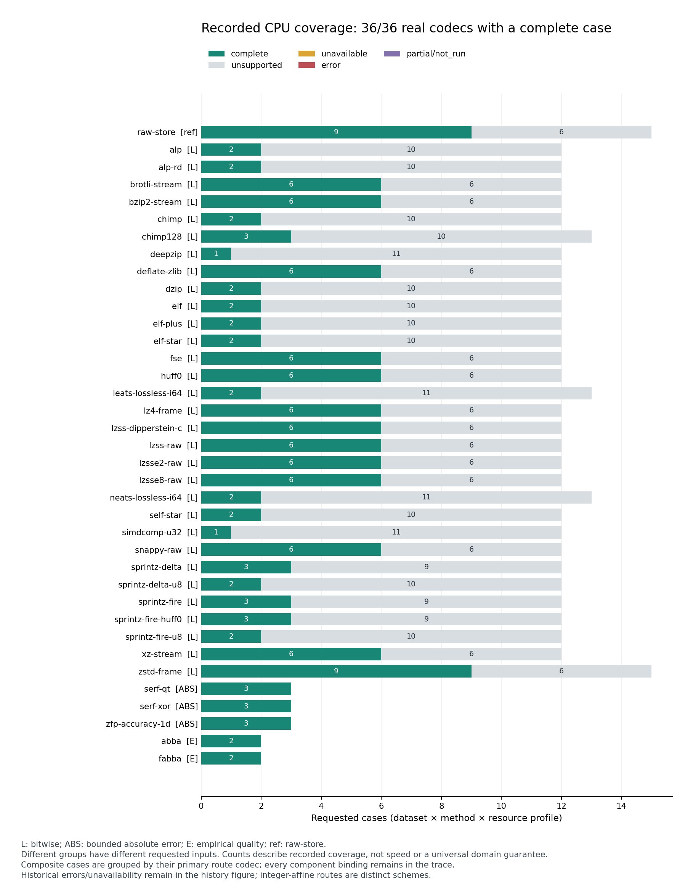
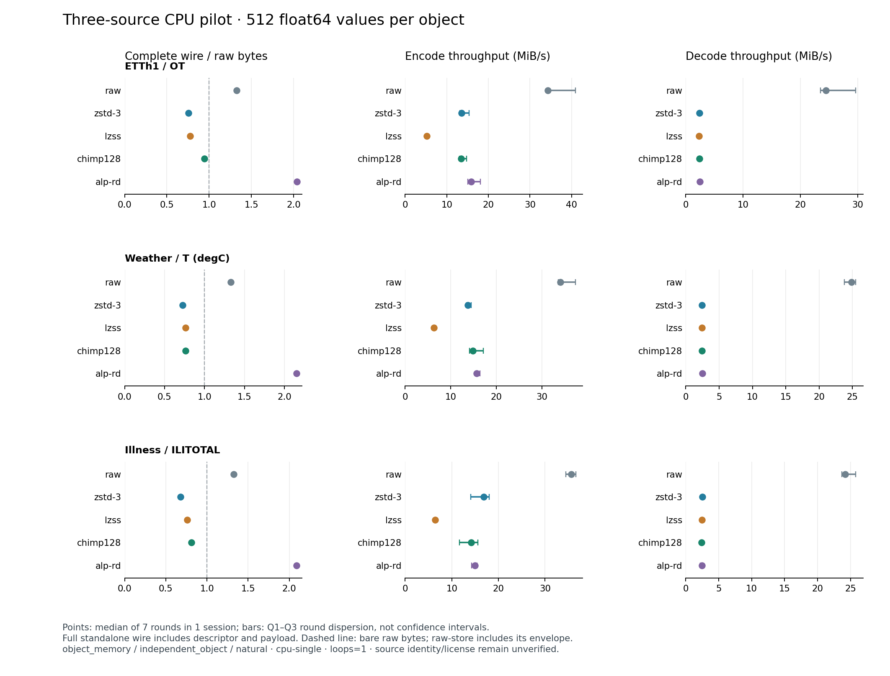
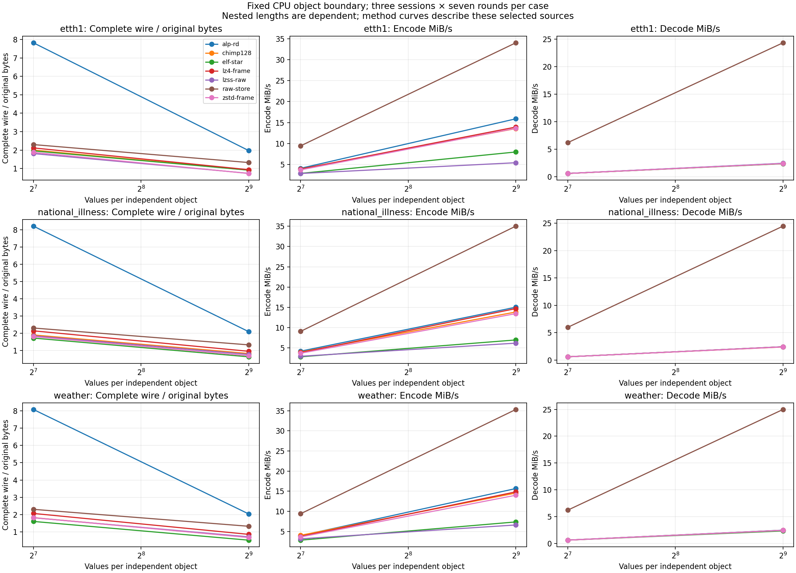
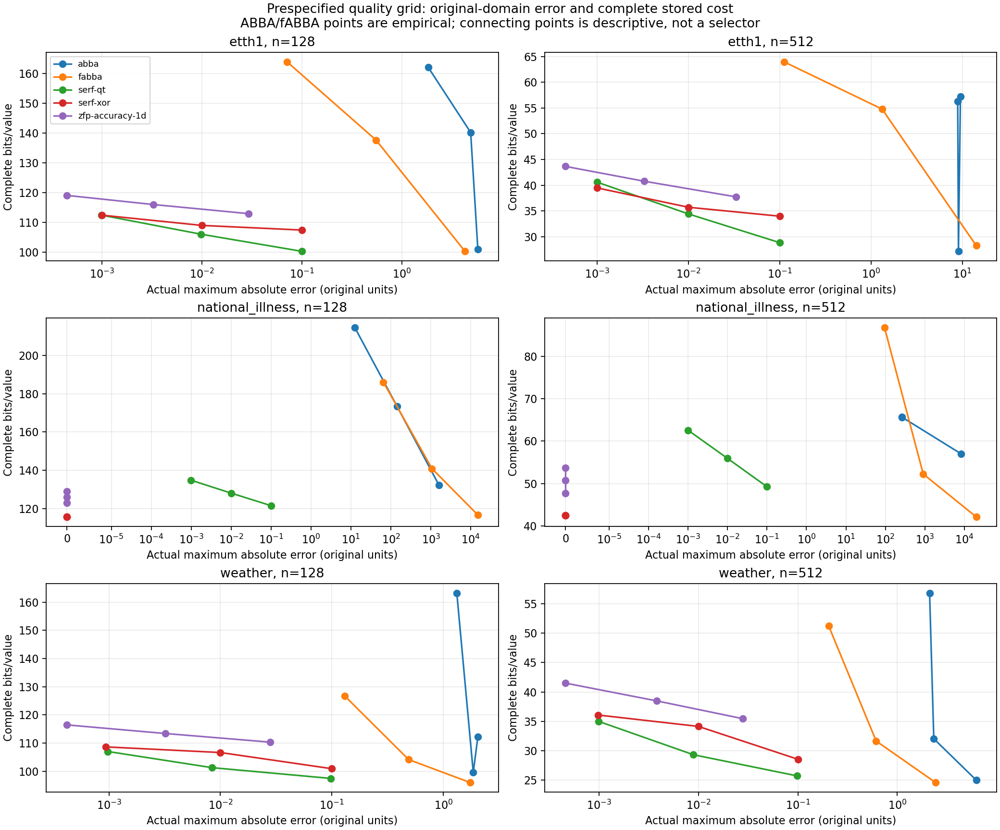
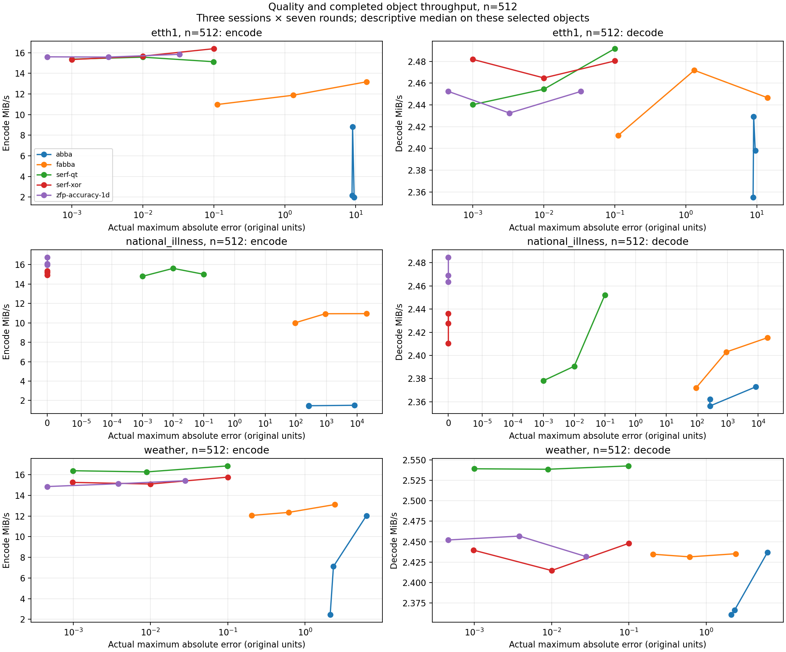

# Benchmark 实施与实际结果（2026-10-13）

独立 `tsbench` 已完成对象编码、独立恢复、验证和描述报告闭环。六组核心正式run共 **1092/1092 measurement trials 成功**，36/36个真实CPU codec key至少完成一个7-round case；真实对象152/152 case、3192/3192 trial通过，PeMS三维对象36/36合资格case、756/756 trial通过。cuSZp原参数严格质量失败保留，显式margin90的四组run共840/840成功；安装构建修复后的GPU控制面另有4case、28/28检查。历史run保留自己的身份。覆盖限于已记录输入和约束，完整测试与当前证据见 [current_evidence.json](current_evidence.json)。

设计与阶段要求见 [V4 工程实施总计划](../TimeSeries_Compression_Benchmark_V4.0_工程实施总计划.md)，执行入口见 [README](../README.md)。架构和执行流程分别为 [architecture.svg](diagrams/architecture.svg)、[workflow.svg](diagrams/workflow.svg)。旧框架先删除，保留资产与删除范围见 [清理记录](cleanup_20261013.md)、[codec 资产](codec_assets.md)。后续路径整理见 [迁移映射](path_relocation.json)；历史 manifest／observations 字节及其中的原路径保持不变，新目录名本身不赋予历史 run 恢复资格。

## 当前实施范围

核心包在 [benchmark](../benchmark/pyproject.toml)，Python ≥3.11，运行时依赖 NumPy；绘图为可选 `analysis` 依赖。包不导入旧框架。真实 C1／RW1 bridge、冻结 source／model、构建记录、capability card 与内置 raw-store 分别承担编码实现、来源、资格和参考基线，`lz77` 仅为 `deflate-zlib` 别名。

输入支持 NPY、具名 NPZ 和显式 dtype／时间解析／窗口的 CSV。任务分别为 values、timestamps、records 和组件投影；V／T／mask 的 dtype、shape、order、roles 及原始字节分母明确记录。独立 row chunk、channel route 和组件组合产生完整 standalone wire，恢复所需 descriptor、payload、model 以及分块目录均计入 stored bytes。当前 wire 协议2对 canonical descriptor 和 payload 均校验，descriptor 中合法数值字段被污染也不能静默改变恢复。协议1保持历史读取兼容，但它没有 descriptor checksum，不能宣称该旧格式具有协议2的完整性保证。mask、T、无效位置和特殊值按策略精确恢复；bitwise 验证保留 NaN payload 和 signed zero，有损误差在原始有效有限域计算。

主执行器接受 CPU `object_memory / independent_object / natural`。每次 encode／decode 使用新 native handle／session，计时覆盖真实完成的对象 encode／decode；每个 trial 验证自己的产物并检查输入不变。exact qualification 用只给 wire 和已安装 decoder 的新进程独立恢复。implementation 小 suite 与 exact-input qualification 是两套内容身份缓存；缓存和 prior PASS 均不能代替新输入的资格。

父进程保存随机 schedule，隔离 worker 顺序执行 calibration、warmup 和 measurement，完整 JSONL 记录 planned／started／stage／terminal、budget、timeout／crash 及 retry。未知 signal 保持未知，SIGKILL 不直接记为 OOM。主摘要按每个预定 `(session, round)` 最早实际执行的终态选取 primary attempt；先前仅 `not_run` 的位置可后续执行，实际失败不会被成功 retry 替换。report 只读取 raw；缺失指标为 null 及原因，空对象不填造比例或吞吐。

显式 `profile.runtime_preload` 和 worker 实际加载库的 maps／hash 证据已加入执行配置，用于可审阅地选择兼容 runtime；`integer_affine_gcd` 作为显式可逆整数 route transform 保存 offset／scale，再在原单位验证恢复。它们以及 wire2 均有自己的配置／实现身份，不能回写原 DZip unavailable 或时间戳错误。

| 阶段 | 已有证据 | 仍待完成的要求 |
|---|---|---|
| P0 最小对象闭环 | 新包、raw-store、Zstd／LZSS、真实 bridge／wire、新进程恢复、失败记录 | CPU 最小闭环已实现；其他 boundary 单独扩展 |
| P1 数据与能力 | NPY／CSV／NPZ、V／T／mask、capability／params、两 ABI、bitwise／质量、完整成本与组合 routes | codec 源域持续以实际输入资格约束；不能从小 suite 推定全域 |
| P2 可靠重复 | 两缓存、隔离 workers、校准／预热、schedule、超时／budget／resume／retry、JSONL 与 describe | 现有 CPU 路径已实现；不同 executor 仍需自身故障／资源证据 |
| P3 论文 CPU 基础 | 三源精确获取／source版本与typed分区冻结；values／T／records、长度／误差梯度132cases／2772trials；source-cluster配对描述；native边界252组 | 3个来源不能替代广域论文语料；ILI评价部分已用于pilot；完整研究覆盖与选择消融仍受声明范围限制 |
| P4 资源扩展 | 已冻结 ISA／线程约束；DZip 声明 3 native threads；独立 Linux RSS／CPU profile；实际W1／2／4进程池共504操作；SSE4.1／AVX2真实路径252trials；cuSZp 资格及两组 host/device formal run | 两个 formal 网格均保留严格 f32 原始域质量约束：ABS=0.01 为 168 ok／84 `not_run`，ABS=0.1 为 210 ok／42 `not_run`；这两组不标记为 complete success。可变native线程／受控scalar消融、stream／query／energy仍未覆盖 |
| P5 复现与投稿 | build／环境／输入身份、raw／恢复产物／图trace；第二Python／NumPy环境独立重建36成员并完成924trials；三源获取校验脚本 | weather包装／ILI数据许可未知；第二机器／OS／ISA及独立第三方未复跑；完整投稿包未声称完成 |

profile 为独立 pass，读取同一 resolved 配置另运行，在 run 自己的 profile 目录保存证据，不修改主 observations。当前 Linux sampler 包含 runner 及可观测 descendants 的 RSS／CPU／thread，记录 baseline 和采样下界；共享页可能重复计入，run-level sampled peak 不能称每 trial 精确 native 峰值。native API 时钟只作独立 C 对照／诊断，与对象主计时分列。

## 当前源码身份的正式运行

以下结果来自本轮完整性与 provenance 修订后的新源码快照和独立 build，所有正式计时串行执行。CPU 六组核心正式结果分别为无损 833、时间戳 28、有损 ABS 63、经验质量 28、records 35、三源 pilot 105，合计 1092/1092。每组 report 都保留 unsupported/error 的分母，不能用旧 run 的同名数字替代当前身份。

| 当前 run | 资格与正式 trial |
|---|---|
| [all_lossless_runtime](../runs/current-core-20261013/all_lossless_runtime/report/README.md) | 119 ready、265 unsupported；833/833 ok |
| [timestamps_normalized](../runs/current-core-20261013/timestamps_normalized/report/README.md) | 4 ready；28/28 ok |
| [bounded_quality](../runs/current-core-20261013/bounded_quality/report/README.md) | 9 ready；63/63 ok |
| [empirical_quality](../runs/current-core-20261013/empirical_quality/report/README.md) | 4 ready；28/28 ok |
| [records_composite](../runs/current-core-20261013/records_composite/report/README.md) | 5 ready；35/35 ok |
| [corpus_pilot](../runs/current-core-20261013/corpus_pilot/report/README.md) | 15 ready；105/105 ok |

真实对象五组 run 位于 [current-real-20261013](../runs/current-real-20261013/)，分别完成 1176、420、840、378、378 个 trial；[只读配对分析](real_object_results-current-20261013/summary.json) 汇总 152 请求、3192 计划 trial、120 个 scheme pairs 和 60 个 layout pairs。窗口、C/F layout、组件方案和原始对象身份均保留在各 run manifest。

cuSZp GPU qualification 的 48 success、48 fresh decoder、30 expected failure 见 [资格报告](research/cuszp_qualification_20261013.md)。两个 P4 formal run 都保留 252 个预定 exact slots：ABS=0.01 为 168 `ok`、84 `not_run`；ABS=0.1 为 210 `ok`、42 `not_run`。未运行槽位对应 f32 中等／大输入的严格原始域 `quality_violation`，不是 codec 崩溃、OOM 或设备不可用；summary 对这些 case 保持 null，因此两个 formal run 均不能标记为 complete success。`host_to_host` 与 `device_resident` 不合并，VRAM 未声明可实施上限；这组 synthetic 一维网格也不代表 ETT／weather MTS GPU 覆盖。

## PeMS、安装构建与交付验证

[PeMS结果](pems_results/README.md)保持4份源文件的原生rank3 `<f8`／C-order，取固定start1024、长度128／512／8192的12对象。48个请求中raw-store／Zstd／deflate共36 ready、Chimp128共12 unsupported；正式执行 **756/756 ok**，每个ready case有3sessions×7rounds。8192行对象原始大小23.5–60.4 MB，均大于本机cpu0所记录L3容量20,971,520 bytes；natural cache且未干预，不作缓存因果主张。嵌套窗口与同采集体系不增加独立source样本量；processed许可、单位、传感器映射未知。

PeMS exact wire-only恢复在新子进程完成，完整wire的descriptor／payload和每轮恢复均核查通过；CPU恢复记录没有逐项持久化decoder PID、execution provenance、native清理计数或effective profile，不能补造这些字段。正式run窗口晚于安装测试结束，所有正式计时已串行完成。精确来源与获取入口见[来源研究](research/additional_data_sources.md)及[获取器](pems_acquisition.md)。

仓库外安装的build原先因配方路径无法相对asset root解析而失败，现记录package配方来源、实际source_path和hash；缺registry或空native选择明确失败。8项安装构建测试包含实际wheel安装、全新Zstd native编译和仅wire恢复257×3 f64对象，见[安装验证](research/installed_build_verification.json)。当前wheel的33个Python源与workspace逐文件相同，见[wheel记录](research/package_installed_verification.json)。

build.py修复保持CPU执行闭包 `d7d0f84e…`，GPU闭包含该文件，因此新控制面身份为 `1e37ea14…`，旧GPU正式矩阵继续保留 `742ab710…`。冻结的[检查配置](../benchmark/experiments/gpu-builder-check/gpu-fixed-smoke.toml)在f32长度33、f64长度32769和两个boundary完成4case、28/28正式trial，见[原始摘要](../runs/gpu/cuszp-builder-check-20261013/summary.json)。native参数0.009、任务strict ABS0.01；这是有限控制面验证，不扩展为新身份下840矩阵全重跑。

本机框架与现有codec的适用任务、约束、拒绝原因和bench结果已具备验收证据，详见[需求范围审计](research/remaining_requirements_audit.md)。源码／配置／当前raw／实际build记录的私有本地导出见[复现说明](reproduction.md)；原始真实数组、系统runtime和不明再分发许可不会由该包取得公开发布授权。广域论文、跨物理机器及第三方复现仍按各自范围陈述。

最终完整suite在基线Python3.11／NumPy1.24为 **308 passed／38.79s**，第二软件环境Python3.14／NumPy2.5为 **308 passed／35.00s**，串行完成且无failures／errors／skips。新增测试验证安装构建、获取读取期间文件变更、获取失败台账和导出证据hash／当前wheel选择等风险。此前267项及中间303项的记录保持历史scope；最新log／XML hash在[current_evidence.json](current_evidence.json)的builder_tests中，测试时间不作codec性能。

## 历史协议2正式运行

最终代码83个测试通过，其中 runtime 绑定／同名 symlink target 变动的 resume 拒绝在20个 runtime 回归中验证。测试耗时不是 benchmark 观测。最终配置输出到名称含 `final` 的独立 run，均已完整串行执行；最终表与主图只采用这些新身份的完整结果，旧 runtime／transform 结果保留为独立历史证据。

| 最终 Run | 请求矩阵／资格 | 正式 measurement trials |
|---|---|---|
| [all-lossless-explicit-runtime-final-20261013](../runs/all-lossless-explicit-runtime-final-20261013/report/README.md) | 384请求：119 ready、265 unsupported，无 unavailable／error | 833/833 ok（含 DZip 14/14） |
| [timestamps-integer-affine-final-20261013](../runs/timestamps-integer-affine-final-20261013/report/README.md) | 4 ready scheme：raw、normalized raw／NeaTS／LeaTS | 28/28 ok |
| [bounded-quality-final-20261013](../runs/bounded-quality-final-20261013/report/README.md) | 9 ready cases：Serf-QT／Serf-XOR／ZFP，ABS=0.01 | 63/63 ok |
| [empirical-quality-final-20261013](../runs/empirical-quality-final-20261013/report/README.md) | 4 ready cases：ABBA／fABBA，经验质量 | 28/28 ok |
| [records-composite-final-20261013](../runs/records-composite-final-20261013/report/README.md) | 5 ready cases：完整 V／T／mask、组件／chunk／channel routes | 35/35 ok |
| [three-source-values-pilot-final-20261013](../runs/three-source-values-pilot-final-20261013/report/README.md) | 15 ready cases：三个本地来源 ×五方法 | 105/105 ok |

六组共421个请求：156个完成全部7轮的 case 和265个明确 unsupported。主覆盖图采用前五组406个请求（141 complete、265 unsupported），三源 pilot 另画空间／速度图，避免重复其方法频次掩盖覆盖含义。共同主边界为 `object_memory / independent_object / natural`，每 case 为1 session ×7 rounds、2 warmups、loops=1；所有成功 trial 仍逐次验证自己的产物。

## 协议1的 runtime／transform 运行证据

路径迁移及 runtime／transform 变更生成新的实现／环境身份；先前 observations 原样保留。协议1的六组记录包括 [无损833/833](../runs/all-lossless-explicit-runtime-20261013/manifest.json)、[时间戳28/28](../runs/timestamps-integer-affine-20261013/manifest.json)、[ABS 63/63](../runs/bounded-quality-current-20261013/manifest.json)、[经验质量28/28](../runs/empirical-quality-current-20261013/manifest.json)、[records 35/35](../runs/records-composite-current-20261013/manifest.json)、[pilot 105/105](../runs/three-source-values-pilot-current-20261013/manifest.json)，共1092个成功正式 trial。它们保留自身实现身份，不能替代最终协议2与 runtime 绑定代码的复验。

## 首轮正式运行与失败历史

以下 run 均保存 [manifest、schedule、raw observations 与描述报告](../runs)。首版预算为 1 session ×7 rounds、2 warmup objects、loops=1。本机记录为 Intel Core i5-13400F、Linux x86_64、Python 3.11.5、NumPy 1.24.3；完整身份以各 manifest 为准。结果仅描述固定输入与本环境，round IQR 表达本 session 的离散程度，不能当跨进程／跨来源置信区间。

| Run | 请求／资格终态 | 正式 measurement trials | 含义 |
|---|---|---:|---|
| [all-lossless-20261013](../runs/all-lossless-20261013/report/README.md) | 384 请求：117 ready、265 unsupported、2 unavailable | 819/819 ok | 六种开发输入 ×31 lossless codec＋raw-store ×两个资源 profile；30 个真实无损 key 完成 case |
| [bounded-quality-20261013](../runs/bounded-quality-20261013/report/README.md) | 9 请求，均 ready | 63/63 ok | Serf-QT／Serf-XOR／ZFP，float64／float32／noise64，原始域 ABS=0.01 |
| [empirical-quality-20261013](../runs/empirical-quality-20261013/report/README.md) | 4 请求，均 ready | 28/28 ok | ABBA／fABBA，float64／noise64，报告实际经验误差 |
| [minimal-20261013](../runs/minimal-20261013/report/README.md) | 3 ready | 21/21 ok | raw-store／Zstd／LZSS 最小闭环 |
| [records-composite-validated-20261013](../runs/records-composite-validated-20261013/report/README.md) | 5 ready | 35/35 ok | raw、全组件压缩、异构组件 route、64-row chunks、channelwise chunks |
| [three-source-values-pilot-validated-20261013](../runs/three-source-values-pilot-validated-20261013/report/README.md) | 15 ready | 105/105 ok | 三个本地来源各 512 float64 values ×五个方法 |
| [timestamps-20261013](../runs/timestamps-20261013/report/README.md) | 5 请求：3 ready、2 error | 21/21 ok（仅三个合资格 case） | raw／Zstd／LZSS 完成；NeaTS／LeaTS 在 exact qualification bitwise_mismatch |

`all-lossless` 的两个 profile 是 `cpu-single` 与 `cpu-dzip-three`。固定双 Eigen 后台 worker 加调用线程使 DZip 的声明为 3 threads；其他单线程成员在三线程请求下明确拒绝，不能把这些 unsupported 解释为数据上失败，也不能用该矩阵推导线程 scaling。dtype、rank、shape、ISA、模型 alphabet 和源算法内容限制均保留对应资格／拒绝理由。

原 DZip unavailable 的原因是隔离 worker 所用 Conda `libstdc++.so.6` 缺少 `GLIBCXX_3.4.30`；构建时可用的 system runtime 与运行进程实际选择不同。原始两行 unavailable 保留，新的 `all_lossless_runtime.toml`／`dzip_runtime.toml` 显式选择 runtime。最终全成员配置的两个 DZip case 已完成14个正式成功 trial；该新证据建立36/36成员覆盖，首轮35/36的历史数字保持不变。

两个尚未 validated 的早期 records／三源 run 保留为故障／修正历史；上表和 pilot 图采用名称含 `validated` 的独立 run，不删除或替换原失败。

## 资格和质量的边界

[最终 native 资格汇总](research/native_qualification_final_summary.md)在当前36个binary／bridge／显式runtime身份下完整重新执行848个案例：834成功、14预期源域拒绝，0非预期拒绝／error；62个配置覆盖DeepZip17个model_key。120个唯一文件hash和36个build／binary index核对一致。覆盖记录中的 dtype、17／257长度、三列矩阵、empty、byte codec rank3／4、SIMD合法ISA／API／tail与u32高位、Sprintz整数位型。该网格没有穷举全域，也未包括大纳秒时间轴反例，0error不能推翻已有反例。

[历史 native 汇总](research/native_qualification_summary.md)仍保留原始范围及身份限制：其中SIMD empty stride修复后的48案例为再资格，其他35成员来自首轮；它不被改写成上述完整最终重跑。资格耗时不作为性能结果。

[直接 native 交叉核对](research/native_crosscheck.md)在 C 中验证结构体 sizeof／offsetof，并对 Zstd／LZSS 的 empty、single、257-byte 输入核对 native payload 与恢复 bytes，六个案例通过。C 与 Python 的 object timing 包含范围不同，不能直接拿不同边界的时间声称 bridge 零开销。DeepZip／DZip 的另进程恢复记录证明其保存案例可在没有 source／外部 model 目录的安装 root 中解码，但原记录的身份绑定限制也已在资格汇总中说明。

最终 ABS=0.01 的九个正式 case 均满足请求：所观察的最大绝对误差最高为 Serf-QT `0.009985480316284434`、Serf-XOR `0.009985292387131528`、ZFP `0.00421202403037757`。该结果是这些 case 的实际质量，不扩展成所有输入的保证。ABBA／fABBA 的参数为经验控制；最终经验质量实验的最大绝对误差分别达到 `4.190377770134724`／`0.7849497550673228`，即使某个 case 恰好精确，也不能把 tolerance 转写成逐点 ABS 上界。

[时间戳反例分析](research/neats_timestamp_failure_analysis.md)读取已保存 native frame 和源码公式，未通过修改 benchmark 绕过错误。输入为 257 个 `<i8` nanosecond timestamps，范围 `0..15_360_000_000_000`，每步通常为 `60_000_000_000` 且有重复点；没有 epoch 偏移，满足 shim 的 signed normalization span。NeaTS／LeaTS 保存的 float32 slope 为 `60_000_002_048` 等，选择 0-bit residual 后未修正 coefficient quantization；257/257 个值均不同，最大偏差 **512000 ns**。原始资格仍为 `error / bitwise_mismatch`。小幅 i16 正式 case 的成功不说明任意 i64 timestamp 无损。新的 `integer_affine_gcd` scheme 在 wire 中保存可逆 offset／scale，把 codec 输入变为整数组合后的单位，并在恢复后按原 ns 位型验证；NeaTS／LeaTS 各完成7个成功正式 trial。这建立新 scheme 在该输入上的证据，不能替代原实现反例或外推任意 i64 域。

三源 pilot 使用 ETTh1 的 OT、weather 的 `T (degC)`、national_illness 的 ILITOTAL，各取 `[0:512)` 并显式解析为 `<f8`。CSV hash 与选列／窗口已记录，V-only 分母均为4096 bytes，未把未请求的 T 计入该分母。pilot运行时未冻结上游／分区；后续[来源核查](data_sources.md)与新study建立精确获取、解析和分区身份，不能追溯改变pilot的原始选择过程。当前本地CSV位于 `/home/fzg/PycharmProjects/材料/TSBench_Corpus`，均为选定来源，不声称领域代表抽样。

## 可重建的图和逐点溯源

[plot_results.py](../benchmark/tools/plot_results.py)只读取 manifest 和 observations，不 import runner／bridge，不启动 codec，也不重写 raw 或 report。默认主覆盖图采用最终前五组：**406 请求，141 complete、265 unsupported，36/36 real codec keys**。不同 fidelity 组的输入／请求数不同，records 复合 scheme 按 primary route codec 分组且完整各组件绑定保留在 trace；此图只表达覆盖，不能用条长排名。



三源图逐对象给出完整 wire stored fraction 及 object encode／decode throughput；每点为7轮 median，横线为 Q1–Q3。bare raw bytes 基准为1，raw-store 的完整 envelope 可超过1。所有 payload／header 均保留在 trace，未扣除 metadata 使短对象压缩率看起来更好。



同目录保存 SVG、[45 个 pilot metric 摘要](figures/pilot_points.csv)与[逐 case／trial trace](figures/trace.json)。trace 包含 plot code、card、manifest／observations、输出图 SHA-256，每个贡献 raw 行的行号和 hash，以及 `run_id / case_id / session / round / attempt`、input／artifact／implementation 身份。修改分析不会改写测量。

[历史覆盖图](figures/history/codec_coverage.png)与[历史 trace](figures/history/trace.json)单独保留首轮402请求的133 complete、265 unsupported、2 unavailable、2 error。新 runtime 成功和归一化 scheme 成功都不会擦去旧失败。历史三源图也读取自己的旧 code／wire 身份，不能与最终图混成同一次测量。

```bash
python benchmark/tools/plot_results.py
python benchmark/tools/plot_results.py --historical --output docs/figures/history
# 新运行追加证据，原 unavailable/error 仍在覆盖图中：
python benchmark/tools/plot_results.py --extra-coverage-run runs/<new-run>
```

## 后续三源 study、边界与第二软件环境

[固定study](../benchmark/experiments/cpu-study/study_design.json)采用3来源×128／512点，3sessions×7rounds，全部132case／2772trial通过。42个无损case、54个严格ABS质量case和36个经验质量case分组保存；不跨误差界作同质量排名。[分析结果](study_results/README.md)给出同对象Zstd配对、完整／payload／header成本、原始域质量、全部状态和逐trial行号。来源等权bootstrap只在3个选定source上重采样，nested窗口与重复session不增加source数；区间为探索性描述。Pareto是实际误差／完整大小／encode／decode四维事后oracle，不是线上selector。

[数据冻结与获取](data_sources.md)核实3个远程CSV与本地SHA-256精确相同，保存source版本、许可证据、开发／评价及typed V／T字节hash，并完成真实下载与失败拒绝验证。ETT／weather评价为[1024,1536)，ILI为[256,768)，128点是512点前缀。**ILI评价[256,512)曾用于历史pilot**，不能称完全未观察的test；开发区预留且未用于当前固定网格调参。ETDataset专用数据许可为CC-BY-ND-4.0；MPI原始weather数据为CC-BY-4.0；weather预处理包装和ILI许可仍未知，仓库只给获取路线与hash，不捆绑原始CSV。

[边界实验](boundary.md)完成Zstd／LZSS×6长度×3sessions×7rounds共252组，三条路径实际native输入／payload／恢复相同，runtime重叠库hash全部相同，全部产物再读回验证。直接C与preparedPython的匹配API比率仍含process／cache生命周期差异，不是单一FFI因果成本。完整对象包含的session／分配／packing／checksum等独立列出，不从API时间扣减。

[第二软件环境比较](alternate_environment_results/README.md)在同主机／OS／编译器下使用已安装Python3.14.5／NumPy2.5.3，独立重建36个codec并完成924／924trial；请求资格与基线一致，逐case质量／成本／时间可追到raw。环境运行未随机化且每case1session，不作版本性能因果主张，也不代表第二机器／OS／ISA或第三方独立复现。[通用复跑工具](../benchmark/tools/replay_environment.py)支持在所选解释器中独立buildroot执行，已有输出禁止覆盖。

[外部进程池](pool.md)最终运行504／504集合操作通过：固定4对象×raw／Zstd×W1／2／4×cold／persistent×3sessions×7rounds×encode／decode。集合连续wall实际覆盖派发、IPC、编码或独立恢复、完整目录／有序对象重组；cold计spawn/setup，persistent单列建立和预热。verification／输入fingerprint／shutdown在availability clock外，各存证据，不能称完整进程生命周期。每个encode集合另作独立wire-only恢复，测得decode验证本轮全部成员。24个operation group均21／21，W1配对session均3／3；固定条件顺序的小对象结果不声称通用scaling。父进程与全部worker的累计CPU／RSS／线程／runtime分别记录。修复前首轮504成功操作与源码仍独立保留，最终run绑定修复crash／timeout竞态后的源码。

[SIMDComp实际路径](isa.md)完成12case／252trial，SSE4.1与AVX2在相同MASKED API及canonical／实际input上逐轮恢复，84paired rounds、8保存frame几何核对mode／block／tail／width。没有scalar实现对应，且内部blocks128／256和tailAPI不同，不能归因于单独向量宽度。source／真实per-TU flags／本次SBP1模式共同提供执行证据。

完整扩展suite在基线与第二软件环境均 **116 tests passed**，分别12.88s／16.35s；83为前述core时点数量，新数量包含pool／boundary／study及分析完整性风险测试。实际currentcatalog三个CSV再次验证成功；迁移的26份历史raw hash保持不变。全部最终证据与代码／输入／raw hashes见[completion_evidence.json](completion_evidence.json)，不同边界及资格case不混合累计。

三源图由保存的raw分析重建，完整成本／长度、实际rate-quality及quality-speed分别保存PNG／SVG和[hash trace](study_results/figures/trace.json)：







以上扩展增加CPU研究证据。[扩展可用性探测](research/extension_availability.json)保留历史 sandbox `nvidia-smi` returncode9；宿主只读探测已确认 RTX2070/driver535.288.01，cuSZp correctness 与 formal host/device 结果见上节。完整论文实验套件仍缺广域来源、共享模型成本、可变线程/scalar消融、跨机器/OS/ISA和独立第三方复现，不能把当前 run 标成全部研究要求已完成。


后续完整性补强见[输入／质量／分母／执行来源说明](research/integrity.md)和计划§14.12。旧表格及证据索引继续表示原测量实施身份。新代码已修正多列mask/schema投影、越界窗口、point-relative违例统计、ZFP native effective tolerance、精确schedule和具名源码／环境证据；当前core身份已由current-core六组新run证明，旧1092trial仍保留其原实施身份。

[GPU宿主探测](research/gpu_host_probe.json)已纠正沙箱unavailable的解释：宿主RTX2070／driver535.288.01可见，原rc9不表示宿主driver失败。[cuSZp资格与正式结果](research/cuszp_qualification_20261013.md)以及 `runs/gpu/cuszp-formal-*` 保存了真实设备证据。[真实对象配置](../benchmark/experiments/real-objects/README.md)已冻结并完成152请求、3192 trial；仍需保持广域数据、部署消融和独立复现的未覆盖声明。

本轮当前 native 资格网格在 `build/tsbench-current-20261013` 的36个binary上重新执行：834成功、14预期源域拒绝、0意外错误。新证据及267项双环境测试的XML/log hash见 [current_evidence.json](current_evidence.json)，该文件与历史completion_evidence分开保存。

后续显式90% native参数敏感性配置已分别完成：synthetic ABS=0.01/0.1各252/252，ETT OT/weather T单列f64各168/168。任务strict ABS未放宽，原参数失败保持原样；新配置的选择发生在失败观察之后，不称盲选或全域保证，见 [参数说明](gpu_margin90.md)。真实GPU单列不代表多变量GPU语料。

当前核心图采用新run只读重生成：[coverage](figures/current-20261013/codec_coverage.png)、[pilot](figures/current-20261013/three_source_pilot.png)、[trace](figures/current-20261013/trace.json)。纯分析风险回归37项通过。纯Python wheel构建和仓库外isolated decoder验证见 [package_verification.json](research/package_verification.json)；恢复只收到真实wire及明确安装roots，bitwise通过，但不称独立机器复现。

[GPU只读分析](gpu_results/README.md)保留原参数和margin90/真实单列分层，6个formal run、64个case中58个成功case与6个原始失败case分别报告；实际源码和raw hash未改写，逐case结果可追到observations及artifact。
