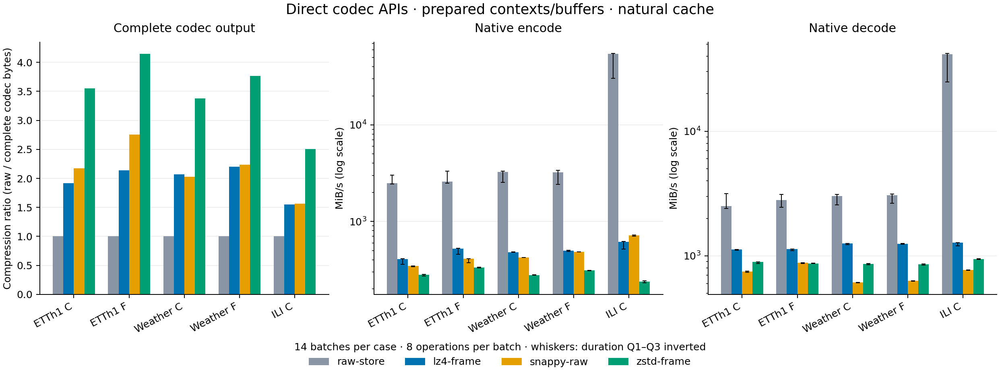

# 原生默认测量结果（2026-10-15）

默认目标已经切换为 `native_core / prepared / natural`。本轮主表使用 **raw-store、Zstd frame、LZ4 frame、Snappy raw 四个直接入口**，在五个真实 V-only 对象上完成 **20 cases、280/280 正式 trials**。首次请求、C1／RW 原生 API 与原完整对象目标各自单列；历史对象结果保持原身份。

六组串行实验共 **792 个请求、181 个 ready、611 个 unsupported、2534/2534 正式 trials 成功**。这些是不同边界下的执行覆盖数，不能合并成一个性能排名。36/37 个真实 CPU codec key 在其适用输入上完成 `native_api` 辅助测量；Gorilla 的联合 T/V 原生 batch 入口尚未接入，其历史 records 对象结果仍保留。

| 测量组 | 请求 cases | ready | unsupported | 成功／计划 trials | 角色 |
|---|---:|---:|---:|---:|---|
| [core prepared](../../runs/native-core-real-20261015/report/README.md) | 190 | 20 | 170 | 280 / 280 | 主表 |
| [core fresh_request](../../runs/native-core-fresh-20261015/report/README.md) | 190 | 20 | 170 | 280 / 280 | 首次请求辅助 |
| [API lossless](../../runs/native-api-lossless-20261015/report/README.md) | 384 | 113 | 271 | 1582 / 1582 | 接口辅助 |
| [API bounded_abs](../../runs/native-api-bounded-20261015/report/README.md) | 6 | 6 | 0 | 84 / 84 | 接口／质量辅助 |
| [API empirical_quality](../../runs/native-api-empirical-20261015/report/README.md) | 2 | 2 | 0 | 28 / 28 | 接口／质量辅助 |
| [object reference](../../runs/object-reference-real-20261015/report/README.md) | 20 | 20 | 0 | 280 / 280 | 完整 wire／对象辅助 |

每个 ready case 为 2 sessions × 7 rounds，描述样本量 **n=14 轮观测（native 为 14 个 batch）**。每个 native batch 内为 8 次正式编解码与 2 次预热；这些内循环不增加独立样本数。2254 个正式 native trials 共保存 **22540 份逐次编解码配对产物的验证记录**，全部通过，且实际输入 buffer 未被改写。每个 ready case 还通过独立进程的 exact-input 恢复资格。未发生正式 trial 的 error、crash、timeout、oom 或 not_run；预期资格拒绝仍在请求分母中。

## 主结果与输入



可下载 [SVG](native_core.svg)、[20 行主结果及 IQR](core_table.md)、[主表 CSV（包含全部 190 个请求）](primary.csv)。CSV 另保存原生每次操作时间的 median、Q1、Q3；吞吐使用逻辑 bytes／时间中位数，图中误差线为 Q3、Q1 时间的倒数范围。所有压缩大小在本轮各 case 内一致；未删除慢值或减去空循环时间。

| 对象 | dtype／shape／layout | 有效原始 bytes | V 标量数 | 源窗口 |
|---|---|---:|---:|---|
| etth1-values-c | `<f8`／8192×7／C | 458752 | 57344 | ETTh1，行 [2048,10240) |
| etth1-values-f | `<f8`／8192×7／F | 458752 | 57344 | 同上，布局作为独立任务 |
| weather-values-c | `<f8`／32768×3／C | 786432 | 98304 | weather，行 [2048,34816) |
| weather-values-f | `<f8`／32768×3／F | 786432 | 98304 | 同上，布局作为独立任务 |
| ili-values-c | `<f8`／512／C | 4096 | 512 | national_illness 的 OT，行 [0,512) |

选列、解析、来源 hash 与窗口均固定在[实验设计](../../benchmark/experiments/native/design.json)及各 manifest 中。每个对象的四个 codec 使用相同 `codec_input_id` 和相同逻辑分母；不把时间戳、padding 或 ABI 头加入这些 V-only 分母。C／F 对象来自相同原数据，不能作为额外独立来源。

本轮五个对象上，Zstd 的压缩倍数为 **2.508–4.145**、编码 **238.29–332.02 MiB/s**、解码 **855.60–938.80 MiB/s**。这些是本机固定输入、参数、构建和自然缓存条件下的描述范围。完整逐对象比较见主表；不据此推断所有数据、最优 ISA 构建或其他硬件上的名次。

主表分子始终是有效逻辑输入／恢复 bytes，大小是 codec 的完整必要输出。Zstd 的整帧、LZ4 的 begin/update/end 输出、Snappy 长度头都计入；框架 JSON／hash／来源信息保存到独立 `.experiment.json`，计入 codec 大小为 0。原始 `.codec` 及其 hash 保存在各 run 的 artifacts 中。

## 辅助边界与质量

[fresh_request 表](fresh_table.md)包含每次 context 创建／配置、bound、调用方 buffer 分配、完整操作和 context 关闭。为逐份验证而保留的输出 buffer 最终释放在计时外，且本轮有预热，因此不能解释为冷进程启动或包含全部释放的总生命周期延迟。prepared 预建 context、预分配并触页；每次对象所需 reset、采样、建模与 finalize 仍在算法时钟内。

[object 表](object_table.md)保留完整 framework wire 大小和 Python 对象处理 wall time。[全部辅助 CSV](auxiliary.csv)按 boundary、lifecycle、profile 列出 602 个请求。两个模式的结果用于展示各自完成边界；不得通过相减估计某个组件的纯开销，也不跨边界排名。

API lossless 采用六个 257 行开发 fixture 验证 dtype／模型／线程约束，不承担跨来源语料排名。271 个 unsupported 中，144 个来自 dtype、114 个来自线程 profile、12 个来自 Gorilla 联合入口未实现、1 个来自 DeepZip 模型 alphabet 的 exact-input 拒绝；该 DeepZip 在合法的 symbols4 输入上成功。DZip 单列 caller＋2 Eigen workers 的三线程 profile，未混入单线程组。

API lossless 的 **45 cases／630 trials** 已核实完整 codec 输出；**68 cases／952 trials** 完整大小尚未审定。bounded 的 **6 cases／84 trials** 同样保留大小未知；这些行的压缩倍数、bits/value 和 `codec_complete_bytes` 为 null，实际 `native_output_bytes` 另列。完整 C1／RW API 时间包含 shim 扫描、转换及内部分配，是接口辅助结果。

| 输入／codec | 最大绝对误差（所有产物最坏值） | RMSE（所有产物最坏值） | 质量规则 |
|---|---:|---:|---|
| f64／Serf-QT | 0.009980000000014755 | 0.004769401499295358 | bounded_abs ≤ 0.01 |
| f32／Serf-QT | 0.0098419189453125 | 0.005872252316607484 | bounded_abs ≤ 0.01 |
| f64、f32／Serf-XOR | 0.0078125 | 0.0007444094219472154 | bounded_abs ≤ 0.01 |
| f64、f32／ZFP | 0 | 0 | bounded_abs ≤ 0.01；仅此 fixture 实测 |
| ILI／ABBA | 5129.80101059092 | 2329.4042798149103 | empirical_quality，无绝对误差承诺 |
| ILI／fABBA | 58113.161048691254 | 29344.700637960334 | empirical_quality，无绝对误差承诺 |

bounded 的 violation_count 均为 0。ZFP 每份真实 payload 在计时外解析，请求 tolerance=0.01、原生有效 tolerance=0.0078125；该参数与任务误差上限分别保存。ABBA／fABBA 的通过状态只代表恢复有效且质量如实记录，不能解释为误差小于压缩参数 0.1。它们的完整输出分别为 2690／1930 bytes，压缩模型也在帧中计费。

## 核验与复现

[独立证据索引](../native_evidence.json)固定六个 run 的 manifest／observations／report hash、源码快照、driver 构建、测试和报告产物身份；[审计说明](audit.md)记录精确范围。全部 run 为 `state=complete`、`execution_source_unchanged=true`，共同 execution source 为 `sha256:694351d78288fc077c2c88f311e8c308943c38981d64a3cd1f36bdbe47c9c7b2`。各自 snapshot_id 包含不同保存路径，内容闭包一致。旧 [current_evidence.json](../current_evidence.json)保持历史范围。

完整 suite **372 passed**，见 [pytest 日志](../../build/verification/native-default/pytest.log)与 [JUnit](../../build/verification/native-default/junit.xml)。构建和测试均在正式测量前结束；[串行时间记录](../../build/verification/native-default/serial_measurements.json)给出 12:47:22–13:02:40 UTC 的六组顺序执行窗口。审计、本页图形和架构图最终状态同步在全部正式测量结束后完成，均未与正式计时并行。

测量主机为 Intel Core i5-13400F，Linux x86_64，Python 3.11.5／NumPy 1.24.3。实际 affinity 为 CPU 0–15，core 主表单次操作单线程，DZip API 辅助另列三线程，未将进程固定到某一个核心；自然缓存，无频率／cache 冷热干预。256 MiB 预算约束输入及保留输出／恢复 buffer 等调用方内存，不涵盖 codec 内部分配或总 RSS。现有 Zstd／Snappy 构建存在已记录 ISA／assembly 限制，见[参考笔记](../research/native_reference_notes.md)；不声称峰值优化性能。固定 8 次操作的短 batch 尤其是 4 KiB raw-store 会受时钟与循环成本影响，这些成本保留在实测中。

在项目根目录运行；原始 CSV 与 frozen codec／model 资产必须可用。复测使用新 output 路径，保留本轮证据：

```bash
export PYTHONPATH="$PWD/benchmark/src${PYTHONPATH:+:$PYTHONPATH}"
python -m tsbench build --all
python -m tsbench build-driver
python -m tsbench run benchmark/experiments/native/core.toml --output runs/reproduced-native-core
python -m tsbench run benchmark/experiments/native/fresh.toml --output runs/reproduced-native-fresh
python -m tsbench run benchmark/experiments/native/api_lossless.toml --output runs/reproduced-native-api-lossless
python -m tsbench run benchmark/experiments/native/api_bounded.toml --output runs/reproduced-native-api-bounded
python -m tsbench run benchmark/experiments/native/api_empirical.toml --output runs/reproduced-native-api-empirical
python -m tsbench run benchmark/experiments/native/object.toml --output runs/reproduced-object-reference
```

`run` 自动生成各自报告；单独运行 `python -m tsbench report <run目录>`可从 raw 重建。`python benchmark/tools/report_native_results.py` 只审计本轮固定的六组已保存结果并重建 CSV／表格／图／证据索引，不执行 codec。报告工具源码身份写入证据索引。本页为描述性结果，没有执行跨物理机器复现或论文总体统计推断。
