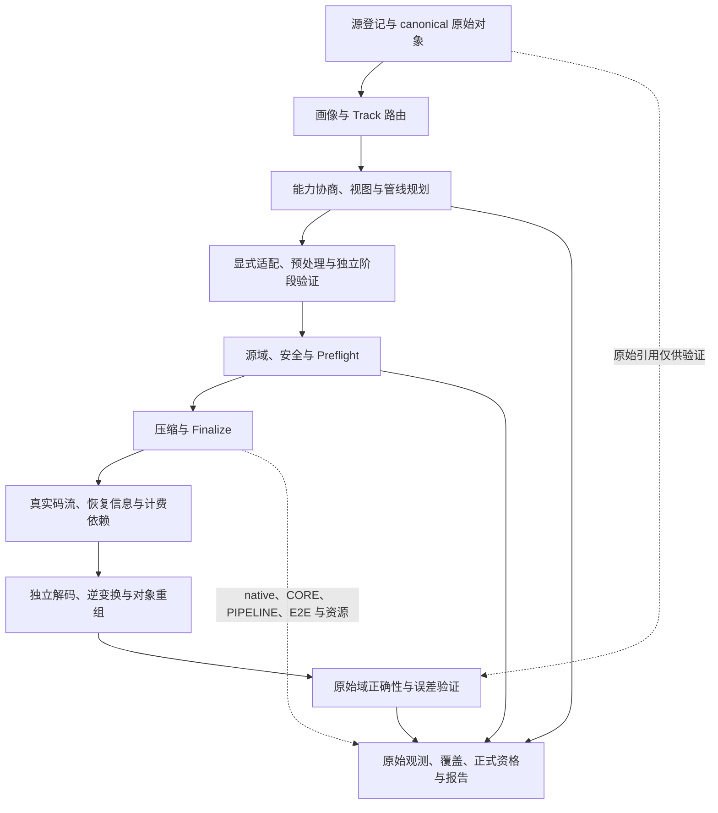

# Time-Series Compression Benchmark V3.1 工程实施总计划

> 当前规范基线：V3.1，2026-10-10 修订；在 V3.0 的完整恢复与审计合同上，将“同类方案在多个共同数据集上可正式比较”提升为核心交付目标。
>
> 项目：`/home/fzg/PycharmProjects/TSDataCompressBenchMark`；控制面 Python，算法数据面为冻结原版或经审查的实现。
>
> 本文版本不改变现有 `schemas/v2`、canonical 格式或 C ABI 版本。新比较合同、Schema 和执行能力均须另行实现、版本化并验收。
>
> 当前代码与活动范围见 §1.5、§20；§1.1–1.4、§18 的历史资产表、§19 保存 2026-10-09 证据，不能代替当前资格。
>
> 长期接入以当前 `algorithm_implementation_plan.csv` 的大多数候选为规划范围，当前33个活动入口只是近期交付切片；清单版本、分类与长期比较路线见§1.6、§7.11、§15.4。
>
> 本次是计划重写与静态核查，不执行算法修改、重新接入退出算法或大规模 FORMAL。目标条款不构成已实现/已测通过声明。
>
> 修订前全文：[V3.0 本地快照](docs/plans/history/TimeSeries_Compression_Benchmark_V3_工程实施总计划_before_comparability_revision_20261010.md)；配套：[算法完整性与性能支持矩阵](docs/algorithm_capability_support_matrix_20261010.md)。

快照保持修订前字节不变，其中相对链接按原文件所在的项目根解释；当前可浏览材料索引见本文§18。

## 0. V3 的目标、取舍与使用规则

### 0.1 顶层验收目标：入口完整与横向比较同时成立

**完整 Benchmark 应完整处理预定任务；完整 Codec 应完整实现声明域；具有比较价值的同类方案必须能在预先冻结的多个共同数据集上完成相同任务并形成公平比较。**

项目有三个独立完成维度：

| 维度 | 必需结果 | 不能替代它的结果 |
|---|---|---|
| 入口完整 | 每个宣称已接入的入口至少一组合法输入，经规划、预检、编码、Finalize、独立解码、原始域正确性与账本闭合；域外明确拒绝 | 能编译、工厂创建、单独 SDK 调用或历史 PASS |
| 比较完整 | 每个本次承诺交付的比较组有共同任务/语料/预算，至少两种不同且适用的方法在多个共同数据集上形成FORMAL比较（实质算法变体按§7.8计数，参数/build副本不凑数）；其他计划成员保留缺口与终态 | 每个算法各选一份不同数据跑通；只列没有共同合同的速度 |
| 证据完整 | 原始观测、源码/构建/数据/参数/路径身份、恢复成本、覆盖及资格可重建 | 手工表格、仅最佳样本、删去失败后的结果交集 |

不要求所有算法接受全部 dtype、数据集或性能功能。SIMD、流式、多线程、query、设备等分别声明、分别验收；算法源域不允许的输入不能为了进组而放宽。P0 primitive、摘要和索引按声明任务接入，未形成完整恢复方案时不进入完整压缩方案榜。

完整闭环增加比较组规划：

```text
源数据/canonical 原对象 → 原始语义、RawBits与内容身份
→ 比较组/核心语料/参数政策/期待矩阵冻结
→ Track路由与能力协商 → 显式适配/预处理及child源域检查
→ 安全预检 → 编码＋Finalize → 真实码流与全部恢复依赖
→ 独立解码＋逆变换/重组 → 原始域验证＋大小/时间/资源
→ 单入口资格 → 同实现统计 → 共同任务跨算法比较＋覆盖/失败报告
```

至少提供两条比较主线：**共同原生域**回答相同实际输入上原生 API/实现的效率；**共同原始对象完整方案**回答同一实际数据恢复任务应采用什么方案，允许已验证的不同可逆表示、逐列、分块或字节序列化并计入完整成本。二者不可互换命名。

### 0.2 主线、能力边界与暂缓方向

| 方向 | V3.1 决定 | 验收边界 |
|---|---|---|
| 同类共同任务、多数据集正式比较 | 核心主线 | 先定义组与核心语料，再资格/测量；不按运行结果找共同成功子集 |
| 原生支持域内 API/C/C++ 实现比较 | 主线 | 固定实际输入和计时边界；补 native timer，不把语言标签当因果解释 |
| 同原始对象的完整方案比较 | 主线 | 允许 direct/可逆适配/逐列/组合；冷恢复、原始分母与全部成本一致 |
| ND、逐列、分块、tail、T-codec＋V-codec | 分阶段主线 | 用于解决实际比较缺口；不得冒充子算法原生能力 |
| 十种基础dtype与有/无T、UTS/MTS | 数据合同基础 | 框架原样表达；各算法按谓词支持或拒绝，不能全局转f64 |
| SIMD、内部MT、外部块/列并行、stream、query | 独立能力/profile | 有源能力或真实组合需求时实现；分别测实际路径、状态与资源 |
| IEEE bitcast、signed映射、宽整数拆字 | 按比较缺口接入 | 独立身份、域证明、恢复描述和成本 |
| 有损量化、归一化、learned | 独立fidelity/模型合同 | 同原始域误差或明确质量目标；参数调优与模型成本透明 |
| 通用fallback | 可选方案 | 事前分支政策、实际method；不能把fallback归为目标算法原生成功 |
| 所有算法对所有文件PASS | 不设为目标 | 使用任务组核心域与扩展能力矩阵 |
| P3、GPU/FPGA/QAT、文件/设备E2E | 扩展路线 | 真实系统/传输/同步/I/O边界，未实现不填零 |
| 立即重建C/C++ Runner | 可选后续 | 不解决共同任务、源域、恢复或比较投影问题 |

### 0.3 规范词与证据状态

- **MUST**：适用条款不满足，不能取得对应资格或进入对应正式比较。
- **SHOULD**：默认实施；例外须记录理由、影响与覆盖范围。
- **MAY**：可选扩展；启用后仍遵守身份、计费、验证和失败合同。
- **已实现基础**：能定位到当前代码；不自动意味着所有输入域均已验收。
- **已有范围证据**：有冻结数据、参数、执行闭包和结果；仅对其范围有效。
- **待实施 / 部分实现 / 阻断**：不得在 manifest 或报告中提前签署通过。

“正确拒绝的测试通过”“算法压缩成功”“源码一致性通过”“正式统计合格” MUST 分开。文档复选框、Excel 的历史 FULL_PARITY、能编译或工厂能创建对象，均不能代替运行资格。

### 0.4 权威关系与本次修订范围

用户当前请求和后续明确决定优先。本 V3.1 是后续实施基线；V3.0/V2、论文、Excel、历史报告是方法或证据材料，不能覆盖用户退出决定、真实源域和执行证据。

V3.1 替代“单入口合法样本全部跑通即可视为完整 Benchmark”的不足完成定义，新增共同任务、比较组、固定核心语料与成对比较验收。原始域验证、FinalBits、安全、源码一致性、正式时长/重复和旧记录不可变原则继续有效。

外部资料用于求证机制与实验边界；项目的组ID、首批成员、最少数据集数量、门禁和实施顺序属于本项目工程决定，不能归称论文或通用标准。新增合同名称均为设计要求，未发布 Schema/解析器前不当作现有 CLI 能力。

当前活动范围按§20；长期接入按用户本轮说明覆盖CSV中的大多数候选，按任务族分批兑现，不能把现有33入口视为项目最终上限。已经明确退出的具体实现继续保留退出状态；CSV仍有同名记录或发生重编号不自动恢复它。许可证已有用户决定继续有效，不因文档升级重新制造审批。原始Word/Excel历史审阅范围维持原说明，本轮不声称重新渲染或重签其资格。

## 1. 历史基线、当前实现与比较缺口

### 1.1 2026-10-09 框架与资产快照

项目已具备 Git、Python 框架、`schemas/v2`、Registry、canonical reader/writer、四态协商、基本适配、预检、执行、原始域正确性、账本、计时、统计与报告。V2 §3.1 的“无框架、无 Git”是建项历史，不能继续作为实施起点。

| 2026-10-09快照事实 | 当时证据范围 | 不能据此推出的结论 |
|---|---|---|
| 67 个根注册项：63 个真实算法入口、4 oracle；另有 4 别名 | 当时`registry/codecs`与注册审阅 | 不是 67 个独立算法；别名不重复计能力或覆盖 |
| Excel 五表，221 逻辑条目、115 C/C++ 候选，首批重写历史完成 13/15、2 阻断 | Excel 2026-10-07 快照 | 不等于 221 条已接入或全域资格通过 |
| 63 真实入口、4 oracle、4 别名的三个 scope，共 213 个范围资格用例 | [计时范围审阅](docs/all_algorithm_timing_scopes.md) | QUALIFICATION，每入口选定输入；不等于正式性能或全数据覆盖 |
| 18 个重写入口有 CORE/PIPELINE/E2E 路径，缺内部 native timer | 当时session实现及计时说明 | CORE 不能替代 native API 或 kernel 时间 |
| 已实现逆适配后对原始输入的正确性检查 | `validation/correctness.py`、`execution/orchestrator.py` | 仍依赖原输入 dtype/shape；尚不足以证明 P2 完全自包含恢复 |
| CSV/NPZ 正式登记；canonical 文件可读和可路由 | `datasets/registry.py`、`loaders.py`、`canonical.py` | canonical 尚未作为正式源格式贯通 CLI |
| 基本连续化、转置、类型转换、端序、对齐和安全 padding | `adapters/compatibility.py` | 不等于通用 ND 映射、逐列、尾块和组合执行 |
| 原始 / codec / native 输入大小、stage/native 可选时间字段 | `measurement/contracts.py` | 当前适配读写与分配遥测仍有估计与汇总，不能宣称逐阶段准确实测 |
| FORMAL 与 QUALIFICATION 分开、完整重复及资源门禁存在 | `execution/repetition.py`、`statistics/engine.py` | 一次 PASS 不自动生成摘要；环境排除不等于编解码失败 |

源资产的“221 条、72 仓库”是清单口径，不是当前 clean/build/许可的统一证明。每次接入按实际 SourceArtifact 和 translation-unit closure 冻结；仓库当前状态必须重查，不能沿用 V2 的全 clean 描述。

### 1.2 Dataset_Verify v1 历史覆盖与当时缺口

`Dataset_Verify` 已有 1,356 个无后缀 canonical 文件，约 2.68 GiB；目录由 `.gitignore` 的 `/Dataset_Verify/` 排除。当时组成：

| 集合 | 内容 |
|---|---|
| 主矩阵 640 | 有 / 无时间戳 × UTS / MTS × 10 dtype × 4 体积 × 4 模式 |
| dtype | i/u8、16、32、64，f32、f64 |
| 体积档位 | 4 KiB、64 KiB、1 MiB、16 MiB 的 T＋V 总载荷目标；不等于文件大小或某 Track 输入大小 |
| 数值模式 | constant、slow、periodic、random |
| 补充集合 | length_extrema 560、IEEE 8、timestamp_cases 60、channel_counts 80、mixed_dtype 8 |

当时确认的缺口（已修项见§1.5/19）：

1. 生成器 UTS 的逻辑 `value_shape` 写成 `[N,1]`，而物理列为一维。rank 协商先拒绝 StreamVByte / Simple9 本来合法的 uint32 UTS。须版本化修正为 `[N]`，或注册 singleton-axis 可逆视图，不能运行时私改原描述。
2. 缺正式 canonical importer、源登记、画像、准备快照及 resume 身份核对。SDK 直接调用不是正式入口验收。
3. 现 validity=NONE、同步 UTS/MTS 为主；需补 N=2、更多 M 边界、ND、async/ragged、validity、overflow、误差界、状态、strided/misaligned 内存视图等。
4. Histogram、WaLLoC、DeepZip 缺匹配当前 profile 的专用正向与域外拒绝数据。现有专用 CSV fixtures 可作起点，不能把普通矩阵改 units 就冒充专用语义。
5. 部分档位超出当前注册限制，例如 Sprintz `N≤131072`、FSE `N≤8192 / raw≤131072`。先查限制来自源 API、适配器、资格范围还是资源预算，再扩接口或注册分块管线。

已做文件校验、路由及 548 次 zlib SDK 回环，只证明这些内容和直接路径有效；没有证明全算法正式协商与 Preflight。zlib 当前未注册 SYSTEM，直接 SYSTEM 回环不能签成正式 SYSTEM 资格。

### 1.3 2026-10-09真实数据与统计诊断的解释

以下是已有报告证据，本次未重跑：

- 17,235 项网格为 QUALIFICATION，`eligibility=false`。全组合有结果不意味着全组合编解码 PASS 或正式摘要。
- 完整 ETTh1：17,420 行；18 重写入口默认 11 个通过。TRISTAN/CORAD 的窗口 40 存尾窗，显式窗口 20 可合法通过；其余 5 个受字节、模型、音频或 Histogram 合同限制。
- Chimp、Elf、TRISTAN、CORAD 共 80 次 FORMAL 编解码正确性通过。合格观测分别 11、17、11、8；前三者有摘要，CORAD 因不足 10 条被排除。系统换页观测不能归因为 codec 自身换页。
- PEMS04 保留 `[16992,307,3]`；18 重写入口的原合同均拒绝，未调用算法。需要明确 ND 视图 / 管线，不能把“协商拒绝”记为解码通过。

详见[数据覆盖分析](outputs/dataset-verify-coverage-analysis-20261009/算法数据覆盖与原生性能比较分析.md)、[CSV/NPZ 诊断](outputs/rewrite-csv-diagnosis-20261009/普通CSV与NPZ重写算法阻断分析.md)。这些本地产物用于审阅，长期资格须保存可复现规格与证据包，不能仅依赖 ignored 输出目录。

### 1.4 升级时发现的风险与后续要求

| 缺口 | V3 处理要求 |
|---|---|
| canonical 内嵌 DatasetID，旧 DatasetID 又由源文件 SHA 生成 | 新 canonical 导入分离内容身份与 transport SHA，避免自引用循环 |
| ND / SYSTEM 的 M 推导不是通用轴语义 | 用 time_axis 与非时间轴映射定义通道，校验每个实际 buffer |
| widening 大小计划按 N×dtype_vector，可漏矩阵维度 | 使用每 buffer 的全部元素数；计划估计与运行观测分开 |
| inverse 校验借助原 ndarray 描述 | P2 恢复描述须计费并由解码器读取；原数据只交给 validator |
| 当前 coverage 合并 ISA / BUILD 与 UNSUPPORTED | 保留旧状态兼容，新增 origin / stage / expected outcome 维度 |
| 当前比较键把不同适配操作 / coupling 分开 | 按 §7 的共同实验合同投影重新设计，禁止混淆身份与比较键 |
| DeepZip 注册合同仍指向旧 `contract.md` | 修复与当前 `contract_v1.md` 的索引一致性，重新冻结相关身份与证据 |

### 1.5 2026-10-10 当前基线：已有基础与未取得能力

本节覆盖上文快照中的过时现状；数量依据当前manifest/活动范围，接口依据静态源码核对，不重签FORMAL。

| 项目 | 当前可定位的实现/登记 | 仍须完成或不能推断的结论 |
|---|---|---|
| 活动范围 | 40根登记＝33范围内真实入口＋3缺构建的范围外残留＋4 oracle；1别名 | 当前运行集合，不是长期方法上限；CSV候选接入前仍须完成§13门禁与范围登记 |
| 验证集 | v1保留1,356；v3登记1,409＝原版本化登记＋40个N=2＋12专用源域＋1 ND oracle；UTS `[N]` | 登记数不是全部算法编解码次数；历史283,209项是NOT_RUN协商 |
| 数据结构 | v3为658 UTS、750同步MTS、1 ND；734有T、675无T；全部validity=NONE | async/ragged、通用ND/time_axis、validity、布局与状态语料仍缺 |
| 正式canonical入口 | 无后缀import、registry/prepare/CLI/report/resume及reader校验已实现 | 完整语义字段白名单仍需版本化；§3.2/3.3不再整体标待实施 |
| 适配/组合 | 基本可逆适配及操作观测；部分wrapper实际逐列、分块并恢复尾长 | 通用P2编排、任意轴映射、raw-tail、T＋V、cold inverse与完整物化未完成 |
| native时间 | 23个活动入口声明可选计时，10个保留重写入口缺失 | native为辅助观测；缺正式native方向统计/profile；CORE不是kernel |
| 增量流式 | deflate-zlib/lz4-frame/zstd-frame/brotli-stream/xz-stream有增量接口与附加workload | 主重复仍INDEPENDENT_OBJECT；已知总长/配置块长，未证明未知总长、有界内存或完整连续流正式统计 |
| 查询/随机访问 | NeaTS/LeaTS有真实query扩展与workload | 不推断其他入口或所有参数/查询域都已资格通过 |
| 线程/资源 | profile记录预算；资格可外部多进程调度；DZip声明后台Eigen池 | threads=8不自动启用codec MT；缺通用线程扫参、高水位/资源租约 |
| 比较基础 | 已有LZ4/Zstd/Snappy多数据集配置、严格比较键和正式统计器 | 配置存在不等于新比较组已取得有效FORMAL；当前键可能过度隔离direct/widen/columnwise |

33个活动入口中27个P1、5个P2、1个P0；25个仅VALUE、8个TIMESTAMP＋VALUE，全部validity_shapes仅NONE。当前无范围内SYSTEM、异步MTS、P3或GPU登记资格。

主要工程缺口已经从“有没有入口”转为：共同组/核心语料尚未版本化；比较身份与公共投影不充分分离；恢复/成本差异阻止完整方案公平比较；源域、框架适配缺失与环境不可用归因不足；缺跨算法、跨数据集的固定覆盖与失败可见报告。

### 1.6 长期候选基线：166条清单记录与当前33入口分开管理

用户已明确，`algorithm_implementation_plan.csv`中的大多数方法将陆续接入。后续工程必须同时推进近期共同组交付与长期候选接入，不能只围绕33入口补功能，也不能把CSV的每一行都当作独立可运行codec。

本轮按UTF-8 BOM及正式CSV解析器读取含换行的字段，得到**166条唯一记录：85条时序数值/通用记录（V1–V85）、81条时间戳记录（T1–T81）**。文件SHA-256为`bd0ad832d0a97d939e04ef3eb44039bceb89439336864a1821eeee667c1304a2`。以下数量是选型记录口径，合并变体、组件、配置、来源框架和硬件提供方均可能占一行；不表示166个独立算法或已取得任何能力。

| 当前CSV分类 | 记录数 | 长期工程用途 |
|---|---:|---|
| 数值/通用：字典压缩 | 17 | 通用byte、时序字典与符号表示；按恢复/有损合同再分组 |
| 数值/通用：函数逼近 | 22 | 分段、变换、降维、学习型数学模型；实现重建与质量/误差合同 |
| 数值/通用：预测编码 | 28 | 浮点/整数无损、有损预测、残差与熵编码组合 |
| 数值/通用：神经网络压缩 | 3 | 模型域、训练/验证划分、权重与依赖成本；机制须核对源码，不能照抄分类名 |
| 数值/通用：工程优化与部署 | 14 | 设备后端、熵组件、质量政策和框架来源；不全部计为新算法 |
| 数值/通用：通用变换压缩 | 1 | bzip2完整byte方案与同语料对照 |
| 时间戳：Differential Encoding | 12 | Delta/D2及其实际封装；T原始顺序、单位、溢出与恢复 |
| 时间戳：Integer Encoding | 21 | VarInt、ZigZag、通用码、Rice的组件与完整管线 |
| 时间戳：Bit-level Encoding | 22 | packing、Simple、FOR/PFOR；裸API与完整方案双轨 |
| 时间戳：Run-length Encoding | 4 | 恒定差分、零残差游程及回退；完整头部/尾部计费 |
| 时间戳：Prediction-based | 1 | fixed-stride预测与例外恢复 |
| 时间戳：Hybrid TSDB Encoding | 21 | 实际chunk/列管线与P3系统任务分层，不据名称将所有项归为SYSTEM |

`Benchmark建议`为79条“主集合保留”、48条“扩展保留”、39条“组件/配置/来源保留”。前两类是主要待接入池，按明确退出决定、可执行来源与任务域逐项审查；39条也须有组件、政策或来源去向，不能为了数量虚构codec。一个记录可映射多个实质方法/实现，一个实现也可对应多个来源记录；合并明细与变体须保留。清单中“在线/流式”“开源”“无损”等文字是候选描述，须经源码/格式审计和资格验证才能成为注册承诺。

按`原始记录ID`对照旧scope，本轮166条保留旧163条并新增bzip2/lzsse2/lzsse8；152条发生重编号。映射19条已退出计划记录后，147条记录仍有长期规划去向，其中主集合69、扩展40、组件/配置/来源38。当前33个活动key关联其中28条旧来源记录；这些不同口径不能直接相除作为算法接入率。147条中既含活动方法也含未来组件/配置，不表示147个新增独立codec。

**清单与范围登记已存在版本差异，必须先做映射。** `registry/algorithm_scope.json`当前冻结的是163条、SHA-256为`536dda0cdb068da2014b1a0638d6cca7e7f1cb92a750d4528ead272d5e1b665c`的旧清单；当前CSV已重编号，并有`原始记录ID`、合并来源等溯源列。例如ABBA当前V16/原V19，SIMDComp当前T37/原T53；当前V10是lzsse2，而旧退出记录V10指TRISTAN。不得用裸V/T编号跨版本连接，更不得直接以旧`excluded_plan_records`过滤新CSV。

后续新增版本化`CandidateIntegrationLedger`，以`清单SHA＋记录ID`标识原记录，保留原始/合并ID命名空间，连接稳定方法/实现身份、具体source、退出决定、当前codec key及比较组。旧scope与退出证据不可原地重标；先核对名称/来源/变体建立显式映射，无法唯一确认的项标记映射待核对。清单漂移未解决前禁止据新行号自动注册、删除或恢复入口。本次记录差异并规定迁移要求，不修改CSV、scope或退出决定。

每条候选最终至少有一种可追踪去向：分批待接入、活动入口、组件/预处理、完整组合方案、配置/后端、来源参考、明确退出，或带具体缺失条件的阻断。不得把所有尚未实施的候选笼统排除为“将来再说”。长期任务组与接入批次见§7.11/15.4。

## 2. 架构与职责边界

### 2.1 保留五层，增加恢复与成本合同



第三层负责同一次 repetition 的执行与正确性，第四层负责其计时和资源，二者 MUST 共享真实执行。不能把一轮正确性和另一轮速度拼成同一个 Run。

### 2.2 模块责任与依赖

| 模块 | V3 责任 |
|---|---|
| `datasets` | 源登记、无后缀 canonical 导入、immutable 原对象、内容身份、画像与快照 |
| `codecs` | 源能力、四态协商、参数与子视图源域检查 |
| `adapters` | 基本物理适配、codec session；新增明确的组合执行器与逆恢复 |
| `preprocess` | 版本化预处理合同、原始域 loss budget；保留现有 A/B/C/D 组织 |
| `planning` | 冻结比较组、核心/扩展语料、成员/参数政策、期待矩阵、任务宇宙与完整执行身份；共同合同与方法选择分开 |
| `execution` | 路由、隔离、Preflight、warmup、重复、Finalize、解码与恢复 |
| `validation` | 独立阶段验证、原始域校验、安全与源码对照，不由 adapter 自证 |
| `accounting` | 原始分母、输入成本账本、互斥最终组件、恢复依赖和闭合检查 |
| `measurement` | 实测边界、native/stage 时间、方向与字节基准、资源归属 |
| `storage/statistics/reporting` | append-only观测；先同实现聚合，再按共同合同生成跨算法成对比较、固定语料汇总、覆盖与缺口报告 |

算法适配器 MUST 只报告事实，不能自行写主 CSV、删除失败、决定排名、放宽误差或把失败改 PASS。规范层不得依赖某个 codec；报告不得重跑算法或改判正确性。

### 2.3 演进边界

当前 Python Runner 保留；原版与重写通过真实 C ABI、扩展、受控子进程或系统接口驱动。未来 C/C++ Runner 必须共享状态、ID、账本与 Golden Fixtures。调用语言不等于核心实现语言；TerseTS 的 C ABI 后仍是 Zig。

既有 `schemas/v2`、`tscb-canonical-v1`、`tscb_adapter_v1.h` 与 native timing 扩展继续按自身版本运行。文档 V3 不触发字符串批量替换。新增合同按 §13 迁移。

## 3. 原始数据、canonical 正式入口与身份

### 3.1 原始语义合同

MUST 保留原始 dtype、完整 shape/axes、channel/entity/feature 顺序、单位、T/V pairing、validity 和 topology。时间戳通常为 little-endian int64，并显式记录单位、epoch、来源、顺序、duplicate、OOO、negative delta 与 checked overflow。

无 T 数据保持无 T。若实验确需构造时间轴，生成有独立派生身份和规则的数据对象，不能声称构造轴是源时间戳。NaN 不自动等于 null。async、ragged、多实体与 native ND 不暗中变为同步矩阵。

UTS 标准逻辑形状为 `[N]`；同步同 dtype MTS 可为 `[N,M]`；混合 dtype 用列 buffer＋dtype vector；ND 保留原 shape，并明确 time_axis。物理布局与逻辑描述分离，零拷贝视图也必须有映射合同。

### 3.2 DatasetContentID 与 ArtifactSHA 分离（基础已实现，白名单待完善）

当前 CSV/NPZ v2 DatasetID 基于源文件 SHA、parser、logical、expected、split。该规则保留给 legacy 数据，不原地重标历史。新canonical源已有独立v1 identity policy；下列为要求保持的身份边界，完整语义白名单治理仍待完善：

```text
LogicalContentSHA = hash(语义字段白名单 + 有序 buffer 角色、dtype、shape、内容摘要)
DatasetContentID  = versioned_id(LogicalContentSHA)
DatasetID        = versioned_id(内容身份 + 语义合同 + split / 数据身份策略)
ArtifactSHA      = hash(实际 canonical 容器全部字节)
SourceProvenance = 源文件 / 生成器版本、规格、seed、父身份、来源与许可
```

内容身份 MUST 不包含内嵌自身的 DatasetID 或包含自身的 ArtifactSHA。容器 SHA 用于传输完整性，不能反过来形成自引用身份。描述、单位、shape、时间来源、split 或内容变化须生成新语义身份；路径变化不改变语义身份。

语义字段白名单排除路径、地址、物理 strides/layout/alignment、分配capacity、来源文件SHA及内嵌身份等。原逻辑 shape/axes/type/units 与有序值进入内容合同；只改变同一对象的物理视图，更新 ViewID / ArtifactSHA，不改变语义内容身份。当前旧 logical descriptor 中可能混有 strides，不能直接整体套入新身份算法。

`InputViewID`、`CompatibilityPlanID`、`PipelinePlanID` 描述同一原对象的派生执行视图，不覆盖原 DatasetID。各 ID 采用明确 domain tag、版本、canonical JSON 和 SHA-256；配置中的浮点使用规范十进制 / IEEE 表示，禁止跨语言默认字符串漂移。

### 3.3 无后缀 canonical importer（已实现基础，持续验收）

已有正式入口按manifest.format与magic/version识别，不靠后缀；维护并持续验收 `registry → loader → characterize → prepare snapshot → task plan → validate / FORMAL → report`，不另建绕过门禁的 Dataset_Verify 专属 Runner。

Importer MUST 独立校验：

- metadata 和 buffer 数量、名称唯一性与顺序、dtype 白名单、角色与单位；
- shape 维度、乘积溢出、最大容器 / metadata / buffer 长度，先校验再分配；
- payload length、hash、logical_bits、T/V 长度、validity shape 与 bitmap 尾位；
- 原始 RawBits 与内容摘要重新计算，不盲信文件内 accounting；
- 无未声明尾部、无截断、版本可识别、身份与描述一致。

输出 immutable CanonicalDataset。直接合成来源可无中间 CSV/NPZ；provenance 应如实记录生成器，不能伪造源文件。复用准备记录与 resume 检查；若重新序列化改变 transport SHA，须记录转换关系与确定性策略。

### 3.4 验证语料、共同比较语料与learned划分

`Dataset_Verify`大二进制、索引和本地生成物继续git排除。生成器、规格、seed、期待矩阵与小Golden应版本管理；1,409份源不是全部整数/浮点取值、任意长度和状态的数学穷举。

三类语料分别登记：

| 语料 | 用途 | 选择与报告要求 |
|---|---|---|
| 合同/对抗资格集 | 源域、拒绝、安全、边界、恢复 | 10dtype、T/shape/validity/layout、算法B/W±1、特殊位模式；不据此签代表性压缩率 |
| 核心共同比较集 | 同组所有承诺成员在相同对象上形成比较 | 真实来源、多种分布/大小/通道特征，选择规则和hash在性能前冻结；不按PASS改写 |
| 扩展与专用集 | 展示核心域之外的能力和限制 | 特殊IEEE、mixed、ND、超长、async/null、模型alphabet等；分母和缺口独立 |

Learned另冻结train/validation/test及模型、调优和选择政策。常规部署结果使用冻结默认或独立validation选择；test逐对象最优仅允许标为oracle/探索包络并披露选择成本，付出成本也不能将其改称无偏部署结果。不能由格式转换取得learned资格。

真实源中产生f32/f64、窄整数、不同窗口/列数等派生对象时，保存父身份与变换；有损量化产生新恢复任务。多个窗口/列/seed可以是多个workload，但不能伪装多个独立真实来源。

UTS版本化修正已完成：v1不覆盖，v3 `[N]`保留原载荷。画像只读且exact/sampled分开；i64/u64可逆证明用精确整数/位域完整检查，不用经f64舍入或抽样的min/max证明全域合法。

### 3.5 数据支持矩阵：框架表达与算法原生域分开

| 数据维度 | 框架必需合同 | 算法/方案验收 | 当前验证语料范围 |
|---|---|---|---|
| int/uint 8/16/32/64 | 保留8种原类型、符号、完整位宽 | native域/受限位域/显式可逆表示；中间溢出规则 | 全8种＋极值 |
| f32/f64 | 保留dtype与原IEEE位模式 | lossless按bits；有损按原始域合同 | 两种及8份IEEE专集 |
| UTS/同步MTS | `[N]`/`[N,M]`、列顺序、单位 | 原生联合、分组、全部逐列或字节方案标明 | 主M=8；另2/4/16/32 |
| mixed dtype MTS | 列buffers＋dtype vector | 全列真实运行/恢复；不统一转f64冒称无损 | 8份10类型混合 |
| 有/无T | int64时间、单位/epoch/来源/顺序/T-V pairing；无T保持无T | 按Track和duplicate/OOO/negative/overflow域验收 | regular/irregular/duplicate/OOO；溢出域需补 |
| null/validity | ROW/CELL/ragged mask；NaN与null分开 | 原生或显式管线；恢复并计费mask | 当前全部NONE |
| ND/async/ragged | axes/time_axis/topology及每通道时间/长度 | 原生或有证明的映射与重组 | 仅1 ND oracle；系统语料待补 |
| layout/endian/alignment | 逻辑对象与物理视图分离 | stride materialization/transpose/padding成本与安全 | 现有基础测试；系统矩阵待补 |
| N/M/B/W边界 | 空/短/尾块/API上限，checked shape乘积 | 域内完整恢复；域外预期拒绝，不静默采样/丢尾 | 固定长度及N=2；各算法边界追加 |
| 专用record/model域 | 真实字段/单位/alphabet/恢复任务 | 专用正向＋域外拒绝 | 历史专用样本存在，不等于活动授权 |

主合成矩阵为`有/无T × UTS/MTS × 10dtype × 4载荷档 × 4模式 = 640`。载荷目标4KiB/64KiB/1MiB/16MiB按完整T＋V行取整；不是文件大小或每Track字节。四模式constant/slow/periodic/random，追加通道相关/不相关、非平稳、噪声、exceptions稀疏度、字典命中、分布偏移和扩张数据，服务具体组的代表性检查。

## 4. 能力协商、运行路径与全任务终态

### 4.1 四态保留，增加显式路径政策

| 四态 | 处理 |
|---|---|
| DIRECT_SUPPORTED | descriptor/接口条件匹配的候选直接路径；执行前仍检查实际值/位域和安全条件 |
| ADAPTER_LOSSLESS | 规划候选无损适配；须通过本次输入的适配域、child源域与完整逆恢复资格；原RawBits不变 |
| ADAPTER_LOSSY | 规划候选显式有损转换；须有有效合同并通过原始域总误差与child域检查 |
| UNSUPPORTED | 不调用不合法算法，保留缺失能力、origin、stage 和原因 |

拟议路径政策是规范分类，**目前不是现有 CLI 选项**：`NATIVE_DOMAIN`、`REVERSIBLE_ADAPTED`、`EXPLICIT_LOSSY`、`COMPOSED_PIPELINE`。实验在规划前声明允许哪些路径。协商是兼容性计划，不是执行或源域资格；历史plan的source_domain_checked=false必须如实保留。没有实现的适配不能返回已支持；候选ADAPTER路径仍可能因本次输入的sNaN/误差预算或实际child域不成立而被拒绝。

原始 rank/topology 不被私改。组合规划先保留原对象，再产生 child descriptors，对每个 child 按源合同重新协商。源域不满足不能靠只修改顶层 max_n、rank 或 supported dtype 解决。

### 4.2 冻结比较组、Task Universe与独立期待（待实现增强）

先冻结§7的比较组/语料/成员政策，再展开任务。任务至少绑定DatasetID、Track、Algorithm/Implementation或PipelineID、ConfigID、Profile、原始视图/计划、状态/workload、依赖与资源预算；输出、恢复、模型、block、seed和fallback默认值全部展开。

对每个`成员×核心数据×配置政策×profile`建立独立期待矩阵；源域依据源合同/规格/域证明，不能由本次协商结果自证。组成员区分承诺覆盖整个核心域、扩展域/部分参与者和参考基线；角色在正式性能前冻结。

| 期待/准入结论 | 验收 | 组报告中的含义 |
|---|---|---|
| 原生域应通过 | 全链路正确、安全、成本、实际路径成立 | 原生参与候选；FORMAL另验收 |
| 已声明适配/组合应通过 | 每child域、正逆变换、冷恢复、完整成本成立 | 完整方案参与候选；不冒称native |
| 核心任务适配未实现 | 明确缺失stage/恢复格式与责任 | 比较工程缺口；不能误报源算法不支持 |
| 源域确实不适用 | 预期阶段及原因匹配 | 不进入该核心承诺；保留扩展/其他子组，不修改源限制 |
| 环境/依赖不可用 | source/build/model/ISA/device原因可定位 | 暂不可测；不同于数据不支持 |
| 非法/损坏输入 | 合同错误，无危险分配或非法codec调用 | reader/安全资格；非压缩成功 |
| 故障注入 | 捕获预期OOM/TIMEOUT/crash并保留记录 | 隔离/错误处理资格；非正常性能 |

预检查可在不查看正式性能的条件下修正明显错误的候选合同；产生新版本并保留原拒绝。正式冻结后不得按PASS缩分母、改期待、删除成员、只选最优参数或给拒绝伪造重复。整体配置无效保留RunSet事件。

任务有终态只证明处理覆盖；核心应通过任务的UNSUPPORTED是缺口或错误，不因“程序没有崩溃”变成组完成。合法域不能运行，按源域、适配、绑定、构建、测量、资源和统计逐层归因。

### 4.3 状态正交化（待增强）

保留既有 RunStatus 的兼容映射，同时记录 capability、execution、correctness、expected_outcome_match、qualification、formal_eligibility、statistics_status、failure_origin/stage、actual_method_path。

MUST 区分：源数据域不支持、适配尚未实现、合法输入误拒绝、源码 / 模型 / 构建 / 许可 / ISA 不可用、压缩失败、解码失败、原始域错误、有损界违反、安全失败、OOM/TIMEOUT、资源观测排除、正式观测不足和未执行。源不支持与环境不可用不能合并为同一覆盖结论。

`0` 是真实观测；缺失用 null＋reason；`NOT_APPLICABLE` 与 `UNSPECIFIED` 分开。不得把空摘要显示为“算法无法运行”，也不得把未知能力猜成源不支持。

### 4.4 比较准入与执行状态独立

比较准入回答“是否满足这张榜的共同任务”；执行回答“本次是否实际运行及发生什么”。同一入口可在f64有限值组准入，在NaN扩展域正确拒绝，在缺ISA机器暂不可测。一次PASS不提升整个family；一次源域不适用不删除该算法其他合法能力。

最少输出：成员角色、原生/适配/组合路径、期待、实际协商/执行、correctness、账本/恢复、安全、FORMAL资格和可比较原因。准入状态属于新合同，不能与现有RunStatus字符串混用或伪造已实现枚举。

## 5. 可逆适配与组合管线合同

### 5.1 合同对象（拟议，分阶段落地）

| 对象 | 必需内容 |
|---|---|
| InputViewSpec | 父内容身份、Track、buffer roles、shape/axes/time_axis、dtype、layout、units、validity、映射顺序与视图 hash |
| AdapterSpec | 操作与实现版本、domain predicate、前后描述、参数、semantic class、inverse spec、资格方法、计划成本与观测边界 |
| PipelinePlan | 有序 stage / child 结构、子算法与配置、列 / 块 / segment、状态、seed、尾部、Finalize、模型、真实分支 |
| RecoveryDescriptor | 容器版本、原 dtype/shape/axes、映射、块与尾长、各段长度、方法标识、数值参数、字典 / 模型依赖 |
| InputCostLedger | 每 stage / buffer 的有效载荷、native 参数工作量、读写、分配、capacity、padding、证据方法 |

优先有序管线与必要的 child tree；仅真实需求出现时扩为 DAG。现 A/B/C/D 表示 / 序列化 / backend / wrapper 组织可以保留，但不能用单个槽位吞掉多列、多块的重复阶段，也不能把融合 API 时间伪拆成独立 stage 时间。

所有计划 / 实现版本进入完整身份；原生算法内固有的 Delta、量化、模型、字典等仍披露在源管线合同中，不为“统一”而擅自拆开或重排其逻辑。

### 5.2 基本布局与类型适配

允许经独立验证的连续化、transpose / 显式 axes permutation、stride materialization、对齐、端序、safe-overread padding 和精确扩大位宽。零拷贝 reshape/squeeze 明确 mapping 与原 shape；`GATHER_SCATTER` 名称不证明当前实现已支持任意映射。

- 同符号整数扩宽可精确逆恢复；signed↔unsigned / 跨 kind 需要独立 domain proof。
- 有限 f32→f64 可精确恢复；NaN payload、signaling NaN、±0 和 Inf 按原 IEEE 合同验证。不能只检查数值相等。
- i64/u64→f64 不可全域无损；某份数据域内精确也必须完整证明并记录，不能全局改 capability。
- f64→f32、归一化、量化等有损转换必须声明总误差与逆变换。误差界不能靠 allclose 放宽。
- 排序 / 去重 / 补空 / 插值 / 重采样 / 丢列 / 截断不作为基础物理适配。本主线保持原顺序；若研究可逆排序＋排列信息，另立语义管线并完整计费。

Post-Adapter Validator MUST 独立检查逻辑内容、dtype、shape、轴与列顺序、validity、T/V pairing 和输入不可变。每阶段证明通过后，最终仍验证原始对象。

### 5.3 ND 与逐列

ND 保留原 time_axis 与非时间轴顺序。ColumnPlan 明确把哪些 entity/feature 组合映射为哪条序列，保存完整映射；混合 dtype 和 validity 跟随对应单元。不能以 `shape[1]` 代表所有 ND 通道。

逐列 MUST 实际运行全部列，保存每列 dtype、帧长度、header/state 和解码重组信息。不能只测一列乘 M，不能混合 dtype 先统一成 float64。逐列方案披露 COLUMN_INDEPENDENT；不能宣称使用跨通道相关性。原生 MTS / ND 方案保留真实 coupling。

PEMS04 可按 time 轴对 sensor×feature 的列集合运行，再恢复三维对象；TIMESTAMP / SYSTEM 仍需要真实 T，VALUE 视图不会自动获得带 T 能力。

### 5.4 分块、窗口与尾部

分块合同明确块长、每块初始状态、连续 / 独立模式、checkpoint、字典 / 模型、长度字段和上限来源。分块调用一次性 API 不自动成为 online streaming。

对源算法规定的合法窗口进行sweep属于参数配置。通用tail扩展须注册独立P2：完整窗口保持源逻辑，不足窗口保存 raw tail 或显式 tail codec；记录实际方法、tail dtype/shape/顺序与长度，全部计时、计费与恢复。

MUST 覆盖 N=0/1/2、N<W、W−1/W/W＋1、2W±1、空尾、余 1、最大块与 API 整数长度上限。不能丢尾、补零后不保存真长、自动采样或仅放宽 manifest 上限。若改变源算法本体以支持尾窗，另立变体与 parity 范围。

### 5.5 跨数值域表示

可按需求注册 IEEE 位模式→整数、signed ZigZag、u64 多 limb、u28 分片 / 残差、符号字典等可逆表示。须固定位序、字长、符号、序列顺序、分段与逆映射；所有 child 再检查值域与模型限制。

将浮点bitcast成bytes不保证DeepZip某模型接受0..255；专用record字段或信号语义不由普通矩阵列数推出。专用语义与数值可逆性分开证明。

### 5.6 T＋V、模型、有损和回退

T-only、V-only 与全对象 SYSTEM 分别路由。仅有真实共享码字时可声明 JOINT；T-codec＋V-codec 是独立组合 P2，需共同 SegmentPlan、validity、assembly 和完整码流，不能事后取两个独立最优值相加。

有损多阶段明确 dtype 舍入、归一化、量化、近似 codec 与重组的失真来源。ERROR_BOUNDED_LOSSY 建立原始域 loss budget，检查有声明界的各阶段及最终原始域总界，不能仅凭 transformed-domain bound 签原数据合格。UNBOUNDED_LOSSY 没有逐点保证时明确报告总失真与质量；RATE_CONTROLLED_LOSSY 另按目标率及质量合同验收，不发明不存在的 bound。

Learned 固定模型架构、权重、alphabet、训练划分、seed、推理路径与依赖。不得测试集训练后不披露。通用回退 MAY 采用 raw escape 或字节 codec，事前冻结分支条件并记录实际分支；fallback 计作组合方案能力，不计为被替代算法原生成功。

### 5.7 自包含逆恢复

P1/P2/P3 解码必须仅使用实际码流与已声明、计费的依赖取得恢复描述。验证器可以持有原始引用；解码器和逆适配器不得读取原始值、原 ndarray 描述或未声明缓存来恢复。

当前基于原始 dtype/shape 的逆校验作为过渡基础。新管线资格 MUST 在独立进程、不保留编码 session 的条件下解码；模型 / 字典依赖按固定 artifact hash 提供。移除恢复描述、模型或字典后应明确失败，不能从本地隐含状态补齐。

### 5.8 算法功能支持矩阵：必需闭环与可选能力

| 功能 | 要求级别 | 能力与验收合同 |
|---|---|---|
| encode/decode、完成输出、释放 | 完整方案MUST | one-shot或增量接口均可；完整对象、错误/容量、Finalize/EOF/tail与资源生命周期 |
| domain/参数/状态声明 | 所有入口MUST | dtype不是充分条件；value域、N/M/bytes、roles/layout、模型及环境可解释 |
| 独立恢复与FinalBits | 完整方案MUST | cold decoder＋全部恢复信息计费；P0缺恢复信息仅primitive比较 |
| offline whole-object/batch | CPU基本工作负载 | 整对象吞吐/延迟/内存；多请求/多序列batch另设batch-size和等待合同 |
| chunk/block/window | 声明或组合后MUST | 独立/连续状态、B/W、初态/字典、block表和tail；分块不等于online |
| stream | 可选；声明后MUST | 增量输出、lookahead、state/buffer、未知/已知长度、flush/finish、背压与checkpoint边界 |
| SIMD | 可选执行路径 | 实际ISA/build/dispatch、alignment/padding/tail安全；SIMD-only可明确拒绝无ISA环境 |
| codec内部多线程 | 可选执行路径 | 编码/解码线程及固定后台池如实声明；可配置接口才做线程数sweep |
| 框架块/列并行 | 可选显式组合 | worker/context、顺序重组、状态隔离、调度成本和总内存/线程；不归为native MT |
| MTS/ND | 按声明域 | 全部列/轴恢复；COLUMN_INDEPENDENT、GROUPED、联合/字节视图分开披露 |
| T/V/SYSTEM | 按Track声明 | 固定原分母与T/V配对；SYSTEM/T＋V组合用共同SegmentPlan；SYSTEM不等于P3 |
| lossy/model/dictionary | 按方法声明 | 总loss budget/quality、alphabet、模型hash、fit/load和完整依赖成本 |
| query/random access | 可选 | 压缩域真实point/range/projection；cache、bytes touched、index/checkpoint计费 |
| device/P3 | 可选专属profile | 设备传输/同步或真实持久化/查询的完整边界；不伪装CPU内存时间 |

“完整算法”不强制所有格为支持；要求每格有NATIVE/ADAPTER/COMPOSITE来源、域与拒绝条件、实现/测试范围和资格。主矩阵的声明、实现、执行正确性、source parity、FORMAL五者不得压成一个✓。

### 5.9 扩域与共同任务桥接

发现同组因接口差异不能比较时，先登记缺口：结构/layout、数值表示、长度/tail、恢复描述、状态、fidelity、模型、计时或资源。选择最小且合法的桥接，不先删除数据或扩大manifest。

典型合法完整方案：同f64矩阵分别全列codec/联合codec/typed字节序列化；同i16对象分别原生窄整数、精确扩宽i64、可逆signed映射＋u32 primitive。第三项需要独立P2恢复与成本资格，不能签为primitive原生signed支持。

布局、列映射、扩宽或分块可以进入完整方案同榜；各child的native比较仍按实际输入另列。量化或f64→f32改变原始恢复目标时转入有损合同，不能用“所有方法都先量化”掩盖对原对象的误差。

每次新增桥接须证明：同原对象与RawBits、源域合法、冷逆恢复、真实全部子工作量、Finalize/tail、完整FinalBits、正逆成本及actual method。只返回bytes不构成桥接完成。

## 6. 大小、最终比特与输入成本账本

### 6.1 五种大小分别记录

| 指标 | 定义与用途 | 当前状态 |
|---|---|---|
| 原始逻辑大小 `CanonicalRawBits` | 选定 Track 的规范未压缩表示大小，非信息熵；主压缩指标唯一原始分母 | 已有 |
| 转换后有效载荷 `AdaptedPayloadBytes` | 适配阶段结束、算法预处理前的每 buffer / 对象有效数据 | 独立完整阶段记录待补 |
| 算法输入 `codec_input_bytes_per_iteration` | 框架实际交给 session 的数值 / T / validity buffers | 已有 |
| 原生数据输入 `native_input_bytes_per_iteration` | 实际源 API 接收的数据表示；包装、打包、拆字或 joint 输入可能与 session 不同 | 已有字段，逐入口的量与证据须审查 |
| 最终压缩成本 `FinalBits` | 真实存储流＋全部流外恢复依赖 | 已有账本；新管线需补完整恢复依赖 |

另外保留 `source_file_bytes`、`canonical_container_bytes` 作为来源与 I/O 体积；不替代 RawBits。时间戳＋值总档位不代表 VALUE 输入大小。一个 4 KiB 的有 T/f64 UTS 样本，VALUE 可能仅约 2 KiB。

RawBits 的 Track 合同：TIMESTAMP 仅 T；VALUE 为 V＋属于该对象的 validity；SYSTEM 为完整 T＋V＋validity。原始 validity 按逻辑 bit 数计，byte-rounded 存储量另记。dtype 扩宽、bitcast、transpose、逐列或 ND 映射 MUST 不增加原 RawBits。

### 6.2 内存与访问成本（待增强）

每 stage / buffer 分开记录：有效元素与字节、backing storage、read/write bytes、copy count、allocation count / allocated bytes、peak live bytes、output capacity、alignment slack、safe-overread padding、device staging、evidence_method 与 unavailable_reason。

计划成本与真实观测 MUST 分开。`ESTIMATED`、`INSTRUMENTED`、`MEASURED` 不能互换；没有读写计数不能把最终 ndarray 大小当作所有阶段实际访问量。ND 大小按每 buffer 的 `prod(shape)×itemsize` 精确计算并检查溢出。

Capacity、分配量和 padding 不是有效载荷。只有实际序列化的 padding 进入压缩成本。native 吞吐分子是实际提交的数据表示，不能把模型文件、上下文、指针、分配 capacity 或算法内部重复扫描量冒充数据输入量；这些成本进入模型 / 内存 / 读写账本。

多列、多块、联合输入分别记录 child 工作量和总体原始工作量。子调用确实重复提交的数据须披露，不能静默去重；API 内部对同一载荷多次扫描属于访问成本，不再增加该对象的输入大小。

### 6.3 FinalBits 不变量

```text
SerializedBits = 互斥物理组件之和
FinalPhysicalBytes = ceil(SerializedBits / 8)              # 兼容现有账本
FinalBits = SerializedBits + ExternalSideInformationBits
CompressionFactor = CanonicalRawBits / FinalBits         # 越大越好
SizeRatio = FinalBits / CanonicalRawBits                  # 越小越好
```

新完整存储 profile MUST 把实际物理末尾 padding 归账，使 `SerializedBits = 8×len(实际流)`；旧 bit-oriented 记录按其冻结版本解释，不静默重签。每个真正 byte-aligned 子帧的 padding 也是实际存储成本，不能因“顶层只 rounding 一次”忽略子帧已经存在的字节补齐，也不能重复收费。

组件包括 T、V、shared/unallocated shared、metadata、validity、dictionary、model、index、checkpoint、checksum、padding、container。每个物理 bit 只归属一个组件。不能按猜测将 joint stream 50/50 分配 T/V；不可分离时进入 UnallocatedSharedBits。

FinalBits MUST 来自真实 finalized 可解码对象。shape、dtype、axis mapping、列段长度、tail、scale、alphabet、字典、模型、索引等在流内或流外均收费。无法确定总成本时保留诊断，不能进入正式压缩率榜。P0 的 packed payload 可作 primitive 诊断；缺独立恢复信息时不能冒充完整 P1/P2 存储成本。

当前重写使用完整 opaque native frame 计费，模型等可能已包含在 ValueBits / SharedBits 中。`model_bits=0` 不等于模型免费。报告须标为“已含完整帧，未细分归属”；禁止再把同一模型加一次。

### 6.4 模型与共享依赖

默认完整单对象 profile 全额计入解码所需模型与字典。共享 / 预训练摊销 MAY 单设 profile，事前冻结共享工件、总对象数、安装成本、分摊方法、加载和训练成本；同时公开未摊销成本。不能事后挑更大的摊销分母。

固定解码程序属于执行工具依赖；用于重建的 learned 权重、字典、alphabet / bootstrap 状态属于恢复信息。两者边界须在合同中冻结。对象内自适应 fit / 在线更新计入相应编码成本，与外部离线训练分开。

### 6.5 分母示例

原 uint8 约 1 MiB，经无损扩宽到 uint32 为 4 MiB，完整结果约 0.8 MiB：主压缩倍数约 1.25；转换域倍数约 5，仅作诊断。主榜不能因扩宽而提高压缩倍数。

CompressionFactor 仅在 FinalBits=0 时未定义，置 null；SizeRatio 仅在 RawBits=0 时未定义，置 null。RawBits>0 且 FinalBits=0 时 SizeRatio=0，但必须审查是否漏计恢复依赖；RawBits=0 且 FinalBits>0 时 CompressionFactor=0。真实零长度码流与缺失数据分开。所有 bit/byte 字段非负整数，单位不能混用；MiB=2²⁰ B，吞吐 MB=10⁶ B。

## 7. 共同任务、算法比较组与性能合同

### 7.1 完整执行身份、同实现统计与公共比较投影

完整执行身份绑定`Algorithm/Implementation/Config/Pipeline/View/ExecutionPath/Source/Build/Runtime/data/model`；它防止不同实现/配置的重复混合，必须保留。同实现统计先按完整身份、同Dataset、Profile、Schema和工作负载聚合。

跨算法比较采用版本化ComparisonContract的**公共实验投影**；共同投影不包含AlgorithmID、唯一源码/二进制hash或完整ConfigID作为相等条件，但每个结果均引用它们。不同算法参数不能因为配置ID不同永远无法比较。

| 比较目标 | 必须共同的条件 | 必须披露但通常不强制相同 |
|---|---|---|
| 共同原生API域 | 相同实际输入内容/位模式、dtype/roles、rank/layout/值域、外部driver分块/状态、有效工作量、计时边界和资源/ISA政策 | 算法固有窗口/格式、源API实现、method参数；是否要求相同ISA由受控问题明确 |
| 同原始对象完整方案 | 原Dataset/Track、dtype/shape/axes/units/validity/order、恢复/fidelity、完整计费、workload、资源预算与PIPELINE/E2E边界 | direct/widen/bitcast、逐列/联合/字节序列化、内部B/W、backend、实际ISA及方法配置 |
| 同预算部署表现 | 相同原任务、机器/可用ISA与核心/内存/device预算、完整用户边界 | 各方法实际dispatch、内部帧、合法优化路径；不能把差异归因语言 |
| 同方法语言/优化消融 | 方法/变体/参数/输入/状态/恢复与parity目标一致，声明可变因素 | C/C++调用层、scalar/SIMD或其他唯一研究变量；其余变化需说明 |

共同原生域与完整方案各有有效榜；核心CPU交付优先完整方案，native计时可并行补齐。不得为得到共同native输入而强迫专用域算法接受所有dtype，也不得因native域不同拒绝已经满足同原对象恢复合同的完整方案。

现代码的semantic/execution keys含coupling、adapter语义、block/state、decodability、实际ISA、backend等。V3.1要求按实验问题重投影，不是简单删除全部字段。它们在完整方案榜可能是机制列，在同状态/同ISA控制实验里仍是约束。新投影待实现，历史键只读。

P0/P1/P2/P3层级按真实对象披露。裸primitive不与完整流空间混榜；经实际恢复封装形成P2的primitive方案可以与完成相同任务的P1/P2比较。无须仅为统一标签虚构额外包装/开销；实际完整对象与边界满足合同才准入。P3有系统任务另立组。

### 7.2 当前 TimingScope 的真实边界

| 范围 | 当前边界 | V3 要求 |
|---|---|---|
| NATIVE 辅助观测 | 内部经审查的 native API 累计时间，非现有 `timing_scope=NATIVE` | 每入口声明 API / frame / fit / kernel 实际边界；缺失 null |
| CORE | session `compress_update＋finalize` / `decompress`，创建与 encode 外层 allocation 在外 | 包含内部 FFI、copy、描述符、序列化、容器、模型和 decode 物化，不能叫纯内核 |
| PIPELINE | 外层 prepare/create/bound/allocation、CORE、stream 物化、账本、telemetry、close；decode 含逆适配 | 新管线须包含全部适配、逆变换及完整恢复对象的物化 |
| E2E 当前内存路径 | 内存 canonical routed view → 完整对象 encode/decode | 不含文件 I/O 与计时后 correctness；须准确标记输入模式 |
| E2E 文件 / 进程 / 设备路径 | 待实施独立 profile | 明确文件读写、启动、模型加载、IPC、H2D/D2H/sync，不复用内存路径名称冒充用户总成本 |

Encode、Decode 和完整对象 E2E 分列。完整 E2E MUST 实测，不能相加两个独立最佳时间。原始域 correctness 在计时外可以保留；逆恢复本身是可消费数据的成本，不能全部放到 validator 里使计时逃逸。

每 stage 记录正向与逆向耗时、是否 inclusive/exclusive、适用方向、时钟和证据方法。嵌套父 / 子时间不重复相加；融合 API 记录联合边界，不能把 CORE−NATIVE 当成无扰动的精确复制时间。校验、插桩和查询自身开销需披露。

### 7.3 native timer 补齐清单

按 2026-10-10 的活动范围，以下 10 个重写入口缺内部 native timer；后续新增或退出入口须同步更新本清单：

```text
abba, fabba, deepzip, dzip,
chimp, chimp128, elf, elf-plus, elf-star, self-star
```

先逐入口审查计时边界，再插桩。不能仅包住整个 `rw_encode` 就统称 kernel；模型加载、fit、打包、序列化是否属于算法 API 主体须据源逻辑登记。API 内部真实分配、复制与惰性初始化仍可能计入 native，不能自行减掉。

遵守既有扩展的 enable/reset/query 语义、CLOCK_MONOTONIC、整数 ns、失败调用与时钟异常规则。MUST 验证累计、多 update、Finalize、reset、关闭 / 缺符号 / 缺观测、查询不清零、异常和溢出；计时开关不改变码流。GPU / worker 高成本时钟须独立合同，不强套 CPU 时钟。

### 7.4 吞吐字节基准

```text
Semantic MB/s = 原始 Track canonical bytes × inner_iterations × 1000 / scope_ns
Native MB/s   = 实际 native 数据输入 bytes × inner_iterations × 1000 / native_ns
```

native 解码默认使用“恢复的 native 未压缩数据字节数 / decode 时间”，与编码的数据表示基准一致；压缩输入 byte/s MAY 另列，须不同字段与标签。`native_input_bytes_per_iteration` 与 direction-specific processed bytes 要有证据。现字段缺 native 遥测时退至 codec-input 值是兼容行为，未经核实不能据此取得新的正式 native 资格。

Semantic吞吐的canonical bytes定义为`ceil(该Track的CanonicalRawBits/8)`，不等于NumPy backing storage或源容器字节；尤其validity的逻辑bit与内存bool字节须区分。输出物理字节和外部恢复信息继续按§6独立计费。

当前 native 为辅助观测，不决定 selected 最短时长或主排名。**新增正式原生比较 profile 属于待实施**：每个 native 方向须满足独立时长、完整观测、计时边界与实际输入证据；不能将现有辅助数字直接重命名为正式原生榜。

### 7.5 lzbench 与 TerseTS 的借鉴范围

| 参考 | 采用 | 保留边界 |
|---|---|---|
| lzbench | 原生驱动、统一 byte buffer、bound、分块调用、重复、解压长度与 memcmp | 不理解 dtype / T / channel；wrapper 与初始化范围不同，默认 FASTEST 不作本项目主统计 |
| dblalock 的 Sprintz/lzbench 分支 | 特定整数、维度与 row 布局包装 | 不是全 dtype 支持；浮点量化是独立有损管线 |
| TerseTS | 方法接口、配置、实际方法标识、回环与边界组织 | 核心 Zig、C ABI `double*＋len`；Python f64/flatten 丢原类型与 shape；单点实际 Uncompressed 须披露 |
| ALP / zfp / Serf / NeaTS 等 | 各自原生 API、格式、状态和测试依据 | upstream benchmark 统计、特殊值判定和输出计费不能未经审查照搬 |

本地参考 lzbench `fa871e66b354`、TerseTS `64abd7767f8f`，后续以 source lock 完整 commit 为准。将 Dataset_Verify 整文件交给 byte codec 是“canonical 文件字节压缩”实验，包含头部；不能混同只压 V、联合 T/V 或利用 MTS 相关性的任务。

### 7.6 分类不是比较合同：共同组与核心/扩展域

方法族用于描述机制；比较组用于规定**相同恢复任务**。先按fidelity、Track与对象语义分组，再按dtype/值域、UTS/MTS、状态/资源与测量问题细化。SIMD、线程、B/W通常是配置维度，query与stream则有自己的workload合同。

| 比较任务族 | 核心恢复任务 | 进一步约束/扩展 |
|---|---|---|
| 字节无损 | 相同byte序列逐字节恢复 | typed对象序列化成本/文件字节任务分开；frame与raw边界明确 |
| 浮点无损 | 原f32或f64、shape和IEEE位模式 | 有限普通值仍按各源数值谓词验证；特殊IEEE扩展与独立f32/f64子组 |
| 整数无损 | 原signedness/字宽/值域的精确对象 | 窄整数/i64/u32 primitive子组；合法适配可连接完整方案 |
| 有界浮点有损 | 相同原始域总误差预算与网格恢复 | ABS/RANGE_REL/POINTWISE_REL不可仅凭同数字混合 |
| 质量/率失真 | 同原对象与可比质量/网格任务 | 无界/率控制参数是曲线点，不伪造数学误差保证 |
| 时间戳无损 | 原T序列、单位/epoch/order | regular、irregular、duplicate/OOO与overflow子域 |
| 多变量完整方案 | 同完整MTS/ND对象及全部列/轴 | 它与数值fidelity族相交；披露独立/分组/联合机制 |
| 查询、stream、device、P3 | 同真实查询/持续输入/设备或系统任务 | 独立延迟、状态、资源、索引/传输/持久化合同 |

核心域是事前确定、有代表性且计划成员承诺完成的域。扩展域用于显露核心之外的能力与拒绝，不用全family最小交集把核心压成常量短序列。不存在一个覆盖全部活动算法的原生域不构成失败；应建立有意义的子组和完整方案桥接。

组准入可以有多种合法表示，不能以native优势强制所有方案采用某方法内部布局；比较控制的是原任务和完整边界。若研究的是布局/ISA本身的效率，则用相应原生/消融合同固定输入。

### 7.7 ComparisonContract、GroupSpec、CorpusSpec的目标结构

这些为拟议独立版本合同，不是现有Schema/CLI选项。先发布小型fixtures与解析/验证器，再连Runner和report。

| 合同 | 必需内容 |
|---|---|
| ComparisonContract | 任务/Track/fidelity/恢复、对象成本层、共同测量边界、workload/state、资源/ISA政策、强制一致字段与机制披露字段、原生或完整方案模式 |
| ComparisonGroupSpec | 唯一group/version、合同引用、承诺核心成员/扩展参与者/参考基线、方法等价关系/实质变体/共享代码标识、成员允许路径、参数政策、组完成门禁 |
| CorpusSpec | 事前Dataset集合、原始/派生来源族/采集实体与父派生链、hash、真实来源独立性依据、核心/扩展域、选择规则、大小/分布/通道覆盖、split与排除规则 |
| MethodConfigMap | 每个成员合法配置或完整方案、参数sweep/default、域相关条件、选择预算/规则、loss映射、模型依赖；不假设各方法level=1代表等力度 |
| ExpectedOutcomeMatrix | task源域/适配/组合/环境准入期待、证据依据、应通过/拒绝及stage/reason；与本次执行结果独立 |
| ComparisonArtifact | 原始观测/单实现摘要引用、成对数据任务、公共投影版本、缺测/失败、覆盖分母、统计/参数选择/聚合政策、legacy迁移来源 |

完整执行ID与比较组ID都保存；组ID用于表达共同任务，不替代Algorithm/Config/Pipeline身份。合同变化、数据/成员/参数政策变化均生成新分析或RunSet身份。只改显示标题不重标历史数据。

### 7.8 当前活动范围的首批比较组（待准入与测量）

下面是计划候选组及bridge需求，不表示全部成员已通过同语料资格。组ID是设计标识，不是新codec注册key，不恢复退出方法。

| 组 | 初始核心任务 | 当前活动候选 | 必须先解决的差异 |
|---|---|---|---|
| G-BYTE-LL | VALUE原typed对象的完整字节无损方案；另列相同native bytes | lz4-frame、zstd-frame、snappy-raw；可扩deflate/brotli/xz/LZSS | 相同原对象/完整描述成本，raw/frame边界、每方法参数、共同多数据集及规模 |
| G-FLOAT-LL-F64 | 有限f64 UTS/同步MTS，另按源谓词冻结普通数核心子域的bit-exact任务 | alp/alp-rd、chimp/chimp128、elf/elf-plus/elf-star/self-star；LZ4/Zstd等参考方案 | 各EOF/IEEE及数值子域与长度、全列/块/tail、冷恢复；本组相关native缺口另线补，不阻断完整PIPELINE比较 |
| G-FLOAT-LL-F32 | 原f32 bit-exact任务 | 上述声明f32入口及byte参考 | 内部扩宽/转换与IEEE逆恢复，不能用f64分母或擅自合并类型 |
| G-INT-LL-I16 | 相同原i16 UTS/MTS对象精确恢复 | sprintz-delta/fire、neats/leats-lossless-i64；byte参考 | NeaTS已有保留原width的i16入口及内部i64归一化/恢复，审计其成本/native工作量；joint/独立列公共投影、N/M与语料 |
| G-U32-PRIMITIVE | 相同u32序列的受控位打包/API任务 | simdcomp-u32的合法SSE/AVX变体；typed/byte参考另列完整任务 | 单primitive/同方法变体不足两个不同方法；不计为完成整数算法组；需要完整P2才能跨层比较 |
| G-FLOAT-ABS | 原有限f32/f64、原采样坐标/长度保留且近似值恢复（当前APPROX_GRID）、固定总MaxAE预算 | serf-qt、serf-xor、zfp-accuracy-1d | 真实误差语义/参数映射、precast总预算、网格与特殊值、同约束投影 |
| G-QUALITY | 原有限f64 UTS/MTS的size-speed-quality曲线 | abba、fabba；上述有损方案可作明确对照 | 参数质量含义不同，全部曲线点与调优成本；说明ABBA/fABBA的实质算法差异与共享代码；不以tol参数点凑方法数 |
| G-BYTE-MODEL | 固定合法byte/alphabet、完整模型依赖的无损任务 | deepzip、dzip；通用byte参考 | 共同alphabet/模型域、训练划分/权重成本、DZip固定后台线程预算 |
| G-TIMESTAMP | 显式原T序列精确恢复 | 当前有TIMESTAMP的8个byte入口 | 原T输入/单位/顺序、字节对象恢复成本；没有专用T-codec不伪造 |
| G-QUERY / G-STREAM | 压缩域查询或增量流workload | NeaTS/LeaTS；5个活动byte stream入口 | query/state域、持续流主统计/资源与首payload/样本界；独立扩展组 |

第一阶段承诺交付G-BYTE-LL、G-FLOAT-LL-F64、G-INT-LL-I16三个CPU无损完整方案组；native结果另按成熟范围交付。G-FLOAT-ABS为下一阶段核心有损组。其他组按适用范围声明研究/扩展状态，不让缺少第二不同方法的组假称横向比较完成。

每组不能只挑两个最好成员就删除其余承诺成员。冻结的核心成员必须取得核心语料全任务资格与正式摘要，或明确作为尚未完成成员阻断该组“核心完整”声明；组内已有成对FORMAL仍可以发布为范围结果并保留缺口。方法数量按GroupSpec的任务相关方法等价关系计数：alias、同方法参数点、不同build/ISA/backend副本不增加方法数；同仓库/同family不自动等价。ALP与ALP-RD、ABBA与fABBA等有实质算法/格式或建模差异的变体，经规格说明与证据可作为不同方法比较，披露共享来源与代码；它们不据此自动证明跨机制多样性。

首批核心语料要求：每个承诺交付组至少两个独立真实来源数据集，另外以四种合成模式作资格/分布检查。Corpus保存采集实体/来源族和独立性依据；不同DatasetID、本地文件路径、重采样、列/窗口/seed/量化器或重新序列化均不自动增加来源数量。ETTh1/ETTm1等同源不同采样不能仅凭名字计两个独立来源。这是本项目门槛，不是文献标准。某专用组暂无足够真实源时，可发布注明来源限制的研究结果，不能宣称代表性核心比较完成。

可从已登记ETT/weather/exchange/electricity等选择浮点真实源，byte组尽量共享相同原对象；整数组先完整检查真实值域，选择真实整数源或可证明精确的解析/转换。将浮点量化成整数若确有实验需求，登记派生整数对象与parent/quantizer；整数无损只针对该派生对象，不能宣称对原浮点无损。派生整数进入真实源核心还须公开量化/值域和任务代表性依据，不能为了满足i16接口任意量化后冒称原生真实整数语料。

### 7.9 参数政策与有损的两种公平比较

比较协议固定共同任务和选择预算，而不要求每算法参数名称/数值相同。当前全局sweep对未知参数会报错；目标使用MethodConfigMap逐方法合法展开，不靠吞掉未知参数或更改schema放宽。

参数政策至少明确一种：固定发布默认；事前完整参数网格；或固定优化目标/预算、使用独立validation选择。不同compression_level=1、block_size或error_bound数值不自动是相同力度。核心report保存所有候选与不可行点；选最优时声明目标、选择数据、成本、tie和不确定性。

组完成口径在冻结时明确：固定默认/validation选定部署配置，或完整参数网格曲线。前者要求每成员选定配置在全部核心数据上有FORMAL；后者要求所有承诺的合法曲线点完成测量。由独立规格预期拒绝的参数点保留终态，无需伪造FORMAL摘要；合法点失败不得事后删作“不可行”。只取得部分曲线时如实标范围，不能伪称完整前沿。

有损建立两种公共投影：

| 方式 | 公共相等约束 | 曲线/机制字段 |
|---|---|---|
| 固定预算 | 相同原始域误差定义/单位/总阈值、原对象和恢复网格、成本/资源 | 方法参数及达到的误差；预处理＋codec＋逆恢复必须整体满足界 |
| rate-distortion / quality | 相同原对象/质量定义、网格、计费/资源及调参政策 | epsilon、rate、方法参数、实际误差/质量、时间与空间为曲线点；不能以每个epsilon值分组隔断前沿 |

无界或只控制RMSE的方法不能因某份数据的MaxAE较小就标为有保证ABS成员；可以作为经验质量曲线对照，保证类型继续披露。REL的分母、零值、per-channel/global规则必须明确。质量指标不可比时分子组或报告多个指标，不用临时综合权重制造总冠军。

经验质量曲线的ComparisonContract可允许ERROR_BOUNDED_LOSSY、UNBOUNDED_LOSSY及RATE_CONTROLLED_LOSSY共同参与，只要原对象、重建任务、质量定义与成本/选择政策一致，保证类型作为结果字段披露。不得把loss_mode必须相等写成所有投影的全局规则；这种曲线准入不赋予无界方法固定误差保证榜的资格。

lossless和lossy主榜分开；有损可显示lossless参考点但不混合排名。计划需避免只保留最有利误差或速度参数；没有实际观测不能插值捏造可达参数点。

### 7.10 性能能力是独立profile，不是每算法的强制全能要求

| Profile族 | 相同任务之外的控制变量 | 主要输出/资格 |
|---|---|---|
| CPU独立整对象 | 冻结单线程预算或真实固定后台池、cache/state/allocation政策 | 完整FinalBits、semantic encode/decode、PIPELINE/内存E2E、资源；固定后台池不能冒称单线程 |
| 原生API/kernel | 实际输入与边界、每方向字节/时长、外部driver工作量 | native辅助→正式profile单独资格；不同边界不强混 |
| 同方法SIMD消融 | 两条路径存在时固定方法/参数/状态与输入，实际ISA为研究变量 | speedup、端到端转换成本、tail安全/parity；不强补不存在的scalar |
| 算法内部MT | 适用接口的p线程，固定后台池单列，编码/解码分别声明 | T1/Tp、效率、thread高水位、大小/内存；无可调API不伪造sweep |
| 框架chunk/column并行 | 独立worker、block/列映射、队列、重组和状态 | 包含调度/重组的总吞吐/延迟；分块改变压缩率和context内存需报告 |
| 持续流/多请求batch | 输入节奏、batch size、lookahead/state/buffer、背压和Finalize | 首字节/首payload/首样本、steady吞吐与p50/p95/p99、总资源；不同于offline batch |
| Query/device/P3 | 查询/cache或传输/同步/持久化的专属边界 | 真实结果、成本与资源；不能拿整对象主吞吐冒称这些性能 |

资格批次的多进程并发是测试调度，不是codec加速；正式主线冻结资源串行占用。部署同预算组可允许不同actual ISA或内部格式，但ISA政策必须共同，机制列仍保留；同ISA归因另用受控profile。

### 7.11 覆盖长期候选的比较组与支持任务

下表把当前CSV的主要方向转成长期工程任务，补充§7.8的近期33入口切片。记录ID均属于§1.6的**当前166条版本**，仅用于定位候选；“代表记录”不是完整成员清单，也不是源能力承诺。具体退出项先按版本映射解析，再从实施批次中剔除；同机制的其他未退出候选仍可正常规划。新增组ID须经GroupSpec冻结，不是现有CLI选项。

| 长期任务/组族 | CSV代表记录与候选 | 共同数据与恢复任务 | 接入与比较必须解决的问题 |
|---|---|---|---|
| 通用byte无损：扩充G-BYTE-LL | V2–V11的LZSS/LZW/DEFLATE/LZ4/Snappy/Zstd/Brotli/xz/lzsse；V85 bzip2 | 同typed对象完整方案；另设同byte原生API组 | raw/frame/字典依赖、全部对象描述、块长/内存与合法参数；LZ77参考机制/alias不增方法数 |
| 浮点按位无损：扩充G-FLOAT-LL-F32/F64 | V44–V57中的FPC/Gorilla/TSXor/Chimp/Patas/Elf/ALP/Camel/RLBE/RAKE | 相同原f32或f64 UTS/MTS；IEEE核心/扩展分别冻结 | 先核对每方法实际dtype/值谓词；逐列/块/尾部与exception成本；算法名字不保证全部IEEE位模式 |
| 整数完整无损：扩充G-INT-LL子组 | V39 NeaTS/LeaTS、V42/V43 Sprintz；适用整数组件的完整方案 | i/u8/16/32/64按可比较子域恢复，含MTS全部列 | signedness/溢出、精确适配、独立列/联合耦合、描述/重组；不强求一个覆盖全部整数方法的原生交集 |
| 整数编码组件：扩充G-U32-PRIMITIVE并建立对应P2组 | T13–T55中的VarInt/Rice/BP128/Simple/FOR/PFOR/AFOR等非退出候选 | 一层比较相同合法整数数组的API；另一层恢复同原始整数或T对象 | 位宽、非负/单调等域条件、B/tail/padding；共同预测器消融与各自完整方案分别报告；不要把library名当唯一method |
| 时间戳无损：扩充G-TIMESTAMP | T6 Parquet DELTA_BINARY_PACKED、T8 Gorilla-D2、T10 IoTDB TS_2DIFF、T11 Redis DoubleDelta、T56/T57 RLE、T60 fixed-stride等 | 同原T序列；regular/irregular/duplicate/OOO及epoch/单位分层 | 保存first/base/count/单位及例外，差分溢出和域外拒绝；byte baseline可连接专用方法；不同来源的同机制实现另做实现对照 |
| 时序字典与符号近似 | V14 A-LZSS、V15 D-LZW；V16/V17 ABBA/fABBA；已退出同族仅留追溯 | 根据实际方法分无损完整序列与近似重建质量组 | 字典/码本/训练状态、窗口/尾窗、长度与重建网格；不能把无损字典压缩和有损符号化混榜 |
| 分段近似与有界重建 | V18–V32的PAA/PMC/PLA变体/SWAB/Swing/LTC/APCA/PPA/Sim-Piece/Mix-Piece | 保留同原采样坐标/长度的重建；满足统一ABS等保证者进入有界组，其余进G-QUALITY | 段端点/时间坐标/参数/残差计费、插值器与最后一段；先核验真实保证类型，分段tol不自动等于原始MaxAE |
| 变换/降维完整方案 | V33–V38 DFT/DCT/DWT/Wavelet Packet/PCA/SVD | 同UTS/MTS对象及事前质量指标；严格可逆变体另按无损资格 | shape/axes、系数索引/量化/熵码、basis/均值/训练数据、逆变换；矩阵或系数内存大小不是压缩码流大小 |
| 数值有界有损与率失真：扩充G-FLOAT-ABS/G-QUALITY | V64 SZ/SZ3、V65/V66 Serf、V67 zfp；各合法模式分别登记 | 原f32/f64、UTS/MTS/ND的共同原始域误差或质量曲线 | ABS/REL/rate/precision/reversible按方法模式分别审计；全转换总loss、布局/边界、固定预算与曲线投影分开 |
| 熵/残差组件及组合 | V58–V61 Huffman/Arithmetic/ANS/Rice，V77–V80 Huff0/FSE/Range/Canonical Huffman，适用T组件 | 同符号序列的受控组件任务；或同原对象的预测＋熵码完整方案 | alphabet、概率表/状态/终止、符号计数与元信息；共享外层预测器可隔离组件差异，完整管线仍按实际总成本比较 |
| 学习型方法：扩充G-BYTE-MODEL/专属质量组 | V68 DeepZip、V69 DZip；其他候选按真实机制及退出状态处理 | 实际合法alphabet或数值/音频专属对象；fidelity分别成组 | 不能从“神经网络/自编码”分类推断机制；模型训练/共享/每对象适配、冷加载/权重、后台线程/随机种子、数据泄漏 |
| TSDB chunk/列管线与T＋V | T61–T81中的Redis/IoTDB/ClickHouse/TimescaleDB/Parquet等非退出候选 | 能完整恢复的chunk/列进入P1/P2同对象组；真实写入/读回进入P3 SYSTEM | 先确定实际抽取层级、联合/独立T/V、索引/元数据/页压缩；抽取内部函数不等于系统已接入；Histogram需独立对象 |
| 硬件与部署后端 | V71 nvCOMP、V72/V73 cuSZ族、V74 Falcon、V75 Vitis、V76 QAT/QATzip | 同恢复/误差任务下的device-resident和host E2E两类profile | 提供方/库不是单个算法；实际codec/backend/device、batch/chunk、H2D/D2H/sync/workspace、失败回退、CPU参考与同预算政策 |
| 质量政策与来源框架 | V81–V84 ABS/REL/rate-distortion/TerseTS | 为上述任务提供合同、选择政策或具体method实现来源 | 不作为四个codec，不增加方法数量；统一接口不自动赋予全dtype、MTS或stream能力 |

这些方向可共享原始语料与能力基础，但不是一张无条件总榜。单个候选接入时至少指定一个主任务组/专属合同；同一个完整方案可参加多个任务组，结果各按其合同解释。P0组件、不同fidelity、VALUE/TIMESTAMP/SYSTEM以及device/P3不得为了“同分类都可比较”而混合计费边界。

长期数据路线与候选路线同步：浮点/byte组共享有来源证明的真实UTS/MTS；整数组补真实整数与宽值域；T组补多个独立来源的原始T和规则/抖动/乱序/溢出扩展；分段/变换/有界组共享可重建网格和质量指标；MTS/ND补不同M、异构列/轴及模型相关性；系统与设备组补真实workload、可用环境和端到端边界。Dataset_Verify的1,409个源主要用于合同与边界覆盖，不能替代这些真实核心语料。

每个长期批次先冻结“候选记录→实质方法/变体→实际实现/组合→任务组→共同核心语料”的映射，再补源/接口/适配。适用成员应进入同组共同多数据比较；单源/单方法或硬件缺失只能发布注明限制的研究/阻断状态。新成员加入现有组产生新成员集版本，保留旧组结果；不因增加候选就无限扩大本轮承诺核心，也不因难接入永久删除候选去向。

## 8. 原版、重写与实际执行的源码一致性

### 8.1 四张能力矩阵分别维护

| 矩阵 | 回答的问题 |
|---|---|
| SourceCapabilityMatrix | 冻结原版真正提供哪些必需能力、数据域、变体与依赖 |
| StandalonePortMatrix | 独立重写实现了哪些能力，哪些拒绝 / 阻断 |
| BenchProfileMatrix | 当前绑定、构建配置、注册参数真正开放哪些范围 |
| PipelineCoverageMatrix | 显式视图 / 组合方案扩大了哪些输入覆盖，如何恢复、计费与验证 |

FULL_PARITY 是相对冻结必需能力矩阵的覆盖结论，不是“接受所有数据”的口号。独立重写能力、Bench 子集和适配后能力不能相互替代。矩阵条目包括声明、测试范围、证据 hash、未知 / 拒绝 / 通过 / 阻断状态及有效版本。

四矩阵按来源路径适用：直接复用可不需要StandalonePortMatrix；原创或按规格实现没有上游可执行矩阵时登记N/A＋理由，用自己的版本化方法规格与实现能力矩阵替代。不能伪造port或upstream证据。

### 8.2 三种一致性目标

| 目标 | 必须证明 | 不足以证明的证据 |
|---|---|---|
| BITSTREAM | 指定raw格式与确定性配置的逐字节相同，合同要求保持的关键决策/边界一致 | 仅自解码正确、平均误差接近；不要求无关内部实现步骤完全相同 |
| CROSS_DECODE | 双向独立解码接收对方有效码流，恢复共同合同 | 单向接受或只比较输出长度 |
| SEMANTIC | 预处理、预测 / 概率表、量化 / 符号、状态与数值流程在冻结容差下对照 | 使用不同算法得到相近质量 |

SEMANTIC 不免除 lossless 原始位模式验证或 lossy 原始域误差合同。FP 表 / 累计概率的数值接近不能直接证明算术码流 cross-decode。端点、特殊值、短输入的安全扩展另列，不冒称原 source 的非法输入路径成功。

Raw component 与完整 Bench frame 分开验收：外层恢复描述、shape、长度、模型和 checksum 可能令完整流不同；raw payload 依目标对照源，完整流依独立解码与 FinalBits 验收。

### 8.3 冻结完整 source / build / runtime closure

按适用来源路径MUST记录上游URL/完整commit、dirty/submodule、源码或archive hash、真实translation units、头与依赖、算法合同版本/hash、license decision；重写的PORT_MANIFEST、能力矩阵、源文件、补丁与oracle；Bench实际vendor、binding、构建选项、动态依赖、模型、FP/ISA dispatch和binary SHA。原创/规格实现保存自己的规格、代码与参考出处，不伪造不存在的上游版本或port。

同名 Source、ReWrite、vendor 副本相同不自动证明实际执行闭包相同。当前 Bench 构建某些 learned 包关闭 HDF5 / CUDA，是具体 CPU profile，不等于 standalone 全能力。每次源码或 wrapper 变化后对实际闭包重新 hash 与运行受影响资格。

补丁分类：API / ownership、安全修复、序列化、数值或算法逻辑、计时插桩、能力扩展。声明 valid-stream parity 的范围与例外；改变逻辑的修复不能写成“所有源码完全未变”。许可证沿已有用户决定，不由文档升级重新制造审批；实际 source/oracle/safety 门禁仍保留。

### 8.4 Oracle、Golden 与历史证据

保存原版可执行 oracle、环境锁、输入、参数、seed、raw 与完整流、解码输出、关键中间产物与 hash。差分对照覆盖支持与拒绝域、边界、状态、特殊值和模型 / 变体，而不仅是一个常量合成样本。

历史报告已重新核对726个有效样例的原版 / 重写码流对；14项fresh replay因缺原环境未完成。该证据标记HISTORICAL_ARTIFACT_RECHECK；不能改签为本轮fresh parity。源码或模型路径清理后，应恢复 / 重建必要oracle闭包。

Oracle unavailable 与 codec correctness 分开：自回环可继续证明实现的恢复能力；如果某项发布声明依赖 fresh source parity，缺 oracle 阻断该声明，不能用自回环替代。历史身份保留，不移植旧摘要或 PASS 到新身份。

## 9. 执行、安全、独立恢复与有损验证

### 9.1 完整对象生命周期

规划与资格先完成；warmup在正式统计外保存证据。当前每个正式inner iteration使用新session的INDEPENDENT_OBJECT。以下是**V3目标**的scope嵌套生命周期；当前逆适配尚未输出完整可消费恢复对象，部分input hash/canary检查仍在PIPELINE内。过渡期如实记录这些边界，移动检查或增加恢复物化须更新计时边界身份。

1. 按profile开始E2E、encode PIPELINE与适用资源观测，随后从immutable原始Track视图执行真实适配 / 预处理。
2. 创建编码上下文、检查bound / capacity与实际执行参数，在session开始工作前按参数enable/reset native计数一次；这些位于encode CORE外、PIPELINE内。
3. 开始encode CORE；各实际源API调用按声明读钟并累计，执行update与Finalize / Flush直到真实完成；不能在每次API调用前重复enable导致清零。
4. 结束encode CORE；物化真实流、核算依赖/账本/遥测，关闭编码上下文后结束encode PIPELINE。
5. 开始decode PIPELINE，创建独立decoder并配置native计数一次；在decompress调用处开始decode CORE，各实际API调用累计native时间，调用完成后结束CORE。
6. 完成native查询、关闭decoder、逆变换与对象重组；可消费恢复对象物化后结束decode PIPELINE与完整E2E，结束资源观测。
7. 在计时外校验canary、输入hash、状态与原始域正确性；不得把真实逆恢复藏在该validator中。
8. 确认所有上下文释放，追加RunRecord、组件与异常证据。

state/context/buffer reuse、cold start、连续流必须另设可执行 profile。当前循环未实现 CONTINUOUS_STREAM，不能由多次 update / 分块自动继承资格。context 创建在 CORE 外并不意味着其成本可从 PIPELINE 隐藏。

### 9.2 Preflight 与安全

每个实现路径在正式测量前检查 source/build/许可决策、capability、输入域、bound、Finalize、独立解码、正确性、成本闭合、资源可施加与执行路径可辨识。失败保留诊断终态，不进入正式 repetition。

Native SHOULD 有 release、debug、ASan/UBSan 资格；涉及越界风险、SIMD safe-overread 或已知 hazard 的必需安全项 MUST 通过适用验证。记录 safe-overread 合同、guard page / canary 结果、所有长度到源 `int` API 的 checked narrowing。

Harness 容量分配错误标 HARNESS_CAPACITY_ERROR；算法越界标 MEMORY_SAFETY_FAIL；时间戳溢出、特殊值或模型域拒绝要归属正确 origin。拒绝原子性、部分输出与状态清理须有测试；不能吞掉 native exception 后假装无输出的正确拒绝。

### 9.3 原始域验证顺序

验证完整长度与shape/axes → T、单位与epoch → integer exact → lossless IEEE bits → validity → channel/entity/feature顺序 → T/V pairing → sparse rebuild → 按声明验证determinism / input immutability / API safety。

无损浮点默认 bit-exact，包括 ±0、subnormal、Inf 与 NaN payload。若源只支持其子域，明确拒绝；若选择 NaN canonicalization，另列语义合同，不宣称原位模式无损。空输入、singletons、重复列也按源域区分，不任意回退。

### 9.4 有损与 Temporal Fidelity

ERROR_BOUNDED_LOSSY 按 ABS、RANGE_REL、POINTWISE_REL 等声明在原始域逐点 / 逐通道检查；违反即 BOUND_VIOLATION。RATE_CONTROLLED_LOSSY 披露目标与真实率、质量与未达原因。无通用误差保证的方法不能把算法参数当成绝对界。

输出 MAE、RMSE、NRMSE、MaxAE、分位数、bias、PSNR（适用）、time-weighted 误差，并明确每通道 / 全局定义。SUMMARY_ONLY、SPARSE 与 EXACT_GRID / APPROX_GRID 分组。

Temporal Fidelity 的 ACF/PACF、PSD、导数、极值、分布等是有损时序 profile 的 SHOULD 画像。除非事前合同明确升级为硬门禁，不能用其缺失否定全部有损算法；也不能用画像好掩盖误差界失败。

## 10. 正式资格、资源、覆盖与统计报告

### 10.1 QUALIFICATION → FORMAL → Summary

QUALIFICATION 用于能力、拒绝、安全、正确性、账本与路径资格；即使 status PASS，仍不进入正式性能排名。FORMAL 必须重跑实际冻结配置，不能把资格记录补写成正式记录。

保留现正式门槛：warmup 次数≥3 且累计≥0.5 秒；计划 repetition≥10；计划索引完整唯一；eligible repetition≥10；编码和解码各满足配置最短时长（当前允许 1–3 秒），E2E 另满足该完整方向时长。inner iterations 上限达到但时长未达时明确失败。

每一真实 iteration 使用规定状态策略、完成 Finalize 与独立解码。计时观测对应完整对象；不能采一个小片段正确性，给大对象性能签 PASS。原生正式 profile 另加 §7.4 的各 native 方向资格。

### 10.2 资源归属与实验并发

当前只有 PROCESS collector 可用；PROCESS_TREE_CGROUP、DEVICE、SYSTEM_E2E、perf / energy 需相应外部实现。未采集 / 未实现写明原因，不能用 PROCESS 冒充 process-tree 或填零。

当前隔离主要是 affinity 与 RLIMIT_AS_WITH_EXISTING_VM_HEADROOM，实际 VM limit 可能高于请求；不是硬 RSS / cgroup 上限。thread before/after 不是完整 thread 高水位；BLAS、OpenMP、Eigen、模型后台线程与子进程须纳入总预算。

`/proc/vmstat` swap 是 SYSTEM_VMSTAT 全机观测。可依据预定门禁排除正式资格，同时保留 correctness 通过；不得断言 codec 自身换页。资源异常、oversubscription、OOM 与输入不支持分别报告。

待实施：正式批次的 CPU/NUMA/内存 / 设备资源租约、跨 RunSet 互斥、process-tree/cgroup 和线程高水位审计。默认正式性能串行占用冻结资源，不与其他 formal 批次并跑；并发吞吐另立 profile。不得为“出现摘要”关掉资源门禁；改善环境后创建新批次。

QUALIFICATION 的独立任务 MAY 采用多进程并行加速。调度器 MUST 为各进程分配并记录 CPU slot，优先选取不同物理核心，分别保存冻结配置、日志、原始观测和报告；总 CPU、线程、内存、模型和 I/O 预算按同时运行的进程核算。调度并发与 codec 内部线程数 MUST 分开，不能隐式改变模型/算法参数或跳过预检、边界安全与执行闭包校验。并行产生的时长只作为资格诊断，不能升级为独占环境的正式性能结果。任务间有模型训练、缓存写入或共享可变状态时，先隔离或串行运行；中断保留历史，剩余任务以新批次执行。

主受控榜优先单线程同类核心；P/E 核、SMT、NUMA、governor/turbo、实际 affinity 和温度 / 负载记录。需要多线程的源模型另列预算，例如当前 DZip profile，不能标签写单线程却使用后台线程池。

### 10.3 同实现摘要、成对比较与固定语料聚合

append-only保存planned task、warmup/每次重复/拒绝与中断、所有身份/hash、阶段成本、correctness与eligibility；resume核对冻结合同，禁止拼接新旧执行。

**第一层：同实现重复统计。** 继续按同Dataset、Algorithm/Pipeline/Config/ExecutionPath/Profile/Schema的完整身份聚合；索引完整及至少10 eligible是组门禁。输出n、median、P25/P75、mean、SD、CV和bootstrap CI95，min仅诊断。确定性输出大小条件按现统计器保持，随机变长另见§12.6。

**第二层：同任务跨方法比较。** 引用第一层摘要，依ComparisonContract对同Dataset/Track/workload/共同预算配对；唯一方法/配置身份作为结果列。缺恢复/账本或测量证据仍不得准入，不能仅删键取得可比。

**第三层：事前固定Corpus汇总。** per-dataset结果先发布，核心完整成员在相同全部核心对象集合上聚合；以部分可比较数据产生的成对诊断，明确其对象数/原字节覆盖与缺测原因，不能用观察成功交集替代核心榜。

吞吐micro定义总实际处理原字节/总对应时间，size ratio为总FinalBits/总RawBits。现有corpus辅助吞吐为每数据集每对象字节之和/每对象median时间之和，准确标记，不称全部raw重复池化。方法间相对速度/大小可报告同数据集配对比值及事前权重的geometric mean；零长/零分母、无摘要、不同对象数必须显式处理。

置信区间说明重采样单位（重复、数据集或分层）和方向；不能把同一数据的多个窗口当独立来源。发布效应大小、观测数和波动，不以CI重叠/单次最快作显著性判断。多指标Pareto仅在共同对象/质量/成本与配置政策下生成，不跨epsilon键误拆或跨不同恢复任务拼前沿。

native每方向须观测完整、边界/时钟一致；缺观测汇总null并公开n。计时开关、cold/steady、单线程/固定后台池、资源排除和调优政策不能在同摘要中混合。

### 10.4 覆盖率、比较覆盖与失败分母

分母由GroupSpec/CorpusSpec/ExpectedOutcomeMatrix/Task Universe事前冻结；不随PASS改变。至少分列：

| 指标 | 分母与含义 |
|---|---|
| 任务处理覆盖 | 有可审计终态task / 全planned task；NOT_RUN和中断明确 |
| 原生源域成功覆盖 | 原生应通过任务中完整correctness/safety/accounting通过比例 |
| 适配/组合成功覆盖 | 声明应通过方案中原始域冷恢复通过比例 |
| 正确拒绝率 | 独立应拒绝任务中stage/reason/安全匹配；未知期待不进分母 |
| 执行可用性 | source/build/model/ISA/device等环境原因，独立于数据不支持 |
| 成员核心域覆盖 | 每承诺成员完成的核心Dataset/工作量 / 固定核心集合；资格/FORMAL/摘要分别计数 |
| 成对可比较覆盖 | 对任意两方法，双方满足共同合同且有摘要的任务 / 该对事前计划共同任务；同时给原RawBits覆盖 |
| 组横向比较完成 | 承诺核心成员、不同方法数（含实质算法变体，排除别名/参数副本）、真实来源数及所有核心FORMAL门禁是否完成；各未完成项列出 |
| 扩展域覆盖 | 特殊IEEE、ND、mixed、null、超长等能力，不缩核心、不并入总分 |

同DatasetID多scope/alias不是多个独立数据源；oracle不进算法榜；同方法参数/build/ISA副本不充当多个不同方法，实质算法变体按§7.8的等价关系计数。合法输入误拒绝、未实现适配、OOM/TIMEOUT、资源排除和观测不足各有origin，不记正确拒绝或压缩成功。

核心成员缺一个数据集摘要时可发布已有范围结果，但不得用删数据或删成员标记完整。历史拒绝和失败保留；修复/改合同后新批次有新证据。新覆盖报告待实现，当前coverage合并逻辑不能被当作以上全部指标已交付。

### 10.5 组报告、性能矩阵与可反查产物

保留runs.csv、组件JSONL、summary/eligibility/coverage、机器与人读报告；新增组报告不能重跑算法或改判正确性。复杂字段先发布合同/schema。

组报告至少含：

1. 共同任务、比较模式、group/contract/corpus版本、核心/扩展/参考成员与真实来源选择规则。
2. `方法/方案 × 核心数据集`矩阵：路径来源、原始域correctness、完整FinalBits、encode/decode速度、时间边界、ISA/线程/资源、FORMAL/摘要状态与证据。
3. 原始/adapted/codec/native大小，stage/逆恢复/native/CORE/PIPELINE/E2E时间和缺失原因；不能由扩宽提高原始分母。
4. 全部配置/模型选择政策、实际method/fallback、coupling/格式/B/W、source parity范围；阈值与实际loss分开。
5. 失败/不支持/缺适配/环境/资源/未测矩阵和固定分母；每项指向原始终态与实施缺口。
6. per-dataset与同固定语料的汇总/配对/Pareto；指标单位、方向、权重/tie、cold/steady与模型全额/摊销政策。

未执行写NOT_RUN，未采集写null＋reason，不写0或✓。QUALIFICATION速度不晋升FORMAL；单对象native辅助不晋升持续流或kernel性能。性能结果按源对象、表示/成本层和问题命名，不以“全部算法统一排名”覆盖不相容任务。

### 10.6 比较组完成门禁

每个正式承诺比较组MUST同时满足：

- 冻结共同合同、成员角色、核心/扩展Corpus、每方法ConfigMap和独立期待矩阵，且满足§7.8不同方法/数据来源门槛。
- 核心成员所有应通过任务完成完整恢复、安全、FinalBits和路径资格；源不适用成员有预先定义角色或新版本，不是运行后删掉。
- 核心部署矩阵每个方法×数据的冻结选定配置有当前身份、独占资源的FORMAL摘要和充分各方向时长；网格曲线按§7.9合法/预期拒绝口径验收，native正式榜另过§7.4。
- 共同投影的正反例验证：合法direct/widen/column/joint完整方案可比较；不同恢复任务、Track/成本/时钟/资源边界或未经合同允许的loss模式混合被阻断；经验质量曲线按§7.9允许不同保证类型并披露；同实现重复仍按唯一身份隔离。
- 多数据集报告能从raw重建，缺测/拒绝/环境/资源/参数不可行与核心覆盖不被隐藏。

只满足部分条件时发布范围结果与未完成项，不把整组或全Benchmark标完成。

## 11. SYSTEM、查询、流式与硬件扩展

### 11.1 SYSTEM 与存储系统

SYSTEM Track 不等于 P3：一个 T/V 联合 chunk 可以是 P1/P2，完整 TSDB / 文件存储才按其真实系统边界登记 P3。SYSTEM 使用同一 SegmentPlan，计入 T/V、validity、共同 header、assembly、index、checkpoint、checksum 与解码依赖。

历史joint示例（Prometheus XOR/XOR2已退出，不构成待办）：其joint control bits不能强拆为两个独立算法榜；内部 DoD / XOR 标签也不能作为同一实际执行的多个独立成功算法重复统计。TsFile / Timescale / ClickHouse / InfluxDB 的内部 codec 可单设 P0/P1 机制实验，真实文件 / 数据库生命周期另设 P3。

### 11.2 Query / Random Access：真实接口与独立比较任务

当前NeaTS/LeaTS有真实query扩展与seeded point/range×通道projection driver；查询生成在计时外，结果独立验证。当前native查询会校验完整frame，bytes_touched按每列调用累加，不能暗示只访问局部码字。实体/任意轴选择、明确cache策略与更广查询合同属于目标增强。

记录p50/p95/p99、bytes touched、read/decode amplification、index/checkpoint bits及依赖。重复读chunk0不是随机访问；全解码后内存查询不标原生compressed random access。

query需独立GroupSpec/资源观测与FORMAL统计，不能用主整对象编码吞吐代替。只有同源变体时可交付变体比较，未满足两不同方法时标研究/扩展组，不伪造第二方法或恢复退出算法。

### 11.3 Streaming、batch与块/线程的独立合同

offline batch是完整对象或明确多请求批次；chunk/block是分割单位；stream是持续状态与增量输出。分块一次性API不自动变成online，native增量API也不自动证明未知总长/任意分段/严格有界内存。

当前5个活动byte codec提供增量start/push/finalize和附加stream worker。主repetition仍INDEPENDENT_OBJECT，主timing/resources不来自stream worker；现有首输出、块分位数、Finalize与session telemetry不能冒称持续流主FORMAL吞吐/RSS峰值。

目标stream profile明确已知/未知总长、输入分段、lookahead、native state/host buffer上限、背压、reset/checkpoint、输出完成与cold decoder。分别测首字节、首有效payload、首可消费样本；当前首emitted可能仅容器header。最终物化完整输出与真正增量消费的边界分开。

覆盖partial/exact block、empty final、重复final的声明行为、reset、独立/连续状态及依赖移除。每块header/checkpoint与持续状态计费；state/buffer估计/telemetry与实测进程/设备内存注明来源。多请求batch另测等待/排队、batch size与每请求延迟。

内部MT、框架块/列并行和多个实验并跑各设预算/身份；块并行若改变B、字典和状态需披露压缩率/内存变化，不能全部归因线程加速。固定后台池按实际预算登记，不要求没有可配置接口的方法虚构单线程sweep。

### 11.4 GPU / FPGA / QAT

分别记录 kernel、H2D、D2H、sync、pinned/pageable、batch、overlap、device memory、padding 和多设备预算。只有 kernel 时间不得放进 CPU E2E 榜。设备不可用写明确环境状态；CPU fallback 使用真实路径与新执行身份。

必需 CUDA / 硬件能力的资格不能被 CPU 通过替代；racecheck / sanitizer / correctness 与 timing 分开。设备、driver 或计数器不可用不伪造零值；本机可用性由执行时探测，不沿用 V2 的旧硬件结论。

## 12. 面向未知算法的通用规范与设计方法

本计划覆盖CSV中大多数候选的分批接入，并允许清单之外的新方法；当前运行活动范围遵守§20，长期路线遵守§1.6/7.11。新算法先识别任务、机制与源域，再选择比较组/适配/组合；没有同类可比成员时允许研究入口，不能冒称完成横向方法比较。候选记录需完成版本映射和接入门禁，下文历史实例不恢复明确退出实现。

### 12.1 先回答十个通用问题

任何新算法、实现或论文方法，在接入前回答：

1. **压缩对象是什么？** bytes、整数、浮点位模式、数值序列、时间网格、矩阵、ND场、特殊record、摘要，还是完整存储系统？
2. **利用什么冗余？** 重复字节、窄值域、时间差、预测残差、位模式相似、跨通道关系、平滑/频域结构、字典/模型先验或查询结构？
3. **真实支持域是什么？** dtype不是全部；还包括数值/位域、长度、shape、units、顺序、validity、状态与模型条件。
4. **什么必须保持？** 原位模式、数值、时间与通道顺序、网格、配对、误差界、目标率、摘要语义或可查询性？
5. **恢复依赖什么？** 初值、长度、dtype、shape、预测器状态、scale、码表、字典、模型、索引与checkpoint如何取得？
6. **何时输出完成？** update、Flush、Finalize、EOF、尾位、校验与尾块如何定义？
7. **状态如何演化？** 独立对象、连续流、跨块/跨列共享、自适应更新、随机选择、重置与冷解码是什么语义？
8. **实际工作量是什么？** 算法/native输入、转码扩张、全部子列/块、内部模型工作、访问与分配成本分别是多少？
9. **加入哪个共同任务？** 共同原生域或完整方案、核心/扩展Corpus、对照方法、参数/预算、准入缺口分别是什么？
10. **如何证明？** source oracle、位流/交叉/语义目标、域内/域外fixtures、独立恢复、安全、成本与正式观测是什么？

答案不完整时登记UNKNOWN / 待审查，不直接推断支持或不支持。论文报告、包名、metadata语言与benchmark程序不自动成为可执行压缩合同。

来源路径同样开放：直接复用上游、跨语言重写、按论文/格式规格实现、原创新算法均可接入。后两者以明确方法规格、可执行候选、独立decoder、数学/规格oracle与性质测试取得资格；无上游可执行实现时source parity为N/A＋理由，不虚构BITSTREAM/CROSS_DECODE。研究实现的“符合规格”与“等同某源实现”是不同声明。

### 12.2 按方法族分析，避免按名称硬编码

| 方法族 | 应识别的合同 | 常见完整方案思路与风险 |
|---|---|---|
| 字节字典 / 通用熵压缩 | bytes、raw/frame、dictionary、bound、线程、stream end | 可逆序列化typed对象后编码；字节可压不代表理解时序，恢复描述和字典仍收费 |
| 整数变换 / 变长码 / 位打包 | signedness、字宽、值域、初值、overflow、selector、block/tail | checked Delta/DoD、ZigZag、FOR、packing＋header＋backend；每步的逆条件独立证明 |
| 位模式浮点 / 数值预测 | IEEE bit域或数值域、预测history、异常/EOF、FP策略 | bits XOR与数值残差不可混称；NaN/±0/Inf、预测误差逃逸及重建舍入须明确 |
| 时序 / 多变量预测 | 时间顺序、采样间隔、通道coupling、窗口、初始状态 | 逐列、通道分组或joint模型；不能把隐式固定网格当真实T，不能丢尾或跨列污染 |
| 分段 / 降维 / 变换近似 | 网格/稀疏表示、segment/basis、coefficients、scale、loss类型 | 传送分段点/基/统计并恢复原域；子空间误差不能直接等同逐点误差 |
| 量化 / 有界近似 / 率控制 | error单位、范数、范围定义、步长、特殊值、exceptions | 量化＋残差/exception＋entropy；整体bound包含转换和逆变换，目标率与实际率分开 |
| 自适应字典 / learned / 概率模型 | 模型来源、alphabet、FP表、更新顺序、seed、状态与device | 编码与解码预测/更新必须一致；权重/初始状态收费，在线fit与离线训练分开 |
| 索引 / 文件 / 存储系统 | segment、schema、T/V/validity、index、checkpoint、查询与持久化 | 编码primitive另测，系统整体另测；索引换空间/速度的成本不能遗漏 |
| 加速 / SIMD / GPU / FPGA | 实际ISA、layout、alignment、padding、精度、kernel/transfer | 相同方法不同execution；设备性能需包括目标profile的传输与同步 |

同一个实现可以属于多族，应显式登记有序步骤。只调用最后的entropy backend时，不能把前面的预测、量化或字典收益归给backend；测完整API时，也不能扣除算法固有的前处理而声称是同一算法的总性能。

### 12.3 能力是一组谓词，不是一个dtype列表

定义输入对象 `x`、参数 `p`、模型/字典 `m` 与执行环境 `e`。支持条件是：数据结构、数值域、参数合法性、恢复依赖、实现可用性与安全条件共同成立。能力合同须能解释哪个谓词失败，而不仅返回False。

区别以下层次：

- **结构可接收**：dtype/rank/layout/长度符合API。
- **源域可编码**：数据值、位模式、时间条件、模型alphabet与内部运算合法。
- **恢复合同成立**：无损/误差/网格/配对/摘要目标可验证。
- **工程资格成立**：bound、安全、Finalize、状态、计费和真实路径完整。
- **统计资格成立**：FORMAL、时长、重复、资源与比较合同有效。

具有相同dtype的两个输入可能只有一个在源域内；低压缩率、结果扩张不是“不支持”，只要编码/恢复合法应记录真实结果。压缩比好也不能证明正确性或全域支持。

域检查须精确且与输入hash绑定。全域范围证明、对当前数据完整检查、抽样画像是不同证据；抽样不能证明全域合法。昂贵资格扫描可以在正式计时外，但不可把真实必需的编码扫描移出完整管线成本；准备期证书的生成/验证/复用策略须公开。

参数相关支持域先展开参数再判断。块大小、模型、字宽、quality、rate、history或ISA变化可能改变域，不能给整个family一个无条件PASS。

### 12.4 通用接入决策

```text
有真实可执行候选与明确方法合同？
  否 → 登记候选/证据缺失，补实现或规格审计；不伪造能力
  是 → 按上游复用 / 重写 / 规格实现 / 原创路径取得适用来源资格
         → 原始对象已在该实现域内？
         是 → 原生支持路径资格
         否 → 是否存在已实现、可证明、可逆且完整计费的表示映射？
                是 → 显式适配/组合资格，重新检查所有child源域
                否 → 是否有符合实验目标的显式有损方案？
                       是 → 有损合同与原域质量/总界资格
                       否 → 明确不支持/适配待实施，保留origin与原因
```

若方法本身只生成摘要、索引或变换系数，先按真实ObjectLevel/专用任务/重建语义接入，验证其声明的输出性质；没有完整恢复时不进入完整压缩方案榜，也不强制伪造inverse。不能为了获得普通压缩函数接口，偷偷附上另一codec却保留原算法身份。没有C/C++源码的算法可以通过隔离worker接入；只有当原生语言实验确有需求时，才建立独立重写任务和源对照目标。

域扩展有三条不同路线：可逆表示、显式组合、修改算法本体。选择时考虑恢复性、元信息、源逻辑影响、成本、状态与可比性，不默认选择“最容易返回bytes”的路线。

### 12.5 数值、数学与平台合同

整数运算明确 checked、modulo或饱和语义、字宽、signedness、shift、endian与初值。源使用modulo时可以保留其算法定义；C/C++ signed overflow或越界shift的未定义行为不能作为可移植合同。修正实现须说明valid-domain与源码流兼容范围。

浮点明确计算精度、舍入、FMA、fast-math、subnormal/FTZ、NaN policy、FP环境与概率表转换。源语义所需的FP顺序不能因“优化”等价表达而未经验证替换。lossless位级路径不能使用数值比较证明bitwise等价。

对高阶差分、预测残差、统计和归一化，检查中间值域与逆运算，不只检查最终dtype。结构字段转换、计数、timestamp epoch换算和shape乘积也须checked。

有界多阶段误差应推导到原域。例如逆缩放 `x=σz+μ` 时，变换域界`εz`在原域贡献约`|σ|εz`，还须加实际统计表示、转换和舍入误差，并按每通道处理；不能直接沿用`εz`。非线性逆变换需要域内稳定性/界证明；仅经验样本质量不构成全域误差保证。

无损压缩不承诺每个输入都变小。不可压缩或很短的对象可以扩张；raw escape如属于格式定义，应传送分支标识与真长度、记录实际路径，作为该显式方案的一部分。

### 12.6 状态、随机性与格式设计

每个码流必须确定其初始化状态、状态更新顺序、块/列边界、reset、Finalize与解码停止条件。独立块需要可恢复初值/模型或checkpoint；共享状态可提高压缩效果，但会影响随机访问、并行解码与损坏影响范围，须作为显式权衡。

随机训练或随机编码不自动非法，但必须冻结/记录随机来源与实际依赖。只记录seed不保证跨版本/平台同一状态；解码所需随机结果、采样latent或更新信息须可重建或传送并计费。编码器私有随机状态不能成为隐含sideinfo。

当前统计器要求同组RawBits与FinalBits恒定。主线固定seed且确定性输出继续按现规则；未来允许随机/启发式变长输出时须新profile：预声明seed schedule、每对象正确性/账本、大小分布、重复/质量聚合及分母，不能只取最小码流。统计支持完成前可保留诊断/专用资格，不能声称已有该profile正式摘要，也不把合法随机长度变化等同恢复错误。

格式SHOULD包含版本、方法/变体标识、段长或停止规则、恢复描述与完整性校验；不能把内存对象、pickle或宿主指针当长期wire合同。raw primitive可以保持原API格式，由显式外层P2补自包含信息。

异常值、空对象、singleton、partial block的处理须事先定义为源拒绝、安全扩展、raw escape或特定fallback。哪一种都不能静默改变实验方法；短输入“实际未压缩”仍应计原始字节与容器。

### 12.7 组合与优化的思考方式

组合方案先确定共同原始对象与恢复合同，再选择表示、序列化、backend和container。每次增加阶段都评估：压缩收益是否超过元信息；吞吐收益是否抵消适配/复制；内存峰值是否增加；是否影响loss、状态、query/streaming与source parity。

几个普遍可研究的权衡：

- 更窄表示减少backend工作量，但可能需要异常逃逸、scale或字典。
- 更大块提高预测/字典利用率，可能增加延迟、峰值、错误传播和尾部成本。
- 跨列模型利用相关性，可能牺牲projection、随机访问、独立解码和并行度。
- 共享模型/字典降低长期平均成本，但增加安装、训练、加载与部署依赖。
- buffer/context复用减少分配，但改变cold/steady测量合同与状态风险。
- SIMD/device加速可能要求转置、对齐、padding和批处理，native收益与端到端收益分别实测。

优化前先证明原逻辑和边界；实现变体不因速度更快免除源对照与原始域验证。使用消融实验分别测已声明阶段/参数，融合实现不能伪拆时间；在同任务和预算下报告FinalBits、速度、内存、质量与覆盖的Pareto权衡。

参数和适配选择采用事先声明的规则，必要时使用独立调参/验证集；保留所有候选与选择成本。不能运行后只保留有利dtype/数据/窗口，或将试探性自动调参时间排除但称为用户E2E。

### 12.8 通用测试生成与能力扩展

测试从合同谓词反推，而不是按当前算法名写固定成功样本。对每个边界生成界内、界上、界外；对每种逆操作验证composition；对状态验证独立/连续、reset/Finalize与冷解码；对模型验证alphabet、依赖、FP和更新顺序。

基础矩阵覆盖dtype、shape、大小、模式、时间、validity和布局；方法族追加域特征：窄/宽残差、单调/OOO、特殊IEEE、异常稀疏度、字典命中、模型分布偏移、通道相关/不相关、非平稳、噪声、扩张数据等。性能语料选择公开代表性依据，不能只使用最有利分布。

Property / metamorphic测试使用可复现seed，失败保存最小反例与输入hash。拒绝测试要检查原因、阶段、输入未变、无状态污染及安全；不能只断言“抛异常”。新增能力有新正向、负向、边界和完整恢复资格；不能由既有域单个PASS推断扩展域。

### 12.9 接入思考示例（含历史算法）

下表用实现案例说明通用合同；2026-10-10 已退出的案例不构成活动算法待办，当前范围按 §20。

以下保留V3.0升级时的profile实例，不是当前活动清单；已退出项仅为历史合同示例，已修合同索引不再列作新待办。活动项继续依§8四矩阵管理。

| 对象 | 历史/活动profile合同与边界 | 通用适配与验收要求 |
|---|---|---|
| 通用 byte codecs | 可压数值位模式的序列化 bytes；Track 与容器仍由注册定义 | 首先用于广泛可逆基线；whole-file 与 T/V payload 实验分开，raw/frame 分开 |
| StreamVByte / Simple9 等整数 primitive | rank=1、具体 uint32 / u28 域；部分有 ISA、长度与 tail 条件 | 修 UTS 视图；多列、signed、宽字拆分另立 P2；不删源域限制 |
| Sprintz | 原生窄整数与多变量布局；现 N/M 上限 | 整数源域优先；浮点量化另列有损；大对象分块前查源长度与状态 |
| ALP / Chimp / Elf 系 | 浮点原生域与具体特殊值 / EOF 限制 | 按变体验证 IEEE 位模式及正确拒绝，不从 dtype=f64 推出所有 bit patterns 可用 |
| TRISTAN / CORAD | 标准化、字典学习、求解完整流程；尾窗、常量 / 非有限列限制；无通用逐点绝对界 | 合法窗口先行；raw-tail 管线独立身份；均值 / 标准差作用范围须冻结，不以 `err` 推导虚假 bound |
| DeepZip | 有效 `contract_v1.md` 支持与模型一致的显式ID-to-byte alphabet；Bench当前登记全部17个四符号冻结模型的CPU profile、identity alphabet | 合同索引已修，持续核对有效版本；记录模型维度/alphabet、FP与算术表、短输入扩展；字节化不能绕过模型字母表 |
| DZip | raw-byte 与文本规范化 profile 不同；模型 alphabet / bootstrap / 在线更新限制 | raw 原字节与规范化文本区分；seed、状态、权重、在线更新与完整成本冻结 |
| WaLLoC | 当前双声道 f32、有限归一化音频输入，数值有损；latent / WebP framing、padding 与模型 | 专用正向 fixture；普通数据扩域另建 normalization / grouping 管线；统计与模型计费，原域质量验证 |
| Prometheus XOR / XOR2 | joint T/V；XOR2 还带 ST 语义与长度限制，当前 ST 是对象内策略 | 保存真实 T/V pairing、ST 与 modulo / epoch 合同，不能由无 T 数据伪造原生支持 |
| Histogram / FloatHistogram-ST | 特殊 record；当前 gauge、schema 0、单正桶、六字段角色子集 | 专用 record fixtures，完整 shape / spans / bounds / reset 等逐profile登记；任意六列不直接重解释 |
| zfp / Serf / NeaTS / LeaTS | 各自 loss / ND / frame / 参数 / ISA 合同与已记录修复 | 保留修复分类、实际 API边界、FinalBits、误差与源对照，不把全部实现说成原样源码 |
| FlexTEC | G2 source 随机状态 / 独立 decoder 一致性阻断，尚无可接入 C++ 完成实现 | 保持 BLOCKED，恢复 source oracle 并解决合同后再走重写门禁 |
| TEC-TT | G5 CUDA safety 阻断，历史 53 shared-memory hazards；CPU 通过不覆盖 CUDA | 保持 BLOCKED，不因文档升级标 FULL_PARITY / REWRITE_DONE |

TRISTAN/CORAD 原 source 的 mean/std 可使用包括被丢尾的全行。若新管线把完整窗口主体单独交给源 API，mean/std 会依主体变化；应对照同主体输入的 source，并声明新整体语义。若选择全对象统计再编码主体，属于另一明确预处理合同，须独立验证与计费。

Histogram 聚合通常无法恢复原 CSV 的逐值顺序与内容。真实 Histogram 是独立原始对象；从 CSV 聚合生成它需新派生 DatasetID，不能称对原 CSV 无损。WaLLoC 的 clip / normalize 同样不能因 dtype/shape 合法就标 lossless。

DeepZip旧contract.md已被contract_v1.md取代，索引修复已有§19证据；持续核对source artifact、manifest、参数与实际闭包，后续变化只重签受影响资格，不将旧索引问题重复当成未实施项。

## 13. 新算法、重写与新管线的统一接入门禁

### 13.1 接入与比较交付顺序

1. **方法/来源与范围**：连接CandidateIntegrationLedger的清单版本/当前及原始记录ID、方法/变体和具体实现，核对退出映射；冻结复用/重写/规格实现路径、源码/构建闭包、有效合同、既有license决定、数据域/依赖，完成本批活动范围登记。
2. **分类与比较意图**：ObjectLevel、Track、fidelity/reconstruction、coupling/state及四矩阵；指定共同组、核心/扩展角色、原生或完整方案、实际对照方法与缺口。
3. **构建与对照**：可重放recipe、release/debug/必需安全产物、binary/模型hash与适用source parity；无上游时以规格oracle验收，不伪造源一致性。
4. **统一接口与恢复格式**：ownership/bound/完成输出/reset/errors、native timer、header/tail/模型依赖；安全扩展与算法逻辑改变分开。
5. **单入口正负资格**：合法源域完整闭环、独立拒绝期待、边界/IEEE/overflow/状态、安全、真实FinalBits与actual method。
6. **适配/组合资格**：每child重新协商、独立Plan/RecoveryDescriptor、cold decode、全列/块/tail、总loss与正逆成本；不继承child PASS。
7. **组冻结与资格**：ComparisonContract/Corpus/Group/MethodConfigMap/ExpectedOutcomeMatrix；至少小型双方法×多对象资格，公共投影正反例；不看正式性能挑语料。
8. **正式比较与报告**：按共同任务及各方法合法参数独占运行FORMAL，满足重复/时长/资源；组完整与范围结果分别发布，保留缺口及原始证据。

研究性单入口可完成1–6并明确“尚无横向组”；不得据此声明Benchmark比较完成。纯primitive/摘要/索引使用真实专属合同，无完整恢复不进入完整方案榜。

### 13.2 接入卡与比较组卡必填

```text
范围/来源：候选清单SHA/当前及原始ID、退出映射、本批范围、source/spec、完整commit/closure、license既有决定
方法/实现：Algorithm/Implementation、变体、P0/P1/P2/P3、Track、fidelity/恢复
域：dtype/rank/shape/axes/layout/roles、值/位域、N/M/bytes、单位/顺序/validity
状态/输出：block/window/tail、reset、Finalize/EOF、字典/模型/index/checkpoint
恢复/成本：独立decoder、RecoveryDescriptor、原RawBits、最终流/依赖、正逆stage
执行/测量：backend、请求/实际ISA/device/线程/后台池、native/CORE/PIPELINE/E2E边界
资格：正向/拒绝/边界/safety/source parity规格和有效证据；未知/阻断原因
比较：group/contract/corpus、核心/扩展角色、共同任务与对照方法、允许路径
参数：每方法合法配置/default/sweep、调优预算/validation/选择规则、loss映射
报告：期待矩阵、原始观测/摘要、覆盖分母、formal/资源/统计资格、剩余缺口
```

参数/模型/适配路径事前展开，不用相同数字假装相同方法力度；组选择不看正式性能。工厂创建不代表资格，manifest不越过source限制；source commit不代替binary与runtime身份。

### 13.3 完成状态分层

各状态用独立证据字段表达；以下是规范语义，不是批量替换现有RunStatus：

| 状态层 | 所需证据 |
|---|---|
| 候选已有实施去向 | 清单版本/ID映射、方法与角色、分批待接入/组件/配置/来源/退出/具体阻断，以及主任务组与依赖 |
| 已登记/已构建 | manifest/来源与可创建产物；不等于输入正确 |
| 源域入口已资格 | 单入口完整正向、预期拒绝、safety/accounting/恢复 |
| 显式方案已资格 | Plan/child/适配及cold inverse、原始域总合同和成本 |
| 已准入比较组 | 满足冻结共同任务/成员角色/参数政策，核心期待明确 |
| 某范围已FORMAL | 当前身份与充分重复/时长/资源/同实现摘要 |
| 比较组核心完整 | §10.6全部成员/共同真实源/配对与报告门禁完成 |
| Benchmark本阶段完成 | §17声明交付的组与基础工程均完成；扩展组另列 |

SOURCE_PARITY与以上层次正交：自回环不等于source一致，历史source证据不替代current replay。未正式测量不叫接入失败；没有共同核心比较也不叫完整Benchmark性能完成。

### 13.4 后续修改的评审要求

每个算法 / 新管线单独可审阅提交；框架合同、算法逻辑、计时插桩与大规模测量分开提交。提交说明 MUST 引用 V3 条款、影响域、身份 / Schema 影响、源逻辑变化、验证证据、覆盖与剩余限制。

改变 dtype / alphabet / tail / layout / block / state / model / FP / ISA / dependency / timing boundary 时，更新受影响身份并重新资格。只有变化涉及的路径需要重跑，但不得复用失效证据。禁止将全部算法与框架改动混成无法追踪的一次“接入完成”。

## 14. Schema、ID、ABI 与历史结果迁移

### 14.1 独立版本

| 层 | 当前版本事实 | V3 策略 |
|---|---|---|
| 实施计划 | 本文V3.1；文件名保留V3 | 所有新变更引用当前条款 |
| 候选清单/活动scope | CSV当前166条，scope冻结旧163条；不是相同ID命名空间 | 显式版本化映射与CandidateIntegrationLedger；先核对退出/方法/来源，不用新行号重解释旧记录 |
| Experiment Config | 目前只接 `schema_version="2.0"` | 拟议 policy / plan 字段发布后才能用于配置 |
| Manifest / Run / Summary | 现 `schemas/v2` | 兼容附加字段经测试扩展；破坏语义时发布新版本 |
| Canonical wire | `tscb-canonical-v1`，magic `TSCB2` | magic 不因文档名称变更；格式变化才发新版本 |
| Native ABI | `tscb_adapter_v1.h` 与可选 timing 扩展 | struct_size/version、旧符号缺失、ownership 与长度兼容测试 |
| ID / ComparisonContract | 现 v2 identity / keys | 新 identity policy 与比较投影各自版本化，旧键只读 |

### 14.2 迁移流程

先发布合同 / Schema / 正反例 / Golden IDs，再提供 parser 与迁移器，再改执行器和存储，最后接报告。未知字段拒绝；不存在实现的新路径不在 UI / CLI 中显示为可运行。

原记录保持不可变。离线迁移产生带 `derived_from`、migration version/hash 的新分析 artifact；不能补造 native time、适配成本、模型、实际路径或未发生的 repetition。旧 v2 RunSet 使用原冻结执行路线 resume，不能混入新语义字段后继续冒称同一批次。

算法源码不变但 wrapper / 合同 / 计时插桩 / 构建变化，也可能改变 AlgorithmID、AdapterID、ConfigID 或 ExecutionPathHash；按实际 identity policy处理并重做相关资格。升级文档不强制无关结果全部废弃，但只能在可证明相同的合同下复用历史分析，明确标注 legacy。

### 14.3 比较合同与投影迁移

新ComparisonContract/Group/Corpus/MethodConfigMap/ExpectedOutcomeMatrix分别版本化。先发布schema和正反例、原始/适配/曲线投影测试，再连规划、Runner、统计、report；不直接把新字段写进旧Run参与排名。

可对保留充分原始/恢复/成本/边界/资源证据的legacy观测重新分析，输出新的analysis identity、投影版本及derived_from，原记录/旧键只读。缺失native时间、cold恢复、适配成本、模型或实际repetition不得迁移补造。

新完整方案公共键允许不同adapter/coupling/internal block，但实际stage与执行身份仍完整保存；native受控键继续验证实际输入/API与外部driver。固定误差预算与rate-distortion两种投影分别测试，不能把删除error_bound字段变成无限制有损混比。

改变成员/语料/参数选择或资源政策产生新组/分析或RunSet；正式性能前可用新的冻结资格规格修正发现的域条件，旧失败不删除。纯文档升级不重标现有schema/ABI或自动废弃不受影响证据。

## 15. V3.1 按“形成共同可比结果”组织实施

路线分近期比较基础和长期候选覆盖两层，从当前可运行框架推进，不重新初始化Git/Runner，也不重复把已完成canonical入口列为全新任务。首先交付共同无损方案比较，再按CSV任务族扩充方法、组件、系统与设备；native计时和更广数据/功能按依赖并行实施，正式测量与构建/并行资格分开。

| 阶段 | 具体交付 | 验收门 | 依赖/当前基础 |
|---|---|---|---|
| A. 当前范围与长期候选对齐 | 33入口当前能力、native缺10、四矩阵；166条CSV与旧163条scope的版本映射、CandidateIntegrationLedger和本批组/角色/缺口 | 19退出记录及27key/3alias语义保持；不以新ID误过滤；候选/活动/资格/FORMAL分开 | §1.5/1.6/20及已有manifest |
| B. 比较合同/语料/配置 | ComparisonContract/Group/Corpus/MethodConfigMap/ExpectedOutcomeMatrix最小schema和公共投影 | 双方法×多对象正例；不相容恢复/保证要求及Track/成本/资源负例；质量曲线允许不同保证类型；固定分母、逐方法合法参数 | A；在现规划/统计上增量实现 |
| C. 第一个共同byte组 | G-BYTE-LL：LZ4/Zstd/Snappy完整VALUE方案；至少两个独立真实源＋分布检查 | 冷恢复、FinalBits、组准入后新FORMAL、所有核心成员/数据摘要、可反查配对报告 | B；已有多数据配置不是完成证据 |
| D. 浮点/整数比较桥接 | G-FLOAT-LL-F64、G-INT-LL-I16；审计NeaTS已有i16/内部i64归一化；按需精确扩宽、全列/块/tail、完整RecoveryDescriptor与逆物化；补真实整数源登记/来源证明 | 原RawBits不变；各child源域；同原对象不同coupling可比；2不同方法×2真实源核心矩阵 | A–B；基本适配/局部wrapper已有 |
| E. 原生计时与正式API组 | 10保留重写入口逐API计时及native方向正式profile；成熟路径先交付 | enable/reset/query/累积/Finalize/异常、位流不变、实际字节、充分各方向时长；不将CORE改名native | A；可与B–D工程并行，测量串行 |
| F. 有损共同任务 | G-FLOAT-ABS及质量/率失真投影、每方法参数/loss映射、模型/调优成本 | 原始域总bound；fixed-budget与curve不混；完整网格和不可行点；同真实源FORMAL | B/D适用恢复与成本基础 |
| G. 广域完整方案 | f32、mixed/ND/任意轴、通用COLUMNWISE/raw-tail/T＋V；validity/async按需求 | 全列/轴/配对、完整真实流与冷恢复、独立期待；源不支持/缺适配正确归因 | 仅依具体stage；T＋V以活动入口合法组合，不引回退出codec |
| H. 资源与报告完善 | 独占租约、线程/进程树高水位、组覆盖/成对RawBits/固定Corpus汇总和迁移 | 不关闭门禁；环境与算法故障分开；raw可重建、无成功交集作弊 | C–F正式前须满足适用资源最低门禁；高级collector可另列 |
| I. 独立功能与候选批次 | 持续流、内部/外部并行、SIMD消融、query、device/P3；按§15.4扩充CSV多数候选与必要组件 | §7.11/11/13逐项；批次至少形成共同多数据任务；设备/系统真实边界、源无能力不虚构 | CPU核心基础后持续推进；具体方法/组件按依赖可提前准备 |

### 15.1 第一轮交付：三组共同CPU无损任务

第一轮明确承诺G-BYTE-LL、G-FLOAT-LL-F64、G-INT-LL-I16，不再以“一个byte＋一个integer＋一个float各跑自己的样本”作为比较交付。

每组先冻结：至少两个不同方法、至少两个独立真实来源、核心成员与每方法配置、语料hash、独立期待及共同恢复/计费/资源边界。原始大数据如需窗口，窗口规则事前冻结、derived_from齐全；窗口和列数不抵来源数。

先以小型QUALIFICATION发现源域或wrapper缺口，修复或形成明确P2桥接，再建立新FORMAL批次。基本架构已有，剩余工作集中在公共投影、每方法配置、cold inverse/成本和组报告，而不是取消门禁或把所有输入改f64。

其中byte组作为第一条纵向切片，展示相同原对象的完整恢复、三方法、多数据集、固定覆盖和配对报告。浮点组连接浮点专用与byte参考；整数组连接窄整数联合与NeaTS/LeaTS已接收i16的独立列方案，审计内部i64表示、归一化和恢复成本；若另选外层扩宽，再独立登记Plan。真实整数源获取、独立来源与精确值域证明是阶段B/D的必需交付；不足时先报合成专项范围结果，不能签代表性核心完成。native正式结果可以按成熟子集先交付，未补timer不阻止已经完整且边界正确的PIPELINE比较。

### 15.2 第二轮与扩展交付

第二轮完成G-FLOAT-ABS的共同原始域误差预算与两种有损投影；G-QUALITY/G-BYTE-MODEL若没有足够不同适用方法或真实源，先发布研究范围与补充计划，实质算法变体按等价关系准入，别名/参数/build副本不凑数。

随后按比较缺口扩展f32/ND/mixed/尾块/T＋V与资源collector。SYSTEM、query、stream、SIMD/MT/device在本阶段声明交付的子集单独验收。历史Histogram/音频样本留作追溯，不成为必须重新接入其退出codec的待办。

### 15.3 停止条件、部分结果与完成追踪

发现声明域内错误恢复、安全失败、漏计依赖、输入变更或隐藏回退，停止该路径正式资格，保留失败；修复/新身份复测。域外/环境缺失只阻断其适用路径，不删除其他工作。

组成员缺数据/摘要时，保留已有成对范围结果和固定分母，标“核心未完成”；不能通过删成员/数据或重命名全family完成来过门。改变核心合同有新版本与理由，并保留旧规格/结果。

每阶段登记规范条款、实现状态、代码/Schema/身份变更、资格与FORMAL证据、比较组完成度和剩余缺口。文档更新、字段存在、配置可解析或summary非空均不是完整组验收。

### 15.4 长期候选覆盖批次：多数清单方法进入实际任务

以下是首批三组之后的建设路线；批次按依赖可交错，每批先冻结明确成员/语料/配置和可交付范围，不设无依据的日期。完整方法与其必要组件同批推进，避免先登记大量primitive却长期没有共同恢复方案。

| 批次 | 主要候选与建设方向 | 必需共同交付 |
|---|---|---|
| L0. 选型映射与任务台账 | 当前166条、旧scope163条、退出记录、活动入口、合并来源/变体、组件/配置/系统/硬件角色 | CandidateIntegrationLedger与旧新ID对照；每记录去向/证据/依赖/主组；多数覆盖的事前分母，未解析映射不触发自动接入 |
| L1. 扩充通用与数值无损 | LZW、bzip2/lzsse候选，FPC/Gorilla/Patas/Camel等浮点方法与适用整数方法 | 加入G-BYTE/G-FLOAT/G-INT新版本，在既定核心真实源上比较并公开扩展域；新增方法不能只跑自己的专用fixture |
| L2. 整数与时间戳成套方案 | 非退出VarInt/Rice/BP128/Simple/FOR/PFOR/RLE、预测与T-codec | 相同合法残差的组件消融＋相同原整数/T对象的完整方案；多个独立真实整数/T来源、单位/order/overflow/tail、byte参考；必要T＋V管线 |
| L3. 分段、变换和误差控制 | PAA/PMC/PLA/SWAB/Swing/LTC/APCA/Sim/Mix-Piece，DFT/DCT/DWT/PCA/SVD，SZ/SZ3及适用Serf/zfp模式 | 原网格独立重建、完整段/系数/模型编码；真实保证者同误差预算比较，其余同质量指标曲线；不把裸近似数组当最终压缩文件 |
| L4. 学习型与模型依赖 | DeepZip/DZip及未来未退出学习型方法，适用字典/拟合方案 | 共同合法数据域、训练/validation/test分离、模型/字典/fit与冷恢复成本、随机性及线程预算；成对比较/来源限制可审计 |
| L5. 列/chunk与系统工作负载 | 非退出Parquet/Redis/IoTDB/ClickHouse/TimescaleDB等实际来源路径 | 提取codec/完整列P1/P2与真实P3分层；T/V/mask对象和实际文件/系统workload，持久化/索引/query及完整资源；不以内部函数代替系统验收 |
| L6. 硬件与独立性能功能 | nvCOMP/cuSZ族/Falcon/Vitis/QAT具体后端；适用方法的stream/query/SIMD/MT | 明确实际底层方法、硬件可用性、device-resident/host E2E、传输同步/workspace与batch/chunk；CPU参考、真实持续流/查询profile与同预算比较 |

主集合与扩展候选的默认去向是分批实施评估，来源/可执行实现/数据/设备尚缺则列具体阻断与解决条件；不能因当前manifest没有字段就永久排除。组件/质量政策/框架来源须连接实际方案或实验能力，只有抄写一条元数据不算可执行覆盖。已有明确退出实现不回到默认批次；同机制其他方法按真实来源和新身份审查。

每批报告并列候选记录映射、不同方法/实质变体、活动key、完整方案、组件、系统/设备profile和完成共同组数量。多数覆盖以事前冻结并去重的适用方法/角色集合为分母，同时公开166条原始记录的完整映射；不能在接入失败后把候选改成“仅参考”缩小分母。长期完成条件见§17.4，近期三组完成只代表比较基础阶段完成。

## 16. 可复现构建、测试与运行规程

### 16.1 构建与环境

冻结主 Runner、native compiler、legacy / learned worker、device环境；版本、依赖lock、Python executable、compiler/linker/flags、CMake、动态库、ISA、模型及完整 binary SHA落盘。`-march=native` 不简写成“AVX2”；release性能与sanitizer安全产物使用不同BuildID。

源码与原始数据默认只读；补丁可重放并登记，不无记录修改共享 `_repos`。构建写 `build/`，实验写新 RunSet；正式运行不临时下载、训练未声明模型、`git pull` 或自动更新依赖。

当前项目运行使用 `/home/fzg/anaconda3/envs/CompressBench14/bin/python`；系统默认 Python 版本不能代替项目环境。路径仅用于宿主执行，语义身份使用内容与合同，不把绝对路径纳入跨机器语义 hash。

### 16.2 测试层次

| 层次 | 重点 |
|---|---|
| Contract / unit | canonical JSON/ID、Schema正反例、状态、RawBits、ledger闭合与migration |
| Dataset / view | deterministic parser/import、非循环身份、UTS/ND/混合dtype、validity、T与不可变 |
| Adapter / pipeline | child源域、ownership/bound、正逆映射、全部列/块/tail、冷解码、模型依赖 |
| Safety / boundary | N=0/1/2、B±1/2B±1、M边界、特殊IEEE、overflow、capacity/guard page、reset/finalize |
| Source differential / Golden | raw位流、双向解码、semantic过程、FP/概率表、实际执行闭包 |
| Integration | 正式CLI、全任务终态、resume、timeout/crash/OOM、日志与报告反查 |
| Comparison contract | direct/widen/column/joint同原任务正例；不相容恢复/保证要求及Track/成本/状态/资源负例；不同保证类型同质量曲线正例；固定与曲线投影、每方法配置、核心分母 |
| Formal benchmark | 双方法×多共同真实源、独立稳定宿主、warmup/重复/方向时长/资源，组完整与范围结果分开 |

Metamorphic 检查：transpose / squeeze后原始内容不变；columnwise真实总成本；两路径均存在时scalar/SIMD恢复一致但路径不同；去掉sideinfo无法恢复；改参数/内容/模型产生相应新ID；只移动路径不改语义身份。

CI 的快速合同、native安全、全资格与正式性能分层。普通CI只检查计时有效性与资格流程，不能用抖动的绝对吞吐阈值签性能回归；稳定 benchmark host 才执行正式比较。不得因任务多而并行运行污染formal环境。

### 16.3 现有可运行配置与命令

以下使用兼容v2配置说明已有入口；新Group/Contract等合同仍按§15实施，不把下述命令冒称已具备V3.1组比较能力。canonical已有正式入口；新P2/native/stream正式资格另验收。

可用例子：[LZ4完整正式配置](configs/experiments/lz4-frame-formal-smoke.toml)、[现有native辅助配置](configs/experiments/native-timing-formal-comparison.toml)、[LZ4/Zstd/Snappy多数据集配置](configs/experiments/snappy-lz4-zstd-all-datasets-formal.toml)。配置存在不是新组完成或性能证据。新批次示例：

```bash
cd /home/fzg/PycharmProjects/TSDataCompressBenchMark
PYTHONPATH=src /home/fzg/anaconda3/envs/CompressBench14/bin/python -m tscompbench --project-root . run validate \
  configs/experiments/lz4-frame-formal-smoke.toml \
  --output-root runs --run-set-id v3-baseline-lz4-new
PYTHONPATH=src /home/fzg/anaconda3/envs/CompressBench14/bin/python -m tscompbench --project-root . run report \
  configs/experiments/lz4-frame-formal-smoke.toml \
  --output-root runs --run-set-id v3-baseline-lz4-new --resume
```

每次新环境 / 配置 / 闭包使用新的 RunSetID。该命令测 PIPELINE，native 为辅助且可能有不同输入大小。当前 Dataset_Verify 可通过全局 `--dataset-manifest-root` 指定 v3 源登记目录，配置使用已登记的 dataset key；无后缀文件通过 `datasets import-canonical` 发布专用源 manifest，复现步骤见 §19 的实施记录。可选 timing_scope 仍为 CORE、PIPELINE、E2E；内部 native 观测与原生正式排名资格另行验收。

拟议管线的开发对齐表达如下，**不是当前可解析配置**：

```text
原对象：DatasetContentID，VALUE，shape=[N,S,F]，time_axis=0
方案：按(S,F)固定次序逐列 → 精确表示适配 → source child codec
恢复：每列dtype/shape、child标识/长度、映射、validity、外部依赖
大小：原RawBits；各阶段有效payload；child native input；完整FinalBits
测量：真实适配/逆恢复＋完整PIPELINE；child native API辅助
验证：每child源域 → 冷解码 → 原始[N,S,F]逐值/位模式与轴顺序
```

拟议比较组的配置表达如下，**不是当前可解析TOML或CLI命令**：

```text
Group：G-INT-LL-I16 / version / COMPLETE_OBJECT
共同任务：原i16 VALUE对象、UTS/MTS、bit-exact、完整FinalBits、PIPELINE、同CPU预算
Corpus：两个独立真实整数来源＋独立合成资格；固定Dataset/parent/hash/window
MethodConfigMap：Sprintz合法joint路径；NeaTS已有i16入口/内部i64归一化的完整方案；byte参考
共同键：原Dataset/Track/恢复任务/成本/资源/workload；机制列：widen/coupling/B/ISA
预期：每核心成员全语料应通过；特殊域拒绝另列；未知和缺适配不伪造源限制
结果：按唯一身份统计 → 同Dataset配对 → 固定Corpus汇总＋缺口/覆盖
```

正式运行前输出dry-plan与独立期待核对，确保每方法未知参数不会来自全局sweep、共同恢复描述完整、固定真实源数量和资源预算可施加。dry-plan通过仅是规划证据，不是编解码或性能PASS。

### 16.4 运行前后核对

运行前冻结group/contract/corpus/MethodConfigMap/期待、source/registry/schema/data/model/binary与所有默认值；核对dry-plan、各child域、Preflight、cold恢复和FinalBits、CPU/线程/内存/磁盘资源；使用新RunSet/append-only。

运行后核对全task终态、原输入未变、每成员/数据的重复索引和时长、账本闭合、实际路径/ISA/线程、资源资格、组成员/真实来源/固定RawBits分母，以及summary/比较artifact可从raw重建。

超大流按统一政策保存hash/受控路径和足够Golden/spec；报告任一格均可反查原始观测与执行闭包。不得仅提交手工Excel，或用观察成功子集重新计算“全核心”汇总。

## 17. 完成定义、风险与持续维护

### 17.1 阶段发布条件：基础资格与共同比较双门禁

本阶段宣称完整CPU比较基础时，MUST同时满足：

1. 当前活动范围和四矩阵明确，退出算法不恢复；canonical/UTS/身份/旧格式兼容有效，Dataset_Verify可复现且git排除。
2. 每个宣称已接入入口有合法域完整资格与独立拒绝/安全/成本证据；unknown/BLOCKED/环境不可用如实保留，不以source parity替代原始域恢复。
3. 本阶段承诺的G-BYTE-LL、G-FLOAT-LL-F64、G-INT-LL-I16均满足§10.6：至少两种不同方法、两个独立真实源，冻结核心成员全部应通过任务取得当前FORMAL摘要、配对/固定Corpus报告。
4. 新适配/组合使用独立cold decoder恢复原始对象并物化可消费数据；全部column/block/tail/shape/单位/依赖计入FinalBits与正逆时间；P0/摘要/索引按专属任务，不伪装完整方案。
5. 原始/adapted/codec/native/FinalBits/内存分别报告，测量缺失null＋reason；充分重复、方向时长、资源与比较投影正反例通过。
6. 任务处理、域内恢复、正确拒绝、执行可用性、成员核心/成对数据/RawBits/组完成与FORMAL资格分列；无成功交集、删失败或别名/参数/build副本凑方法数。
7. 新合同/Schema/投影迁移可审计，legacy Run和身份只读；组report与全部摘要能从raw与冻结计划重建。

达到其中部分条件可以发布“入口基础”或“部分组范围结果”，明确尚未完成项；不能泛称全部Benchmark完成。第二轮G-FLOAT-ABS以及其他扩展按§15.2单独声明阶段目标，未声明本轮交付的SYSTEM/device/query/stream不阻断无关CPU核心组。

10个缺失native timer按批补齐；只有完整验收的范围可宣称native正式比较。完整方案PIPELINE符合条件时可先比较，不以全部timer/SIMD/MT齐全为其先决条件；不能反过来用PIPELINE结果宣称已取得native/kernel性能。

#### 17.1.1 完成声明必须回答的问题

发布页明确：比较了什么原任务、哪些不同方法/变体、哪些独立真实源、完整/原生成本边界是什么、核心完成多少、哪些失败/缺适配/环境/资源/统计不足、尚未开放哪些扩展能力。没有共同多数据结果的入口库存，可以是集成资产，尚不满足本计划的完整横向Benchmark目标。

### 17.2 主要风险及处理

| 风险 | 处理与资格影响 |
|---|---|
| 隐式cast/flatten/补T/丢尾 | 冻结计划、原始域验证；发现即停止对应资格 |
| 合法输入误拒绝 / 未实现适配冒称源限制 | 独立期待矩阵、origin与stage；修复框架缺口 |
| 原始分母被扩大 | RawBits不可变断言；转换域指标只辅助 |
| capacity / padding / opaque模型误计 | 每buffer成本与真实最终流闭合，未细分不等于未计费 |
| inverse依赖原数据 / 本地缓存 | 冷decoder与依赖移除测试；缺恢复信息不得完整方案资格 |
| source与vendor / 合同引用漂移 | 四矩阵、closure与有效合同hash；受影响资格重签 |
| 不同API/kernel、输入表示或语言标签混比 | 版本化ComparisonContract、真实native字节和边界 |
| 资源异常导致空摘要 | 保留正确性与资源资格；环境改善新批次，不关门禁 |
| Oracle闭包清理 / 模型丢失 | historical与fresh分开，恢复所需闭包后补source资格 |
| Python旧依赖 / device不可用 | 独立worker环境、实际可用性记录，CPU不冒称GPU |
| 公共键过严拆散合法方案 / 过宽混入不同任务 | 唯一重复身份与共同投影分开；合同正反例，机制列仍保留 |
| 各算法不同成功子集的总体冠军 | 冻结Corpus与成员/RawBits分母；缺测不入完整核心汇总，已有成对诊断明确范围 |
| 同level/epsilon数字被当作同力度/误差 | MethodConfigMap逐方法合法配置，固定原始域预算或独立率失真投影 |
| 只做单样本入口验收或同源变体凑数 | §10.6双不同方法、多真实源、全核心任务正式组门禁 |

### 17.3 后续变更的条款追踪

| 用户目标 / 后续工作 | V3 条款 | 验收重点 |
|---|---|---|
| 全算法测试是否完整 | §0、4、10、13 | 全Task终态、源域正向、域外正确拒绝 |
| 原始数据转为算法所需状态 | §3、5、9 | 显式视图与逆恢复、child源域、原始域验证 |
| 记录原始 / 转换 / 输入 / 压缩大小 | §6、7.4 | 字节基准、RawBits不变、真实FinalBits与内存分开 |
| 比较C/C++原生性能 | §7、8、10.1 | 同输入/API/状态/ISA/构建；native时长；源算法对齐 |
| 同类方法多个共同数据可比较 | §0、3.4、4、7.6–7.10、10.6、15、17 | 两不同方法/真实源、完整核心矩阵、固定与曲线投影、缺口/成对覆盖 |
| CSV多数候选逐步形成实际能力 | §1.6、7.11、13、15.4、17.4、20 | 清单/ID版本映射、角色与去重分母、成套任务批次、实际资格/共同组、退出决定不误解释 |
| 完整TSDataCompressBenchMark | §2、5、7、10、11、17.1 | 入口完整＋共同任务比较＋恢复/成本/正式证据 |
| 判断是否保持源压缩逻辑 | §8、12、13 | source closure、三目标、四矩阵、raw与frame分开 |
| 新增算法 / 修复 / 性能优化 | §13–16 | V3条款引用、identity/migration、受影响资格与证据 |

每个后续Issue/PR注明条款、现实现状态、具体变化、验证与未完成项。变更超出本基线时先作Decision Record并修订V3小版本；不得只改代码而让合同、Schema和报告继续描述旧行为。

### 17.4 长期Benchmark的完成声明与候选覆盖分母

§17.1的三组是近期CPU比较基础，不能代表CSV长期计划已经完成。长期版本除入口、比较和证据完整外，还须发布候选台账、角色分类与能力覆盖，说明多数候选如何实际形成了完整方案、组件/组合、系统或设备实验能力。

长期发布声明MUST满足：

1. 候选快照、原始/合并ID、稳定方法/实现身份及退出决定映射闭合；每条原始记录有去向，不用当前行号重解释旧身份。
2. 事前承诺的适用方法/角色集合、分批覆盖目标与分母公开；主集合/扩展的大多数候选形成实际可执行贡献，尚缺来源/数据/接口/设备者保留具体条件；来源参考和配置关联不虚增独立算法数。
3. 每个宣称已完成的任务族都有相应共同组，满足§10.6；不以“一类一个入口”或“每入口不同样本”替代组内比较，也不让某个有代表性的分类始终只有注册记录而没有实施路线。
4. 数据覆盖按十dtype、UTS/MTS/ND、T/无T、值域/特殊值、validity、真实来源及规模报告；不要求每方法支持全部组合，但声明域内恢复/拒绝责任和缺适配归因明确。
5. 本版本承诺的batch/chunk/stream、SIMD/MT/query、模型及系统/device能力分别有真实workload与资格；未承诺或环境缺失能力列范围，不能据库名提前签署支持。
6. 实际代码、Schema/接口、冷恢复格式、FinalBits/资源、正式结果与组报告可追溯；文档、清单处理率或manifest数量不能替代这些交付。

支持范围扩展或新增候选按新版本持续维护；多数覆盖与全部覆盖、入口资格与正式比较、完整方法与组件/来源分别报告。长期路线不要求先实现所有设备才能发布CPU比较，也不允许CPU第一阶段完成后把其余主要候选从总计划中消失。

## 18. 本地审阅依据与历史资产索引

下列资产表保存V3.0升级时的Excel/源码/历史工件审阅依据，其中退出入口路径和数量只用于追溯。V3.1本轮核对当前manifest、数据索引、比较/执行/统计代码及第一手联网资料；不重跑全算法、fresh oracle或FORMAL。当前事实以§1.5/20、联网依据以§21为准。

| 材料 / 实现 | 本计划采用的证据 |
|---|---|
| [当前候选CSV](algorithm_implementation_plan.csv)、[活动范围登记](registry/algorithm_scope.json) | 本轮只读解析166条、分类/角色/原始ID与旧163条scope差异，长期候选及退出映射边界见§1.6；不把旧登记编号当当前编号 |
| [算法清单Excel](Compression_Rewrite_Algorithm_List_v1.0.xlsx) | 五表完整读取；清单/历史重写/框架范围资格分开 |
| [V2历史原文](docs/plans/history/TimeSeries_Compression_Benchmark_V2_工程实施总计划_20261009.md) | 五层、原规范材料、221逻辑资产分类与首轮source lock，作为历史保留 |
| [数据模型](src/tscompbench/datasets/models.py)、[canonical](src/tscompbench/datasets/canonical.py)、[源登记](src/tscompbench/datasets/registry.py) | immutable、RawBits、内容hash、v1wire、正式CSV/NPZ限制与自引用风险 |
| [能力模型](src/tscompbench/codecs/models.py)、[协商](src/tscompbench/codecs/negotiation.py)、[基本适配](src/tscompbench/adapters/compatibility.py) | 四态、源rank检查、转换分类、当前操作与成本估计 |
| [路由](src/tscompbench/execution/routing.py)、[准备](src/tscompbench/execution/preparation.py)、[重复](src/tscompbench/execution/repetition.py)、[正确性](src/tscompbench/validation/correctness.py) | Track分母、ND/M边界、原始域逆恢复、真实时间与inner循环 |
| [计量合同](src/tscompbench/measurement/contracts.py)、[资源](src/tscompbench/measurement/resources.py)、[账本](src/tscompbench/accounting/ledger.py) | actual native bytes、PROCESS可用性、swap归属、FinalBits闭合 |
| [比较键](src/tscompbench/planning/resolution.py)、[统计](src/tscompbench/statistics/engine.py)、[报告](src/tscompbench/reporting/generator.py) | 当前严格投影、重复/资格、coverage合并与corpus口径 |
| [重写接入说明](Compression_Rewrite/INTEGRATION.md)、[用户既有决定](Compression_Rewrite/USER_DECISIONS.md) | oracle清理、历史状态、许可决定与安全门禁 |
| [重写绑定](src/tscompbench/adapters/completed_rewrites.py)、[无损绑定](src/tscompbench/adapters/rewrite_lossless.py) | 18入口、实际域、container/opaque frame计费与缺timer |
| [DeepZip有效合同](Compression_Rewrite/ReWrite/deepzip/contract_v1.md)、[TRISTAN合同](Compression_Rewrite/ReWrite/tristan/contract.md)、[CORAD合同](Compression_Rewrite/ReWrite/corad/contract.md)、[WaLLoC合同](Compression_Rewrite/ReWrite/walloc-1d/contract.md) | 模型/alphabet、FP、全流程、归一化/尾部与自包含依赖 |
| [当前计时范围](docs/all_algorithm_timing_scopes.md)、[native说明](docs/native_codec_timing.md)、[重写接入审阅](docs/completed_rewrite_integration_review.md) | 范围资格、timer状态、具体native边界与历史FORMAL；其中旧字节分母描述按本文修正 |
| [算法运行与源一致性审计](outputs/algorithm-audit-20261009/算法运行与源码一致性审计.md)、[覆盖分析](outputs/dataset-verify-coverage-analysis-20261009/算法数据覆盖与原生性能比较分析.md)、[CSV/NPZ诊断](outputs/rewrite-csv-diagnosis-20261009/普通CSV与NPZ重写算法阻断分析.md) | historical/fresh区别、探针、专用域、80条FORMAL原始记录与统计排除 |
| [升级审阅哈希](docs/plans/v3_upgrade_evidence_20261009.json) | V2原文hash、当前Git基线与既有dirty状态、工作簿表名、选定实现/合同文件SHA |

V2历史原文SHA-256：`947ada706f3da69a3f41d19bf12ffeecbb72e6bdf3c2f09ddef079186b3a1dee`。历史资产目录不作为当前源码/资格真值；之后以source lock、实际closure、版本化能力矩阵与新证据为准。

## 19. V3 第一轮实施状态（2026-10-09）

本节保存2026-10-09实际实施快照；当前范围见§20、当前能力见§1.5。不改变V3.1目标合同或重签历史证据。完整说明、复现工具和范围限制见[Dataset_Verify 第一轮实施记录](docs/dataset_verify_v3_implementation.md)。

| 内容 | 2026-10-09交付快照 | 当时未取得的资格/后续工作 |
|---|---|---|
| 正式 canonical 源入口 | 独立 source manifest/identity policy；无后缀 CLI import、prepare、执行、report/resume；长度/hash/RawBits/validity 校验 | 完整语义字段白名单仍需新 policy；不将所有未知 physical 字段作为语义 |
| UTS 与验证集 | v1 不覆盖；v3 UTS `[N]`；1,409 个源登记、N=2 和专用合法样本；Git 排除保留 | 更完整 async/ragged/validity/布局/状态边界 |
| 基础适配 | ND 元素数与通道数、int64 时间顺序溢出修复；逐 operation 的输出缓冲区/拷贝观测与计划估计分开 | 自包含 RecoveryDescriptor、完整逆恢复物化、peak live/RSS/真实访问计数 |
| IEEE 扩宽域 | float NaN 的不可逆扩宽在 codec 前明确拒绝；有限值逆验证失败仍报错 | 位模式映射或 exceptions 管线须单独登记和计费；拒绝不代表重写 codec 出错 |
| 当时全部入口正向资格 | 67 根项＋4 别名、三个 scope，共 213 个完整资格用例；复核当前身份和执行产物；原始失败保留 | 不代表全数据/全参数/source parity 或全算法 FORMAL |
| 数据覆盖矩阵 | 283,209 个协商任务明确 NOT_RUN；67 根项的 6,251 条分层终态：2,739 PASS、7 资源排除但正确性通过、3,505 UNSUPPORTED；最终身份/产物复核通过 | 独立期待矩阵、全部体积/模式执行、正确拒绝率和版本化 ComparisonContract |
| 多核资格调度 | 6 个隔离入口进程绑定不同物理核心，独立配置/日志/报告和 driver 快照；codec 内部线程不改；历史中断与失败保留 | 正式性能继续串行；统一资源租约与共享状态隔离仍需后续实现 |
| 后续发现的输入处理 | XOR 行矩阵恢复及 native frame 字节一致测试；XOR2 显式 COMPOSITE_T_V；标准有损 cast 无法满足预算时在 codec 前拒绝，非标准输出损坏仍报错 | 通用组件布局描述与任意 ND 管线仍未完成；输入支持扩展不等于源算法全域一致性 |
| 证据迁移 | 受影响 SDK/native 真实复验、历史备份、严格 gate 保留、candidate 当前身份映射刷新 | 旧 FORMAL/source reviews 不自动取得新身份资格 |
| 当时未实施主线 | — | 当时18重写入口native timer及通用P2/cold恢复/正式矩阵；当前范围已收缩，缺timer以§7.3的10项为准 |

后续修复 MUST 区分源域、输入适配域、框架缺陷和 codec 缺陷。`ADAPTER_BIT_EXACT_DOMAIN_UNSUPPORTED` 表示本次实际输入无法由已实现的 EXACT_WIDEN 位级逆恢复，不是源算法失败；不能把有限值适配错误改成该状态。算法重写异常与源码逻辑偏离继续依 §8 的独立证据判断。


## 20. 2026-10-10 用户确认的算法范围收缩

本节覆盖旧章节中关于活动算法清单与接入待办的历史描述。按用户明确请求退出 27 个 Codec 入口及指向被退出入口的 3 个别名，名单与验证见 [算法退出记录](docs/algorithm_retirement_20261010.md)。当前 40 个根注册项为 33 个范围内真实入口、3 个本次未要求删除的范围外残留登记、4 个框架 oracle；仅 `lz77` 别名保留。[活动算法登记与 CSV 对照](docs/registered_algorithms_20261010.md)逐 key 列出对应记录、共享变体、组合无单独行及 CSV 无对应项的情况。范围外 3 项声明构建产物缺失，不构成运行资格。

`algorithm_implementation_plan.csv`是长期选型输入，用户本轮已明确其大多数候选将接入，当前活动33项不是范围上限；它不覆盖此前具体退出决定。`registry/algorithm_scope.json`记录被退出key、计划记录和别名，注册/冻结/构建/工作清单与测试须遵守当前范围。当前CSV已由旧163条变为166条并重编号，旧scope的`excluded_plan_records`属于旧清单命名空间；必须按§1.6/14显式迁移，不得直接拿旧编号过滤新CSV。版本漂移未核对时禁止自动新增/删除/恢复入口，也不能据误匹配宣称某候选被用户退出。

长期接入以§7.11/15.4分批推进；选型台账记录候选、活动、退出和资格的不同状态。独立`Compression_Rewrite`与原版源码目录、历史runs/outputs保留追溯，不作为当前活动/运行证明。本次只改计划，未迁移scope、改CSV或恢复任何入口。

§1.1–1.4、§18资产表与§19的数量/审计属于历史快照；§1.5给出当前静态核对。§12.9 中退出算法的示例仅用于解释通用合同与管线边界，不再构成当前必须实现或补计时的算法待办。仍保留的重写入口共 10 个，内部 native timer 仍缺失；后续以实际活动注册表重新建立计时与资格矩阵，不照搬旧 18 项清单。整数差分、符号映射、窗口、尾部、专用字段、时间戳组合等通用规范继续适用于未来明确获准接入的方法。

再次接入任何退出算法，视为新的范围变更，须显式修订退出记录并完成 §13 的身份、能力、源一致性、账本和受影响资格门禁；不能仅恢复一个旧文件或复制历史 PASS。


## 21. 外部第一手资料求证与设计边界（2026-10-10）

本次通过联网读取作者仓库、论文摘要/元数据和官方文档，并与本地冻结源码核对。以下资料支撑机制/边界判断，不代替本项目current build、source parity或FORMAL。online main可能变化，具体接入仍冻结完整commit；zfp文档固定release1.0.1，不外推新版本。

| 依据 | 已核对的第一手事实 | 对本计划的具体约束 |
|---|---|---|
| [lzbench作者仓库](https://github.com/inikep/lzbench)及本地bench/lzbench.h/cpp | 统一内存byte驱动与回环；README线程池实验用独立4MB块并说明压缩率变化；本地接口区分INTERNAL_MT/BENCH_POOL_MT | §5.8/7.10/11.3区分native MT、框架块并行和实验并发；整对象与独立块压缩成本不可混称纯线程收益 |
| [Sprintz作者仓库](https://github.com/dblalock/sprintz)、[论文摘要](https://arxiv.org/abs/1808.02515)、[论文DOI](https://doi.org/10.1145/3264903) | 面向多变量整数；实验先量化8/16bit，部分整数方法扩宽至u32并校正原始分母；实验移除T，另披露layout/B | §3/5/6保留原始域与派生身份，精确扩宽/量化分开；VALUE结论不扩称SYSTEM；核心Corpus/成员事前冻结 |
| [TerseTS作者仓库](https://github.com/cmcuza/TerseTS)、[C ABI](https://github.com/cmcuza/TerseTS/blob/main/bindings/c/tersets.h) | 同时提供lossless/lossy方法与配置；C输入为const double*＋len，无shape/T/mask合同；本地Python转f64并传size | 统一方法API不证明全dtype/MTS语义；§7按恢复/fidelity再分组；dtype转换与对象重组须另成合法方案 |
| [ALP作者仓库](https://github.com/cwida/ALP)、[用户数据benchmark说明](https://github.com/cwida/ALP/blob/main/how_to_benchmark_your_dataset.md)、[论文DOI](https://doi.org/10.1145/3626717) | 浮点无损及可重现实验；用户配置区分float/double单列，输出bits/value、cycles/value和vector/row-group规模 | §7.8区分f32/f64/native列任务与完整MTS方案；结构规模、适配和完整帧成本显式；SIMD-friendly机制不自动等于本绑定已验收SIMD |
| [zfp 1.0.1模式](https://zfp.readthedocs.io/en/release1.0.1/modes.html)及[并行执行](https://zfp.readthedocs.io/en/release1.0.1/execution.html) | fixed-rate/fixed-precision/fixed-accuracy/reversible等模式不同；该版本OpenMP编码/解码能力不对称；变量率并行有临时buffer与拼接/offset限制 | §7.9不能按同参数数字混误差/率目标；§5.8/7.10按encode/decode声明线程、workspace与index依赖；上游可用模式不等于当前zfp-accuracy-1d全部开放 |

论文链接用于识别方法和实验背景；本轮不声称完整复现论文、不采纳README最快速度为本项目门槛。最少两不同方法/两独立真实来源、首批G组、Schema/公共投影与正式重复门槛均为本项目工程决定。

第一手证据支持的是“共同任务/数据域、完整成本、功能与执行分别声明”的设计方向；它们不构成让所有算法支持全dtype、为无stream源虚构增量API、或因上游reversible/OpenMP存在而扩大当前绑定能力的授权。

## 22. 本次修订交付与仍待实施的边界

本次交付为V3.1文档：重写§0/3–7/10/13–17，修正当前/历史基线，新增数据/功能矩阵、比较合同目标结构、首批组、参数/loss曲线、共同任务验收、路线与外部依据；根据用户补充，纳入当前166条CSV的分类、角色、旧新ID/退出映射及多数候选的长期组和批次。修订前V3.0快照SHA-256为`e412744af71ff9b7ae53a5fac2f3cd82aa21729419cc66e60e18e4f7406da515`。

新合同解析器、CandidateIntegrationLedger及清单映射、公共键投影、MethodConfigMap、cold inverse/通用P2、组FORMAL/报告、长期候选接入、持续流与资源扩展仍按§15实现；未改算法、Registry/退出范围、代码/Schema/ABI或旧Run，本次不产生新的运行资格或性能结果。

后续每个实现任务引用具体比较组、规范条款和缺口，先完成可审阅小切片及正反例，再进行独占正式测量。不得将本文件升级为“已经实现V3.1全部能力”的证书。
