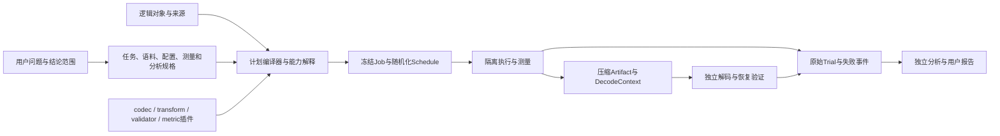

# TSDataCompressBenchMark 独立研究与逐节设计审查

审查日期：2026-10-10。审查对象为修订前 V3.1 总计划及逐节对应的架构实现。结论是：**需要结构性修订，但无需推翻已经有效的数据、验证、账本和运行资产。应以研究问题、共同任务与实验协议为主规范，以实现现状作为迁移依据。**

## 1. 审查顺序与结论适用范围

本轮先独立访问论文、官方规范与成熟工具文档，冻结[独立审查基线](independent_audit_baseline_20261010.md)，然后才重新读取项目 Markdown、CSV 和源码。不能真正删除对话记忆；这里采用的是证据基线重建。三个研究分支均从不含项目上下文的新上下文开始，先研究再进入项目对照。

独立基线 SHA-256：`18d4b5eaee9a10254da301afc050105765b2e6cc6aae222ae3d67493f171f538`。

被审计划 SHA-256：`1cc1e1f890b332285c6781d6172051ecbf523e6b497703d7b82b33d588ea7c51`。原始章节和行号以[V3.1 审查前快照](../plans/history/TimeSeries_Compression_Benchmark_V3.1_before_independent_review_20261010.md)为准；快照内原相对链接按项目根解释。章节覆盖清单见[审查覆盖记录](independent_review_coverage_20261010.json)。

审查涉及全部原有章节/小节及对应最小必要的架构代码、Schema、Registry、测试和数据生成规格。它是静态设计与实现对照，**不等于全源码安全审计、全域算法资格、fresh source parity 或新的 FORMAL 性能试验**。仓库已有大量未提交修改；本轮仅修订计划与新增审查材料，未修改算法、CSV、退出范围或历史结果。

## 2. 三个视角的主要判断

| 视角 | 应优先回答的问题 | V3.1 的不足 | 建议 |
|---|---|---|---|
| 使用者 | 我这份数据能与哪些方案比较？在什么质量、延迟和资源要求下选谁？ | 用户要先理解入口、scope、native timer、P0/P2和大量历史状态；支持和比较缺口尚没有直接解释流程 | 先选恢复任务、语料和预算；计划预览给出可比较成员、路径、缺口、预计成本和正式结果条件 |
| 工程审查员 | 数据、插件、产物、计划、执行、度量与分析边界是否可执行且可演进？ | “保留五层/A-B-C-D”把当前目录组织写成设计前提；过多规则仅存在于文字；恢复仍借原描述 | 用小型执行规格和独立验证器作为核心；目录可迁移，decode只接收产物及显式依赖；可选能力通过扩展接口提供 |
| 论文评审者 | 研究问题、语料、调参、重复和成本能否支撑给出的结论？ | 固定时长/重复数尚未说明实验单位和统计目标；按任务串行完成全部重复缺少随机化；合成覆盖多于代表性证据 | 预先声明研究问题和目标总体；分层真实语料、独立调参、分块随机顺序、适当统计单位、原始观测与不确定性，范围结论不外推 |

“至少同一分类下可互相比”仍是正确方向，但**分类仅是目录索引**。正式比较对象应是共同任务：相同原对象或相同API输入、相同恢复/质量要求、共同成本边界与资源政策。不同分类的完整方案也可完成相同任务；同分类的摘要、primitive、系统和完整流仍可能不属于同一张榜。

## 3. 优先修订的问题

优先级表示实施依赖，不表示已经证明存在算法错误。P0为开始可信共同任务比较前必须解决，P1为正式研究结论前必须补齐，P2为按需求发展的扩展。

| 编号 | 判断类型/优先级 | 具体问题与证据 | 修订方向 |
|---|---|---|---|
| F01 | 规范/P0 | §0/2以当前入口和五层为起点，研究问题未成为顶层对象 | 增加使用者决策、研究问题、目标总体与结论范围；架构按职责设计，现目录仅作迁移映射 |
| F02 | 实现缺口/P0 | §5.7要求完整恢复，但`validation/correctness.py`的逆转换仍读取original dtype/shape；`repetition.py`新decoder session仍共享进程与原输入 | 形成可持久化Artifact+DecodeContext；清洁进程验收只传工件和已声明依赖。新session不能证明独立恢复 |
| F03 | 规范/P0 | 完整对象默认自描述和依赖全额计费容易变成所有研究的强制包装 | 分开API组件、schema绑定对象、独立对象、系统四种边界；公开外部固定协议可以合法，实际对象相关sideinfo必须归账 |
| F04 | 规范/P0 | §3/9没有充分定义null下值字节是否属于恢复目标；Arrow明确null槽载荷未规定 | 明确BITWISE与SEMANTIC两种合同；validity始终恢复；语义任务对null槽规范化，不能将NaN自动当null |
| F05 | 规范与实现/P1 | §10固定3次/0.5秒预热和10次重复不能独立证明稳态或统计充分 | 改为版本化MeasurementProtocol；pilot确定测量粒度、进程/会话重复、随机化和停止政策，旧门槛保留为legacy协议 |
| F06 | 已核实实现边界/P1 | `orchestrator.py:157`预热和`:212`正式重复分别run_isolated；`isolation.py:75`每次fork/spawn | 若声称进程稳态，必须在每个正式worker内预热；若测冷启动则禁止此前对象训练/缓存污染。旧证据仅证明单独worker预热 |
| F07 | 实现缺口/P1 | `runner.py:630,673`逐task执行全部重复；`planning/tasks.py:76`按TaskID排序；不存在正式分块随机调度协议 | 冻结ScheduleID、round/block及配对顺序；按同数据/机器时段交错方法；保留实际顺序、时间、排除与重跑事件 |
| F08 | 规范/P1 | §7.3把补内部native timer作为显眼工程主线；插桩本身也会扰动 | API调用外部单调时钟可取得正式API资格；内部计时只对需隔离内核/跨FFI边界的研究使用，并验证开关扰动 |
| F09 | 规范/P1 | §10 bootstrap CI缺少明确估计量与重复层级；窗口、参数、trial容易被误用为独立样本 | 分开运行噪声和语料泛化；固定语料只对该语料结论；来源级泛化须采样设计/分层，报告效应量及适合实际配对/非配对设计的区间 |
| F10 | 规范/P1 | 算法内自适应与测试集调参的界限仍可误解 | 固定算法政策下对当前对象求min/max、拟合局部模型或选择合法表示可以部署，只要计入成本/依赖；共享模型与超参选择使用独立development数据 |
| F11 | 规范/P1 | §6/9质量与成本指标很全，但指标有效域、collector扰动和异常政策不足 | 每指标带版本、单位、方向、范围、证据方法；零range/非有限/乱序T/整数精确误差显式处理；时间和资源插桩分别验收 |
| F12 | 已核实工具阻断/P0 | 当前CSV与旧scope的SHA不同；只读调用scope加载函数实际得到`CSV selection changed; review and update registry/algorithm_scope.json first` | 将候选ID版本映射和scope迁移列为近期具体任务，不能仅用文档统计声称工具已支持当前清单；本轮不擅自迁移范围 |
| F13 | 规范/P1 | §1/7/15/19大量特定日期、数量、方法与命令混在规范里 | 主计划保留目标、合同、阶段；历史快照外移并链接，活动成员与机器路径放实施规格 |
| F14 | 规范/P2 | 多种能力、资源和通用DAG同时扩张会阻止小型纵向交付 | 先完成两个不同方法、多来源共同任务的一条可执行切片；再扩f64/i16/有损等，设备/query/持续流独立扩展 |
| F15 | 实现缺口/P0/P1 | `validation/correctness.py:78,242`的SUMMARY_ONLY与RATE_CONTROLLED缺少专属输出/率验证；`validation/lossy.py:141`有限误差指标会过滤非有限失配 | 专属validator先验证摘要/率/质量合同；非有限失配单独计数并使不适用的质量指标为null或明确失败，不以有限子集分数掩盖问题；无损及有界模式的原始严格校验继续保留 |

已有正确设计应保留：原始分母、Finalize和尾部、逐列实际全量运行、整数/IEEE按位校验、源域与环境不可用分开、固定语料与失败分母、唯一实现统计与公共比较投影分开、完整方案与primitive成本分开、历史结果不可重签。当前有损validator的`bound_passed`使用原始违反数，8ULP容差只是额外诊断，并没有把原始bound放宽；不应误报为宽松校验缺陷。

## 4. 从零设计的参考方案

### 4.1 以用户问题定义任务

优先支持四类问题：同对象无损恢复、同对象给定质量/误差的有损恢复、同输入API或组件研究、真实持续流/查询/存储部署。UTS/MTS、dtype、T、validity属于任务的数据合同；ISA、线程、块和缓存属于执行与工作负载合同。方法分类、现有代码目录与候选数量不决定任务是否公平。

发布结果至少有未压缩完整对象基线和适用的通用byte基线。memcpy只用于测量/带宽校准，不能冒充一种压缩方法。参数默认、开发集选择、对象内自适应和测试oracle分别报告。共同预算并不要求所有方法的level、block或指令路径相同；归因实验才固定相应变量。

### 4.2 核心职责与扩展

数据分为三层：DatasetSpec管理来源/单位/派生/split；LogicalObject管理dtype/shape/axis/validity和有序内容；BufferView管理strides/端序/ownership/alignment。热路径不复制整份provenance。插件最小接口是描述、参数检查、编码、解码和资源释放；fit、stream、query、内部计时、设备同步是按需能力。不要要求所有插件实现所有扩展。

计划编译器输出不可变的任务、具体ExecutionJob、调度和期待；执行器只追加事实；分析器只读观测并生成比较。Capability先声明，实际数据域再验证。独立恢复验证器和账本验证器属于核心；可插拔并不意味着由codec自行批准其正确性。

第一版只需要有序recipe和child列/块树。任意DAG、远程调度、自动选择器、完整本体系统只有多个真实需求证明价值后再引入。科学数组后端可评估LibPressio复用，不能据此免除时序对象、成本和实验协议。

### 4.3 工件与成本边界

API组件边界可以由公开协议固定dtype/count，报告payload及API时间，结论限于组件。schema绑定对象边界允许外部schema，schema须是冻结可取得的artifact，公开安装/共享场景及完整成本。独立对象边界需要可取得全部对象描述；系统边界按实际安装、写入、索引、读回和查询任务计费。

解码可以依赖公共程序、固定协议和显式schema/model，但不能依赖验证器中的original数组、编码器未保存状态、临时本地缓存或未记录模型。cold decode是恢复依赖资格；“进程冷启动”“CPU冷缓存”“模型未加载”是其他实验条件，不应合并成一个cold标签。

报告PayloadBits、ArtifactPhysicalBits、RequiredExternalBits、场景总成本和共享依赖未摊销量。程序代码与模型/字典的边界按具体部署合同冻结，不采用“所有非码流字节都每对象全额收费”的统一规则。同一bit只计一次。所有方案在同一边界比较；完整对象基线也遵守该边界。

### 4.4 语料与实验协议

合同资格集用于性质/拒绝/安全/状态边界；真实评价集用于回答部署与论文问题。Dataset_Verify的组合数不能证明代表性。先定义来源总体、采样单位、采集实体、规模与分布层，再选真实源；派生窗口/列/量化对象保留父身份且不增加独立来源数。预先区分training/development/test；对象内自适应按算法政策执行。

pilot在独立开发语料上确定测量粒度和预算。每个正式worker按目标执行预热或冷启动，外层进程/会话重复与内层批量迭代分开。按数据和机器时段分块随机化方法顺序，保存seed和实际schedule。停止可以是固定外层次数/预算，或预注册精度/序贯规则；不能在“目标方法获胜”时停止。

wall-clock、CPU time、设备event与内部clock各有边界；校验、资源采样、每次读钟和FFI都会扰动。正式主指标尽量使用共同且少扰动的观测，额外collector必要时另开同合同辅助pass并标明非同次观测。异步API必须完成同步后结束host用户时间。cache-resident、内存驻留、文件I/O、context复用和连续状态分别命名。

### 4.5 分析与发布

先报告每数据/每方法的原始时间、完整大小、质量、失败和配置，再给冻结语料总体的aggregate。总bytes/总time回答固定工作量总吞吐；按来源等权的相对比值回答典型来源优势。两种估计量不能互称。bootstrap、配对检验和跨数据集秩检验按独立单位与研究问题选择，不强制所有研究运行所有统计检验。

固定语料上的噪声区间不等于面向所有时序数据的泛化区间。重复、窗口、配置点不能膨胀来源样本量。多指标用共同质量/成本/预算下的Pareto与条件推荐，避免临时综合分数。统计不充分仍应发布观测及原因；不确定并不等于算法不能运行。

## 5. 外部证据、推论与访问深度

以下于2026-10-10实际联网读取。官方文档和作者自报用于识别边界；没有独立复现其性能数字。`全文`仅指实际可读取的HTML正文，不包括只打开但无文本层的PDF。

| 编号 | 资料与访问层级 | 实际支持的判断 | 本报告不据此声称的结论 |
|---|---|---|---|
| E01 | [Chiarot & Silvestri 综述](https://arxiv.org/html/2101.08784v2)，HTML全文 | taxonomy、size/speed/accuracy、原论文结果meta-analysis | 综述跨论文图表不是统一环境重跑或公平总排名；某些方法族泛化仍需原论文核对 |
| E02 | [Sprintz论文](https://arxiv.org/html/1808.02515v1)，HTML全文 | 整数任务、量化、数据布局/语料和十次最好值等特定实验选择 | 量化后的无损不等于对原浮点无损；串接/插值和最好值不是必须照搬的规范 |
| E03 | [ALP仓库](https://github.com/cwida/ALP)与[用户基准指南](https://github.com/cwida/ALP/blob/main/how_to_benchmark_your_dataset.md)，正文 | float/double列、vector/row-group、bits/value与cycles/value | 未把作者“全面优于”主张当独立结论；论文PDF未读取全文 |
| E04 | [TerseTS文档](https://tersets.com/docs.html)与[仓库](https://github.com/cmcuza/TerseTS)，正文 | 方法配置/组合、质量曲线，C ABI局限由项目参考源码另核 | 统一API不证明全dtype/MTS/stream；未把demo PDF当全文依据 |
| E05 | [lzbench仓库](https://github.com/inikep/lzbench)，README正文 | 内存驱动、回环、统一构建、独立4MB块线程池及率变化 | 不证明时序语义、未知长度stream或每方法内部MT |
| E06 | [LibPressio](https://robertu94.github.io/libpressio/)、[codec插件](https://robertu94.github.io/libpressio/writingacompressor.html)、[metrics插件](https://robertu94.github.io/libpressio/writingametric.html)，官方正文 | typed data/options、ownership及codec/metrics/IO分离 | 组合例子log/exp不证明按位可逆；框架API不等于公平实验协议 |
| E07 | [zfp modes](https://zfp.readthedocs.io/en/latest/modes.html)，官方正文 | rate/precision/accuracy/reversible为不同合同，零accuracy不自动无损 | current页面可变，实验需锁版本；未把未知backend能力扩给现绑定 |
| E08 | [SZ3仓库](https://github.com/szcompressor/SZ3)，README正文 | dtype/dimensions、不同质量模式、格式/软件版本 | 未核验高级REL等具体公式，不以模式名称推导原域保证 |
| E09 | [Arrow Columnar Format](https://arrow.apache.org/docs/format/Columnar.html)，官方正文，格式1.5 | logical/physical分离、validity、null槽载荷未规定、dictionary/schema、stream/file区别 | 不要求项目直接采用Arrow，也不由IPC stream推断持续流性能 |
| E10 | [SPEC CPU2017 run rules](https://www.spec.org/cpu2017/Docs/runrules.html)，关键条款正文 | 固定workload、base/peak、偏离披露、speed/rate区别，重复规则有领域特性 | 不照搬其重复数、优化或源码修改规则；未把其门槛称压缩通用标准 |
| E11 | [Google Benchmark guide](https://google.github.io/benchmark/user_guide.html)，关键章节正文 | repetitions与iterations、min/warmup time、随机交错、timer和统计 | microbenchmark的机制不能直接提供独立真实数据泛化 |
| E12 | [pyperf运行](https://pyperf.readthedocs.io/en/latest/run_benchmark.html)与[系统](https://pyperf.readthedocs.io/en/latest/system.html)，正文 | 多worker/calibration/warmup、系统环境与原始值 | 单一工具默认不能成为所有codec的资格门槛 |
| E13 | [ASV attributes](https://asv.readthedocs.io/en/stable/benchmarks.html)，正文并有页面过时提示 | repeat/number/warmup分别控制不同测量环节 | 不据旧页面固定当前工具默认值或benchmark统计充分性 |
| E14 | [Mytkowicz等2009作者组页面](https://sape.inf.usi.ch/publications/asplos09)，作者组书目与摘要正文 | 看似无关的环境/布局因素可导致测量偏差，支持随机化与披露 | PDF全文未实际读取；不引用未验证具体实验数字 |
| E15 | [FAIR 2016论文](https://www.nature.com/articles/sdata201618)，HTML关键章节 | 持久ID、元数据/来源、合格引用、数据不可得时保留metadata | 不规定必须使用某ontology、云平台、DAG或全部数据公开 |
| E16 | [SciPy bootstrap](https://docs.scipy.org/doc/scipy/reference/generated/scipy.stats.bootstrap.html)，官方正文 | paired重采样、方法和退化分布边界 | 重采样次数不增加独立实测N，也不自动解决自相关/多层级问题 |

ACM页面遇安全验证；Kalibera/Jones PDF已打开但无可读文本层，Hoefler/Belli作者页摘要已读、PDF仅定位未读；SCIL候选入口未成功定位。以上未成功正文均不作为已核验依据。统计建议主要据实际读取的工具文档及独立实验设计推理，不伪称已完整阅读这些论文。

## 6. 逐章逐节对照

以下117行覆盖全部原章节/小节，按审查前V3.1编号定位。证据简称“计划/Plan”指审查前快照；Python路径以datasets/codecs/planning/execution/adapters/validation/accounting/preprocess/contracts/measurement/statistics/reporting/storage或runner.py/environment.py/configuration.py/cli.py开头时，加项目根下`src/tscompbench/`前缀。CSV行号是物理行，含多行字段，不用它作记录ID。U=使用者，E=工程审查员，P=论文评审者（表内用户/工程/论文、用/工/研为相同视角）；“已实现”仅是指定静态证据，待实施项不会因写入V3.2而获得运行资格。

### 原§0 V3 的目标、取舍与使用规则

| 原条款 | 旧内容/意图 | U/E/P三视角 | 外部依据/独立推理 | 最小实现证据 | 结论与具体修订 |
|---|---|---|---|---|---|
| §0 | 本章总目标与组织方式 | U：先明确问题、任务和阶段，不要求全能。 E：原目标应成为可执行合同。 P：两方法多数据只是最低交付，不是普遍性证据。 | E01/E06/E15；独立准则1/14/15 | 同章下表所列实现/Schema；V3.1快照原§0 | 重构P0：新增用户/研究问题、估计量与最小流程。 |
| §0.1 | 入口、比较、证据三个完成维度；两条比较主线 | 用户：能回答选方案。工程：闭环明确但“完整”有多重含义。论文：共同任务/冻结语料正确；两方法是工程下限，非充分代表性。 | E01/E06/E15；独立准则1/14/15 | 计划:23、29、46；planning/resolution.py:197；validation/correctness.py:141 | **保留＋修正 P0**：给三种完成状态独立名称/产物；native-input比较与原对象方案比较各绑定合同ID、固定分母、可比原因。说明满足“两方法×多数据集”仅证明该组交付，不能外推所有时序压缩。 |
| §0.2 | 主线、能力与暂缓方向 | 用户：避免被全部dtype/设备全能要求阻住。工程：表明阶段性，但仍多方向并列。论文：不把可选硬件能力当算法普适性。 | E01/E06/E15；独立准则1/14/15 | 计划:50；contracts/enums.py:38；execution/protocol.py:103 | **保留＋修正 P1**：用恢复任务与能力优先级组织；最低切片限定统一对象/typed参数/encode-decode/成本/结果，其余按至少两个真实需求升级。CPU基本路径不强制流式形式API。 |
| §0.3 | MUST/SHOULD/MAY及证据状态 | 用户：理解完成与未实现。工程：已有RunStatus混合多个轴。论文：拒绝测试通过≠压缩通过。 | E01/E06/E15；独立准则1/14/15 | 计划:67；contracts/enums.py:73；planning/models.py:79 | **保留 P0**：补可机器检验的证据级别/适用范围，不要求每一可选能力都生成重复状态副本；unknown不等于unsupported。 |
| §0.4 | 权威、修订范围、CSV长期范围 | 用户：尊重退出决定与长期接入。工程：版本命名与实现版本分开正确。论文：外部材料只证明机制。 | E01/E06/E15；独立准则1/14/15 | 计划:78、82、84；registry/algorithm_scope.json:5；tools/algorithm_scope.py:20 | **修正 P0**：明确现行CSV漂移是scope相关工具的实际阻断；工程决策与文献事实分栏；“多数候选”不转成核心接口强制全集。 |

### 原§1 历史基线、当前实现与比较缺口

| 原条款 | 旧内容/意图 | U/E/P三视角 | 外部依据/独立推理 | 最小实现证据 | 结论与具体修订 |
|---|---|---|---|---|---|
| §1 | 本章总目标与组织方式 | U：日期数量只用于理解现状。 E：当前/历史/未来状态拆分。 P：历史PASS不支撑当前或代表性结论。 | E01/E06/E15；独立准则1/14/15 | 同章下表所列实现/Schema；V3.1快照原§1 | 迁移P1：详细历史表移快照，保留具体迁移缺口。 |
| §1.1 | 10-09历史资产快照 | 用户：历史规模易被误读为现状。工程：保留追溯但主文过长。论文：历史PASS不足以复用。 | E01/E06/E15；独立准则1/14/15 | 计划:90、94；当前codecs/registry.py:98；计划:153 | **迁移 P2**：主文保留一句历史说明和版本化证据链接，详细数量表移历史附录；历史未重跑不可标已证实当前事实。 |
| §1.2 | 历史Dataset_Verify矩阵与缺口 | 用户：无需记1356/640等内部数字。工程：边界样本有用；旧缺口已有修复。论文：合成测试不等于代表性语料。 | E01/E06/E15；独立准则1/14/15 | 计划:108、118；datasets/canonical.py:273；datasets/models.py:58 | **迁移＋保留 P1**：历史数表移证据索引；主文保留“合同/对抗集与性能语料分离”。把已修/未修状态列入可重生成ledger，避免章节重复。 |
| §1.3 | 历史真实数据与统计诊断 | 用户：需要知道结果能说明什么。工程：旧输出ignored目录不够持久。论文：资格、有效样本及排除范围解释正确。 | E01/E06/E15；独立准则1/14/15 | 计划:130、134、137；reporting/generator.py:64 | **迁移 P1**：主文仅保留结论边界，原始trial/软件/data规格打包为不可变证据；报告链接到摘要源RunIDs，不靠长段手写数字。 |
| §1.4 | 升级风险与要求 | 用户：修复优先级不明。工程：身份、逆恢复、ND问题真实；DeepZip旧contract项已不再现状。论文：不可把修正后的路径继承旧资格。 | E01/E06/E15；独立准则1/14/15 | 计划:143；datasets/canonical.py:28；validation/correctness.py:34；registry/codecs/deepzip.json:8、64 | **修正 P0/P1**：将DeepZip条目标历史已修；身份白名单和cold inverse保留明确待办；每风险有证据状态/owner/完成验收，避免未修总表吞掉已修项。 |
| §1.5 | 10-10当前静态基线 | 用户：活动入口数不等于可用方案数。工程：当前/未来边界准确但应自动生成。论文：静态声明不代替FORMAL。 | E01/E06/E15；独立准则1/14/15 | 计划:153、157、170；registry/codecs/*.json；execution/repetition.py:245；planning/resolution.py:197 | **保留＋修正 P1**：当前盘点作为日期快照，自动生成registry/build/qualification/FORMAL分轴表；主文重点是剩余架构缺口与验收，不围绕33入口设计核心。 |
| §1.6 | 166候选、角色、旧新ID与scope漂移 | 用户：多数候选均有去向。工程：版本+记录ID合理；稳定方法ID应独立。论文：组件/后端不能凑算法数。 | E01/E06/E15；独立准则1/14/15 | CSV:1、34、138、164、168、185；registry/algorithm_scope.json:5；tools/algorithm_scope.py:17 | **保留＋迁移 P0**：Candidate ledger属于选型控制台，不进入热路径和核心CodecManifest。冻结CSV SHA+recordID，映射稳定Method/Implementation/Recipe；移“147个去向”统计到生成附表，无法唯一映射不自动恢复。 |

### 原§2 架构与职责边界

| 原条款 | 旧内容/意图 | U/E/P三视角 | 外部依据/独立推理 | 最小实现证据 | 结论与具体修订 |
|---|---|---|---|---|---|
| §2 | 本章总目标与组织方式 | U：用户无需了解五层内部目录。 E：职责先于目录，工件/插件/计划/分析独立。 P：harness必须证明所测任务边界。 | E06/E09/E15；独立准则2/14 | 同章下表所列实现/Schema；V3.1快照原§2 | 重构P0：取消五层/ABCD为设计前提，增加最小执行规格。 |
| §2.1 | 保留五层及恢复成本流程 | 用户：需要可操作执行链。工程：“保留五层”把现结构提升成不可质疑约束；第三/四层共享执行原则正确。论文：不能拼接另一轮正确性。 | E06/E09/E15；独立准则2/14 | 计划:205、224；execution/repetition.py:234；execution/orchestrator.py:262 | **重构 P1**：改为数据、插件、实验编译、执行、观测、分析的职责和数据流；“五层”仅现实现迁移映射。共享真实trial不要求所有昂贵metrics放入timed region。 |
| §2.2 | 模块责任、A/B/C/D和报告分离 | 用户：插件易接入。工程：A/B/C/D唯一槽位确实限制重复stage，工厂有显式codec映射；metrics缺独立插件协议。论文：统一指标来源应避免各adapter自证。 | E06/E09/E15；独立准则2/14 | 计划:233、241；preprocess/contracts.py:29、43；adapters/factory.py:53；execution/protocol.py:112；reporting/generator.py:16 | **重构 P1**：保留单向依赖；新核心用ordered stage IDs/child树和独立MetricPlugin，legacy ABCD仅迁移表示。先普通Python注册工厂，不必动态ABI/大型插件发现系统。 |
| §2.3 | 保留Python、后续C++、独立版本 | 用户：尽快取得比较。工程：实现语言不等于调用语言正确；未来native runner不是当前关键路径。论文：跨runner必须共享合同而非共享速度结论。 | E06/E09/E15；独立准则2/14 | 计划:245；execution/protocol.py:103；schemas/v2/codec-manifest.schema.json:9 | **保留 P1**：明确对照golden协议+job/result schema是跨语言稳定面；不把C++重写列为先决条件。迁移引用应指§14（当前写§13可再校对）。 |

### 原§3 原始数据、canonical 正式入口与身份

| 原条款 | 旧内容/意图 | U/E/P三视角 | 外部依据/独立推理 | 最小实现证据 | 结论与具体修订 |
|---|---|---|---|---|---|
| §3 | 本章总目标与组织方式 | U：原对象、缺失/单位和派生含义可确认。 E：logical/physical/transport身份分层。 P：来源独立性和代表性不由矩阵数证明。 | E01/E02/E09/E15；独立准则4/5 | 同章下表所列实现/Schema；V3.1快照原§3 | 修订P0/P1：补null语义、split身份与真实语料设计。 |
| §3.1 | 原始语义、T/V/validity/shape | 用户：对象语义保存充分。工程：当前单一timestamp ndarray不能表达async/ragged；DataDescriptor无axes/time_axis。论文：NaN/null、构造T/真实T分开正确。 | E01/E02/E09/E15；独立准则4/5 | 计划:253；datasets/models.py:58；codecs/models.py:26；contracts/enums.py:7、21 | **保留＋分期重构 P1**：原对象spec与轻NumericView分开；同步数组先实现，async/ragged为明确可选topology，不要求所有encoder接受。time_axis进入版本化schema，不能仅加枚举宣称可表达。 |
| §3.2 | 内容ID、容器SHA、视图ID与白名单 | 用户：换位置不应变数据。工程：已有transport-independent策略只删除strides，logical其余字段全hash；content_sha仍含整个logical。论文：身份漂移破坏复现。 | E01/E02/E09/E15；独立准则4/5 | 计划:264、273；datasets/canonical.py:28、35；datasets/models.py:103；datasets/canonical_source.py:19 | **迁移 P0**：定义有schema的明确semantic whitelist与字段规则；display_name/provenance不应无意改变科学对象ID；legacy policy冻结，新policy用黄金样例验证路径/layout不变、单位/值序变则变ID。split是dataset-use身份，不必混进纯content ID。 |
| §3.3 | 无后缀canonical importer与安全校验 | 用户：统一入口正确。工程：当前读取含header/metadata/hash/tail验证，缺总payload/总allocation预算；include_buffers会累积chunks并join。论文：数据转换可复现。 | E01/E02/E09/E15；独立准则4/5 | 计划:279、284；datasets/canonical.py:283、293、311、333；datasets/canonical_source.py:113 | **保留＋补充 P0/P1**：实施总文件/payload/分配预算与schema版本界限；提供stream/mmap按需加载为扩展，避免大语料内存双份。此为具体资源改进，不假称现reader已存在漏洞利用。 |
| §3.4 | 资格/核心/专用语料与learned split | 用户：区分能跑通和有选型意义。工程：train/val/test需实物ID。论文：独立validation选择/test oracle标注正确。 | E01/E02/E09/E15；独立准则4/5 | 计划:299、303、305；datasets/canonical_source.py:50；CSV:146、148 | **保留＋修正 P0**：“有损量化产生新恢复任务”需澄清：量化可作为同一原始对象质量任务的pipeline stage；只有把量化后对象当新ground truth时才是派生任务。增加模型拟合/调参预算与group split防时间泄漏。 |
| §3.5 | 数据支持矩阵 | 用户：正确理解框架表达≠算法原生。工程：全矩阵是验证路线，不能成为近期全量门槛。论文：分布覆盖应为组代表性服务。 | E01/E02/E09/E15；独立准则4/5 | 计划:313、319、324；datasets/models.py:58；contracts/enums.py:4；CSV:89、138 | **保留＋简化 P1**：核心schema只表达稳定公共语义；每比较组附域/边界子集。异步/validity的“框架必需”改为声明目标及分阶段实现状态，拒绝宣称当前全表达。 |

### 原§4 能力协商、运行路径与全任务终态

| 原条款 | 旧内容/意图 | U/E/P三视角 | 外部依据/独立推理 | 最小实现证据 | 结论与具体修订 |
|---|---|---|---|---|---|
| §4 | 本章总目标与组织方式 | U：可解释哪些方法适用及为何未测。 E：能力/执行/正确性/资格正交。 P：期待不能由执行结果自证。 | E06/E07/E08；独立准则6/14 | 同章下表所列实现/Schema；V3.1快照原§4 | 保留并落实P0：冻结期待、路径及完整失败分母。 |
| §4.1 | 四态与路径政策 | 用户：拒绝原因可解释。工程：四态混了compatibility与loss，路径分类又与fidelity重叠。论文：source-domain资格必须独立。 | E06/E07/E08；独立准则6/14 | 计划:332、337；contracts/enums.py:66；codecs/models.py:135 | **保留兼容＋重构 P1**：旧四态仅legacy projection；新结构以supported/reason、operations/recipe、effective fidelity分轴，避免COMPOSED与LOSSY二选一。按child验证不靠顶层域放宽。 |
| §4.2 | 任务宇宙、独立期待与冻结 | 用户：完整处理不等于都压缩成功。工程：当前TaskID逻辑字段较少，但ConfigID/AlgorithmID和完整plan快照已防多种漂移，未证实碰撞或resume错误。论文：不按PASS缩分母正确。 | E06/E07/E08；独立准则6/14 | 计划:343；planning/tasks.py:28、78；planning/sweep.py:123；codecs/registry.py:413；runner.py:486、510 | **保留＋澄清 P1**：定义LogicalTaskID与ExecutionJobID边界；后者显式绑定recipe、resolved build/backend、预算、依赖artifact IDs。独立期待按冻结合同与独立goldens，不必维护覆盖全组合的另一套手工真值系统。 |
| §4.3 | 状态正交化 | 用户：必须分清不支持、没实现、没构建和失败。工程：现RunStatus包含这些混合轴，新schema不要再制造全笛卡尔积。论文：missing与0不可混。 | E06/E07/E08；独立准则6/14 | 计划:363、367；contracts/enums.py:73；planning/models.py:79 | **重构 P0**：最小capability/attempt/outcome/validation/eligibility＋stage/reason；summary聚合状态派生而非手填。保留旧字符串映射、schema版本及raw legacy值，显式NOT_RUN。 |
| §4.4 | 准入与执行独立 | 用户：同一方法有多个合法域。工程：report中不能只显示最终PASS；组准入数据需versioned。论文：成功一次不能提升family。 | E06/E07/E08；独立准则6/14 | 计划:371、373；planning/models.py:72；reporting/generator.py:33 | **保留 P0**：准入以ContractID+variant+domain为键；每成员报告期待、attempt、correctness、成本资格、统计资格与缺口。不得把新的admission enum塞RunStatus。 |

### 原§5 可逆适配与组合管线合同

| 原条款 | 旧内容/意图 | U/E/P三视角 | 外部依据/独立推理 | 最小实现证据 | 结论与具体修订 |
|---|---|---|---|---|---|
| §5 | 本章总目标与组织方式 | U：同原对象不同合法方案应可比。 E：逆恢复不借original，组合事实可审计。 P：适配/选择成本不可逃逸。 | E02/E06/E09；独立准则3/4/9 | 同章下表所列实现/Schema；V3.1快照原§5 | 修订P0：Artifact/DecodeContext，外部公开协议与独立对象分边界。 |
| §5.1 | InputView/Adapter/Pipeline/Recovery/Cost对象 | 用户：复合方案可解释。工程：五对象重叠过多会增加配置负担；按ordered stages而非任意DAG正确。论文：完整recipe可复现。 | E02/E06/E09；独立准则3/4/9 | 计划:381、387；preprocess/contracts.py:17、36；codecs/models.py:105 | **保留概念＋简化 P1**：公共输入只需DatasetSpec+View、Recipe、DecodeArtifact、Observation；成本从执行产生，不让用户手填ledger。避免五份重复shape/params漂移；保留引用而非复制。 |
| §5.2 | 物理适配与数值转换 | 用户：不暗改数据。工程：精确域证明与bit验证充分；“GATHER_SCATTER”实际仅名称不能做能力。论文：±0/NaN payload不应allclose。 | E02/E06/E09；独立准则3/4/9 | 计划:393、395；adapters/compatibility.py:188、236；validation/correctness.py:141 | **保留 P0**：适配器输出单独可验证view+inverse recipe；Integer proof用完整整数域，浮点异常单列。排序等语义变换走recipe而非physical adapter。 |
| §5.3 | ND与逐列 | 用户：可比较全对象方案。工程：ColumnPlan需要真实轴语义，当前descriptor仅shape/n/m；逐列不能乘一列估算。论文：不同coupling可在原对象方案榜比较但须披露。 | E02/E06/E09；独立准则3/4/9 | 计划:405、407；codecs/models.py:31；planning/resolution.py:211 | **保留＋重构 P1**：columns/axis mapping为显式Recipe节点；完整方案比较投影不以coupling强行拆组，native microbenchmark保持实际域。优先固定time_axis同步ND，不先泛化全部topology。 |
| §5.4 | block/window/tail | 用户：尾部不能静默丢掉。工程：原生窗口参数与framework tail extension应分开；有限边界集可参数化。论文：chunk≠stream，状态策略改变压缩率。 | E02/E06/E09；独立准则3/4/9 | 计划:413、415、417；execution/protocol.py:108；CSV:45、348 | **保留 P0**：精确命名whole object/independent blocks/continuous stream；TailRecipe保存真长及分支，cold恢复计费；N边界按合法源域期待，不强迫不接受空输入的codec PASS。 |
| §5.5 | IEEE/signed/limb/符号表示 | 用户：扩域不应冒充原生。工程：适合可选transform plugins，不应每项单独核心字段。论文：源语义与数字可逆性分离正确。 | E02/E06/E09；独立准则3/4/9 | 计划:421、423；CSV:233、255；registry/codecs/deepzip.json:61 | **保留＋简化 P1**：用typed transform接口+domain predicate表示；将ZigZag/bitcast/limb等作为插件例子，不以候选清单逐项增加顶层API或全实现门禁。 |
| §5.6 | T+V、lossy、model与fallback | 用户：完整方案与质量可判断。工程：fit与decode dependency需一等对象；当前任务dependencies只有dataset/source。论文：先固定选择政策及loss原域正确。 | E02/E06/E09；独立准则3/4/9 | 计划:427、429、431；planning/tasks.py:65；CSV:138、144、146、148 | **重构 P0/P1**：ModelArtifact含train IDs/fit config/hash/bytes/decoder依赖；fit/load/inference成本分开。联合/独立T+V是recipe coupling，不据算法名推断。error guarantee与经验quality分轴，避免把所有lossy硬分互斥等级。 |
| §5.7 | 自包含逆恢复 | 用户：产物交给另一机器能用。工程：当前逆恢复读取original dtype，fresh session仍持同parameters且同进程。论文：self-contained资格尚未取得。 | E02/E06/E09；独立准则3/4/9 | 计划:435、437；validation/correctness.py:34、48、107；execution/repetition.py:245 | **保留＋实施 P0**：cold worker输入只给压缩产物+声明dependency IDs+decoder实现，RecoveryDescriptor驱动逆恢复后交validator；原对象不得进入decoder API。参数依赖要么序列化要么声明计费。 |
| §5.8 | 必需闭环与可选功能矩阵 | 用户：清楚每方法支持什么。工程：现session一律compress_update/finalize易让one-shot被误读成stream。论文：声明/实现/验证/FORMAL各轴正确。 | E02/E06/E09；独立准则3/4/9 | 计划:443、448、458；execution/protocol.py:103；contracts/enums.py:45 | **保留＋简化 P1**：最小one-shot encode/decode协议；incremental/fit/query/device为可选protocol；one-shot的update wrapper不是stream。表格由capability predicate+证据生成，不手填五重✓。 |
| §5.9 | 共同任务桥接 | 用户：全对象方案可同榜。工程：先桥接再扩manifest正确，需避免无限为每codec改数据。论文：同original task、总成本同合同才能比较。 | E02/E06/E09；独立准则3/4/9 | 计划:462、466、468；planning/resolution.py:212；validation/correctness.py:107 | **保留 P0/P1**：桥接必须作为独立recipe而非codec claim；只实现能解除实际共同比较阻断的最小transform。量化仍保留原对象为quality reference，错误不能藏于派生数据。 |

### 原§6 大小、最终比特与输入成本账本

| 原条款 | 旧内容/意图 | U/E/P三视角 | 外部依据/独立推理 | 最小实现证据 | 结论与具体修订 |
|---|---|---|---|---|---|
| §6 | 本章总目标与组织方式 | U：主指标分母与模型成本可理解。 E：每bit一次归账、场景依赖显式。 P：不同成本层不能混榜。 | E01/E06/E09；独立准则8 | 同章下表所列实现/Schema；V3.1快照原§6 | 修订P0：schema绑定/独立对象/系统成本与未压缩参考。 |
| §6.1 | 五种大小与Track分母 | 用户：压缩率不能靠扩宽变好。工程：定义明确，缺阶段payload需运行采集。论文：原始逻辑bit与物理byte都应公开。 | E01/E06/E09；独立准则8 | 计划:476、484；datasets/models.py:85；execution/protocol.py:48；accounting/ledger.py:40 | **保留 P0**：将原对象base bytes/bits固定在ComparisonContract；报告codec payload与完整decode package，invalid/null值处理规则也冻结。源文件/容器体积仅I/O诊断。 |
| §6.2 | 读写/分配/capacity/padding成本 | 用户：有助判断系统可用性。工程：全stage真实访问计数昂贵且常无法观测；现telemetry有估计。论文：证据方法清晰比伪精确重要。 | E01/E06/E09；独立准则8 | 计划:488、490；adapters/compatibility.py:27；execution/preparation.py:56；execution/repetition.py:157 | **修正 P1**：P0只强制实际payload/output、声明scope与peak测量方法；copy/read/write/alloc细分为可用性字段，missing+reason可取得不依赖此指标的资格。不要让微观全量仪表阻断可信时间/比率比较。 |
| §6.3 | FinalBits与物理组件闭合 | 用户：模型/头部不免费。工程：现ceil允许非字节对齐bit账本；新完整存储要求8*len需新profile/schema。论文：opaque完整帧可有效比较，不必拆所有组件。 | E01/E06/E09；独立准则8 | 计划:499、506、510、512；accounting/ledger.py:76、106；execution/protocol.py:99 | **保留＋迁移 P0**：新PhysicalStoredBits精确等8*len；payload logical bits另报。共同依赖de-dup以artifact ID/实际bundle边界，不凭字段猜测；opaque归未细分，不强制猜T/V/model占比。 |
| §6.4 | 模型/字典共享摊销 | 用户：独立对象与部署共享场景都要看。工程：固定“解码程序/恢复信息”边界存在specialized decoder风险。论文：事后选摊销N会误导。 | E01/E06/E09；独立准则8 | 计划:516、518；CSV:146、148、168；planning/tasks.py:65 | **保留＋补充 P0**：ModelArtifact与dependency manifest记录共享安装/fit/load/bytes及不可摊销原值。dataset-specific生成代码/嵌入常量视为模型侧信息，不能藏进“固定decoder”。 |
| §6.5 | 分母、零值与单位例子 | 用户：易懂且必要。工程：现ratio经Python float对超大integer会失精；字段合法性应先于格式化。论文：零长/缺失必须区分。 | E01/E06/E09；独立准则8 | 计划:522、524；accounting/ledger.py:122、128 | **保留＋修正 P1**：整数bit/byte仍为权威；派生比率用Decimal/有理数或明示精度。空对象专属任务，不因undefined ratio误报失败；所有图表处理null+reason。 |

### 原§7 共同任务、算法比较组与性能合同

| 原条款 | 旧内容/意图 | U/E/P三视角 | 外部依据/独立推理 | 最小实现证据 | 结论与具体修订 |
|---|---|---|---|---|---|
| §7 | 本章总目标与组织方式 | U：先按任务找可比方案。 E：完整身份与公共投影分开。 P：参数、资源与研究问题决定控制变量。 | E02/E03/E05/E07；独立准则6/7/10 | 同章下表所列实现/Schema；V3.1快照原§7 | 保留并补强P1：问题/estimand、每方法政策与可选API计时。 |
| §7.1 | 完整身份分开保存；跨算法用公共投影；primitive 与完整方案分层。 | P：投影避免算法/ConfigID使组永不可比，方向正确。E：公共投影尚需明确哪些字段可变。U：应先看能回答的部署问题，再看身份细节。 | E02/E03/E05/E07；独立准则6/7/10 | [总计划](/home/fzg/PycharmProjects/TSDataCompressBenchMark/docs/plans/history/TimeSeries_Compression_Benchmark_V3.1_before_independent_review_20261010.md:530)；[statistics/engine.py](/home/fzg/PycharmProjects/TSDataCompressBenchMark/src/tscompbench/statistics/engine.py:944) 仍按 semantic/execution keys 分组。 | **保留并补强 P1**：每个 ComparisonContract 增加 `research_question`、`decision_context`、`estimand`；给至少两个反例 fixture：同任务不同内部布局应可比较、同 API 不同恢复语义应拒绝。身份与投影分别验收。 |
| §7.2 | CORE/PIPELINE/内存 E2E 分界；完整 E2E 实测，逆恢复不能放 validator。 | P：正确，但“E2E”仍可能被使用者误读为加载到输出的总成本。E：当前逆恢复未产生可消费对象，encode PIPELINE 包含哈希/canary及账本插桩。U：主表应显式写内存驻留/冷启动。 | E02/E03/E05/E07；独立准则6/7/10 | [总计划](/home/fzg/PycharmProjects/TSDataCompressBenchMark/docs/plans/history/TimeSeries_Compression_Benchmark_V3.1_before_independent_review_20261010.md:551)；[repetition.py](/home/fzg/PycharmProjects/TSDataCompressBenchMark/src/tscompbench/execution/repetition.py:183)、[逆适配](/home/fzg/PycharmProjects/TSDataCompressBenchMark/src/tscompbench/execution/repetition.py:322)。 | **修订 P0/P1**：完整方案正式资格以“独立 decoder＋materialized restored object”为门禁；计时记录增加 `input_residency`、`output_materialization`、`instrumentation_included` 和 perturbation 对照。当前只能标 `IN_MEMORY_HARNESS_E2E_TRANSITIONAL`，不得靠标签升级取得完整恢复资格。 |
| §7.3 | 十个重写入口补 native timer，并验证累计/reset/finalize。 | P：可支持原生边界研究，非全部基准的前置要求。E：加钟有维护/干扰成本，API 融合不宜硬拆。U：缺内部 timer 不应使有效 API/对象结果消失。 | E02/E03/E05/E07；独立准则6/7/10 | [总计划](/home/fzg/PycharmProjects/TSDataCompressBenchMark/docs/plans/history/TimeSeries_Compression_Benchmark_V3.1_before_independent_review_20261010.md:563)；[completed_rewrites.py](/home/fzg/PycharmProjects/TSDataCompressBenchMark/src/tscompbench/adapters/completed_rewrites.py:89) 绑定 rw_encode；[native_timing.py](/home/fzg/PycharmProjects/TSDataCompressBenchMark/src/tscompbench/adapters/native_timing.py:26) 可选符号。 | **澄清 P1**：标题改为“可选 native 观测接入清单”；区分外部 API 调用墙钟与内部 kernel 计时，不把后者当普遍要求。新增 disabled/enabled 干扰实验及最小有效时长/时钟分辨率依据；native 补齐不得阻断合法 PIPELINE/E2E 组。 |
| §7.4 | Semantic 吞吐按 CanonicalRawBits；native 按实际未压缩输入；native 独立资格。 | P：分母明确，便于比较适配扩张。E：当前缺遥测会退到 codec_input_bytes，encode/decode强制同分母。U：MB/s 易误作有效值数/秒。 | E02/E03/E05/E07；独立准则6/7/10 | [总计划](/home/fzg/PycharmProjects/TSDataCompressBenchMark/docs/plans/history/TimeSeries_Compression_Benchmark_V3.1_before_independent_review_20261010.md:576)；[repetition.py](/home/fzg/PycharmProjects/TSDataCompressBenchMark/src/tscompbench/execution/repetition.py:157)、[分母一致检查](/home/fzg/PycharmProjects/TSDataCompressBenchMark/src/tscompbench/execution/repetition.py:479)。 | **保留并补强 P1**：并列 samples/s、values/s、bits/value；新增方向性 processed bytes 与 denominator provenance，禁止 fallback 值取得正式 native 资格。对零长度/不足一字节 validity 定义吞吐 N/A，明确 MB 为十进制。 |
| §7.5 | 借鉴 lzbench/Sprintz/TerseTS/ALP，不照搬其 dtype、统计或计费。 | P：参考边界合理。E：本地固定版本与当代 upstream 文档不同，应防止泛化。U：应说明“参考流程”和“复现实验”区别。 | E02/E03/E05/E07；独立准则6/7/10 | [总计划](/home/fzg/PycharmProjects/TSDataCompressBenchMark/docs/plans/history/TimeSeries_Compression_Benchmark_V3.1_before_independent_review_20261010.md:591)；[alp source artifact](/home/fzg/PycharmProjects/TSDataCompressBenchMark/registry/sources/alp-cwida-benchmark.artifact.json:9) 固定 commit。 | **保留/澄清 P2**：外部引用附访问深度与具体版本；TerseTS 文档的 lossless/lossy quality 曲线借鉴不等于其默认 range%具有统一误差语义。量化作为针对原浮点的有损stage时按原域验证；仅以量化结果作为ground truth时另立派生任务。 |
| §7.6 | 方法分类不决定可比性；按恢复任务/fidelity/Track细化核心与扩展域。 | P：比单family最小交集更有效。E：多个合法布局/适配可进入完整方案。U：全场总榜应禁止；需看任务级适用结论。 | E02/E03/E05/E07；独立准则6/7/10 | [总计划](/home/fzg/PycharmProjects/TSDataCompressBenchMark/docs/plans/history/TimeSeries_Compression_Benchmark_V3.1_before_independent_review_20261010.md:600)；[codec-manifest schema](/home/fzg/PycharmProjects/TSDataCompressBenchMark/schemas/v2/codec-manifest.schema.json:22) 多关键域当前只约束 object。 | **保留并落实 P1**：任务组必须先由用户决策与语料语义定义，再选方法；fidelity/cost boundary/资源为硬约束，coupling/layout等是问题相关控制或机制字段。新增“同label不同任务不可比”的 schema/validator fixture。 |
| §7.7 | 拟议 ComparisonContract、GroupSpec、CorpusSpec等独立版本合同。 | P：必要信息较全，缺估计目标和干预/观测定义。E：过多新对象有先设计全套再执行的风险。U：不应要求用户手写全部内部身份。 | E02/E03/E05/E07；独立准则6/7/10 | [总计划](/home/fzg/PycharmProjects/TSDataCompressBenchMark/docs/plans/history/TimeSeries_Compression_Benchmark_V3.1_before_independent_review_20261010.md:619)；[comparability schema](/home/fzg/PycharmProjects/TSDataCompressBenchMark/schemas/v2/comparability-keys.schema.json:7)；[dataset schema](/home/fzg/PycharmProjects/TSDataCompressBenchMark/schemas/v2/dataset-manifest.schema.json:43)。 | **修订 P1**：先交付一个最小可执行组 fixture＋解析/验证＋报告，再扩 schema；增加分析单位/权重/失败处理、训练适应与选择预算、deployment amortization。CLI提供默认生成与可读拒绝原因，避免把内部对象全暴露给用户。 |
| §7.8 | 首批 byte/f64/i16 三组，至少两个独立真实来源；ALP/ALP-RD等变体可算不同方法。 | P：来源独立性和失败分母正确；“两来源”是最低交付门槛而非代表性证据。E：当前 `alp` 被强制 decimal，禁 RD fallback；拆开两方案不等于自适应论文 ALP。U：看到 ALP 易以为复现论文整体方法。 | E02/E03/E05/E07；独立准则6/7/10 | [总计划](/home/fzg/PycharmProjects/TSDataCompressBenchMark/docs/plans/history/TimeSeries_Compression_Benchmark_V3.1_before_independent_review_20261010.md:638)；[alp manifest](/home/fzg/PycharmProjects/TSDataCompressBenchMark/registry/codecs/alp.json:5)、[FORCED_DECIMAL](/home/fzg/PycharmProjects/TSDataCompressBenchMark/registry/codecs/alp.json:145)；[Dataset_Verify fixture mapping](/home/fzg/PycharmProjects/TSDataCompressBenchMark/Dataset_Verify/v3/index.json:3)。 | **修订 P1**：核心组增加官方 adaptive ALP 组合/dispatch基线或明确研究问题只比 forced component；报告完整方法/子方案/变体/实现数四种计数。两真实源仅标 pilot/core-minimum，再按任务特征覆盖矩阵证明代表性。 |
| §7.9 | 独立validation调参；固定预算与率失真曲线两种有损比较，保证类型分开。 | P：关键公平性正确；对象内合法自适应不能误算test泄漏。E：完整网格要求可能造成不必要笛卡尔积。U：需要默认策略与可选调优成本。 | E02/E03/E05/E07；独立准则6/7/10 | [总计划](/home/fzg/PycharmProjects/TSDataCompressBenchMark/docs/plans/history/TimeSeries_Compression_Benchmark_V3.1_before_independent_review_20261010.md:661)；[alp manifest模型ROWGROUP_SAMPLE](/home/fzg/PycharmProjects/TSDataCompressBenchMark/registry/codecs/alp.json:85)；[lossy.py](/home/fzg/PycharmProjects/TSDataCompressBenchMark/src/tscompbench/validation/lossy.py:187)。 | **保留并澄清 P1**：显式分离 shared training、development-set selection、per-object adaptation、oracle四类；记录固定政策/训练资料/选择预算和在线成本。网格可按事前精度/预算停止策略采样，合法未测点保留状态；不得把对象内scale一概禁止。 |
| §7.10 | CPU/API/SIMD/MT/chunk/stream/query/device独立profile，不强制全能。 | P：避免机制与部署问题混淆。E：适用能力逐步实现，减轻无意义接入。U：能力缺失是适用范围而非所有榜失败。 | E02/E03/E05/E07；独立准则6/7/10 | [总计划](/home/fzg/PycharmProjects/TSDataCompressBenchMark/docs/plans/history/TimeSeries_Compression_Benchmark_V3.1_before_independent_review_20261010.md:682)；[measurement policy](/home/fzg/PycharmProjects/TSDataCompressBenchMark/schemas/v2/measurement-policy.schema.json:23) 当前仅两种state/allocation标签。 | **保留/补强 P2**：把 profile 是否正式可执行单独登记；增加 process/session repeats 与 inner iterations 区别、cold/warm/reuse明确操作，禁止一个通用 `threads` 字段覆盖内部/框架/并发线程。 |
| §7.11 | CSV候选分批映射至长期任务族与语料，不是一张总榜。 | P：候选清单不能主导研究范围；数据路线仍围绕已有名称。E：长期广度有较大维护负担。U：首先需要少数可信任务，而非最多codec。 | E02/E03/E05/E07；独立准则6/7/10 | [总计划](/home/fzg/PycharmProjects/TSDataCompressBenchMark/docs/plans/history/TimeSeries_Compression_Benchmark_V3.1_before_independent_review_20261010.md:694)、[真实数据路线](/home/fzg/PycharmProjects/TSDataCompressBenchMark/docs/plans/history/TimeSeries_Compression_Benchmark_V3.1_before_independent_review_20261010.md:715)；[Dataset_Verify count](/home/fzg/PycharmProjects/TSDataCompressBenchMark/Dataset_Verify/v3/index.json:71)。 | **修订 P1/P2**：把“候选覆盖”移为接入backlog，主路线改为研究问题/部署场景→任务/语料→适用方法；每批固定可交付问题和退出/维护预算。1,409源只能说明边界fixtures广度，报告不得称代表性样本数。 |

### 原§8 原版、重写与实际执行的源码一致性

| 原条款 | 旧内容/意图 | U/E/P三视角 | 外部依据/独立推理 | 最小实现证据 | 结论与具体修订 |
|---|---|---|---|---|---|
| §8 | 本章总目标与组织方式 | U：实现名称应准确反映原版/重写/变体。 E：源码闭包与格式/语义证据正交。 P：只能在已验证claim scope引用原论文结论。 | E03/E05/E15；独立准则13 | 同章下表所列实现/Schema；V3.1快照原§8 | 保留并澄清P1：源码一致性不能替代恢复，缺oracle仅阻对应声明。 |
| §8.1 | 原版/重写/Bench/管线四矩阵；FULL_PARITY仅相对冻结必需能力。 | P：来源忠实与结果正确是不同声明。E：四矩阵可减少同名假等价，但有重复维护风险。U：应显示“支持此任务/经何验证”而不是FULL_PARITY口号。 | E03/E05/E15；独立准则13 | [总计划](/home/fzg/PycharmProjects/TSDataCompressBenchMark/docs/plans/history/TimeSeries_Compression_Benchmark_V3.1_before_independent_review_20261010.md:725)；[SourceRegistry](/home/fzg/PycharmProjects/TSDataCompressBenchMark/src/tscompbench/codecs/registry.py:40)、[CodecRegistry](/home/fzg/PycharmProjects/TSDataCompressBenchMark/src/tscompbench/codecs/registry.py:98)。 | **保留并落实 P1**：从同一版本化能力事实生成矩阵视图，避免四份手写表；每条标 authority/claim scope/test evidence/current validity。FULL_PARITY不作为同任务benchmark性能结果的普遍前置要求。 |
| §8.2 | BITSTREAM、双向CROSS_DECODE、SEMANTIC三一致性目标。 | P：三目标有价值，但SEMANTIC列要求预测/概率/量化内部流程可能过强；正确重实现可用不同内部步骤。E：差分中间产物适合诊断，非全部资格必须一致。U：bitstream身份不等于质量/性能等价。 | E03/E05/E15；独立准则13 | [总计划](/home/fzg/PycharmProjects/TSDataCompressBenchMark/docs/plans/history/TimeSeries_Compression_Benchmark_V3.1_before_independent_review_20261010.md:738)；[correctness.py](/home/fzg/PycharmProjects/TSDataCompressBenchMark/src/tscompbench/validation/correctness.py:130)。 | **修订 P1**：分开 specification conformance、task recovery correctness、source behavioral fidelity、wire compatibility；内部决策只在明确source-reproduction声明需要时强制。交叉解码记录方向，单向结果仍有价值但不标双向PASS。 |
| §8.3 | 冻结source/build/runtime闭包、补丁类型、模型与二进制。 | P：足够重现实际实现比“语言”标签重要。E：当前 artifact schema内部identity/build为任意object，不能保证闭包必填。U：需要可获取、可重建的包而非只存hash。 | E03/E05/E15；独立准则13 | [总计划](/home/fzg/PycharmProjects/TSDataCompressBenchMark/docs/plans/history/TimeSeries_Compression_Benchmark_V3.1_before_independent_review_20261010.md:748)；[source artifact schema](/home/fzg/PycharmProjects/TSDataCompressBenchMark/schemas/v2/source-artifact.schema.json:12)；[ALP closure](/home/fzg/PycharmProjects/TSDataCompressBenchMark/registry/sources/alp-cwida-benchmark.artifact.json:18)。 | **保留并补强 P1**：声明 source closure 的文件选择规则、生成物/动态依赖/环境变量/模型版本；验证非空可解析字段与可重建receipt。许可证沿已有决定处理，不创造新审批；不可获取依赖明确限制复现声明。 |
| §8.4 | 原版oracle/golden；历史726对、14fresh缺环境；自回环不能替代fresh parity。 | P：正确区分证据年代与证明范围。E：应允许不依赖source parity的算法实验继续。U：结果必须显示历史复核与当轮重放的差别。 | E03/E05/E15；独立准则13 | [总计划](/home/fzg/PycharmProjects/TSDataCompressBenchMark/docs/plans/history/TimeSeries_Compression_Benchmark_V3.1_before_independent_review_20261010.md:756)；[source onboarding](/home/fzg/PycharmProjects/TSDataCompressBenchMark/src/tscompbench/codecs/onboarding.py:63) 只检查build hash字段。 | **保留/补强 P2**：增加golden provenance（生成器/版本/输入域）、oracle availability与correctness正交字段；把726/14数字挂带hash的receipt而非长期写死在规范正文。缺oracle阻断“fresh复现”，不自动阻断合法独立正确性/性能研究。 |

### 原§9 执行、安全、独立恢复与有损验证

| 原条款 | 旧内容/意图 | U/E/P三视角 | 外部依据/独立推理 | 最小实现证据 | 结论与具体修订 |
|---|---|---|---|---|---|
| §9 | 本章总目标与组织方式 | U：输出真正可消费且任务语义正确。 E：worker/session/工件生命周期分别定义。 P：cache/warmup/数值验证必须支撑所称条件。 | E07/E09/E11/E12；独立准则4/10/11 | 同章下表所列实现/Schema；V3.1快照原§9 | 修订P0/P1：worker内预热、恢复物化、rate/summary专属验证。 |
| §9.1 | 新session独立对象，真实prepare/encode/decode/inverse/E2E；stream另设profile。 | P：顺序和范围正确；关闭decoder后输出所有权需证明。E：`_measure_reverse_adapter`只局部变量转换/标量读取后丢弃，validator再逆适配；目前非独立完整恢复。U：不能把不可消费结果叫完整E2E。 | E07/E09/E11/E12；独立准则4/10/11 | [总计划](/home/fzg/PycharmProjects/TSDataCompressBenchMark/docs/plans/history/TimeSeries_Compression_Benchmark_V3.1_before_independent_review_20261010.md:766)；[repetition.py逆适配](/home/fzg/PycharmProjects/TSDataCompressBenchMark/src/tscompbench/execution/repetition.py:322)、[decode close后逆适配](/home/fzg/PycharmProjects/TSDataCompressBenchMark/src/tscompbench/execution/repetition.py:460)；[correctness重复逆适配](/home/fzg/PycharmProjects/TSDataCompressBenchMark/src/tscompbench/validation/correctness.py:107)。 | **修订 P0**：增加 `RestoredArtifact` 公共返回协议，在decode计时内实际生成dtype/shape/axes/units/validity对象；validator仅比较该对象。关闭上下文后的所有权/生命周期、全对象访问与冷独立进程恢复做资格fixture。过渡观测保留但资格明确降级。 |
| §9.2 | Preflight检查来源/能力/域/bound/finalize/恢复/资源；native安全资格。 | P：安全和正确性先于正式测量合理。E：sanitizer是针对有效域/构建的证据，不能证明所有未知输入无bug。U：需分清unsupported、hazard与harness错误。 | E07/E09/E11/E12；独立准则4/10/11 | [总计划](/home/fzg/PycharmProjects/TSDataCompressBenchMark/docs/plans/history/TimeSeries_Compression_Benchmark_V3.1_before_independent_review_20261010.md:781)；[preflight.py](/home/fzg/PycharmProjects/TSDataCompressBenchMark/src/tscompbench/execution/preflight.py:109)、[边界隔离](/home/fzg/PycharmProjects/TSDataCompressBenchMark/src/tscompbench/execution/preflight.py:181)。 | **保留并补强 P1**：安全证据与实际源码/flags/ISA/长度范围绑定；safe-overread须可执行分配证明。增加 malformed/truncated/hostile descriptor解码、拒绝后状态清理；资源限制施加失败不得变PASS。不要把未运行ASan等同明确内存bug。 |
| §9.3 | 原始长度/shape/T/整数/IEEE/validity/顺序/pairing验证；无损浮点bit-exact。 | P：bit-exact轨正确，但null槽的值字节可无语义；应允许单独semantic lossless轨。E：当前在validity前对全部value bytes比较，不能表达masked equality。U：空值数据可能被不合理拒绝或隐含纳入成本。 | E07/E09/E11/E12；独立准则4/10/11 | [总计划](/home/fzg/PycharmProjects/TSDataCompressBenchMark/docs/plans/history/TimeSeries_Compression_Benchmark_V3.1_before_independent_review_20261010.md:789)；[correctness.py全部值逐字节](/home/fzg/PycharmProjects/TSDataCompressBenchMark/src/tscompbench/validation/correctness.py:141)、[validity后验](/home/fzg/PycharmProjects/TSDataCompressBenchMark/src/tscompbench/validation/correctness.py:155)。 | **修订 P1**：把 bitwise equality、semantic equality、bounded fidelity明确成独立合同；语义无损先验证validity，再只比较有效槽，null填充值/掩码/成本事前声明。bitwise轨仍保留所有IEEE位模式；Timestamp units/epoch/axes须由恢复对象实证而非比较标签。 |
| §9.4 | ABS/REL原域检查，率控制披露实际率；多质量指标与Temporal Fidelity画像。 | P：不能把RMSE好当MaxAE保证。E：RATE_CONTROLLED目前直接记录deferred后PASS；Inf错误被finite_error过滤，极端失败可报告好RMSE；time-weighted/temporal只对单buffer有效。U：失败质量值必须醒目，N/A要有原因。 | E07/E09/E11/E12；独立准则4/10/11 | [总计划](/home/fzg/PycharmProjects/TSDataCompressBenchMark/docs/plans/history/TimeSeries_Compression_Benchmark_V3.1_before_independent_review_20261010.md:795)；[rate路径](/home/fzg/PycharmProjects/TSDataCompressBenchMark/src/tscompbench/validation/correctness.py:242)；[finite_error过滤](/home/fzg/PycharmProjects/TSDataCompressBenchMark/src/tscompbench/validation/lossy.py:141)、[time-weighted限制](/home/fzg/PycharmProjects/TSDataCompressBenchMark/src/tscompbench/validation/lossy.py:239)；[bound严格raw计数](/home/fzg/PycharmProjects/TSDataCompressBenchMark/src/tscompbench/validation/lossy.py:59)。 | **修订 P0/P1**：率控制须按声明分母/计费层/取整容差验证实际率，并验证重建形状/特殊值及适用质量合同；完整FinalBits另行披露，payload目标不强加为完整对象率；非有限失配令质量∞/invalid并保留计数，不能从分母删掉。定义MTS逐通道time-weighted/导数和乱序/重复T的N/A；约束bound为有限非负，记录`longdouble`实际精度并给int64极值精确误差替代路径。8ULP仅diagnostic，当前raw门禁不放宽，不应误报。 |

### 原§10 正式资格、资源、覆盖与统计报告

| 原条款 | 旧内容/意图 | U/E/P三视角 | 外部依据/独立推理 | 最小实现证据 | 结论与具体修订 |
|---|---|---|---|---|---|
| §10 | 本章总目标与组织方式 | U：显示效应、波动与缺测，避免虚假冠军。 E：原始trial/调度/资源可重建。 P：统计单位和随机化优先于重复次数。 | E10/E11/E12/E13/E16；独立准则11/12 | 同章下表所列实现/Schema；V3.1快照原§10 | 重构P1：MeasurementProtocol/AnalysisPolicy与固定Corpus分析。 |
| §10.1 | QUALIFICATION不进榜；warmup≥3/0.5s、repeat≥10、方向≥1–3s | U：正式观测不足应显示证据不足，不能显示算法不可用。 E：模式分离合理，机械门槛已有代码；warmup却在不同worker，独立对象不等于独立冷进程/稳态 P：固定次数/时长无精度论证；跨worker预热不能支持steady性能解释 | E10/E11/E12/E13/E16；独立准则11/12 | Plan:803–809；execution/orchestrator.py:157、205、211；execution/isolation.py:75；schemas/v2/measurement-policy.schema.json:46；tests/unit/test_measurement.py:123、204 | **改写，P1**：旧≥10仅保留为LEGACY_V2；新协议按pilot冻结次数/预算或有依据的精度/序贯规则；新增process/session/context/cache状态、worker-local warmup和process IDs；pilot预算/目标CI、稳定性/冷启动单独profile；加跨进程预热负例测试。 |
| §10.2 | PROCESS/VMSTAT归属、独占资源、资格可并行、同类核心 | U：实际线程与资源预算必须可解释，环境污染另列。 E：不冒充process-tree与hard RSS正确；租约/线程高水位确未实施，现有锁只保护同RunSet P：主机干扰若未约束，算法间差异可能是调度/功耗差异；仅swap排除不足 | E10/E11/E12/E13/E16；独立准则11/12 | Plan:811–823；measurement/resources.py:195、251、295、347；runner.py:605；environment.py:169 | **保留并前移资源最小实现，P1**：正式前全宿主/资源租约，冻结同物理核/NUMA与后台池；记录时序温度/频率/load/throttle；先验排除和重跑上限，correctness与性能资格分离。 |
| §10.3 | 三层摘要、固定Corpus、micro/geomean、bootstrap/Pareto | U：先看到每数据结果、效应和不确定性，再看汇总/排名。 E：身份/分母与逐次raw原则正确；当前只repetition CI、点排名、成功summary聚合，没有配对schedule/固定Corpus执行合同 P：无paired CI、多重比较、实际效应阈值、数据源层不确定性；点Pareto可夸大微小差异 | E10/E11/E12/E13/E16；独立准则11/12 | Plan:825–839；statistics/core.py:30、132；statistics/engine.py:705、787、1055、1095；runner.py:630 | **扩展，P1**：冻结随机block schedule和pair IDs；process/block/hierarchical重采样；预定义主要指标/实际效应与Holm/BH；rank stability、CI/Pareto不确定性；micro的summary中位数口径单独命名，不与raw pooled混称。 |
| §10.4 | 冻结任务/核心/成对RawBits分母，失败归属 | U：失败、拒绝与未测保留分母，避免支持范围误读。 E：覆盖原则成熟，文档已说明当前coverage不足；engine当前把ISA/BUILD与UNSUPPORTED合并，NOT_EXECUTED落FAIL P：需要分别报告缺测机制，否则complete-case偏差不透明；数据来源去重重要 | E10/E11/E12/E13/E16；独立准则11/12 | Plan:841–859；statistics/engine.py:887–914；schemas/v2/coverage-record.schema.json:6 | **保留并实施，P1**：独立expectation与origin schema、固定pair分母、source/bytes覆盖；NOT_RUN/环境/输入不支持/资源/统计不足独立字段；加入失败成员不缩分母的报告反例。 |
| §10.5 | 方法×数据性能矩阵、raw可反查，null+reason | U：主表要能回答同任务选谁，并反查任一格证据。 E：报告结构合理；现report还有单点排名和概括性formula，不能当V3组已完成 P：应一眼看到样本量/区间/缺测和范围；曲线不能把连线误读连续保证 | E10/E11/E12/E13/E16；独立准则11/12 | Plan:861–874；reporting/generator.py:799–820；statistics/engine.py:1099；schemas/v2/report.schema.json:6 | **保留补强，P2**：每格增加n_process/n_block/CI、顺序与状态、固定coverage；曲线画raw点和CI，实测点/插值分开；新增分析method/version与uncertainty flags；保持报告不重跑算法。 |
| §10.6 | 核心比较组合同/恢复/FORMAL/正负投影/可重建完成门禁 | U：明确核心完成与范围结果，不能隐藏缺成员/缺数据。 E：门禁方向正确，但只引用充分时长/独占，缺可执行精度和随机化门 P：两方法×两来源只是最低例子，不能自动证明代表性或普遍优越 | E10/E11/E12/E13/E16；独立准则11/12 | Plan:876–884；statistics/engine.py:416；runner.py:630；schemas/v2/comparability-group.schema.json:6 | **改写并机器化，P1**：在门禁加入worker-local状态、冻结随机schedule及真实配对关系（适用时）、先验精度/预算与干扰规则、未决比较状态；两个来源称最小纵向切片，代表性另有采样论证。 |

### 原§11 SYSTEM、查询、流式与硬件扩展

| 原条款 | 旧内容/意图 | U/E/P三视角 | 外部依据/独立推理 | 最小实现证据 | 结论与具体修订 |
|---|---|---|---|---|---|
| §11 | 本章总目标与组织方式 | U：实时/查询/设备的任务与总成本明确。 E：首payload/样本、状态与host buffer分开。 P：整对象速度不能外推持续流/query。 | E05/E07/E09；独立准则9/10 | 同章下表所列实现/Schema；V3.1快照原§11 | 保留并补强P1/P2：独立workload、尾分位证据和同步。 |
| §11.1 | SYSTEM不等P3；joint T/V chunk与完整存储系统分开计费。 | P：边界合理，避免内部子函数冒充系统收益。E：SegmentPlan共有但系统有索引/持久化生命周期差异。U：关键是落盘、读回、崩溃后恢复和更新成本。 | E05/E07/E09；独立准则9/10 | [总计划](/home/fzg/PycharmProjects/TSDataCompressBenchMark/docs/plans/history/TimeSeries_Compression_Benchmark_V3.1_before_independent_review_20261010.md:892)；[preflight.py](/home/fzg/PycharmProjects/TSDataCompressBenchMark/src/tscompbench/execution/preflight.py:127) 当前主要canonical routed路径。 | **保留并补强 P2**：P3另声明 durability/fsync、压缩/compaction、冷热cache、索引构建与读回、存储放大、更新/删除及崩溃恢复；不要求每P1/P2系统codec承担整TSDB功能。 |
| §11.2 | NeaTS/LeaTS真实query，point/range×projection；全frame校验，独立组。 | P：正确披露访问放大。E：每查询同一session运行，当前无cold/warm操作；bytes_touched是逻辑全frame累计而非实测硬件访存。U：应能看尾延迟与窗口大小/选择率变化。 | E05/E07/E09；独立准则9/10 | [总计划](/home/fzg/PycharmProjects/TSDataCompressBenchMark/docs/plans/history/TimeSeries_Compression_Benchmark_V3.1_before_independent_review_20261010.md:898)；[query driver](/home/fzg/PycharmProjects/TSDataCompressBenchMark/src/tscompbench/measurement/workloads.py:75)；[native query](/home/fzg/PycharmProjects/TSDataCompressBenchMark/adapters/neats/native/tscb_neats.cc:401)、[bytes_touched=size](/home/fzg/PycharmProjects/TSDataCompressBenchMark/adapters/neats/native/tscb_neats.cc:413)。 | **保留并补强 P1**：版本化查询集合/分布/选择率，冷热cache、session parse/index amortization和checksum政策；将bytes_touched标逻辑估计。保存query原始样本并按独立session估不确定性；同源码变体比较不冒称跨机制优劣。 |
| §11.3 | 增量API不等未知总长/有界内存stream；附加worker不是主FORMAL；分离首字节/payload/sample。 | P：边界声明准确。E：当前必须已知routed.n、固定块，最终join全部输出且decompress复用同stream session，state telemetry未涵盖host输出/容器。U：first_output可能只有header，不能用于实时样本延迟判断。 | E05/E07/E09；独立准则9/10 | [总计划](/home/fzg/PycharmProjects/TSDataCompressBenchMark/docs/plans/history/TimeSeries_Compression_Benchmark_V3.1_before_independent_review_20261010.md:908)；[native_streaming已知长度](/home/fzg/PycharmProjects/TSDataCompressBenchMark/src/tscompbench/adapters/native_streaming.py:112)、[header首输出](/home/fzg/PycharmProjects/TSDataCompressBenchMark/src/tscompbench/adapters/native_streaming.py:169)；[workloads完整join/decode](/home/fzg/PycharmProjects/TSDataCompressBenchMark/src/tscompbench/measurement/workloads.py:263)。 | **保留并落实 P1**：正式stream采用独立冷decoder、增量消费/背压、可变分段、已知/未知总长子profile；主计时/资源覆盖完整生产消费，host缓冲和累计输出计入。当前只标known-length fixed-block stream diagnostic，不自动取得unknown-length资格。 |
| §11.4 | 设备kernel/传输/sync、内存、batch等单列；CPU fallback新身份。 | P：同预算与resident/host两类任务比只比kernel更可解释。E：依赖环境探测，计数器不可用为null。U：需要何时比CPU划算的规模/批量break-even。 | E05/E07/E09；独立准则9/10 | [总计划](/home/fzg/PycharmProjects/TSDataCompressBenchMark/docs/plans/history/TimeSeries_Compression_Benchmark_V3.1_before_independent_review_20261010.md:918)；[measurement policy资源域](/home/fzg/PycharmProjects/TSDataCompressBenchMark/schemas/v2/measurement-policy.schema.json:18)。 | **保留/补强 P2**：增加host-resident/device-resident持有场景、异步completion证明、统一墙钟下overlap不重复相加、PCIe/NUMA/频率与workspace；输出batch/size break-even和可用环境限制，硬件缺失不阻断CPU主线。 |

### 原§12 面向未知算法的通用规范与设计方法

| 原条款 | 旧内容/意图 | U/E/P三视角 | 外部依据/独立推理 | 最小实现证据 | 结论与具体修订 |
|---|---|---|---|---|---|
| §12 | 本章总目标与组织方式 | U：新方法按决策价值接入。 E：机制/域/变换按合同表达。 P：测试泄漏与合法对象内自适应分开。 | E01/E06/E15；独立准则1/14/15 | 同章下表所列实现/Schema；V3.1快照原§12 | 修订P1：问题优先、专属validator，历史具名案例外移。 |
| §12.1 | 新算法回答对象/冗余/域/恢复/状态/工作量/组/证明十问题；原创规格实现开放。 | P：完整，但没有先问“哪个决策/假设值得测”。E：应允许最小接入而非所有profile一次完成。U：希望输入任务后得到适用候选与原因。 | E01/E06/E15；独立准则1/14/15 | [总计划](/home/fzg/PycharmProjects/TSDataCompressBenchMark/docs/plans/history/TimeSeries_Compression_Benchmark_V3.1_before_independent_review_20261010.md:930)；[onboarding.py](/home/fzg/PycharmProjects/TSDataCompressBenchMark/src/tscompbench/codecs/onboarding.py:12)。 | **修订 P1**：首问增加实验假设/目标用户/部署预算/效应指标，十问按“最低核心资格”与“可选研究profile”分级；方法规格正确性与source parity分开。 |
| §12.2 | 机制族合同表，预测/量化/字典/熵后端有序步骤，完整收益不可归最后backend。 | P：消融与整体对照兼备。E：一个实现可多族，避免按名分支。U：机制表应解释何种数据/约束下有效。 | E01/E06/E15；独立准则1/14/15 | [总计划](/home/fzg/PycharmProjects/TSDataCompressBenchMark/docs/plans/history/TimeSeries_Compression_Benchmark_V3.1_before_independent_review_20261010.md:949)；[ALP域与model](/home/fzg/PycharmProjects/TSDataCompressBenchMark/registry/codecs/alp.json:78)；[rewrite域原因](/home/fzg/PycharmProjects/TSDataCompressBenchMark/src/tscompbench/adapters/rewrite_lossless.py:25)。 | **保留/补强 P2**：每族补最小可证反例/预测假设（状态跳变、稀疏脉冲、无相关、高精度尾数等），作为语料分层依据；族标签不决定资格或统计分组。 |
| §12.3 | 支持是结构/源域/恢复/工程/统计谓词；全域检查与抽样区分；扩张不等不支持。 | P：必须保留失败/扩张结果。E：昂贵资格证书与编码必需扫描已区分。U：明确失败谓词与可行替代路径很有价值。 | E01/E06/E15；独立准则1/14/15 | [总计划](/home/fzg/PycharmProjects/TSDataCompressBenchMark/docs/plans/history/TimeSeries_Compression_Benchmark_V3.1_before_independent_review_20261010.md:963)；[preflight域异常映射](/home/fzg/PycharmProjects/TSDataCompressBenchMark/src/tscompbench/execution/preflight.py:135)。 | **保留并落实 P1**：每谓词声明scope（静态规格/完整scan/抽样/执行验证）、证据hash与复用期限；每对象自适应与scan成本按已冻结部署政策计入，不能把“test上计算”一概判泄漏。 |
| §12.4 | 上游/重写/规格/原创皆可；可逆/组合/有损路径；摘要/索引专属任务不伪造inverse。 | P：不应把全部输出都压成完整压缩任务。E：当前SUMMARY_ONLY仅验输入/canary就PASS，没有验证摘要含义。U：PASS应指任务正确，而非函数没崩。 | E01/E06/E15；独立准则1/14/15 | [总计划](/home/fzg/PycharmProjects/TSDataCompressBenchMark/docs/plans/history/TimeSeries_Compression_Benchmark_V3.1_before_independent_review_20261010.md:994)；[correctness SUMMARY_ONLY](/home/fzg/PycharmProjects/TSDataCompressBenchMark/src/tscompbench/validation/correctness.py:78)。 | **修订 P0/P1**：专属任务需提供独立 `output_property_validator`（摘要、索引、稀疏重建等），没有验证器仅记EXECUTED_UNVALIDATED；完整恢复资格另判，不以普通PASS代替语义证明。 |
| §12.5 | 整数checked/modulo、FP环境、原域误差传播、短输入raw escape。 | P：不把经验通过当数学保证。E：longdouble平台精度、数值误差界解析和FP settings要可执行。U：用户需要知道跨机器是否还保无损/误差界。 | E01/E06/E15；独立准则1/14/15 | [总计划](/home/fzg/PycharmProjects/TSDataCompressBenchMark/docs/plans/history/TimeSeries_Compression_Benchmark_V3.1_before_independent_review_20261010.md:1000)；[lossy bound转float](/home/fzg/PycharmProjects/TSDataCompressBenchMark/src/tscompbench/validation/lossy.py:199)、[longdouble误差](/home/fzg/PycharmProjects/TSDataCompressBenchMark/src/tscompbench/validation/lossy.py:114)。 | **保留并补强 P1**：定义finite bound参数、decimal阈值解析、FP/longdouble能力探测与精确整数误差路径；误差传播提供可验证证书/限定域，不能用“约”式作为强保证。源signed overflow不继承，修复后的claim scope单列。 |
| §12.6 | 初始状态/更新/块/reset/EOF；随机长度新profile，不能取最小码流；格式自包含。 | P：固定seed只是一个实验条件，不能代表随机方法分布。E：当前摘要要求FinalBits恒定，可限制研究但非算法错误。U：长期wire格式要可跨版本/冷decoder。 | E01/E06/E15；独立准则1/14/15 | [总计划](/home/fzg/PycharmProjects/TSDataCompressBenchMark/docs/plans/history/TimeSeries_Compression_Benchmark_V3.1_before_independent_review_20261010.md:1012)；[statistics固定bits](/home/fzg/PycharmProjects/TSDataCompressBenchMark/src/tscompbench/statistics/engine.py:681)、[CompletedRewrite deterministic](/home/fzg/PycharmProjects/TSDataCompressBenchMark/src/tscompbench/adapters/completed_rewrites.py:58)。 | **保留并补强 P1/P2**：参数/实现级 determinism能力，seed schedule及每seed质量/长度/耗时样本；固定seed主线只是条件结论。区分格式版本/方法版本/容器版本，独立decoder只依允许外部协议与已计费依赖，不依原输入。 |
| §12.7 | 组合先任务/恢复再表示/backend；Pareto权衡，选择规则事前冻结。 | P：比按ratio单榜更有解释力。E：阶段时间可inclusive/exclusive/融合，不能差减伪拆。U：希望看到约束下推荐而非综合总冠军。 | E01/E06/E15；独立准则1/14/15 | [总计划](/home/fzg/PycharmProjects/TSDataCompressBenchMark/docs/plans/history/TimeSeries_Compression_Benchmark_V3.1_before_independent_review_20261010.md:1024)、[选择成本](/home/fzg/PycharmProjects/TSDataCompressBenchMark/docs/plans/history/TimeSeries_Compression_Benchmark_V3.1_before_independent_review_20261010.md:1037)；[pipeline executor现为空](/home/fzg/PycharmProjects/TSDataCompressBenchMark/src/tscompbench/preprocess/runtime.py:10)。 | **保留并落实 P1**：预注册组合候选空间/搜索budget/停止规则/训练与对象内自适应政策；给端到端对照和消融两份结果。按原任务报告bytes/value、速度、延迟、峰值、质量及覆盖，不隐去搜索成本。 |
| §12.8 | 合同反推正/负/边界/property/metamorphic测试；性能语料代表性独立。 | P：fixtures不应当独立真实样本，metamorphic性质须对方法成立。E：泛用property不能硬要求随机码流相等。U：失败需要最小可重放例子。 | E01/E06/E15；独立准则1/14/15 | [总计划](/home/fzg/PycharmProjects/TSDataCompressBenchMark/docs/plans/history/TimeSeries_Compression_Benchmark_V3.1_before_independent_review_20261010.md:1041)；[boundary.py](/home/fzg/PycharmProjects/TSDataCompressBenchMark/src/tscompbench/validation/boundary.py:82)；[Dataset_Verify种子](/home/fzg/PycharmProjects/TSDataCompressBenchMark/Dataset_Verify/v3/index.json:91)。 | **保留/补强 P2**：性质附适用谓词/随机容差/已知不变量，保存生成器版本；独立留一来源/分布偏移测试只在有共享学习场景必要。fixtures广度与代表性语料覆盖分别计数。 |
| §12.9 | 历史/活动方法实例，特殊域、尾窗、模型/恢复边界不复活退出项。 | P：实例有助理解但容易把当前实现限制固化为方法本体。E：大量历史具名细节会漂移并重复接入合同。U：历史blocked项不应出现在推荐/可运行候选中。 | E01/E06/E15；独立准则1/14/15 | [总计划](/home/fzg/PycharmProjects/TSDataCompressBenchMark/docs/plans/history/TimeSeries_Compression_Benchmark_V3.1_before_independent_review_20261010.md:1051)；[DeepZip source两contract](/home/fzg/PycharmProjects/TSDataCompressBenchMark/registry/sources/deepzip-completed-rewrite.artifact.json:42)、[有效contract_v1](/home/fzg/PycharmProjects/TSDataCompressBenchMark/registry/sources/deepzip-completed-rewrite.artifact.json:46)。 | **修订 P2**：历史案例移只读附录，正文保留2–3个机制示例；每案例注明证据时间、method/spec versus implementation restriction、active状态及权威合同ID，自动检测失效链接/hash。DeepZip旧contract只能追溯，不得重新当未修阻断。 |

### 原§13 新算法、重写与新管线的统一接入门禁

| 原条款 | 旧内容/意图 | U/E/P三视角 | 外部依据/独立推理 | 最小实现证据 | 结论与具体修订 |
|---|---|---|---|---|---|
| §13 | 本章总目标与组织方式 | U：接入/可用/已验证/已比较状态明确。 E：门禁分阶段，不一次要求全部能力。 P：source parity与任务证据分别解释。 | E01/E06/E15/E11/E12/E14/E16；独立实验设计推论；独立准则1/14/15 | 同章下表所列实现/Schema；V3.1快照原§13 | 修订P1：最小接口与测量政策，内部timer改可选。 |
| §13.1 | 方法到正式比较8步，先资格再冻结正式 | U：接入分阶段，应说明何时可试用、何时可正式比较。 E：分阶段合理，未把研究入口当完整benchmark；对measurement准备缺独立一步 P：在看到正式结果前冻结hypotheses/语料/config必要；比较流程应防止“资格调试”成为性能挑选 | E01/E06/E15/E11/E12/E14/E16；独立实验设计推论；独立准则1/14/15 | Plan:1077–1088；codecs/onboarding.py:1；schemas/v2/source-onboarding.schema.json:7；runner.py:673 | **保留扩展，P2**：步骤7补pilot仅估方差/合法性、主要比较与随机schedule/停止规则；步骤8要求资源独占、效应与区间，按真实设计选择配对或声明局限的适当非配对分析；资格调试数据与最终测试数据角色分明。 |
| §13.2 | 接入卡/组卡必填来源、域、恢复、测量、参数、报告 | U：必填事实由工具生成，用户填写任务与预算而非hash。 E：文字卡覆盖广，但已有source card无Group/Corpus/统计字段；没有机器化卡之间的外键闭合 P：论文复现还需明确样本单位、控制因素、比较族/选择偏差 | E01/E06/E15/E11/E12/E14/E16；独立实验设计推论；独立准则1/14/15 | Plan:1090–1105；schemas/v2/source-onboarding.schema.json:8–13；schemas/v2/measurement-policy.schema.json:6–12 | **扩展，P2**：发布分立MethodCard/GroupCard/ExperimentDesign schema；增加estimand、process/block/schedule、warmup证据、CI method/seed、精度/预算、干扰排除、multiple-testing和调优数据划分；卡引用artifact hash不复制散文。 |
| §13.3 | 登记/资格/组准入/FORMAL/核心完成独立状态 | U：已登记、可运行、已验证、已比较分别展示。 E：分层合理，当前RunStatus无法独立表达所有新状态，文档也未强行批量替换 P：“FORMAL完成”与“证据足以得胜负”仍需区别；可发布不确定结果 | E01/E06/E15/E11/E12/E14/E16；独立实验设计推论；独立准则1/14/15 | Plan:1107–1122；storage/runs.py:51、69、78；schemas/v2/run-record.schema.json:6 | **保留补一层，P2**：增加MEASUREMENT_COMPLETE与COMPARISON_CONCLUSIVE/INCONCLUSIVE，资格、资源、统计各正交；状态引用版本化证据，不只布尔PASS。 |
| §13.4 | 分开提交、引用条款、身份变化及受影响重跑 | U：变更后的支持范围与旧结果资格应直接说明。 E：可追踪变更原则合理；仅PR文字难强制影响传播 P：cherry-pick重新测量会引入选择性报告；受影响范围应可验证 | E01/E06/E15/E11/E12/E14/E16；独立实验设计推论；独立准则1/14/15 | Plan:1124–1128；planning/models.py:55、91；tests/integration/test_runner.py:22、69 | **保留，P2**：建立条款→代码/schema/测试/分析artifact映射及失效依赖图；凡时间边界/worker状态/schedule变化重签measurement profile，报告前验证依赖闭合。 |

### 原§14 Schema、ID、ABI 与历史结果迁移

| 原条款 | 旧内容/意图 | U/E/P三视角 | 外部依据/独立推理 | 最小实现证据 | 结论与具体修订 |
|---|---|---|---|---|---|
| §14 | 本章总目标与组织方式 | U：旧结果与接口可继续追溯。 E：独立版本/迁移与新identity policy。 P：不能补造历史缺失观测。 | E06/E09/E15/E11/E12/E14/E16；独立实验设计推论；独立准则2/13/14 | 同章下表所列实现/Schema；V3.1快照原§14 | 保留并补强P1：命名空间扩展与Task/Job/Trial/Analysis分层。 |
| §14.1 | Config/Manifest/wire/ABI/ID独立版本 | U：文档版本升级不能使旧数据/ABI突然失效。 E：独立版本合理；当前config仅2.0、新比较规范无schema为真实过渡状态 P：分析方法变化也会改变CI/排名，不能只版本化执行 | E06/E09/E15/E11/E12/E14/E16；独立实验设计推论；独立准则2/13/14 | Plan:1132–1142；configuration.py:407；schemas/v2/report.schema.json:8；statistics/engine.py:698 | **补AnalysisPolicyID与版本，P2**：统计方法、重采样单位、比较族、权重、rank/Pareto政策独立identity；区分兼容metadata与语义改变；历史结果仍可展示但标legacy。 |
| §14.2 | 先Schema/Golden→parser迁移→执行→报告，旧raw不改 | U：迁移结果明确来源与局限，缺失观测不得补造。 E：顺序与不补造观测正确；未见迁移器是待实施，不能让未知字段策略误伤合法未来扩展 P：重分析可复现性依赖分析代码/依赖/输入manifest，只有derived_from字符串不够 | E06/E09/E15/E11/E12/E14/E16；独立实验设计推论；独立准则2/13/14 | Plan:1144–1150；configuration.py:401；statistics/engine.py:1128–1140；tools目录（未发现migration工具） | **保留细化，P2**：给migration manifest、input hash、code/dependency digest、analysis method与拒绝原因；未知字段按schema版本strict而非跨版本一概拒绝；测试旧raw hash不变及不补造native/warmup。 |
| §14.3 | 各比较对象版本化，legacy充分证据可重分析 | U：只允许在证据充分时重分析，不以删字段得到可比。 E：投影与执行身份分离合理；当前comparability schema仍旧keys，无新Group/Corpus P：即使原始数据足够，非随机顺序/无pair IDs也不能回填配对因果证据 | E06/E09/E15/E11/E12/E14/E16；独立实验设计推论；独立准则2/13/14 | Plan:1152–1160；schemas/v2/comparability-group.schema.json:6；statistics/engine.py:939；runner.py:630 | **保留加禁止项，P1**：legacy不得追认随机化/worker-local warmup/独占租约；只能重分析其真实设计，不宣称new formal；投影迁移须验证source/成本/状态/资源证据。 |

### 原§15 V3.1 按“形成共同可比结果”组织实施

| 原条款 | 旧内容/意图 | U/E/P三视角 | 外部依据/独立推理 | 最小实现证据 | 结论与具体修订 |
|---|---|---|---|---|---|
| §15 | 本章总目标与组织方式 | U：第一条切片能完成真实共同任务。 E：依赖先后以有效性为准。 P：数据/测量pilot在正式前完成。 | E01/E06/E15/E11/E12/E14/E16；独立实验设计推论；独立准则1/14/15 | 同章下表所列实现/Schema；V3.1快照原§15 | 重构P0/P1：规范→工件→byte切片→正式协议→长期路线。 |
| §15.1 | 首轮3组，byte纵向切片，2方法×2真实源，完整恢复 | U：首条切片应能完成真实同对象多方法比较。 E：限定首轮与原域比较合理；复数最低门槛未包含统计设计与资源调度改造 P：两来源只能演示流程，不能足以概括全部时序数据；需按数据特征解释代表性 | E01/E06/E15/E11/E12/E14/E16；独立实验设计推论；独立准则1/14/15 | Plan:1178–1186；configs/experiments/lz4-frame-formal-smoke.toml:2、29；runner.py:630；schemas/v2/measurement-policy.schema.json:46 | **调整交付依赖，P1**：首组正式比较前须有schedule/worker-local状态/资源租约和适合设计的分析；双来源称proof-of-workflow，来源泛化另需采样/特征分层论证，共享训练或开发集选择须独立test/holdout；固定Corpus描述性比较不普遍要求holdout；按协议发布不确定结论。 |
| §15.2 | 有损/质量曲线、扩展功能独立验收 | U：有损与实时扩展各有目标，不被无关设备能力阻塞。 E：不用别名凑数、fixed-bound与quality区分合理 P：rate-distortion曲线还需相同参数选择预算、质量指标不确定性和多点比较控制 | E01/E06/E15/E11/E12/E14/E16；独立实验设计推论；独立准则1/14/15 | Plan:1188–1192；statistics/engine.py:1035–1044；statistics/core.py:91 | **补曲线协议，P2**：冻结质量目标/grid/不可行点与搜索预算；同数据点不当独立来源；画每点CI、实测Pareto、覆盖带；总bound失败与经验质量优劣分开。 |
| §15.3 | 错误恢复/安全等停止，部分范围/核心未完成 | U：发布已有范围与剩余缺口，预算耗尽可报告不确定。 E：路径止损与保留失败成熟；缺噪声/漂移/CI不足的测量停止规则 P：没有失败预算与统计停止政策容易反复测到想要结论 | E01/E06/E15/E11/E12/E14/E16；独立实验设计推论；独立准则1/14/15 | Plan:1194–1200；execution/repetition.py:513–517；statistics/engine.py:421 | **扩展，P1**：预先冻结最大重跑/时间预算、污染块剔除/重试政策、目标CI半宽；硬失败停路径，统计不确定发布INCONCLUSIVE；不要用直到显著作为停止规则。 |
| §15.4 | 长期候选批次、方法/角色分母、成套组 | U：多数候选有实际去向，组件/来源不冒充独立codec。 E：成套交付与不靠manifest数很合理；台账/多数目标需可计算与范围版本 P：候选覆盖率是工程资产指标，不能充当科学代表性或性能分数 | E01/E06/E15/E11/E12/E14/E16；独立实验设计推论；独立准则1/14/15 | Plan:1202–1218；registry/native_integration_plan.json:1；schemas/v2/coverage-record.schema.json:6 | **保留并量化，P2**：冻结适用角色集合、去重equivalence及多数阈值/批次预算；每任务族给数据代表性独立指标；阻断项不事后改参考缩分母；工程coverage与效果统计分开。 |

### 原§16 可复现构建、测试与运行规程

| 原条款 | 旧内容/意图 | U/E/P三视角 | 外部依据/独立推理 | 最小实现证据 | 结论与具体修订 |
|---|---|---|---|---|---|
| §16 | 本章总目标与组织方式 | U：已有命令与目标功能区分。 E：构建、测试、资格、正式运行分层。 P：CI吞吐不作为稳定性能结论。 | E05/E11/E12/E15/E11/E12/E14/E16；独立实验设计推论；独立准则10/11/13 | 同章下表所列实现/Schema；V3.1快照原§16 | 保留并补强P1：可重建环境、协议正反例及证据包。 |
| §16.1 | 冻结环境/compiler/flags/binary，源只读、不临时更新 | U：在另一台机器上可找到并重建环境。 E：build-record已有binary/command/compiler；requirements注明非完整锁，环境只记录少数包，动态依赖闭包尚不足 P：完整复现不等于同commit；跨机器ISA/动态库/模型差异会影响结果 | E05/E11/E12/E15/E11/E12/E14/E16；独立实验设计推论；独立准则10/11/13 | Plan:1222–1228；tools/build_codec.py:1285–1305；requirements.txt:6、21；environment.py:179–185 | **保留补制品闭包，P2**：导出runner/legacy各lock或可重建容器digest，动态库/driver/model/dispatch闭包hash；build exact command和源依赖持久化统一，不只command hash；清洁环境离线复建验证。 |
| §16.2 | unit/dataset/pipeline/safety/diff/integration/comparison/formal层次；普通CI不签速度 | U：区分快速测试通过与可信性能证据。 E：分层合理，现tests覆盖门槛、计时、排名确定性、raw报告；未测worker-local warmup、schedule、租约、统计coverage P：deterministic bootstrap测试不证明CI覆盖；严格排名测试不证明实际可区分 | E05/E11/E12/E15/E11/E12/E14/E16；独立实验设计推论；独立准则10/11/13 | Plan:1230–1245；tests/unit/test_measurement.py:123、148、204；tests/unit/test_statistics.py:10、31；tests/integration/test_layer5_reporting.py:246 | **补验证矩阵，P1**：跨worker预热负例、随机schedule/resume、不同RunSet冲突、相同/微小效应不强判胜、相关/分层样本CI模拟coverage；stable host复跑而普通CI只验证合同。 |
| §16.3 | v2已有命令不冒充新组；dry-plan先验 | U：现有命令与拟议功能必须清楚区分。 E：范例明确legacy范围，validate实际上执行FORMAL配置，命名可能令用户误以为仅校验 P：可复现实验需一条完整pipeline，包括plan→qualification→formal→analysis而非只跑单算法 | E05/E11/E12/E15/E11/E12/E14/E16；独立实验设计推论；独立准则10/11/13 | Plan:1247–1288；cli.py:208–217；configs/experiments/lz4-frame-formal-smoke.toml:12–30 | **澄清/补例，P2**：当前validate命令旁明确“按配置执行正式测量”，发布新组dry-plan/资格/formal/report可重放脚本；dry-plan输出schedule及所需资源，未实现对象继续标不可执行。 |
| §16.4 | 前冻结/后核对/append-only/hash与受控大流 | U：运行前有可理解计划，运行后有完整缺口报告。 E：前后核对合理但没有预先注册design/schedule、运行中监测与analysis锁定 P：手工核对难保证追踪，应能自动复算所有格和缺测原因 | E05/E11/E12/E15/E11/E12/E14/E16；独立实验设计推论；独立准则10/11/13 | Plan:1290–1296；statistics/engine.py:1128–1140；reporting/generator.py:822–833；storage/runs.py:435 | **补运行中证据，P2**：前冻结design/analysis/schedule hash；中记录resource trace与block事件；后自动assert task/pair完备、排除/重跑预算和CI精度；生成machine-readable audit manifest。 |

### 原§17 完成定义、风险与持续维护

| 原条款 | 旧内容/意图 | U/E/P三视角 | 外部依据/独立推理 | 最小实现证据 | 结论与具体修订 |
|---|---|---|---|---|---|
| §17 | 本章总目标与组织方式 | U：发布名称与任务覆盖相符。 E：持续状态/变更可追踪。 P：完成与统计结论不确定可同时存在。 | E01/E06/E15/E11/E12/E14/E16；独立实验设计推论；独立准则1/14/15 | 同章下表所列实现/Schema；V3.1快照原§17 | 修订P1：阶段完成绑定冻结协议与缺口，长期分母不缩。 |
| §17.1 | 三组双门禁，部分发布，native与PIPELINE独立 | U：阶段名称与已交付任务对应，不以完整一词掩盖局限。 E：发布边界清楚，不要求无关扩展阻断CPU；统计充分/独占仍只有散文 P：“当前FORMAL摘要”不代表可靠差异，必须不确定也可发布；representative与最小两源不同 | E01/E06/E15/E11/E12/E14/E16；独立实验设计推论；独立准则1/14/15 | Plan:1300–1314；statistics/engine.py:416–429；runner.py:605–613 | **加证据成熟门，P1**：发布清单要求实施/验证worker状态、schedule、租约与适合真实配对/非配对设计的效应区间；报告precision achieved/unachieved；最小切片完成与推广范围明确区分。 |
| §17.1.1 | 完成页回答任务/方法/真实源/成本/核心缺口 | U：发布声明必须能回答任务、语料、成员、成本与缺测。 E：问题清单实用，应加测量单位、状态、调优/选择、未决结论 P：论文读者需知道“快多少、在哪些输入、可信到什么程度”，不只已完成多少格 | E01/E06/E15/E11/E12/E14/E16；独立实验设计推论；独立准则1/14/15 | Plan:1316–1318；reporting/generator.py:799–820；statistics/core.py:63 | **补问题，P2**：何种estimand/冷热；多少独立process/block/source；主要效应及CI/多重比较；停止/剔除政策；复现包及分析版本链接；结果不足时明确未判胜负。 |
| §17.2 | 风险表关注cast/成本/source/资源/公共键/成功交集等 | U：失败应有行动原因，资源不足不等于算法不支持。 E：已覆盖主要合同风险，遗漏时间漂移、跨worker预热、热节流与选择性统计 P：统计风险与恢复正确性风险同样可使论文结论失效 | E01/E06/E15/E11/E12/E14/E16；独立实验设计推论；独立准则1/14/15 | Plan:1320–1337；execution/orchestrator.py:157、211；runner.py:630；statistics/core.py:30、132 | **补6类风险，P1**：预热迁移失效、非随机顺序、伪重复/相关数据、过窄CI/多重比较、rank不稳定、until-significant重跑；每类附检测与影响资格。 |
| §17.3 | Issue/PR条款追踪，超范围Decision Record | U：需求、条款与具体交付可追踪。 E：可维护原则合理，计划/代码/schema/证据状态仍宜自动追踪 P：科学方法改变需记录理由与历史影响，不能只宣称纯工程优化 | E01/E06/E15/E11/E12/E14/E16；独立实验设计推论；独立准则1/14/15 | Plan:1339–1353；tests/integration/test_runner.py:22；schemas/v2/report.schema.json:6 | **保留，P3**：每变更给design/analysis版本及失效证据清单；自动检查条款owner、实现状态、测试/报告artifact；Decision Record记录统计方法改变和可比范围。 |
| §17.4 | 长期大多数候选/能力/组/数据覆盖完成 | U：长期路线不能因近期CPU组完成而消失。 E：角色分母和“不替代实际交付”正确；多数/数据覆盖门尚未具体量化 P：候选数量与dtype矩阵不代表实际用户分布，长周期总榜易过度泛化 | E01/E06/E15/E11/E12/E14/E16；独立实验设计推论；独立准则1/14/15 | Plan:1355–1368；schemas/v2/coverage-record.schema.json:6；statistics/engine.py:880 | **保留补可计算标准，P2**：分别发布候选工程完成度、语料来源/特征覆盖、同任务效果不确定性；每版本冻结角色/等价关系/阈值和未承诺项；不造统一性能总分。 |

### 原§18 本地审阅依据与历史资产索引

| 原条款 | 旧内容/意图 | U/E/P三视角 | 外部依据/独立推理 | 最小实现证据 | 结论与具体修订 |
|---|---|---|---|---|---|
| §18 | 本地历史资产索引与当前真值分离 | U：历史材料与当前可用入口分开，避免失效路径误导。 E：追溯原则正确，列出的Compression_Rewrite合同路径已核对存在；证据已读深度、快照身份与当前有效性仍应结构化 P：引文/工件可访问不等于全文核验，历史数量不能成为当前证明 | E01/E06/E15/E11/E12/E14/E16；独立实验设计推论；独立准则1/14/15 | Plan:1370–1391；requirements.txt:6；独立研究 本报告§5的E11–E14/E16访问声明 的访问深度声明 | **保留补强索引，P3**：所有证据记录仓库URI、commit/hash、访问日期与审阅深度/可重放状态；目录存在仍不等于snapshot与当前闭包一致；已定位未读全文显式注明，复现快照与当前证据分列。 |

### 原§19 V3 第一轮实施状态（2026-10-09）

| 原条款 | 旧内容/意图 | U/E/P三视角 | 外部依据/独立推理 | 最小实现证据 | 结论与具体修订 |
|---|---|---|---|---|---|
| §19 | 10-09第一轮状态，无小节 | 用户：旧完成声明不覆盖新范围。工程：历史数量与新能力混杂会反复过时。论文：NOT_RUN与PASS解释正确。 | E01/E06/E15；独立准则1/14/15 | 计划:1395、1404、1410；validation/correctness.py:48；registry/codecs/deepzip.json:8 | **迁移 P2**：完整原文移immutable实施记录，主规范仅链接和未完成能力摘要；source/adapter/harness/codec归因原则上升到通用状态规范，不留历史章独有。 |

### 原§20 2026-10-10 用户确认的算法范围收缩

| 原条款 | 旧内容/意图 | U/E/P三视角 | 外部依据/独立推理 | 最小实现证据 | 结论与具体修订 |
|---|---|---|---|---|---|
| §20 | 退出范围、CSV命名空间、重新接入，无小节 | 用户：退出决定优先，大多数候选仍规划。工程：scope SHA故障实证；name/key不是稳定method identity。论文：历史结果与当前资格隔离。 | E01/E06/E15；独立准则1/14/15 | 计划:1415、1417；registry/algorithm_scope.json:5；tools/algorithm_scope.py:20；本次只读load_scope返回ValueError | **保留＋迁移 P0**：近期明确scope迁移前阻断哪些工具，不影响无关现有runs阅读。选型ledger与active registry分离；退出ImplementationID/决定artifact连接候选稳定ID，防重编号误删。 |

### 原§21 外部第一手资料求证与设计边界（2026-10-10）

| 原条款 | 旧内容/意图 | U/E/P三视角 | 外部依据/独立推理 | 最小实现证据 | 结论与具体修订 |
|---|---|---|---|---|---|
| §21 | 一手文献与机制边界，无小节 | 用户：需要成熟方案依据。工程：目前偏向算法实例，缺统一插件/实验产物架构来源。论文：访问深度应更精确。 | E01–E16访问边界；独立准则 | 计划:1428、1432–1438；独立研究 `本报告§5的E06–E09/E15访问声明` | **扩展＋修正 P1**：加入LibPressio官方data/options/compressor/metrics/IO设计、zfp模式、FAIR原文；按实际read depth分全文/官方设计/摘要。SCIL/CRBench未读到不作事实；外部机制不能替代项目能力测试。 |

### 原§22 本次修订交付与仍待实施的边界

| 原条款 | 旧内容/意图 | U/E/P三视角 | 外部依据/独立推理 | 最小实现证据 | 结论与具体修订 |
|---|---|---|---|---|---|
| §22 | 本轮文档交付与未实现，无小节 | 用户：不能把计划当完成。工程：待办面广，应拆纵向小切片。论文：新资格必须新run。 | E01/E06/E15；独立准则1/14/15 | 计划:1444、1446、1448；schemas/v2/codec-manifest.schema.json:9；planning/models.py:72 | **保留＋重构 P1**：每切片有“用户问题→合同→最小实现→正反验收→结果产物”，优先一个完整共同任务，而不是把所有新名词schema一次实现；后续执行准入另版本化。 |

## 7. 修订与迁移的顺序

先将本报告确认的规范写回总计划，再落地小型可执行规格：Task/Artifact/MeasurementProtocol/AnalysisPolicy及正反例。解决scope版本映射、独立恢复和公共比较投影；以byte完整对象做第一条纵向切片。进程内预热、随机化调度和扰动验收随后与正式测量一起完成，再扩数值/有损/长期候选。核心规格变化生成新版本，旧FORMAL、ID和原始结果不重签。

历史快照、当前活动实现、候选CSV和规范分开维护。166条是选型记录，不是166个独立codec；79主、48扩展、39组件/配置/来源仍须逐条有去向。PCA/SVD、误差政策、TerseTS、硬件库和TSDB来源压力测试的是抽象是否能表达不同角色，不应各自迫使核心增加一套强制接口。

这次不以更多适配器或更宽manifest证明设计成熟。下一个代码任务应交付一个可审查的共同任务包：原对象、两种以上适用方法、冻结多来源语料、明确协议、独立恢复、原始观测、缺口矩阵和可重建报告。
